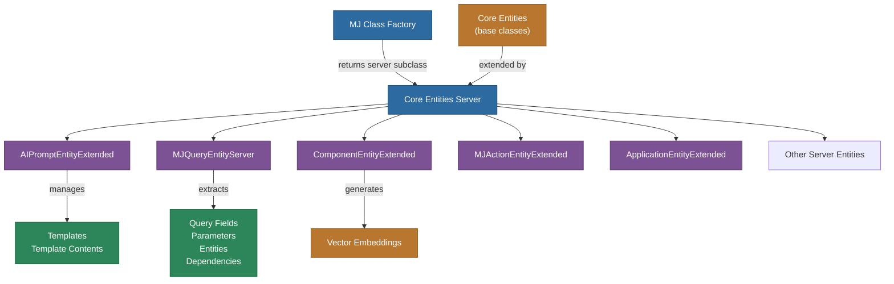

# @memberjunction/core-entities-server

Server-side entity subclasses for MemberJunction that provide extended functionality and business logic for core entities when running in a Node.js environment.

## Overview

This package contains server-side implementations of MemberJunction entity subclasses that require server-specific functionality such as direct database access, file system operations, server-side API integrations, complex business logic, and automatic creation/management of related entities.



### Key Differences from Core Entities

- **Core Entities**: Work everywhere, basic CRUD operations, suitable for client-side usage
- **Core Entities Server**: Server-only, extended functionality, can directly interact with system resources

## Installation

```bash
npm install @memberjunction/core-entities-server
```

## Usage

### Basic Setup

Each server-side subclass registers itself with `@RegisterClass` when the package is imported, so there is no setup function to call:

```typescript
import '@memberjunction/core-entities-server';
```

**Important**: The package must be loaded before any entities are instantiated. An MJAPI server built on `@memberjunction/server-bootstrap` loads it through the bootstrap's class-registration manifest, which also keeps a bundler from removing the classes as unused. Other server applications import the package at startup.

### Example: AI Prompt Entity

The package includes an extended AI Prompt entity that automatically manages Template and Template Contents records:

```typescript
import { Metadata } from '@memberjunction/core';

// The metadata system will automatically use the server-side subclass
const md = new Metadata();
const aiPrompt = await md.GetEntityObject<AIPromptEntity>('AI Prompts');

// Setting TemplateText will automatically create/update Template records
aiPrompt.TemplateText = `You are a helpful assistant...`;

// Save will handle all the Template management automatically
await aiPrompt.Save();
```

## Available Server-Side Entities

### AIPromptEntityExtendedServer

Extends the base AI Prompt entity with automatic Template management:

- **Virtual Property**: `TemplateText` - A convenient way to get/set the prompt template content
- **Automatic Template Creation**: Creates Template and Template Contents records when saving
- **Automatic Template Updates**: Updates existing templates when content changes
- **Proper Relationship Management**: Maintains proper foreign key relationships

### ComponentEntityExtended_Server (v2.90.0+)

Extends the Component entity with automatic vector embedding generation:

- **Automatic Embeddings**: Generates vector embeddings for FunctionalRequirements and TechnicalDesign fields
- **Model Tracking**: Stores the AI model ID used for each embedding
- **Binary Companions**: Also writes `FunctionalRequirementsVectorBinary` / `TechnicalDesignVectorBinary` (float32 bytes), which readers decode much faster than the JSON vectors
- **Smart Updates**: Only regenerates embeddings when source text changes
- **Parallel Processing**: Generates multiple embeddings concurrently for performance

### MJQueryEntityServer

The server-side `MJ: Queries` entity. It extends `MJQueryEntityExtended` from `@memberjunction/core-entities`:

- **Query Extraction**: Saving a new query, or a query whose SQL changed, works out the query's output fields, parameters, the entities it reads and its dependencies, and writes them as child rows. See [Query Extraction](#query-extraction).
- **Save-Time Rules**: A query whose template breaks a rule, or whose output repeats a column name, is refused with the reasons in the save's result.
- **Declared Child Rows**: A query and the `Parameters`, `Fields` and `Entities` rows it declares save together as one graph.
- **Embeddings**: Computes a vector from the query's name, user question and description, unless `SkipEmbeddings` is set.
- **Dialect Conversion**: Keeps the query's SQL variants for other database platforms in step with its SQL.
- **On-Demand Refresh**: `QueryExtractionService` re-runs extraction for saved queries without changing their SQL. See [Query Refresh](#query-refresh).

### MJAIAgentNoteEntityServer (v5.30.x+)

Extends the agent note entity to keep the in-process vector store in sync with persisted state:

- **Vector Store Invariant**: Overrides `Save()` and `Delete()` so that `AIEngine.Instance._noteVectorService` contains an entry for a note iff its persisted `Status='Active'` and it has a stored vector (`EmbeddingVectorBinary` or `EmbeddingVector`)
- **Inline Maintenance**: When a note's Status flips between `Active` and any other value, or when a note is deleted, the corresponding vector store entry is added/removed in the same operation — eliminating the need for an MJAPI restart after note revocation (e.g., during MemoryManagerAgent consolidation or contradiction resolution)
- **Consolidation Field Persistence**: New `AIAgentNote` columns introduced by `V202604260056__v5.30.x__Memory_Consolidation_Schema.sql` (`ConsolidatedIntoNoteID`, `ConsolidationCount`, `DerivedFromNoteIDs`, `ProtectionTier`, `ImportanceScore`) persist via the standard generated setters — no custom logic needed in this override

See [`@memberjunction/aiengine` README](../AI/Engine/README.md#vector-store-invariant-preservation) for the read-side and the consuming code in [`@memberjunction/ai-agents`](../AI/Agents/README.md#consolidation-pipeline).

### MJAIAgentExampleEntityServer

Companion to `MJAIAgentNoteEntityServer` — maintains the parallel invariant for the agent example vector store on `Save`/`Delete`.

### MJRemoteOperationEntityServer (v5.43.x+)

The **AI-from-Description** half of the [Remote Operations](../../guides/REMOTE_OPERATIONS_GUIDE.md) primitive (RO-4). For a `MJ: Remote Operations` row with `GenerationType='AI'`, the `Save` hook calls the `Generate Remote Operation Code` prompt to author the body of the operation's `InternalExecute` — against the ambient `input` / `provider` / `user` / `context` contract — stores it in `Code`, records the libraries it used in the JSONType `LibrariesObject`, and resets `CodeApprovalStatus='Pending'` for human review (skipped when `CodeLocked`). CodeGen then emits a complete registered class from the approved code. Mirrors `MJActionEntityServer`; transactional; no junction CRUD (the library list is a JSONType field).

## Architecture

### Entity Registration

The package uses MemberJunction's entity subclassing system:

1. At startup, the package is imported (directly, or through the server bootstrap's class-registration manifest)
2. Each subclass's `@RegisterClass` decorator registers it with the metadata system
3. When code requests an entity (e.g., "AI Prompts"), the metadata system returns the server-side subclass
4. The server-side subclass extends the base entity with additional functionality

### Virtual Properties

Server-side entities can expose virtual properties that don't exist in the database but provide convenient access to complex data:

```typescript
export class AIPromptEntityExtendedServer extends AIPromptEntity {
    private _TemplateText?: string;

    get TemplateText(): string | undefined {
        return this._TemplateText;
    }

    set TemplateText(value: string | undefined) {
        this._TemplateText = value;
    }
}
```

## Development Guidelines

### Creating New Server-Side Entities

1. Create a new file in `src/custom/`
2. Import and extend the base entity class
3. Add server-specific functionality
4. Register the subclass in the loader

Example:

```typescript
import { BaseEntity, RegisterClass } from '@memberjunction/core';
import { UserEntity } from '@memberjunction/core-entities';

@RegisterClass(BaseEntity, 'Users')
export class UserEntityExtendedServer extends UserEntity {
    async BeforeSave(): Promise<boolean> {
        // Server-side validation or processing
        if (this.Email) {
            // Verify email domain against company whitelist
            const validDomain = await this.checkEmailDomain(this.Email);
            if (!validDomain) {
                throw new Error('Invalid email domain');
            }
        }
        return super.BeforeSave();
    }

    private async checkEmailDomain(email: string): Promise<boolean> {
        // Server-side logic to validate email domain
        return true;
    }
}
```

### Best Practices

1. **Keep It Server-Side**: Only include code that must run on the server
2. **Extend, Don't Replace**: Always extend the base entity class, don't replace core functionality
3. **Handle Errors Gracefully**: Server-side operations can fail - handle errors appropriately
4. **Document Virtual Properties**: Clearly document any virtual properties and their behavior
5. **Test Thoroughly**: Server-side logic can be complex - ensure comprehensive testing

## Integration with Other MJ Packages

This package works seamlessly with:

- `@memberjunction/core`: Provides the base entity system
- `@memberjunction/core-entities`: Provides the base entity classes
- `@memberjunction/server`: Can be used in MJ server applications
- `@memberjunction/cli`: Used by CLI tools like MetadataSync

## Vector Embeddings Support (v2.90.0+)

This package provides a utility helper for server-side entities to easily implement vector embedding generation using the MemberJunction AI Engine.

### EmbedTextLocalHelper

A shared utility function that simplifies embedding generation for any server-side entity:

```typescript
import { EmbedTextLocalHelper } from '@memberjunction/core-entities-server';
import { BaseEntity, SimpleEmbeddingResult } from '@memberjunction/core';

@RegisterClass(BaseEntity, 'MyEntity')
export class MyEntityServer extends MyEntity {
    protected async EmbedTextLocal(textToEmbed: string): Promise<SimpleEmbeddingResult> {
        return EmbedTextLocalHelper(this, textToEmbed);
    }
}
```

The helper:
- Configures the AI Engine with the current user context
- Calls the embedding generation
- Validates the response
- Returns a properly typed `SimpleEmbeddingResult`

### Using Vector Embeddings in Your Entity

1. **Add database fields** for storing vectors and model IDs — a JSON vector column plus a `VARBINARY(MAX)` binary companion (see the [Binary Fields Guide](../../guides/BINARY_FIELDS_GUIDE.md))
2. **Override EmbedTextLocal** using the helper function
3. **Call GenerateEmbeddings** in your Save method:

```typescript
public async Save(): Promise<boolean> {
    await this.GenerateEmbeddingsByFieldName([
        {
            fieldName: "Content",
            vectorFieldName: "ContentVector",
            modelFieldName: "ContentVectorModelID",
            binaryVectorFieldName: "ContentVectorBinary"   // optional; set and cleared with the JSON field
        }
    ]);
    return await super.Save();
}
```

The note, example, component, query and tag entity servers all write both the JSON and the binary vector column. Readers should load with `ReadStoredVector(binary, json)` from `@memberjunction/ai-vectors-memory`, which prefers the binary column and falls back to JSON.

## Common Use Cases

### 1. Automatic Related Entity Management
```typescript
// AI Prompts automatically manage their Template records
const prompt = await md.GetEntityObject<AIPromptEntity>('AI Prompts');
prompt.TemplateText = "New prompt content";
await prompt.Save(); // Template and Template Contents created/updated automatically
```

### 2. Vector Embedding Generation
```typescript
// Components automatically generate embeddings for text fields
const component = await md.GetEntityObject<ComponentEntity>('MJ: Components');
component.FunctionalRequirements = "The system shall...";
component.TechnicalDesign = "Architecture overview...";
await component.Save(); // Embeddings generated automatically
```

### 3. Server-Side Validation
```typescript
@RegisterClass(BaseEntity, 'Documents')
export class DocumentEntityServer extends DocumentEntity {
    async BeforeSave(): Promise<boolean> {
        // Scan document for viruses using server-side scanner
        if (this.Content) {
            const isSafe = await virusScanner.scan(this.Content);
            if (!isSafe) {
                throw new Error('Document failed security scan');
            }
        }
        return super.BeforeSave();
    }
}
```

### 3. Complex Business Logic
```typescript
@RegisterClass(BaseEntity, 'Orders')
export class OrderEntityServer extends OrderEntity {
    async AfterSave(): Promise<boolean> {
        // Send order to fulfillment system
        await fulfillmentAPI.submitOrder(this);
        
        // Update inventory
        await inventorySystem.decrementStock(this.OrderItems);
        
        return super.AfterSave();
    }
}
```

## Query Extraction

When a query is saved and it is new, or its SQL changed, `MJQueryEntityServer` works out what the query reads and returns, and writes it to the query's child entities. Nothing has to be filled in by hand for a query to be usable.

### What a Save Does

1. **Reads the template.** MJ's own template parser reads the SQL: its parameters (with composition pass-throughs), the queries it composes (`{{query:"Category/Name(...)"}}`), and the tables and views it reads. Whether the query uses a template at all (`UsesTemplate`) comes from the lexer, so a tag inside a comment does not count.
2. **Asks the database server.** The query is rendered with sample parameter values (a caller can supply tested values in `ParameterHints`, keyed by parameter name), once for the base render and once for each `` branch, and the database server is asked to describe each render without running it. The server reports each output column's exact type, nullability, and the table column it comes from, when there is one.
3. **Applies the save-time rules.** A rule error in the template, or an output that repeats a column name, refuses the save. Nothing is written, and the reasons are in the save's result (`LatestResult`).
4. **Writes the child rows** once the query row is saved:

| Child entity | What is written |
|---|---|
| `MJ: Query Fields` | Each output column: name, order, SQL type, nullability, whether it is computed, and its source (`SourceEntityFieldID` when the column maps to an entity field, otherwise `SourceObjectName`, the object the server reported) |
| `MJ: Query Parameters` | Each template parameter: name, inferred type, whether it is required, its default |
| `MJ: Query Entities` | Each entity whose base view, base table or alternate base view the query reads |
| `MJ: Query Dependencies` | Each query it composes, with the alias and parameter mapping |

5. **Records the run** on the query row (see [Extraction Status](#extraction-status)).
6. **Fills empty descriptions** with an LLM, after the save's transaction commits. Facts never come from the LLM. Pass `SkipEntityAIActions: true` in the save options to skip this step.

### Facts and Annotations

Extraction separates what the SQL determines from what a person wrote:

- **Facts** are corrected on every run: names, order, types, nullability, sources and the computed flag. A fact a person edited is set back to what the SQL and the server say.
- **Annotations** are kept: descriptions, and for a parameter a person wrote (`DetectionMethod` `Manual`), its type, required flag, default, sample value and validation filters. Doc comments in the SQL (`{# @param ... #}`, `{# @field ... #}`, and a trailing `--:` comment on a select-list line) count as authored.
- **A parameter a person wrote that the SQL no longer uses** is kept, and flagged in `ExtractionMessage`.
- **A row extraction added that the SQL no longer produces** is removed.

### DetectionMethod Values

Each child row records who wrote it:

| Value | Used on | Meaning |
|---|---|---|
| `Database` | Query Fields | The facts came from the database server describing the query's output |
| `Parser` | Query Fields, Parameters, Entities | The facts came from MJ's analysis of the template and SQL structure |
| `Manual` | Query Fields, Parameters, Entities, Dependencies | A person wrote the row. A `Manual` parameter's annotations are never overwritten, and it is kept when the SQL stops using it |
| `AI` | Query Fields, Parameters, Entities | On a field, an LLM wrote its description (an LLM never sets types or sources). On a parameter or entity link, the row was written by the earlier LLM-based extraction |
| `Auto` | Query Dependencies | The dependency was found in the SQL |

### Extraction Status

Each run is recorded on the `MJ: Queries` row:

| Column | Meaning |
|---|---|
| `ExtractionStatus` | `OK`: every fact was extracted. `Warning`: extraction succeeded with findings. `Error`: the database server could not describe the query, so the stored child rows were kept. `Skipped`: the facts could not be checked, for example for a query on an external data source. `NULL`: never extracted. |
| `ExtractionMessage` | The run's findings, one per line: flagged parameters, rule warnings, the server's error |
| `ExtractedSQLHash` | A hash of the SQL and dialect the child rows were extracted from. A value that differs from the current SQL's hash means the rows may be stale |

### Controlling Extraction per Save

`MJQueryEntityServer.ExtractionOverride` sets what the next save does. It goes back to `Auto` after every save.

| Value | Behaviour |
|---|---|
| `Auto` (default) | Extract when the query is new or its SQL changed |
| `Skip` | Do not extract, even when the SQL changed. The save-time rules are not applied, and the child rows, the extraction columns and `UsesTemplate` stay as they are. For bulk loaders and fixtures that write those rows themselves |
| `Force` | Extract even when the SQL did not change. On a query whose SQL did not change, rule errors are recorded instead of refusing the save; a save that changes the SQL is still held to the save-time rules |

```typescript
import { Metadata, UserInfo } from '@memberjunction/core';
import { MJQueryEntityServer } from '@memberjunction/core-entities-server';

async function saveQuery(contextUser: UserInfo, queryID: string, sql: string): Promise<boolean> {
  const md = new Metadata();
  const query = await md.GetEntityObject<MJQueryEntityServer>('MJ: Queries', contextUser);
  if (!(await query.Load(queryID))) return false;

  query.SQL = sql;
  query.ExtractionOverride = 'Auto'; // the default; 'Skip' or 'Force' change this one save
  const saved = await query.Save({ SkipEntityAIActions: true }); // no LLM description pass
  if (!saved) {
    console.error(query.LatestResult?.CompleteMessage); // the save-time rule findings
  }
  return saved;
}
```

### Other Behaviour

- **Declared child rows win by name.** A save can declare child rows through the query's `Parameters`, `Fields` and `Entities` collections, and the query and those rows save as one graph. Extraction does not add a second row with a declared row's name or delete a declared row. A declared field still gets its facts from the describe, so only its annotations are the caller's.
- **Written as the system user.** The child rows a save derives mirror SQL the caller was allowed to change, so they are written as the system user, inside the caller's transaction when there is one. A failed child-row write is recorded on the query as an `Error` rather than failing a save whose row is already written.
- **Tables named by a parameter.** A query that reads a table or view named by a template parameter is not described, because its columns depend on the arguments. Its declared fields are kept, and `ExtractionMessage` says why.
- **Network providers.** A query saved through a network (client) provider leaves extraction to the server it saves to.

### Legacy Pipeline

`RunExtractionPipeline` in `src/custom/query-extraction/pipeline.ts`, the earlier LLM-assisted extraction, is deprecated. It is not used by saves and is not exported from the package root. Saves use `ComputeQueryExtraction` with `WriteExtractedChildRows`. The pipeline is kept until 7.0 for code that imports it directly.

## Query Refresh

`QueryExtractionService` re-runs extraction for saved queries on demand, without changing their SQL. It is the same extraction a save runs, under the refresh rules: a rule error is recorded on the query, never a refusal. Use it after a schema change, after an upgrade, or when a query's child rows look stale.

- **`RefreshQuery(queryID, options)`** refreshes one query and returns a `QueryRefreshReport`.
- **`RefreshQueries(filter, options)`** refreshes a selection and returns a `QueryRefreshRunReport`. The `QueryRefreshFilter` selectors combine as a union: `QueryIDs`, `QueryNames` (a bare name or a full path such as `Category/Sub/Name`), `CategoryPath` (that category and every category below it), `EntityNames` or `EntityIDs` (the queries that read those entities), or `All`. A filter with no selector refreshes nothing.
- **`QueryRefreshOptions`**: `DryRun` works out and reports the changes without writing anything; `WithAI` queues the LLM description pass for rows still without a description (off by default); `OnProgress` is called after each query in a bulk run.

Each query is refreshed in its own transaction on the caller's provider, so a failure rolls back that query only. A bulk run refreshes the queries a composition depends on before the queries that compose them; queries that compose each other in a cycle are refreshed once, after the rest, and listed in `Cycles`.

Each query's report gives:

- `Outcome`: `Refreshed` (rows changed, or would change in a dry run), `Unchanged`, `NotPermitted` (a bulk run skipped it), `Unavailable` (does not exist, or the caller may not refresh it), or `Failed` (nothing was written)
- `Added`, `Updated` and `Removed`: the child rows changed, with the changed columns for an update
- `Flagged`: authored parameters the SQL no longer uses
- `ExtractionStatus`, `QueryColumns` (the query-row columns that change) and `Diagnostics`

```typescript
import { IMetadataProvider, UserInfo } from '@memberjunction/core';
import {
  FormatQueryRefreshRun,
  IsQueryRefreshProvider,
  QueryExtractionService,
  QueryRefreshFilter,
} from '@memberjunction/core-entities-server';

async function refreshSalesQueries(provider: IMetadataProvider, contextUser: UserInfo): Promise<void> {
  if (!IsQueryRefreshProvider(provider)) {
    throw new Error('A query refresh needs a provider that can run views');
  }
  const service = new QueryExtractionService({ Provider: provider, User: contextUser });
  const filter: QueryRefreshFilter = { CategoryPath: 'Reports/Sales' };

  // Review first: a dry run reports what would change and writes nothing
  const preview = await service.RefreshQueries(filter, {
    DryRun: true,
    OnProgress: p => console.log(`${p.Processed}/${p.Total} ${p.Report.Outcome}: ${p.Report.QueryName}`),
  });
  for (const line of FormatQueryRefreshRun(preview, true)) console.log(line);

  // Then apply
  const run = await service.RefreshQueries(filter);
  for (const report of run.Reports) {
    if (report.Outcome === 'Failed') console.error(report.QueryName, report.Diagnostics);
  }
}
```

### Entry Points

Every entry point goes through `QueryExtractionService`, so the same authorization applies to all of them:

- **`Query.RefreshExtraction` remote operation** (`QueryRefreshExtractionServerOperation`): a long-running operation that reports each query as a progress event. An API key needs the `query:refresh` scope.
- **CLI**: `mj query refresh [--id|--name|--category|--entity|--all] [--dry-run] [--with-ai]`. After an upgrade, run `mj query refresh --all --dry-run` to review, then `mj query refresh --all`.
- **CodeGen**: `RebindQueriesForChangedEntities` refreshes the queries that read an entity whose fields were added, dropped, or changed in type or nullability, with no description pass. The SQL is never edited: a query the change broke is recorded as an `Error` with the server's message. A query authorized by its role list (`MJ: Query Permissions`) that gains a column from a field with field permissions is recorded as a `Warning`.

### Refresh Authorization

- The caller needs Update on `MJ: Queries` and Create, Update and Delete on `MJ: Query Fields`, `MJ: Query Parameters`, `MJ: Query Entities` and `MJ: Query Dependencies`. A dry run needs the same, since its report shows the same metadata. Run permissions on the query play no part: refreshing is an authoring act.
- The caller must be able to read every entity the query reads, with no field denied on any of them, because the report and the written rows expose those entities' columns.
- A refused single query reads exactly like one that does not exist (`Unavailable`). A bulk run reports a refused query as `NotPermitted`, with no reason.
- A refresh writes the child rows as the caller, not as the system user, so each write's own permission check also applies.

`UserCanRefreshQueries(user, entities)` and `UserCanSeeQuerySources(user, entityIDs, entities)` expose these checks for callers that want to test them up front.

## SQL Parser

This package does not contain a SQL parser. SQL and template parsing live in [`@memberjunction/sql-parser`](../SQLParser/README.md), which query extraction uses. New code reads SQL with `SqlDocument.Parse(sql, dialect)` (table references, column references, output items, CTEs) and templates with `QueryTemplate.Parse(sql, dialect)` (parameters, compositions, `` branches).

The legacy `SQLParser` class in `@memberjunction/sql-parser` is deprecated but kept. Its `Parse` and extraction methods now run on the new parser, which changes some results from earlier releases:

- A CTE name is not reported as a table, and neither are table-valued functions or derived tables.
- Names inside comments and string literals are never read as tables or columns.
- A template is read branch by branch, and the result is the union of every branch's references; a `{{query:"..."}}` composition is not a table.
- An unqualified table gets the dialect's default schema (`dbo` on SQL Server, `public` on PostgreSQL). The dialect defaults to SQL Server when none is given.
- `ParseWithTemplatePreprocessing` is the same as `Parse`. `UsedASTParsing` is true when every reading of the SQL parsed completely, and `Columns` is empty when it could not be read completely.

## Troubleshooting

### Entity subclass not being used
Ensure the package is imported before any entity is instantiated. In a bundled server, check that it is in the class-registration manifest (`mj codegen manifest`), so the bundler does not drop the classes.

### Module loading errors
This package is a native ES module (`"type": "module"`). Import it from ES module code (`import`), not with `require()`.

### Virtual properties not persisting
Virtual properties are not saved to the database. Use them as convenient accessors that manage real database fields behind the scenes.

## Future Enhancements

- Additional server-side entity implementations
- Integration with file storage providers
- Advanced caching mechanisms
- Batch processing utilities
- Background job integration

## Contributing

When contributing new server-side entities:

1. Follow the existing patterns
2. Document all virtual properties
3. Include comprehensive tests
4. Ensure no client-side dependencies
5. Update this README with new entities

## License

This package is part of the MemberJunction project.