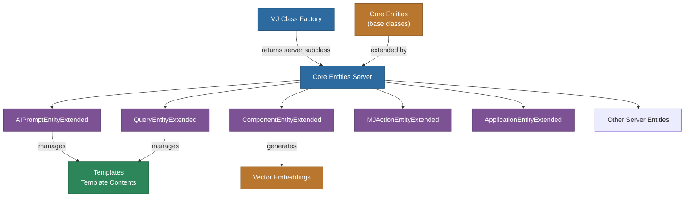

# @memberjunction/core-entities-server

Server-side entity subclasses for MemberJunction that provide extended functionality and business logic for core entities when running in a Node.js environment.

## Overview

This package contains server-side implementations of MemberJunction entity subclasses that require server-specific functionality such as direct database access, file system operations, server-side API integrations, complex business logic, and automatic creation/management of related entities.



### Key Differences from Core Entities

- **Core Entities**: Work everywhere, basic CRUD operations, suitable for client-side usage
- **Core Entities Server**: Server-only, extended functionality, can directly interact with system resources

## Installation

```bash
npm install @memberjunction/core-entities-server
```

## Usage

### Basic Setup

```typescript
import { LoadCoreEntitiesServerSubClasses } from '@memberjunction/core-entities-server';

// Load all server-side entity subclasses at application startup
LoadCoreEntitiesServerSubClasses();
```

**Important**: Call `LoadCoreEntitiesServerSubClasses()` early in your application initialization to ensure the server-side subclasses are registered with the MemberJunction metadata system before any entities are instantiated.

### Example: AI Prompt Entity

The package includes an extended AI Prompt entity that automatically manages Template and Template Contents records:

```typescript
import { Metadata } from '@memberjunction/core';

// The metadata system will automatically use the server-side subclass
const md = new Metadata();
const aiPrompt = await md.GetEntityObject<AIPromptEntity>('AI Prompts');

// Setting TemplateText will automatically create/update Template records
aiPrompt.TemplateText = `You are a helpful assistant...`;

// Save will handle all the Template management automatically
await aiPrompt.Save();
```

## Available Server-Side Entities

### AIPromptEntityExtendedServer

Extends the base AI Prompt entity with automatic Template management:

- **Virtual Property**: `TemplateText` - A convenient way to get/set the prompt template content
- **Automatic Template Creation**: Creates Template and Template Contents records when saving
- **Automatic Template Updates**: Updates existing templates when content changes
- **Proper Relationship Management**: Maintains proper foreign key relationships

### ComponentEntityExtended_Server (v2.90.0+)

Extends the Component entity with automatic vector embedding generation:

- **Automatic Embeddings**: Generates vector embeddings for FunctionalRequirements and TechnicalDesign fields
- **Model Tracking**: Stores the AI model ID used for each embedding
- **Binary Companions**: Also writes `FunctionalRequirementsVectorBinary` / `TechnicalDesignVectorBinary` (float32 bytes), which readers decode much faster than the JSON vectors
- **Smart Updates**: Only regenerates embeddings when source text changes
- **Parallel Processing**: Generates multiple embeddings concurrently for performance

### QueryEntityExtendedServer

Extends the Query entity with automatic Template management similar to AIPromptEntity:

- **Virtual Property**: `TemplateText` - Manages the SQL query template content
- **Automatic Template Management**: Creates and updates Template records when saving
- **Dynamic SQL Support**: Supports parameterized queries with Nunjucks templates

### Save-time AI: the host switches and the per-instance opt-out

Several server entities call a model while they save. `SaveTimeAISettings` (a process-wide
`BaseSingleton` in `@memberjunction/ai`, the lowest package every reader depends on) holds one switch per kind of call — every save-time model
call of a server entity class except Duplicate Runs (by design, see below); every switch is on
unless the host sets it to `false`, and only an explicit `false` turns one off:

| Switch (`SaveTimeAIConfig`) | Entities whose save calls the model | When `false` |
|---|---|---|
| `QueryParameters` | `MJ: Queries`, `MJ: Query SQLs` | no enrichment prompt; parameters, fields, entities and dependencies are still extracted deterministically, with heuristic descriptions |
| `TemplateParameters` | `MJ: Template Contents` | no enrichment prompt; parameters are still extracted deterministically |
| `ViewSmartFilters` | `MJ: User Views` | no Smart Filter generation; the view keeps its current WhereClause |
| `CodeGeneration` | `MJ: Actions` (Type `Generated`), `MJ: Remote Operations` (GenerationType `AI`) | no code generation; the record saves with its current code |
| `Embeddings` | `MJ: Queries`, `MJ: Tags`, `MJ: AI Agent Notes`, `MJ: AI Agent Examples`, `MJ: Components` | nothing is embedded or cleared; stored vectors are left exactly as they are, even when the source text is now empty |

The first four run an AI prompt (a live model, credentials, an AI Prompt Run row) —
`SaveTimeAISettings.PromptKinds`. `Embeddings` runs the local, in-process embedding model. Not in
the family:

- **`MJ: Duplicate Runs` (by design).** Saving a new run starts duplicate detection, which vectorizes
  the source records through the Entity Document's embedding model. Creating the run *is* the request
  to detect, so a switch would turn the entity into a no-op.
- `MJ: AI Agent Requests`: a responded request resumes the agent — the run is the feature, not work
  done for the save.
- Entity Actions and Entity AI Actions that metadata attaches to an entity (including the
  `Run Record Process` action a Record Process's on-change trigger owns). The provider fires them on
  save; attaching them is the request, and Entity AI Actions have a per-save opt-out
  (`EntitySaveOptions.SkipEntityAIActions`, which also skips the `QueryParameters` and
  `TemplateParameters` enrichment of that save — and none of the other switches' work).
- `MJ: Vector Indexes` (vector-database index creation, not a model call) and `MJ: AI Prompt Runs`
  (cost arithmetic).

**Deferred embeddings (`SkipEmbeddings`).** `mj sync push` saves every record with
`BaseEntity.SkipEmbeddings = true` so a short-lived CLI never loads the embedding model. A Query, Tag,
AI Agent Note, AI Agent Example or Component saved that way with changed text gets its now-stale vector
cleared instead of recomputed, and the engine that serves the vectors embeds it later, with no manual step:

| Records | Engine | When it embeds and persists the missing vectors |
|---|---|---|
| Queries | `QueryEngineServer.EmbedMissingQueries` | started when the engine loads (on first use), and after every `MJ: Queries` change |
| Tags | `TagEngine` (load) / `EmbedMissingTags` | on load — awaited (`RunUntilDone`): the load finishes only when every tag without a current-model vector has been embedded and indexed, because new-tag de-duplication needs them (a tag whose save fails is indexed anyway, and its save is retried by the next run) — and after every `MJ: Tags` change |
| AI Agent Notes, AI Agent Examples | `AIEngine.EmbedMissingNoteAndExampleVectors` | started once its note/example embeddings load (server startup — AIEngine is a deferred startup engine — or the first similarity search), and after every change to either entity from then on — never in a process that has not loaded them, so the pushing CLI still loads no model |
| Components | `ComponentMetadataEngineServer.EmbedMissingComponentVectors` | started at server startup (`HandleStartup`: the engine is a deferred `@RegisterForStartup` engine, full startup mode only), reading only the components that lack a vector — not the bulk list `Config` loads — and after every component save in that process that leaves a vector missing |

All of them run on `EmbeddingBackfill` (`@memberjunction/aiengine`), the one implementation of the loop and of
"embed, write the vector columns, save, put them back on failure":

- **Started, not awaited** — except TagEngine's load. A load or startup starts the backfill and returns; a similarity
  search waits for its engine to load, never for the backfill. TagEngine's load uses the awaited mode
  (`RunUntilDone`: the same bounded passes, back to back) so tag de-duplication always sees every tag's vector; the
  load is therefore slower, once, in proportion to the tags without a vector.
- **One pass at a time.** A trigger during a pass schedules exactly one more pass after it (never dropped).
- **Bounded per pass.** A pass embeds and saves at most `embeddingBackfill.BatchSize` records (default 100); the
  rest continue in later passes, `embeddingBackfill.PassDelaySeconds` apart (default 10), on their own.
- **Failures never starve the rest.** A record whose embedding or save fails is skipped for the rest of that run, so
  records that keep failing cannot fill every batch; neither can rows a database read returns with nothing to embed
  (whitespace-only text passes `<> ''` on PostgreSQL). Each failure is logged, and the run ends with one error line
  counting them; the next load or change retries them.
- **Stops when embedding is unavailable.** No local embedding model (`EmbeddingUnavailableError`), or a batch
  embedder that throws or returns a result list not matching the texts: the run stops with one error line instead of walking the backlog; the
  records wait for the next load or change. A text the model rejects is only that record's failure; the pass goes on.
- **Persisted through the entity.** Each vector is saved with the record (so `MJ: Record Changes` records it); a
  failed embedding or save puts the record's vector columns back as they were, and the next run retries it. The
  engine's in-memory index (tags, queries) takes a computed vector whether or not its save succeeds, and keeps it
  across an index rebuild from the persisted vectors (`EmbeddingBackfill.ReplayUnsavedVectors`) until the record
  is saved, edited or deleted.

Every one of these engines computes nothing while `saveTimeAI.Embeddings` is false (they only load stored
vectors then); `TagEngine` also skips embedding the tags it creates or renames. An explicit
`TagEngine.RebuildTagEmbeddings` (an admin action) and similarity searches are not save-time work and still run.

Other vector columns are not written by a save, so push skips nothing there: `MJ: Entity Record Documents`
`VectorJSON` and the Content Items/Chunks vectors are produced by the vectorization pipelines, and
`MJ: AI Result Cache` `PromptEmbedding` is not written by any code path.

MJServer installs the switches from the `saveTimeAI` section of `mj.config.cjs`, and the backfill bounds from the
`embeddingBackfill` section, at startup — before any startup engine runs:

```javascript
module.exports = {
  // ...
  saveTimeAI: {
    // a host that must make no live model call (e.g. a deterministic integration-test MJAPI)
    QueryParameters: false,
    TemplateParameters: false,
    ViewSmartFilters: false,
    CodeGeneration: false,
    // Embeddings: false,   // also stop local embedding on save, and every backfill
  },
  embeddingBackfill: {
    BatchSize: 100,         // records one backfill pass embeds and saves (default 100)
    PassDelaySeconds: 10,   // wait before the next pass when records are left over (default 10)
  },
};
```

Code that holds the entity can opt one instance out instead: `MJQueryEntityServer`,
`MJQuerySQLEntityServer` and `MJTemplateContentEntityServer` implement `ISaveEnrichmentOptOut` —
set `SkipAIEnrichment = true` before `Save()` and that instance's parameter enrichment is skipped on
every later save too (it is sticky). A caller that does not hold the server subclass can skip one
save instead: `EntitySaveOptions.SkipEntityAIActions = true` skips the parameter enrichment of that
save on all three entities (it crosses GraphQL, unlike the instance flag). On a query,
`RerunExtraction(skipAIEnrichment)` overrides the instance flag for one run. One rule resolves all of
them — `SaveEnrichmentOptOut.ShouldSkip`: the save option, else the run override, else the instance
flag; the host switch applies either way.

**Re-extraction keeps declared sample values.** When a query's SQL changes, extraction updates each
existing parameter's Type, IsRequired, DefaultValue and Description from the SQL, but a parameter
whose `DetectionMethod` is `'Manual'` and whose `SampleValue` is not empty keeps that SampleValue (a
value declared by a user or by metadata is not overwritten by a heuristic or AI sample), unless the
parameter's Type changed. Re-extraction no longer flips `DetectionMethod` to `'AI'`. Because the
column defaults to `'Manual'`, a row created without an explicit DetectionMethod counts as Manual;
set its `DetectionMethod` to `'AI'` to let the next extraction refresh its SampleValue again.

**Identifier samples.** A string parameter whose name reads as a key — `ID`, a name ending in
`ID`/`Id` after a lowercase letter or digit (`ActivityID`, `userId`), `_id`, or a GUID/UUID name —
gets the empty GUID `00000000-0000-0000-0000-000000000000` as its heuristic sample, so a test run of
the query is valid SQL and returns no rows (`QueryParameterEnricher.IsIdentifierParameterName`).

### MJAIAgentNoteEntityServer (v5.30.x+)

Extends the agent note entity to keep the in-process vector store in sync with persisted state:

- **Vector Store Invariant**: Overrides `Save()` and `Delete()` so that `AIEngine.Instance._noteVectorService` contains an entry for a note iff its persisted `Status='Active'` and it has a stored vector (`EmbeddingVectorBinary` or `EmbeddingVector`)
- **Inline Maintenance**: When a note's Status flips between `Active` and any other value, or when a note is deleted, the corresponding vector store entry is added/removed in the same operation — eliminating the need for an MJAPI restart after note revocation (e.g., during MemoryManagerAgent consolidation or contradiction resolution)
- **Consolidation Field Persistence**: New `AIAgentNote` columns introduced by `V202604260056__v5.30.x__Memory_Consolidation_Schema.sql` (`ConsolidatedIntoNoteID`, `ConsolidationCount`, `DerivedFromNoteIDs`, `ProtectionTier`, `ImportanceScore`) persist via the standard generated setters — no custom logic needed in this override

See [`@memberjunction/aiengine` README](../AI/Engine/README.md#vector-store-invariant-preservation) for the read-side and the consuming code in [`@memberjunction/ai-agents`](../AI/Agents/README.md#consolidation-pipeline).

### MJAIAgentExampleEntityServer

Companion to `MJAIAgentNoteEntityServer` — maintains the parallel invariant for the agent example vector store on `Save`/`Delete`.

### MJRemoteOperationEntityServer (v5.43.x+)

The **AI-from-Description** half of the [Remote Operations](../../guides/REMOTE_OPERATIONS_GUIDE.md) primitive (RO-4). For a `MJ: Remote Operations` row with `GenerationType='AI'`, the `Save` hook calls the `Generate Remote Operation Code` prompt to author the body of the operation's `InternalExecute` — against the ambient `input` / `provider` / `user` / `context` contract — stores it in `Code`, records the libraries it used in the JSONType `LibrariesObject`, and resets `CodeApprovalStatus='Pending'` for human review (skipped when `CodeLocked`). CodeGen then emits a complete registered class from the approved code. Mirrors `MJActionEntityServer`; transactional; no junction CRUD (the library list is a JSONType field).

## Architecture

### Entity Registration

The package uses MemberJunction's entity subclassing system:

1. At startup, `LoadCoreEntitiesServerSubClasses()` is called
2. This registers all server-side entity subclasses with the metadata system
3. When code requests an entity (e.g., "AI Prompts"), the metadata system returns the server-side subclass
4. The server-side subclass extends the base entity with additional functionality

### Virtual Properties

Server-side entities can expose virtual properties that don't exist in the database but provide convenient access to complex data:

```typescript
export class AIPromptEntityExtendedServer extends AIPromptEntity {
    private _TemplateText?: string;

    get TemplateText(): string | undefined {
        return this._TemplateText;
    }

    set TemplateText(value: string | undefined) {
        this._TemplateText = value;
    }
}
```

## Development Guidelines

### Creating New Server-Side Entities

1. Create a new file in `src/custom/`
2. Import and extend the base entity class
3. Add server-specific functionality
4. Register the subclass in the loader

Example:

```typescript
import { BaseEntity, RegisterClass } from '@memberjunction/core';
import { UserEntity } from '@memberjunction/core-entities';

@RegisterClass(BaseEntity, 'Users')
export class UserEntityExtendedServer extends UserEntity {
    async BeforeSave(): Promise<boolean> {
        // Server-side validation or processing
        if (this.Email) {
            // Verify email domain against company whitelist
            const validDomain = await this.checkEmailDomain(this.Email);
            if (!validDomain) {
                throw new Error('Invalid email domain');
            }
        }
        return super.BeforeSave();
    }

    private async checkEmailDomain(email: string): Promise<boolean> {
        // Server-side logic to validate email domain
        return true;
    }
}
```

### Best Practices

1. **Keep It Server-Side**: Only include code that must run on the server
2. **Extend, Don't Replace**: Always extend the base entity class, don't replace core functionality
3. **Handle Errors Gracefully**: Server-side operations can fail - handle errors appropriately
4. **Document Virtual Properties**: Clearly document any virtual properties and their behavior
5. **Test Thoroughly**: Server-side logic can be complex - ensure comprehensive testing

## Integration with Other MJ Packages

This package works seamlessly with:

- `@memberjunction/core`: Provides the base entity system
- `@memberjunction/core-entities`: Provides the base entity classes
- `@memberjunction/server`: Can be used in MJ server applications
- `@memberjunction/cli`: Used by CLI tools like MetadataSync

## Vector Embeddings Support (v2.90.0+)

The server-side entities of this package embed their text with the local embedding model through `AIEngine.EmbedTextLocalForEntity` (`@memberjunction/aiengine`); an entity of your own does the same.

### AIEngine.EmbedTextLocalForEntity

The shared embedding call for any server-side entity (a static on `AIEngine` in `@memberjunction/aiengine`; it
replaces the former free function `EmbedTextLocalHelper` of this package):

```typescript
import { AIEngine } from '@memberjunction/aiengine';
import { BaseEntity, SimpleEmbeddingResult } from '@memberjunction/core';

@RegisterClass(BaseEntity, 'MyEntity')
export class MyEntityServer extends MyEntity {
    protected async EmbedTextLocal(textToEmbed: string): Promise<SimpleEmbeddingResult> {
        return AIEngine.EmbedTextLocalForEntity(this, textToEmbed);
    }
}
```

`AIEngine.EmbedTextLocalForEntity`:
- Configures the AI Engine with the entity's current user (`ContextCurrentUser`)
- Throws `EmbeddingUnavailableError` when no local embedding model is configured
- Embeds the text with the highest-power local embedding model and validates the result
- Returns a properly typed `SimpleEmbeddingResult`

### Using Vector Embeddings in Your Entity

1. **Add database fields** for storing vectors and model IDs — a JSON vector column plus a `VARBINARY(MAX)` binary companion (see the [Binary Fields Guide](../../guides/BINARY_FIELDS_GUIDE.md))
2. **Override EmbedTextLocal** to return `AIEngine.EmbedTextLocalForEntity(this, textToEmbed)`
3. **Call GenerateEmbeddings** in your Save method:

```typescript
public async Save(): Promise<boolean> {
    await this.GenerateEmbeddingsByFieldName([
        {
            fieldName: "Content",
            vectorFieldName: "ContentVector",
            modelFieldName: "ContentVectorModelID",
            binaryVectorFieldName: "ContentVectorBinary"   // optional; set and cleared with the JSON field
        }
    ]);
    return await super.Save();
}
```

The note, example, component, query and tag entity servers all write both the JSON and the binary vector column. Readers should load with `ReadStoredVector(binary, json)` from `@memberjunction/ai-vectors-memory`, which prefers the binary column and falls back to JSON.

## Common Use Cases

### 1. Automatic Related Entity Management
```typescript
// AI Prompts automatically manage their Template records
const prompt = await md.GetEntityObject<AIPromptEntity>('AI Prompts');
prompt.TemplateText = "New prompt content";
await prompt.Save(); // Template and Template Contents created/updated automatically
```

### 2. Vector Embedding Generation
```typescript
// Components automatically generate embeddings for text fields
const component = await md.GetEntityObject<ComponentEntity>('MJ: Components');
component.FunctionalRequirements = "The system shall...";
component.TechnicalDesign = "Architecture overview...";
await component.Save(); // Embeddings generated automatically
```

### 3. Server-Side Validation
```typescript
@RegisterClass(BaseEntity, 'Documents')
export class DocumentEntityServer extends DocumentEntity {
    async BeforeSave(): Promise<boolean> {
        // Scan document for viruses using server-side scanner
        if (this.Content) {
            const isSafe = await virusScanner.scan(this.Content);
            if (!isSafe) {
                throw new Error('Document failed security scan');
            }
        }
        return super.BeforeSave();
    }
}
```

### 3. Complex Business Logic
```typescript
@RegisterClass(BaseEntity, 'Orders')
export class OrderEntityServer extends OrderEntity {
    async AfterSave(): Promise<boolean> {
        // Send order to fulfillment system
        await fulfillmentAPI.submitOrder(this);
        
        // Update inventory
        await inventorySystem.decrementStock(this.OrderItems);
        
        return super.AfterSave();
    }
}
```

## SQL Parser

The `SQLParser` utility class extracts table/view references and column references from SQL statements. It uses `node-sql-parser` for AST-based parsing with automatic regex fallback when the AST parser fails. This class has **no dependency on MJ Metadata** — it returns raw parse results that callers cross-reference against entities themselves.

### When to Use

- **Virtual entity decoration**: Parse a view's SQL to identify which source entities it pulls from
- **Query entity metadata**: Parse SQL queries to find referenced tables and columns
- **Any server-side SQL analysis**: Extract structural information from SQL without executing it

### Basic Usage — Plain SQL

```typescript
import { SQLParser } from '@memberjunction/core-entities-server';

const sql = `
  SELECT c.Name, c.Email, o.OrderDate, o.Total
  FROM [dbo].[Customer] c
  INNER JOIN [dbo].[Order] o ON o.CustomerID = c.ID
  WHERE o.Status = 'Active'
`;

const result = SQLParser.Parse(sql);

// Tables found in the query
for (const table of result.Tables) {
  console.log(`${table.SchemaName}.${table.TableName} (alias: ${table.Alias})`);
}
// Output:
//   dbo.Customer (alias: c)
//   dbo.Order (alias: o)

// Columns referenced in the query
for (const col of result.Columns) {
  console.log(`${col.TableQualifier ? col.TableQualifier + '.' : ''}${col.ColumnName}`);
}
// Output:
//   c.Name, c.Email, o.OrderDate, o.Total, o.CustomerID, c.ID, o.Status

// Whether AST parsing succeeded (true) or regex fallback was used (false)
console.log(`Used AST: ${result.UsedASTParsing}`);
```

### Nunjucks Template SQL

For SQL that contains Nunjucks template syntax (e.g., MemberJunction query templates), use `ParseWithTemplatePreprocessing`. This replaces template expressions with safe placeholder values before parsing:

```typescript
import { SQLParser } from '@memberjunction/core-entities-server';

const templateSQL = `
  SELECT * FROM [dbo].[Customer]
  WHERE Status = {{ status | sqlString }}
  
    AND RegionID = {{ regionId | sqlNumber }}
  
`;

// Nunjucks syntax is replaced with placeholders, then parsed normally
const result = SQLParser.ParseWithTemplatePreprocessing(templateSQL);
console.log(result.Tables); // [{ TableName: 'Customer', SchemaName: 'dbo', Alias: 'Customer' }]
```

### Cross-Referencing with Entity Metadata

The parser returns raw table/column references. To resolve them to MemberJunction entities:

```typescript
import { Metadata } from '@memberjunction/core';
import { SQLParser } from '@memberjunction/core-entities-server';

const parseResult = SQLParser.Parse(viewDefinitionSQL);
const md = new Metadata();

for (const tableRef of parseResult.Tables) {
  const entity = md.Entities.find(e =>
    (e.BaseTable.toLowerCase() === tableRef.TableName.toLowerCase() ||
     e.BaseView.toLowerCase() === tableRef.TableName.toLowerCase()) &&
    e.SchemaName.toLowerCase() === tableRef.SchemaName.toLowerCase()
  );

  if (entity) {
    console.log(`Table ${tableRef.TableName} → Entity "${entity.Name}"`);
    // Access entity.Fields for full field metadata
  }
}
```

### Return Types

```typescript
interface SQLParseResult {
  Tables: SQLTableReference[];   // All table/view references (FROM, JOIN, subqueries, CTEs)
  Columns: SQLColumnReference[]; // All column references (SELECT, WHERE, JOIN ON, etc.)
  UsedASTParsing: boolean;       // true = AST parsed, false = regex fallback
}

interface SQLTableReference {
  TableName: string;    // Table or view name
  SchemaName: string;   // Schema name (defaults to 'dbo')
  Alias: string;        // Query alias, or table name if no alias
}

interface SQLColumnReference {
  ColumnName: string;        // Column name
  TableQualifier: string | null; // Table alias prefix (e.g., "c" in "c.Name")
}
```

### How It Works

1. **AST Parsing** (preferred): Uses `node-sql-parser` with `TransactSQL` dialect to build an AST, then recursively walks it to extract table references from `FROM`/`JOIN` clauses, subqueries, and CTEs, plus column references from `SELECT`, `WHERE`, `GROUP BY`, `ORDER BY`, and `ON` conditions.

2. **Regex Fallback**: If AST parsing fails (complex SQL, dialect edge cases), a regex-based extractor finds `FROM`/`JOIN` table references. Column references are not extracted in regex mode (the `Columns` array will be empty).

3. **Nunjucks Preprocessing**: `ParseWithTemplatePreprocessing` first renders the SQL through a Nunjucks environment with placeholder filters (`sqlString` → `'placeholder'`, `sqlNumber` → `0`, etc.), stripping template blocks while preserving the SQL structure. If Nunjucks rendering fails, it falls back to regex-based template removal.

## Troubleshooting

### Entity subclass not being used
Ensure `LoadCoreEntitiesServerSubClasses()` is called before any entity instantiation.

### Module loading errors
This package uses CommonJS. Ensure your Node.js application is configured to handle CommonJS modules.

### Virtual properties not persisting
Virtual properties are not saved to the database. Use them as convenient accessors that manage real database fields behind the scenes.

## Future Enhancements

- Additional server-side entity implementations
- Integration with file storage providers
- Advanced caching mechanisms
- Batch processing utilities
- Background job integration

## Contributing

When contributing new server-side entities:

1. Follow the existing patterns
2. Document all virtual properties
3. Include comprehensive tests
4. Ensure no client-side dependencies
5. Update this README with new entities

## License

This package is part of the MemberJunction project.