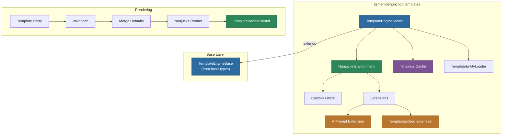
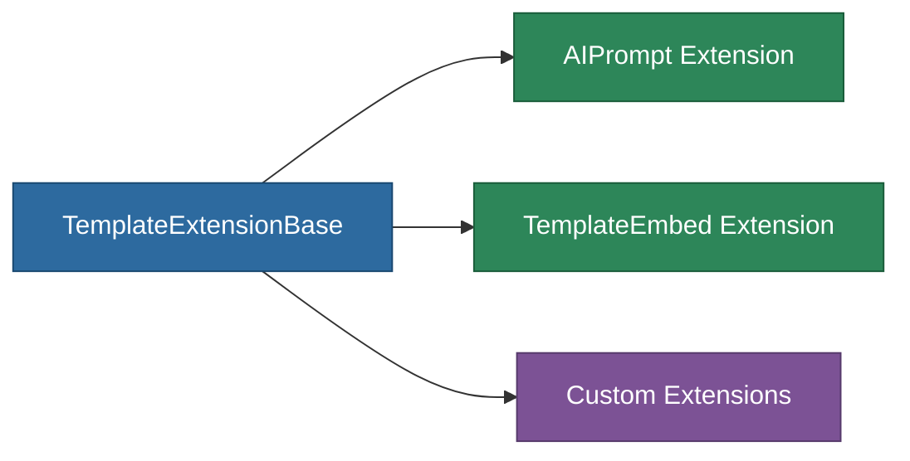

# @memberjunction/templates

Server-side template rendering engine for MemberJunction, built on Nunjucks. Extends `TemplateEngineBase` with rendering capabilities, custom filters, and MJ-specific extensions for AI prompt integration and recursive template embedding.

## Architecture



## Overview

This package is the **server-side rendering engine** for MemberJunction templates. It is NOT used within Angular applications despite using Angular Universal internally for compilation.

**Key capabilities:**

- **Nunjucks Rendering**: Full Nunjucks template syntax with async support
- **Parameter Validation**: Validates input data against template parameter definitions before rendering
- **Default Value Merging**: Automatically applies parameter defaults with content-specific overrides
- **Template Caching**: Compiled Nunjucks templates are cached per template content, together with the text they were compiled from; a saved edit to a content row (same ID, new text) is recompiled on its next render instead of serving the old text
- **Custom Filters**: `json`, `jsoninline`, and `jsonparse` filters for JSON manipulation
- **Extensible**: Plugin system via `TemplateExtensionBase` for custom Nunjucks tags
- **AI Prompt Extension**: Execute AI prompts inline within templates
- **Template Embedding**: Recursively embed templates within other templates

## Installation

```bash
npm install @memberjunction/templates
```

## Usage

### Rendering Templates

```typescript
import { TemplateEngineServer } from '@memberjunction/templates';

const engine = TemplateEngineServer.Instance;
await engine.Config(false, contextUser);

// Find and render a template
const template = engine.FindTemplate('Welcome Email');
const content = template.Content[0]; // First content variant

const result = await engine.RenderTemplate(template, content, {
    userName: 'John Doe',
    companyName: 'Acme Corp'
});

if (result.Success) {
    console.log(result.Output); // Rendered HTML/text
} else {
    console.error(result.Message); // Validation or rendering error
}
```

Stored templates are HTML-escaped by default too. When the output is plain text for a model rather than HTML — AI
prompt templates, which `AIPromptRunner` renders this way — pass `{ autoescape: false }` as the sixth argument. The raw
render keeps the registered extensions and the sandbox guards, a `` embed inside it renders raw as well,
and its compiled templates are cached separately from the escaping render's:

```typescript
const prompt = await engine.RenderTemplate(template, content, { title: 'Affineur & Owner' }, true, false, { autoescape: false });
// prompt.Output contains "Affineur & Owner", not "Affineur &amp; Owner"
```

### Simple Template Rendering

For ad-hoc templates not stored in the database:

```typescript
const result = await engine.RenderTemplateSimple(
    'Hello {{ name }}, welcome to {{ company }}!',
    { name: 'Jane', company: 'MemberJunction' }
);
// result.Output: "Hello Jane, welcome to MemberJunction!"
```

By default, output is HTML-escaped. For plain-text contexts such as email subject lines — where
`Acme & Co` must not become `Acme &amp; Co` — opt out with the `autoescape` option:

```typescript
const subject = await engine.RenderTemplateSimple(
    '{{ company }} — your invite',
    { company: 'Acme & Co' },
    { autoescape: false }
);
// subject.Output: "Acme & Co — your invite"  (no entity encoding)
```

### Custom Nunjucks Filters

The engine provides built-in filters for JSON operations:

```nunjucks
{# Convert object to formatted JSON #}
{{ userData | json }}

{# Compact JSON output #}
{{ userData | jsoninline }}

{# Parse a JSON string back to object #}

```

### Template Sandbox

Users can edit stored templates, so the engine guards nunjucks when this package loads
(`HardenNunjucksRuntime()`). The guard is process-wide: it also covers nunjucks environments that
other packages create, and templates loaded through `include` and `import`. It checks templates at
two points.

**Before a template compiles.** The nunjucks compiler copies names from the template into the code it
generates, so `AssertTemplateTreeIsSafe()` checks every parsed template first:

- Variable, filter, loop, `set`, macro, import and block names must be plain names: letters,
  combining marks, digits, connector characters such as `_`, and `$`. A filter name can also contain
  dots.
- A test name (`is defined`, `is none`) and an extension's registered name and method must not
  contain a quote, a backslash or a line break.
- A name that every object inherits (a member of `Object.prototype`, such as `toString`,
  `hasOwnProperty` or `constructor`), or `prototype`, must not be used as a dictionary key, a keyword
  argument, a macro or call-block argument, a `set`, loop, import, macro or block name, or a filter or
  test name. The code generator also refuses such a name as a dictionary key or keyword argument. Bare
  names and member reads are not in this rule: `{{ constructor }}` reads only an own key of the render
  data, and a member read such as `obj.constructor` or `value.toLocaleString()` goes through the
  render-time member check (see below).
- The name of a called member, such as `obj["key"]()`, must not contain a backslash or a line break.
- A loop variable must not reuse an identifier that the generated loop code uses, such as `context`,
  `frame`, `runtime`, `env`, `cb`, `next`, `tasks` or `undefined`. A unit test compiles every kind of
  loop body with nunjucks 3.2.4, including loops inside macros and blocks, and checks this list against
  the generated code, so a nunjucks upgrade that adds an identifier fails the test.
- The parse tree may hold only nunjucks nodes, plain values and regular expression literals. This
  matters only for extensions, which build their own nodes.

**While a template renders.**

- A filter, test or global resolves only to a name that the environment registered itself, never to a
  member that every object inherits. This also covers the test names that the `select` and `reject`
  filters receive while the template renders. Such a name must be text, a number or another simple
  value such as `none`; an object, a function or a symbol is refused.
- The member names `constructor`, `prototype` and the `__define/lookup Getter/Setter__` accessors read
  as empty unless they hold an object's own data that is not a function. `__proto__` always reads as
  empty. This applies to a literal member name (`obj.name`, `obj["name"]`) and to one computed while
  the template renders (`obj[key]`) alike.
- A bare name such as `{{ user }}` resolves only to a template variable, an own key of the render data,
  or an own environment global. It never resolves to a property that the data or the globals inherit,
  such as `valueOf`.
- A macro or call-block argument that a call leaves out is filled only from a keyword argument of the
  same name that the call itself passes, never from a member that the keyword arguments inherit, so
  otherwise it reads as empty. Keyword arguments written at a call site must be a plain object literal
  with ordinary names; keyword arguments passed as a value (from render data, for example) are read
  through a copy of their own keys.
- A template must not read a member of the render context, an environment, a loader, a frame, a
  template or a nunjucks module. A lookup or call that would return one of them fails.
- A template must not reach `Function` (or its async and generator variants), `eval`, `Object`,
  `Reflect`, `globalThis` or `process`.

A template that breaks one of these rules fails with a `TemplateSandboxError`.

The guard blocks reflection and code injection, not ordinary methods. Pass templates plain data, not
objects whose methods reach the database or the file system (for example `BaseEntity` instances).

The `RunTemplate` mutation and the `Template.Run` remote operation also apply
`GetTemplateRunRefusal()` before they load anything: they refuse scope-limited sessions and callers
without read permission on `MJ: Templates` and `MJ: Template Contents`.

### Template Extensions

Extensions are registered via the MJ class factory:



- **AIPrompt Extension**: Executes AI prompts inline within templates using `` tags. On any failure (the model is not found, the driver throws, or it returns a failed result) the error is logged and its text is rendered in place of the response; the render never waits on a failed call
- **TemplateEmbed Extension**: Embeds other templates within a template using `` tags

## API Reference

### TemplateEngineServer

| Member | Type | Description |
|--------|------|-------------|
| `Instance` | static getter | Singleton instance |
| `Config()` | method | Load metadata and initialize Nunjucks environment |
| `RenderTemplate()` | method | Render a stored template with validation; `options.autoescape: false` renders without HTML escaping |
| `RenderTemplateSimple()` | method | Render an ad-hoc template string |
| `AddTemplate()` | method | Add a template to the Nunjucks loader |
| `SetupNunjucks()` | method | Re-initialize the Nunjucks environment |
| `ClearTemplateCache()` | method | Clear cached compiled templates |

### Rendering Process

1. **Validation**: Input data is validated against template parameter definitions
2. **Default Merging**: Missing parameters receive default values (content-specific defaults override global defaults)
3. **Compilation**: Template text is compiled by Nunjucks (cached per content row, and recompiled when the row's text changed since it was cached)
4. **Rendering**: Nunjucks processes the template with merged data
5. **Result**: Returns `TemplateRenderResult` with `Success`, `Output`, and optional `Message`

## Dependencies

| Package | Purpose |
|---------|---------|
| `@memberjunction/templates-base-types` | Base engine and result types |
| `@memberjunction/core` | UserInfo, logging utilities |
| `@memberjunction/core-entities` | Template entity types |
| `@memberjunction/global` | Class factory for extensions |
| `@memberjunction/ai` | AI integration for prompts |
| `@memberjunction/ai-core-plus` | AI core utilities |
| `nunjucks` | Template rendering engine |

## License

Business Source License 1.1 — see [LICENSE](../../../LICENSE) for details.
