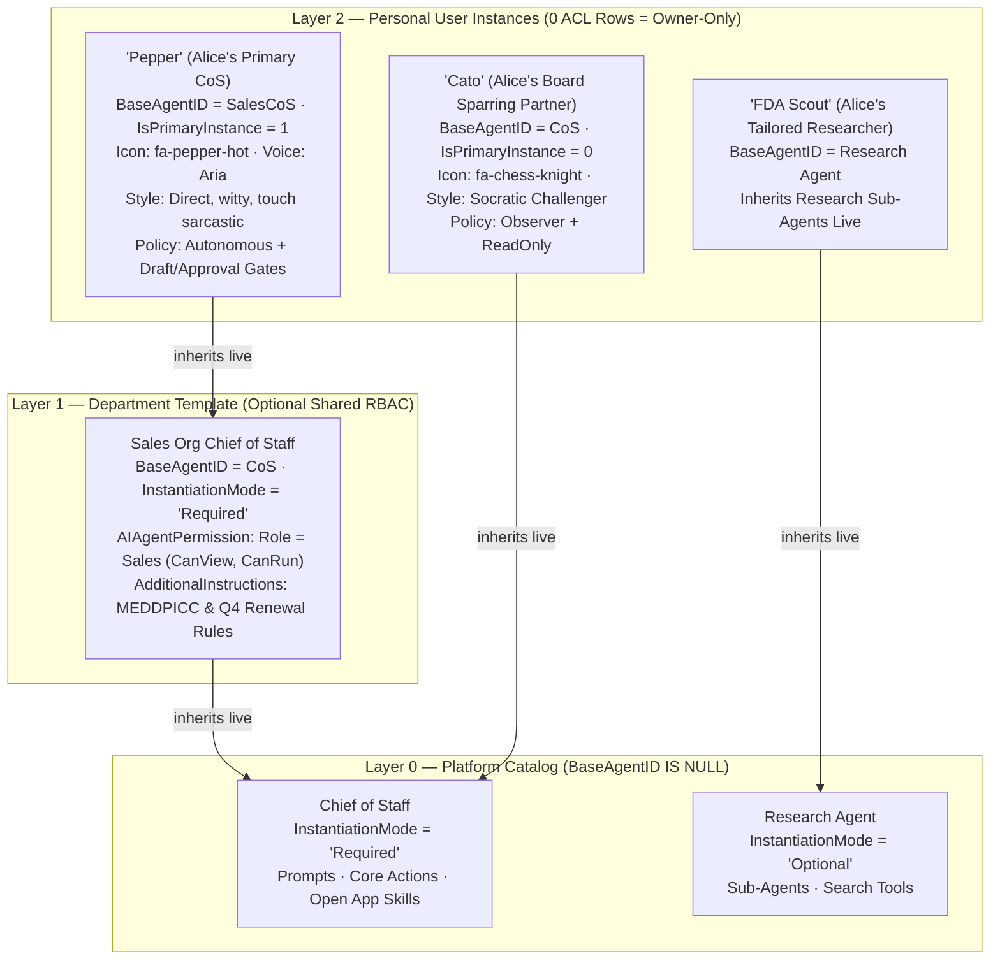

# Agent Instances & Multi-Level Prototype Inheritance (`BaseAgentID`)

- **Status**: Approved for Implementation
- **Date**: 2026-11-22
- **Sponsor**: Amith Nagarajan (`AN-BC`)
- **Baseline**: `origin/next` (`4e752ba0ac`)
- **Target Branch**: `feat/agent-instances-and-inheritance`

---

## 1. Executive Summary & Architectural Thesis

Enterprise users want Grok-Bot-style agency over the AI agents they work with every day: taking a capability-rich agent like **Chief of Staff** or **Research Agent**, giving it a name (*"Pepper"*), an icon or custom avatar, a voice, a distinct conversational personality (*"be direct, skip corporate fluff, add a touch of dry sarcasm and humor"*), and custom standing instructions — **and** spinning up **more than one instance** when different roles call for different personas and guardrails (for example, *"Pepper"* for autonomous daily operations alongside *"Cato"* as a read-only Socratic board-prep sparring partner, or a Sales VP publishing a *"Sales Org Chief of Staff"* template that every Sales rep trees their own personal instance off of).

### Why We Introduce Zero New Concepts in the Agent Architecture

Every runtime, UI, memory, scheduling, and governance table in MemberJunction already keys off **`AgentID` (`FK -> __mj.AIAgent.ID`)**:
- `MJ: Conversations.DefaultAgentID` & `MJ: Conversation Details.AgentID`
- `MJ: AI Agent Runs.AgentID` & `MJ: AI Agent Sessions.AgentID`
- `MJ: User Routines.TargetID` (`TargetType = 'Agent'`)
- `MJ: AI Agent Notes.AgentID` & `MJ: AI Agent Examples.AgentID`
- `MJ: AI Agent Requests`, `MJ: Agent Channel Participants.AgentID`
- `MJ: AI Agent Permissions.AgentID` & `MJ: AI Agent User Policies.AgentID`

Inventing a parallel `AIAgentInstance` entity (or dropping `UNIQUE(AgentID, UserID)` on `AIAgentUserPolicy`) would either force nullable `AgentInstanceID` foreign keys across a dozen tables or cause multiple instances to bleed together in chat bubbles, `@mentions`, `Agent Channels`, routines, and agent memory.

**The Clean Model:**
> **A tailored agent *is* an `MJ: AI Agents` row with `BaseAgentID` prototype inheritance.**
> - **`AIAgent.ParentID`** = **Structural composition (*has-a*)** — internal child sub-agents hidden from top-level discovery (`Research Agent -> Database Research Agent`).
> - **`AIAgent.BaseAgentID`** = **Prototype inheritance (*instance-of*)** — top-level or department-level derived agents that inherit capabilities (Type, Driver, Prompts, Actions, Sub-Agents, Open App Skills, Configurations, Modalities, and Rhythm Templates) **live** from their prototype chain (`MaxDepth = 5`), while owning their own identity, persona/voice, custom instructions, memories, routines, and `AIAgentUserPolicy`.

---

## 2. Locked Architectural Decisions

1. **Multi-Level Inheritance Capped at `MaxDepth = 5` via CodeGen Hierarchy Engine**:
   - Configure `MJ: AI Agents.BaseAgentID` with `EntityField.Configuration = { "Hierarchy": { "IsHierarchy": true, "MaxDepth": 5 } }`.
   - CodeGen automatically generates SQL Server / PostgreSQL hierarchy TVFs (`fnAIAgentBaseAgentID_GetHierarchyMeta`, `GetAncestors`, `GetDescendants`, `GetRootID`), projects **`RootBaseAgentID`**, **`BaseAgentIDDepth`**, **`BaseAgentIDPath`**, **`BaseAgentIDIsLeaf`**, and **`BaseAgentIDChildCount`** onto `vwAIAgents`, and emits `GetBaseAgentIDAncestors()`, `GetBaseAgentIDDescendants()`, and `GetBaseAgentIDChildren()` on `MJAIAgentEntity`.
   - Why `5` instead of unlimited: unlike key-value config overrides, `AdditionalInstructions` and policy ceilings accumulate down the chain; `5` covers `Platform -> Enterprise -> Division -> Department -> Team -> User` without prompt-token bloat or "telephone game" instruction drift.

2. **Three `InstantiationMode` Archetypes on `MJ: AI Agents` + Rich `TypeConfiguration.instantiation` Bag**:
   - First-class column `InstantiationMode` (`'None' | 'Optional' | 'Required'`, default `'None'`):
     - `'None'`: Direct-use only (default for `Sage`, `Form Builder`, `Database Designer`, sub-agents, and all personal leaf instances so users don't accidentally chain personal leaves).
     - `'Optional'`: Directly runnable via `@Research Agent` / `@Query Builder` **and** available as a template to spin up tailored instances.
     - `'Required'`: Template / onboarding factory only (`Chief of Staff`, or a department template like `Sales Org Chief of Staff`). Excluded from normal ad-hoc delegation (`Sage` / `Find Candidate Agents` delegates to Alice's *Pepper*, never the raw `Chief of Staff` template). Opening a `Required` template runs the Grok-Bot-style onboarding flow to materialize the user's instance.
   - Optional UX hints live in `AIAgent.TypeConfiguration` under a strongly-typed `instantiation` key (`IAgentInstantiationConfig` in `@memberjunction/ai-core-plus`): `suggestedNames`, `suggestedIcons`, `suggestedPersonaNames`, `maxInstancesPerUser`, `onboardingGreeting`, `personalityPresets`.

3. **2x2 RBAC Strategy Reusing `MJ: AI Agent Permissions` (Zero New Permission Tables)**:
   - Invert the `0`-permission-row default **only** when `BaseAgentID IS NOT NULL`:
     - **Root Catalog Agent (`BaseAgentID IS NULL`) + `0` ACL rows** -> **Public** (`CanView` + `CanRun` for all users; `OwnerUserID` has `CanEdit` + `CanDelete`).
     - **Root Catalog Agent (`BaseAgentID IS NULL`) + `>= 1` ACL rows** -> **RBAC-Scoped** (`OwnerUserID` + matching `RoleID` / `UserID` rows).
     - **Derived Agent (`BaseAgentID IS NOT NULL`) + `0` ACL rows** -> **Private Personal Instance** (strictly `OwnerUserID` only — zero ACL rows needed when a user mints *Pepper*).
     - **Derived Agent (`BaseAgentID IS NOT NULL`) + `>= 1` ACL rows** -> **Shared Department / Team Agent** (`OwnerUserID` + matching `RoleID` / `UserID` rows).
   - **Ancestor `CanRun` Invariant**: Effective `CanRun` on a derived agent requires `CanRun` on **every ancestor** in its `BaseAgentID` chain. If a user leaves the `Sales` role and loses `CanRun` on `Sales Org Chief of Staff`, any personal instance treed off it loses `CanRun` automatically.
   - **Database RLS Parity**: Mirror this exact visibility rule in Row-Level Security on `MJ: AI Agents` so browser `AIEngineBase` (`CacheLocal: true`) never downloads coworkers' private agent names or `AdditionalInstructions`.

4. **Personality + Voice Unification (`MJ: AI Personas` + `AIAgentPersona.StyleOverride`) & Audience-Aware Framing**:
   - Wire `AIEngineBase.ResolveAgentPersona()` into **`BaseAgent` text prompt assembly** (`Tone`, `SpeakingStyle`, `Description`, `StyleOverrideObject`) in addition to Realtime audio/video.
   - Frame personal style instructions with an **Audience-Aware Guardrail**: apply humor/sarcasm/informality when conversing directly with the owner (`{{ _USER_NAME }}`), while keeping external emails, calendar invites, and peer `Agent Channel` messages drafted on the user's behalf professional unless explicitly instructed otherwise.

5. **Governance & Budget Ceilings Attach to the Instance Row and Inherit Ancestor Ceilings**:
   - `MJ: AI Agent User Policies` attaches directly to the materialized instance (`Pepper.ID`, `Cato.ID`), enabling distinct postures per instance (*Pepper* = `Autonomous`, *Cato* = `Observer` + `ReadOnly`).
   - `AgentUserPolicyEngine` and `ResolveAgentRunLimits` intersect all active policies across `[rootAgent ... leafAgent]` so creating a new instance can **narrow** permissions/limits, **never widen** beyond an admin- or user-configured ceiling on an ancestor template.

---

## 3. Phased Implementation Plan

### Phase 1 — Schema Migration, Metadata Seeds & CodeGen

1. **Author T-SQL Migration** in `migrations/v6/` (`V<YYYYMMDDHHMM>__v6.3.x__Agent_Instances_And_Prototype_Inheritance.sql`) strictly following `migrations/CLAUDE.md` (no existence guards, explicit `COLLATE SQL_Latin1_General_CP1_CI_AS` on all string columns, no `migrations-pg/` file in this PR):
   - `ALTER TABLE [${flyway:defaultSchema}].[AIAgent]` to add:
     - `[BaseAgentID] UNIQUEIDENTIFIER NULL` + `FK_AIAgent_BaseAgent` -> `[AIAgent]([ID])` + `CK_AIAgent_NoSelfBase` (`[BaseAgentID] IS NULL OR [BaseAgentID] <> [ID]`) + index `IDX_AUTO_MJ_FKEY_AIAgent_BaseAgentID`.
     - `[InstantiationMode] NVARCHAR(20) COLLATE SQL_Latin1_General_CP1_CI_AS NOT NULL CONSTRAINT [DF_AIAgent_InstantiationMode] DEFAULT ('None')` + `CK_AIAgent_InstantiationMode` (`[InstantiationMode] IN ('None', 'Optional', 'Required')`).
     - `[AdditionalInstructions] NVARCHAR(MAX) COLLATE SQL_Latin1_General_CP1_CI_AS NULL`.
     - `[IsPrimaryInstance] BIT NOT NULL CONSTRAINT [DF_AIAgent_IsPrimaryInstance] DEFAULT (0)`.
   - `ALTER TABLE [${flyway:defaultSchema}].[AIAgent] ALTER COLUMN [LogoURL] NVARCHAR(MAX) COLLATE SQL_Latin1_General_CP1_CI_AS NULL` (additive widening from `NVARCHAR(255)` so custom avatars, presigned URLs, and data URIs never truncate).
   - Add `sp_addextendedproperty` (`MS_Description`) for `BaseAgentID`, `InstantiationMode`, `AdditionalInstructions`, `IsPrimaryInstance`, and updated `LogoURL`.
2. **Hierarchy Configuration & CodeGen**:
   - Seed `Configuration: { "Hierarchy": { "IsHierarchy": true, "MaxDepth": 5 } }` on `MJ: AI Agents.BaseAgentID` in `metadata/entities/` so `mj codegen` emits `fnAIAgentBaseAgentID_*` TVFs, `RootBaseAgentID` / `BaseAgentIDDepth` / `BaseAgentIDPath` / `BaseAgentIDIsLeaf` / `BaseAgentIDChildCount` on `vwAIAgents`, and `GetBaseAgentIDAncestors()` / `GetBaseAgentIDDescendants()` / `GetBaseAgentIDChildren()` on `MJAIAgentEntity`.
   - Append CodeGen SQL output after **50+ blank lines** and the standard CodeGen banner; delete standalone `CodeGen_Run_*.sql`; verify `node .github/scripts/check-migration-entityfield-sequence.mjs` passes with 0 issues.
3. **Metadata Seeds (`metadata/`, pushed to `MJ_Agent_Instances` via `mj sync push` without committing `sync` blocks if repo convention requires — check `metadata/CLAUDE.md`)**:
   - **Row-Level Security (`metadata/row-level-security-filters/`)**: Add `UserAccessibleAIAgents` RLS filter (with SQL Server `FilterText` and PostgreSQL `PlatformVariants`) enforcing:
     - `OwnerUserID = currentUser` OR `(BaseAgentID IS NULL AND NOT EXISTS (SELECT 1 FROM AIAgentPermission WHERE AgentID = ID))` OR `EXISTS (SELECT 1 FROM AIAgentPermission WHERE AgentID = ID AND (CanView = 1 OR CanRun = 1 OR CanEdit = 1 OR CanDelete = 1) AND (UserID = currentUser OR RoleID IN userRoles))`.
     - Attach as Read RLS on `MJ: AI Agents` for non-Owner roles (`UI`, etc.) so browser `AIEngineBase` only caches accessible agents.
   - **Entity Permissions (`metadata/entity-permissions/`)**: Grant `UI` role Create/Update/Delete on `MJ: AI Agents` and `MJ: AI Agent Personas` (strictly sandboxed in `MJAIAgentEntityServer` and `MJAIAgentPersonaEntityServer`, mirroring `MJAIAgentUserPolicyEntityServer`).
   - **Built-in Personas & Agents**:
     - Ensure rich built-in `MJ: AI Personas` archetypes exist/are active (e.g., crisp executive, warm coach, witty/candid challenger, deep analyst) alongside voice bindings.
     - Set `InstantiationMode: "Required"` + `TypeConfiguration.instantiation` (`suggestedNames: ["Pepper", "Atlas", "Friday", "Maya", "Cato"]`, `personalityPresets`, `onboardingGreeting`) on `Chief of Staff` (`metadata/agents/.chief-of-staff-agent.json`).
     - Set `InstantiationMode: "Optional"` on `Research Agent` and `Query Builder`.
     - Register the new **`Manage My Agent Instance`** action (`metadata/actions/`) and bind it to `Chief of Staff` (and `Sage` if appropriate).

---

### Phase 2 — Prototype Inheritance & 2x2 RBAC in `ai-core-plus` & `ai-engine-base`

1. **Shared Types in `@memberjunction/ai-core-plus`**:
   - Define `AgentInstantiationMode = MJAIAgentEntity['InstantiationMode']` (derived from entity per Rule 2c — never hand-copy the union!).
   - Define `IAgentInstantiationConfig` & `IAgentPersonalityPreset` for `TypeConfiguration.instantiation`, plus helper `ParseAgentInstantiationConfig(typeConfigJson)`.
2. **Prototype Chain Resolution in `AIEngineBase` (`packages/AI/BaseAIEngine/src/BaseAIEngine.ts`)**:
   - `GetAgentInheritanceChain(agentId: string): MJAIAgentEntityExtended[]`:
     - Memoized per `_agents` snapshot; walks `BaseAgentID` with `Set` cycle detection and `MAX_AGENT_INHERITANCE_DEPTH = 5`, returning `[rootAgent, ..., leafAgent]`.
   - `GetRootAgent(agentId: string): MJAIAgentEntityExtended | undefined`.
   - **Inherited Capability Accessors** (all existing callers benefit transparently or via dedicated effective helpers):
     - **Scalar properties**: `ResolveEffectiveAgentProperties(agent)` inherits `TypeID`, `DriverClass`, `ModelSelectionMode`, `Isolation`, `ContextWindowMaxTokens`, `CompactionTriggerPercent`, `CompactionTargetPercent`, `ConversationSummaryPromptID`, `EnableContextCompression`, `ContextCompression*`, `RerankerConfiguration`, `ScopeConfig`, `DefaultPromptEffortLevel`, `ChatHandlingOption`, `DefaultArtifactTypeID`, `ArtifactCreationMode`, `DeclareActionsAsNativeTools`, `SupportsPlanMode`, `RequirePlanMode` (`RequirePlanMode` is monotonic OR down chain: if an ancestor requires plan mode, descendants cannot turn it off), `LogoURL` / `IconClass` fallback.
     - **`TypeConfiguration` & `AgentTypePromptParams`**: Deep-merged root -> leaf (excluding `instantiation` from leaking onto `InstantiationMode === 'None'` leaves).
     - **Prompts (`GetEffectiveAgentPrompts(agentId)`)**: If the agent has its own active `AIAgentPrompt` rows, use them; otherwise walk up `BaseAgentID` to the nearest ancestor with active `AIAgentPrompt` rows.
     - **Actions (`GetEffectiveAgentActions(agentId)`)**: Accumulate active `AIAgentAction` rows root -> leaf, keyed by `ActionID`; a descendant row with `Status = 'Disabled'` / `'Revoked'` vetoes an inherited action.
     - **Sub-Agents (`GetSubAgents(agentId, ...)` & relationships)**: Accumulate `ParentID` child sub-agents and `AIAgentRelationship` rows across the `BaseAgentID` chain (deduplicated by `SubAgentID`; descendant `Status = 'Disabled'` vetoes).
     - **Skills (`GetSkillsForAgent` / `GetAutoActivatableSkillsForAgent`)**: Walk `BaseAgentID` chain for `AIAgentSkill` grants; `AcceptsSkills` narrows down chain (`All` -> `Limited` -> `None`), so Open App skills registered on `Chief of Staff` (`MJ: AI Agent Skills`) automatically light up on *Pepper* and *Cato*!
     - **Configurations (`GetAgentConfigurationPresets`), Client Tools (`GetClientToolsForAgent`), Modalities (`GetAgentModalities`), Personas (`GetAgentPersonas` / `ResolveAgentPersona`), Rhythm Templates**: Walk `BaseAgentID` chain with child-overrides-parent / explicit-veto semantics.
     - **`GetStackedAdditionalInstructions(agentId)`**: Returns ordered `{ AgentID, AgentName, IsRootOrTemplate, Instructions }[]` from root -> leaf for non-empty `AdditionalInstructions`.
3. **2x2 RBAC & Ancestor `CanRun` Invariant (`AIAgentPermissionHelper.ts` & `BaseAIEngine.ts`)**:
   - Update both async `AIAgentPermissionHelper.GetEffectivePermissions()` and sync `BaseAIEngine.canUserRunAgentSync()` / `CanUserViewAgentSync()`:
     - If `UUIDsEqual(agent.OwnerUserID, user.ID)` -> full permissions (`view/run/edit/delete`), **subject to ancestor `CanRun` check** when `agent.BaseAgentID != null` (`canRun` is `true` only if `user` also has `CanRun` on every ancestor in `GetAgentInheritanceChain(agent)`!).
     - If `agentPermissions.length === 0`:
       - When `agent.BaseAgentID == null`: `{ canView: true, canRun: true, canEdit: false, canDelete: false }` (preserves existing catalog behavior).
       - When `agent.BaseAgentID != null`: `{ canView: false, canRun: false, canEdit: false, canDelete: false }` (private to `OwnerUserID`!).
     - If `agentPermissions.length > 0`: evaluate matching `UserID` / `RoleID` rows AND intersect `canRun` with ancestor `CanRun` across the `BaseAgentID` chain.
4. **Runnable vs. Instantiable Catalogs & Scoped Name Resolution**:
   - Update `AIAgentPermissionHelper.IsDirectlyDiscoverable(agent)`: exclude `InstantiationMode === 'Required'` from ad-hoc delegation (`GetUserRunnableAgentDirectory`, `Find Candidate Agents`, `Sage` delegation) so `Sage` routes to the user's materialized instance (*Pepper*), never the un-instantiated template!
   - Add `AIEngineBase.GetInstantiableAgents(user)` returning active agents with `InstantiationMode === 'Required' || InstantiationMode === 'Optional'` that `user` has `CanRun` on.
   - Add `AIEngineBase.GetUserDerivedAgents(user, rootOrBaseAgentId?)` returning derived agents owned by or shared with `user`.
   - Protect `_agentsByName`: global `GetAgentByName()` indexes root catalog agents (`BaseAgentID == null`) first so personal agents named `"Pepper"`, `"Jarvis"`, or `"Sage"` never collide globally or shadow system agents; add `ResolveAgentForUser(nameOrId, user)` checking exact UUID -> user's owned derived agents -> shared derived agents -> root catalog agents.

---

### Phase 3 — Server Guards, Policy Ceiling Inheritance, Persona Text+Voice Unification & Primary Routing

1. **Server Entity Guards (`packages/MJCoreEntitiesServer/src/custom/`)**:
   - **`MJAIAgentEntityServer.server.ts`**:
     - Auto-populate `OwnerUserID = ContextCurrentUser.ID` on new records when unset.
     - When `BaseAgentID` is set:
       - Verify `BaseAgentID` exists, has no cycle, and resulting chain depth `<= 5` (`MAX_AGENT_INHERITANCE_DEPTH`).
       - On create, verify parent agent's `InstantiationMode !== 'None'` (unless `Owner` admin explicitly authoring metadata) and check `maxInstancesPerUser` if configured in `TypeConfiguration.instantiation`.
       - Auto-inherit required `TypeID` from `BaseAgentID` when unset on create.
       - **Non-Owner (`UI` role) Sandbox**:
         - Non-Owner users may **only** create/update/delete `AIAgent` rows where `BaseAgentID != null`, `OwnerUserID === ContextCurrentUser.ID` (checked against pre-save `OldValue` on update/delete!), and `InstantiationMode === 'None'`.
         - Non-Owner users must hold `CanRun` on `BaseAgentID`, and cannot set custom `DriverClass`, loosen `Isolation`, set `ExposeAsAction = true`, or raise `MaxCostPerRun` / `MaxTokensPerRun` / `MaxTimePerRun` above the base agent's finite bounds.
       - **`IsPrimaryInstance` Management**:
         - On create of a user's *first* personal instance under a given `RootBaseAgentID`, default `IsPrimaryInstance = true`.
         - Whenever `IsPrimaryInstance = true` is saved, clear `IsPrimaryInstance = false` on any other active instance with the same `(OwnerUserID, RootBaseAgentID)`.
   - **`MJAIAgentPersonaEntityServer.server.ts` (New)**:
     - Allows non-Owner (`UI` role) users to create/update/delete `MJ: AI Agent Personas` rows **only** when the target `AgentID` is a derived agent (`BaseAgentID != null`) whose `OwnerUserID === ContextCurrentUser.ID`.
   - **`MJAIAgentUserPolicyEntityServer.server.ts` Update**:
     - Update `validateAgentContextNonWidening()` (lines 78–115): when an executing template agent (`activeAgentId`) creates/initializes a policy for a newly minted derived agent (`derivedAgent.OwnerUserID === ContextCurrentUser.ID` and `activeAgentId` is in `derivedAgent`'s `BaseAgentID` chain), permit saving the policy on `derivedAgent.ID`, while running `DetectAgentPolicyWidening(ancestorEffectivePolicy, this)` so it can never widen an ancestor ceiling!
2. **Policy & Limits Ceiling Inheritance (`AgentUserPolicyEngine.ts` & `limits-diagnostics.ts`)**:
   - Add `AgentUserPolicyEngine.Instance.GetEffectivePolicyForAgentChain(agentChainIds: string[], userId: string)`:
     - Walks `[rootAgentId ... leafAgentId]`, intersecting active policies using strictest-wins semantics (`DefaultDataAccessMode`, `CoordinationMode` ceiling if locked, channel modes, `RequireApprovalFor*` ORed if locked, `AutoApproveAmountThreshold` min, `EntityAccessRules` + `ActionPolicyRules` combined). When only the leaf (`Pepper.ID`) has a policy row (the common case!), returns it directly in O(1).
   - Update `BaseAgent` and `ResolveAgentRunLimits` to pass the `BaseAgentID` inheritance chain so Tier 3 (`AgentOrWorkflowMetadata`) and Tier 4 (`UserAgentPolicy`) ceilings always respect ancestor templates.
3. **Persona + Stacked Instructions in `BaseAgent` (`packages/AI/Agents/src/base-agent.ts`)**:
   - Update `BaseAgent` execution & prompt gathering to use `AIEngineBase` effective inherited prompts, actions, sub-agents, skills, modalities, and configurations!
   - Wire `AIEngineBase.ResolveAgentPersona(agent.ID, { modelId, preferredPersonaId: cachedUserPolicy?.PreferredPersonaID })`:
     - Inject a dedicated **`### Persona & Communication Style`** section into text system prompts whenever `Tone`, `SpeakingStyle`, or `Persona.Description` is present.
     - Inject **`### Custom & Inherited Instructions`** from `GetStackedAdditionalInstructions(agent.ID)` (root -> leaf) with the **Audience-Aware Tone Guardrail** (*apply personal humor/sarcasm/banter when speaking directly with your owner; keep external emails, calendar invites, and peer Agent Channel messages professional unless explicitly instructed otherwise*).
4. **Memory Scoping (`AgentContextInjector`) & Primary CoS Routing (`AgentWakeTriggerService`, `SendInterAgentRequestAction`, ` chief-of-staff-rhythms-suggestions.action.ts`)**:
   - In `AgentContextInjector`: keep user+agent notes (`AgentID = Pepper.ID, UserID = Alice`) strictly isolated per instance, while allowing org/agent-wide notes (`UserID IS NULL` and `AgentID IN ancestorIds`) to flow down from `BaseAgentID` ancestors!
   - Add `ResolvePrimaryUserAgentInstance(rootAgentIdOrName, userId)` helper: used by `AgentWakeTriggerService` (inbound `cos@company.com` utility mailbox & peer wakes), `SendInterAgentRequestAction`, and `OpenAgentChannelAction` so external/peer coordination targeting *"Alice's Chief of Staff"* deterministically routes to Alice's `IsPrimaryInstance = 1` agent (*Pepper*), falling back cleanly if un-onboarded.
   - Update Chief of Staff rhythm discovery (`List Available Rhythms` / `Enable Agent Rhythm`) to walk `BaseAgentID` so rhythm templates registered on `Chief of Staff` are offered to and instantiated targeting *Pepper.ID* (`TargetID = Pepper.ID`).

---

### Phase 4 — `Manage My Agent Instance` Action & Grok-Bot Conversational Onboarding

1. **`Manage My Agent Instance` Action (`packages/Actions/CoreActions/src/custom/ai/manage-my-agent-instance.action.ts` + metadata)**:
   - Operations: `Create`, `Update`, `ListMine`, `SetPrimary`, `Archive` (`Status = 'Disabled'`).
   - Parameters: `Operation`, `BaseAgentID` / `BaseAgentName`, `InstanceAgentID`, `Name` (e.g. `"Pepper"`), `Description`, `IconClass`, `LogoURL`, `PersonaID` / `PersonaName`, `Tone` (e.g. `"Direct, dryly witty, a touch sarcastic"`), `SpeakingStyle`, `AdditionalInstructions`, `IsPrimaryInstance`, `CoordinationMode`, `ConversationID` (optional — when provided on `Create`, re-pins `Conversation.DefaultAgentID = newAgent.ID` and updates the conversation title if generic so the onboarding chat seamlessly becomes a conversation with `@Pepper`!).
   - Refreshes `AIEngine` / `AIEngineBase` cache after mutation so the new/updated instance is immediately live in the same session.
2. **Update `Chief of Staff` Prompt (`metadata/prompts/templates/chief-of-staff/chief-of-staff.template.md`)**:
   - **Template Onboarding Mode** (when executing as the template `Chief of Staff` with `BaseAgentID == null`):
     - Warm, concise Grok-Bot-style onboarding! Greets the user, offers fun inspiration (`Pepper`, `Atlas`, `Friday`, `Cato`...), asks for: (1) Name, (2) Personality vibe / tone & voice preference (e.g., crisp & direct, warm coach, witty & slightly sarcastic, Socratic challenger), and (3) Top current priorities & operating posture.
     - Calls **`Manage My Agent Instance`** (`Operation = 'Create'`, passing `ConversationID` from context) to materialize their personal Chief of Staff + `AIAgentPersona` + `AIAgentUserPolicy` in one atomic step!
   - **Active Instance Mode** (when executing as a materialized instance like *Pepper* with `BaseAgentID != null`):
     - Fully embodies its `Name`, `Persona` (`Tone` + `SpeakingStyle`), and `AdditionalInstructions`, and calls `Manage My Agent Instance` (`Operation = 'Update'`) whenever the user asks to tweak its name, icon, voice, sarcasm/humor dial, or standing instructions!

---

### Phase 5 — Angular UX (`@memberjunction/ng-conversations` & Chief of Staff App)

1. **Grok-Bot-Style "My Agents" Left-Rail Section (`packages/Angular/Generic/conversations/src/lib/components/sidebar/my-agents-section.*`)**:
   - Rendered in `ConversationSidebarComponent` (`ShowMyAgents` `@Input()`, default `true`, following MJ design tokens `--mj-*` in both light and dark themes and Angular `@if`/`@for` syntax + `OnPush`).
   - Displays:
     - Each of the user's personal/shared derived instances (*Pepper*, *Cato*, *FDA Scout*) with its custom `LogoURL` or `IconClass`, `Name`, subtle base-agent pill/subtitle (*Chief of Staff*, primary badge), click-to-chat (opens active thread pinned to `DefaultAgentID = instance.ID` or starts a new conversation with that instance), and a gear/pencil button to open the **Tailor Agent** dialog!
     - If the user has **no** instance yet for a `Required` agent (like `Chief of Staff`), renders an inviting **"Set up My Chief of Staff"** card right in the rail!
     - **`+` ("New Agent Instance")** button opening the **Tailor / New Agent Modal**.
2. **Tailor / New Agent Instance Modal (`packages/Angular/Generic/conversations/src/lib/components/agent/agent-instance-editor-modal.*`)**:
   - Supports **two seamless creation/editing modes**:
     1. **"Chat to Onboard" button** (starts a live onboarding conversation with the selected template agent — Grok-Bot conversational setup!).
     2. **Direct Interactive Designer** (create a brand-new instance from `Chief of Staff` / `Research Agent` / `Query Builder`, OR edit an existing instance like *Pepper*):
        - **Base Template selector** (on create) showing `GetInstantiableAgents()`.
        - **Instance Name** (with clickable suggestion chips from `TypeConfiguration.instantiation.suggestedNames`).
        - **Icon & Avatar picker** (curated Font Awesome icon grid including `fa-pepper-hot`, `fa-bolt`, `fa-chess-knight`, `fa-compass`, `fa-brain`, `fa-rocket`, `fa-wand-magic-sparkles`, `fa-shield-halved`, etc., + custom Avatar URL input + live preview badge).
        - **Voice & Persona selector** (cards from `AIEngineBase.Instance.Personas` showing voice/gender/locale/tone).
        - **Personality Style (`Tone` & `SpeakingStyle`)** with quick preset pills (*"Direct & Witty"*, *"Touch Sarcastic & Funny"*, *"Crisp Executive"*, *"Warm Coach"*, *"Socratic Challenger"*) + free-text inputs saved to `AIAgentPersona.StyleOverrideObject`.
        - **Custom Standing Instructions** (`AdditionalInstructions` textarea).
        - **Primary Instance toggle** (when `> 1` instance shares the same `RootBaseAgentID`).
3. **Conversations Composer, Agent Picker & Message Identity**:
   - `ConversationAgentPickerComponent` & `@mention` autocomplete (`message-input` / `ai-composer`): list the user's derived instances (*Pepper*, *Cato*, *FDA Scout*) prominently with their custom icons/avatars, while filtering out raw `InstantiationMode === 'Required'` templates from direct execution (or badging them as *"Set up new…"*).
   - `MessageItemComponent`: renders *Pepper*'s exact `Name`, `LogoURL` (falling back to effective `Persona.PreviewImageURL`, then `IconClass`) on every turn she authors!
   - Live refresh: when `Manage My Agent Instance` completes during conversational onboarding and flips `Conversation.DefaultAgentID`, `AIEngineBase` client cache refreshes so the left rail ("My Agents") and chat header immediately update to **Pepper** without a page reload!
4. **Chief of Staff Application Integration (`packages/Angular/Explorer/dashboards/src/ChiefOfStaff/`)**:
   - Update `SelectableAgentsForGovernance()` in `chief-of-staff-agent-context.ts` and `BaseChiefOfStaffPage` so:
     - All active derived instances owned by the user whose `RootBaseAgentID` (or `BaseAgentID` chain root) is `Chief of Staff` (*Pepper*, *Cato*) appear in the Chief of Staff app's header agent switcher (`AvailableAgents`), defaulting to the user's `IsPrimaryInstance`!
     - Each selected instance displays its own scoped `MJ: AI Agent User Policies`, `MJ: User Routines`, and `MJ: AI Agent Requests`!
     - Add a **`+ New Instance`** / **`Personalize`** action in the Chief of Staff app header (and a welcoming setup CTA when the user has 0 instances yet).

---

## 4. Verification, Testing & Documentation Requirements

### 4.1 Unit Tests (Vitest — All Modified Packages Must Be 100% Green)
- `@memberjunction/ai-core-plus`: `ParseAgentInstantiationConfig`, `AgentUserPolicyEngine` multi-level ancestor policy intersection & non-widening.
- `@memberjunction/ai-engine-base`:
  - `GetAgentInheritanceChain` (1-hop, 3-hop, 5-hop max depth, cycle guard).
  - Inherited prompts, actions (with child `Disabled` veto), sub-agents, Open App skills, modalities, configurations, personas, and stacked `AdditionalInstructions`.
  - **2x2 RBAC matrix** (`BaseAgentID == null` vs `!= null` x `0` vs `>= 1` `AIAgentPermission` rows) + **Ancestor `CanRun` revocation** (losing `Sales` role revokes `CanRun` on child personal instance).
  - `IsDirectlyDiscoverable` (`Required` excluded from delegation, `Optional` & `None` included) + `ResolveAgentForUser` (no collision when two users both name their bot `"Pepper"` or `"Sage"`).
- `@memberjunction/ai-agents`:
  - `BaseAgent` text prompt injection of `ResolveAgentPersona()` (`Tone`, `SpeakingStyle`) + stacked `AdditionalInstructions` + Audience-Aware Tone Framing.
  - `AgentContextInjector` memory isolation between sibling instances (*Pepper* vs *Cato*) while inheriting org-level notes from `BaseAgentID`.
  - Primary instance resolution in `AgentWakeTriggerService`.
- `@memberjunction/core-entities-server` & `@memberjunction/core-actions`:
  - `MJAIAgentEntityServer` depth > 5 rejection, non-Owner (`UI` role) sandbox enforcement, `IsPrimaryInstance` uniqueness flipping.
  - `MJAIAgentUserPolicyEntityServer` allowing template-to-child policy creation while blocking privilege widening.
  - `ManageMyAgentInstanceAction` (`Create`, `Update`, `SetPrimary`, `Archive`, `Conversation.DefaultAgentID` morphing).
- `@memberjunction/ng-conversations` & `@memberjunction/ng-dashboards`:
  - `MyAgentsSectionComponent` & `AgentInstanceEditorModalComponent` DOM/unit tests.
  - `SelectableAgentsForGovernance` multi-instance Chief of Staff switcher tests.

### 4.2 Live SQL Server Integration Test (`IT172-agent-instances-and-inheritance`)
- Register a new deterministic integration test check bundle in `packages/TestingFramework/integration-test-suite/` + `.IT172-agent-instances-and-inheritance.json` verifying against real SQL Server (`MJ_Agent_Instances`):
  1. `vwAIAgents` CodeGen hierarchy columns (`RootBaseAgentID`, `BaseAgentIDDepth`, `BaseAgentIDPath`) across a 3-level chain (`Chief of Staff [L0]` -> `Sales Org CoS [L1]` -> `Alice's Pepper [L2]`).
  2. 2x2 RBAC + RLS enforcement: User B cannot read or run User A's personal *Pepper*; Sales user can read/instantiate `Sales Org CoS` while non-Sales user cannot; removing Sales role from user revokes `CanRun` on their derived child instance.
  3. Multiple instances for one user (*Pepper* `IsPrimaryInstance = 1` + *Cato* `IsPrimaryInstance = 0`) with independent `AIAgentUserPolicy` postures (`Autonomous` vs `Observer`/`ReadOnly`), ancestor policy ceiling clamping, Open App skill inheritance from `L0`, and isolated `AIAgentNote` memories.
  4. `MJAIAgentEntityServer` blocking a `UI`-role user from creating a root agent (`BaseAgentID = null`), editing another user's instance, or exceeding `MaxDepth = 5`.

### 4.3 Playwright End-to-End UI Testing & Screenshots
- Launch `MJAPI` (`:4000`) and `MJExplorer` (`:4200`) against `MJ_Agent_Instances`, authenticate headlessly as `da-robot-tester@bluecypress.io` via shell-extracted `.env` credentials (never reading/printing `.env` secrets directly), and verify with zero console/GraphQL errors:
  1. **Left Rail "My Agents" & Tailor Modal** (light & dark / full window).
  2. **Creating & Conversing with "Pepper"** (custom chili-pepper/bolt icon, voice persona, *"direct, a touch sarcastic and funny"* personality style, custom instructions) — showing `@Pepper` in the left rail, `@mention` picker, chat header, and message bubbles responding in character!
  3. **Spinning up a 2nd Chief of Staff Instance ("Cato" — Board Sparring Partner)** + a tailored **Research Agent** instance — showing `> 1` instances side-by-side in the left rail and switching between **Pepper** and **Cato** inside the **Chief of Staff** application (`Overview` & `Governance` pages showing distinct per-instance policies)!

### 4.4 Documentation Deliverables
- **New Guide**: [`guides/AGENT_PERMISSIONS_AND_INHERITANCE_GUIDE.md`](../guides/AGENT_PERMISSIONS_AND_INHERITANCE_GUIDE.md) — comprehensive architectural guide covering `BaseAgentID` vs `ParentID`, `MaxDepth = 5` CodeGen hierarchy TVFs, `InstantiationMode` (`None | Optional | Required`), the 2x2 `MJ: AI Agent Permissions` RBAC matrix, Ancestor `CanRun` invariant, RLS parity, `MJAIAgentEntityServer` sandbox rules, and Persona text+voice unification.
- **Cross-link & Update**: [`guides/BUILT_IN_AGENTS_GUIDE.md`](../guides/BUILT_IN_AGENTS_GUIDE.md) (Chief of Staff instantiation & multi-instance section + prominent link to the new permissions & inheritance guide).
- **Package READMEs**: Update `README.md` in `packages/AI/BaseAIEngine`, `packages/AI/Agents`, `packages/AI/CorePlus`, and `packages/Angular/Generic/conversations`.

### 4.5 Repo Standards & CI Gates
-Zero `any` or `unknown` shortcuts; zero `.Get()`/`.Set()` on typed entities; all entity value-list types derived via `Entity['Field']`.
- Run and pass:
  - `node .github/scripts/check-migration-entityfield-sequence.mjs`
  - `node .github/scripts/sweep-limits-literals.mjs --check-standards`
  - `pnpm run check:standards` / `pnpm run check:guards` (verify exact root script names in `package.json`)
  - Verify `git status` before every commit so no local host artifacts (`mj.config.cjs`, `.env`, `environment.development.ts`) are ever staged.

---

## Wave 2 — "My Agents" App Rethink, Default Chat Agent, Smart `@Mention` Frecency/FK Search, AutoRefresh Optimization & Local JSON Mock Email/Calendar Provider

### Locked Decisions (2026-11-23)
1. **Application Rename & Variant A Navigation (`metadata/applications/.chief-of-staff-application.json`)**:
   - Preserve Application primary key `C05A8E01-4C11-4E8A-9B01-1A2B3C4D5E70`.
   - Rename `Name` to `"My Agents"` (`Icon: "fa-solid fa-wand-magic-sparkles"`), with 3 `DefaultNavItems` (no `Reports` tab):
     1. **`Overview`** (`isDefault: true`): Full-width Executive Bento Canvas across **all** of the user's personal instances and shared agents (interactive My Agent cards at top + unified `Pending Approvals Across All Agents` with per-agent avatar/name attribution + unified `Upcoming Wakes & Briefings` + `Active Agent Channels` summary).
     2. **`Agents`**: Option B Master-Detail workspace with left rail split into **`My Agents`** (personal instances + `+ New`) and **`Shared`** (root catalog & shared team agents), and right detail pane with `Make Default Chat Agent` (`chat.defaultAgentId` via `UserInfoEngine`), `Primary` star toggle, `+ Create My Own Instance` on instantiable shared agents, and 4 accessible tabs (`Approvals & Wakes`, `Persona & Instructions`, `Governance Policy`, `Sharing`).
     3. **`Agent Channels`**: Multi-agent coordination threads across all agents with optional agent filter.
2. **Ditch `MY AGENTS` Left Rail in Chat + Per-User `Default Chat Agent`**:
   - Remove `<mj-my-agents-section>` from `ChatConversationsResource` sidebar.
   - Persist `chat.defaultAgentId` via `UserInfoEngine.Instance` (`MJ: User Settings`) and bind `[DefaultAgentId]` on `<mj-conversation-chat-area>`, reacting live when updated in `My Agents`.
3. **Exclusive `IsPrimaryInstance` + `AIEngineBase` / `MentionAutocomplete` AutoRefresh**:
   - Remove manual `engine.Config(true)` and `MentionAutocompleteService.Refresh()` calls on save; rely on `BaseEngine` `AutoRefresh` + reactive `ObserveProperty` / `BaseEntityEvent` listeners.
   - Ensure `AIEngineBase` immediately clears `IsPrimaryInstance` on in-memory siblings sharing `(OwnerUserID, RootBaseAgentID)` whenever an active derived agent is saved with `IsPrimaryInstance = true`, matching `MJAIAgentEntityServer.clearOtherPrimaryInstances`.
   - Subscribe `MentionAutocomplete` to `MJGlobal` `BaseEntity` events (`MJ: AI Agents`, `MJ: AI Agent Permissions`, `MJ: AI Skills`) so caches update incrementally with zero full reloads.
4. **Smart `@Mention` Autocomplete (Frecency + FK-Style Multi-Field Search & Scope Pills)**:
   - Rank `@` suggestions using `UserInfoEngine`-persisted Frecency (`chat.mentionFrecency`: `uses * 6 * exp(-hoursAgo / 72)`) + context boosts (`InCurrentThread`, `DefaultChatAgent`, `MyAgentInstance`).
   - Add FK-dropdown-inspired population filter pills (`All | My Agents | Shared | People`), search-field scope selector (`All Fields | Name | Capabilities | Template`), acronym matching (`@fcs`), capability matching (`@sql`), grouped empty-query headers, and `<mark>` match highlights.
5. **Local JSON Mock Email & Calendar Provider + SQL Integration Tests**:
   - Implement `LocalJsonCommunicationProvider` inside `@memberjunction/communication-engine` (`@RegisterClass(BaseCommunicationProvider, 'Local JSON Mock')`) backed by local JSON files per mailbox under `MJ_MOCK_COMM_DIR`, supporting full Inbox (`GetMessages`, `SendSingleMessage`, `DraftMessage`, `ReplyToMessage`, `ForwardMessage`) and Calendar (`ListCalendarEvents`, `CreateCalendarEvent`, `UpdateCalendarEvent`, `DeleteCalendarEvent`, `GetFreeBusy`, `VerifyMailboxAccess`).
   - Exercise derived agent calendar availability/events, inbox reading, and policy-gated draft/approval flows end-to-end in the live SQL Server Integration Test suite (`IT186`).
