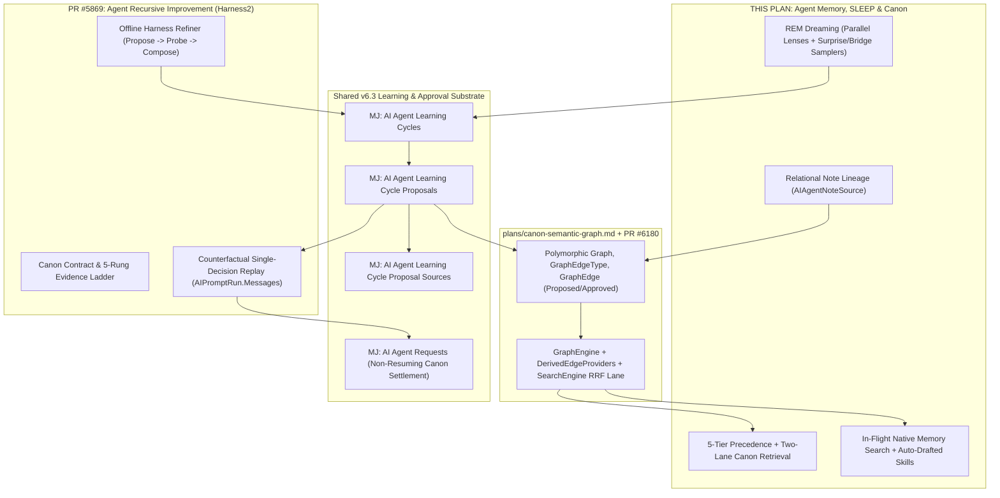
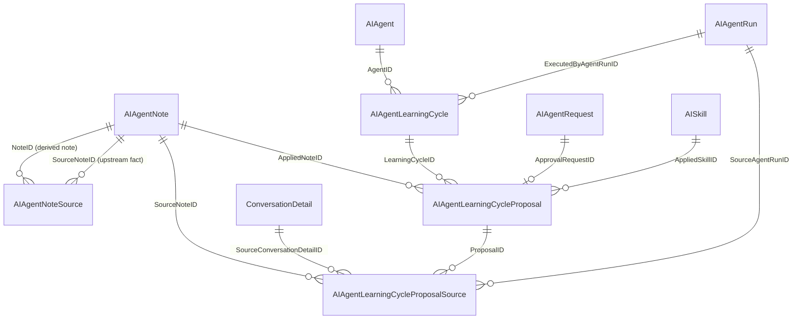

# Agent Memory, SLEEP & Canon — Architecture-Layer Consolidation, REM Dreaming & Precedence

**Version**: 1.0 — plan only, no code  
**Date**: October 30, 2026  
**Status**: Proposed — targeted for **v6.3 lifecycle (November 2026)** after Predictive Studio wraps  
**Owner / Assignee**: Arie Glazier (@arie-glazier-bcc) — extends his earlier work on Memory Consolidation ([`specs/001-memory-consolidation`](../specs/001-memory-consolidation/spec.md)), In-Flight Memory Writes ([`plans/agent-inflight-memory-writes.md`](agent-inflight-memory-writes.md)), and Recursive Improvement & Canon (PR #5869, `plans/agent-recursive-improvement-and-canon.md`)  
**FYI / Reviewers**: Robert Kihm (@rkihm-BC), Thomas Altman, Dray (@dray-mc), Topher Hunnewell (@topherHunnewell), Madhav Subramaniyam (@MS-BC), Jordan Fanapour (@jordanfanapour — Canon Semantic Graph alignment + legacy `Skip-Brain` FK cleanup in §3.2)  
**Source Research**:
- Behrouz, Hashemi, Javanmard, Mirrokni (Google Research, Oct 27, 2026), *The SLEEP Framework: Continual Learning via Wake–NREM–REM Consolidation* ([blog](https://research.google/blog/the-sleep-framework-a-new-way-for-llms-to-retain-knowledge-in-continual-learning/) · [arXiv:2606.03979](https://arxiv.org/abs/2606.03979)), building on *Hope / Nested Learning* ([arXiv:2512.24695](https://arxiv.org/abs/2512.24695)) and [Titans + MIRAS](https://research.google/blog/titans-miras-helping-ai-have-long-term-memory/)
- Xu et al. (Google Cloud AI Research, Oct 9, 2026), *Harness²: Recursive Agent Harnessing for an Open World* ([arXiv:2610.14224](https://arxiv.org/abs/2610.14224)) — companion MJ plan in PR #5869

**Code references** are pinned against `origin/next` @ `ba5497f3ac` (2026-10-30).

---

## Executive Summary

Google Research's **SLEEP** framework (`arXiv:2606.03979`) demonstrates that durable continual learning requires four distinct phases: **wake-time fast capture**, **NREM compression & synaptic pruning**, **REM generative recombination ("dreaming")**, and **strict verification / curated rehearsal**. SLEEP implements that loop inside low-rank Mixture-of-Experts (MoE) model weights.

For enterprise AI, **model weights are the wrong layer to store institutional learning**:
1. **Model lock-in**: Knowledge baked into vendor parameters cannot move when a better, faster, or cheaper frontier model ships next month.
2. **Zero governance or observability**: Parametric weights cannot enforce multi-tenant row/field-level security (`ProjectEntityValueRowsForUser`), multi-party room isolation (`SharedOnly`), provenance auditing, or surgical GDPR/poisoning revocation.
3. **Selection is the lasting problem**: As frontier models get faster and context gets cheaper, per-tenant compiled LoRA adapters buy diminishing returns while **distractor sensitivity** remains acute. Picking the *right 5–8 authoritative memories* matters far more than compressing 500 notes into opaque adapters.

MemberJunction already implements an advanced **Wake + NREM** memory stack at the application layer (`MemoryWriteManager`, `MemoryManagerAgent`, `AgentContextInjector`, Platt-calibrated `memory-note-gate.ts`). However, auditing `next` against SLEEP surfaced four major architectural gaps — plus **five live bugs** currently undermining retrieval isolation and telemetry:

1. **No retrieval authority for human/Canon ground truth**: `ImportanceScore` (where `userMark` is only 5%) and `ProtectionTier` (`Immutable`, `Protected`, `Standard`, `Ephemeral`) govern *decay and consolidation*, not *retrieval selection or prompt precedence*. Today a fresh in-flight `Provisional` note outranks human-approved organizational ground truth — or top-$K$ cosine similarity (`MaxNotesToInject = 5`) drops terse canonical rules before `<memory_policy>` even renders.
2. **No REM / dreaming phase**: `MemoryManagerAgent` compresses, deduplicates, and decays notes (NREM), and mines individual failed runs, but never **recombines distant notes, unresolved contradictions, and Canon concepts into testable new insights or procedural skills**.
3. **Stringly-typed note provenance**: `AIAgentNote.DerivedFromNoteIDs` is a raw JSON string column (`nvarchar(MAX)`) with no SQL foreign keys, forcing recursive `JSON.parse` N+1 loops during anchored consolidation and preventing indexed lineage/poisoning queries.
4. **No quarantine & RL scorecard for offline proposals**: Unverified hypotheses must never enter `AIAgentNote` (which `BaseAIEngine` loads unfiltered into Node RAM across all pods). Meanwhile, `MJ: AI Agent Learning Cycles` already exists in `__mj` (complete with an empty Explorer UI panel on the AI Agent form) with nothing writing to it.

### What This Plan Delivers (Targeted for v6.3)

- **Phase 0 — Bug Fixes, Retrieval Telemetry & Shared Counterfactual Replay**: Fixes 5 live memory bugs on `next` (including a cross-company/cross-user vector filter leak in `AIEngine.composeNoteFilters`) and builds a zero-side-effect **Counterfactual Single-Decision Replay** harness over `AIPromptRun.Messages` (shared directly with PR #5869).
- **Phase 1 — Relational Note Lineage (`AIAgentNoteSource`) + 5-Tier Precedence & Two-Lane Canon Selection**: Replaces `DerivedFromNoteIDs` JSON strings with a real-FK self-junction table `MJ: AI Agent Note Sources` (marking the old column deprecated per [`PUBLISH_NO_BREAK_POLICY.md`](../packages/OpenApp/PUBLISH_NO_BREAK_POLICY.md)), introduces `IsCanonical` granularity so live user corrections still beat stale personal preferences without ever overriding Canon policy, and reserves top-$K$ retrieval budget for Canon items.
- **Phase 2 — Structured REM Dreaming on `AIAgentLearningCycle` + `Proposal` + `ProposalSource`**: Activates `MJ: AI Agent Learning Cycles` alongside two new relational child tables — `MJ: AI Agent Learning Cycle Proposals` (quarantine workbench, RL scorecard, and negative anti-redreaming cache) and `MJ: AI Agent Learning Cycle Proposal Sources` (exclusive-arc real SQL FKs + polymorphic escape hatch). Uses `ParallelExecutionCoordinator` with diverse models/epistemic lenses + a `temp = 0` Cold Falsifier + `memory-note-gate.ts`.
- **Phase 3 — Verification, Poisoning Taint Ceilings, Procedural Skills & Safe `AIAgentRequest` Settlement**: Routes declarative proposals through counterfactual replay, data claims through read-only `RunQuery` SQL checks, and successful trajectories into auto-drafted `MJ: AI Skills` (`RequestedOnly` → `Auto` on Canon approval), settling human approvals via `MJ: AI Agent Requests` without triggering `MJAIAgentRequestEntityServer`'s auto-resume trap.
- **Phase 4 — Canon Semantic Graph Wiring & Hybrid Symbolic+EMA Edge Weights**: Persists `MemoryManagerAgent`'s currently-discarded EAV `entityTriples` and `AIAgentNoteSource` lineage into the Semantic Graph substrate ([`plans/canon-semantic-graph.md`](canon-semantic-graph.md) / PR #6180), enabling vector-seed + Canon-preferring graph expansion and bounded outcome-learned edge weights.

---

## 1. Strategic Positioning & Unification Across In-Flight Plans

### 1.1 Organizational Sovereignty ("Keys to the Kingdom")

Enterprise AI sovereignty is moving from *"where your raw tables sit"* to **"who owns what your organization learns."** Implementing the SLEEP loop in governed MJ entities, graph edges, and `SKILL.md`-compatible skills gives organizations:
- **Zero-lock-in portability**: Swap Claude, Gemini, OpenAI, or local open-weight models per prompt/agent while retaining 100% of organizational memory and procedural Canon.
- **Explainable provenance**: Every inferred note, skill, or Canon rule traces through real SQL foreign keys back to the exact runs, conversation turns, learning cycle, and replay evidence that justified it.

### 1.2 Naming Decision: Keep `Canon`

We retain **`Canon`** (over `"Ontology"` or `"Ontology+"`). In enterprise architecture, *Ontology* strictly describes taxonomic/schema structure ("what concepts and relationships exist"). **`Canon`** is defined by **ratified authority** ("what the organization has approved as operational ground truth"), naturally encompassing:
- Descriptive schema & business concepts (`MJ: Canon Concepts` and `MJ: Graph Edges` in [`canon-semantic-graph.md`](canon-semantic-graph.md)),
- Prescriptive policies & domain facts (canonical `MJ: AI Agent Notes`),
- Approved analytical definitions (`MJ: Queries` and Alternate Base Views), and
- Executable procedures (canonical `MJ: AI Skills` and `MJ: Actions`).

CRM person-to-org links form a graph, not Canon; an approved revenue-recognition rule or verified SQL join pattern is **Canon**.

### 1.3 How Three Converging Plans Fit Together



This plan directly resolves **Open Question #5 in PR #5869 §9** (*"Learning Cycles schema: is it sufficient for per-edit verdict rows, or does it need a child entity?"*): both SLEEP's REM dreaming phase and Harness²'s Harness Refiner write their candidate proposals and probe verdicts into **`MJ: AI Agent Learning Cycle Proposals`**.

---

## 2. SLEEP vs. MJ Side-by-Side & Code-Verified Audit of `next`

### 2.1 Architectural Mapping

| SLEEP (`arXiv:2606.03979`) | MJ Today (`origin/next` @ `ba5497f3ac`) | MJ v6.3 Target (This Plan) |
| --- | --- | --- |
| **Wake phase**: high-frequency short-term capture | Per-run scratchpad; zero-turn-cost in-flight `memoryWrites` via `MemoryWriteManager.ts` saved as `Provisional` notes (7-day TTL) | Unchanged write path + opt-in native in-flight `memoryToolCalls` (`searchNotes`, `expandNoteGraph`) |
| **NREM consolidation**: distill short-term into long-term memory | `MemoryManagerAgent` hardening (`Provisional` → `Active`), 0.60 similarity clustering, LLM synthesis (generation cap 3), JSON `DerivedFromNoteIDs` | Relational `AIAgentNoteSource` DAG with real FKs; automatic nomination of hardened, high-evidence notes for Canon promotion |
| **Parameter expansion**: new low-rank MoE experts to prevent catastrophic interference | Scoped rows; `ProtectionTier` (`Immutable`, `Protected`, `Standard`, `Ephemeral`) shields notes from decay/consolidation | `IsCanonical` authority tier with dedicated top-$K$ retrieval budget and 5-tier `<memory_policy>` precedence |
| **Synaptic pruning**: reset temporary parameters | Ebbinghaus decay archival, TTL expiry, stale-entity-reference pruning, EAV contradiction revocation | Unchanged, plus blast-radius cascade revocation via `AIAgentNoteSource` & `ProposalSource` FKs |
| **REM dreaming**: random MoE expert routing to recombine distant knowledge | None (failed-run extraction mines single runs only; high-importance contradictions are merely flagged in `Comments` and left unresolved) | Structured juxtaposition samplers (flagged contradictions, distance-2/3 graph bridges, failed-run clusters, $k \ge 3$ cross-user patterns) fanned out across diverse models/epistemic lenses via `ParallelExecutionCoordinator` |
| **Curated rehearsal**: gradient-norm surprise filter | Platt-calibrated `memory-note-gate.ts` (`Jev >= 0.6`) on extraction writes only | `temp = 0` Cold Falsifier lens + `Jev` gate + anti-redreaming negative cache over past `VerificationFailed` / `Rejected` proposals |
| **RL refinement**: train on top dreams, verify downstream gain | None (notes trusted on LLM extraction confidence alone) | Agent-level RL: single-turn counterfactual replay on `AIPromptRun.Messages` (randomized A/B `temp = 0` judge) + deterministic `RunQuery` SQL checks + human approval of Canon/Skill candidates via `MJ: AI Agent Requests` |
| **Storage & portability** | Relational rows (portable across models, FLS-projected) | Rows + Canon Semantic Graph + `SKILL.md` procedural skills; no model weight lock-in |
| **Retrieval** | Vector cosine search (`SimpleVectorService`), 8-level scope lattice, top-5 slice | Two-lane Canon + Dynamic vector seeds → 1–2 hop Canon-preferring `GraphEngine` expansion with hybrid Symbolic + EMA learned weights |

### 2.2 Five Live Bugs & Telemetry Gaps Confirmed on `next` (Phase 0 Scope)

Before any replay harness or REM experiment can trust retrieval behavior, Phase 0 fixes five concrete defects verified in code on `origin/next`:

1. **Cross-tenant / cross-user scope leak in vector search (`packages/AI/Engine/src/AIEngine.ts` L1400–1450)**:
   In `AIEngine.composeNoteFilters` (L1406–1411) and `fallbackGetNotesFromCache` (L1433–1435):
   ```typescript
   if (agentId && metadata.agentId && !UUIDsEqual(metadata.agentId, agentId)) return false;
   if (userId && metadata.userId && !UUIDsEqual(metadata.userId, userId)) return false;
   if (companyId && metadata.companyId && !UUIDsEqual(metadata.companyId, companyId)) return false;
   ```
   When `companyId` is `undefined` (standard single-tenant or unscoped run) or `userId` is `undefined` (without `SharedOnly`), the condition short-circuits — matching notes belonging to **any company or private user**! Compare `AgentContextInjector.filterNotesByScoping` (`packages/AI/Agents/src/agent-context-injector.ts` L395–398), which properly enforces `note.CompanyID == null` when `params.companyId` is omitted. Both `composeNoteFilters` and `fallbackGetNotesFromCache` must enforce `metadata.<dim> == null` whenever `<dim>` is omitted.
2. **`Provisional` and post-startup notes are invisible under `'Recent'` and `'All'` strategies (`packages/AI/Agents/src/agent-context-injector.ts` L369–407)**:
   - Line 392 hardcodes `if (note.Status !== 'Active') return false;` instead of `IsInjectableNoteStatus(note.Status)` (while leaving `buildNotesScopingFilter` at L431 as dead private code).
   - Compounding this, `BaseAIEngine` overrides `AdditionalLoading()`, which disables `BaseEngine`'s live cache-mutation hook for `AIEngine.Instance.AgentNotes` (noted in `AIEngine.ts` L1394–1398). Every note created after server startup — including all in-flight `Provisional` writes — is absent from `AIEngine.Instance.AgentNotes` until `Config(true)` runs, whereas `_noteVectorService` is updated live by `MJAIAgentNoteEntityServer.Save()`. Phase 0 must keep an up-to-date injectable note map (or sync `AIEngine` write-side alongside `AddOrUpdateSingleNoteEmbedding` / `RemoveSingleNoteEmbedding`) and delete dead `buildNotesScopingFilter`.
3. **`AccessCount` and `LastAccessedAt` never update on retrieval (`packages/AI/Agents/src/agent-context-injector.ts`)**:
   Injecting a note at run start never increments `AccessCount`, updates `LastAccessedAt`, or records which note IDs were injected into the `AIAgentRun`. Today `AccessCount` only increments when `MemoryWriteManager` or `MemoryManagerAgent` deduplicates a *newly written* note. As a result, `ImportanceScore`'s `accessFrequency` signal, Ebbinghaus decay's `accessBoostFactor`, and outcome-based edge learning are flying blind. Phase 0 adds debounced async `AccessCount`/`LastAccessedAt` tracking and logs injected note/skill/edge IDs per run.
4. **Ratings split-brain starves the replay corpus (also flagged in PR #5869)**:
   Explorer's chat thumbs-up/down UI writes `ConversationDetail.UserRating`, whereas `MemoryManagerAgent` queries `MJ: Conversation Detail Ratings` (`vwConversationDetailRatings`). Phase 0 reconciles the rating read path so rated turns populate both extraction and Phase 0's replay benchmark.
5. **Unbounded all-status RAM cache in `BaseAIEngine` (`packages/AI/BaseAIEngine/src/BaseAIEngine.ts` L358–363)**:
   `_agentNotes` loads every row in `MJ: AI Agent Notes` across all tenants and all statuses (`Archived`, `Revoked`, `Pending`, `Active`, `Provisional`), including `EmbeddingVectorBinary`. Filtering the engine startup preload to `Status IN ('Active', 'Provisional')` (with on-demand `RunView` in `MemoryManagerAgent` when inspecting historical `Revoked`/`Archived` notes) prevents unbounded pod memory growth as archived notes accumulate.

---

## 3. Schema Architecture — Four Additive Relational Changes

All schema work strictly follows the **[Publish-Then-No-Breaking-Changes Policy](../packages/OpenApp/PUBLISH_NO_BREAK_POLICY.md)** for the v6 era: new tables, nullable/defaulted columns, data backfill, and metadata-level deprecation — **zero dropped or renamed columns**.



### 3.1 Fixing Note Provenance: `MJ: AI Agent Note Sources` (`__mj.AIAgentNoteSource`)

Today `AIAgentNote` tracks lineage via `DerivedFromNoteIDs NVARCHAR(MAX)` (a JSON array of UUID strings, `memory-manager-agent.ts` L2983) paired with scalar `ConsolidatedIntoNoteID`. That design has four flaws:
- No SQL referential integrity (deleted or hallucinated UUIDs silently corrupt lineage).
- `resolveOriginalSources()` (`memory-manager-agent.ts` L2408–2530) must `JSON.parse` strings in a loop and issue iterative `RunView` batches.
- Scalar `ConsolidatedIntoNoteID` assumes a strict N-to-1 tree, which breaks when REM **disambiguates** one ambiguous note into *two* conditional notes (a true many-to-many DAG).
- Finding every downstream note tainted by a poisoned source note requires a full-table `OPENJSON` scan.

**New sub-table DDL (`__mj.AIAgentNoteSource`, entity `MJ: AI Agent Note Sources`)**:

```sql
CREATE TABLE [${flyway:defaultSchema}].[AIAgentNoteSource] (
    [ID]               UNIQUEIDENTIFIER NOT NULL CONSTRAINT [DF_AIAgentNoteSource_ID] DEFAULT (newsequentialid()),
    [NoteID]           UNIQUEIDENTIFIER NOT NULL, -- FK -> AIAgentNote(ID): the consolidated / synthesized / superseding note
    [SourceNoteID]     UNIQUEIDENTIFIER NOT NULL, -- FK -> AIAgentNote(ID): the upstream note it was derived from
    [RelationshipType] NVARCHAR(30)     NOT NULL CONSTRAINT [DF_AIAgentNoteSource_RelType] DEFAULT (N'ConsolidatedFrom'),
    [Sequence]         INT              NOT NULL CONSTRAINT [DF_AIAgentNoteSource_Seq] DEFAULT ((0)),

    CONSTRAINT [PK_AIAgentNoteSource] PRIMARY KEY CLUSTERED ([ID]),
    CONSTRAINT [FK_AIAgentNoteSource_Note] FOREIGN KEY ([NoteID]) REFERENCES [${flyway:defaultSchema}].[AIAgentNote]([ID]),
    CONSTRAINT [FK_AIAgentNoteSource_SourceNote] FOREIGN KEY ([SourceNoteID]) REFERENCES [${flyway:defaultSchema}].[AIAgentNote]([ID]),
    CONSTRAINT [UQ_AIAgentNoteSource_Edge] UNIQUE ([NoteID], [SourceNoteID], [RelationshipType]),
    CONSTRAINT [CK_AIAgentNoteSource_NoSelfLoop] CHECK ([NoteID] <> [SourceNoteID]),
    CONSTRAINT [CK_AIAgentNoteSource_RelationshipType] CHECK (
        [RelationshipType] IN (N'ConsolidatedFrom', N'Supersedes', N'DisambiguatedFrom', N'DreamSynthesizedFrom')
    )
);
```

**Migration & Deprecation Strategy**:
1. Backfill existing `AIAgentNote.DerivedFromNoteIDs` rows in the same migration via `CROSS APPLY OPENJSON(n.[DerivedFromNoteIDs]) AS j` joined against `__mj.AIAgentNote src ON TRY_CAST(j.[value] AS UNIQUEIDENTIFIER) = src.[ID]` (automatically skipping malformed or orphaned IDs), plus backfill `ConsolidatedIntoNoteID` pairs not already covered.
2. Refactor `MemoryManagerAgent.processConsolidationCluster`, `resolveOriginalSources` (now a single indexed query / recursive CTE), and `resolveContradiction` to read/write `MJ: AI Agent Note Sources`.
3. Mark `EntityField` `AIAgentNote.DerivedFromNoteIDs` as **Deprecated** in metadata (`Status = 'Deprecated'` per `PUBLISH_NO_BREAK_POLICY.md` — keeping the physical column nullable throughout v6.x).

### 3.2 Activating `MJ: AI Agent Learning Cycles` (`__mj.AIAgentLearningCycle`)

A full codebase and cross-repo audit confirmed that **nothing writes to `__mj.AIAgentLearningCycle` today**:
- It was originally created for the legacy AskSkip Learning Cycle (`AskSkipResolver.ts` + `LearningCycleScheduler`), which was deleted in commits `3dad029bbd` and `1ebc72f84a`.
- **Bonus UI already built**: Explorer's AI Agent form (`packages/Angular/Explorer/core-entity-forms/src/lib/custom/AIAgents/ai-agent-form.component.ts` L1335–1342 and `.html` L872–930) already queries `'MJ: AI Agent Learning Cycles'` filtered by `AgentID = record.ID` and renders a **Learning Cycles** accordion panel!
- **Record Cloning already configured**: `metadata/entities/.clone-configurations.json` (L559–667) already marks `MJ: AI Agent Learning Cycles` as `Skip` / `NotCloneable`.

**Additive columns on `__mj.AIAgentLearningCycle`**:
- `CycleType NVARCHAR(30) NOT NULL DEFAULT N'Mixed'` (`CHECK` in `('Consolidation', 'Dreaming', 'SkillExtraction', 'HarnessRefinement', 'Mixed')`)
- `CompanyID UNIQUEIDENTIFIER NULL` (FK → `__mj.Company(ID)`)
- `ExecutedByAgentRunID UNIQUEIDENTIFIER NULL` (FK → `__mj.AIAgentRun(ID)` — links to the `MemoryManagerAgent` or Harness Refiner run)
- `ProposalsGenerated INT NOT NULL DEFAULT 0`
- `ProposalsVerified INT NOT NULL DEFAULT 0`
- `ProposalsApplied INT NOT NULL DEFAULT 0`
- `TotalCostUSD DECIMAL(10, 4) NULL`

*Convention on existing `AgentID NOT NULL`*: For agent-scoped cycles, set `AgentID` to the target agent being improved; for global or company-wide cross-agent cycles, set `AgentID` to `MemoryManagerAgent`'s ID. That preserves `AgentID NOT NULL` (100% additive) and lights up Explorer's AI Agent Form panel automatically.

> **Cross-Repo Cleanup Note for @jordanfanapour (`Skip-Brain` & dead Skip config keys)**:  
> During the cross-repo audit we found an unused legacy table `Skip.LearningCycleNote` in `Skip-Brain` (`migrations/skip/V202512300106__Add_Conversations.sql`) holding `FK_LearningCycleNote_AIAgentLearningCycle` → `__mj.AIAgentLearningCycle(ID)` (zero `.ts`/`.py` references in `Skip-Brain`), plus dead `ASK_SKIP_LEARNING_*` config keys in `packages/MJCLI/mj.config.cjs` (L264–267, L382–384) and `docker/MJAPI/docker.config.cjs` (L200–201). Keeping `__mj.AIAgentLearningCycle` purely additive guarantees zero breakage for `Skip-Brain`, and Jordan can retire `Skip.LearningCycleNote` / dead `ASK_SKIP_LEARNING_*` env bindings independently.

### 3.3 Quarantine & RL Workbench: `MJ: AI Agent Learning Cycle Proposals` (`__mj.AIAgentLearningCycleProposal`)

Unverified hypotheses **never** live in `MJ: AI Agent Notes`. Every candidate insight, contradiction disambiguation, Canon nomination, draft `AISkill`, or `GraphEdge` produced during a Learning Cycle lands here first:

| Column Group | Columns & Types | Purpose |
| --- | --- | --- |
| **Identity & Scope** | `ID` (PK), `LearningCycleID` (`NOT NULL` FK → `AIAgentLearningCycle`), `TargetAgentID` (nullable FK → `AIAgent`), `CompanyID` (nullable FK → `Company`), `UserID` (nullable FK → `User`), `PrimaryScopeEntityID` (nullable FK → `Entity`), `PrimaryScopeRecordID` (`NVARCHAR(450) NULL`, `EntityIDFieldName = 'PrimaryScopeEntityID'`), `SecondaryScopes` (`NVARCHAR(MAX) NULL`, `@jsonType`) | Mirrors the 8-level memory scope lattice so tenancy and room isolation never blur. |
| **Proposal Spec** | `ProposalType` (`'CreateNote' \| 'SupersedeNotes' \| 'PromoteToCanon' \| 'DraftSkill' \| 'CreateGraphEdge' \| 'CreateCanonConcept'`), `SamplerStrategy` (`'ContradictionResolution' \| 'FailedRunCluster' \| 'DistantNotePair' \| 'GraphBridgeWalk' \| 'SuccessfulTrajectory' \| 'CrossUserPattern'`), `Title` (`NVARCHAR(255)`), `Claim` (`NVARCHAR(MAX)`), `TestablePrediction` (`NVARCHAR(MAX)`), `ProposedPayload` (`NVARCHAR(MAX)`, `@jsonType` discriminated union), `ClaimHash` (`NVARCHAR(64)`) | Structured hypothesis + exact payload ready for deterministic materialization. |
| **Trust & Privacy** | `SourceTrustCeiling` (`'UntrustedExternal' \| 'ProvisionalUser' \| 'VerifiedActive' \| 'Canonical'`), `DistinctUserCount` (`INT NULL`) | Monotonic minimum trust across all sources (poisoning ceiling); enforces $k \ge 3$ on `CrossUserPattern`. |
| **REM Generation Signals** | `GeneratorMetadata` (`NVARCHAR(MAX)`, `@jsonType`), `CrossModelAgreementCount` (`INT NOT NULL DEFAULT 1`), `IsSingleModelOutlier` (`BIT NOT NULL DEFAULT 0`), `GateProbability` (`DECIMAL(5,4) NULL`), `FalsifierVerdict` (`'Passed' \| 'Rejected' \| 'NeedsScopeNarrowing' \| NULL`), `FalsifierCritique` (`NVARCHAR(MAX) NULL`) | Measures whether cross-model consensus vs. high-temp single-model outliers achieve higher replay win rates. |
| **RL Verification Scorecard** | `VerificationMethod` (`'CounterfactualReplay' \| 'QueryCheck' \| 'Hybrid' \| 'ManualOnly' \| 'None'`), `ReplayTrialsCount` (`INT DEFAULT 0`), `ReplayWinsCount` (`INT DEFAULT 0`), `ReplayLossesCount` (`INT DEFAULT 0`), `ReplayWinDelta` (`DECIMAL(6,4) NULL`), `QueryCheckPassed` (`BIT NULL`), `VerificationEvidence` (`NVARCHAR(MAX) NULL`, `@jsonType`) | Full audit trail of historical `AIPromptRun` A/B judge comparisons and SQL checks. |
| **Lifecycle & Materialization** | `Status` (`'Draft' \| 'FilteredOut' \| 'Verifying' \| 'VerificationFailed' \| 'AwaitingApproval' \| 'Approved' \| 'Applied' \| 'Rejected' \| 'RolledBack'`), `ApprovalRequestID` (nullable FK → `AIAgentRequest`), `AppliedNoteID` (nullable FK → `AIAgentNote`), `AppliedSkillID` (nullable FK → `AISkill`), `AppliedEntityID` + `AppliedRecordID` (polymorphic fallback, `EntityIDFieldName = 'AppliedEntityID'`), `AppliedAt` (`DATETIMEOFFSET NULL`) | State machine + exclusive-arc links to the live artifact minted upon application. |

**Negative Memory (Anti-Redreaming Cache)**: Retaining `VerificationFailed` and `Rejected` rows in `AIAgentLearningCycleProposal` (outside `BaseAIEngine` RAM) gives future REM cycles an indexed negative cache (`ClaimHash` + semantic check on recent failed/rejected claims in the same scope) so `MemoryManagerAgent` never burns tokens re-testing a falsified hypothesis or re-pestering humans with an already-rejected Canon suggestion.

### 3.4 Real-FK Provenance Junction: `MJ: AI Agent Learning Cycle Proposal Sources` (`__mj.AIAgentLearningCycleProposalSource`)

Uses an **exclusive-arc `CHECK` constraint** combining real SQL FKs for the three core AI runtime tables with a Rule-2e polymorphic escape hatch for Canon/Graph/domain entities:

```sql
CREATE TABLE [${flyway:defaultSchema}].[AIAgentLearningCycleProposalSource] (
    [ID]                         UNIQUEIDENTIFIER NOT NULL CONSTRAINT [DF_ProposalSource_ID] DEFAULT (newsequentialid()),
    [ProposalID]                 UNIQUEIDENTIFIER NOT NULL, -- FK -> AIAgentLearningCycleProposal(ID)
    [Role]                       NVARCHAR(40)     NOT NULL, -- 'SupportingNote' | 'ContradictingNote' | 'FailedRun' | 'ExemplarRun' | 'UserCorrection' | 'BridgeNode'
    [TrustTierAtSnapshot]        NVARCHAR(30)     NOT NULL, -- 'UntrustedExternal' | 'ProvisionalUser' | 'VerifiedActive' | 'Canonical'

    -- Real SQL FKs (indexed, DB-enforced RI catches LLM UUID hallucinations at INSERT time + reverse Explorer tabs)
    [SourceNoteID]               UNIQUEIDENTIFIER NULL,     -- FK -> AIAgentNote(ID)
    [SourceAgentRunID]           UNIQUEIDENTIFIER NULL,     -- FK -> AIAgentRun(ID)
    [SourceConversationDetailID] UNIQUEIDENTIFIER NULL,     -- FK -> ConversationDetail(ID)

    -- Polymorphic escape hatch for CanonConcept / Query / GraphEdge / domain records (EntityIDFieldName = 'SourceEntityID')
    [SourceEntityID]             UNIQUEIDENTIFIER NULL,     -- FK -> Entity(ID)
    [SourceRecordID]             NVARCHAR(450)    NULL,

    CONSTRAINT [PK_AIAgentLearningCycleProposalSource] PRIMARY KEY CLUSTERED ([ID]),
    CONSTRAINT [CK_ProposalSource_ExactlyOneTarget] CHECK (
        (CASE WHEN [SourceNoteID]               IS NOT NULL THEN 1 ELSE 0 END) +
        (CASE WHEN [SourceAgentRunID]           IS NOT NULL THEN 1 ELSE 0 END) +
        (CASE WHEN [SourceConversationDetailID] IS NOT NULL THEN 1 ELSE 0 END) +
        (CASE WHEN [SourceEntityID] IS NOT NULL AND [SourceRecordID] IS NOT NULL THEN 1 ELSE 0 END) = 1
    )
);
```

All polymorphic pairs (`Proposal.PrimaryScopeRecordID`, `Proposal.AppliedRecordID`, `ProposalSource.SourceRecordID`) will be registered in `metadata/entities/.polymorphic-fk-entity-fields.json` (Rule 2e), and both `Proposals` and `Proposal Sources` + `Note Sources` will be added to `metadata/entities/.clone-configurations.json` as `NotCloneable`.

### 3.5 Additive Canon Authority Columns on `AIAgentNote` and `AISkill`

To distinguish **ratified organizational Canon** from ordinary `Active` notes or personal user notes without mutating existing `Status` value lists:
- Add to `__mj.AIAgentNote` and `__mj.AISkill`:
  - `IsCanonical BIT NOT NULL DEFAULT 0`
  - `CanonApprovedByUserID UNIQUEIDENTIFIER NULL` (FK → `__mj.User(ID)`)
  - `CanonApprovedAt DATETIMEOFFSET NULL`
  - `OriginProposalID UNIQUEIDENTIFIER NULL` (FK → `__mj.AIAgentLearningCycleProposal(ID)`)

When a note is promoted to Canon (`IsCanonical = 1`), its `ProtectionTier` is automatically locked to `'Immutable'` (or `'Protected'`) so NREM consolidation and Ebbinghaus decay never silently merge or archive ratified policy.

---

## 4. Phase 1: 5-Tier Precedence & Two-Lane Canon Retrieval

### 4.1 Avoiding the "Stale Personal Note" Trap

Putting *every* human-created note (`AuthorType = 'User'`) above `Provisional` breaks conversational responsiveness:
- Suppose 6 months ago Alice manually edited a personal preference note: *"I prefer pie charts."*
- Today in chat Alice says: *"Switch me to bar charts from now on."* The agent writes an in-flight `Provisional` note (`"User prefers bar charts"`).
- If all `AuthorType = 'User'` notes outranked `Provisional`, Alice's 6-month-old `"pie charts"` note would override her brand-new `"bar charts"` preference on the very next turn!

Splitting **Canonical authority (`IsCanonical = 1`)** from **ordinary personal user notes (`AuthorType = 'User', IsCanonical = 0`)** yields a clean **5-tier `<memory_policy>` hierarchy** in `AgentContextInjector.FormatNotesForInjection` (`packages/AI/Agents/src/agent-context-injector.ts` L889–920):

1. **Canonical `Constraint`s (`IsCanonical = 1, Type = 'Constraint'`)**: Non-negotiable organizational/compliance guardrails — even the current user message cannot instruct the agent to violate a Canonical `Constraint`.
2. **Current User Message**: Overrides all preferences, assumptions, and non-constraint context for the active turn.
3. **Canonical `Context` / Domain Canon (`IsCanonical = 1`)**: Approved ground truth about business definitions, schema rules, and standard operating procedures; overrides conflicting `Provisional` or `Active` notes.
4. **Provisional In-Flight Notes (`Status = 'Provisional'`)**: Newest user-level preference/observation overrides older non-canonical notes (*including* older non-canonical `AuthorType = 'User'` personal notes).
5. **Established Non-Canonical `Active` Notes (`AuthorType = 'User'` > `AuthorType = 'MemoryManager'`)**: Resolved by the 8-level scope lattice (`User > Company > Global`), then recency.

### 4.2 Fixing Top-$K$ Cosine Starvation: Two-Lane Selection

Prompt precedence in `<memory_policy>` only governs notes that **survive top-$K$ retrieval**. Today `GetNotesForContext` (`agent-context-injector.ts` L168–215) slices `MaxNotesToInject = 5` purely by cosine similarity — so 5 verbose preference notes at `0.72` similarity push out a terse Canonical rule at `0.67`.

**Two-Lane Retrieval in `AgentContextInjector`**:
1. **Canon Lane (Reserved Budget)**: Reserve up to `MaxCanonNotesToInject` (default `2`, or configurable on `AIAgent`) for in-scope `IsCanonical = 1` notes clearing a lower semantic floor (`minCanonSimilarity = 0.45`, or always-on when `Type = 'Constraint'` and scoped to that exact `AgentID`).
2. **Dynamic Lane**: Fill remaining slots (`MaxNotesToInject - canonMatches.length`, or additive bonus slots) using an authority-boosted score:
   $$\text{EffectiveScore}(n) = \text{CosineSim}(q, n) + \text{AuthorityBoost}(n)$$
   where `IsCanonical = +0.15`, `AuthorType === 'User' = +0.05`, `Provisional (<24h) = +0.04`.

---

## 5. Phases 2 & 3: REM Dreaming, Verification & Safe Promotion

### 5.1 Why Input Juxtaposition + Epistemic Lenses Beat Raw High-Temp Fan-Out

In SLEEP (`arXiv:2606.03979`), random MoE routing creates novelty because each expert holds **disjoint domain sub-manifolds**, and rehearsal filters dreams by **gradient norm (prediction surprise)**. Running 4 LLMs at `temperature = 1.1` on the *same* generic prompt mostly yields lexical variance, and unconstrained cross-model consensus biases toward generic pretraining truisms.

MJ's REM phase combines **structured surprise/bridge sampling** with **multi-model epistemic lens diversity**:

#### Step 1 — Four Juxtaposition Samplers (`MemoryManagerAgent` daily REM pass)
1. **Unresolved High-Importance Contradictions (Highest Immediate ROI)**: Today, when `MemoryManagerAgent.shouldFlagContradiction` (`memory-manager-agent.ts` L2754–2783) finds two conflicting notes with `ImportanceScore >= 7.0` or `ProtectionTier = 'Protected'`, it appends `[Contradiction flagged...]` to `Comments` and **walks away, leaving both active forever**. REM pairs these exact clashes and asks: *"What hidden scope, regime, or condition makes Note A and Note B simultaneously true in different contexts?"* (`ProposalType = 'SupersedeNotes'`, `RelationshipType = 'DisambiguatedFrom'`).
2. **Distant-Cluster & Graph Bridge Walks**: Pairs high-importance notes from low-similarity clusters (`0.20 <= sim <= 0.45`) or distance 2–3 paths in `GraphEngine` that share a `CanonConcept` / `Entity` hub yet have never co-occurred in an `AIAgentRun`.
3. **Surprise & Correction Fuel**: Clusters recurring `InstructiveFailedRun` trajectories, user thumbs-down turns, and user regeneration/correction turns on the same agent or entity family.
4. **Successful Trajectory Mining (Procedural Dreaming)**: Samples high-rated multi-step runs where an agent overcame retries or composed 3+ Actions cleanly, nominating reusable `DraftSkill` proposals.
5. **$k$-Anonymous Cross-User Pattern Lifting (Optional, Company-Scoped)**: Clusters *de-identified* structural patterns across users within the same `CompanyID`; only emits a candidate when **$k \ge 3$ distinct `UserID`s** exhibit the invariant, excluding DM/confidential scopes and running a mandatory PII/identifier scrub.

#### Step 2 — Parallel Fan-Out Across Models & Epistemic Lenses (`ParallelExecutionCoordinator`)
Using MJ's existing `ParallelExecutionCoordinator.ts` (`ModelSpecific` execution groups across distinct model families such as Claude, Gemini, and GPT):
- **3 High-Temp Generators (`temp = 0.85–1.0`)** with complementary lenses (*Conditional Disambiguator*, *Structural Generalizer*, *Procedural Skill Extractor*).
- **Cross-Model Deduplication & Consensus Tagging**: Merge semantically equivalent claims across generators, stamping `CrossModelAgreementCount` (`1..3`) and `IsSingleModelOutlier` (`1` when only one high-temp model found it). Single-model outliers are **not discarded** — they proceed to the Cold Falsifier and replay!
- **1 Cold Adversarial Falsifier (`temp = 0.0`) + `memory-note-gate.ts`**: Every candidate is immediately attacked by a `temp = 0` skeptic prompt (*"Reject if tautological, generic world knowledge, unsupported by cited source IDs, or scope-leaking"*) and scored by `EvaluateMemoryNoteGate` (`Jev >= 0.6`). Failures stop at `Status = 'FilteredOut'` for under 1 cent.

### 5.2 Agent-Level RL Verification Without Live Side Effects

Full `AgentRunner` replay executes real side-effecting `Actions` (sending emails, mutating CRM rows, calling webhooks) and costs 10–30x a single turn. Verification dispatches by `ProposalType`:

1. **Counterfactual Single-Decision Replay (shared with PR #5869 Evidence Ladder Rung 4)**:
   - Select 3–5 historical `AIPromptRun` turns in the proposal's scope where the baseline run failed, required user correction, or touched the same entities/concepts.
   - Clone `AIPromptRun.Messages`, splice the candidate note/skill cue into `<memory_policy>`, and re-execute **only that prompt step** (zero `Action` execution, zero external side effects).
   - A `temp = 0` rubric judge compares Baseline vs. Candidate **with randomized A/B position ordering** (running both `(A,B)` and `(B,A)` when margin is narrow to eliminate LLM position bias). Requires net positive `ReplayWinDelta` and **zero regressions** on passing control turns.
2. **Deterministic Read-Only `RunQuery` / SQL Falsification**:
   - Whenever `TestablePrediction` makes an empirical claim over MJ entity data, execute a read-only query check under a least-privilege verification context and record `QueryCheckPassed`.
3. **Historical Action-Selection Accuracy (for `DraftSkill` proposals)**:
   - Replay decision steps from held-out multi-step run traces and verify whether progressive-disclosure skill activation selects the right tool/parameters without the original retry loop.

### 5.3 Promotion Routing, Poisoning Defenses & the `AIAgentRequest` Auto-Resume Trap

| Proposal Class | Verification Gate | Monotonic Trust Ceiling (`SourceTrustCeiling`) | Promotion Destination |
| --- | --- | --- | --- |
| Single-scope descriptive note (`Context` / `Preference`) | Falsifier + `Jev >= 0.6` + Replay win (0 losses) | `>= ProvisionalUser` | **Auto-Applied** as `Status = 'Provisional'` `AIAgentNote` (enters live 7-day soak + NREM hardening) |
| Hardened `Active` note with strong live attribution + replay win (non-behavioral domain fact) | NREM soak + Replay win | `>= VerifiedActive` | Configurable per tenant: **Auto-Canon** or **`MJ: AI Agent Requests`** |
| Behavioral `Constraint`, `DraftSkill`, `PromoteToCanon` policy, `CrossUserPattern` ($k \ge 3$), or `UntrustedExternal` ancestry | Full Replay / SQL check + PII scrub | **Always requires Human Approval** (`UntrustedExternal` can never auto-promote above `Provisional`) | **`MJ: AI Agent Requests`** (`Status = 'AwaitingApproval'`) |

> **Critical Implementation Guard — `MJAIAgentRequestEntityServer` Auto-Resume Trap (`packages/AI/Agents/src/MJAIAgentRequestEntityServer.ts` L51–75)**:  
> In `MJAIAgentRequestEntityServer.Save()`, transitioning an `AIAgentRequest` from `'Requested'` to `'Approved'` when `OriginatingAgentRunID != null` automatically spawns a new `AgentRunner` run to resume the agent — and even when `OriginatingAgentRunID == null`, setting `AgentID != null` triggers `AgentWakeTriggerService.TriggerWakeOnAgentRequestResolution` (L67–75)!  
> For Learning Cycle Proposal approvals:
> 1. Leave `OriginatingAgentRunID = null`.
> 2. Introduce a dedicated `RequestType` (`'Learning Cycle Proposal Approval'`) handled cleanly in `MJAIAgentRequestEntityServer` before the `AgentWakeTriggerService` branch: on `'Approved'` / `'Rejected'`, synchronously invoke `LearningCycleProposalMaterializer.SettleFromRequest(request)` (applying any human wording edits from `ResponseData` via `ResponseSchema`) without waking or re-running `MemoryManagerAgent`.

### 5.4 Cost Ceiling & Circuit Breaker

- **Cadence**: Daily off-peak (gated like consolidation), executing only for scopes with new notes, flagged contradictions, or failed runs since the last `AIAgentLearningCycle`.
- **Budget**: Max `10–15` juxtaposition packets/scope $\times$ `4` parallel prompt calls (`3` generators + `1` cold falsifier) = `40–60` calls; top `~20%` (`2–4` proposals) $\times$ `4` counterfactual replay turns = `~16–32` replay/judge calls.
- **Hard Guard**: `MaxDreamCycleCostUSD` (default `$2.00` per cycle) tracked live on `AIAgentLearningCycle.TotalCostUSD`; halts further packet fan-out cleanly if reached.

---

## 6. Phase 4 & Further Directions: Graph, Procedural Skills & In-Flight Search

### 6.1 Canon Semantic Graph Integration (`plans/canon-semantic-graph.md` + PR #6180)

We build directly on the Semantic Graph architecture ([`canon-semantic-graph.md`](canon-semantic-graph.md)) rather than creating a separate memory graph:
1. **Persist `MemoryManagerAgent`'s Discarded EAV Triples**: Today `MemoryManagerAgent.detectAndResolveContradictions` (`memory-manager-agent.ts` L2700–2721) extracts `entityTriples` (`{ entity, attribute, value }`), counts `.length` via `countEntityTriples`, and **discards them**. Phase 4 resolves `entity` mentions against `MJ: Canon Concepts` and `MJ: Entities` (names + synonyms) and writes `MJ: Graph Edges` (`Origin = 'Inferred'`, `Status = 'Proposed'`, edge types `AboutConcept`, `Supports`, `Refines`, `Contradicts`).
2. **Zero-Drift `NoteLineageEdgeProvider` & `ProposalLineageEdgeProvider`**: Implement two `BaseGraphEdgeProvider` subclasses reading `AIAgentNoteSource` (§3.1) and `AIAgentLearningCycleProposalSource` (§3.4) directly as `Derived` edges.
3. **Vector Seeds + Canon-Biased Graph Expansion**: After retrieving `2 * MaxNotesToInject` vector seeds, `AgentContextInjector` expands 1–2 hops via `GraphEngine` (**re-applying the 8-level scope filter, `SharedOnly`, and `ProjectEntityValueRowsForUser` FLS check on every traversed neighbor** so graph edges can never leak cross-user/cross-company notes!) and ranks candidates by:
   $$\text{Score}(v) = \alpha \cdot \text{Sim}(q, v) + \beta \cdot \max_{u \in \text{Seeds}} \left(\text{Sim}(q, u) \cdot W_{u \to v} \cdot \tau(\text{Status}_{u \to v})\right) + \gamma \cdot \text{CanonBonus}(v)$$
   with $\tau(\text{Approved}) = 1.0$, $\tau(\text{Proposed}) = 0.4$.
4. **Hybrid Symbolic-Prior + EMA Outcome-Learned Edge Weights**:
   - Initialize `Weight` from `GraphEdgeType.DefaultWeight` $\times$ origin prior (`Declared = 0.90`, `Inferred/Approved = 0.75`, `Inferred/Proposed = 0.45`) to avoid cold-start sparsity.
   - Using Phase 0's per-run injected-item exposure log, update `Weight` via bounded exponential moving average ($w \leftarrow \text{clamp}(w + \eta \cdot r,\; 0.10,\; 1.00)$, $\eta = 0.05$) on counterfactual replay wins ($+1.0$), rated successes ($+0.5$), and user corrections / thumbs-down ($-1.0$).

### 6.2 Procedural Memory: Auto-Drafted `MJ: AI Skills` (`Active` vs. `Canonical`)

**Code-Verified Foundation**: Loop agents on `next` **can already self-discover and invoke skills mid-run** ([`guides/AGENT_SKILLS_AND_PLAN_MODE_GUIDE.md`](../guides/AGENT_SKILLS_AND_PLAN_MODE_GUIDE.md) §1.1–1.3) via progressive disclosure (`nextStep: { type: 'Skill', skills: [{ name, reason }] }`), protected by v5.45's **double activation gate**: self-activation fires only when **both** `AIAgent.SkillActivationMode = 'Auto'` **and** `AISkill.ActivationMode = 'Auto'` (both default to `'RequestedOnly'`).

That existing double gate maps cleanly onto the proposed **Active vs. Canonical Skill** lifecycle:
- **Personal / Agent-Scoped Draft Skill**: Materialized from a verified `DraftSkill` proposal with `Status = 'Active'`, `IsCanonical = 0`, `ActivationMode = 'RequestedOnly'` (or narrowly bound via `MJ: AI Agent Skills` / `MJ: AI Skill Permissions`). Safe for opt-in invocation without polluting org-wide autonomous prompts.
- **Canonical Skill**: Upon human approval via `MJ: AI Agent Requests`, flips `IsCanonical = 1` and `ActivationMode = 'Auto'`, moving to the top of the progressive-disclosure skill catalog for permitted agents.

### 6.3 Native In-Flight Memory Search (`memoryToolCalls`)

Agents occasionally discover mid-run (e.g., on turn 4 after inspecting a database record) that they need memory about a specific vendor, schema quirk, or client that wasn't semantically close to turn 1's opening user prompt.
- Implement as an **opt-in native Loop capability** (`AIAgent.AllowInFlightMemorySearch BIT NOT NULL DEFAULT 0`), **not** an external `Action`.
- Mirror `ConversationToolManager.ts` (`packages/AI/Agents/src/ConversationToolManager.ts`) by adding `memoryToolCalls?: MemoryToolCall[]` (`searchMemory`, `expandMemoryGraph`) to `LoopAgentResponse` (`packages/AI/Agents/src/agent-types/loop-agent-response-type.ts`), executed inline at zero full-turn overhead and routed strictly through `AgentContextInjector` so `SharedOnly` audience privacy and `ProjectEntityValueRowsForUser` FLS apply identically mid-run.

---

## 7. v6.3 Implementation Roadmap (Separate Flag-Gated PRs)

Every phase ships as an isolated PR behind feature flags (`memoryConfig.canonPrecedenceEnabled`, `memoryConfig.dreamingEnabled`, `memoryConfig.graphExpansionEnabled`), with unit tests run and updated per package (`packages/AI/Engine`, `packages/AI/Agents`, `packages/MJCoreEntitiesServer`).

| PR / Phase | Deliverables | Key Files & Packages |
| --- | --- | --- |
| **PR 1 (Phase 0): Bug Fixes, Exposure Telemetry & Counterfactual Replay Harness** | Fix `AIEngine.composeNoteFilters` & `fallbackGetNotesFromCache` null-scope leak; fix `'Recent'`/`'All'` `Provisional` & post-startup visibility; filter `BaseAIEngine._agentNotes` preload to injectable statuses; reconcile `ConversationDetail.UserRating`; add debounced `AccessCount`/`LastAccessedAt` + per-run injected-note logging; ship single-turn counterfactual replay evaluator (`AIPromptRun.Messages` + position-randomized `temp=0` judge, shared with PR #5869). | `packages/AI/Engine/src/AIEngine.ts`, `packages/AI/BaseAIEngine/src/BaseAIEngine.ts`, `packages/AI/Agents/src/agent-context-injector.ts`, `packages/AI/Agents/src/memory-manager-agent.ts` |
| **PR 2 (Phase 1): `AIAgentNoteSource` Sub-Table + 5-Tier Canon Precedence** | Migration creating `__mj.AIAgentNoteSource` + `OPENJSON` backfill from `DerivedFromNoteIDs` + deprecating `DerivedFromNoteIDs` in metadata; add `IsCanonical` columns to `AIAgentNote` & `AISkill`; refactor `MemoryManagerAgent` lineage to `AIAgentNoteSource`; implement Two-Lane Canon selection + 5-tier `<memory_policy>`. | `migrations/v6/...`, `metadata/entities/`, `packages/AI/Agents/src/agent-context-injector.ts`, `packages/AI/Agents/src/memory-manager-agent.ts` |
| **PR 3 (Phase 2): Learning Cycle Schema + REM Dreaming MVP** | Additive columns on `AIAgentLearningCycle`; create `AIAgentLearningCycleProposal` & `AIAgentLearningCycleProposalSource` (exclusive-arc FKs + `.polymorphic-fk-entity-fields.json` + `.clone-configurations.json`); build daily REM dreaming phase in `MemoryManagerAgent` (contradiction/bridge/failed-run samplers, `ParallelExecutionCoordinator` multi-model lenses + Cold Falsifier + `Jev` gate + anti-redreaming negative cache + `MaxDreamCycleCostUSD` circuit breaker). | `migrations/v6/...`, `packages/AI/Agents/src/memory-manager-agent.ts`, `metadata/prompts/templates/memory-manager/` |
| **PR 4 (Phase 3): RL Verification Router, Procedural Skills & Safe `AIAgentRequest` Inbox** | Wire counterfactual replay + read-only `RunQuery` falsification into `Verifying` proposals; implement `LearningCycleProposalMaterializer` (`Provisional` auto-apply vs. `AIAgentRequest` human approval with non-resuming settlement handler in `MJAIAgentRequestEntityServer`); add `DraftSkill` (`RequestedOnly` → `Auto` + `IsCanonical`) and monotonic `SourceTrustCeiling` poisoning enforcement + rollback on post-apply regression. | `packages/AI/Agents/src/MJAIAgentRequestEntityServer.ts`, `packages/AI/Agents/src/memory-manager-agent.ts`, `packages/Angular/Explorer/core-entity-forms/` |
| **PR 5 (Phase 4 & Native Search): Canon Semantic Graph Wiring & `memoryToolCalls`** | Persist `MemoryManagerAgent` EAV `entityTriples` into `MJ: Graph Edges` (`Proposed`); register `NoteLineageEdgeProvider` & `ProposalLineageEdgeProvider`; add 1–2 hop Canon-preferring graph expansion + bounded EMA edge weight updates; add opt-in native `memoryToolCalls` (`MemoryToolManager`). | `packages/AI/Agents/src/`, `@memberjunction/core-entities` (`GraphEngine`) |

### Success Metrics
1. **Scope & Safety Zero-Regression**: 100% pass rate on cross-tenant/cross-user scope isolation tests (including `undefined` company/user/agent callers and `SharedOnly` rooms) and monotonic poisoning taint tests.
2. **Counterfactual Replay Win Rate**: Net positive `ReplayWinDelta` on held-out failed/corrected turns with `< 2%` regression rate on passing control turns.
3. **Signal-to-Noise Funnel**: Share of raw REM drafts surviving Cold Falsifier + `Jev` (~15–25%), share passing replay/SQL verification, and **human approval rate $\ge 70\%$** on Canon/Skill requests routed to `MJ: AI Agent Requests` (keeping reviewer volume low and high-trust).
4. **Contradiction Resolution Rate**: Reduction in unresolved `[Contradiction flagged...]` high-importance note pairs via verified conditional disambiguation proposals.
