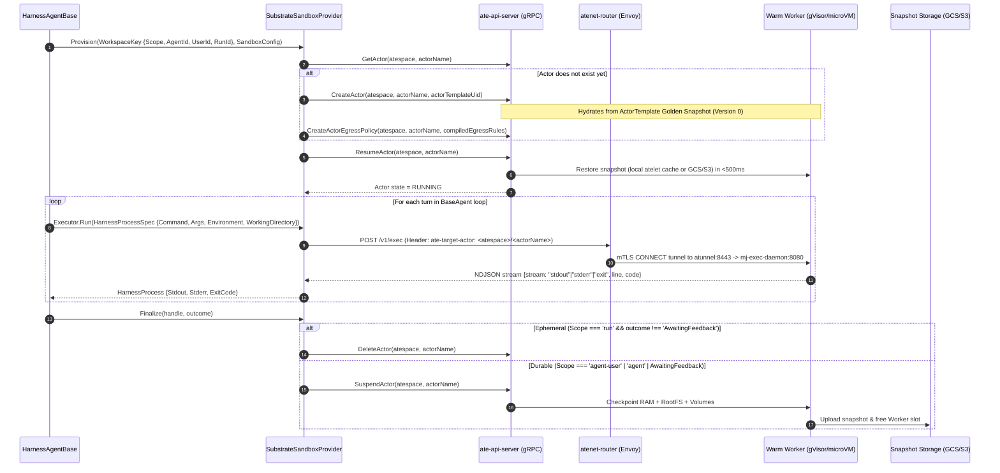
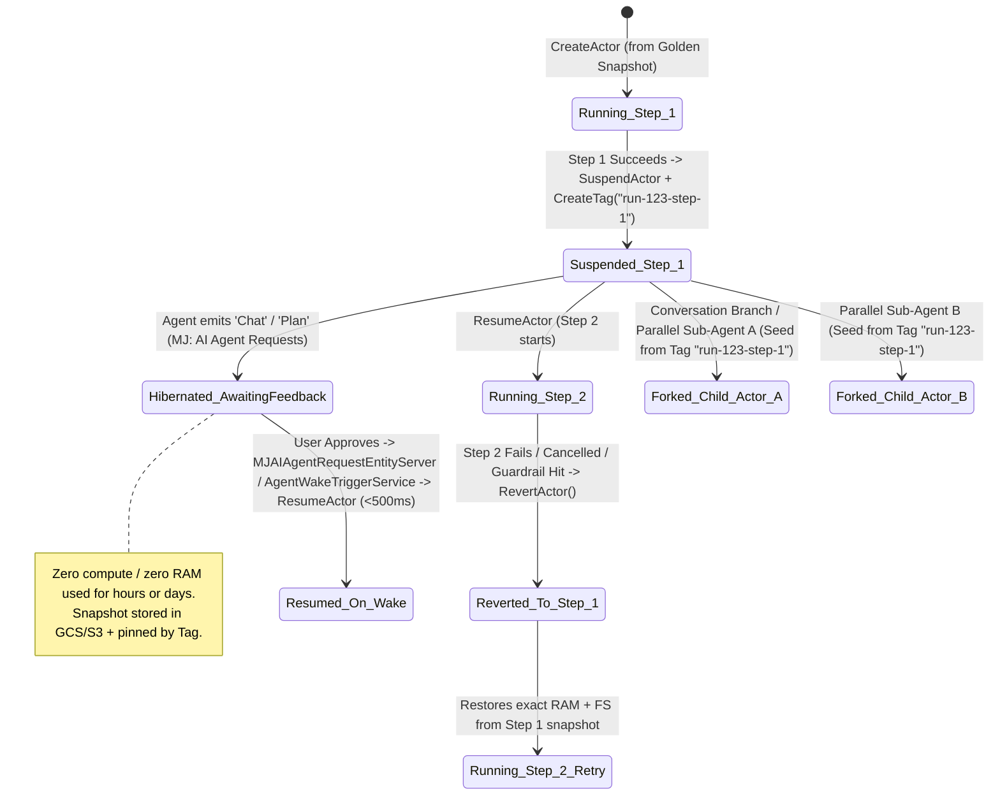
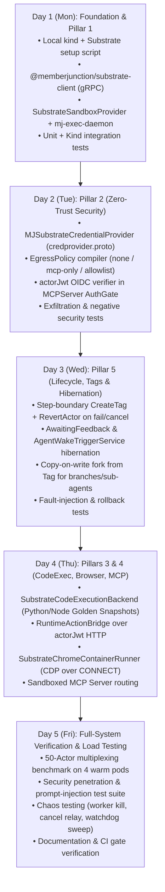

# Agent Substrate (`agent-substrate/substrate`) Integration Plan for MemberJunction

## Status: Proposed Implementation Plan (1-Week Sprint)

**Target Repositories / Packages:**
- `packages/AI/AgentHarness` (`@memberjunction/ai-agent-harness`)
- `packages/Credentials/Engine` (`@memberjunction/credentials-engine`)
- `packages/AI/MCPServer` (`@memberjunction/ai-mcp-server`) & `packages/AI/MCPClient` (`@memberjunction/ai-mcp-client`)
- `packages/AI/Agents` (`@memberjunction/ai-agents`) & `packages/AI/CorePlus` (`@memberjunction/ai-core-plus`)
- `packages/Actions/CodeExecution` (`@memberjunction/code-execution`) & `packages/Actions/RuntimeHost` (`@memberjunction/actions-runtime-host`)
- `packages/AI/RemoteBrowser/Providers/SelfHost` (`@memberjunction/ai-remote-browser-self-host`)

---

## 1. Executive Summary & Architectural Fit

[**Agent Substrate**](https://github.com/agent-substrate/substrate) (originally created at Google, donated to the CNCF, internal codename `ate`, shipped `v1.0.0`) is a **Kubernetes-native, zero-trust sandbox runtime and actor scheduler** built to run millions of bursty, stateful, untrusted agent and tool workloads with 10x–30x higher density than standard containers.

Agent Substrate is **not** an agent orchestration SDK—it does not compete with MemberJunction's `BaseAgent`, `LoopAgentType`, `FlowAgentType`, `PayloadManager`, or `TaskGraphDispatcher`. Instead, it provides the **sandboxed infrastructure plane** underneath them:

- **Decoupled Actors & Warm Workers**: An **Actor** represents a stateful sandbox instance (process tree, RAM, rootfs overlay, durable volumes, and cryptographic SPIFFE identity). A **WorkerPool** maintains pre-warmed Kubernetes pods running **gVisor (`runsc`)** or **Cloud Hypervisor microVMs** (`Kata Containers`).
- **Golden Snapshots & Sub-500ms Suspend/Resume**: Because agents spend most of their wall-clock life waiting on LLM responses, tool I/O, or humans, Substrate checkpoints idle Actors out of memory into GCS/S3 (with node-local caching via `atelet`) and restores them onto any available warm Worker in `<500ms` when network traffic or an RPC arrives.
- **Zero Ambient Credentials & Policy-Enforced Egress (`atenet-egress`)**: Sandboxed processes hold **zero secrets** in their environment variables, filesystems, or memory snapshots. All outbound traffic traverses `atenet-egress`, which enforces default-deny DNS/host policies and either injects secrets out-of-band via a pluggable gRPC `CredentialProvider` (`credprovider.proto`) or mints short-lived per-actor OIDC JWTs (`actorJwt`).

> [!IMPORTANT]
> **Explicit Boundary Alignment:**
> In the [Agent Substrate Security Overview](https://ate.dev/docs/security/security/#security-scope), the Substrate authors explicitly mark three responsibilities **Out of Scope** for Substrate, stating that the calling application platform must own them:
> 1. **Human-to-Actor Authentication & Authorization** → Owned by MJ's `AIAgentPermissionHelper` (`packages/AI/BaseAIEngine/src/AIAgentPermissionHelper.ts`) and `AgentUserPolicyEngine` (`packages/AI/CorePlus/src/AgentUserPolicyEngine.ts`).
> 2. **Agent Registry & Metadata** → Owned by MJ's `MJ: AI Agents`, `MJ: AI Agent Types`, `MJ: AI Agent Harnesses`, and `MJ: AI Agent Configurations`.
> 3. **Sub-Agent Hierarchy, Lineage & Provenance** → Owned by MJ's `MJAIAgentRunEntityExtended` (`ParentRunID`, `RootParentRunID`, `LastRunID`), `MJAIAgentRunStepEntityExtended`, and `PayloadManager`.

### High-Level Architecture Diagram

```mermaid
graph TB
    subgraph MJ_Control_Plane ["MemberJunction Application & Orchestration Plane (MJAPI)"]
        AR["AgentRunner & BaseAgent<br/>(packages/AI/Agents)"]
        HAB["HarnessAgentBase<br/>(packages/AI/AgentHarness)"]
        CE["CredentialEngine + AgentUserPolicyEngine<br/>(packages/Credentials/Engine)"]
        CES["CodeExecutionService & RuntimeActionExecutor<br/>(packages/Actions/CodeExecution)"]
        MCP_C["MCPClientManager<br/>(packages/AI/MCPClient)"]
        MCP_S["MCPServer + AuthGate<br/>(packages/AI/MCPServer)"]
        RB["RemoteBrowser SelfHost<br/>(packages/AI/RemoteBrowser)"]
    end

    subgraph MJ_Substrate_Adapters ["MJ Substrate Integration Layer (This Plan)"]
        SSP["SubstrateSandboxProvider<br/>(implements ISandboxProvider)"]
        MCP_CRED["MJSubstrateCredentialProvider<br/>(gRPC credprovider.v1.CredentialProvider)"]
        SCB["SubstrateCodeExecutionBackend<br/>(Python / Node Golden Snapshots)"]
        SCR["SubstrateChromeContainerRunner<br/>(implements IChromeContainerRunner)"]
    end

    subgraph Substrate_Cluster ["Agent Substrate Runtime on Kubernetes (ate-system)"]
        ATE_API["ate-api-server<br/>(gRPC Control Plane: Actors, Templates, Tags)"]
        ATE_IDP["ate-idp-server<br/>(OIDC Discovery & Actor JWT JWKS)"]
        ATE_ROUTER["atenet-router<br/>(Envoy Ingress Proxy + Request Parking)"]
        ATE_EGRESS["atenet-egress<br/>(Default-Deny Egress + Header Injection)"]
        
        subgraph Warm_Worker_Pool ["WorkerPool (Warm Worker Pods)"]
            W1["Worker Pod 1 (ateworker-gvisor / microvm)<br/>├── Actor: Harness (agent-user)<br/>├── Actor: Python Code Sandbox<br/>└── Actor: Headless Chromium"]
            W2["Worker Pod 2 (ateworker-gvisor / microvm)<br/>├── Actor: Sandboxed MCP Server<br/>└── (Free Actor Slots)"]
        end

        OBJ_STORE[("Snapshot Object Storage<br/>(GCS / S3 + atelet Local Cache)")]
    end

    AR --> HAB
    HAB --> SSP
    CES --> SCB
    RB --> SCR

    SSP -->|gRPC: CreateActor / ResumeActor / SuspendActor / RevertActor| ATE_API
    SSP -->|HTTPS + Header: ate-target-actor| ATE_ROUTER
    SCB -->|HTTPS + Header: ate-target-actor| ATE_ROUTER
    SCR -->|HTTP CONNECT <actor>:9222| ATE_ROUTER
    MCP_C -->|StreamableHTTP + ate-target-actor| ATE_ROUTER

    ATE_ROUTER -->|mTLS Tunnel (:8443 atunnel)| Warm_Worker_Pool
    Warm_Worker_Pool <-->|Checkpoint / Restore (<500ms)| OBJ_STORE

    Warm_Worker_Pool -->|Outbound HTTPS (Placeholder Header)| ATE_EGRESS
    ATE_EGRESS -->|gRPC mTLS: FetchSecret(uri, actor_spiffe_id)| MCP_CRED
    MCP_CRED -->|Decrypt + Audit + Policy Check| CE
    ATE_EGRESS -->|Injected actorJwt (Bearer)| MCP_S
    MCP_S -->|Verify JWKS| ATE_IDP
```

---

## 2. Reference Links: Official Google Open Source & Agent Substrate Documentation

Developers implementing this plan should consult these primary references:

### Core Architecture & Announcements
- **Google Open Source Blog Announcement**: [Sandboxing Untrusted AI Agents at Scale](https://opensource.googleblog.com/2026/11/sandboxing-untrusted-ai-agents-at-scale.html)
- **Agent Substrate Main Repository**: [github.com/agent-substrate/substrate](https://github.com/agent-substrate/substrate)
- **Official Documentation Portal**: [ate.dev/docs](https://ate.dev/docs/)
- **Architecture Deep Dive**: [ate.dev/docs/concepts/architecture](https://ate.dev/docs/concepts/architecture/) ([source markdown](https://github.com/agent-substrate/substrate/blob/main/docs/concepts/architecture.md))
- **Resource Model (`WorkerPool`, `SandboxConfig`, `ActorTemplate`, `Actor`, `Tag`)**: [ate.dev/docs/reference/resource-model](https://ate.dev/docs/reference/resource-model/)
- **Glossary of Terms (`ateapi`, `atelet`, `ateworker`, `atenet`, `atunnel`, `Atespace`)**: [ate.dev/docs/reference/glossary](https://ate.dev/docs/reference/glossary/) ([source markdown](https://github.com/agent-substrate/substrate/blob/main/docs/reference/glossary.md))
- **Request Parking (Handling Momentary Pool Saturation)**: [ate.dev/docs/concepts/request-parking](https://ate.dev/docs/concepts/request-parking/)

### Security, Egress Credential Injection & Identity
- **Security Overview & Principles**: [ate.dev/docs/security/security](https://ate.dev/docs/security/security/) ([source markdown](https://github.com/agent-substrate/substrate/blob/main/docs/security/security.md))
- **Threat Model**: [ate.dev/docs/security/threat-model](https://ate.dev/docs/security/threat-model/) & [`docs/threats.json`](https://github.com/agent-substrate/substrate/blob/main/docs/threats.json)
- **Egress Credential Injection Guide (`replaceHeaders`, `credentialUri`, `actorJwt`)**: [ate.dev/docs/guides/egress-credential-injection](https://ate.dev/docs/guides/egress-credential-injection/) ([source markdown](https://github.com/agent-substrate/substrate/blob/main/docs/guides/egress-credential-injection.md))
- **MITM Trust Bundle Projection for HTTPS Inspection**: [`docs/guides/egress-trust-bundle.md`](https://github.com/agent-substrate/substrate/blob/main/docs/guides/egress-trust-bundle.md)
- **Network Egress & DNS Relay Filtering**: [`docs/guides/network-egress.md`](https://github.com/agent-substrate/substrate/blob/main/docs/guides/network-egress.md) & [`docs/guides/egress-traffic.md`](https://github.com/agent-substrate/substrate/blob/main/docs/guides/egress-traffic.md)
- **Actor JWTs & OIDC Federation**: [`docs/guides/actor-jwts.md`](https://github.com/agent-substrate/substrate/blob/main/docs/guides/actor-jwts.md), [`docs/guides/actor-jwt-federation.md`](https://github.com/agent-substrate/substrate/blob/main/docs/guides/actor-jwt-federation.md), and [`docs/guides/actor-jwt-key-rotation.md`](https://github.com/agent-substrate/substrate/blob/main/docs/guides/actor-jwt-key-rotation.md)

### Protobuf Contracts & Reference Demos
- **Control Plane gRPC Protobuf (`substrate.ateapi.v1.Control`)**: [`api/ateapi/v1/ateapi.proto`](https://github.com/agent-substrate/substrate/blob/main/api/ateapi/v1/ateapi.proto)
- **Credential Provider Plugin Protobuf (`substrate.credprovider.v1.CredentialProvider`)**: [`api/credprovider/v1/credprovider.proto`](https://github.com/agent-substrate/substrate/blob/main/api/credprovider/v1/credprovider.proto)
- **Reference K8s Credential Provider Implementation**: [`cmd/credential-provider/kubernetes-secrets`](https://github.com/agent-substrate/substrate/tree/main/cmd/credential-provider/kubernetes-secrets)
- **Interactive Shell Sandbox Demo**: [`demos/sandbox`](https://github.com/agent-substrate/substrate/tree/main/demos/sandbox) ([`demos/sandbox/main.go`](https://github.com/agent-substrate/substrate/blob/main/demos/sandbox/main.go))
- **Claude Code Multiplexing Demo (3 Agents on 2 Warm Pods)**: [`demos/claude-code-multiplex`](https://github.com/agent-substrate/substrate/tree/main/demos/claude-code-multiplex)
- **kagent Integration Architecture Reference**: [kagent Agent Substrate Architecture](https://kagent.dev/docs/kagent/1.x/about/architecture/agent-substrate/)

---

## 3. Detailed Technical Design for the 5 Integration Pillars

---

### Pillar 1: `SubstrateSandboxProvider` for `@memberjunction/ai-agent-harness`

#### 1.1 Current State & Gaps in MJ
In `packages/AI/AgentHarness`:
1. **`ISandboxProvider` (`packages/AI/AgentHarness/src/sandbox/ISandboxProvider.ts:83-93`)** and **`SandboxExecutor` (`packages/AI/AgentHarness/src/sandbox/SandboxExecutor.ts:48-50`)** are already designed for remote execution: `SandboxExecutor.Run(spec: HarnessProcessSpec)` returns a `HarnessProcess` with `Stdout: AsyncIterable<string>`, `Stderr: AsyncIterable<string>`, `ExitCode: Promise<number | null>`, and `Kill(): void`.
2. **Unenforced Network Policies in `DockerSandboxProvider`**: In `packages/AI/AgentHarness/src/sandbox/DockerSandboxProvider.ts:35-42` and `buildNetworkArgs` (`:180-193`), `mcp-only` and `allowlist` network policies are explicitly documented as **not yet enforced at the packet level**—they fall back to default Docker bridge networking.
3. **Loss of In-Container State Between Runs**: `DockerSandboxProvider.Provision` (`:65`) starts a container per `AIAgentRun` (`docker run --detach --rm`), and `Finalize` (`:135`) stops and destroys it at the end of the run. On multi-turn conversations (`Scope: 'agent-user'` or `'agent'`), only files inside the host bind-mounted `/workspace` survive; global npm/pip packages, virtualenvs, background processes, and in-memory state are lost after every turn.
4. **Host Kernel & Docker Socket Coupling**: `DockerSandboxProvider` shells out to `docker` on the MJAPI host, requiring root-equivalent Docker socket access and running plain Linux containers rather than VM/gVisor sandboxes.

#### 1.2 Target Design with Agent Substrate
We add **`SubstrateSandboxProvider`** (`packages/AI/AgentHarness/src/sandbox/SubstrateSandboxProvider.ts`) and **`SubstrateExecExecutor`** (`packages/AI/AgentHarness/src/sandbox/SubstrateExecExecutor.ts`), selected when `HarnessAgentConfig.sandbox.provider === 'substrate'`.



#### 1.3 Key Implementation Details

1. **Deterministic Actor Naming from `WorkspaceKey`**:
   - Given `WorkspaceKey` (`Scope: 'run' | 'agent' | 'agent-user'`, `AgentId`, `UserId`, `RunId`), compute a DNS-1123 compliant actor name (`<= 63` chars, lowercase alphanumeric + hyphens):
     - `Scope === 'run'`: `run-${ normalizeUuidPrefix(RunId) }` (`Ephemeral: true`)
     - `Scope === 'agent'`: `agent-${ normalizeUuidPrefix(AgentId) }` (`Ephemeral: false`)
     - `Scope === 'agent-user'`: `au-${ normalizeUuidPrefix(AgentId, 16) }-${ normalizeUuidPrefix(UserId, 16) }` (`Ephemeral: false`)
2. **Workload Image & `mj-exec-daemon` (`packages/AI/AgentHarness/docker/substrate-harness-workload/`)**:
   - Extend `demos/sandbox/main.go` into a small streaming HTTP server (`mj-exec-daemon`) listening on port `80` inside the `ghcr.io/memberjunction/harness-sandbox` image:
     - `POST /v1/exec`: Accepts `{ command: string, args: string[], env: Record<string, string>, cwd: string }` and streams newline-delimited JSON (`NDJSON`) frames: `{"type":"stdout","data":"..."}\n`, `{"type":"stderr","data":"..."}\n`, `{"type":"exit","code":0}\n`. Supports stdin forwarding via chunked request body or WebSocket upgrade, and kills the child process if the HTTP request is aborted (`CancellationToken`).
     - `PUT /v1/files` & `GET /v1/files`: Streams input artifacts into `/workspace` and collects output artifacts at turn end without requiring a host bind-mount on the MJAPI pod.
3. **Compiling `HarnessNetworkPolicy` into Substrate `EgressPolicy`**:
   - In `SubstrateSandboxProvider.buildEgressPolicy(config, agentId)`:
     - `NetworkPolicy === 'none'`: Empty `EgressPolicy` (`rules: []`) — Substrate's default-deny blocks all outbound DNS and TCP/UDP.
     - `NetworkPolicy === 'mcp-only'`: Allows HTTPS **only** to the harness's LLM vendor endpoint (e.g. `api.anthropic.com`, `api.openai.com`, `generativelanguage.googleapis.com`) and MJ's `MCPServer` hostname, with `replaceHeaders` effects (see Pillar 2).
     - `NetworkPolicy === 'allowlist'`: Allows HTTPS to `mcp-only` hosts plus the explicit `config.allowedHosts` list declared in `AIAgent.TypeConfiguration`.
4. **Extending `HarnessAgentConfig` (`packages/AI/AgentHarness/src/HarnessAgentBase.ts:54`)**:
   ```typescript
   interface HarnessAgentConfig {
       harnessName?: string;
       sandbox?: {
           provider?: 'local' | 'docker' | 'substrate';
           image?: string;
           workspaceScope?: HarnessWorkspaceScope;
           networkPolicy?: HarnessNetworkPolicy;
           allowedHosts?: string[];
           substrate?: {
               atespace?: string;
               actorTemplateName?: string;
               ateApiAddress?: string;
               ateRouterAddress?: string;
               preferredFidelity?: 'MEMORY' | 'ROOTFS' | 'VOLUMES';
           };
       };
       // ...
   }
   ```

---

### Pillar 2: Zero-Credential Sandboxes via MJ Credential Provider Plugin (`credprovider.proto`) & `actorJwt`

#### 2.1 Current State & Security Risk in MJ
In `packages/AI/AgentHarness/src/HarnessAgentBase.ts:543-589` (`resolveGrantedEnvironment`):
- MJ queries `MJ: AI Agent Credentials` for the active agent, loads decrypted secret values from `MJ: Credentials` (`loadCredentialValue` `:631`), or falls back to `process.env[AI_VENDOR_API_KEY__<DRIVER>]`, and passes those plaintext secrets into `HarnessProcessSpec.Environment`.
- Inside the sandbox, CLI harnesses execute model-authored shell commands. Any prompt injection in a repository file, issue description, or web page can run `env` or `cat /proc/self/environ` and exfiltrate the raw API keys.
- Furthermore, when a remote or sandboxed agent needs to call back into MJ (compare `SkipProxyAgent` in `skip-callback-key-provisioner.ts`), provisioning and revoking temporary API keys adds database churn and leaves bearer tokens inside the untrusted environment.

#### 2.2 Target Design: Out-of-Band Egress Injection + `actorJwt`

We implement Agent Substrate's [`substrate.credprovider.v1.CredentialProvider`](https://github.com/agent-substrate/substrate/blob/main/api/credprovider/v1/credprovider.proto) gRPC service directly against MJ's `CredentialEngine` (`packages/Credentials/Engine/src/CredentialEngine.ts`) and `AgentUserPolicyEngine` (`packages/AI/CorePlus/src/AgentUserPolicyEngine.ts`).

```mermaid
sequenceDiagram
    autonumber
    participant Actor as Sandboxed Actor (Zero Secrets)
    participant Egress as atenet-egress (MITM TLS Proxy)
    participant CredSvc as MJSubstrateCredentialProvider (gRPC)
    participant Policy as AgentUserPolicyEngine & AIAgentCredentials
    participant CredEng as CredentialEngine (MJ: Credentials)
    participant Upstream as Upstream API (Anthropic / GitHub / MCP)
    participant MJMCP as MJ MCPServer (AuthGate)
    participant IDP as ate-idp-server (OIDC JWKS)

    rect rgb(235, 245, 255)
        Note over Actor,Upstream: Flow A: External API Call with Egress Secret Injection
        Actor->>Egress: HTTPS POST https://api.anthropic.com/v1/messages<br/>Header: x-api-key: ate-placeholder
        Note over Egress: Terminates TLS via projected MITM Trust Bundle<br/>Matches EgressPolicy rule for api.anthropic.com
        Egress->>CredSvc: gRPC mTLS FetchSecret(uri="ate-secret://mj.local/<agentId>/<credId>/<field>",<br/>actor_spiffe_id="spiffe://.../actor/<atespace>/<actorName>")
        CredSvc->>CredSvc: Verify client cert SAN == spiffe://.../ns/ate-system/sa/atenet-egress
        CredSvc->>Policy: Verify actorName maps to active AIAgentRun/Session<br/>& AgentID is granted CredentialID for contextUser
        CredSvc->>CredEng: GetCredential(credentialName, {contextUser, credentialId})
        Note over CredEng: Decrypts Values, validates expiry, writes MJ: Audit Logs
        CredEng-->>CredSvc: Decrypted secret string
        CredSvc-->>Egress: FetchSecretResponse { opaque_bytes: <secret> }
        Egress->>Upstream: Re-originate TLS with Header: x-api-key: <real-secret>
        Upstream-->>Actor: 200 OK (Streaming LLM Response)
    end

    rect rgb(235, 255, 240)
        Note over Actor,IDP: Flow B: Keyless Callback into MJ MCPServer via actorJwt
        Actor->>Egress: HTTPS POST https://mj-mcp.internal/mcp<br/>Header: Authorization: Bearer placeholder
        Egress->>IDP: MintActorJwt(audiences=["https://mj-mcp.internal"], expirationSeconds=900)
        IDP-->>Egress: Signed JWT (sub="actor/<atespace>/<actorName>", uid="<actorUid>")
        Egress->>MJMCP: Forward with Header: Authorization: Bearer <actorJwt>
        MJMCP->>IDP: Verify JWT signature against OIDC JWKS
        MJMCP->>MJMCP: Resolve (atespace, actorName, uid) -> active AIAgentRun & contextUser
        MJMCP-->>Actor: Execute MCP Tool under contextUser + AgentUserPolicyEngine ceiling
    end
```

#### 2.3 Key Implementation Details

1. **URI Convention (`ate-secret://mj.local/<agentId>/<credentialId>/<fieldKey>`)**:
   - When `HarnessAgentBase.resolveGrantedEnvironment` runs with `SubstrateSandboxProvider`:
     - It **never** loads decrypted secret values into `environment`.
     - Instead, it sets `environment[grant.EnvVariableName] = 'ate-placeholder'` and registers an `HttpsRule` in the Actor's `EgressPolicy`:
       ```yaml
       rules:
         - https:
             hostnames: ["api.anthropic.com"]
             effects:
               replaceHeaders:
                 - header: "x-api-key"
                   prefix: ""
                   credentialUri: "ate-secret://mj.local/8f3a.../4b1c.../apiKey"
       ```
2. **`MJSubstrateCredentialProvider` (`packages/AI/AgentHarness/src/substrate/MJSubstrateCredentialProvider.ts`)**:
   - Implements `substrate.credprovider.v1.CredentialProvider.FetchSecret(FetchSecretRequest) returns (FetchSecretResponse)`:
     - **mTLS Caller Pinning**: Verifies the peer certificate chains to the cluster's pod-identity trust bundle and pins URI SAN `spiffe://cluster.local/ns/ate-system/sa/atenet-egress` (matching [Substrate's trust model](https://ate.dev/docs/guides/egress-credential-injection/#the-plugin-api)).
     - **Actor-to-Run Attestation**: Parses `request.actor_spiffe_id` (`spiffe://<trust-domain>/atespace/<atespace>/actor/<actor-name>`) and looks up the active `SandboxHandle` / `MJAIAgentRunEntity` in MJ. If the run is `Cancelled`, `Failed`, or `Completed`, returns gRPC `PERMISSION_DENIED` (`403` fail-closed at `atenet-egress`).
     - **Governance & Decryption**: Confirms `MJAIAgentCredentialEntity` is `Active` for `AgentID`, checks `AgentUserPolicyEngine` for the run's `contextUser`, and calls `CredentialEngine.Instance.GetCredential` (which decrypts the secret and records an `MJ: Audit Logs` entry).
3. **`actorJwt` Verifier in `MCPServer` (`packages/AI/MCPServer/src/AuthGate.ts`)**:
   - Add an OIDC JWKS verifier in `AuthGate.ts` configured with `SUBSTRATE_ACTOR_JWT_ISSUER` and `SUBSTRATE_IDP_JWKS_URI`.
   - When a valid `actorJwt` (`sub: "actor/<atespace>/<actor-name>"`) arrives, `AuthGate` resolves the active `MJAIAgentRunEntity` for that actor, binds the request's `contextUser` and `AgentID`, and enforces `AgentUserPolicyEngine` permissions without any API key ever entering the sandbox.

---

### Pillar 3: Stateful Polyglot Code Execution & Runtime Actions (`packages/Actions/CodeExecution`)

#### 3.1 Current State & Gaps in MJ
In `packages/Actions/CodeExecution`:
- `CodeExecutionService` (`packages/Actions/CodeExecution/src/CodeExecutionService.ts:30`) and `RuntimeActionExecutor` (`packages/Actions/Runtime/src/RuntimeActionExecutor.ts:44`) execute code inside a forked Node child-process pool (`WorkerPool.ts:89`) using V8 `isolated-vm` (`worker.ts:130`).
- **Limitations**:
  1. **JavaScript-only** with a hardcoded 6-package allowlist (`lodash`, `date-fns`, `mathjs`, `papaparse`, `uuid`, `validator` in `worker.ts:332-344`).
  2. **No Python data science stack** (`pandas`, `polars`, `numpy`, `scipy`, `matplotlib`, `seaborn`, `scikit-learn`, `duckdb`, `openpyxl`, `reportlab`) — which is the #1 runtime environment needed by analytical and research agents.
  3. **Stateless per call**: Every `ExecuteCode` invocation creates a brand-new `ivm.Isolate` (`worker.ts:154`) and destroys it immediately. An agent cannot load a dataset in Step 1, inspect its schema in Step 2, and plot/export a chart in Step 3 without re-fetching and re-parsing everything from scratch.

#### 3.2 Target Design: Golden-Snapshot Polyglot Code Interpreters + Reverse RPC Bridge

```mermaid
flowchart TB
    subgraph MJ_Agent_Turn ["BaseAgent Step Execution"]
        Step1["Step 1: ExecuteCode (Python)<br/>df = mj.run_query('SalesByRegion')"]
        Step2["Step 2: ExecuteCode (Python)<br/>df.groupby('region').sum().to_excel('/workspace/out.xlsx')"]
        Bridge["RuntimeActionBridge HTTP/mTLS Endpoint<br/>(BuildRuntimeActionBridgeHandlers)"]
    end

    subgraph Substrate_Code_Actor ["Substrate Actor (Template: mj-python-datascience)"]
        Kernel["Persistent IPython / FastAPI Kernel Daemon<br/>(Restored from Golden Snapshot in <200ms)"]
        Mem["In-Memory State: `df` DataFrame persists across Step 1 -> Step 2"]
        FS["Writable Overlay: `/workspace/out.xlsx`"]
    end

    Step1 -->|POST /v1/kernel/execute<br/>ate-target-actor: mj/code-run-789| Kernel
    Kernel -->|POST /internal/runtime-bridge<br/>Authorization: Bearer <actorJwt>| Bridge
    Bridge -->|Executes under contextUser + permissions| Kernel
    Kernel --> Mem
    Step2 -->|Resumes Actor (<200ms) & runs in same Python namespace| Kernel
    Kernel --> FS
    FS -->|Extracted as MJ File Artifact via ArtifactToolManager| Step2
```

#### 3.3 Key Implementation Details

1. **Two Golden-Snapshot `ActorTemplate`s**:
   - **`mj-python-datascience`**: Pre-warmed Python 3.12 kernel with `pandas`, `polars`, `numpy`, `matplotlib`, `plotly`, `scikit-learn`, `duckdb`, `openpyxl`, `pypdf`, and a lightweight `mj` Python bridge client pre-imported in memory before the Golden Snapshot is captured. Cold imports (`import pandas`, `import matplotlib`) take **0ms at run time** because they are already resident in the Golden Snapshot's RAM!
   - **`mj-node-runtime`**: Pre-warmed Node 24 LTS runtime for `RuntimeActionExecutor` (`Action.Type === 'Runtime'`), removing the 128MB V8 isolate ceiling when an approved Runtime Action requires full npm modules or filesystem staging.
2. **Tiered Execution Strategy in `CodeExecutionService`**:
   - Keep `isolated-vm` (`WorkerPool`) as the **fast in-process tier (`<10ms`)** for pure, stateless JS expressions.
   - Route `language: 'python'`, `statefulSession: true`, or heavy `RuntimeAction` executions to **`SubstrateCodeExecutionBackend`** (`packages/Actions/CodeExecution/src/SubstrateCodeExecutionBackend.ts`).
3. **Bridging `BuildRuntimeActionBridgeHandlers` (`packages/Actions/RuntimeHost/src/RuntimeActionBridge.ts:65`)**:
   - Expose the existing `BuildRuntimeActionBridgeHandlers` (`utilities.md.*`, `utilities.rv.RunView`, `utilities.rq.RunQuery`, `utilities.entity.*`, `utilities.actions.Invoke`, `utilities.ai.*`) over an internal MJServer endpoint authenticated via Substrate's `actorJwt` and enforcing the exact same `maxBridgeCalls` (default `100`) and `RuntimeActionConfiguration.permissions` (`allowedEntities`, `allowedActions`, `allowedAgents`).

---

### Pillar 4: On-Demand Sandboxed MCP Servers, Self-Hosted Remote Browsers & Bursty Sidecars

#### 4.1 Sandboxed MCP Servers (`packages/AI/MCPClient`)
- **Problem Today**: In `MCPClientManager.ts` (`packages/AI/MCPClient/src/MCPClientManager.ts:296`), `StdioClientTransport` spawns third-party MCP server binaries (`npx`, `uvx`, Python/Node scripts) directly as child processes of the MJAPI server, sharing MJAPI's filesystem and network. Meanwhile, HTTP MCP servers require always-on pods even when called once a day.
- **Substrate Solution**:
  - Add a `'SubstrateActor'` transport mode in `MCPClientManager`.
  - Each `MJMCPServerConnectionEntity` can reference an `ActorTemplate`. When `MCPClientManager.CallTool` (`:476`) runs, requests route through `atenet-router` with header `ate-target-actor: mj-mcp/conn-${connectionId}-user-${userId}`.
  - Substrate wakes the MCP server Actor in `<500ms`, `atenet-egress` injects the user's `OAuthManager` / `CredentialEngine` token via Pillar 2, and the Actor suspends back to object storage after an idle timeout.

#### 4.2 Self-Hosted Remote Browser Sandboxes (`packages/AI/RemoteBrowser/Providers/SelfHost`)
- **Problem Today**: `IChromeContainerRunner` (`packages/AI/RemoteBrowser/Providers/SelfHost/src/chrome-container-runner.ts:76`) has a clean seam (`Launch(options) -> Promise<ChromeContainerLease>`), and its default `LocalChromeContainerRunner` (`local-chrome-container-runner.ts:49`) spawns local Playwright Chromium processes on loopback ports. Cold-starting Chromium takes 1.5–4 seconds and consumes 500MB–1GB RAM per idle browser.
- **Substrate Solution (`SubstrateChromeContainerRunner`)**:
  - Implement `SubstrateChromeContainerRunner` (`packages/AI/RemoteBrowser/Providers/SelfHost/src/substrate-chrome-container-runner.ts`) implementing `IChromeContainerRunner`:
    - Uses an `ActorTemplate` (`mj-chromium-headless`) whose Golden Snapshot captures a booted, warmed Chromium instance listening on CDP port `9222`.
    - Uses Substrate's **Arbitrary-Port Ingress** (`HTTP CONNECT <actor-dns>:9222` through `atenet-router`) to expose the `CdpEndpoint` WebSocket to MJ's Playwright controller.
    - On `lease.Release()`, either calls `DeleteActor` (for ephemeral runs) or `SuspendActor` (preserving cookies, `localStorage`, `IndexedDB`, and open DOM tabs across multi-turn agent steps while freeing the 1GB RAM on the Worker pod!).

#### 4.3 Bursty Sidecars (`VideoStudio` RenderWorker & `PredictiveStudio` MLSidecar)
- Both `@memberjunction/video-studio-render-worker` (`packages/AI/VideoStudio/RenderWorker/src/index.ts:122`) and `MLSidecar` (`packages/AI/PredictiveStudio/Sidecar/src/ml-sidecar.ts:151`, which already supports `PREDICTIVE_STUDIO_SIDECAR_URL` remote mode at `:189`) are bursty HTTP services that sit idle most of the day. Deploying them as Substrate `ActorTemplate`s behind `atenet-router` lets them scale to zero RAM when idle and resume in `<500ms` on demand.

---

### Pillar 5: Snapshot `Tag`s, `RevertActor` Rollback & Zero-Cost Hibernation for Human-in-the-Loop, Chief of Staff & Branching

#### 5.1 Current State in MJ
MJ has rich multi-turn and human-in-the-loop pause/resume semantics in `packages/AI/Agents`:
1. **`Chat` & `Plan` Steps (`Status = 'AwaitingFeedback'`)**: When `BaseAgent` emits a clarifying question or plan requiring approval (`base-agent.ts:20901, 20996, 22732`), it creates an `MJ: AI Agent Requests` row and terminates the Node.js loop. When the user approves or replies hours/days later, `MJAIAgentRequestEntityServer.resumeAgent()` (`packages/AI/Agents/src/MJAIAgentRequestEntityServer.ts:103`) or `AgentWakeTriggerService` (`packages/AI/Agents/src/AgentWakeTriggerService.ts:150`) starts a new `AIAgentRun` chained via `lastRunId`.
2. **Stopped Runs & Watchdog (`AgentRunWatchdog`)**: `AgentRunWatchdog` (`packages/AI/Agents/src/agent-run-watchdog.ts:112`) heartbeats active runs, relays cross-instance cancellations, and sweeps orphaned runs, while `loadStoppedRunContinuation` (`base-agent.ts:10425`) recovers payload progress on the next turn.
3. **Conversation Branching & Parallel Sub-Agents**: Users can branch conversations (`ConversationBranchRow`), and `BaseAgent` can spawn parallel sub-agents or `ForEach` iterations.

#### 5.2 Target Design: Pairing `AIAgentRunStep` with Substrate Snapshot `Tag`s & `RevertActor`



#### 5.3 Key Implementation Details

1. **Step-Boundary Checkpoint Tagging (`CreateTag`)**:
   - After a mutating sandbox step (`Prompt` in `HarnessAgentBase`, or `Actions` in `SubstrateCodeExecutionBackend`) completes cleanly, optionally call `SuspendActor` + `CreateTag(atespace, tagName: "step-${stepEntity.ID}")` and record the snapshot tag metadata in `MJAIAgentRunStepEntityExtended.OutputData`.
2. **Transactional Sandbox Rollback (`RevertActor`)**:
   - If a turn times out, throws an unhandled error, is cancelled via `AgentRunWatchdog` (`RequestCancel`), or a human **Rejects** an `MJAIAgentRequestEntity` approval gate, invoke `Control.RevertActor(atespace, actorName)`.
   - `RevertActor` immediately terminates the dirty/compromised sandbox, discards un-checkpointed mutations, and resets the Actor to its last verified durable snapshot.
3. **Copy-on-Write Sandbox Forking for Conversation Branches & Parallel Sub-Agents**:
   - When a user branches a conversation from message $N$ (`ConversationDetailID`), or when a parent agent spawns parallel sub-agents that share a repository workspace (`Scope: 'fork'` in `SandboxConfig.Concurrency` at `ISandboxProvider.ts:25`), look up the `ActorSnapshotTag` recorded on the step at message $N$ and call `CreateActor` seeded from that tag. Each branch or sub-agent gets an instant, independent copy-on-write clone of the filesystem and memory at that exact point in time.

---

## 4. One-Week (5-Day) Developer Implementation & Extensive Testing Plan

This schedule is structured so a single senior engineer can build, integrate, and exhaustively test all five pillars in **5 working days (40 hours)**, with clean PR checkpoints at the end of each day.



---

### Day 1 (Monday): Local Substrate Harness, gRPC Control Client & Pillar 1 (`SubstrateSandboxProvider`)

#### Morning (4h): Dev Environment & `SubstrateControlClient`
1. **Cluster Bootstrap Script (`scripts/dev/setup-substrate-kind.sh`)**:
   - Automates the [Agent Substrate Kind Quickstart](https://ate.dev/docs/get-started/quickstart/):
     - Creates local `kind` cluster with tuned kernel neighbor table (`net.ipv4.neigh.default.gc_thresh1/2/3`).
     - Deploys `ate-system` (`ate-api-server`, `atecontroller`, `atelet`, `atenet-router`, `atenet-egress`, `ate-idp-server`, local S3/MinIO object store for snapshots).
     - Applies default `SandboxConfig` (`gvisor`) and a warm 4-pod `WorkerPool` (`mj-default-worker-pool`).
2. **Typed gRPC Client (`packages/AI/AgentHarness/src/substrate/SubstrateControlClient.ts`)**:
   - Load [`api/ateapi/v1/ateapi.proto`](https://github.com/agent-substrate/substrate/blob/main/api/ateapi/v1/ateapi.proto) using `@grpc/grpc-js` and `@grpc/proto-loader` (or generated TS types via `ts-proto`).
   - Wrap `CreateAtespace`, `CreateActorTemplate`, `GetActor`, `CreateActor`, `ResumeActor`, `SuspendActor`, `RevertActor`, `DeleteActor`, `CreateActorEgressPolicy`, and `CreateTag` with strongly-typed TypeScript interfaces (strictly **no `any` types** per MJ rules).

#### Afternoon (4h): `mj-exec-daemon`, `SubstrateSandboxProvider` & `SubstrateExecExecutor`
1. **Build `mj-exec-daemon` (`packages/AI/AgentHarness/docker/substrate-harness-workload/`)**:
   - Implement the streaming NDJSON `/v1/exec` and `/v1/files` HTTP server inside the harness sandbox image.
2. **Implement `SubstrateSandboxProvider` & `SubstrateExecExecutor` (`packages/AI/AgentHarness/src/sandbox/SubstrateSandboxProvider.ts`)**:
   - Implement `ISandboxProvider.Provision(key, config)` and `ISandboxProvider.Finalize(handle, outcome)`.
   - Wire `provider: 'substrate'` into `HarnessAgentBase.createSandboxProvider` (`packages/AI/AgentHarness/src/HarnessAgentBase.ts:692`).
3. **Day 1 Tests (`packages/AI/AgentHarness/src/__tests__/SubstrateSandboxProvider.test.ts`)**:
   - **Unit Tests (Mock gRPC & HTTP)**: Verify `WorkspaceKey` -> `(atespace, actorName)` mapping for `run`, `agent`, and `agent-user` scopes; verify `Finalize` calls `DeleteActor` when `Ephemeral: true` and `SuspendActor` when `Ephemeral: false`; verify `Finalize` never throws on gRPC errors.
   - **Live `kind` Integration Test**: Provision an Actor from Golden Snapshot, run `echo`, `python3 -c`, and a multi-turn file write (`/tmp/state.txt` outside `/workspace`), call `Finalize` (`SuspendActor`), re-provision the same `WorkspaceKey`, and assert `/tmp/state.txt` and process state survived hibernation in `<500ms`.

---

### Day 2 (Tuesday): Pillar 2 — Zero-Credential Egress (`credprovider.proto`) & `actorJwt` Federation

#### Morning (4h): `MJSubstrateCredentialProvider` & Egress Policy Compiler
1. **Implement `MJSubstrateCredentialProvider` (`packages/AI/AgentHarness/src/substrate/MJSubstrateCredentialProvider.ts`)**:
   - Implement [`substrate.credprovider.v1.CredentialProvider.FetchSecret`](https://github.com/agent-substrate/substrate/blob/main/api/credprovider/v1/credprovider.proto).
   - Enforce mTLS client certificate SAN verification (`spiffe://cluster.local/ns/ate-system/sa/atenet-egress`).
   - Parse `ate-secret://mj.local/<agentId>/<credentialId>/<fieldKey>` and `actor_spiffe_id`, verify the run is active and authorized via `MJAIAgentCredentialEntity` + `AgentUserPolicyEngine`, resolve the secret via `CredentialEngine.Instance.GetCredential`, and return `FetchSecretResponse`.
2. **Update `HarnessAgentBase.resolveGrantedEnvironment` (`packages/AI/AgentHarness/src/HarnessAgentBase.ts:543`)**:
   - When `sandboxProvider instanceof SubstrateSandboxProvider`, inject `ate-placeholder` values into `Environment` and attach `replaceHeaders` rules to the Actor's `EgressPolicy`.

#### Afternoon (4h): `actorJwt` OIDC Verification in `MCPServer` & Security Tests
1. **Add `actorJwt` Verification to `MCPServer` (`packages/AI/MCPServer/src/AuthGate.ts`)**:
   - Verify inbound Bearer tokens issued by `ACTOR_JWT_ISSUER` against `ate-idp-server`'s OIDC discovery JWKS (`/.well-known/openid-configuration`).
   - Map `sub` (`actor/<atespace>/<actorName>`) and `uid` to the active `MJAIAgentRunEntity` and `contextUser`.
2. **Day 2 Tests (`packages/AI/AgentHarness/src/__tests__/SubstrateCredentialProvider.test.ts`)**:
   - **Unit Tests**: Test `FetchSecret` with valid active actor, expired credential (`CredentialEngine` expiration check), unauthorized `agentId`/`credentialId` pair (`403 PermissionDenied`), cancelled run (`403 PermissionDenied`), and malformed URI (`400 InvalidArgument`).
   - **Live Security & Exfiltration Tests**:
     - Inside the sandboxed Actor, run `env` and `/proc/self/environ` and assert **zero real API keys exist**.
     - Have the Actor call `https://httpbin.org/headers` (or `api.anthropic.com`) with `x-api-key: ate-placeholder` and verify `atenet-egress` injects the real key from `MJ: Credentials` and writes an `MJ: Audit Logs` record.
     - Have the Actor attempt to `curl` an unapproved host (`https://evil.example.com`) with the placeholder header and assert `atenet-egress` drops the connection and **never** calls `FetchSecret`.

---

### Day 3 (Wednesday): Pillar 5 — Snapshot `Tag`s, `RevertActor`, `AwaitingFeedback` Hibernation & Branch Forking

#### Morning (4h): Step-Boundary `Tag`s, `RevertActor` & `AwaitingFeedback` Hibernation
1. **Step-Boundary Tagging & Rollback (`packages/AI/AgentHarness/src/HarnessAgentBase.ts` & `SubstrateSandboxProvider.ts`)**:
   - Add `CheckpointStep(handle: SandboxHandle, stepId: string): Promise<string>` and `RevertToLastCheckpoint(handle: SandboxHandle): Promise<void>` on `SubstrateSandboxProvider`.
   - Hook `RevertActor` into `HarnessAgentBase` when a turn fails validation, exceeds cost/token budget (`checkTreeBudgetLimit`), or is aborted by `AgentRunWatchdog.RequestCancel`.
2. **Zero-Cost Hibernation Across `AwaitingFeedback` & `AgentWakeTriggerService`**:
   - Ensure that when `BaseAgent` transitions to `Status = 'AwaitingFeedback'` (`executeChatStep` / `executePlanStep`) or waits on an `MJAIAgentRequestEntity`, `Finalize` suspends the Actor (`SuspendActor`) and tags the snapshot (`CreateTag`), and when `MJAIAgentRequestEntityServer.resumeAgent()` or `AgentWakeTriggerService` wakes the agent, the new run resumes the exact suspended Actor.

#### Afternoon (4h): Copy-on-Write Sandbox Forking (`Concurrency: 'fork'`)
1. **Implement `Concurrency: 'fork'` in `SubstrateSandboxProvider`**:
   - Support seeding a new Actor from an existing `ActorSnapshotTag` when a conversation branches (`ConversationBranchRow`) or when concurrent sub-agents request `Concurrency: 'fork'` on a shared workspace.
2. **Day 3 Tests (`packages/AI/AgentHarness/src/__tests__/SubstrateLifecycleAndForking.test.ts`)**:
   - **Rollback Test**: Step 1 writes `/workspace/good.txt` and checkpoints. Step 2 corrupts `/workspace/good.txt`, writes `/workspace/bad.txt`, and triggers an abort/failure (`RevertActor`). Verify the next resume sees `/workspace/good.txt` intact and `/workspace/bad.txt` gone.
   - **Forking Test**: Create a base Actor, write state, tag snapshot `v1`, fork two child Actors `branch-a` and `branch-b` from `v1`, mutate both concurrently, and assert complete isolation with zero cross-talk.
   - **Human Approval Hibernation Test**: Run an agent that pauses on an `MJ: AI Agent Requests` approval, verify the Worker pod slot is freed (`ListWorkerActorAssignments` shows `0` active actors), approve the request to trigger `MJAIAgentRequestEntityServer.resumeAgent()`, and verify the Actor resumes and finishes the task.

---

### Day 4 (Thursday): Pillars 3 & 4 — Polyglot Code Execution, Remote Browser & Sandboxed MCP

#### Morning (4h): `SubstrateCodeExecutionBackend` & Runtime Action Bridge (Pillar 3)
1. **Python & Node Golden Snapshot Templates (`packages/Actions/CodeExecution/docker/python-sandbox/`)**:
   - Build the FastAPI/IPython kernel daemon image with pre-imported `pandas`, `polars`, `numpy`, `matplotlib`, `duckdb`, and the `mj` reverse-bridge client.
2. **Implement `SubstrateCodeExecutionBackend` (`packages/Actions/CodeExecution/src/SubstrateCodeExecutionBackend.ts`)**:
   - Integrate with `CodeExecutionService` (`packages/Actions/CodeExecution/src/CodeExecutionService.ts`) and expose `BuildRuntimeActionBridgeHandlers` (`packages/Actions/RuntimeHost/src/RuntimeActionBridge.ts:65`) over an `actorJwt`-authenticated internal endpoint.

#### Afternoon (4h): `SubstrateChromeContainerRunner` & Sandboxed MCP Routing (Pillar 4)
1. **Implement `SubstrateChromeContainerRunner` (`packages/AI/RemoteBrowser/Providers/SelfHost/src/substrate-chrome-container-runner.ts`)**:
   - Implement `IChromeContainerRunner` (`chrome-container-runner.ts:76`) using a Golden Snapshot Chromium `ActorTemplate` and `atenet-router` `HTTP CONNECT <actor>:9222` tunneling.
2. **Add `SubstrateActor` Routing to `MCPClientManager` (`packages/AI/MCPClient/src/MCPClientManager.ts`)**:
   - Allow `MCPClientManager` to inject `ate-target-actor` headers on `StreamableHTTPClientTransport` connections backed by Substrate Actors.
3. **Day 4 Tests**:
   - **Stateful Python Code Execution Test**: Step 1 loads a 10,000-row JSON dataset via `mj.run_view("MJ: AI Models")` into a Pandas DataFrame `df`; Step 2 computes summary statistics and generates `/workspace/chart.png` in the same Python memory space after a suspend/resume cycle.
   - **Remote Browser Test**: Lease a Chromium Actor via `SubstrateChromeContainerRunner`, navigate to a test page, set `localStorage`, suspend the Actor, resume it, and verify `localStorage` and DOM state persisted.

---

### Day 5 (Friday): Extensive End-to-End Testing, Multiplexing Benchmarks, Chaos & Security Audit

#### Morning (4h): High-Density Multiplexing & Chaos / Fault-Injection Suite
1. **Multiplexing & Request Parking Benchmark (`packages/AI/AgentHarness/src/__tests__/e2e/SubstrateMultiplexBenchmark.e2e.ts`)**:
   - Configure a `WorkerPool` with **only 4 warm Worker pods** (`maxActors` constrained) and launch **50 concurrent MJ Agent Runs** (mixing `HarnessAgentBase`, Python `ExecuteCode`, and `RemoteBrowser` sessions) with staggered LLM/human think times.
   - Assert:
     - All 50 runs complete with `100%` success and zero `503` drops (verifying `atenet-router` **Request Parking** holds bursts while workers free up).
     - P95 `ResumeActor` latency from node-local cache is `<150ms` and from S3/GCS is `<500ms`.
     - Memory state and filesystem state across all 50 actors show zero cross-tenant contamination.
2. **Chaos & Watchdog Integration Suite (`SubstrateChaos.e2e.ts`)**:
   - **Scenario A (User Stop Button Mid-Turn)**: Trigger `AgentRunWatchdog.RequestCancel(runId)` while a harness command is executing inside a Substrate Actor -> verify `SubstrateExecExecutor` aborts the stream, kills the in-sandbox process, calls `RevertActor` / `SuspendActor`, and settles `MJAIAgentRunEntity.Status = 'Cancelled'`.
   - **Scenario B (Worker Pod Crash Mid-Turn)**: `kubectl delete pod --force` on the physical Worker pod hosting an active Actor -> verify `ate-api-server` marks the Actor `CRASHED`, MJ catches the transport error, calls `RevertActor` to restore the last step checkpoint onto a healthy Worker pod, and retries the step cleanly.
   - **Scenario C (MJAPI Replica Crash)**: Kill the MJAPI process mid-run -> verify `AgentRunWatchdog.SweepOrphanedRuns` sweeps the stale `MJAIAgentRunEntity` and triggers an orphan-actor suspend/cleanup hook so no Actor stays `RUNNING` indefinitely.

#### Afternoon (4h): Red-Team Security Suite, Documentation & CI Gates
1. **Automated Red-Team / Penetration Test Suite (`SubstrateSecurityRedTeam.e2e.ts`)**:
   | Test ID | Attack Vector Simulated Inside Sandbox Actor | Expected Defense & Verification |
   | :--- | :--- | :--- |
   | **SEC-01** | Dump `os.environ`, `/proc/self/environ`, `/proc/*/maps` to find `ANTHROPIC_API_KEY` or `OPENAI_API_KEY` | Only `ate-placeholder` is present; zero secret bytes exist anywhere in sandbox memory or disk. |
   | **SEC-02** | Send `x-api-key: ate-placeholder` to attacker-controlled domain `https://attacker.example.com` | Blocked at two layers: DNS relay refuses resolution, and `atenet-egress` only injects credentials for hostnames explicitly matched in the Actor's `EgressPolicy`. |
   | **SEC-03** | Attempt to connect directly to `ate-api-server`, Kubernetes API (`10.96.0.1:443`), MJ PostgreSQL/SQL Server, or co-located Actors on the same Worker | Blocked by private network namespace (`netns`), link-local block, and `ate-system` `NetworkPolicy` (connection refused / timed out). |
   | **SEC-04** | Replay or forge a `FetchSecretRequest` to `MJSubstrateCredentialProvider` from outside `atenet-egress` | Rejected at TLS handshake / gRPC interceptor due to missing `spiffe://cluster.local/ns/ate-system/sa/atenet-egress` client certificate SAN. |
   | **SEC-05** | Attempt to use an `actorJwt` after the owning `MJAIAgentRun` has completed or been cancelled by the user | `MCPServer` `AuthGate` checks run status in MJ and rejects the request with `403 Forbidden` even if the JWT's cryptographic `exp` has not yet elapsed. |
   | **SEC-06** | Attempt container escape / kernel exploit (`mount`, `ptrace`, `unshare`, raw sockets) | Blocked by `gVisor` (`runsc`) user-space kernel interception or `Cloud Hypervisor` microVM hardware boundary (`CAP_DROP=ALL`, `no-new-privileges`). |

2. **CI Gate & Code Quality Verification**:
   - Run `npm run build` and `npm run test` across all modified packages (`packages/AI/AgentHarness`, `packages/Credentials/Engine`, `packages/AI/MCPServer`, `packages/AI/MCPClient`, `packages/Actions/CodeExecution`, `packages/AI/RemoteBrowser/Providers/SelfHost`).
   - Verify **zero `any` types**, **zero `.Get()`/`.Set()` weak typing**, and **zero cross-package re-exports** per [`AGENTS.md`](../AGENTS.md).

---

## 5. Summary of New & Modified Files Across the Monorepo

| Package | File Path | Action | Purpose |
| :--- | :--- | :--- | :--- |
| `@memberjunction/ai-agent-harness` | `packages/AI/AgentHarness/src/substrate/SubstrateControlClient.ts` | **NEW** | Typed gRPC client for `substrate.ateapi.v1.Control` (`CreateActor`, `ResumeActor`, `SuspendActor`, `RevertActor`, `DeleteActor`, `CreateTag`, `CreateActorEgressPolicy`). |
| `@memberjunction/ai-agent-harness` | `packages/AI/AgentHarness/src/sandbox/SubstrateSandboxProvider.ts` | **NEW** | `ISandboxProvider` implementation mapping `WorkspaceKey` to Substrate Actors with Golden Snapshot boot and `SuspendActor` hibernation. |
| `@memberjunction/ai-agent-harness` | `packages/AI/AgentHarness/src/sandbox/SubstrateExecExecutor.ts` | **NEW** | `SandboxExecutor` implementation streaming NDJSON stdout/stderr/exit over `atenet-router` (`ate-target-actor`). |
| `@memberjunction/ai-agent-harness` | `packages/AI/AgentHarness/src/substrate/MJSubstrateCredentialProvider.ts` | **NEW** | gRPC server implementing `substrate.credprovider.v1.CredentialProvider/FetchSecret` backed by `CredentialEngine` & `AgentUserPolicyEngine`. |
| `@memberjunction/ai-agent-harness` | `packages/AI/AgentHarness/src/HarnessAgentBase.ts` | **MODIFY** | Add `'substrate'` provider option, placeholder env injection mode when running on Substrate, and step checkpoint/revert hooks. |
| `@memberjunction/ai-mcp-server` | `packages/AI/MCPServer/src/AuthGate.ts` | **MODIFY** | Add OIDC JWKS verification for Substrate `actorJwt` tokens (`ate-idp-server`) and bind requests to the owning `MJAIAgentRun` + `contextUser`. |
| `@memberjunction/ai-mcp-client` | `packages/AI/MCPClient/src/MCPClientManager.ts` | **MODIFY** | Support `ate-target-actor` header routing to wake and invoke sandboxed MCP server Actors on demand. |
| `@memberjunction/code-execution` | `packages/Actions/CodeExecution/src/SubstrateCodeExecutionBackend.ts` | **NEW** | Stateful Python (`mj-python-datascience`) & Node (`mj-node-runtime`) execution backend using Golden Snapshots and `RuntimeActionBridge` over `actorJwt`. |
| `@memberjunction/ai-remote-browser-self-host` | `packages/AI/RemoteBrowser/Providers/SelfHost/src/substrate-chrome-container-runner.ts` | **NEW** | `IChromeContainerRunner` implementation restoring warmed Chromium from Golden Snapshots and tunneling CDP over `atenet-router` `HTTP CONNECT`. |
| `scripts/dev` | `scripts/dev/setup-substrate-kind.sh` | **NEW** | One-command local `kind` + Agent Substrate + warm `WorkerPool` + Golden Snapshot setup script for developer workstations and CI. |
