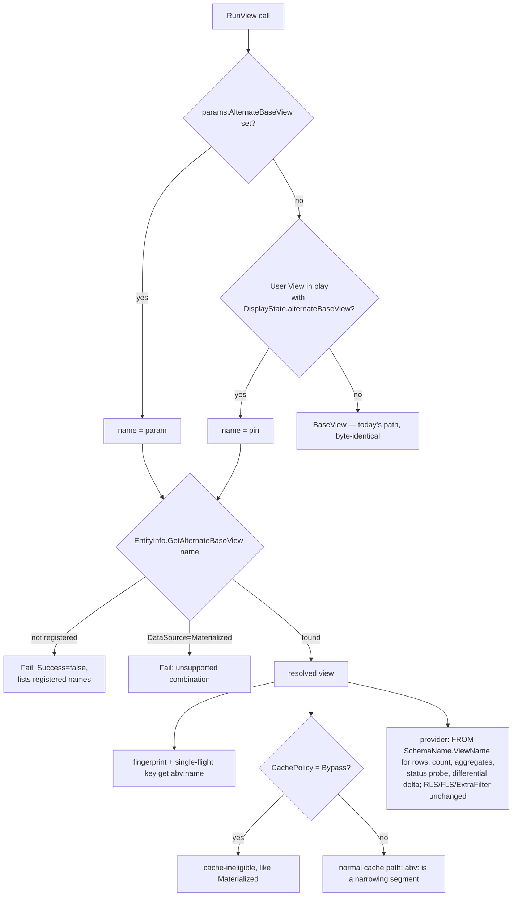

# Alternate Base Views

## Status
- **Status**: Draft, for review before implementation
- **Created**: 2026-10-23
- **Author**: Claude (Claude Code session), for review
- **Branch**: `claude/alternate-base-views`
- **Reviewed against**: `next` @ `48c974e76`
- **Supersedes**: Future Phases D–G of [`plans/complete/json-type-and-additional-base-views.md`](complete/json-type-and-additional-base-views.md)

## Overview

Today every MJ entity has exactly one database view, `Entity.BaseView`, and `RunView` always reads
from it. This plan lets an entity register **alternate base views**: additional SQL views with the
**same columns** as the base view but **different rows**. Each one has a logical name and a
description, for example `Active` → `vwCustomersActive`, "Customers with an active membership".
A caller picks one per `RunView` call, and a saved User View can pin one. The rest of the stack
then honors the choice: caching, BaseEngine, GraphQL, CodeGen, the Explorer UI.

This was designed once before. The JSONType half shipped. The alternate-view half (Phases D–G of
the old plan) was deferred. A partial implementation exists on `origin/claude/multiple-base-views-R8gzU`
(commit `3c13faa38`, March 2026): RunView param, PreRunView validation, provider FROM-clause swap,
`EntityInfo` accessors. It predates most of today's caching layer and never touched it. The backup
directory the old plan cites (`delete-logs/altbaseview-backup/`) is not in the repo. The design
below reuses that work's shape. It is re-derived from current `next`, where the closest precedent
is `RunViewParams.DataSource: 'Materialized'`. That parameter already routes a read to a different
physical view, and it shows every seam the new parameter has to pass through.

**No schema migration is needed for the feature itself.** The entity-level registry lives in the
existing `Entity.Configuration` JSON column, typed by `IEntityConfiguration`, and the per-view pin
lives in the existing `UserView.DisplayState` JSON column, typed by `IDisplayState`. Both are
JSONType interface edits, which are metadata changes carried by the release `Metadata_Sync` seed.
An entity that *adopts* an alternate view still ships the `CREATE VIEW` in its own migration.

## Goals & Non-Goals

### Goals
- Register alternate base views per entity, with name, description and optional display name, in `Entity.Configuration`.
- `RunViewParams.AlternateBaseView` selects one for a read: rows, count, aggregates, paging and keyset all come from it. RLS, field-level security and `ExtraFilter` apply on top unchanged.
- A User View can pin an alternate base view. The pin is honored by `RunView` on both tiers and by every Explorer surface that renders the view.
- Caching is correct by construction: no cache slot ever serves base-view rows for an alternate-view request or the reverse, and saves never upsert rows into an alternate-view slot.
- BaseEngine configs can load from an alternate base view without being treated as an unfiltered cache donor.
- CodeGen keeps alternate views refreshed, granted and column-compatible when it regenerates the base view.
- Agents and users can discover the alternate views and their descriptions.

### Non-Goals
- **Different columns.** An alternate view must expose the base view's columns. A different shape is a different entity (virtual entity) or a Query.
- **Making an alternate view an entity's default.** `BaseView` stays the default and the target of `Load()`, CRUD, `CheckRecordRLS` and single-record paths. An alternate view is a lens for reads, not a change to record identity.
- **Combining with `DataSource: 'Materialized'`.** The pair is rejected in v1; see Decision D6.
- **Search across alternate views.** This was old Phase G; `UserSearchable` is dropped for now.
- **Alternate views inside client-supplied SQL.** `ClientClauseScreen` keeps refusing a `FROM` that is not an entity base view.
- **A new table.** Per review, a JSON array is enough.

## Background & Context

### Where the read view is chosen today

`GenericDatabaseProvider.resolveEffectiveBaseView()` (`GenericDatabaseProvider.ts:1804`), with its
synchronous core `GetEffectiveBaseView()` (`:1782`), is the one place that decides which view a read
targets. It returns `entityInfo.BaseView`, or the `materialized_vw…` snapshot when
`DataSource: 'Materialized'` is set and the materialization is Active. Its callers:

| Caller | Line | Uses it for |
|---|---|---|
| `executeRunViewCore` | `:2439` | SELECT, COUNT (`:2445`, `BuildTotalRowCountSQL` `:1754`), aggregates (`:2661`), user-view-run logging (`:2622`, SQL Server override `SQLServerDataProvider.ts:1009`) |
| `getBatchedServerCacheStatus` | `:3978` | smart-cache status probe (SQL Server override `SQLServerDataProvider.ts:970`) |

**It is not used here, and these do need the alternate view:**
- `getUpdatedRowsSince` (`:4433`) hard-codes `entityInfo.BaseView` for the differential refresh delta. This is harmless today only because materialized reads are never cached.
- `` subquery expansion (`:3380`) uses `innerEntityInfo.BaseView`.

**These correctly stay on `BaseView`:** `Load` (`:5962`), `CheckRecordRLS` (`:6053`).

### How the `DataSource` precedent is threaded (the checklist this plan follows)

| Layer | Where | DataSource handling |
|---|---|---|
| Params | `runView.ts:158`, `Equals` `:541`, normalizer `IsMaterializedDataSource` `:627` | normalizer used at every decision point because the value crosses GraphQL as a `String` |
| Cache eligibility | `providerBase.ts:1870` `runViewCacheEligible`, `:1904` `runViewCacheEligibleForWrite`, `:3652` smart-cache gate | materialized excluded (refreshed out-of-band) |
| Fingerprint | `localCacheManager.ts:2540` | `ds:materialized` appended only when set |
| Single-flight key | `GenericDatabaseProvider.ts:2232` | `ds:` segment |
| GraphQL inputs | `RunViewResolver.ts` `RunViewByIDInput` `:202`, `RunViewByNameInput` `:330`, `RunDynamicViewInput` `:444`, `RunViewGenericInput` `:587`, cache-check map `:1270` | field-by-field |
| Resolver plumbing | `ResolverBase.ts:649, 696, 744, 818, 1279, 1440`; `MJServer/src/types.ts:128` | positional args + generic params |
| Client | `graphQLDataProvider.ts:1127, 1313, 1443` | three transports |

The code comments at `RunViewResolver.ts:1268` and `graphQLDataProvider.ts:1440` record that
`DataSource`, `Aggregates` and `BypassCache` were each dropped silently by one of these hand-written
maps before. This plan adds a forwarding test for every transport (Phase 3).

### Caching facts that shape the design
- **One fingerprint builder** (`LocalCacheManager.GenerateRunViewFingerprint`, `localCacheManager.ts:2469`) feeds every cache layer: the client IndexedDB, the server cache, request dedup, the BaseEngine fingerprints, and `OnDataChanged`.
- **`hasNarrowingSegment` is deny-by-default** (`localCacheManager.ts:1052`). Any appended segment other than `imr:`, the connection, and `f:*` marks a slot "filtered". On a save the slot is invalidated instead of upserted; deletes still remove the row in place. So a new `abv:` segment is safe by construction **as long as it is never added to that allowlist**.
- **`shouldAutoCache`** (`providerBase.ts:4495`) considers only `ExtraFilter`/`OrderBy` when deciding "unfiltered". This is harmless once the segment exists, because maintenance decisions read the fingerprint, not the params.
- **ViewID/ViewName-only requests with a context user already skip the shared cache** (`cacheDeniedForViewOnlyRequest`, `providerBase.ts:1933`, fail-closed). A view's pin can therefore only reach a cache key through an explicit `AlternateBaseView` or a passed `ViewEntity`.
- **BaseEngine** (`baseEngine.ts`): `BaseEnginePropertyConfig` (`:25`) has no `DataSource`. `BuildRunViewParamsForConfig` (`:2119`) builds every engine RunView. `canUseImmediateMutation` (`:1611`) gates in-place array mutation on `Filter`/`OrderBy`.
- **BaseEngineRegistry** `FindCachedEntity` (`baseEngineRegistry.ts:699`) computes `unfiltered = !cfg.Filter`. An alternate-view config would wrongly be offered as a full-set donor to `relatedRecordCollection.ts:836`, `AIEngine.ts:706`, `knowledgeHubMetadata.ts:114`, `FieldPathResolver.ts:250`, `form-field.component.ts:1852` and `sync-metadata-engine.ts:515`.

### User Views facts that shape the design
- `MJ: User Views` has no `Configuration` column. Its JSON columns are `GridState`, `FilterState`, `SortState` (an array), `CardState` and `DisplayState`.
- **`FilterState` is the wrong home despite meaning "which rows":**
  - It is rewritten wholesale on every Data Explorer save (`view-workspace.component.ts:1258, 1302` → `buildFilterStateJson` `:1856`).
  - It is rewritten on filter clear (`filter-builder.component.ts:300`) and on the smart-filter toggle (`view-config-panel.component.ts:1653`).
  - Dirtying it makes `Save()` recompile `WhereClause` (`MJUserViewEntityExtended.ts:443, 567`).
- **`DisplayState` is safe:**
  - Nothing walks or validates it.
  - Its writers read, modify and write back (`MJUserViewEntityExtended.ts:190`, `entity-viewer.component.ts:1837`).
  - The Zod schema types it `z.any()`, and the typed `DisplayStateObject` accessor keeps unknown keys.
  - Caveat: `defaultMode` is required, so a writer creating `DisplayState` from scratch must supply it.
- **The Explorer entity viewer never sends `ViewID`/`ViewEntity` to RunView.** It flattens a saved view into `EntityName` + `ExtraFilter: ViewEntity.WhereClause` (`entity-viewer.component.ts:1339, 1347–1364`; export `:1226–1260`). A pin is therefore ignored in Explorer unless the viewer forwards it explicitly.
- No Action, agent or MCP tool creates User Views. All creation goes through `view-workspace` (new `:1238`, update `:1286`, quick-save `:1496`, duplicate `:1694`), `entity-viewer` and `entity-data-grid`.

## Architecture / Design

### Decisions

| # | Decision | Why |
|---|---|---|
| D1 | Entity registry in `Entity.Configuration` → `IEntityConfiguration.AlternateBaseViews` | Column exists, so no migration. `SaveReturnMode` is precedent for an engine-consumed key in this bag; the bag's "stays a column" rule targets values SQL over `__mj.Entity` filters or joins on, which this is not. |
| D2 | User View pin in `DisplayState` → `IDisplayState.alternateBaseView` | No migration; the only JSON column whose writers preserve unknown keys (see above). Semantically a stretch ("display"), so the accessor is named for what it does. |
| D3 | **Logical `Name` separate from physical `ViewName`** | Saved User Views, code and agents reference `Active`, not `vwCustomersActive`. Renaming or moving the SQL view touches one Configuration entry instead of every saved view. The old plan used the physical name as identity. |
| D4 | Parameter is `RunViewParams.AlternateBaseView` (the logical name), not the old `AlternateViewName` | `RunViewParams.ViewName` already means a User View record name and feeds the `vw:` segment and resolver lookups. "AlternateViewName" invites confusion with it. |
| D5 | **An unknown name fails the call** (`Success: false`, message lists the valid names). It never falls back to the base view. | Silently returning the wider row set breaks the "active only" contract the caller asked for. It is a correctness and data-exposure failure, not a degradation. |
| D6 | `AlternateBaseView` + `DataSource: 'Materialized'` is rejected in v1 | The snapshot is of the base view; an alternate view over it does not exist. Supporting it means materializing alternate views, which is out of scope. |
| D7 | Alternate-view reads are cacheable by default, isolated by an `abv:` fingerprint segment, with a per-view `CachePolicy: 'Bypass'` opt-out | Unlike materialized snapshots, alternate views are live, so saves on the entity fire events that invalidate their slots. Predicates that read **time** (`GETDATE()`, `CURRENT_TIMESTAMP`) or **other tables** change with no event on this entity; those views declare `'Bypass'`. |
| D8 | Precedence: explicit `AlternateBaseView` → the User View's pin → `BaseView` | The caller is most specific. There is no "force the base view over a pin" in v1 (see Open Questions). |
| D9 | One resolver, called once per request | Mirrors `IsMaterializedDataSource`: validation, fingerprint, single-flight key and FROM clause all consume one resolved value, so no two sites can disagree. |
| D10 | Authoring contract: `CREATE VIEW <Alt> AS SELECT * FROM <BaseView> WHERE …`, same schema by default | Selecting from the base view inherits its joins and soft-delete handling and makes the alternate view a row subset of it. CodeGen keeps it refreshed (Phase 4). |

### Data model (JSONType interface additions, no DDL)

`metadata/entities/JSONType-interfaces/IEntityConfiguration.ts`. MJCore's copy under
`packages/MJCore/src/generic/JSONType-interfaces/` is regenerated by `sync-json-types.mjs` on build;
never edit it directly.

```typescript
export interface IEntityConfiguration {
    // ...existing UI, Attachments, Clone, SaveReturnMode...

    /**
     * Additional database views this entity can be READ through. Same columns as BaseView,
     * different rows. Selected per call with RunViewParams.AlternateBaseView, or pinned on a
     * User View (DisplayState.alternateBaseView). BaseView stays the default and the target of
     * Load(), CRUD and single-record paths.
     */
    AlternateBaseViews?: IEntityAlternateBaseView[];
}

export interface IEntityAlternateBaseView {
    /** Logical identity: what callers pass and what User Views store. Unique per entity, case-insensitive. e.g. 'Active' */
    Name: string;
    /** Physical SQL view. Must expose every BaseView column. e.g. 'vwCustomersActive' */
    ViewName: string;
    /** Schema of ViewName. Defaults to the entity's SchemaName. */
    SchemaName?: string;
    /** UI label. Defaults to Name. e.g. 'Active Customers' */
    DisplayName?: string;
    /** What the subset is and when to use it. Shown in pickers and to agents. Required. */
    Description: string;
    /**
     * 'Default' (omitted): cached like any filtered read, invalidated by this entity's saves.
     * 'Bypass': never cached. Use when the view's predicate reads the clock or other tables,
     * since those change without an event on this entity.
     */
    CachePolicy?: 'Default' | 'Bypass';
}
```

`metadata/entities/JSONType-interfaces/IDisplayState.ts`. Properties in this interface are camelCase, so the new key follows suit:

```typescript
export interface IDisplayState {
    // ...existing defaultMode, enabledModes, timeline, cards, grid, viewTypeConfigs...

    /** Logical name of an alternate base view (IEntityAlternateBaseView.Name) this view reads from. Omitted = the entity's BaseView. */
    alternateBaseView?: string;
}
```

Example `Entity.Configuration` value:

```json
{
  "AlternateBaseViews": [
    { "Name": "Active", "ViewName": "vwCustomersActive", "DisplayName": "Active Customers",
      "Description": "Customers whose membership is currently active." },
    { "Name": "RenewingSoon", "ViewName": "vwCustomersRenewingSoon",
      "Description": "Active customers whose membership ends in the next 60 days.", "CachePolicy": "Bypass" }
  ]
}
```

### Resolution flow



### MJCore API surface

```typescript
// packages/MJCore/src/generic/entityInfo.ts — on EntityInfo, parse-once via the existing ConfigurationObject
get AlternateBaseViews(): readonly IEntityAlternateBaseView[];         // [] when none; malformed entries dropped with LogError
GetAlternateBaseView(name: string): IEntityAlternateBaseView | undefined; // trimmed, case-insensitive on Name

// packages/MJCore/src/views/runView.ts
export class RunViewParams {
    /** Logical name of one of the entity's AlternateBaseViews (EntityInfo.AlternateBaseViews). Omitted = BaseView, or the User View's pin. */
    AlternateBaseView?: string;
}
/** Trim; empty/whitespace → null. Use at EVERY decision point, like IsMaterializedDataSource. */
export function NormalizeAlternateBaseViewName(value: string | null | undefined): string | null;

// packages/MJCore/src/generic/alternateBaseViews.ts (new) — the single resolver (D9)
export type AlternateBaseViewResolution =
    | { Kind: 'BaseView' }
    | { Kind: 'Alternate'; View: IEntityAlternateBaseView; SchemaName: string; ViewName: string }
    | { Kind: 'Error'; Message: string };
export function ResolveAlternateBaseView(entity: EntityInfo, params: RunViewParams, pinnedName?: string | null): AlternateBaseViewResolution;
```

`pinnedName` is supplied by the caller that has the User View. GenericDatabaseProvider has the typed
`MJUserViewEntityExtended`. ProviderBase has only `params.ViewEntity`; MJCore cannot import
core-entities, so it reads `DisplayState` through the same documented weak-typing exception
`RunView.GetEntityNameFromRunViewParams` uses for `EntityID` (`runView.ts:720`), in one helper.

### API changes
- **GraphQL:** `AlternateBaseView: String` (nullable) on `RunViewByIDInput`, `RunViewByNameInput`, `RunDynamicViewInput` and `RunViewGenericInput`, and in the `RunViewsWithCacheCheck` param map. CodeGen's per-entity `Run<Type>ViewByID/ByName` resolvers reuse these input classes, so they pick it up with no regeneration.
- **REST:** `ViewOperationsHandler.RunView` passes `RunViewParams` through. Confirm the body→params mapping keeps the field.
- **No new mutations, Actions or entities.**

## Implementation Plan

Each phase is one PR into `next`, with unit tests for every package touched and the deterministic
integration tier passing. Phases 1–3 deliver a working server + client API. Phase 4 must merge before
any entity whose base view CodeGen regenerates ships an alternate view.

### Phase 1 — Metadata contract (no behavior change)
1. **`IEntityConfiguration`**: add `AlternateBaseViews` and `IEntityAlternateBaseView` as above (`metadata/entities/JSONType-interfaces/IEntityConfiguration.ts`). Update the interface's header comment to say engine-consumed keys like `SaveReturnMode` and `AlternateBaseViews` belong here.
2. **`IDisplayState`**: add `alternateBaseView?: string` (`metadata/entities/JSONType-interfaces/IDisplayState.ts`).
3. **`EntityInfo`** (`packages/MJCore/src/generic/entityInfo.ts`, beside `SaveReturnMode` at `:3271`):
   - Add the `AlternateBaseViews` getter and `GetAlternateBaseView()`, built once from `ConfigurationObject`.
   - Validate entries: Name and ViewName required, Name unique case-insensitively, CachePolicy one of the two values.
   - Drop and `LogError` invalid ones rather than throw, so one bad entry never breaks metadata load.
4. **`RunViewParams.AlternateBaseView`**, `NormalizeAlternateBaseViewName`, and the `Equals` comparison on normalized lowercase values (`runView.ts:541` pattern). The entity data grid reloads on `Equals` (`entity-data-grid.component.ts:221`), so a missing comparison would mean no reload on switch.
5. **`alternateBaseViews.ts`** with `ResolveAlternateBaseView` (D5, D6, D8). Export it from MJCore's index.
6. **Regenerate types**, in this order, on your own database: `mj sync push` (the JSONTypeDefinition rows) **then** `mj codegen --skipdb`. CodeGen reads JSONType definitions from the database, so the reverse order silently deletes properties. This refreshes `MJEntityEntity_IEntityConfiguration` and `MJUserViewEntity_IDisplayState` in `MJCoreEntities`.
7. Changeset: **`minor`**. This branch changes metadata (JSONType definitions), per `.claude/rules/changesets.md`.

### Phase 2 — Read path, cache and providers
1. **Validation in `ProviderBase.PreRunView`** (`providerBase.ts:3264`): resolve once, right after `EntityStatusCheck`. Fail an `Error` resolution through the same channel as other PreRunView failures, so the client fails fast without a round trip and the server re-checks as the authority. Carry the resolved value forward. Do not re-derive it per site (D9).
2. **Fingerprint** (`localCacheManager.ts`, beside `ds:materialized` at `:2540`):
   - Append `abv:<lowercased Name>` only when an alternate view resolved, so every existing fingerprint stays byte-identical.
   - Do **not** add `abv:` to the `hasNarrowingSegment` allowlist.
   - Avoid the `ds:` and `vw:` prefixes; they are taken.
3. **Cache eligibility**: add `CachePolicy === 'Bypass'` to the exclusions in `runViewCacheEligible`, `runViewCacheEligibleForWrite` and the smart-cache gate (`providerBase.ts:1870, 1904, 3652`), alongside the Materialized exclusion. Update the JSDoc lists there.
4. **Single-flight key** (`GenericDatabaseProvider.ts:2232`): add `abv:`.
5. **Provider view routing:**
   - Change `resolveEffectiveBaseView`/`GetEffectiveBaseView` (`GenericDatabaseProvider.ts:1782, 1804`) to return `{ SchemaName, ViewName }` instead of a bare name, since an alternate view may name its own schema.
   - Order: alternate view if resolved; else the materialized logic unchanged; else `BaseView`.
   - The User View pin comes from the already-loaded `viewEntity` in `executeRunViewCore` (`:2340`) through the typed accessor (Phase 5).
   - Update every caller: `:2439` (rows, count, `BuildTotalRowCountSQL`), `:2622` (run logging, plus the SQL Server override `SQLServerDataProvider.ts:1009`), `:2661` (aggregates), `:3978` and `SQLServerDataProvider.ts:970` (status probes).
6. **`getUpdatedRowsSince`** (`GenericDatabaseProvider.ts:4433`): read from the effective view. Today this is a latent bug the new feature would trigger: the differential delta would come from the base view. Hidden-delete detection (`:4330`) already handles rows that leave the subset through an update.
7. **`` subqueries** (`GenericDatabaseProvider.ts:3380`): when the referenced inner view pins an alternate base view, select from it.
8. **PostgreSQL**: no `InternalRunView` override exists, so the generic provider covers it. Confirm `QuoteSchemaAndView` quoting with a non-default `SchemaName`.

### Phase 3 — Transport
1. `RunViewResolver.ts`: the field on the four input types (`:85, :213, :341, :455`) and the cache-check map (`:1270`).
2. `ResolverBase.ts`: positional args in `RunViewByNameGeneric`/`RunViewByIDGeneric`/`RunDynamicViewGeneric` (`:649, :696, :744`), `RunViewsGeneric` (`:818`), `RunViewGenericInternal` (`:1279`), `RunViewsGenericInternal` (`:1440`); `RunViewGenericParams` in `MJServer/src/types.ts`.
3. `graphQLDataProvider.ts`: `InternalRunView` (`:1127`), `InternalRunViews` (`:1313`), the cache-check path (`:1443`). Also `graphQLSystemUserClient.ts`, which has no `DataSource` forwarding at all; add both here or file it.
4. **A forwarding test per transport**, modeled on `RunViewResolver.cacheCheckForwarding.test.ts`, so the next hand-written map that drops the field fails CI.

### Phase 4 — CodeGen upkeep
Without this, a SQL Server alternate view written as `SELECT *` keeps the column list it had at
creation after CodeGen recreates the base view. New columns go missing, and a reordered column list
misaligns. On PostgreSQL the `*` is frozen at `CREATE VIEW`.
1. **Refresh/rebind** every registered alternate view after the entity's base view is regenerated. Reuse the layered-view machinery in `sql_codegen.ts`:
   - SQL Server: `generateViewRefreshSQL` → `sp_refreshview`, after the base view.
   - PostgreSQL: the `RestarLayeredOuterView` rewrite (`packages/SQLDialect/src/postgresqlRestarLayeredOuter.ts`), with the base view as the inner view. Verify it preserves the alternate view's `WHERE`, or add a sibling for the `SELECT * FROM <base> WHERE …` shape.
   - Guard each with `generateIfViewExistsSQL`, so a configured-but-not-yet-created view never fails the run.
2. **Permissions:**
   - Emit the base view's permission set (role GRANTs, plus the column-level FLS `DENY SELECT` on SQL Server) on each alternate view.
   - Include them in the wipe-and-reassert scope. Field-level security is enforced in the app layer too, but the DB grants must match or a role reading through an alternate view gets `permission denied`.
   - See [`guides/FIELD_LEVEL_SECURITY_GUIDE.md`](../guides/FIELD_LEVEL_SECURITY_GUIDE.md) first.
3. **Column-parity check:**
   - Warn when an alternate view lacks a `BaseView` column. Extra columns are ignored (RunView selects an explicit field list).
   - Also warn when the view does not exist, or does not depend on `BaseView` (`sys.sql_expression_dependencies` / `pg_depend`), since that breaks the D10 subset guarantee.
4. A one-line pointer in `packages/CodeGenLib/CLAUDE.md` § Base views to the new guide (keep within the `check:claude-md` budget).

### Phase 5 — User Views, BaseEngine, other consumers
1. **`MJUserViewEntityExtended`** (`packages/MJCoreEntities/src/custom/MJUserViewEntityExtended.ts`, beside `ParsedDisplayState` `:150`): a typed `AlternateBaseView` getter/setter over `DisplayStateObject`.
   - The setter supplies `defaultMode` when it has to create `DisplayState`.
   - Setting `null` removes the key.
2. **`MJUserViewEntityServer`**: on save, reject a pin that names no registered alternate view (`Validate()`, pushing `ValidationErrorInfo`). A typo is caught at save rather than on every later run. If a registration is later removed, runs of that view fail loudly per D5, which is the intended signal.
3. **BaseEngine** (`baseEngine.ts`):
   - `BaseEnginePropertyConfig.AlternateBaseView?: string`
   - pass it in `BuildRunViewParamsForConfig` (`:2119`)
   - `canUseImmediateMutation` (`:1611`) returns false when set
   - the property's TSDoc must say that a `'Bypass'` view makes the engine's cache refresh on every `Config(true)`, never in place
4. **BaseEngineRegistry** `FindCachedEntity` (`baseEngineRegistry.ts:699`): `unfiltered = !cfg.Filter && !cfg.AlternateBaseView`. Add a unit test that an alternate-view config is never returned under `unfilteredOnly`.
5. **Lists**: `packages/Lists/server/src/ListOperations.ts:852–880` re-runs a view's clause against the entity and drops the pin; pass it. (`resolveViewSource` `:425` runs by ViewID and already inherits it.)
6. **Data contexts**: `MJDataContext/src/types.ts:301` hand-builds `SELECT * FROM [schema].[BaseView]` for view items; honor the pin.
7. **Agent discovery**: `get-entity-details.action.ts` (`:189, :323`) and `explore-database-schema.action.ts` (`:208, :426`) list each alternate view's Name, DisplayName and Description next to `BaseView`. That way agents choose `AlternateBaseView: 'Active'` instead of guessing a filter.

### Phase 6 — Angular (Explorer)
Layering per [`guides/UI_LAYERING_GUIDE.md`](../guides/UI_LAYERING_GUIDE.md): the picker and viewer
changes live in `ng-entity-viewer` (widgets, no Router). URL and navigation wiring live in
`ng-dashboards` / `ng-shared`.
1. **`EntityViewerComponent`** (`Generic/entity-viewer/.../entity-viewer.component.ts`):
   - New getter/setter `@Input() AlternateBaseView`.
   - Effective value: the input, else `ViewEntity.AlternateBaseView`.
   - Forward it on the page query and the `count_only` query (`:1347–1364`) and on export (`FetchAllRowsForExport`, `:1226–1260`).
2. **`EntityDataGridComponent`**: `buildRunViewParams` (`:4068`) already spreads `Params`. The aggregate-only RunView (`:2687`) builds its own params and must add the field.
3. **Picker** in `ViewConfigPanelComponent`'s **Filters** tab (`view-config-panel.component.html:584`), which holds everything that decides which rows appear:
   - "Records from: [All <Entity>] ▾", listing `EntityInfo.AlternateBaseViews` by DisplayName with Description as help text.
   - Hidden when the entity registers none.
   - `ViewSaveEvent` (`:54–72`) gains `AlternateBaseView`.
   - Use `@memberjunction/ng-ui-components` (`mj-dropdown`) and `--mj-*` tokens.
4. **`ViewWorkspaceComponent`**:
   - `persistNewView`/`persistExistingView` (`:1238, :1286`) set the pin through the typed accessor.
   - `persistDuplicate` (`:1703–1714`) must start copying DisplayState (and CardState and ViewTypeID, which it drops today), or duplicating a view loses its pin.
   - The unsaved default view keeps the selection in its `default-view-setting/<Entity>` user setting.
5. **`ViewSelectorComponent`**: show a small badge with the DisplayName on views that pin one.
6. **Data Explorer deep links** (`data-explorer-dashboard.component.ts`): an `abv` query param in `DataExplorerDeepLink`, `buildDeepLinkFromParams` (`:2850`) and `pushCurrentStateToUrl` (`:2908`), following the query-param round-trip convention in `packages/Angular/Explorer/CLAUDE.md`. Saved views carry the pin themselves, so the param matters for unsaved selections.
7. **`NavigationService.OpenDynamicView`** (`navigation.service.ts:1146`) accepts an optional alternate base view and passes it through `UserViewResource` (`view-resource.component.ts:417`). Fix that path's ignored `_extraFilter` while there, or file it.
8. **Data Explorer agent tool** `SelectView` (`:1446`): no change. Add an optional `alternateBaseView` argument only if the dynamic-view path in item 7 lands.

### Phase 7 — Docs and integration tests
1. New guide `guides/ALTERNATE_BASE_VIEWS_GUIDE.md`, indexed in `guides/README.md`. It covers:
   - authoring the view (D10 contract, both platforms)
   - registering it in `Entity.Configuration` via `metadata/`
   - choosing `CachePolicy`
   - when to use a User View filter, an alternate view, a virtual entity or a Query instead
2. Integration bundle `alternate-base-views`, as the next free IT number (IT132 at time of writing), in the **deterministic** tier. Model it on `layered-base-views.checks.ts` and `materialized-read.checks.ts`. See Testing Strategy for the checks.

## Migration & Data
- **None for the feature.** `Entity.Configuration` and `UserView.DisplayState` already exist.
- Phase 1 changes two JSONTypeDefinition metadata rows (`.entity-field-jsontype-entity-configuration.json` and `.entity-field-jsontype-user-views.json` via `@file:`). Per the release model, the PR carries only the JSON/TS. The build engineer's release `Metadata_Sync` ships them. No `*__Metadata_Sync.sql` in a feature PR.
- **No PostgreSQL migration.**
- **Adopting entities** ship their `CREATE VIEW` in their own migration and their `Configuration` value in `metadata/`.
- **Risk — Configuration is one JSON blob.** A `metadata/` record that sets `Configuration` replaces the whole value, so an entity already carrying `UI` or `Clone` keys must include them alongside `AlternateBaseViews` (see Open Questions).

## Testing Strategy

**Unit tests**, one file per area, modeled on existing ones:
- `EntityInfo.AlternateBaseViews`: parse, validation, duplicate names, case-insensitive lookup (`packages/MJCore/src/__tests__/metadata.configuration.test.ts`).
- `ResolveAlternateBaseView`: precedence (D8), unknown name (D5), Materialized combination (D6), whitespace and case.
- `RunViewParams.Equals`: toggling `AlternateBaseView` is unequal; `undefined` vs `''` is equal.
- Fingerprint (`localCacheManager.dataSourceFingerprint.test.ts` as model):
  - `abv:` is present only when set
  - existing fingerprints are byte-identical
  - `isFilteredFingerprint` is true for an `abv:` slot
  - a save event invalidates instead of upserting
  - a delete removes in place
- Cache eligibility: `CachePolicy: 'Bypass'` is ineligible on read, write and the smart-cache path.
- Provider (`GenericDatabaseProvider.test.ts:380` `GetEffectiveBaseView` tests as model): FROM, COUNT, aggregate, status-probe and `getUpdatedRowsSince` SQL all target the alternate view. Single-record `Load` does not.
- Transport forwarding: every GraphQL input type and all three client maps (Phase 3 item 4).
- BaseEngine: `canUseImmediateMutation` is false; the registry never returns an alternate-view config as an unfiltered donor.
- `MJUserViewEntityExtended.AlternateBaseView`: preserves other DisplayState keys and creates `defaultMode` when needed.
- Angular: viewer forwards the pin on page, count and export; `persistDuplicate` keeps it.

**Integration bundle** `alternate-base-views`, run on both platforms:
- **Fixture.** `Setup` creates a scratch alternate view over a core entity's base view through the provider's SQL seam, registers it by saving that `MJ: Entities` row's `Configuration` through `BaseEntity`, and refreshes metadata. `Teardown` restores the original `Configuration` and drops the view.
- **Checks:**

| Check | Proves |
|---|---|
| ABV1 | metadata is coherent |
| ABV2 | RunView with the alternate view returns only rows satisfying its predicate, and fewer than the base view (anti-vacuity) |
| ABV3 | count and aggregates come from the alternate view |
| ABV4 | an unknown name fails with the registered names listed |
| ABV5 | base read, then alternate read, then base read again: no slot is cross-served, in either order |
| ABV6 | saving a row so it leaves the subset removes it from the next cached alternate read |
| ABV7 | a User View pin is honored when running by ViewID |
| ABV8 | an explicit param overrides the pin |
| ABV9 | Materialized + alternate is rejected |
| ABV10 | a `'Bypass'` view is never served from cache |
| ABV-C1 (client transport) | the field survives `RunView`, `RunViews` and the cache-check transport |

- **Gate:** `pnpm run test:integration`, and `check:guards` + `check:standards` before every push.

## Risks & Open Questions

**Risks**
- **Stale caches from predicates outside the entity.** Covered by `CachePolicy: 'Bypass'`, but it relies on the author choosing it. Mitigations:
  - the guide says so prominently
  - Phase 4's parity check could also warn when a view's definition references `GETDATE`/`CURRENT_TIMESTAMP`/`NOW()` or another table and `CachePolicy` is not `'Bypass'`
- **A removed registration breaks saved views that pin it.** Intentional (D5): a loud failure beats silently widening the rows. The view-config panel should show the broken pin with a "reset to all records" action rather than a blank picker.
- **The `vw:` slot of a ViewEntity-passed request.** If a view's pin changes while a server-internal caller holds an old `ViewEntity`, the `abv:` segment reflects that object. This is the same semantics `WhereClause` already has. ViewID-only client requests skip the cache entirely (fail-closed), so the UI path is unaffected.

**Open questions for review**
1. **Open Apps registering alternate views on core entities** (e.g. a BizApps app adding `vwCompaniesWithOpenDeals` on `MJ: Companies`). `Configuration` is a single blob owned by the entity's owner, and a second writer would overwrite it. v1 proposal: owner-only. Revisit with a merge-aware sync or an `EntitySetting`-style side channel if a real case appears.
2. **Overriding a pin back to the base view per call.** Would need a sentinel (e.g. `AlternateBaseView: '$base'`), because `null` and `undefined` collapse over GraphQL. Proposed: skip until someone needs it.
3. **IT fixture vs a shipped core adopter.**
   - The plan uses a Setup-created fixture, so the bundle depends on no shipped view.
   - Alternative: ship one real core alternate view, e.g. `MJ: Users` → `Active` (`vwUsersActive`, `IsActive = 1`), in a follow-up PR with its own migration and `minor` changeset. It would double as an Explorer demo.
4. Should the smart-filter prompt (`MJUserViewEntityServer.server.ts:242–279`, template input `baseView`) receive the alternate view's Description as context? The columns are identical, so this is a quality improvement, not a correctness one.

**Pre-existing issues found during review** (not caused by this feature; file separately unless a phase fixes them):
- `BaseEngine.classifyEventForConfig` (`baseEngine.ts:1415–1441`) returns `'notify'` with no refresh when the saved object is the engine's own instance. A row that leaves a `Filter` set therefore stays in the array. Alternate-view configs would inherit this.
- `ViewWorkspaceComponent.persistDuplicate` drops DisplayState, CardState and ViewTypeID. Fixed in Phase 6.
- `graphQLSystemUserClient.ts` never forwards `DataSource`. Fixed in Phase 3 if trivial.
- `UserViewResource` ignores the `ExtraFilter` of dynamic views (`view-resource.component.ts:417–432`). Fixed in Phase 6 if touched.

## Files to Modify

| File | Phase | Change |
|---|---|---|
| `metadata/entities/JSONType-interfaces/IEntityConfiguration.ts` | 1 | `AlternateBaseViews`, `IEntityAlternateBaseView` |
| `metadata/entities/JSONType-interfaces/IDisplayState.ts` | 1 | `alternateBaseView` |
| `packages/MJCore/src/generic/JSONType-interfaces/IEntityConfiguration.ts` | 1 | regenerated by build (`sync-json-types.mjs`) |
| `packages/MJCore/src/generic/entityInfo.ts` | 1 | accessors |
| `packages/MJCore/src/generic/entityConfiguration.ts` | 1 | export new types |
| `packages/MJCore/src/views/runView.ts` | 1 | param, normalizer, `Equals` |
| `packages/MJCore/src/generic/alternateBaseViews.ts` (new) | 1 | `ResolveAlternateBaseView` |
| `packages/MJCoreEntities/src/generated/entities/__mj.ts` | 1 | regenerated JSONType interfaces |
| `packages/MJCore/src/generic/providerBase.ts` | 2 | PreRunView resolve/validate, eligibility, ViewEntity pin helper |
| `packages/MJCore/src/generic/localCacheManager.ts` | 2 | `abv:` segment |
| `packages/GenericDatabaseProvider/src/GenericDatabaseProvider.ts` | 2 | view routing, single-flight key, `getUpdatedRowsSince`, `` |
| `packages/SQLServerDataProvider/src/SQLServerDataProvider.ts` | 2 | status-probe and run-logging overrides |
| `packages/MJServer/src/generic/RunViewResolver.ts` | 3 | input fields, cache-check map |
| `packages/MJServer/src/generic/ResolverBase.ts`, `packages/MJServer/src/types.ts` | 3 | plumbing |
| `packages/GraphQLDataProvider/src/graphQLDataProvider.ts`, `graphQLSystemUserClient.ts` | 3 | client forwarding |
| `packages/MJServer/src/rest/ViewOperationsHandler.ts` | 3 | verify passthrough |
| `packages/CodeGenLib/src/Database/sql_codegen.ts` (+ providers) | 4 | refresh/rebind, grants, parity check |
| `packages/SQLDialect/src/postgresqlRestarLayeredOuter.ts` | 4 | reuse or sibling for the `WHERE` shape |
| `packages/MJCoreEntities/src/custom/MJUserViewEntityExtended.ts` | 5 | typed pin accessor |
| `packages/MJCoreEntitiesServer/src/custom/MJUserViewEntityServer.server.ts` | 5 | pin validation on save |
| `packages/MJCore/src/generic/baseEngine.ts`, `baseEngineRegistry.ts` | 5 | engine config, mutation gate, donor gate |
| `packages/Lists/server/src/ListOperations.ts`, `packages/MJDataContext/src/types.ts` | 5 | honor the pin |
| `packages/Actions/CoreActions/src/custom/data/get-entity-details.action.ts`, `explore-database-schema.action.ts` | 5 | list alternate views |
| `packages/Angular/Generic/entity-viewer/src/lib/entity-viewer/entity-viewer.component.ts` | 6 | input, forwarding |
| `packages/Angular/Generic/entity-viewer/src/lib/entity-data-grid/entity-data-grid.component.ts` | 6 | aggregate call |
| `packages/Angular/Generic/entity-viewer/src/lib/view-config-panel/*` | 6 | picker, `ViewSaveEvent` |
| `packages/Angular/Generic/entity-viewer/src/lib/view-workspace/view-workspace.component.ts` | 6 | persist, duplicate |
| `packages/Angular/Generic/entity-viewer/src/lib/view-selector/view-selector.component.ts` | 6 | badge |
| `packages/Angular/Explorer/dashboards/src/DataExplorer/*` | 6 | `abv` deep link |
| `packages/Angular/Explorer/shared/src/lib/navigation.service.ts`, `explorer-core/.../view-resource.component.ts` | 6 | dynamic-view option |
| `packages/TestingFramework/integration-test-suite/src/checks/alternate-base-views.checks.ts` (new) | 7 | IT bundle |
| `metadata-optional/integration-test/tests/integration/.IT132-alternate-base-views.json` (new), suite membership | 7 | register in the deterministic tier |
| `guides/ALTERNATE_BASE_VIEWS_GUIDE.md` (new), `guides/README.md`, `packages/CodeGenLib/CLAUDE.md` | 4, 7 | docs |

## References
- Old plan: [`plans/complete/json-type-and-additional-base-views.md`](complete/json-type-and-additional-base-views.md), Future Phases D–G
- Old implementation (phases 1–4, pre-caching-layer): `origin/claude/multiple-base-views-R8gzU` @ `3c13faa38`; JSONType branch `origin/claude/jsontype-and-additional-base-views`
- Precedents: `DataSource: 'Materialized'` routing (`GenericDatabaseProvider.ts:1766–1835`); layered base views (`EntityInfo.GeneratedBaseViewName`, `packages/CodeGenLib/CLAUDE.md` § Base views, IT69)
- [`guides/CACHING_AND_PUBSUB_GUIDE.md`](../guides/CACHING_AND_PUBSUB_GUIDE.md), [`guides/FIELD_LEVEL_SECURITY_GUIDE.md`](../guides/FIELD_LEVEL_SECURITY_GUIDE.md), [`guides/UI_LAYERING_GUIDE.md`](../guides/UI_LAYERING_GUIDE.md), [`guides/INTEGRATION_TESTING_QUICKSTART.md`](../guides/INTEGRATION_TESTING_QUICKSTART.md), [Release Metadata Migrations Guide](../guides/RELEASE_METADATA_MIGRATIONS_GUIDE.md)
