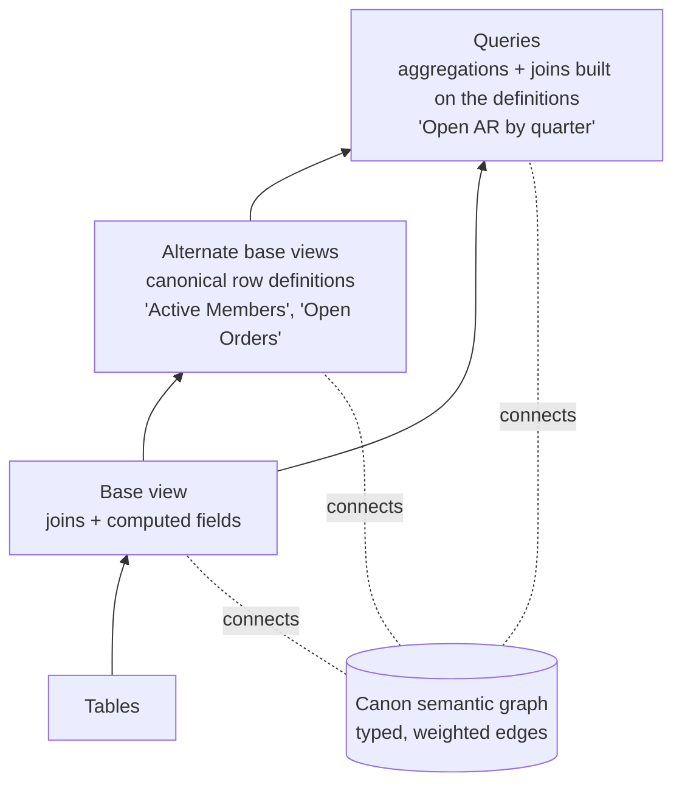
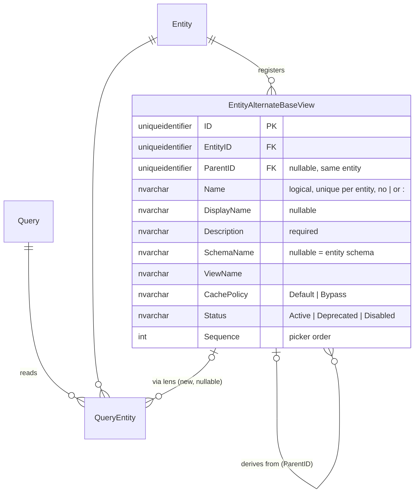
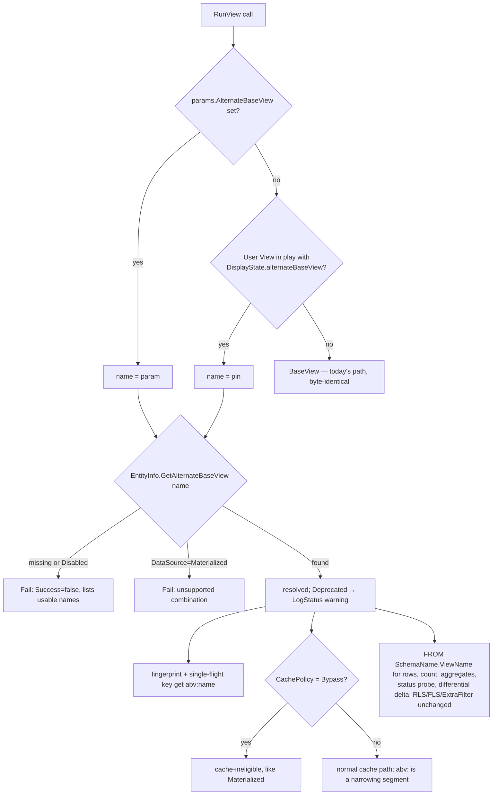

# Alternate Base Views (MJ Canon, layer 1)

## Status
- **Status**: Draft, for review before implementation
- **Created**: 2026-10-23. **Revised** the same day after review (`@rkihm-BC`): a metadata table replaces the JSON column; per-view permissions dropped from v1 (entity `CanRead` + RLS + FLS govern access); `ParentID` hierarchy with AST auto-population added; `Name` constrained for `abv:` cache-key safety; cross-entity `ViewName` collision checks, `QueryEntity` sync keying on `(EntityID, AlternateBaseViewID)`, external-data-source refusal, and `BaseEngine.classifyEventForConfig` reload semantics added.
- **Author**: Claude (Claude Code session), for review
- **Branch**: `claude/alternate-base-views`
- **Reviewed against**: `next` @ `ec08f9736b`
- **Companion**: [`plans/canon-semantic-graph.md`](canon-semantic-graph.md), the extensible semantic graph (any entity record as a node, any edge type), with MJ Canon as its first graph. It is a **design for review only, not scheduled**; this plan does not depend on it.
- **Supersedes**: Future Phases D–G of [`plans/complete/json-type-and-additional-base-views.md`](complete/json-type-and-additional-base-views.md)

## Overview

MJ's data layer has two reusable read primitives today:
- **An entity's `BaseView`.** It almost never filters; it joins and computes.
- **Queries.** They are reusable and parameterized well beyond SQL (Nunjucks), but they are not *selectable* the way a SQL view is.

Business logic like "what is an active member" or "what are open orders" therefore ends up either
repeated in ad-hoc `ExtraFilter` strings, or baked into individual queries that other queries cannot
build on.

This plan adds the missing middle primitive: **alternate base views**. An entity can register any
number of additional SQL views with the **same columns** as its base view but **different rows**.
Each has a logical name, a clear description, an optional `ParentID` derivation link, and a lifecycle status:
- `Active` → `vwActiveMembers`: "members whose membership is current"
- `Open` → `vwOrdersOpen`: "orders not yet fulfilled or cancelled"

They are first-class SQL objects, so they act like tables:
- `RunView` can read through one by swapping the view name in the SQL it generates.
- A saved User View can pin one.
- Queries can `SELECT … FROM vwActiveMembers` and inherit the definition, keeping their permissions and dependency tracking intact.
- Client filters can say `CustomerID IN (SELECT ID FROM vwActiveMembers)`.

This is layer 1 of **MJ Canon**:



Agents (Skip and MJ's own) see the definitions and descriptions, so they choose `Active` rather
than guessing at a filter. The graph that connects these objects is designed in the companion doc.

**Prior work.** The idea was designed once before; the JSONType half shipped, and the
alternate-view half (old Phases D–G) was deferred. A partial implementation exists on
`origin/claude/multiple-base-views-R8gzU` (`3c13faa38`, March 2026): RunView param, PreRunView
validation, provider FROM swap, `EntityInfo` accessors. It predates most of today's caching layer.
Nothing was merged, and no table for this exists in `next`. The design below is re-derived from
current `next`. The closest precedent is `RunViewParams.DataSource: 'Materialized'`, which already
routes a read to a different physical view and shows every seam the new parameter must pass
through.

## Goals & Non-Goals

### Goals
- **Registry.** Alternate base views are first-class metadata (`MJ: Entity Alternate Base Views`): name, display name, description, view, cache policy, lifecycle status. Each has an ID other objects can reference.
- **Selection.** `RunViewParams.AlternateBaseView` selects one per call. Rows, count, aggregates, paging and keyset all come from it; RLS, field-level security and `ExtraFilter` apply on top unchanged.
- **Pinning.** A User View can pin one, and every tier and Explorer surface honors the pin.
- **Queries.** Queries over alternate views resolve to the owning entity, so query permissions (entity `CanRead`), dependency tracking and query caching behave exactly as for base views, and the specific alternate view is recorded.
- **Client SQL.** `ExtraFilter`/`OrderBy` subqueries may reference registered alternate views, with the same row- and field-security checks applied to the owning entity.
- **Security Inheritance.** Entity `CanRead`, Row-Level Security (RLS), and Field-Level Security (FLS) govern reads through alternate base views identically to `BaseView` (no separate per-view permissions table in v1).
- **Caching.** Correct by construction: no slot ever cross-serves base and alternate rows, and saves never upsert into an alternate-view slot.
- **BaseEngine.** Configs can load from an alternate view without being treated as an unfiltered cache donor.
- **CodeGen.** Keeps alternate views refreshed, granted and column-compatible when it regenerates the base view.
- **Discovery.** Agents, QueryGen and users can discover alternate views and their descriptions. They are nodes in the canon graph.

### Non-Goals
- **Different columns.** A different shape is a virtual entity or a Query.
- **Making an alternate view an entity's default.** `BaseView` stays the target of `Load()`, CRUD, `CheckRecordRLS` and single-record paths. An alternate view is a read lens, not a change to record identity.
- **Combining with `DataSource: 'Materialized'`.** Rejected in v1 (D6).
- **Per-view permissions as a row-security boundary.** That is what RLS filters are for (D11).
- **Search across alternate views.** This was old Phase G.
- **The canon graph itself.** See the companion doc; this plan only makes alternate views and query-to-view dependencies available to it.

## Background & Context

### Where the read view is chosen today
`GenericDatabaseProvider.resolveEffectiveBaseView()` (`GenericDatabaseProvider.ts:1804`), with its
synchronous core `GetEffectiveBaseView()` (`:1782`), is the one place that decides which view a read
targets. It returns `entityInfo.BaseView`, or the `materialized_vw…` snapshot when
`DataSource: 'Materialized'` is set and Active. Its callers:

| Caller | Line | Uses it for |
|---|---|---|
| `executeRunViewCore` | `:2439` | SELECT, COUNT (`:2445`, `BuildTotalRowCountSQL` `:1754`), aggregates (`:2661`), user-view-run logging (`:2622`, SQL Server override `SQLServerDataProvider.ts:1009`) |
| `getBatchedServerCacheStatus` | `:3978` | smart-cache status probe (SQL Server override `SQLServerDataProvider.ts:970`) |

**Not routed today, but must be:**
- `getUpdatedRowsSince` (`:4433`) hard-codes `entityInfo.BaseView` for the differential refresh delta.
- `` subquery expansion (`:3380`) uses `innerEntityInfo.BaseView`.

**Correctly stay on `BaseView`:** `Load` (`:5962`), `CheckRecordRLS` (`:6053`).

### The `DataSource` precedent (the checklist this plan follows)

| Layer | Where | DataSource handling |
|---|---|---|
| Params | `runView.ts:158`, `Equals` `:541`, normalizer `IsMaterializedDataSource` `:627` | normalized at every decision point (it crosses GraphQL as a `String`) |
| Cache eligibility | `providerBase.ts:1870` `runViewCacheEligible`, `:1904` `runViewCacheEligibleForWrite`, `:3652` smart-cache gate | materialized excluded |
| Fingerprint | `localCacheManager.ts:2540` | `ds:materialized`, only when set |
| Single-flight key | `GenericDatabaseProvider.ts:2232` | `ds:` |
| GraphQL inputs | `RunViewResolver.ts` `RunViewByIDInput` `:202`, `RunViewByNameInput` `:330`, `RunDynamicViewInput` `:444`, `RunViewGenericInput` `:587`, cache-check map `:1270` | field by field |
| Resolver plumbing | `ResolverBase.ts:649, 696, 744, 818, 1279, 1440`; `MJServer/src/types.ts:128` | positional args + generic params |
| Client | `graphQLDataProvider.ts:1127, 1313, 1443` | three transports |

The code comments at `RunViewResolver.ts:1268` and `graphQLDataProvider.ts:1440` record that
`DataSource`, `Aggregates` and `BypassCache` were each dropped silently by one of these hand-written
maps before. Phase 3 adds a forwarding test for every transport.

### Caching facts
- **One fingerprint builder** (`LocalCacheManager.GenerateRunViewFingerprint`, `localCacheManager.ts:2469`) feeds every cache: client IndexedDB, server cache, request dedup, BaseEngine fingerprints, `OnDataChanged`.
- **`hasNarrowingSegment` is deny-by-default** (`localCacheManager.ts:1052`). Any appended segment other than `imr:`, the connection, and `f:*` marks a slot filtered: saves invalidate it rather than upsert into it, and deletes remove in place. A new `abv:` segment is therefore safe as long as it is never added to that allowlist.
- **ViewID/ViewName-only requests with a context user skip the shared cache** (`cacheDeniedForViewOnlyRequest`, `providerBase.ts:1933`, fail-closed). A view's pin reaches a cache key only through an explicit `AlternateBaseView` or a passed `ViewEntity`.
- **BaseEngine** (`baseEngine.ts`): `BaseEnginePropertyConfig` (`:25`) has no `DataSource`. `BuildRunViewParamsForConfig` (`:2119`) builds every engine RunView. `canUseImmediateMutation` (`:1611`) gates in-place mutation on `Filter`/`OrderBy`.
- **BaseEngineRegistry** `FindCachedEntity` (`baseEngineRegistry.ts:699`) computes `unfiltered = !cfg.Filter`. An alternate-view config would wrongly be offered as a full-set donor to `relatedRecordCollection.ts:836`, `AIEngine.ts:706`, `knowledgeHubMetadata.ts:114`, `FieldPathResolver.ts:250`, `form-field.component.ts:1852` and `sync-metadata-engine.ts:515`.

### Queries
- **Extraction maps SQL objects to entities** in `MJCoreEntitiesServer/src/custom/query-extraction/` (`parse` → `resolve` → `sync`). `findEntityByTableRef` (`resolve.ts:969`) matches only `BaseView`/`BaseTable` + `SchemaName`, so a query reading `vwActiveMembers` today gets **no** `MJ: Query Entities` row.
- **That row is a security input, not just bookkeeping.** The full run check (`MJQueryEntityExtended.UserCanRun`: roles + entity `CanRead` + composition) consults entity `CanRead` only through Query Entities rows. Integration check `runquery-cache` Q12 is built on exactly this. An unmapped alternate view would let a query skip the entity read check.
- `MJ: Query Entities` has `QueryID`, `EntityID`, `DetectionMethod`, `AutoDetectConfidenceScore`, and no unique key on `(QueryID, EntityID)`.
- **QueryGen builds its LLM entity context** from `BaseView` only (`packages/QueryGen/src/utils/entity-helpers.ts:32, 106`).

### Client SQL screen
`ResolverBase.assertClientClauseUsesEntityBaseViews` → `ClientClauseScreen` (`@memberjunction/generic-database-provider`):
- parses a client `ExtraFilter`/`OrderBy`
- allows a `FROM` only over an entity `BaseView`
- refuses a subquery over any entity the user reads under a row filter or with denied fields (`ClientClauseScreen.AssertUnscopedRead`)

It is shared with the REST view routes, ad-hoc list sources and the provider's saved-view checks.

### Metadata loading
- Entity child metadata ships in the `MJ_Metadata` dataset (`metadata/datasets/.datasets.json`: `EntityFields`, `EntityPermissions`, `EntityRelationships`, `EntitySettings`, `RowLevelSecurityFilters`, `QueryEntities`, …).
- `ProviderBase.PostProcessEntityMetadata` (`providerBase.ts:5683`, grouping at `:5844`) groups the rows by `EntityID` (tolerating an absent dataset item on databases migrated before `mj sync push`).
- The `EntityInfo` constructor builds the child Info arrays (`entityInfo.ts:4979–5060`).
- The same payload reaches the browser, so anything added there is available on both tiers.

### User Views
- `MJ: User Views` has no `Configuration` column. Its JSON columns are `GridState`, `FilterState`, `SortState` (an array), `CardState` and `DisplayState`.
- **`FilterState` cannot carry the pin**, even though it means "which rows":
  - Data Explorer rewrites it wholesale on every save (`view-workspace.component.ts:1258, 1302` → `buildFilterStateJson` `:1856`), on filter clear (`filter-builder.component.ts:300`) and on the smart-filter toggle (`view-config-panel.component.ts:1653`).
  - Dirtying it makes `Save()` recompile `WhereClause` (`MJUserViewEntityExtended.ts:443, 567`).
- **`DisplayState` is safe:**
  - Its writers read, modify and write back (`MJUserViewEntityExtended.ts:190`, `entity-viewer.component.ts:1837`).
  - Its Zod schema is `z.any()`, and `DisplayStateObject` keeps unknown keys.
  - Caveat: `defaultMode` is required whenever `DisplayState` is created from scratch.
- **The Explorer entity viewer never sends `ViewID`/`ViewEntity` to RunView.** It flattens a saved view into `EntityName` + `ExtraFilter: ViewEntity.WhereClause` (`entity-viewer.component.ts:1339, 1347–1364`; export `:1226–1260`), so it must forward the pin explicitly.
- No Action, agent or MCP tool creates User Views today.

## Architecture / Design

### Decisions

| # | Decision | Why |
|---|---|---|
| D1 | **A metadata table, `MJ: Entity Alternate Base Views`**, not a JSON key in `Entity.Configuration` | Canon objects need IDs: query dependencies, derivation hierarchies (`ParentID`), and canon-graph edges all reference them. A JSON array entry is not an FK target. The table also gives Record Changes history (changing what "active member" means is a business-rule change worth auditing), a CodeGen-generated admin form, `@lookup` metadata seeding, and per-app ownership: an Open App ships its own rows instead of overwriting a shared JSON blob. Cost: one core migration. |
| D2 | User View pin in `DisplayState` → `IDisplayState.alternateBaseView` (the logical name) | No migration; the only JSON column whose writers preserve unknown keys. Stored by name, not ID, so saved views stay portable across environments. |
| D3 | **Logical `Name`** separate from physical `ViewName`, constrained against `|` and `:` | Saved views, code and agents reference `Active`, not `vwActiveMembers`. Disallowing `|` and `:` (`CK_EntityAlternateBaseView_Name` + server validation) prevents `abv:<Name>` from colliding with fingerprint delimiters or `hasNarrowingSegment`'s `://` connection check. |
| D4 | Parameter `RunViewParams.AlternateBaseView` (the logical name), not the old `AlternateViewName` | `RunViewParams.ViewName` already means a User View record name and feeds the `vw:` segment and resolver lookups. |
| D5 | **An unknown or `Disabled` name fails the call** (`Success: false`, listing the usable names). `Deprecated` works but logs a warning and is hidden from pickers and agents. | Silently returning the wider row set breaks the contract the caller asked for. |
| D6 | `AlternateBaseView` + `DataSource: 'Materialized'` is rejected in v1 (and external-data-source entities reject `AlternateBaseView` in `assertExternalRunViewParamsSupported`) | The snapshot is of the base view; materializing or remote-routing alternate views is out of scope. |
| D7 | Alternate-view reads are cached by default, isolated by an `abv:` fingerprint segment, with a per-view `CachePolicy = 'Bypass'` opt-out | Alternate views are live, so saves on the entity invalidate their slots (`abv:` is explicitly classified as narrowing in `hasNarrowingSegment`, and `Name` cannot contain `|` or `:`). Predicates that read the clock or other tables change with no event on this entity; those views declare `Bypass`. |
| D8 | Precedence: explicit `AlternateBaseView` → User View pin → `BaseView` | The most specific source wins. |
| D9 | One resolver, called once per request | Mirrors `IsMaterializedDataSource`: validation, permission gate, fingerprint, single-flight key and FROM clause all consume one resolved value. |
| D10 | Authoring contract: `CREATE VIEW <alt> AS SELECT * FROM <BaseView or ParentAltView> WHERE …` | Selecting from the base view (or a parent alternate base view) inherits its joins and soft-delete handling and makes the alternate view a row subset of it. CodeGen keeps it refreshed in topological `ParentID` order (Phase 4). |
| D11 | **No per-view permissions table in v1; entity `CanRead`, Row-Level Security (RLS), and Field-Level Security (FLS) govern access.** | Any role with `CanRead` on the entity could express the same filter via `ExtraFilter`, so hard-refusing per-view permissions creates a false sense of row security (`@rkihm-BC` review). Entity `CanRead`, RLS, and FLS apply identically whether a read uses `BaseView` or an `AlternateBaseView`. |
| D12 | A Query Entities row for an alternate-view reference keeps `EntityID` = **owning entity** and adds `AlternateBaseViewID` | Query permission and cache semantics key on `EntityID` and stay exactly as they are; the lens is recorded alongside (`sync.ts` matches on `(EntityID, AlternateBaseViewID)` with update support) for impact analysis and the canon graph. |
| D13 | `ClientClauseScreen` and the full-SQL screen behind ad-hoc queries accept a `FROM` over a registered, usable alternate view, applying `AssertUnscopedRead` to its owning entity | Lets client filters reuse canonical definitions without opening any object that is not already readable as the base view. Cross-entity `(EffectiveSchemaName, ViewName)` uniqueness is enforced on save so physical-view lookup is unambiguous. |
| D14 | `ViewName`/`SchemaName` are validated as identifiers on save (`IsValidSQLIdentifier` in `@memberjunction/core`, zero heavy dependencies) and again before splicing into SQL | They become SQL text. Quoting alone is not the control, and keeping the validator in `@memberjunction/core` avoids pulling `@memberjunction/schema-engine` (and its AI/queue transitive tree) into database providers. |
| D15 | **`ParentID` hierarchy on `EntityAlternateBaseView` + deterministic AST auto-population** | Derived alternate views (e.g. `ActiveAutoRenew` selecting from `vwActiveMembers`) link to their parent alternate view on the same entity (`ParentID`). When `ParentID` is unset on save, `MJEntityAlternateBaseViewEntityServer` inspects the SQL view definition via AST (`extractTableRefsFromSQL`) and automatically populates `ParentID` if the `FROM` clause references another registered alternate view on the same entity. Gives CodeGen topological refresh order, parent-chain status inheritance, and direct `NarrowerThan`/`Subsets` edges for the canon graph. |
| D16 | **No LLM "Smart Filter" on `EntityAlternateBaseView`; User View Smart Filters receive the pinned view's description** | Alternate Base Views are governed SQL canon (`CREATE VIEW` in migrations), not runtime LLM-generated `WHERE` strings. However, when a **User View** pins an alternate base view and uses User View Smart Filters (`MJUserViewEntityServer`), the pinned alternate view's `Name`, `DisplayName`, and `Description` are passed to the Smart Filter prompt so the LLM generates only the incremental predicate on top of the canonical lens. |

### Data model



The migration's hand-written half. Follow [`migrations/CLAUDE.md`](../migrations/CLAUDE.md): no
`__mj_*` columns, no FK indexes, `sp_addextendedproperty` on every table and column, one `ALTER TABLE` per
table, CodeGen output appended below, no literal `Sequence` on generated `EntityField` inserts.

```sql
-- migrations/v6/V<YYYYMMDDHHMM>__v6.2.x__Entity_Alternate_Base_Views.sql
CREATE TABLE ${flyway:defaultSchema}.EntityAlternateBaseView (
    ID UNIQUEIDENTIFIER NOT NULL DEFAULT NEWSEQUENTIALID(),
    EntityID UNIQUEIDENTIFIER NOT NULL,
    ParentID UNIQUEIDENTIFIER NULL,
    Name NVARCHAR(100) NOT NULL,
    DisplayName NVARCHAR(255) NULL,
    Description NVARCHAR(MAX) NOT NULL,
    SchemaName NVARCHAR(255) NULL,
    ViewName NVARCHAR(255) NOT NULL,
    CachePolicy NVARCHAR(20) NOT NULL DEFAULT 'Default',
    Status NVARCHAR(20) NOT NULL DEFAULT 'Active',
    Sequence INT NOT NULL DEFAULT 0,
    CONSTRAINT PK_EntityAlternateBaseView PRIMARY KEY (ID),
    CONSTRAINT FK_EntityAlternateBaseView_Entity FOREIGN KEY (EntityID) REFERENCES ${flyway:defaultSchema}.Entity(ID),
    CONSTRAINT FK_EntityAlternateBaseView_Parent FOREIGN KEY (ParentID) REFERENCES ${flyway:defaultSchema}.EntityAlternateBaseView(ID),
    CONSTRAINT UQ_EntityAlternateBaseView_EntityID_Name UNIQUE (EntityID, Name),
    CONSTRAINT CK_EntityAlternateBaseView_NoSelfParent CHECK (ParentID <> ID),
    CONSTRAINT CK_EntityAlternateBaseView_Name CHECK (LEN(LTRIM(RTRIM(Name))) > 0 AND Name NOT LIKE N'%|%' AND Name NOT LIKE N'%:%'),
    CONSTRAINT CK_EntityAlternateBaseView_CachePolicy CHECK (CachePolicy IN ('Default', 'Bypass')),
    CONSTRAINT CK_EntityAlternateBaseView_Status CHECK (Status IN ('Active', 'Deprecated', 'Disabled'))
);

ALTER TABLE ${flyway:defaultSchema}.QueryEntity ADD
    AlternateBaseViewID UNIQUEIDENTIFIER NULL
        CONSTRAINT FK_QueryEntity_EntityAlternateBaseView REFERENCES ${flyway:defaultSchema}.EntityAlternateBaseView(ID);
-- + sp_addextendedproperty for table and every column above
```

`Name` uniqueness is case-insensitive by intent. SQL Server's collation enforces that; PostgreSQL
does not, so the entity server subclass enforces it on both platforms and lookups always lowercase.

`IDisplayState` (`metadata/entities/JSONType-interfaces/IDisplayState.ts`), camelCase like its siblings:

```typescript
/** Logical name of an alternate base view (Entity Alternate Base Views.Name) this view reads from. Omitted = the entity's BaseView. */
alternateBaseView?: string;
```

### Resolution flow



### MJCore API surface

```typescript
// packages/MJCore/src/generic/entityInfo.ts
export class EntityAlternateBaseViewInfo extends BaseInfo {
    ID: string; EntityID: string; ParentID: string | null; Name: string; DisplayName: string | null; Description: string;
    SchemaName: string | null; ViewName: string;
    CachePolicy: 'Default' | 'Bypass'; Status: 'Active' | 'Deprecated' | 'Disabled'; Sequence: number;
    get ParentView(): EntityAlternateBaseViewInfo | undefined;
    get ChildViews(): EntityAlternateBaseViewInfo[];
    get EffectiveSchemaName(): string;            // SchemaName ?? owning entity's SchemaName
    get EffectiveDisplayName(): string;           // DisplayName ?? Name
    get IsUsable(): boolean;                      // Status !== 'Disabled' (and ParentView.IsUsable when ParentID is set)
}
// on EntityInfo, built in the constructor from initData.EntityAlternateBaseViews
get AlternateBaseViews(): EntityAlternateBaseViewInfo[];                     // ordered by Sequence, Name
GetAlternateBaseView(name: string): EntityAlternateBaseViewInfo | undefined; // trimmed, case-insensitive
GetAlternateBaseViewByViewName(viewName: string, schemaName?: string | null): EntityAlternateBaseViewInfo | undefined; // for query extraction + client SQL screen

// packages/MJCore/src/views/runView.ts
AlternateBaseView?: string;                                                   // on RunViewParams
export function NormalizeAlternateBaseViewName(v: string | null | undefined): string | undefined;

// packages/MJCore/src/generic/alternateBaseViews.ts (new) — the single resolver (D9) + identifier check (D14)
export function IsValidSQLIdentifier(name: string | null | undefined): boolean;
export function IsValidAlternateBaseViewName(name: string | null | undefined): boolean;
export function ResolveAlternateBaseView(options: ResolveAlternateBaseViewOptions): AlternateBaseViewResolution;
export function FindAlternateBaseViewByPhysicalName(entities: readonly EntityInfo[], viewName: string, schemaName?: string | null): { entity: EntityInfo; alternateView: EntityAlternateBaseViewInfo } | undefined;
```

`pinnedName` comes from whichever caller holds the User View:
- **GenericDatabaseProvider** has the typed `MJUserViewEntityExtended`.
- **ProviderBase** has only `params.ViewEntity`. MJCore cannot import core-entities, so it reads `DisplayState` in one helper through the same documented weak-typing exception `RunView.GetEntityNameFromRunViewParams` uses for `EntityID` (`runView.ts:720`).

### API changes
- **GraphQL:** nullable `AlternateBaseView: String` on `RunViewByIDInput`, `RunViewByNameInput`, `RunDynamicViewInput`, `RunViewGenericInput` and the `RunViewsWithCacheCheck` map. The per-entity generated `Run<Type>ViewByID/ByName` resolvers reuse these classes.
- **REST:** `ViewOperationsHandler.RunView` passes `RunViewParams` through; confirm the body mapping keeps the field.
- **New entity** (CodeGen-generated CRUD, form and GraphQL): `MJ: Entity Alternate Base Views`; the new `AlternateBaseViewID` field on `MJ: Query Entities`.

## Implementation handoff

This work needs migrations, CodeGen and `mj sync push`, so it is built by a local agent with its
own database. This section is that agent's checklist.

**Scope: build this plan only.** The semantic graph
([`plans/canon-semantic-graph.md`](canon-semantic-graph.md)) is a design for review by Jordan and
Robert and is **not scheduled**. Do not build any of its phases. Nothing here depends on it. Phase 5
records each query's `AlternateBaseViewID`, which permissions and impact analysis need regardless.
Phase 7 item 4 builds nothing.

**Build order.** One PR per phase into `next`.

| Order | Phase | Depends on |
|---|---|---|
| 1 | ABV 1, schema + metadata contract | — |
| 2 | ABV 2, read path / cache / providers | ABV 1 |
| 3 | ABV 3, transport | ABV 2 |
| 4 | ABV 4, CodeGen upkeep (before any real entity adopts an alternate view) | ABV 1 |
| 5 | ABV 5, queries + client SQL | ABV 1–3 |
| 6 | ABV 6–9, User Views / BaseEngine, agents, Angular, docs + IT | ABV 1–5 |

When the graph is approved and scheduled, its own document gives its order. G1 (substrate) is
independent of this plan; G2 (MJ Canon) needs ABV 1 and ABV 5 merged.

**Every phase:**
- **Branch.** Cut from `origin/next` and track `origin/<same-name>` (`git branch -vv` before every push). Never push to `next` or `main`.
- **Database.** One per agent. Confirm no other session uses your `DB_DATABASE` before `mj migrate`, `mj codegen` or `mj sync push`; the `bootstrap-clean-db` skill builds a private one.
- **Verify.**
  - Build every touched package and run its `pnpm test`.
  - Run `pnpm run test:integration` (deterministic tier) after migrations + CodeGen.
  - Run `check:guards` and `check:standards`.
  - Report pass/fail/skip counts in the PR.
- **Changeset.** `minor` when the phase adds a migration or metadata; otherwise `patch`.

**Phases with a migration (ABV 1):**
- **File.** `migrations/v6/V<YYYYMMDDHHMM>__v6.2.x__<Name>.sql`, with a timestamp after the newest migration on `next`. Renumber before merge if `next` has moved; a merged migration is immutable.
- **Order.** Hand-written DDL, then at least 50 blank lines, then the CodeGen comment block, then CodeGen's output (`mj migrate` → `mj codegen`).
- **`EntityField` inserts.** CodeGen's must not carry a literal `Sequence`; use the apply-time `MAX(Sequence)+1` form ([`migrations/CLAUDE.md`](../migrations/CLAUDE.md)). A literal fails only on fresh installs.
- **PostgreSQL.** No file; it is transpiled at release.

**Phases with metadata:**
- **Order.** `mj sync push` **before** `mj codegen --skipdb`. CodeGen reads JSONType definitions from the database, and the reverse order silently drops properties.
- **What the PR carries.** Only declarative JSON (`primaryKey` from `uuidgen`, `@lookup` references). Revert any `sync` blocks the push wrote back into `metadata/`. No `*__Metadata_Sync.sql`; the release seed carries it.
- **Never commit** `mj.config.cjs`, `mj.config.json` or generated host folders.

## Implementation Plan

Each phase is one PR into `next`, with unit tests for every package touched and the deterministic
integration tier passing. Phases 1–3 deliver a working server + client API. Phase 4 must merge
before any entity whose base view CodeGen regenerates ships an alternate view.

### Phase 1 — Schema and metadata contract
1. **Migration** as above in `migrations/v6/`. Then run, on your own database (one database per agent): `mj migrate`, `mj codegen`. Append the CodeGen output below the 50-blank-line banner. Changeset **`minor`**. No PostgreSQL file: the build engineer transpiles at release.
2. **`MJ_Metadata` dataset** (`metadata/datasets/.datasets.json`): add item `EntityAlternateBaseViews`. Ships in the release seed.
3. **MJCore Info classes**:
   - `EntityAlternateBaseViewInfo`.
   - `PostProcessEntityMetadata` (`providerBase.ts:5683, 5844`) groups the new rows by entity (tolerating an absent dataset item when the DB is migrated before seeding).
   - The `EntityInfo` constructor builds `AlternateBaseViews` (`entityInfo.ts:4979`, alongside `EntityRelationships`).
   - Add the `simpleMetadata` key at `providerBase.ts:173`.
4. **`RunViewParams.AlternateBaseView`**, `NormalizeAlternateBaseViewName`, and the `Equals` comparison on normalized lowercase values (`runView.ts:541` pattern). The entity data grid reloads on `Equals` (`entity-data-grid.component.ts:221`).
5. **`alternateBaseViews.ts`**: `ResolveAlternateBaseView` (D5, D6, D8, D11), `IsValidSQLIdentifier` (D14), `IsValidAlternateBaseViewName` (D3/D7), exported from MJCore's index.
6. **Server subclass** `MJEntityAlternateBaseViewEntityServer` in `MJCoreEntitiesServer`, following [`guides/BASE_ENTITY_SERVER_PATTERNS.md`](../guides/BASE_ENTITY_SERVER_PATTERNS.md); validation in `ValidateAsync`, not triggers:
   - case-insensitive `Name` uniqueness per entity, plus `Name` cannot contain `|` or `:` (D3/D7)
   - `ViewName`/`SchemaName` identifier validation via `IsValidSQLIdentifier` (D14)
   - cross-entity `(EffectiveSchemaName, ViewName)` collision check: `ViewName` cannot match any entity's `(SchemaName, BaseView)` / `(SchemaName, BaseTable)` or another entity's registered alternate base view (D13)
   - `ParentID` validation: must belong to the same `EntityID` and must not form a cycle
   - deterministic AST auto-population of `ParentID` in `Save()`: when `ParentID` is unset, inspect the SQL view definition and if its `FROM` clause references another registered alternate base view on the same entity, set `ParentID` to that view's `ID` (D15)
7. **`IDisplayState.alternateBaseView`**. Run `mj sync push` **then** `mj codegen --skipdb`; CodeGen reads JSONType definitions from the database, so the reverse order silently deletes properties.
8. **Polymorphic-FK and form metadata.** Nothing polymorphic here. Confirm the generated `MJ: Entities` form shows "Alternate Base Views" as a related section, and order the new `metadata/` directories after `entities` in `.mj-sync.json`.

### Phase 2 — Read path, cache and providers
1. **`ProviderBase.PreRunView`** (`providerBase.ts:3264`): resolve once after `EntityStatusCheck`. Fail an `Error` resolution through the same channel as other PreRunView failures, so the client fails fast and the server re-checks as the authority. Carry the result forward; do not re-derive it per site.
2. **Fingerprint** (`localCacheManager.ts`, beside `:2540`):
   - Append `abv:<lowercased Name>` only when resolved, so existing fingerprints stay byte-identical.
   - Explicitly classify `seg.startsWith('abv:')` as narrowing in `hasNarrowingSegment` (before the `://` connection check), and never add it to the allowlist.
   - Avoid `ds:` and `vw:`.
3. **Cache eligibility**: `CachePolicy = 'Bypass'` joins the Materialized exclusions in `runViewCacheEligible`, `runViewCacheEligibleForWrite` and the smart-cache gate (`providerBase.ts:1870, 1904, 3652`).
4. **Single-flight key** (`GenericDatabaseProvider.ts:2232`): add `abv:`.
5. **Provider routing:**
   - `resolveEffectiveBaseView`/`GetEffectiveBaseView` return `{ SchemaName, ViewName }`.
   - Order: alternate view; else the materialized logic unchanged; else `BaseView`.
   - Reject `AlternateBaseView` on external-data-source entities in `assertExternalRunViewParamsSupported` (`GenericDatabaseProvider.ts:2362`).
   - Re-validate identifiers before splicing (D14).
   - The pin comes from `viewEntity` in `executeRunViewCore` (`:2340`) through the typed accessor (Phase 6).
   - Update every caller: `:2439`, `:2622` + `SQLServerDataProvider.ts:1009`, `:2661`, `:3978` + `SQLServerDataProvider.ts:970`.
6. **`getUpdatedRowsSince`** (`:4433`): read from the effective view. Without this, differential deltas would come from the base view.
7. **`` subqueries** (`:3380`): honor the inner view's pin.
8. **PostgreSQL**: there is no `InternalRunView` override. Confirm `QuoteSchemaAndView` with a non-default schema.

### Phase 3 — Transport
1. `RunViewResolver.ts`: the field on the four inputs (`:85, :213, :341, :455`) and the cache-check map (`:1270`).
2. `ResolverBase.ts`: `:649, :696, :744, :818, :1279, :1440`; `RunViewGenericParams` in `MJServer/src/types.ts`.
3. `graphQLDataProvider.ts` (`:1127, :1313, :1443`) and `graphQLSystemUserClient.ts`. The latter forwards no `DataSource` either; fix both.
4. **A forwarding test per transport**, modeled on `RunViewResolver.cacheCheckForwarding.test.ts`.

### Phase 4 — CodeGen upkeep
Without this, a SQL Server `SELECT *` alternate view keeps its creation-time column list after
CodeGen recreates the base view, and PostgreSQL freezes `*` at `CREATE VIEW`.
1. **Refresh/rebind** each registered alternate view after its entity's base view is regenerated, ordered topologically by `ParentID` (parent alternate views refreshed before derived child alternate views). Reuse the layered-view machinery in `sql_codegen.ts`:
   - SQL Server: `generateViewRefreshSQL`.
   - PostgreSQL: `RestarLayeredOuterView` (`packages/SQLDialect/src/postgresqlRestarLayeredOuter.ts`) with the base view (or parent alternate view) as the inner. Verify it keeps the `WHERE`, or add a sibling for that shape.
   - Guard each with `generateIfViewExistsSQL`.
2. **Permissions**: emit the base view's permission set on each alternate view (role GRANTs plus SQL Server column-level FLS `DENY SELECT`), inside the wipe-and-reassert scope. Read [`guides/FIELD_LEVEL_SECURITY_GUIDE.md`](../guides/FIELD_LEVEL_SECURITY_GUIDE.md) first.
3. **Parity and safety warnings**:
   - missing `BaseView` columns
   - view absent
   - view not dependent on `BaseView` (`sys.sql_expression_dependencies` / `pg_depend`), which breaks D10
   - definition reads `GETDATE`/`CURRENT_TIMESTAMP`/`NOW()` or another table while `CachePolicy` is `'Default'`
4. A one-line pointer in `packages/CodeGenLib/CLAUDE.md` § Base views to the new guide, within the `check:claude-md` budget.

### Phase 5 — Queries and client SQL
1. **Query extraction** (`MJCoreEntitiesServer/src/custom/query-extraction/resolve.ts:969`):
   - `findEntityByTableRef` also matches registered alternate views by `(SchemaName, ViewName)` and returns the owning entity plus the alternate view.
   - `sync.ts` keys matching on `(EntityID, AlternateBaseViewID)` (supporting add, update, and remove) and writes `MJ: Query Entities` with `EntityID` = owner and `AlternateBaseViewID` set (D12), one row per distinct `(EntityID, AlternateBaseViewID)` pair referenced.
   - Permission checks (`MJQueryEntityExtended.UserCanRun`) and query-cache invalidation key on `EntityID` and need no change. Add an integration check modeled on `runquery-cache` Q12: a query over an alternate view must still deny a user who cannot read the owning entity.
2. **Query run gate**: `UserCanRun` also refuses when a row's referenced alternate view is `Disabled`. One cached lookup over `EntityInfo`, no RunView per check.
3. **QueryGen context** (`packages/QueryGen/src/utils/entity-helpers.ts:32, 106`): list each usable alternate view (name, view, description), so generated SQL selects from the canonical definition instead of re-deriving it.
4. **`ClientClauseScreen`**: a `FROM` over a registered alternate view is allowed when the view is usable, with `AssertUnscopedRead` applied to the owning entity (D13). Update `assertClientClauseUsesEntityBaseViews`'s TSDoc and the screen's tests (covering `DatasetResolver` as well).
5. **Full-SQL screen**: `ResolverBase.assertFullQueryUsesReadableEntityViews` gets the same treatment, so ad-hoc SQL and query testing (`AdhocQueryResolver`, `TestQuerySQLResolver`, `GetDataContextDataResolver`) can read through canonical definitions.

### Phase 6 — User Views, BaseEngine, other consumers
1. **`MJUserViewEntityExtended`** (beside `ParsedDisplayState`, `:150`): a typed `AlternateBaseView` get/set over `DisplayStateObject`. It supplies `defaultMode` when creating `DisplayState`; `null` removes the key.
2. **`MJUserViewEntityServer`**: `Validate()` refuses a pin naming no usable alternate view of the view's entity. Runs of a view whose pin is later disabled fail loudly per D5. When generating a User View Smart Filter (`GenerateSmartFilterWhereClause`), include the pinned alternate view's `Name`, `DisplayName`, and `Description` in the prompt context so the LLM emits only the incremental filter on top of the canonical lens (D16).
3. **BaseEngine** (`baseEngine.ts`): `BaseEnginePropertyConfig.AlternateBaseView?: string`; passed in `BuildRunViewParamsForConfig` (`:2119`); `canUseImmediateMutation` (`:1611`) returns false when set; `classifyEventForConfig` (`:1415`) returns `'reload'` on save events when `config.AlternateBaseView` is set so rows leaving the subset are evicted.
4. **BaseEngineRegistry** `FindCachedEntity` (`baseEngineRegistry.ts:699`): `unfiltered = !cfg.Filter && !cfg.AlternateBaseView`, with a unit test.
5. **Lists** (`packages/Lists/server/src/ListOperations.ts:852–880`): pass the pin when re-running a view's clause. `resolveViewSource` (`:425`) runs by ViewID and inherits it already.
6. **Data contexts** (`packages/MJDataContext/src/types.ts:301`): view items honor the pin.

### Phase 7 — Agent discovery
1. `get-entity-details.action.ts` (`:189, :323`) and `explore-database-schema.action.ts` (`:208, :426`) list each usable, non-deprecated alternate view (Name, DisplayName, Description, ViewName) next to `BaseView`.
2. Agents that call RunView through actions (e.g. the data-retrieval actions in `packages/Actions/CoreActions/src/custom/data/`) accept an optional `AlternateBaseView` parameter, described as "prefer a canonical alternate view over writing an equivalent filter".
3. **Skip.** Its integration is not in this repo. MJ's side is complete once alternate views are in entity metadata (Phase 1) and in the actions above. Skip's prompt and context change is a separate item for that codebase.
4. **Canon graph inputs.** In the companion design, the built-in `AlternateBaseViewEdgeProvider` (`Subsets`) and `QueryMetadataEdgeProvider` (`Reads`, using `AlternateBaseViewID`) turn these into derived edges. Nothing extra is built here.

### Phase 8 — Angular (Explorer)
Layering per [`guides/UI_LAYERING_GUIDE.md`](../guides/UI_LAYERING_GUIDE.md): the picker and viewer
changes go in `ng-entity-viewer` (widgets, no Router); URL and navigation wiring go in
`ng-dashboards`/`ng-shared`.
1. **`EntityViewerComponent`**:
   - Getter/setter `@Input() AlternateBaseView`.
   - Effective value: the input, else `ViewEntity.AlternateBaseView`.
   - Forward it on the page and `count_only` queries (`:1347–1364`) and on export (`:1226–1260`).
2. **`EntityDataGridComponent`**: `buildRunViewParams` (`:4068`) spreads `Params` already. The aggregate-only RunView (`:2687`) must add the field.
3. **Picker** in `ViewConfigPanelComponent`'s Filters tab (`view-config-panel.component.html:584`):
   - "Records from: [All <Entity>] ▾", listing the entity's usable, non-deprecated alternate views by DisplayName, with Description as help text.
   - Hidden when there are none.
   - A disabled pin shows a "reset to all records" action.
   - `ViewSaveEvent` (`:54–72`) gains the field.
   - Use `mj-dropdown` and `--mj-*` tokens.
4. **`ViewWorkspaceComponent`**:
   - `persistNewView`/`persistExistingView` (`:1238, :1286`) set the pin.
   - `persistDuplicate` (`:1703–1714`) starts copying DisplayState (plus CardState and ViewTypeID, dropped today).
   - The default view keeps the selection in `default-view-setting/<Entity>`.
5. **`ViewSelectorComponent`**: a DisplayName badge on views with a pin.
6. **Data Explorer deep link**: an `abv` query param in `DataExplorerDeepLink`, `buildDeepLinkFromParams` (`:2850`) and `pushCurrentStateToUrl` (`:2908`).
7. **`NavigationService.OpenDynamicView`** (`navigation.service.ts:1146`) and `UserViewResource` (`view-resource.component.ts:417`) carry it. That path ignores its `ExtraFilter` today; fix it while there or file it.

### Phase 9 — Docs and integration tests
1. **Guide** `guides/ALTERNATE_BASE_VIEWS_GUIDE.md`, indexed in `guides/README.md`. It covers:
   - the canon layering
   - authoring (D10, both platforms)
   - registering via `metadata/` with `@lookup`
   - `CachePolicy` (including when predicates filter on joined/virtual columns from related entities)
   - security inheritance via entity `CanRead`, RLS, and FLS (D11)
   - when to use a User View filter, an alternate view, a virtual entity or a Query
2. **Integration bundle** `alternate-base-views` (next free IT number; IT132 at time of writing) in the deterministic tier. Model it on `layered-base-views.checks.ts`, `materialized-read.checks.ts` and `runquery-cache.checks.ts`.

## Migration & Data
- **One core migration** (Phase 1): one table (`EntityAlternateBaseView`) plus one nullable column on `QueryEntity`, with CodeGen output appended. Changeset `minor`. PostgreSQL is converted at release.
- **Metadata** (shipped by the release `Metadata_Sync` seed, never in a feature PR):
  - the `EntityAlternateBaseViews` `MJ_Metadata` dataset item
  - the `IDisplayState` JSONType definition change
- **Adopting entities** ship their `CREATE VIEW` in their own migration, and their `MJ: Entity Alternate Base Views` rows in `metadata/` (`primaryKey` from `uuidgen`, `EntityID` via `@lookup`).

## Testing Strategy

**Unit:**
- `EntityAlternateBaseViewInfo` / `EntityInfo`: grouping, ordering, `ParentID` hierarchy linking, case-insensitive lookup.
- `ResolveAlternateBaseView`: precedence, unknown, `Disabled`, `Deprecated`, Materialized combination, entity `CanRead` enforcement.
- `RunViewParams.Equals`.
- Fingerprint (model: `localCacheManager.dataSourceFingerprint.test.ts`): `abv:` present only when set; existing fingerprints byte-identical; save invalidates rather than upserts (including edge-case names); delete removes in place.
- `CachePolicy = 'Bypass'` ineligibility on all three paths.
- Provider SQL (model: `GenericDatabaseProvider.test.ts:380`): FROM, COUNT, aggregates, status probe, `getUpdatedRowsSince`, and external-entity refusal target/handle the alternate view; `Load` does not.
- Transport forwarding on every input and client map.
- BaseEngine mutation gate, `classifyEventForConfig` reload on save, and registry donor gate.
- Query extraction mapping (`sync.ts` keyed on `(EntityID, AlternateBaseViewID)`) and the `UserCanRun` gate.
- `ClientClauseScreen` accept/refuse cases.
- `MJUserViewEntityExtended.AlternateBaseView` preserves other DisplayState keys.
- Server-subclass validation (D14, cross-entity `ViewName` collision, `ParentID` cycle/entity checks, AST auto-population).
- Angular forwarding on page, count and export; duplicate keeps the pin.

**Integration bundle** `alternate-base-views`, on both platforms.

Fixture: `Setup` creates a scratch alternate view over a core entity's base view through the
provider's SQL seam and inserts its `MJ: Entity Alternate Base Views` row through `BaseEntity`, then
refreshes metadata. `Teardown` deletes the row and drops the view.

| Check | Proves |
|---|---|
| ABV1 | metadata is loaded onto `EntityInfo` on server and client |
| ABV2 | rows satisfy the predicate and number fewer than the base view (anti-vacuity) |
| ABV3 | count and aggregates come from the alternate view |
| ABV4 | an unknown name fails, listing the usable names |
| ABV5 | base, alternate and base reads never cross-serve, in either order |
| ABV6 | saving a row out of the subset removes it from the next cached alternate read |
| ABV7 | a User View pin is honored by ViewID |
| ABV8 | an explicit param overrides the pin |
| ABV9 | Materialized + alternate is rejected |
| ABV10 | a `Bypass` view is never served from cache |
| ABV11 | a derived child alternate view (`ParentID`) auto-populates via AST, inherits disabled status from its parent, and filters accurately |
| ABV12 | a query over the alternate view gets a Query Entities row with `EntityID` = owner and `AlternateBaseViewID` set, and still denies a user without entity read |
| ABV13 | an `ExtraFilter` subquery over the alternate view is accepted, and one over an unregistered view is refused |
| ABV-C1 (client transport) | the field survives `RunView`, `RunViews` and cache-check |

Gate: `pnpm run test:integration`; `check:guards` and `check:standards` before every push.

## Risks & Open Questions

**Risks**
- **Stale caches when a predicate reads the clock, other tables, or joined virtual columns.** `CachePolicy = 'Bypass'` covers it, Phase 4 warns when it detects clock functions or multi-table dependencies, and the guide documents setting `Bypass` when filtering on joined virtual columns from `BaseView`.
- **Disabling a view breaks saved views that pin it.** Intentional (D5); the picker offers "reset to all records".
- **A `ViewEntity`-passed request keyed on an old pin.** If a server-internal caller holds a stale `ViewEntity`, the `abv:` segment follows that object, the same semantics `WhereClause` has today. ViewID-only client requests skip the cache entirely.

**Resolved design questions**
1. **May an Open App register alternate views on entities it doesn't own** (e.g. a BizApps app adding `vwCompaniesWithOpenDeals` on `MJ: Companies`)? **Yes** — allowed, with the guide requiring the app's own schema (`SchemaName`) for the SQL view.
2. **Overriding a pin back to the base view per call:** deferred until needed.
3. **IT fixture vs shipped core & BizApps adopters:** we build the deterministic `IT132` Setup fixture first, and then propose candidate out-of-the-box alternate base views in MJ Core and BizApps for review.
4. **Smart filters (D16):** `EntityAlternateBaseView` itself does not have an LLM-generated `WhereClause` (alternate views are governed physical SQL views in migrations). User View Smart Filters (`MJUserViewEntityServer`) receive the pinned alternate view's `Name`, `DisplayName`, and `Description` as context so the LLM writes only the incremental filter.
5. **Hierarchy of alternate views (D15):** `EntityAlternateBaseView.ParentID` supports derived alternate views (e.g. `ActiveAutoRenew` built on `Active`), auto-populated deterministically via SQL AST inspection when unset on save, and refreshed in topological order by CodeGen.
6. **Per-view permissions (D11):** Dropped from v1 per `@rkihm-BC` review; entity `CanRead`, RLS, and FLS are the sole security mechanisms.

**Pre-existing issues found during review** (file separately unless a phase fixes them):
- `BaseEngine.classifyEventForConfig` (`baseEngine.ts:1415–1441`) returns `'notify'` with no refresh when the saved object is the engine's own instance, so a row that leaves a `Filter` set stays in the array. Fixed for `AlternateBaseView` in Phase 6.
- `ViewWorkspaceComponent.persistDuplicate` drops DisplayState, CardState and ViewTypeID. Fixed in Phase 8.
- `graphQLSystemUserClient.ts` never forwards `DataSource`. Fixed in Phase 3.
- `UserViewResource` ignores the `ExtraFilter` of dynamic views. Fixed in Phase 8 if touched.

## Files to Modify

| File | Phase | Change |
|---|---|---|
| `migrations/v6/V<ts>__v6.2.x__Entity_Alternate_Base_Views.sql` (new) | 1 | `EntityAlternateBaseView` table, `QueryEntity` column, CodeGen output |
| `metadata/datasets/.datasets.json` | 1 | `EntityAlternateBaseViews` `MJ_Metadata` item |
| `metadata/entities/JSONType-interfaces/IDisplayState.ts` | 1 | `alternateBaseView` |
| `packages/MJCore/src/generic/entityInfo.ts`, `providerBase.ts` | 1–2 | Info class, metadata wiring, PreRunView, eligibility, ViewEntity pin helper |
| `packages/MJCore/src/views/runView.ts`, `packages/MJCore/src/generic/alternateBaseViews.ts` (new) | 1 | param, normalizer, `Equals`, resolver, identifier validator |
| `packages/MJCoreEntities/src/generated/**` | 1 | regenerated |
| `packages/MJCoreEntitiesServer/src/custom/` (new server subclass) | 1 | validation + AST `ParentID` auto-population |
| `packages/MJCore/src/generic/localCacheManager.ts` | 2 | `abv:` segment |
| `packages/GenericDatabaseProvider/src/GenericDatabaseProvider.ts`, `packages/SQLServerDataProvider/src/SQLServerDataProvider.ts` | 2 | routing, single-flight key, differential delta, ``, external-entity guard |
| `packages/MJServer/src/generic/RunViewResolver.ts`, `ResolverBase.ts`, `packages/MJServer/src/types.ts`, `packages/MJServer/src/rest/ViewOperationsHandler.ts` | 3 | transport |
| `packages/GraphQLDataProvider/src/graphQLDataProvider.ts`, `graphQLSystemUserClient.ts` | 3 | client forwarding |
| `packages/CodeGenLib/src/Database/sql_codegen.ts` (+ providers), `packages/SQLDialect/src/postgresqlRestarLayeredOuter.ts` | 4 | refresh, grants, warnings |
| `packages/MJCoreEntitiesServer/src/custom/query-extraction/resolve.ts`, `sync.ts` | 5 | alternate-view mapping + `(EntityID, AlternateBaseViewID)` sync |
| `packages/MJCoreEntities/src/custom/MJQueryEntityExtended.ts` | 5 | run gate |
| `packages/QueryGen/src/utils/entity-helpers.ts` | 5 | LLM context |
| `packages/GenericDatabaseProvider/src/clientClauseScreen.ts`, `packages/MJServer/src/generic/ResolverBase.ts`, `packages/MJServer/src/resolvers/AdhocQueryResolver.ts` | 5 | client and ad-hoc SQL screens |
| `packages/MJCoreEntities/src/custom/MJUserViewEntityExtended.ts`, `packages/MJCoreEntitiesServer/src/custom/MJUserViewEntityServer.server.ts` | 6 | pin accessor, validation, Smart Filter prompt context |
| `packages/MJCore/src/generic/baseEngine.ts`, `baseEngineRegistry.ts` | 6 | engine config, mutation, reload-on-save, and donor gates |
| `packages/Lists/server/src/ListOperations.ts`, `packages/MJDataContext/src/types.ts` | 6 | honor the pin |
| `packages/Actions/CoreActions/src/custom/data/get-entity-details.action.ts`, `explore-database-schema.action.ts` (+ data-retrieval actions) | 7 | discovery |
| `packages/Angular/Generic/entity-viewer/src/lib/{entity-viewer,entity-data-grid,view-config-panel,view-workspace,view-selector}/*` | 8 | input, picker, persistence, badge |
| `packages/Angular/Explorer/dashboards/src/DataExplorer/*`, `packages/Angular/Explorer/shared/src/lib/navigation.service.ts`, `packages/Angular/Explorer/explorer-core/src/lib/resource-wrappers/view-resource.component.ts` | 8 | deep link, dynamic views |
| `packages/TestingFramework/integration-test-suite/src/checks/alternate-base-views.checks.ts` (new), `metadata-optional/integration-test/tests/integration/.IT132-alternate-base-views.json` (new), suite membership | 9 | IT bundle |
| `guides/ALTERNATE_BASE_VIEWS_GUIDE.md` (new), `guides/README.md`, `packages/CodeGenLib/CLAUDE.md` | 4, 9 | docs |

## References
- Companion: [`plans/canon-semantic-graph.md`](canon-semantic-graph.md)
- Old plan: [`plans/complete/json-type-and-additional-base-views.md`](complete/json-type-and-additional-base-views.md), Future Phases D–G
- Old implementation: `origin/claude/multiple-base-views-R8gzU` @ `3c13faa38`
- Precedents: `DataSource: 'Materialized'` routing (`GenericDatabaseProvider.ts:1766–1835`); layered base views (`EntityInfo.GeneratedBaseViewName`, `packages/CodeGenLib/CLAUDE.md` § Base views, IT69)
- Guides: [`CACHING_AND_PUBSUB_GUIDE.md`](../guides/CACHING_AND_PUBSUB_GUIDE.md), [`UNIFIED_PERMISSIONS_GUIDE.md`](../guides/UNIFIED_PERMISSIONS_GUIDE.md), [`FIELD_LEVEL_SECURITY_GUIDE.md`](../guides/FIELD_LEVEL_SECURITY_GUIDE.md), [`UI_LAYERING_GUIDE.md`](../guides/UI_LAYERING_GUIDE.md), [`INTEGRATION_TESTING_QUICKSTART.md`](../guides/INTEGRATION_TESTING_QUICKSTART.md), [`BASE_ENTITY_SERVER_PATTERNS.md`](../guides/BASE_ENTITY_SERVER_PATTERNS.md), [Release Metadata Migrations Guide](../guides/RELEASE_METADATA_MIGRATIONS_GUIDE.md)
