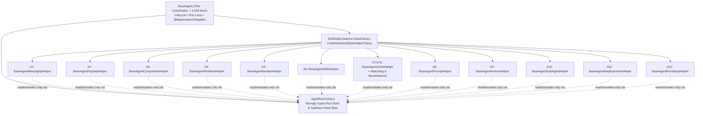
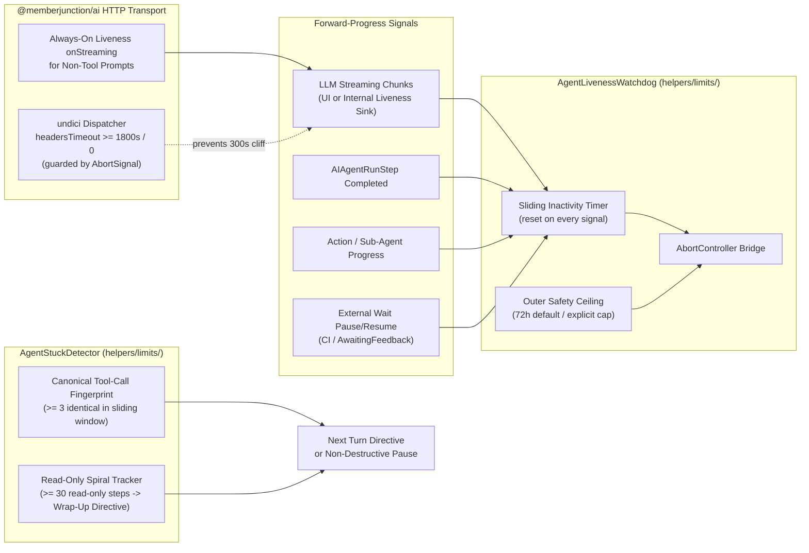

# `BaseAgent` Decomposition, Pluggable Helper Architecture & Liveness Overhaul Plan

**Status:** Ready for Step 1 Sign-Off & Software Factory Execution
**Target Repository:** `MemberJunction/MJ` (base branch: `next`)
**Ground-Truth Baseline:** `origin/next` @ `2b4498abe2` (post-`MJ#6852` Agent Instances & Multi-Level Prototype Inheritance)
**Scan Date:** 2026-11-24 UTC
**Owner / Assignee:** `@AN-BC`

---

## Executive Summary & Prerequisites

`packages/AI/Agents/src/base-agent.ts` has grown to **26,454 lines** (**639 methods/accessors**, **145 properties**, **39 top-level declarations**) on `origin/next`. Every agent capability lands in the same class, causing chronic merge conflicts and preventing deployments or applications from customizing a single runtime behavior (e.g., compaction, liveness watchdogs, skill activation, or action policy checks) without subclassing all of `BaseAgent`.

This plan provides a **ground-truth, Software-Factory-executable blueprint** covering:

1. **Step 1 — In-Flight Scan & Temporary Freeze Protocol:** Live snapshot of all open PRs and unmerged remote branches on `MemberJunction/MJ` touching the freeze zone, exact dispositions, a ready-to-post Teams freeze notice, a temporary path guard, and a permanent `<= 1,000`-line `@memberjunction/standards` CI gate with an exact 19-file allowlist.
2. **Epic A — Seam-by-Seam `BaseAgent` Decomposition (`A0`–`A12`):** Splits `BaseAgent` into **12 pluggable helper seams** resolved via `MJGlobal.Instance.ClassFactory.CreateInstance(...)` + `@RegisterClass`, communicating through a strongly-typed `AgentRunContext` contract (zero `any`, zero `unknown` casts, zero `BaseEntity.Get()/Set()`, entity-derived unions), while preserving 100% backwards-compatible `@deprecated` thin `protected` delegates for every overridden method across the repository.
3. **Slice A7b — Approved `BaseAgent` Liveness, Sliding Heartbeat & `undici` Streaming Overhaul:** Separated strictly from pure refactoring moves, replaces blunt wall-clock `MaxTimePerRun` aborts with a sliding inactivity watchdog (`72h` outer safety ceiling), always-on liveness streaming + Node `undici` `headersTimeout` fix (eliminating the `300,000ms` non-streaming `fetch failed` cliff), and a semantic `StuckDetector` (canonical repeated tool-call breaker + `30+` read-only step wrap-up directive injection).
4. **Turnkey Software Factory Wave Manifest:** Exact per-slice scope, dependencies, verification commands, and falsifiable acceptance criteria for autonomous execution across 14 sequential PRs (`A0` → `A12`, including `A7b`).
5. **Phase 2 Follow-Up Queue:** Sizing notes for the next oversized files (`realtime-client-session-service.ts`, `memory-manager-agent.ts`, `AgentRunner.ts`, `BaseAIEngine.ts`).

### Prerequisites & Related Epics Status

| Workstream | Status | Branch / PR | Relationship to This Plan |
| --- | --- | --- | --- |
| **Agent Instances & Prototype Inheritance** | **Merged on `next`** | `MJ#6852` (`5a6021c060`) | Already present in baseline `2b4498abe2`. `BaseAgent` line count increased from 26,218 → 26,454; `BaseAIEngine.ts` increased from 3,458 → 4,719. |
| **Epics B, C, D & Epic E Hardening** (Chief of Staff `enableHandoff` + shared delegation prompt, Per-User Default Agent via `UserInfoEngine`, Sage hard-coding cleanup, Epic E wake/ceiling/RLS follow-ups) | **In Progress (Separate Code PR)** | `feat/agents-routing-default-and-sage-cleanup` | Being implemented in parallel outside `Epic A`. **Must merge before the `Epic A` freeze opens.** |
| **Step 1 Scan Sign-Off & Freeze** | **Pending `@AN-BC` Sign-Off** | This document (§1) | Disposition the 7 open PRs & unmerged branches below, merge agreed items, post Teams freeze notice, then start Slice `A0`. |
| **Epic A (`A0`–`A12` + `A7b`)** | **Queued for Software Factory** | `epic-a/slice-a0` … `epic-a/slice-a12` | Runs strictly sequentially (1 seam per PR) while the temporary freeze path guard is active; removes guard in `A12`. |

---

## 1. Live `Step 1` In-Flight GitHub Scan Snapshot (`MemberJunction/MJ`)

**Scan Scope (Freeze-Zone Paths):**
- `packages/AI/Agents/src/base-agent.ts`
- `packages/AI/Agents/src/agent-types/**`
- `packages/AI/Agents/src/AgentRunner.ts`
- `packages/AI/BaseAIEngine/src/BaseAIEngine.ts`

**Scan Coverage (2026-11-24 UTC against `origin/next` @ `2b4498abe2`):**
- **138** open PRs scanned on `MemberJunction/MJ` → **7 open PRs** touch freeze-zone paths.
- **785** remote branches scanned via GitHub GraphQL/Compare API (**89** updated since `2026-10-01` without an open PR) → **22 remote branches** have commits ahead of `next` touching freeze-zone paths (**13** are LTS/backport maintenance branches excluded from `next`, **1** has a merged PR, **1** duplicates draft PR `#6404`, and **7** are stale Oct 2026 branches with no PR).

### 1.1 Open PRs Touching Freeze-Zone Paths (Action Required Before Freeze)

| PR | Branch | Author | State | Last Updated (UTC) | Exact Freeze-Zone Diff | Seam Impact | Recommended Disposition |
| --- | --- | --- | --- | --- | --- | --- | --- |
| **`#6516`** | `feat/6395-unified-skill-action-expiration` | `ct-bc` | Open | 2026-11-24 02:34 | `base-agent.ts` (`+481 / -175`) | Compaction (`A3`), Skills (`A6`), Actions (`A9`) | **Land before freeze.** Largest in-flight diff on `base-agent.ts`; rebasing across 3 extracted helpers post-Epic A would require a full manual rewrite. |
| **`#6853`** | `feat/6664-templated-skill-instructions` | `jordanfanapour` | Open | 2026-11-24 00:52 | `base-agent.ts` (`+115 / -10`) | Skills (`A6`) | **Land before freeze.** Active, clean, self-contained Nunjucks skill template rendering; quick review & merge avoids rebase tax. |
| **`#6878`** | `feat/conversation-side-questions` | `ct-bc` | Open | 2026-11-24 00:32 | `base-agent.ts` (`+133 / -11`), `AgentRunner.ts` (`+11 / -4`) | Prompts/Context (`A8`), Logging (`A1`) | **Land before freeze.** Active today; touches live agent-run snapshot hooks inside `base-agent.ts`. |
| **`#6404`** | `feat/canon-graph-engine` | `MS-BC` | Draft (`CONFLICTING`) | 2026-11-23 18:25 | `base-agent.ts` (`+49 / -7`), `AgentRunner.ts` (`+17 / -5`) | Sub-Agents (`A10`) | **Rebase after freeze** (or split the small 2-file Delegated Sub-Agent Results hook out and land pre-freeze). Large multi-package Canon draft already has conflicts. |
| **`#4612`** | `claude/kind-edison-4mc7pk` | `AN-BC` | Open | 2026-10-18 13:54 | `base-agent.ts` (`+58 / -9`) | Payload (`A2`) | **Rebase onto `AgentPayloadHelper` after freeze (or close/split).** Stale 5+ weeks; 58-line payload-size-guard hook cleanly plugs into Slice `A2` post-refactor. |
| **`#4805`** | `fix/sage-workflow-planner-approval` | `ct-bc` | Open | 2026-10-06 04:45 | `base-agent.ts` (`+36 / -2`), `agent-types/loop-agent-type.ts` (`+29 / -4`) | Step Execution (`A11`), `loop-agent-type` | **Confirm with `ct-bc`: rebase after freeze or close.** Stale 7+ weeks; verify whether superseded by newer Workflow Planner/TaskGraph work. |
| **`#4736`** | `fix/complete-message-migration-remaining-readers` | `MarceloT-BC` | Draft | 2026-09-24 16:11 | `AgentRunner.ts` (`+2 / -2`) | `AgentRunner.ts` only (0 lines in `base-agent.ts`) | **Rebase after freeze** (or land trivial 2-line change pre-freeze). Does not touch `base-agent.ts`. |
| *(in-flight)* | `feat/agents-routing-default-and-sage-cleanup` | *(Epics B/C/D/E)* | In Progress | 2026-11-24 | Small hardening outside or minimal in freeze zone | Epics B/C/D + Epic E | **Land before freeze.** Scheduled prerequisite wave. |

**Recently Resolved / Verified Clear PRs (No Freeze Action Needed):**
- **`#6852`** (`AN-BC`, `feat/agent-instances-and-inheritance`): **MERGED** (`5a6021c060`).
- **`#6873`** (`MattC-BC`, `fix/realtime-mobile-audio-ui`): **MERGED** (`2b4498abe2`, 0 freeze-zone files).
- **`#6849`** (`AN-BC`, `factory/8cb5476e-task-graph-isolation-workqueue`): **CLOSED** (superseded by merged `#6832`).
- **`#6783`** (`CaelebB-BC`, `CB-taskgraph-and-test-action-authorization`): **OPEN** — verified **0 freeze-zone files**.
- **`#6751`** (`bg-BC`, `claude/live-avatars-ui-refinement-3e7c2b`): **OPEN** — verified **0 freeze-zone files**.

### 1.2 Unmerged Recent Remote Branches Without Open PRs (`>= 2026-10-01`)

| Category | Branch(es) | Author(s) | Last Commit (UTC) | Freeze-Zone Diff | Recommended Disposition |
| --- | --- | --- | --- | --- | --- |
| **Duplicate of Draft PR `#6404`** | `fix/agent-delegated-results` | `Madhav` | 2026-11-05 20:19 | `base-agent.ts` (`+49/-7`), `AgentRunner.ts` (`+17/-5`) | Identical diff to `#6404`; coordinate with `MS-BC` / `Madhav` (either open standalone PR pre-freeze or rebase after `A10`). |
| **Stale Oct Feature/Fix Branches (No PR)** | `fix/5510-report-stalls` | `MarceloT-BC` | 2026-10-13 19:48 | `base-agent.ts` (`+16/-2`) | Confirm with author; likely supersede via Slice `A7b` liveness/stuck-detector or abandon. |
| **Stale Oct Feature/Fix Branches (No PR)** | `research-mermaid-diagrams` | `rkihm-BC` | 2026-10-07 21:36 | `base-agent.ts` (`+75/-2`) | Confirm with author (`rkihm-BC`); rebase after freeze or abandon. |
| **Stale Oct Feature/Fix Branches (No PR)** | `fix/pre-execution-rag-scope-permission` | `cmbrock-BC` | 2026-10-06 21:12 | `base-agent.ts` (`+8/-3`) | Confirm with author (`cmbrock-BC`); verify if already landed in later RAG scope fixes; delete if obsolete. |
| **Stale Oct Feature/Fix Branches (No PR)** | `telephony-pr3-rooms-humans`, `realtime-pr4-turn-taking`, `telephony-pr2-agent-parity` | `claude` | 2026-10-04 02:52–02:55 | `base-agent.ts` (`+6/-0` each) | Stale pre-merge realtime/telephony branch shards; confirm superseded & delete. |
| **Stale Oct Feature/Fix Branches (No PR)** | `chore/decisions-phase1-scope` | `cmbrock-BC` | 2026-10-01 17:24 | `base-agent.ts` (`+64/-1541`), `agent-types/loop-agent-*` | Stale 7+ weeks large deletion branch; confirm abandoned & delete. |
| **Merged PR Residue** | `claude/mj-agent-building-guide-ro98ux` | `ct-bc` | 2026-10-11 21:37 | `base-agent.ts` (`+78/-6`), `flow-agent-type.ts` (`+9/-5`) | Associated PR `#4586` already `MERGED`; delete stale branch. |
| **LTS / Backport Branches (13 branches)** | `lts/6.2`, `lts/6.1`, `lts/5`, `backport-5798-to-lts/6.1`, `handport-5839-to-lts-6.1`, `handport-5928-to-lts-6.1`, `JF_Native_Tool_Loop_LTS61`, `backport-5019-to-lts/6.1`, `handport-5638-to-lts-5`, `handport-4746-to-lts-6.1`, `handport-5058-to-lts-6.1`, `handport-4765-to-lts-6.1`, `fix/5367-isa-child-field-security-lts-6.1` | `jordanfanapour`, `bg-BC`, `cmbrock-BC`, `cadam11` | 2026-10-15 – 2026-11-21 | Release-line divergence vs `next` | **Exclude from freeze.** LTS maintenance branches never merge back into `next`. |

### 1.3 Ready-to-Post Teams Freeze Notice

Post in engineering Teams channel once `#6516`, `#6853`, `#6878`, and `feat/agents-routing-default-and-sage-cleanup` have merged (or been explicitly deferred):

> **Heads-up:** Starting **[DATE]**, `packages/AI/Agents/src/base-agent.ts`, `packages/AI/Agents/src/agent-types/`, `packages/AI/Agents/src/AgentRunner.ts`, and `packages/AI/BaseAIEngine/src/BaseAIEngine.ts` are **frozen** while we refactor `BaseAgent` (26,454 lines) into 12 small, pluggable `@RegisterClass` helper classes (`< 1,000` lines per file). Please don't start new work in those files until I post that the refactor is done. If you have work in progress there not already coordinated (`#6516`, `#6853`, `#6878`), ping me today so we can get it merged before the freeze starts. Everything else in MJ is unaffected.

### 1.4 Temporary Freeze Path-Guard Specification (Added in `A0`, Removed in `A12`)

Enforce the freeze with **both** a lightweight CODEOWNERS lock and a dedicated required-or-visible workflow check so accidental PRs fail immediately in CI:

1. **Temporary `.github/CODEOWNERS` block** (added in `A0`, deleted in `A12`):
   ```text
   # TEMPORARY FREEZE (Epic A — BaseAgent decomposition; remove in Slice A12)
   /packages/AI/Agents/src/base-agent.ts @AN-BC
   /packages/AI/Agents/src/agent-types/ @AN-BC
   /packages/AI/Agents/src/AgentRunner.ts @AN-BC
   /packages/AI/BaseAIEngine/src/BaseAIEngine.ts @AN-BC
   ```
2. **Temporary `.github/workflows/baseagent-freeze-guard.yml`** (added in `A0`, deleted in `A12`):
   - Trigger: `pull_request` targeting `next` (no `paths:` filter so status check always reports, matching `ci-standards.yml` convention).
   - Inspects `git diff --name-only origin/next...HEAD` against the 4 freeze-zone patterns.
   - If any freeze-zone file is modified **and** the PR does **not** carry the label `epic-a-baseagent-refactor` (or head branch does not match `epic-a/*`), fails with a clear message pointing to this plan and `@AN-BC`.

### 1.5 Permanent `<= 1,000`-Line `@memberjunction/standards` CI Gate Specification (Added in `A0`)

Integrate directly into MJ's existing `@memberjunction/standards` framework (`packages/Standards`, executed by `.github/workflows/ci-standards.yml` on every PR touching `packages/**/*.ts`):

- **New check ID:** `file-line-limit` (`packages/Standards/src/checks/file-line-limit.ts`, registered in `packages/Standards/src/registry.ts` with `Since: "6.3.0"`).
- **Rule:** Every non-test `.ts` source file under configured `Roots` (`["packages/AI/Agents/src"]`) must be `<= MaxLines` (`1000`), **unless**:
  1. It appears in `Options.Allowlist` (grandfathered pre-existing files), **or**
  2. Its top 15 lines contain an explicit single-line rationale pragma: `// file-size-ok: <reason>` (e.g., generated table or large union type).
- **Test files excluded** (`__tests__/`, `*.test.ts`, `*.spec.ts`) — matching `limits-literals.ts` `SKIP_DIRS` / `SKIP_FILE_RE` conventions.
- **Exact `.mj-standards.json` adoption block (exact 19-file allowlist on `origin/next` @ `2b4498abe2`):**

```json
"file-line-limit": {
  "Severity": "error",
  "Roots": [
    "packages/AI/Agents/src"
  ],
  "Options": {
    "MaxLines": 1000,
    "HeaderReasonPattern": "//\\s*file-size-ok:\\s*\\S+",
    "Allowlist": [
      "packages/AI/Agents/src/base-agent.ts",
      "packages/AI/Agents/src/realtime/realtime-client-session-service.ts",
      "packages/AI/Agents/src/memory-manager-agent.ts",
      "packages/AI/Agents/src/AgentRunner.ts",
      "packages/AI/Agents/src/artifact-tools/SpreadsheetToolLibrary.ts",
      "packages/AI/Agents/src/ArtifactToolManager.ts",
      "packages/AI/Agents/src/GovernedArtifactService.ts",
      "packages/AI/Agents/src/PayloadManager.ts",
      "packages/AI/Agents/src/agent-types/flow-agent-type.ts",
      "packages/AI/Agents/src/artifact-tools/SlideDeckToolLibrary.ts",
      "packages/AI/Agents/src/artifact-tools/DocumentToolLibrary.ts",
      "packages/AI/Agents/src/AgentWakeTriggerService.ts",
      "packages/AI/Agents/src/realtime/realtime-coagent-config.ts",
      "packages/AI/Agents/src/agent-types/loop-agent-type.ts",
      "packages/AI/Agents/src/GrowthCoachService.ts",
      "packages/AI/Agents/src/BudgetEnforcementGuard.ts",
      "packages/AI/Agents/src/operations/LimitsOperations.ts",
      "packages/AI/Agents/src/artifact-tools/artifact-comment-suggestion-helper.ts",
      "packages/AI/Agents/src/RunawayCheckpointManager.ts"
    ]
  }
}
```

> **Ratchet Invariant:** In Slice `A12`, `"packages/AI/Agents/src/base-agent.ts"` is **removed from `Allowlist`**, permanently locking `base-agent.ts` at `<= 1,000` lines in CI. Every newly extracted helper module across `A1`–`A12` is born un-allowlisted and must stay `<= 1,000` lines from day one (aiming for 400–800 lines per file).

---

## 2. Exact Ground-Truth Seam Map & Pluggable `@RegisterClass` Architecture (`Epic A`)

### 2.1 Ground-Truth AST Inventory of `base-agent.ts` (`origin/next` @ `2b4498abe2`)

| Metric | Exact Count on `next` | Notes |
| --- | ---: | --- |
| Total file lines | **26,454** | `BaseAgent` class spans L818–L26453 (25,636 lines); top-level types/constants span L1–L817 |
| Top-level declarations | **39** | 11 exported (`StoppedRunStackStepRecord`, `ActionResultSummary`, `ActionResultCrushConfig`, `ExecuteSingleActionOptions`, `ActionCircuitBreakerReason`, `ActionFailureClass`, `NON_RETRYABLE_RESULT_CODES`, `POLICY_*_RESULT_CODE`, `IDENTICAL_FAILURE_THRESHOLD`, `ACTION_FAILURE_BUDGET`, `CircuitBreakerActionResult`) + 28 local |
| Class properties | **145** | 5 `public`, 7 `protected`, 133 `private` |
| Class methods & accessors | **639** | 28 `public`, 238 `protected`, 373 `private` |
| Existing unit test files in `packages/AI/Agents/src/__tests__/` | **289** | Strong coverage on loops, limits, realtime, compaction, payload, handoff, skills, and instances |
| Existing partial collaborators already wired on `BaseAgent` (L944–L991) | **8** | `AgentTreeBudgetTracker`, `AgentFeedbackCoordinator`, `AgentContextAssembler`, `AgentStepDispatcher`, `BudgetEnforcementGuard`, `DeterministicProgressDetector`, `FastConvergenceJudge`, `RunawayCheckpointManager` |

**Composition Principle with Existing Collaborators:** The 8 existing collaborators above are already tested and focused (529–1,286 lines each). The new `@RegisterClass` helpers **compose and delegate to** these existing collaborators rather than duplicating or rewriting them (e.g., `AgentLimitsHelper` owns `AgentTreeBudgetTracker`, `BudgetEnforcementGuard`, `DeterministicProgressDetector`, `FastConvergenceJudge`, and `RunawayCheckpointManager`; `AgentMessagingHelper` owns `AgentFeedbackCoordinator`; `AgentPromptHelper` owns `AgentContextAssembler`; `AgentStepExecutionHelper` & `AgentIterationHelper` compose `AgentStepDispatcher`).

### 2.2 Pluggable `@RegisterClass` Resolution Architecture



**Plugin Resolution Pattern (Zero `BaseAgent` Subclassing Required):**

1. Each of the 12 seams exports:
   - A TypeScript contract interface (`IAgent<Seam>Helper`)
   - A concrete base class (`BaseAgent<Seam>Helper implements IAgent<Seam>Helper`) serving as the `ClassFactory` registration token (non-abstract so `ClassFactory.CreateInstance` accepts its constructor directly with **zero** `any` or `unknown` casts)
   - A default concrete implementation (`Agent<Seam>Helper extends BaseAgent<Seam>Helper`) decorated with `@RegisterClass(BaseAgent<Seam>Helper)` (default priority `0`).
2. `BaseAgent` resolves each helper lazily per run via a single strongly-typed factory helper with zero casts:
   ```typescript
   protected resolveHelper<T>(
       baseClass: new () => T,
       fallbackCtor: new () => T,
   ): T {
       const registered = MJGlobal.Instance.ClassFactory.CreateInstance<T>(baseClass);
       return registered ?? new fallbackCtor();
   }
   ```
   *(Declaring each `BaseAgent<Seam>Helper` as a non-abstract base class guarantees `MJGlobal.Instance.ClassFactory.CreateInstance<BaseAgentCompactionHelper>(BaseAgentCompactionHelper)` compiles under strict TypeScript with zero casts while still allowing any subclass to override individual methods.)*
3. **Downstream Override Mechanism:** Any application or deployment swaps a single seam by registering a subclass with a higher priority:
   ```typescript
   @RegisterClass(BaseAgentCompactionHelper, undefined, 100)
   export class CustomCompactionHelper extends BaseAgentCompactionHelper {
       public override async CompactMessage(ctx: AgentRunContext, ...): Promise<...> {
           // Custom compaction strategy — zero BaseAgent subclassing!
       }
   }
   ```
4. **Side-Effect Registration Guarantee:** `packages/AI/Agents/src/helpers/index.ts` statically imports and exports all 12 default helper classes (no dynamic `import()`), and `packages/AI/Agents/src/index.ts` exports `./helpers/index`, ensuring all default `@RegisterClass` registrations execute automatically whenever `@memberjunction/ai-agents` loads.

### 2.3 Strongly-Typed `AgentRunContext` Contract

Every helper receives `ctx: AgentRunContext` rather than a reference to `BaseAgent` internals. This guarantees:
- Helpers **never** reach into `BaseAgent` private fields (`_agentRun`, `_agentConfig`, `_executionCounts`, etc.).
- Zero `any`, zero `unknown` casts, zero `BaseEntity.Get()/Set()`.
- All entity status/enum fields use TypeScript indexed access (`MJAIAgentRunEntityExtended['Status']`, `MJAIAgentRunStepEntityExtended['StepType']`, `MJAIAgentEntityExtended['InstantiationMode']`, etc.) so CodeGen union expansions propagate automatically.

```typescript
// packages/AI/Agents/src/helpers/AgentRunContext.ts (target ~260 lines)

export interface AgentRunContext {
    /** Immutable per-run inputs & resolved runtime identity */
    readonly RunId: string;
    readonly Params: ExecuteAgentParams;
    readonly ContextUser: UserInfo;
    readonly ActiveProvider: IMetadataProvider;
    readonly Depth: number;
    readonly AgentHierarchy: readonly string[];

    /** Mutable run lifecycle entities & resolved configuration */
    AgentRun: MJAIAgentRunEntityExtended | null;
    AgentConfig: AgentConfiguration | undefined;
    AgentTypeInstance: BaseAgentType | undefined;
    AgentTypeState: Record<string, JsonValue> | undefined;
    RunAbortController: AbortController | null;

    /** Domain-partitioned mutable state bags (replacing 133 BaseAgent private fields) */
    readonly Messaging: AgentMessagingState;
    readonly Payload: AgentPayloadState;
    readonly Compaction: AgentCompactionState;
    readonly Realtime: AgentRealtimeState;
    readonly Iteration: AgentIterationState;
    readonly Skills: AgentSkillsState;
    readonly Limits: AgentLimitsState;
    readonly Prompt: AgentPromptState;
    readonly Actions: AgentActionsState;
    readonly SubAgents: AgentSubAgentState;

    /** Peer helper registry (lets higher-layer helpers invoke leaf helpers cleanly) */
    readonly Helpers: AgentHelperRegistry;

    /**
     * Subclass override bridge: routes overridable BaseAgent protected hooks
     * (e.g., executePrompt, validateSuccessNextStep, InjectPreExecutionRAG)
     * back to the live BaseAgent instance so existing subclasses & tests
     * keep working with zero test-logic changes.
     */
    readonly SubclassHooks: AgentSubclassHooks;
}
```

**Design Invariant for `SubclassHooks`:** When `AgentStepExecutionHelper` validates a `Success` step, it invokes `ctx.SubclassHooks.validateSuccessNextStep(...)` which calls `this.validateSuccessNextStep(...)` on the `BaseAgent` instance. If a subclass (`QueryBuilderAgent`, `VideoStudioAgent`, etc.) overrode `validateSuccessNextStep`, the subclass override runs and its `super.validateSuccessNextStep(...)` delegates back into `AgentStepExecutionHelper.ValidateSuccessNextStep(ctx, ...)`. This preserves **exact virtual dispatch semantics** across all 31 production subclasses and 66 test subclasses while moving 100% of the implementation out of `base-agent.ts`.

### 2.4 Complete 12-Helper Ground-Truth Seam Map (Every New File `<= 1,000` Lines)

> **Crucial Sizing Constraint:** Several seams currently span `1,200–3,200` lines inside `base-agent.ts`. Dropping an entire 3,200-line seam into a single file would immediately violate the `<= 1,000`-line CI gate introduced in Slice `A0`. Therefore, every seam exceeding ~850 lines is decomposed into a **pluggable `@RegisterClass` facade (`<= 750L`) plus cohesive internal sub-modules (`<= 800L` each)** under `packages/AI/Agents/src/helpers/<seam>/`.

| Slice | Seam / Pluggable Base Class | Methods in `base-agent.ts` | Vis (`pub/prot/priv`) | Current Lines in `base-agent.ts` | Target File Tree (All Files `<= 850L`) | Key Responsibilities & Top Extracted Methods |
| --- | --- | ---: | :---: | ---: | --- | --- |
| **A1** | **Messages, Progress & Run Logging**<br>`BaseAgentMessagingHelper` | 59 | `4 / 28 / 27` | 1,201 | `helpers/messaging/BaseAgentMessagingHelper.ts`<br>`helpers/messaging/AgentMessagingHelper.ts` (~680L)<br>`helpers/messaging/AgentStoppedRunContinuationHelper.ts` (~480L) | Step entity creation/finalization/save-queue (`createStepEntity`, `finalizeStepEntity`, `queueStepSave`), progress callbacks & hierarchical formatting, UI markup conversion, message lifecycle events, reasoning-prefix fingerprinting, prior-turn & stopped-run continuation (`BuildPriorTurnToolResultsMessage`, `BuildStoppedRunResultsMessage`, `ExtractStoppedRunLoopTurns`), feedback requests (`AgentFeedbackCoordinator`). |
| **A2** | **Payload, Validation & Scratchpad**<br>`BaseAgentPayloadHelper` | 51 | `2 / 12 / 37` | 857 | `helpers/payload/BaseAgentPayloadHelper.ts`<br>`helpers/payload/AgentPayloadHelper.ts` (~780L) | Starting/final payload validation & retries (`handleStartingPayloadValidation`, `handleFinalPayloadValidationFailure`), payload change application & upstream/downstream path computation, media output promotion & large binary interception (`interceptLargeBinaryContent`, `resolveMediaPlaceholdersRecursive`), scratchpad management, held completion changes, response-type auto-alignment. |
| **A3** | **Context Compaction & Summaries**<br>`BaseAgentCompactionHelper` | 28 | `0 / 22 / 6` | 1,246 | `helpers/compaction/BaseAgentCompactionHelper.ts`<br>`helpers/compaction/AgentCompactionHelper.ts` (~720L)<br>`helpers/compaction/AgentContextRecoveryHelper.ts` (~490L) | Mid-loop & pre/post-turn/cross-turn compaction (`pruneAndCompactExpiredMessages`, `runPostRunCompaction`, `runCrossTurnCompaction`, `compactMessage`), message expansion (`executeExpandMessageStep`), token estimation & model context limit lookup, context-window overflow recovery strategies (`smartTrimContent`, `recoveryStrategy_CompactOldToolResults`, `recoveryStrategy_TrimLastUserMessage`), post-run memory extraction trigger. |
| **A4** | **Realtime Session Hooks**<br>`BaseAgentRealtimeHelper` | 26 | `1 / 6 / 19` | 790 | `helpers/realtime/BaseAgentRealtimeHelper.ts`<br>`helpers/realtime/AgentRealtimeHelper.ts` (~750L) | Session-driven agent execution branch (`isSessionDrivenAgentType`), realtime config/model/avatar/vendor resolution (`resolveRealtimeEffectiveConfig`, `resolveRealtimeModel`), serialized transcript persistence & flushing (`persistRealtimeTranscriptSerialized`, `flushRealtimeTranscriptQueues`), recording finalization, realtime delegation & bridge prep (`delegateRealtimeToTarget`, `buildBridgePrepInput`), usage checkpointing. |
| **A5** | **Iteration Constructs (`ForEach`, `While`, `Pipeline`)**<br>`BaseAgentIterationHelper` | 31 | `0 / 3 / 28` | 1,321 | `helpers/iteration/BaseAgentIterationHelper.ts`<br>`helpers/iteration/AgentIterationHelper.ts` (~650L)<br>`helpers/iteration/AgentLoopBodyExecutor.ts` (~660L) | `ForEach` / `While` / `Pipeline` validation & step lifecycle (`executeForEachLoop`, `executeWhileLoop`, `buildPipelineRegistry`), batched/sequential iteration execution (`executeForEachIterationsSequential`, `executeWhileIterations`, `executeLoopStepsIteration`), inline loop governance (`checkInlineLoopIterationGovernance`), loop template interpolation & result folding (composes `AgentStepDispatcher` & `pipeline-executor`). |
| **A6** | **Skills Activation & Grants**<br>`BaseAgentSkillsHelper` | 21 | `1 / 18 / 2` | 486 | `helpers/skills/BaseAgentSkillsHelper.ts`<br>`helpers/skills/AgentSkillsHelper.ts` (~520L) | Skill availability filtering (`filterAvailableSkills`, `availableSkills`), step validation & execution (`validateSkillNextStep`, `executeSkillStep`), pre-activation & conversation skill persistence (`preActivateRequestedSkills`, `persistConversationSkillActivation`), capability/action grants (`enableSkillCapabilities`), skill ID merging & history loading. |
| **A7** | **Limits, Budgets, Guardrails & Checkpoints (Pure Move)**<br>`BaseAgentLimitsHelper` | 73 | `7 / 16 / 50` | 1,547 | `helpers/limits/BaseAgentLimitsHelper.ts`<br>`helpers/limits/AgentLimitsHelper.ts` (~740L)<br>`helpers/limits/AgentCheckpointAndPauseHelper.ts` (~740L) | Epic 1 guardrails, limits resolution & server user policy (`resolveFullRunLimits`, `resolveServerUserPolicy`, `checkExecutionGuardrails`, `checkMinimumExecutionRequirements`), tree/workflow budgets (`ensureTreeBudget`, `checkTreeBudgetLimit`, `recordPromptUsageInTreeBudget`), progress detector & fast convergence judge reconciliation (`evaluateRunawayGovernanceAfterStep`, `reconcileFastJudgeUsageForScope`), non-destructive pause & checkpoint restore (`pauseNonDestructively`, `restorePausedRunFromCheckpoint`, `ResumePausedRun`), taint tracking & credential-shaped argument checks. *(Composes `AgentTreeBudgetTracker`, `BudgetEnforcementGuard`, `DeterministicProgressDetector`, `FastConvergenceJudge`, `RunawayCheckpointManager`.)* |
| **A7b** | **Liveness Watchdog, `undici` Streaming & `StuckDetector` (Behavior Enhancement)** | *(new)* | — | *(new)* | `helpers/limits/AgentLivenessWatchdog.ts` (~380L)<br>`helpers/limits/AgentStuckDetector.ts` (~420L)<br>+ `@memberjunction/ai` `undici` dispatcher transport helper (~180L) | Replaces blunt wall-clock aborts with sliding inactivity watchdog + `72h` outer safety ceiling, always-on liveness streaming sink + Node `undici` `headersTimeout` fix, and semantic `StuckDetector` (repeated tool-call breaker + `30+` read-only step wrap-up directive). **See §3 for complete specification.** |
| **A8** | **Prompts, Persona, Context Memory & Prototype Inheritance**<br>`BaseAgentPromptHelper` | 117 | `2 / 40 / 75` | 3,202 | `helpers/prompt/BaseAgentPromptHelper.ts`<br>`helpers/prompt/AgentPromptHelper.ts` (~750L)<br>`helpers/prompt/AgentPromptTemplateDataBuilder.ts` (~780L)<br>`helpers/prompt/AgentContextAndMemoryInjector.ts` (~780L)<br>`helpers/prompt/AgentRunScopeResolver.ts` (~520L) | Prompt step execution & parameter preparation (`executePromptStep`, `preparePromptParams`, `finalizePromptParams`, `executePrompt`), template data & volatile trailing state (`gatherPromptTemplateData`, `buildVolatileStateMessage`, `resolveRuntimeStateDelivery`), agent catalog & narrowed catalog, persona/memory/pre-execution RAG/decision discovery (`InjectContextMemory`, `InjectPreExecutionRAG`, `InjectDecisionDiscovery`), prototype inheritance (`MJ#6852` prompt/preset/configuration chain), run scope, audience & data trust (`ResolveAudienceUsers`, `validateAndApplySecondaryScopes`). *(Composes `AgentContextAssembler`.)* |
| **A9** | **Actions, Native Tools & Client Tools**<br>`BaseAgentActionsHelper` | 101 | `1 / 41 / 59` | 2,575 | `helpers/actions/BaseAgentActionsHelper.ts`<br>`helpers/actions/AgentActionsHelper.ts` (~750L)<br>`helpers/actions/AgentActionPolicyAndValidation.ts` (~720L)<br>`helpers/actions/AgentNativeAndClientToolsExecutor.ts` (~820L) | Action step & single-action invocation (`executeActionsStep`, `ExecuteSingleAction`), param normalization & bound action params (`normalizeActionParams`), policy/audience/tainted-egress gates (`checkUserActionPolicy`, `checkStructuralAudienceAction`, `checkTaintedEgress`), action failure circuit breaker & retry classification, native tool declaration & loop bridge (`GetAgentTools`, `ExecuteAgentToolCallsAsSteps`), client tools (`executeClientToolsStep`), artifact tools, conversation tools & decision step execution (`executeDecisionStep`). |
| **A10** | **Sub-Agents, TaskGraph Delegation & Handoff**<br>`BaseAgentSubAgentHelper` | 57 | `0 / 22 / 35` | 2,913 | `helpers/subagents/BaseAgentSubAgentHelper.ts`<br>`helpers/subagents/AgentSubAgentHelper.ts` (~780L)<br>`helpers/subagents/AgentParallelSubAgentDispatcher.ts` (~720L)<br>`helpers/subagents/AgentHandoffAndTaskGraphHelper.ts` (~780L) | Child & related sub-agent execution (`ExecuteSubAgent`, `executeChildSubAgentStep`, `executeRelatedSubAgentStep`), parallel sub-agent dispatch & result merging (`prepareParallelSubAgentDispatch`, `mergeParallelExecutionsIntoParent`), sub-agent payload cloning & I/O mapping, handoff validation & target resolution (`validateHandoffNextStep`), task graph delegation & folded task graph tracking (`recordFoldedTaskGraph`), sub-agent chat consult, escalation & plan approval form. |
| **A11** | **Step Execution & Next-Step Dispatch**<br>`BaseAgentStepExecutionHelper` | 30 | `0 / 14 / 16` | 1,364 | `helpers/steps/BaseAgentStepExecutionHelper.ts`<br>`helpers/steps/AgentStepExecutionHelper.ts` (~720L)<br>`helpers/steps/AgentStepValidationHelper.ts` (~620L) | Main step dispatch switch (`executeNextStep`, `processNextStep`, `determineNextStep`), task & chat step handlers (`executeTasksStep`, `executeChatStep`), next-step & terminal validators (`validateNextStep`, `validateSuccessNextStep`, `validateChatNextStep`, `validateTasksNextStep`), self-check evaluation (`applySelfCheck`), native retry & failed-write terminal decline (`answerNativeRetryTurn`, `declineTerminalAfterFailedWrite`), context recovery entry (`attemptContextRecovery`). |
| **A12** | **Run Setup (Pre-Work & Phase 1–3) + Final Thin `BaseAgent` Coordinator**<br>`BaseAgentRunSetupHelper` | 12 (+ `executeRun` PRE-WORK / PHASE 1–3) | `0 / 6 / 6` | 1,301 | `helpers/setup/BaseAgentRunSetupHelper.ts`<br>`helpers/setup/AgentRunSetupHelper.ts` (~780L)<br>`base-agent.ts` (**final `< 950L`**) | Parallelized Opt #4 initialization pipeline: PRE-WORK (sync param wrapping, markup conversion, payload init, cancellation check), PHASE 1 (permission check + engine init + `AgentRun` creation in parallel), PHASE 2 (config load + data preload + context memory injection in parallel), PHASE 3 (agent type initialization), `validateRunChain`, `isConfigurationError`. Leaves `BaseAgent` as a thin `< 1,000`-line coordinator owning `Execute()`, `executeAgentInternal()`, `finalizeAgentRun()`, helper wiring, and `@deprecated` protected delegates. |
| *(Core)* | **`BaseAgent` Thin Coordinator** *(stays in `base-agent.ts`)* | 33 | `10 / 10 / 13` | ~767 → **< 950L total** (incl. thin `@deprecated` delegates) | `packages/AI/Agents/src/base-agent.ts` | Public entry `Execute()`, `executeAgentInternal()` step loop, `finalizeAgentRun()` / `finalizeRun()`, `validateAgent()`, helper resolution, static utilities (`CancellationReasonForAbort`, `LastStepPayload`), and 1-release `@deprecated` protected delegate table. |

**Accounting Verification:** `59 + 51 + 28 + 26 + 31 + 21 + 73 + 117 + 101 + 57 + 30 + 12 + 33 = 639 / 639` methods accounted for (**100.0%**).

### 2.5 Backwards-Compatible `protected` Delegates Table (AST-Verified Across Entire Repo)

AST scanning all **97 files** extending `BaseAgent` (**31 production files**, **66 test files**) yields the exact contract that MUST remain intact for one full release cycle:

#### A. Production Subclass Overrides (13 Unique `BaseAgent` Methods Across 18 Concrete Classes)

| `BaseAgent` Method | Visibility | Production Subclasses Overriding It | Disposition After `Epic A` |
| --- | :---: | --- | --- |
| `executeAgentInternal` | `protected` | `AgentBuilderAgent`, `MemoryCleanupAgent`, `MemoryManagerAgent`, `PredictiveStudioPipelineBuilderAgent`, `VideoStudioPreProductionAgent`, `VideoStudioRenderAgent`, `VideoStudioAgent` (7) | **Permanent coordinator hook** on `BaseAgent` (not deprecated). |
| `validateSuccessNextStep` | `protected` | `AgentArchitectAgent`, `PlanningDesignerAgent`, `QueryBuilderAgent`, `DatabaseDesignerSchemaDesigner`, `FormBuilderDesignerAgent`, `VideoStudioAgent`, `ActionSmithAgent` (7) | **`@deprecated` thin delegate** on `BaseAgent` → `BaseAgentStepExecutionHelper.ValidateSuccessNextStep`; bridged via `ctx.SubclassHooks`. |
| `determineNextStep` | `protected` | `HarnessAgentBase`, `DatabaseDesignerAgent`, `FormBuilderAgent`, `PredictiveStudioModelDevAgent` (4) | **Coordinator hook** (thin delegate → `BaseAgentStepExecutionHelper.DetermineNextStep`); bridged via `ctx.SubclassHooks`. |
| `executePrompt` | `protected` | `HarnessAgentBase`, `ITConsultParentAgent`, `ITConsultChildAgent` (3) | **`@deprecated` thin delegate** → `BaseAgentPromptHelper.ExecutePrompt`; bridged via `ctx.SubclassHooks`. |
| `validateChatNextStep` | `protected` | `QueryBuilderAgent`, `ActionSmithAgent` (2) | **`@deprecated` thin delegate** → `BaseAgentStepExecutionHelper.ValidateChatNextStep`; bridged via `ctx.SubclassHooks`. |
| `executeNextStep` | `protected` | `FormBuilderAgent`, `VideoStudioAgent` (2) | **Coordinator hook** (thin delegate → `BaseAgentStepExecutionHelper.ExecuteNextStep`); bridged via `ctx.SubclassHooks`. |
| `finalizeRun` | `protected` | `HarnessAgentBase` (1) | **Permanent coordinator hook** on `BaseAgent`. |
| `preparePromptParams` | `protected` | `DatabaseDesignerAgent` (1) | **`@deprecated` thin delegate** → `BaseAgentPromptHelper.PreparePromptParams`; bridged via `ctx.SubclassHooks`. |
| `validateAgent` | `protected` | `VideoStudioAgent` (1) | **Permanent coordinator hook** on `BaseAgent`. |
| `resolvePlanModeGate` | `protected` | `VideoStudioAgent` (1) | **`@deprecated` thin delegate** → `BaseAgentSubAgentHelper.ResolvePlanModeGate`; bridged via `ctx.SubclassHooks`. |
| `validateNextStep` | `protected` | `VideoStudioAgent` (1) | **`@deprecated` thin delegate** → `BaseAgentStepExecutionHelper.ValidateNextStep`; bridged via `ctx.SubclassHooks`. |
| `validateSubAgentNextStep` | `protected` | `VideoStudioAgent` (1) | **`@deprecated` thin delegate** → `BaseAgentSubAgentHelper.ValidateSubAgentNextStep`; bridged via `ctx.SubclassHooks`. |
| `GetAgentTools` | `protected` | `ITNtlDocAgent` (1) | **`@deprecated` thin delegate** → `BaseAgentActionsHelper.GetAgentTools`; bridged via `ctx.SubclassHooks`. |

*(Note: `LoopAgentType` and `FlowAgentType` extend `BaseAgentType`, not `BaseAgent` — they interact with `BaseAgent` through public/package-level types and `BaseAgentType` callbacks rather than `extends BaseAgent`.)*

#### B. Additional Methods Overridden by Unit Test Subclasses (33 Additional Methods Across 66 Test Files)

To satisfy the strict acceptance rule **"unit tests and the deterministic integration tier pass with no test logic changed, apart from updated import paths"**, these additional methods overridden or called via `super.*` by existing unit test harnesses MUST also remain on `BaseAgent` as 1-to-3-line `@deprecated` thin delegates (grouped cleanly by helper seam so they fit comfortably inside the `< 1,000`-line budget):

- **A1 (Messaging):** `createStepEntity`, `finalizeStepEntity`, `queueStepSave`, `logStatus`, `logError`, `formatActionResultsAsMarkdown`
- **A2 (Payload):** `serializePayloadAtEnd`, `cloneSubAgentPayload`
- **A3 (Compaction):** `compactMessage`, `resolveCompactionBudget`, `startPostTurnCompaction`, `runPostRunCompaction`, `triggerPostRunMemoryExtraction`
- **A4 (Realtime):** `resolveRealtimeEffectiveConfig`, `resolveRealtimeModel`
- **A5 (Iteration):** `buildPipelineRegistry`
- **A6 (Skills):** `filterAvailableSkills`
- **A7 (Limits/Budgets):** `ensureTreeBudget`, `checkTreeBudgetLimit`, `checkExecutionGuardrails`, `checkMinimumExecutionRequirements`
- **A8 (Prompts/Context):** `InjectPreExecutionRAG`, `InjectContextMemory`, `InjectDecisionDiscovery`, `ResolveAudienceUsers`, `volatileTemplateMarkers`, `buildVolatileStateMessage`, `buildAgentTypePromptParams`, `resolveTemplates`, `getValueFromPath`
- **A9 (Actions/Tools):** `ExecuteSingleAction`, `getEffectiveActionsForValidation`, `normalizeActionParams`, `normalizeActionParamEntry`, `normalizeActionParamValue`
- **A10 (Sub-Agents):** `ExecuteSubAgent`, `getEffectiveSubAgentsForValidation`, `recordFoldedTaskGraph`
- **A12 (Run Setup):** `loadAgentConfiguration`

> **Line-Budget Check for Final `base-agent.ts`:**
> - Imports & class header / helper registry fields: ~120 lines
> - Core lifecycle (`Execute`, `executeAgentInternal`, `finalizeAgentRun`, `finalizeRun`, `validateAgent`, `createFailureResult`, `createCancelledResult`, static `CancellationReasonForAbort` / `LastStepPayload`): ~380 lines
> - `AgentRunContext` assembly + `SubclassHooks` wiring: ~140 lines
> - ~45 one-to-three-line `@deprecated` thin delegates (3 lines each incl. concise `@deprecated` JSDoc): ~180 lines
> - **Projected final `base-agent.ts` total: ~820 lines** — safely below the `1,000`-line hard ceiling with ~180 lines of headroom!

---

## 3. Approved `BaseAgent` Liveness, Sliding Heartbeat & `undici` Streaming Specification (`Slice A7b`)

> **Strict Separation Rule:** Slice `A7` is a **pure move** of existing limits, budgets, progress detector, fast judge, and checkpoint code (zero behavior changes). **Slice `A7b`** is a dedicated follow-up PR immediately after `A7` that implements the approved liveness, streaming, and stuck-detection overhaul cleanly inside `helpers/limits/` + `@memberjunction/ai`.

### 3.1 Ground-Truth Diagnosis on `origin/next`

Inspecting the live codebase reveals three concrete mechanisms causing premature aborts on legitimate long-running agents:

1. **Blunt Wall-Clock `setTimeout` (`base-agent.ts:3230–3305`):**
   `BaseAgent.executeRun()` computes `agentTimeoutMS = resolvedMaxWallClockMs ?? params.maxExecutionTimeMs ?? configuredMaxTimeMs ?? this.DefaultAgentTimeoutMS` and arms a single non-resetting `setTimeout(() => timeoutController.abort(...), agentTimeoutMS)`. An agent actively streaming reasoning tokens and closing steps is blindly killed the instant wall-clock time elapses.
2. **Headless Non-Streaming & Node `undici` `300s` `headersTimeout` Cliff (`base-agent.ts:18869`, `AIPromptRunner.ts:2544`, `baseLLM.ts:114–129`):**
   - `base-agent.ts:18869` sets `promptParams.onStreaming = params.onStreaming ? (...) : undefined;`. When an agent executes without a UI streaming callback (background runs, scheduled routines, sub-agents, autonomous runners), `params.onStreaming` is `undefined`.
   - `AIPromptRunner.ts:2544` only sets `chatParams.streaming = true` when `params.onStreaming` is defined. Thus headless runs execute **non-streaming**.
   - Additionally, `packages/AI/Core/src/generic/baseLLM.ts:114–129` suppresses streaming (`streamingSuppressedForTools = toolsRequested && params.streaming === true`) whenever native tool calling is active, forcing `nonStreamingChatCompletion(params)`.
   - On large thinking/reasoning prompts (extended thinking models taking > 5 minutes before first HTTP response byte), Node's built-in `undici` default `headersTimeout: 300_000` (`300s`) fires and rejects with `TypeError: fetch failed` (`cause.code = 'UND_ERR_HEADERS_TIMEOUT'`).
3. **Lack of Semantic Spin / Read-Only Spiral Recovery:**
   While `DeterministicProgressDetector` tracks 6 numeric signals and `BaseAgent` has `_actionFailureHistory` for repeated *failing* actions, there is no canonical repeated-tool-call breaker for identical *succeeding* calls, nor a non-lethal wrap-up directive injector when an evaluator/reviewer agent performs `30+` consecutive read-only steps without invoking its terminal action.

### 3.2 Architecture of `Slice A7b`



#### Pillar 1: Sliding Inactivity Watchdog (`helpers/limits/AgentLivenessWatchdog.ts`)

- **Configuration (Centralized in `LimitsConfigResolver`, zero bare literals):**
  Add a `Liveness` block under `MJLimitsConfig` (`packages/MJCore/src/generic/limitsConfig.ts`, preserving full compliance with the `limits-literals` standard):
  - `InactivityTimeoutMs`: sliding window before declaring a hung run (default: `900_000` = `15m`, configurable per org/agent via `mj.config.cjs` & `AgentUserPolicy`).
  - `OuterMaxWallClockMs`: absolute safety ceiling (default: `259_200_000` = `72h` when no tighter org/workflow cap is set; explicit caller `maxExecutionTimeMs`, `PerRun.MaxWallClockMs`, and workflow duration caps still apply as upper bounds so `E2` policy narrowing invariants remain unbroken).
  - `LivenessEnabled`: boolean (default: `true`).
- **Heartbeat Reset Hooks:**
  `AgentLivenessWatchdog.RecordProgress(signal: LivenessProgressSignal)` resets the sliding inactivity timer on:
  - `'llm-stream-chunk'` (throttled in-memory timestamp update on every streamed thought/content chunk)
  - `'step-complete'` (every `AIAgentRunStep` finalization)
  - `'action-progress'` (action/sub-agent progress callback emission)
  - `'sub-agent-heartbeat'` (forwarded upward when child sub-agents emit progress)
- **External Wait Suspension:**
  `SuspendForExternalWait(waitId: string, reason: string)` / `ResumeFromExternalWait(waitId: string)` pauses the sliding inactivity timer (while keeping the outer safety ceiling active) during `AwaitingFeedback`, paused states, or external CI/workflow waits so actively-queued external checks never trigger a false inactivity abort.
- **Abort Reason Contract:**
  - Inactivity breach aborts with `BaseAgent.AgentInactivityAbortReason` (`'Agent execution stalled with no progress signal'`).
  - Outer ceiling / explicit cap breach aborts with `BaseAgent.AgentTimeoutAbortReason` (preserving 100% compatibility with `BaseAgent.CancellationReasonForAbort` and existing tests).

#### Pillar 2: Always-On Liveness Streaming & Node `undici` `headersTimeout` Fix

1. **Always-On Liveness Streaming Sink (`BaseAgentPromptHelper`):**
   - In `executePromptStep`, even when `params.onStreaming` is `undefined`, attach a lightweight internal `promptParams.onStreaming` callback when `ctx.Limits.LivenessWatchdog` is active:
     ```typescript
     const livenessSink: AIPromptStreamingCallback = (chunk) => {
         ctx.Limits.LivenessWatchdog?.RecordProgress({
             Kind: 'llm-stream-chunk',
             TimestampMs: Date.now(),
             StepEntityId: stepEntity.ID,
             Bytes: chunk.content.length,
         });
         if (callerOnStreaming) {
             coalescedForward(chunk);
         }
     };
     ```
   - Because `AIPromptRunner.ts:2544` enables `chatParams.streaming = true` whenever `promptParams.onStreaming` is present, headless/background/sub-agent LLM calls automatically switch to streaming on all streaming-capable drivers, delivering continuous thought/token chunks that reset the sliding inactivity watchdog and avoiding response buffering timeouts!
2. **Node `undici` `headersTimeout` Fix (`@memberjunction/ai` + Provider HTTP Layer):**
   - Covers the remaining non-streaming paths — specifically **native tool calling** (`streamingSuppressedForTools` in `baseLLM.ts:114`) and drivers with `SupportsStreaming === false`.
   - Introduce `CreateLongRunningFetchDispatcher(options?: { headersTimeoutMs?: number; bodyTimeoutMs?: number })` in `packages/AI/Core/src/generic/httpDispatcher.ts` using Node's `undici` `Agent` with `headersTimeout: 0` (or configurable `>= 1_800_000ms` via `LimitsConfigResolver`) and `bodyTimeout: 0` so the per-request `AbortSignal` (`cancellationToken`, driven by `AgentLivenessWatchdog`) is the sole authoritative timeout rather than Node's hardcoded `300,000ms` default.
   - Wire into `MJAPI` server startup (`setGlobalDispatcher` opt-in / provider fetch adapter) and into fetch-based SDK drivers (`@google/genai`, OpenAI, Anthropic custom `fetch` option when running in Node).
   - Update `ErrorAnalyzer` (`packages/AI/Core/src/generic/errorAnalyzer.ts`) to explicitly recognize `UND_ERR_HEADERS_TIMEOUT` and `UND_ERR_BODY_TIMEOUT` on `error.cause.code` as retriable timeout/network errors (`ErrorType: 'NetworkError'` / `'Timeout'`, `canFailover: true`).

#### Pillar 3: Semantic `StuckDetector` (`helpers/limits/AgentStuckDetector.ts`)

Composes alongside `DeterministicProgressDetector` inside `BaseAgentLimitsHelper` (all thresholds defined in `LimitsConfigResolver` under `Limits.StuckDetector`):

1. **Canonical Repeated Tool-Call Breaker:**
   - Computes deterministic canonical fingerprint: `${toolName}::${stableSortedJSON(normalizedArgs)}` for every action, native tool, and client tool call.
   - Maintains a sliding window of the last `WindowSize` calls (default `10`).
   - When the same fingerprint appears `>= RepeatedToolCallThreshold` (default `3`) times within the window:
     - **First trigger:** injects a structured high-priority `system`/`user` **course-correction directive** naming the repeated tool & arguments and requiring a different approach or terminal conclusion.
     - **Second consecutive trigger (agent ignores correction):** escalates to `AgentLimitsHelper` non-destructive checkpoint pause (`PauseReason: 'StuckToolCallLoop'`) or clean termination, preserving all run artifacts and step history.
2. **Read-Without-Act Spiral Detector (`30+` Read-Only Steps Wrap-Up Directive):**
   - Classifies each completed step as **mutating/terminal** vs **read-only** (e.g., search/list/read/get/inspect actions, conversation history lookups, artifact reads, zero payload mutations, zero write actions, zero terminal action calls).
   - Increments `consecutiveReadOnlySteps` on read-only turns; resets to `0` on any mutating action, payload mutation, sub-agent delegation, or terminal action.
   - At `consecutiveReadOnlySteps >= ReadOnlySpiralThreshold` (default `30`):
     - Injects a structured **Wrap-Up Directive** into the next prompt turn:
       > *"You have completed N consecutive read-only investigation steps without producing a final output or invoking a terminal action. Synthesize what you have gathered so far and either call your required terminal action or return your final response on this turn. Do not perform additional exploratory reads unless strictly required to fix a concrete gap."*
     - Emits a diagnostic `AIAgentRunStep` / telemetry event (`StuckDetectorDirectiveInjected`).
     - If the agent continues read-only loops for `ReadOnlyPostDirectiveGraceSteps` (default `5`) additional steps without acting, escalates to non-destructive pause (`PauseReason: 'ReadOnlySpiral'`).

---

## 4. Turnkey Software Factory Wave Manifest & Falsifiable Acceptance Criteria

### 4.1 Execution Dependency Graph

```mermaid
flowchart LR
    A0["A0\nChar Tests +\n<=1000L Gate +\nFreeze Guard"] --> A1["A1\nMessaging &\nLogging"]
    A1 --> A2["A2\nPayload &\nScratchpad"]
    A2 --> A3["A3\nCompaction &\nRecovery"]
    A3 --> A4["A4\nRealtime\nHooks"]
    A4 --> A5["A5\nIteration\nForEach/While"]
    A5 --> A6["A6\nSkills &\nGrants"]
    A6 --> A7["A7\nLimits/Budgets\n(Pure Move)"]
    A7 --> A7b["A7b\nLiveness/undici\n& StuckDetector"]
    A7b --> A8["A8\nPrompts/Persona\n& Inheritance"]
    A8 --> A9["A9\nActions &\nNative/Client Tools"]
    A9 --> A10["A10\nSub-Agents,\nTaskGraph & Handoff"]
    A10 --> A11["A11\nStep Execution\n& Validation"]
    A11 --> A12["A12\nRun Setup +\nThin BaseAgent <1000L\n+ Remove Freeze"]
```



> **Sequencing Invariant:** Every slice `A1`–`A12` removes methods from `packages/AI/Agents/src/base-agent.ts`. Execute **strictly 1 PR at a time** (merge `A(n)` to `next`, rebase `A(n+1)` onto `next`) to eliminate merge conflicts and isolate regressions to a single seam.

### 4.2 Universal Gate Commands (Required on EVERY Slice `A0`–`A12`)

Every PR in this wave MUST pass all five verification commands before merge:

```bash
# 1. Build affected packages
npx turbo run build --filter=@memberjunction/ai-agents --filter=@memberjunction/standards

# 2. Adopted MJ standards gate (enforces file-line-limit <= 1000L, limits-literals, naming-conventions)
node packages/Standards/bin/run.js check

# 3. Full @memberjunction/ai-agents unit test suite (289+ test files)
cd packages/AI/Agents && npm run test

# 4. Dependent agent subclass packages typecheck & unit tests (verifies protected delegates)
npx turbo run build test --filter=@memberjunction/ai-agent-harness --filter=@memberjunction/ai-agent-manager-core --filter=@memberjunction/core-actions

# 5. Deterministic integration tier (required on every MJ PR)
pnpm run test:integration
```

---

### 4.3 Per-Slice Software Factory Specifications

#### Slice `A0` — Characterization Tests, `<= 1,000`-Line CI Gate & Temporary Freeze Guard
- **PR Title:** `chore(ai-agents): add BaseAgent characterization tests, 1,000-line standards gate, and Epic A freeze guard`
- **Branch:** `epic-a/slice-a0-char-tests-and-gates`
- **Type:** Infrastructure & Test Pinning (zero production behavior change in `base-agent.ts`)
- **Depends On:** Step 1 sign-off + pre-freeze PRs (`#6516`, `#6853`, `#6878`, `feat/agents-routing-default-and-sage-cleanup`) merged
- **Governed Scope Paths:**
  - **Create:**
    - `packages/Standards/src/checks/file-line-limit.ts`
    - `packages/Standards/src/__tests__/file-line-limit.test.ts`
    - `.github/workflows/baseagent-freeze-guard.yml`
    - `packages/AI/Agents/src/helpers/AgentRunContext.ts` (type contract + state bag interfaces, `< 350L`)
    - `packages/AI/Agents/src/helpers/index.ts`
    - `packages/AI/Agents/src/__tests__/base-agent-characterization.test.ts` (characterization tests pinning any uncovered seams: PRE-WORK/Phase 1–3 init order, step save queue ordering, subclass override dispatch for `validateSuccessNextStep`/`preparePromptParams`/`executePrompt`, and helper seam contracts)
  - **Modify:**
    - `packages/Standards/src/registry.ts` (register `FileLineLimitCheck`)
    - `.mj-standards.json` (adopt `file-line-limit` with exact 19-file allowlist from §1.5)
    - `.github/CODEOWNERS` (add temporary freeze block from §1.4)
  - **Forbidden:** Do NOT modify `packages/AI/Agents/src/base-agent.ts` logic in `A0`.
- **Falsifiable Acceptance Criteria:**
  - [ ] `node packages/Standards/bin/run.js check` exits `0` on current `next`.
  - [ ] Unit test in `file-line-limit.test.ts` proves: (a) a 1,001-line un-allowlisted file fails, (b) a 1,001-line file with `// file-size-ok: generated table` passes, (c) an allowlisted file passes, and (d) `.test.ts` files are excluded.
  - [ ] `packages/AI/Agents/src/__tests__/base-agent-characterization.test.ts` passes and pins Phase 1–3 init ordering, `SubclassHooks` virtual dispatch, and step-save sequencing.
  - [ ] `npx turbo run test --filter=@memberjunction/standards` + all 5 universal gates (§4.2) pass.

---

#### Slice `A1` — Messages, Progress & Run Logging Helper
- **PR Title:** `refactor(ai-agents): extract BaseAgentMessagingHelper (Slice A1)`
- **Branch:** `epic-a/slice-a1-messaging-helper`
- **Type:** Pure Move (zero behavior change)
- **Depends On:** `A0`
- **Governed Scope Paths:**
  - **Create:**
    - `packages/AI/Agents/src/helpers/messaging/BaseAgentMessagingHelper.ts` (`<= 250L`)
    - `packages/AI/Agents/src/helpers/messaging/AgentMessagingHelper.ts` (`<= 750L`, `@RegisterClass(BaseAgentMessagingHelper)`)
    - `packages/AI/Agents/src/helpers/messaging/AgentStoppedRunContinuationHelper.ts` (`<= 550L`)
    - `packages/AI/Agents/src/__tests__/helpers/AgentMessagingHelper.test.ts`
  - **Modify:**
    - `packages/AI/Agents/src/base-agent.ts` (extract 59 methods / ~1,201L; retain `@deprecated` thin delegates for `createStepEntity`, `finalizeStepEntity`, `queueStepSave`, `logStatus`, `logError`, `formatActionResultsAsMarkdown`)
    - `packages/AI/Agents/src/helpers/AgentRunContext.ts` (populate `AgentMessagingState`)
    - `packages/AI/Agents/src/helpers/index.ts`, `packages/AI/Agents/src/index.ts`
- **Falsifiable Acceptance Criteria:**
  - [ ] `base-agent.ts` shrinks by `>= 1,100` lines including JSDoc & moved private fields (target `<= 25,350L`).
  - [ ] Every new file in `helpers/messaging/` is `<= 1,000` lines; `file-line-limit` check passes.
  - [ ] Zero existing test logic changed (import paths only if needed); all 5 universal gates (§4.2) pass.
  - [ ] Zero `any`, zero `unknown` casts, zero `BaseEntity.Get()/Set()` in new files.

---

#### Slice `A2` — Payload, Validation & Scratchpad Helper
- **PR Title:** `refactor(ai-agents): extract BaseAgentPayloadHelper (Slice A2)`
- **Branch:** `epic-a/slice-a2-payload-helper`
- **Type:** Pure Move (zero behavior change)
- **Depends On:** `A1`
- **Governed Scope Paths:**
  - **Create:**
    - `packages/AI/Agents/src/helpers/payload/BaseAgentPayloadHelper.ts` (`<= 220L`)
    - `packages/AI/Agents/src/helpers/payload/AgentPayloadHelper.ts` (`<= 850L`, `@RegisterClass(BaseAgentPayloadHelper)`)
    - `packages/AI/Agents/src/__tests__/helpers/AgentPayloadHelper.test.ts`
  - **Modify:**
    - `packages/AI/Agents/src/base-agent.ts` (extract 51 methods / ~857L; retain `@deprecated` thin delegates for `serializePayloadAtEnd`, `cloneSubAgentPayload`)
    - `packages/AI/Agents/src/helpers/AgentRunContext.ts` (`AgentPayloadState`), `helpers/index.ts`
- **Falsifiable Acceptance Criteria:**
  - [ ] `base-agent.ts` shrinks by `>= 850` lines including JSDoc & moved private fields (target `<= 24,500L`).
  - [ ] Every new file in `helpers/payload/` is `<= 1,000` lines.
  - [ ] All payload, scratchpad, and media tests (`base-agent-payload-at-start-source.test.ts`, `base-agent-media.test.ts`, `scratchpad-manager.test.ts`, `payload-manager.test.ts`) + all 5 universal gates (§4.2) pass with zero test-logic changes.

---

#### Slice `A3` — Context Compaction & Summaries Helper
- **PR Title:** `refactor(ai-agents): extract BaseAgentCompactionHelper (Slice A3)`
- **Branch:** `epic-a/slice-a3-compaction-helper`
- **Type:** Pure Move (zero behavior change)
- **Depends On:** `A2`
- **Governed Scope Paths:**
  - **Create:**
    - `packages/AI/Agents/src/helpers/compaction/BaseAgentCompactionHelper.ts` (`<= 220L`)
    - `packages/AI/Agents/src/helpers/compaction/AgentCompactionHelper.ts` (`<= 780L`, `@RegisterClass(BaseAgentCompactionHelper)`)
    - `packages/AI/Agents/src/helpers/compaction/AgentContextRecoveryHelper.ts` (`<= 550L`)
    - `packages/AI/Agents/src/__tests__/helpers/AgentCompactionHelper.test.ts`
  - **Modify:**
    - `packages/AI/Agents/src/base-agent.ts` (extract 28 methods / ~1,246L; retain `@deprecated` thin delegates for `compactMessage`, `resolveCompactionBudget`, `startPostTurnCompaction`, `runPostRunCompaction`, `triggerPostRunMemoryExtraction`)
    - `packages/AI/Agents/src/helpers/AgentRunContext.ts` (`AgentCompactionState`), `helpers/index.ts`
- **Falsifiable Acceptance Criteria:**
  - [ ] `base-agent.ts` shrinks by `>= 1,250` lines including JSDoc & moved private fields (target `<= 23,250L`).
  - [ ] Every new file in `helpers/compaction/` is `<= 1,000` lines.
  - [ ] All compaction tests (`mid-loop-compaction-gate.test.ts`, `post-run-compaction.test.ts`, `native-tool-turn-compaction.test.ts`, `conversation-compaction-manager.test.ts`, `base-agent-message-expansion.test.ts`) + all 5 universal gates (§4.2) pass with zero test-logic changes.

---

#### Slice `A4` — Realtime Session Hooks Helper
- **PR Title:** `refactor(ai-agents): extract BaseAgentRealtimeHelper (Slice A4)`
- **Branch:** `epic-a/slice-a4-realtime-helper`
- **Type:** Pure Move (zero behavior change)
- **Depends On:** `A3`
- **Governed Scope Paths:**
  - **Create:**
    - `packages/AI/Agents/src/helpers/realtime/BaseAgentRealtimeHelper.ts` (`<= 200L`)
    - `packages/AI/Agents/src/helpers/realtime/AgentRealtimeHelper.ts` (`<= 820L`, `@RegisterClass(BaseAgentRealtimeHelper)`)
    - `packages/AI/Agents/src/__tests__/helpers/AgentRealtimeHelper.test.ts`
  - **Modify:**
    - `packages/AI/Agents/src/base-agent.ts` (extract 26 methods / ~790L; retain `@deprecated` thin delegates for `resolveRealtimeEffectiveConfig`, `resolveRealtimeModel`)
    - `packages/AI/Agents/src/helpers/AgentRunContext.ts` (`AgentRealtimeState`), `helpers/index.ts`
- **Falsifiable Acceptance Criteria:**
  - [ ] `base-agent.ts` shrinks by `>= 800` lines including JSDoc & moved private fields (target `<= 22,450L`).
  - [ ] Every new file in `helpers/realtime/` is `<= 1,000` lines.
  - [ ] All realtime tests (`realtime-agent-integration.test.ts`, `base-agent-realtime-avatar-vendor.test.ts`, `base-agent-finalize-recording.test.ts`, `realtime-bridge-wiring.test.ts`) + all 5 universal gates (§4.2) pass with zero test-logic changes.

---

#### Slice `A5` — Iteration Constructs (`ForEach`, `While`, `Pipeline`) Helper
- **PR Title:** `refactor(ai-agents): extract BaseAgentIterationHelper (Slice A5)`
- **Branch:** `epic-a/slice-a5-iteration-helper`
- **Type:** Pure Move (zero behavior change)
- **Depends On:** `A4`
- **Governed Scope Paths:**
  - **Create:**
    - `packages/AI/Agents/src/helpers/iteration/BaseAgentIterationHelper.ts` (`<= 200L`)
    - `packages/AI/Agents/src/helpers/iteration/AgentIterationHelper.ts` (`<= 720L`, `@RegisterClass(BaseAgentIterationHelper)`)
    - `packages/AI/Agents/src/helpers/iteration/AgentLoopBodyExecutor.ts` (`<= 720L`)
    - `packages/AI/Agents/src/__tests__/helpers/AgentIterationHelper.test.ts`
  - **Modify:**
    - `packages/AI/Agents/src/base-agent.ts` (extract 31 methods / ~1,321L; retain `@deprecated` thin delegate for `buildPipelineRegistry`)
    - `packages/AI/Agents/src/helpers/AgentRunContext.ts` (`AgentIterationState`), `helpers/index.ts`
- **Falsifiable Acceptance Criteria:**
  - [ ] `base-agent.ts` shrinks by `>= 1,350` lines including JSDoc & moved private fields (target `<= 21,100L`).
  - [ ] Every new file in `helpers/iteration/` is `<= 1,000` lines.
  - [ ] All loop/pipeline tests (`base-agent-foreach-collection.test.ts`, `base-agent-while-condition.test.ts`, `pipeline-step-finalization.test.ts`, `flow-loop-index-substitution.test.ts`) + all 5 universal gates (§4.2) pass with zero test-logic changes.

---

#### Slice `A6` — Skills Activation & Grants Helper
- **PR Title:** `refactor(ai-agents): extract BaseAgentSkillsHelper (Slice A6)`
- **Branch:** `epic-a/slice-a6-skills-helper`
- **Type:** Pure Move (zero behavior change)
- **Depends On:** `A5`
- **Governed Scope Paths:**
  - **Create:**
    - `packages/AI/Agents/src/helpers/skills/BaseAgentSkillsHelper.ts` (`<= 180L`)
    - `packages/AI/Agents/src/helpers/skills/AgentSkillsHelper.ts` (`<= 600L`, `@RegisterClass(BaseAgentSkillsHelper)`)
    - `packages/AI/Agents/src/__tests__/helpers/AgentSkillsHelper.test.ts`
  - **Modify:**
    - `packages/AI/Agents/src/base-agent.ts` (extract 21 methods / ~486L — plus any skill template methods merged from `#6853`/`#6516`; retain `@deprecated` thin delegate for `filterAvailableSkills`)
    - `packages/AI/Agents/src/helpers/AgentRunContext.ts` (`AgentSkillsState`), `helpers/index.ts`
- **Falsifiable Acceptance Criteria:**
  - [ ] `base-agent.ts` shrinks by `>= 500` lines including JSDoc & moved private fields (target `<= 20,600L`).
  - [ ] Every new file in `helpers/skills/` is `<= 1,000` lines.
  - [ ] All skill tests (`skill-step.test.ts`, `skill-availability-hook.test.ts`, `conversation-scoped-skills.test.ts`, `skill-code-only-resolution.test.ts`, `skill-expose-to-model-agent.test.ts`) + all 5 universal gates (§4.2) pass with zero test-logic changes.

---

#### Slice `A7` — Limits, Budgets, Guardrails & Checkpoints Helper (Pure Move)
- **PR Title:** `refactor(ai-agents): extract BaseAgentLimitsHelper (Slice A7 — pure move)`
- **Branch:** `epic-a/slice-a7-limits-helper`
- **Type:** Pure Move (zero behavior change — strictly no liveness/watchdog changes in this PR)
- **Depends On:** `A6`
- **Governed Scope Paths:**
  - **Create:**
    - `packages/AI/Agents/src/helpers/limits/BaseAgentLimitsHelper.ts` (`<= 260L`)
    - `packages/AI/Agents/src/helpers/limits/AgentLimitsHelper.ts` (`<= 800L`, `@RegisterClass(BaseAgentLimitsHelper)`)
    - `packages/AI/Agents/src/helpers/limits/AgentCheckpointAndPauseHelper.ts` (`<= 800L`)
    - `packages/AI/Agents/src/__tests__/helpers/AgentLimitsHelper.test.ts`
  - **Modify:**
    - `packages/AI/Agents/src/base-agent.ts` (extract 73 methods / ~1,547L; retain `@deprecated` thin delegates for `ensureTreeBudget`, `checkTreeBudgetLimit`, `checkExecutionGuardrails`, `checkMinimumExecutionRequirements`)
    - `packages/AI/Agents/src/helpers/AgentRunContext.ts` (`AgentLimitsState`), `helpers/index.ts`
- **Falsifiable Acceptance Criteria:**
  - [ ] `base-agent.ts` shrinks by `>= 1,700` lines including JSDoc & moved private fields (target `<= 18,900L`).
  - [ ] Every new file in `helpers/limits/` is `<= 1,000` lines and passes `limits-literals` check (zero new bare numeric guard literals).
  - [ ] All Epic 1 limits/budget/checkpoint tests (`nonDestructiveCheckpointResume.test.ts`, `longRunAndSyntheticRunaway.test.ts`, `budgetExhaustionScopes.test.ts`, `progressDetectorAndFastJudge.test.ts`, `agent-tree-budget.test.ts`, `limitsOperations.test.ts`, `limitsSweepAndStandards.test.ts`) + all 5 universal gates (§4.2) pass with zero test-logic changes.

---

#### Slice `A7b` — Sliding Liveness Watchdog, `undici` Streaming Fix & Semantic `StuckDetector` (Behavior Enhancement)
- **PR Title:** `feat(ai-agents,ai-core): sliding liveness watchdog, undici headersTimeout streaming fix, and StuckDetector (Slice A7b)`
- **Branch:** `epic-a/slice-a7b-liveness-and-stuck-detector`
- **Type:** Behavior Enhancement (isolated in its own PR per pure-move vs behavior-change discipline)
- **Depends On:** `A7`
- **Governed Scope Paths:**
  - **Create:**
    - `packages/AI/Agents/src/helpers/limits/AgentLivenessWatchdog.ts` (`<= 420L`)
    - `packages/AI/Agents/src/helpers/limits/AgentStuckDetector.ts` (`<= 450L`)
    - `packages/AI/Core/src/generic/httpDispatcher.ts` (`<= 220L`, `undici` long-running `headersTimeout` dispatcher factory)
    - `packages/AI/Agents/src/__tests__/helpers/AgentLivenessWatchdog.test.ts`
    - `packages/AI/Agents/src/__tests__/helpers/AgentStuckDetector.test.ts`
    - `packages/AI/Core/src/__tests__/httpDispatcher.test.ts`
  - **Modify:**
    - `packages/MJCore/src/generic/limitsConfig.ts` (add `Liveness` and `StuckDetector` config blocks with `72h` outer ceiling defaults, respecting `limits-literals`)
    - `packages/AI/Agents/src/helpers/limits/AgentLimitsHelper.ts` (wire `AgentLivenessWatchdog` + `AgentStuckDetector`)
    - `packages/AI/Agents/src/base-agent.ts` (swap blunt `setTimeout` block at L3230–L3305 to delegate to `AgentLivenessWatchdog`; always attach liveness-only `onStreaming` sink in `executePromptStep`)
    - `packages/AI/Core/src/generic/errorAnalyzer.ts` (recognize `UND_ERR_HEADERS_TIMEOUT` / `UND_ERR_BODY_TIMEOUT`)
    - `packages/AI/Core/src/index.ts`
- **Falsifiable Acceptance Criteria:**
  - [ ] **Sliding heartbeat verified (fake timers):** A run configured with `InactivityTimeoutMs = 5_000` and `OuterMaxWallClockMs = 259_200_000` (`72h`) that emits streamed chunks every `3_000ms` runs cleanly past `15_000ms` without aborting; halting signals for `5_001ms` triggers `AgentInactivityAbortReason`.
  - [ ] **External wait suspension verified:** While `SuspendForExternalWait()` is active, inactivity timer does not fire; `ResumeFromExternalWait()` re-arms it cleanly.
  - [ ] **Outer cap & policy narrowing verified:** Explicit caller `maxExecutionTimeMs` or org `PerRun.MaxWallClockMs` still bounds the outer ceiling; `AgentTimeoutAbortReason` tests remain green.
  - [ ] **Headless streaming verified:** Invoking `BaseAgent` with `params.onStreaming === undefined` still attaches the internal liveness sink so `AIPromptRunner` receives a defined `onStreaming` callback and sets `chatParams.streaming = true`.
  - [ ] **`undici` dispatcher & `ErrorAnalyzer` verified:** `CreateLongRunningFetchDispatcher()` configures `headersTimeout` above `300_000ms` (`0` or configured ceiling) and `ErrorAnalyzer` classifies `UND_ERR_HEADERS_TIMEOUT` as retriable/failover-eligible.
  - [ ] **Semantic `StuckDetector` verified:** (a) 3 identical `(toolName, canonicalArgs)` calls in a 10-step window inject a course-correction directive, and a repeat escalates to non-destructive pause; (b) 30 consecutive read-only steps inject the wrap-up directive on turn 31 without killing the run, and 5 ignored post-directive turns escalate to pause.
  - [ ] `npx turbo run build test --filter=@memberjunction/core --filter=@memberjunction/ai --filter=@memberjunction/ai-agents` + `node packages/Standards/bin/run.js check` + `pnpm run test:integration` all pass.

---

#### Slice `A8` — Prompts, Persona, Context Memory & Prototype Inheritance Helper
- **PR Title:** `refactor(ai-agents): extract BaseAgentPromptHelper (Slice A8)`
- **Branch:** `epic-a/slice-a8-prompt-helper`
- **Type:** Pure Move (zero behavior change)
- **Depends On:** `A7b`
- **Governed Scope Paths:**
  - **Create:**
    - `packages/AI/Agents/src/helpers/prompt/BaseAgentPromptHelper.ts` (`<= 280L`)
    - `packages/AI/Agents/src/helpers/prompt/AgentPromptHelper.ts` (`<= 780L`, `@RegisterClass(BaseAgentPromptHelper)`)
    - `packages/AI/Agents/src/helpers/prompt/AgentPromptTemplateDataBuilder.ts` (`<= 800L`)
    - `packages/AI/Agents/src/helpers/prompt/AgentContextAndMemoryInjector.ts` (`<= 800L`)
    - `packages/AI/Agents/src/helpers/prompt/AgentRunScopeResolver.ts` (`<= 580L`)
    - `packages/AI/Agents/src/__tests__/helpers/AgentPromptHelper.test.ts`
  - **Modify:**
    - `packages/AI/Agents/src/base-agent.ts` (extract 117 methods / ~3,202L; retain `@deprecated` thin delegates for `executePrompt`, `preparePromptParams`, `InjectPreExecutionRAG`, `InjectContextMemory`, `InjectDecisionDiscovery`, `ResolveAudienceUsers`, `volatileTemplateMarkers`, `buildVolatileStateMessage`, `buildAgentTypePromptParams`, `resolveTemplates`, `getValueFromPath`)
    - `packages/AI/Agents/src/helpers/AgentRunContext.ts` (`AgentPromptState`), `helpers/index.ts`
- **Falsifiable Acceptance Criteria:**
  - [ ] `base-agent.ts` shrinks by `>= 3,600` lines including JSDoc & moved private fields (target `<= 15,300L`).
  - [ ] All 5 new files in `helpers/prompt/` are `<= 1,000` lines each.
  - [ ] All prompt, memory, RAG, audience, scope, and `MJ#6852` prototype inheritance tests (`agent-instances-runtime.test.ts`, `base-agent-audience.test.ts`, `base-agent-volatile-state.test.ts`, `base-agent-run-scope.test.ts`, `agent-pre-execution-rag.test.ts`, `agent-catalog-narrowing.test.ts`, `loop-agent-system-prompt-snapshot.test.ts`) + all 5 universal gates (§4.2) pass with zero test-logic changes.

---

#### Slice `A9` — Actions, Native Tools & Client Tools Helper
- **PR Title:** `refactor(ai-agents): extract BaseAgentActionsHelper (Slice A9)`
- **Branch:** `epic-a/slice-a9-actions-helper`
- **Type:** Pure Move (zero behavior change)
- **Depends On:** `A8`
- **Governed Scope Paths:**
  - **Create:**
    - `packages/AI/Agents/src/helpers/actions/BaseAgentActionsHelper.ts` (`<= 260L`)
    - `packages/AI/Agents/src/helpers/actions/AgentActionsHelper.ts` (`<= 780L`, `@RegisterClass(BaseAgentActionsHelper)`)
    - `packages/AI/Agents/src/helpers/actions/AgentActionPolicyAndValidation.ts` (`<= 760L`)
    - `packages/AI/Agents/src/helpers/actions/AgentNativeAndClientToolsExecutor.ts` (`<= 850L`)
    - `packages/AI/Agents/src/__tests__/helpers/AgentActionsHelper.test.ts`
  - **Modify:**
    - `packages/AI/Agents/src/base-agent.ts` (extract 101 methods / ~2,575L; retain `@deprecated` thin delegates for `ExecuteSingleAction`, `GetAgentTools`, `getEffectiveActionsForValidation`, `normalizeActionParams`, `normalizeActionParamEntry`, `normalizeActionParamValue`)
    - `packages/AI/Agents/src/helpers/AgentRunContext.ts` (`AgentActionsState`), `helpers/index.ts`
- **Falsifiable Acceptance Criteria:**
  - [ ] `base-agent.ts` shrinks by `>= 3,000` lines including JSDoc & moved private fields (target `<= 12,300L`).
  - [ ] All 4 new files in `helpers/actions/` are `<= 1,000` lines each.
  - [ ] All action, native-tool, client-tool, audience-action, and decision tests (`base-agent-action-failure.test.ts`, `base-agent-action-abort-signal.test.ts`, `base-agent-client-tool-step.test.ts`, `bound-action-params.test.ts`, `loop-steps-and-native-bridge.test.ts`, `native-tool-call-answers.test.ts`, `audience-enforcement-structural.test.ts`, `agent-decisions.test.ts`) + all 5 universal gates (§4.2) pass with zero test-logic changes.

---

#### Slice `A10` — Sub-Agents, TaskGraph Delegation & Handoff Helper
- **PR Title:** `refactor(ai-agents): extract BaseAgentSubAgentHelper (Slice A10)`
- **Branch:** `epic-a/slice-a10-subagent-helper`
- **Type:** Pure Move (zero behavior change)
- **Depends On:** `A9`
- **Governed Scope Paths:**
  - **Create:**
    - `packages/AI/Agents/src/helpers/subagents/BaseAgentSubAgentHelper.ts` (`<= 240L`)
    - `packages/AI/Agents/src/helpers/subagents/AgentSubAgentHelper.ts` (`<= 820L`, `@RegisterClass(BaseAgentSubAgentHelper)`)
    - `packages/AI/Agents/src/helpers/subagents/AgentParallelSubAgentDispatcher.ts` (`<= 760L`)
    - `packages/AI/Agents/src/helpers/subagents/AgentHandoffAndTaskGraphHelper.ts` (`<= 820L`)
    - `packages/AI/Agents/src/__tests__/helpers/AgentSubAgentHelper.test.ts`
  - **Modify:**
    - `packages/AI/Agents/src/base-agent.ts` (extract 57 methods / ~2,913L; retain `@deprecated` thin delegates for `ExecuteSubAgent`, `getEffectiveSubAgentsForValidation`, `validateSubAgentNextStep`, `resolvePlanModeGate`, `recordFoldedTaskGraph`)
    - `packages/AI/Agents/src/helpers/AgentRunContext.ts` (`AgentSubAgentState`), `helpers/index.ts`
- **Falsifiable Acceptance Criteria:**
  - [ ] `base-agent.ts` shrinks by `>= 3,400` lines including JSDoc & moved private fields (target `<= 8,900L`).
  - [ ] All 4 new files in `helpers/subagents/` are `<= 1,000` lines each.
  - [ ] All sub-agent, handoff, consult, escalation, parallel, and task-graph tests (`base-agent-handoff.test.ts`, `base-agent-handoff-gate.test.ts`, `parallel-subagents.test.ts`, `sub-agent-chat-consult.test.ts`, `sub-agent-escalation.test.ts`, `sub-agent-presets.test.ts`, `sub-agent-resume.test.ts`, `base-agent-task-graph-taint.test.ts`) + all 5 universal gates (§4.2) pass with zero test-logic changes.

---

#### Slice `A11` — Step Execution & Next-Step Dispatch Helper
- **PR Title:** `refactor(ai-agents): extract BaseAgentStepExecutionHelper (Slice A11)`
- **Branch:** `epic-a/slice-a11-step-execution-helper`
- **Type:** Pure Move (zero behavior change)
- **Depends On:** `A10`
- **Governed Scope Paths:**
  - **Create:**
    - `packages/AI/Agents/src/helpers/steps/BaseAgentStepExecutionHelper.ts` (`<= 220L`)
    - `packages/AI/Agents/src/helpers/steps/AgentStepExecutionHelper.ts` (`<= 780L`, `@RegisterClass(BaseAgentStepExecutionHelper)`)
    - `packages/AI/Agents/src/helpers/steps/AgentStepValidationHelper.ts` (`<= 680L`)
    - `packages/AI/Agents/src/__tests__/helpers/AgentStepExecutionHelper.test.ts`
  - **Modify:**
    - `packages/AI/Agents/src/base-agent.ts` (extract 30 methods / ~1,364L; retain coordinator/thin delegates for `executeNextStep`, `determineNextStep`, `validateNextStep`, `validateSuccessNextStep`, `validateChatNextStep`)
    - `packages/AI/Agents/src/helpers/index.ts`
- **Falsifiable Acceptance Criteria:**
  - [ ] `base-agent.ts` shrinks by `>= 1,600` lines including JSDoc & moved private fields (leaving only Run Setup PRE-WORK/PHASE 1–3, top-level types L1–L817, and Thin Coordinator for Slice `A12`; target `<= 3,800L` after dead local types/comments are pruned across `A1`–`A11`).
  - [ ] All 3 new files in `helpers/steps/` are `<= 1,000` lines each.
  - [ ] All step-loop & validator tests (`base-agent-loop.test.ts`, `AgentStepDispatcher.test.ts`, `agent-finish-if.test.ts`, `repeated-failing-step.test.ts`, `VideoStudioAgent`, `QueryBuilderAgent`, `FormBuilderAgent`, `ActionSmithAgent` builds/tests) + all 5 universal gates (§4.2) pass with zero test-logic changes.

---

#### Slice `A12` — Run Setup Helper, Final Thin `BaseAgent` (`< 1,000L`), `@RegisterClass` Override Proof, Developer Guide & Unfreeze
- **PR Title:** `refactor(ai-agents): extract BaseAgentRunSetupHelper, finalize thin BaseAgent (<1,000L), and lift Epic A freeze (Slice A12)`
- **Branch:** `epic-a/slice-a12-run-setup-and-unfreeze`
- **Type:** Pure Move + Finalization + Unfreeze
- **Depends On:** `A11`
- **Governed Scope Paths:**
  - **Create:**
    - `packages/AI/Agents/src/helpers/setup/BaseAgentRunSetupHelper.ts` (`<= 200L`)
    - `packages/AI/Agents/src/helpers/setup/AgentRunSetupHelper.ts` (`<= 800L`, `@RegisterClass(BaseAgentRunSetupHelper)`)
    - `packages/AI/Agents/src/base-agent-types.ts` (`<= 260L`, exported top-level types/constants relocated from L1–L817 of `base-agent.ts` and re-imported cleanly by `packages/AI/Agents/src/index.ts` — note: same-package module split, zero cross-package re-exports!)
    - `packages/AI/Agents/src/__tests__/helpers/base-agent-helper-plugin-override.test.ts` (explicitly proves replacing a helper — e.g., `BaseAgentCompactionHelper` and `BaseAgentSkillsHelper` — via `@RegisterClass(..., undefined, 100)` intercepts live `BaseAgent.Execute()` execution without subclassing `BaseAgent`)
    - `packages/AI/Agents/BASE_AGENT_HELPERS.md` (concise developer guide mapping all 12 helpers to responsibilities, `AgentRunContext` state bags, `@RegisterClass` override recipe, and `@deprecated` protected-delegate migration table)
  - **Modify:**
    - `packages/AI/Agents/src/base-agent.ts` (extract PRE-WORK + PHASE 1–3 setup block + 12 setup methods; final file **`< 1,000` lines**, target ~820 lines)
    - `.mj-standards.json` (**remove `"packages/AI/Agents/src/base-agent.ts"` from `file-line-limit.Options.Allowlist`**)
    - `.github/CODEOWNERS` (**remove temporary Epic A freeze block**)
    - `packages/AI/Agents/src/index.ts`, `packages/AI/Agents/src/helpers/index.ts`
  - **Delete:**
    - `.github/workflows/baseagent-freeze-guard.yml` (**lift freeze**)
- **Falsifiable Acceptance Criteria:**
  - [ ] `wc -l packages/AI/Agents/src/base-agent.ts` reports **`< 1000`**.
  - [ ] `"packages/AI/Agents/src/base-agent.ts"` is **no longer** in `.mj-standards.json` `file-line-limit.Options.Allowlist`, and `node packages/Standards/bin/run.js check` exits `0`.
  - [ ] Every newly created file across Slices `A0`–`A12` under `packages/AI/Agents/src/` is `<= 1,000` lines with zero `file-size-ok` overrides required.
  - [ ] `base-agent-helper-plugin-override.test.ts` passes, proving a `@RegisterClass`-registered replacement helper executes inside `BaseAgent.Execute()` with zero `BaseAgent` subclassing.
  - [ ] `packages/AI/Agents/BASE_AGENT_HELPERS.md` documents all 12 helpers, override priority pattern, and the `@deprecated` delegate migration table.
  - [ ] Temporary freeze entries in `.github/CODEOWNERS` and `.github/workflows/baseagent-freeze-guard.yml` are completely removed.
  - [ ] Full repo TypeScript build + all 5 universal gates (§4.2) pass with zero test-logic changes on existing tests.
  - [ ] Post "freeze lifted" notice in Teams channel.

---

## 5. Follow-Up Phase 2 Queue (Out of Scope for `Epic A`)

Once `Epic A` lands and the `@RegisterClass` helper architecture + `<= 1,000`-line CI gate are battle-tested, apply a lighter, same-pattern decomposition to the next largest files currently grandfathered in `.mj-standards.json` (removing each from `Allowlist` upon completion):

| Priority | File | Lines on `origin/next` (`2b4498abe2`) | Proposed Seam Sketch (Phase 2) |
| :---: | --- | ---: | --- |
| **P2.1** | `packages/AI/Agents/src/realtime/realtime-client-session-service.ts` | **5,201** | Split into session lifecycle coordinator (`< 900L`), audio/video media & recording bridge, tool/co-agent dispatch adapter, and presence/turn-taking state helper. |
| **P2.2** | `packages/AI/BaseAIEngine/src/BaseAIEngine.ts` | **4,719** | *(Expanded from 3,458L post-`#6852`)* Split into core engine cache/bootstrap (`< 900L`), agent prototype inheritance resolver, model/vendor/cost registry helper, prompt/skill lookup helper, and credential/config resolver. |
| **P2.3** | `packages/AI/Agents/src/memory-manager-agent.ts` | **4,470** | Split into coordinator (`< 800L`), extraction/mining helper, deduplication & note-gate helper, decision-use tracking helper, and embedding/persistence helper. |
| **P2.4** | `packages/AI/Agents/src/AgentRunner.ts` | **4,275** | Split into runner coordinator (`< 900L`), conversation/artifact persistence helper, media/attachment handling helper, handoff/escalation bridge, and progress/streaming publisher. |
| **P2.5** | Remaining 14 allowlisted files in `packages/AI/Agents/src` (`1,029–3,973L`) | `1,029–3,973` | Burn down opportunistically (`SpreadsheetToolLibrary`, `ArtifactToolManager`, `GovernedArtifactService`, `PayloadManager`, `flow-agent-type`, `loop-agent-type`, `AgentWakeTriggerService`, etc.) whenever touched by future feature waves. |

---

## 6. Risk Register & Mitigations

| Risk | Likelihood | Mitigation Baked Into This Plan |
| --- | :---: | --- |
| **Hidden merge conflicts from in-flight PRs during refactor** | High without Step 1 | Step 1 scan identifies exact 3 active PRs (`#6516`, `#6853`, `#6878`) + Epics B/C/D to merge pre-freeze; CODEOWNERS + `baseagent-freeze-guard.yml` blocks surprise PRs until `A12`. |
| **Subclass override regression (`super.*` / virtual dispatch)** | High if naively extracted | AST-verified every single override across all 97 extending files (§2.5); `AgentRunContext.SubclassHooks` routes helper calls through `BaseAgent` virtual methods and preserves `@deprecated` thin delegates for one release. |
| **New helper file violates `<= 1,000`-line gate** | High on `A8`/`A9`/`A10` | Pre-split large seams (`A1`, `A3`, `A5`, `A7`, `A8`, `A9`, `A10`, `A11`) into a pluggable facade + cohesive sub-modules (`<= 850L` each) in §2.4 & §4.3. |
| **Refactor PR accidentally changes runtime behavior** | Medium | Strict pure-move discipline on `A1`–`A7` & `A8`–`A12`; behavior changes (`A7b` liveness/streaming/`StuckDetector`) isolated in their own dedicated PR with targeted unit tests. |
| **Circular imports between `base-agent.ts` and `helpers/*`** | Medium | `AgentRunContext.ts` and `base-agent-types.ts` hold all shared contracts with zero imports from `base-agent.ts`; helpers import only `AgentRunContext` and peer `Base*Helper` interfaces, never `BaseAgent`. |
| **`ClassFactory` not initialized in minimal unit tests** | Medium | `BaseAgent.resolveHelper(BaseClass, FallbackCtor)` gracefully falls back to `new FallbackCtor()` when no subclass is registered in `ClassFactory`, while `helpers/index.ts` statically registers all 12 defaults in production bundles. |
