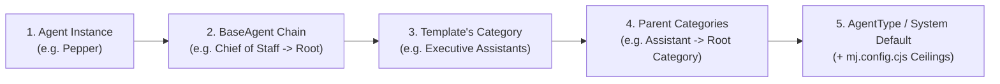
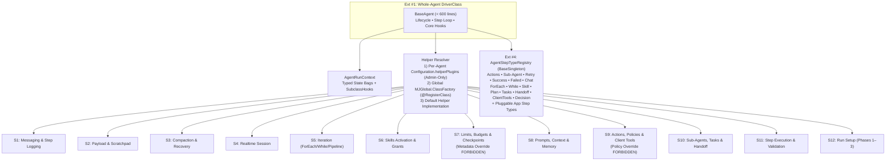
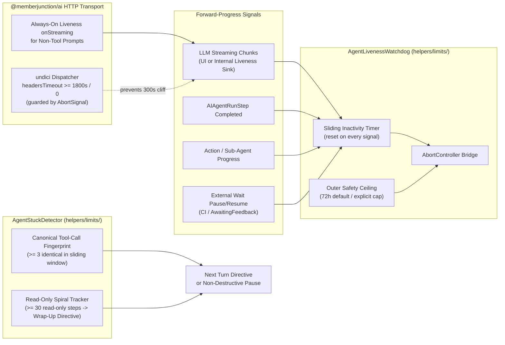

# Phase 2.1 Scan & Phase 2.3 Study: `BaseAgent` Refactor, Extension Architecture & Settings Hierarchy

**Baseline:** `MemberJunction/MJ` `origin/next` (`c77d25ce`, Nov 27, 2026 — includes `#6852` Agent Instances, `#6516` Unified Expiration & `ActionLifecycleResolver`, and `#6853` Templated Skill Instructions)  
**Target File Today:** `packages/AI/Agents/src/base-agent.ts` — **26,883 lines**, **803 class members** (`33` `public`, `251` `protected`, `519` `private`)  
**Target Ceiling:** `< 1,000` lines (`~520–580` lines target for `base-agent.ts`), enforced in CI by a new `@memberjunction/standards` `file-line-limit` check across `packages/AI/Agents/src`  
**Fixed Constraint:** **The public API of `BaseAgent` does not change.** Every existing unit and integration test must pass with zero test-logic changes (only import paths may update).

---

## 1. Phase 2.1 Scan Report — Open PRs, Remote Branches & Prior Plans

### 1.1 Open PRs Touching Freeze-Zone Paths (`base-agent.ts`, `agent-types/`, `BaseAIEngine.ts`, `AgentRunner.ts`)

All **133 open PRs** on `MemberJunction/MJ` were scanned against all four freeze-zone paths (`packages/AI/Agents/src/base-agent.ts`, `packages/AI/Agents/src/agent-types/`, `packages/AI/BaseAIEngine/src/BaseAIEngine.ts`, `packages/AI/Agents/src/AgentRunner.ts`). Note that `#6516` and `#6853` have **already merged** onto `next`.

| PR | State | Author | Updated | Touched Freeze-Zone Files | Disposition |
| --- | :---: | --- | :---: | --- | --- |
| **`#6878`** (`feat/conversation-side-questions`) | OPEN | `ct-bc` | 2026-11-24 | `base-agent.ts` (`+269/-26`), `AgentRunner.ts` (`+11/-4`) | Either land pre-freeze if ready today, or rebase onto `AgentPromptHelper` / `AgentMessagingHelper` via the Rebase Map (`2.8`). |
| **`#6349`** (`claude/guided-tours`) | OPEN | `AN-BC` | 2026-11-26 | `flow-agent-prompt-params.ts` (`+1/-1`), `flow-agent-type.ts` (`+5/-3`), `flow-graph-adapters.ts` (`+1/-1`) | Does **not** touch `base-agent.ts`; tiny 7-line diff in `flow-agent-*` rebases cleanly or lands anytime. |
| **`#4612`** (`claude/kind-edison-4mc7pk`) | OPEN | `AN-BC` | 2026-10-18 | `base-agent.ts` (`+58/-9`) | Stale 5+ weeks; rebases cleanly onto `AgentPayloadHelper` after freeze if still wanted. |
| **`#4805`** (`fix/sage-workflow-planner-approval`) | OPEN | `ct-bc` | 2026-10-06 | `base-agent.ts` (`+36/-2`), `loop-agent-type.ts` (`+29/-4`) | Stale 7+ weeks; rebases after freeze or closes if superseded. |
| **`#4736`** (`fix/complete-message-migration-remaining-readers`) | DRAFT | `MarceloT-BC` | 2026-09-24 | `AgentRunner.ts` (`+2/-2`) | 0 lines in `base-agent.ts`; trivial 2-line rebase after freeze. |
| **`#6886`** (`docs/plan-baseagent-decomposition-and-liveness`) | OPEN | `AN-BC` | 2026-11-24 | `plans/base-agent-decomposition-and-liveness-plan.md` *(plan-only)* | Superseded & expanded by this study (which adds the full 262-member AST call audit, 87-column Settings & Category inheritance design, Per-Agent Helper Plug-Ins, and Step-Type Registry). Recommend closing `#6886` once this plan lands. |

*(Zero open PRs touch `packages/AI/BaseAIEngine/src/BaseAIEngine.ts`.)*

### 1.2 Remote Branches Ahead of `origin/next` Without Open `next` PRs (Excluding `lts/*` & Backports)

| Category | Branches | Notes |
| --- | --- | --- |
| **Recent (Nov 2026)** | `origin/fix/agent-delegated-results` (`2026-11-05`, Madhav, 2 commits: `base-agent.ts`, `AgentRunner.ts`) | Rebases onto `AgentSubAgentHelper` via Rebase Map after freeze. |
| **Oct 2026 Stale Branches** | `origin/fix/5510-report-stalls` (`10-13`), `origin/claude/mj-agent-building-guide-ro98ux` (`10-11`, PR `#4586` already merged), `origin/research-mermaid-diagrams` (`10-07`), `origin/fix/pre-execution-rag-scope-permission` (`10-06`), `origin/chore/decisions-phase1-scope` (`10-01`) | Inactive 6–8 weeks; authors rebase after freeze if revived. |
| **Pre-Oct Historical Branches (10)** | `origin/train/typed-decisions-combined`, `origin/skip-529-artifact-directive`, `origin/feat/multi-party-room-capabilities`, `origin/colin-feat-loop-agent-stream-text`, `origin/feat/dbautodoc-organic-keys`, `origin/claude/baseagent-refactor-plan`, `origin/feature/agent-action-semantic-search`, `origin/feat/agent-delegation-only`, `origin/feat/ai-agent-lazy-context`, `origin/Skip-Branding`, `origin/JF_Security_Fixes`, `origin/claude/review-design-doc-pr-*`, `origin/Base-Agent` | Historical branches (May 2025 – Sep 2026). |

### 1.3 Prior Attempts Assessed (`claude/baseagent-refactor-plan` vs. `#6516` vs. `#6886`)

> [!IMPORTANT]
> **Why we reject May 21's 6-deep inheritance chain (`origin/claude/baseagent-refactor-plan`) and adopt `#6516`-style Helper Composition:**
> - **`claude/baseagent-refactor-plan` (May 21, when `base-agent.ts` was 10,156 lines):** Split `BaseAgent` into a 6-layer vertical class hierarchy (`BaseAgentState <|-- BaseAgentInit <|-- BaseAgentPrompt <|-- BaseAgentOperations <|-- BaseAgentActions <|-- BaseAgent`). That design **cannot** support global helper replacement (`@RegisterClass`), **cannot** support per-agent helper plug-ins, **cannot** be unit-tested per helper against an interface, and keeps every layer coupled to shared `protected _` fields. *(What holds up from May 21: domain grouping boundaries and keeping the public `BaseAgent` signature untouched.)*
> - **`#6516` (`ActionLifecycleResolver` + `ActionResultSpilloverManager`):** Extracted cohesive `<600`-line single-responsibility collaborators with explicit typed inputs/outputs and dedicated unit tests (`ActionLifecycleResolver.test.ts`). **This is our exact model.**
> - **`#6886` (Nov 24 draft plan):** Proposed 12 `@RegisterClass` helpers + `AgentRunContext`, which aligns well on seam decomposition — **however**, our live AST audit below uncovered a critical compile-breaking flaw in `#6886`'s delegate math (it only checked subclass *overrides* and missed 20 production `this.<protected>` calls + 131 test subclass/spy calls!) and `#6886` predated Extension Points #3 & #4 and Category Defaults.

---

## 2. Study Part 1 (`2.3.1`) — Protected Surface & Subclass Audit

We ran a full TypeScript compiler AST pass across `MemberJunction/MJ`, all 25 `bizapps-*` repos, `bizapps-software-factory`, and `BlueCypress/client-portal` (exhaustive 262-row table generated in `scratch/plans_baseagent-refactor-study.md` Appendix A):

### 2.1 Empirical Subclass & Member Counts

- **Downstream Repos (`bizapps-*`, `bizapps-software-factory`, `BlueCypress/client-portal`):** **0 production subclasses** of `BaseAgent` or `BaseAgentType` (only Collaboration's test harness). *Skip* and *Betty* live outside MJ and are protected by preserving the full external contract below.
- **Inside `MemberJunction/MJ`:**
  - **`28` production `BaseAgent` subclasses:** `HarnessAgentBase`, `AgentArchitectAgent`, `AgentBuilderAgent`, `PlanningDesignerAgent`, `MemoryManagerAgent`, `MemoryCleanupAgent`, `QueryBuilderAgent`, `DatabaseDesignerAgent` (+ `BaseDatabaseDesignerCodeAgent`, `SchemaBuilder`, `SchemaDesigner`, `SchemaValidator`), `FormBuilderAgent` (+ `BaseFormBuilderCodeAgent`, `BuilderAgent`, `DesignerAgent`), `PredictiveStudioModelDevAgent`, `PredictiveStudioPipelineBuilderAgent`, `VideoStudioAgent` (+ `VideoStudioAgentBase`, `ArtDirector`, `Critic`, `MotionEngineer`, `PreProduction`, `Render`), `ActionSmithAgent`, `AgentPromptComposer`, `SmokeHarness`.
  - **`112` unit/integration test `BaseAgent` subclasses** across `packages/AI/Agents/src/__tests__/`.
  - **`4` production `BaseAgentType` subclasses** (`LoopAgentType`, `FlowAgentType`, `RealtimeAgentType`, `HarnessAgentType extends LoopAgentType`) + **`11` test subclasses**.
- **Breakdown of all `251` `protected` members on `BaseAgent`:**

| Category | Count | Details |
| --- | ---: | --- |
| **1. Overridden by production subclasses** | **13** | `executeAgentInternal` (12), `validateSuccessNextStep` (8), `determineNextStep` (4), `validateChatNextStep` (2), `executeNextStep` (2), `finalizeRun` (1), `validateAgent` (1), `preparePromptParams` (1), `executePrompt` (1), `validateNextStep` (1), `validateSubAgentNextStep` (1), `resolvePlanModeGate` (1), `GetAgentTools` (1 — IT agent) |
| **2. Called (`this.xyz` / `super.xyz`) by production subclasses without overriding** | **20** | `ProviderToUse`, `ResolvedStorageAccountId`, `AgentHierarchy`, `FileOutputs`, `RunExecutionScope`, `_agentDecisionService`, `_nativeToolBindings`, `logStatus`, `initializeAgentType`, `loadAgentConfiguration`, `contentToString`, `attachDecisionPromptRun`, `buildAgentTypePromptParams`, `DecisionsEnabled`, `resolveActionResultCrush`, `createStepEntity`, `finalizeStepEntity`, `formatHierarchicalMessage`, `getActionExecutionCount`, `getSubAgentExecutionCount`, `pruneAndCompactExpiredMessages` |
| **3. Overridden or called by MJ's `112` test subclasses** | **96** | Internal methods historically marked `protected` instead of `private` so `TestableAgent extends BaseAgent` suites could exercise them directly |
| **4. Invoked via test spies / casts (`vi.spyOn(agent, '...')`)** | **35** | Internal methods spied on or called directly in existing unit tests |
| **5. Unreferenced outside `base-agent.ts` in MJ** | **87** | Internal helpers marked `protected` by habit (though external subclasses like *Skip* / *Betty* could potentially call or override a subset) |
| **Total `BaseAgent` `protected` members** | **251** | *(Plus **11** `protected` members on `BaseAgentType` & `LoopAgentType`, all kept intact)* |

### 2.2 Solving the `< 1,000`-Line Math vs. 100% Unchanged-Test & *Skip*/*Betty* Compatibility

> [!TIP]
> **Critical Line-Budget Insight (`Decision D1`):**  
> Because `33 + 96 + 35 = 164` `protected` members are actively referenced by existing MJ subclasses and tests (which **cannot** change logic per the fixed constraint) — plus up to `87` more that *Skip* or *Betty* might touch — keeping ~230 thin 4-line `@deprecated` delegates directly inside `base-agent.ts` would consume **~920 lines by itself**, leaving `< 80` lines for `BaseAgent`!
>
> **Recommended Solution — Clean Coordinator + Logic-Free Deprecated Delegate Layer:**
> 1. **`packages/AI/Agents/src/base-agent.ts` (~520 lines):** Holds **only** the 28 `public` members, the **~20 permanent `protected` lifecycle & coordinator hooks** (`executeAgentInternal`, `determineNextStep`, `validateAgent`, `validateNextStep`, `executeNextStep`, `finalizeRun`, `ProviderToUse`, `AgentHierarchy`, `ResolvedStorageAccountId`, `RunExecutionScope`, `FileOutputs`, `resolveHelper`, etc.), `AgentRunContext` creation, and the clean run/step coordinator loop.
> 2. **All 12 Helpers (`packages/AI/Agents/src/helpers/<seam>/*`, each file `400–800` lines):** Own **100% of business logic**, state bags on `AgentRunContext`, and strongly-typed `IAgent<Seam>Helper` interfaces. For the 10 seam methods overridden by production/test subclasses (`validateSuccessNextStep`, `executePrompt`, `preparePromptParams`, `validateChatNextStep`, `validateSubAgentNextStep`, `resolvePlanModeGate`, `GetAgentTools`, `ExecuteSingleAction`, `ExecuteSubAgent`, `compactMessage`), helpers route back through `ctx.SubclassHooks.<method>(...)` so **subclass overrides and `super.<method>()` preserve exact virtual-dispatch semantics**.
> 3. **`BaseAgentDeprecatedDelegates` (`helpers/compat/`, split into 2 logic-free `<550`-line files):** Contains **zero state and zero business logic** — strictly 1-line `@deprecated` pass-throughs forwarding historical internal `protected` methods to `this.getRunHelper(...).Method(...)`. `BaseAgent` extends this thin compatibility shim for the `v6.x` deprecation window:
>    - `base-agent.ts` stays a crystal-clear **~520 lines** of pure orchestration.
>    - **Every** existing test (`289` test files, `112` test subclasses), **every** MJ subclass, and *Skip*/*Betty* compile and pass with **zero breakage**.
>    - Every legacy call surfaces an IDE `@deprecated — use BaseAgent<Seam>Helper.<Method> instead` hint pointing directly to the Rebase Map (`2.8`), and removing deprecated shims in the next major version deletes one folder cleanly.

---

## 3. Study Part 2 (`2.3.2`) — Settings Study (`MJ: AI Agents` + `MJ: AI Agent Categories`)

### 3.1 Cross-Type Settings Bag Recommendation (`Decision D2`)

Today `MJ: AI Agents` has **87 physical columns** plus two agent-type-scoped JSON columns:
- `TypeConfiguration` — validated in `MJAIAgentEntityServer` against `AIAgentType.ConfigSchema`. **Crucial finding:** `metadata/agent-types/schemas/realtime-type-config.schema.json` declares **`"additionalProperties": false`** at its root object (`properties: { realtime }`)! Stuffing cross-type settings (`helperPlugins`, `memory`, `artifacts`, `contextWindow`) into `TypeConfiguration` would either **fail schema validation** on Realtime/custom agent types or force every `AIAgentType.ConfigSchema` row to duplicate cross-type schemas, and still wouldn't cleanly fit `MJ: AI Agent Categories` (which are **orthogonal** to Agent Types).
- `AgentTypePromptParams` — per-type prompt flags (`LoopAgentTypePromptParams` vs `FlowAgentTypePromptParams`) validated against `AIAgentType.PromptParamsSchema`.

> [!IMPORTANT]
> **Recommendation (`Decision D2`): Add a dedicated typed `Configuration` JSON column on `MJ: AI Agents` and matching `DefaultConfiguration` JSON column on `MJ: AI Agent Categories`**, authored via MJ's first-class `JSONType` interface (`metadata/entities/JSONType-interfaces/IAgentConfiguration.ts` + lockstep tolerant parser in `@memberjunction/ai-core-plus`, identical to `Application.AgentSettings`).
>
> **Why this wins cleanly:**
> 1. **Zero schema collision:** `TypeConfiguration` remains 100% pure per-AgentType (`realtime.*`, `harness.*` with `additionalProperties: false` preserved), and `AgentTypePromptParams` remains pure per-AgentType prompt options.
> 2. **Exact symmetry between Agents & Categories:** `AIAgent.Configuration` and `AIAgentCategory.DefaultConfiguration` share the **exact same `IAgentConfiguration` shape** (CodeGen generates `ConfigurationObject` and `DefaultConfigurationObject` automatically).
> 3. **Clean home for `instantiation` too:** `Configuration.instantiation` becomes canonical, with dual-read fallback to `TypeConfiguration.instantiation` so existing rows keep working untouched.

### 3.2 `IAgentConfiguration` Shape & Column-to-Bag Migration Summary (All 87 Columns Classified)

Out of **87 physical columns** on `MJ: AI Agents` (full 87-row table in Appendix B):
- **38 Columns STAY Physical Columns:** Identity (`ID`, `Name`, `Description`, `LogoURL`, `IconClass`, `Status`), structural/relational FKs (`TypeID`, `CategoryID`, `BaseAgentID`, `ParentID`, `OwnerUserID`, `DefaultStorageAccountID`, `DefaultArtifactTypeID`, `DefaultCoAgentID`, `ConversationSummaryPromptID`, storage/media FKs), security & sandbox ceilings (`DriverClass`, `Isolation`, `AcceptsSkills`, `InstantiationMode`, `ExposeAsAction`, `IsRestricted`, `InvocationMode`, `MaxCostPerRun`, `MaxTokensPerRun`, `MaxTimePerRun`, `MaxIterationsPerRun`), `AdditionalInstructions` (stacked), `IsPrimaryInstance`, and the two per-type JSON bags (`TypeConfiguration`, `AgentTypePromptParams`).
- **49 Behavioral/Tuning Columns MOVE into `AIAgent.Configuration` (`IAgentConfiguration`)** via an **additive data-copy migration + dual-read deprecation period** (columns remain in DB and sync bidirectionally/dual-read throughout `v6.x` per `PUBLISH_NO_BREAK_POLICY.md`):

| `IAgentConfiguration` Section | Settings Included (Migrated Columns + New Extension Fields) | Inheritable Across Instances & Categories? | Security / Narrow-Only Invariant |
| --- | --- | :---: | --- |
| **`helperPlugins`** *(NEW — Ext. #3)* | `Array<{ seam: AgentHelperSeamKey; driverClass: string; priority?: number }>` | **Yes** (Template → Instance; Category optional) | **Admin-Only** (`ValidateAgentInheritanceAndSandbox` rejects non-admin writes; **`limits` / `policy` / `permissions` seams forbidden in metadata**, code-only via `@RegisterClass`) |
| **`instantiation`** | `suggestedNames`, `suggestedIcons`, `suggestedPersonaNames`, `maxInstancesPerUser`, `onboardingGreeting`, `personalityPresets` | **No** (Stripped on non-instantiable leaf instances) | **Admin-Only** (`InstantiationMode !== 'None'` requires admin) |
| **`memory`** | `injectNotes`, `maxNotesToInject`, `noteInjectionStrategy`, `injectExamples`, `maxExamplesToInject`, `exampleInjectionStrategy`, `allowMemoryWrite`, `noteRetentionDays`, `exampleRetentionDays`, `autoArchiveEnabled`, `reranker` (`RerankerConfiguration` parsed JSON) | **Yes** | Standard inheritance (first-set wins: `Instance -> Chain -> Category -> Parent Category -> Default`) |
| **`execution`** | `modelSelectionMode`, `defaultPromptEffortLevel`, `declareActionsAsNativeTools`, `chatHandlingOption`, `supportsPlanMode`, `requirePlanMode` | **Yes** | `requirePlanMode` is **monotonic OR** (cannot turn `false` if template/category requires `true`); `supportsPlanMode` is **monotonic AND** |
| **`contextWindow`** | `maxTokens`, `compactionTriggerPercent`, `compactionTargetPercent`, `summaryPromptID`, `enableCompression`, `compressionMessageThreshold`, `compressionPromptID`, `compressionMessageRetentionCount` | **Yes** | `maxTokens` respects model & `mj.config.cjs` ceiling |
| **`artifacts`** | `creationMode` (`Always \| Never \| System Only`), `defaultArtifactTypeID` | **Yes** | Standard inheritance |
| **`skills`** | `activationMode` (`Auto \| RequestedOnly`) | **Narrow-Only** | **Monotonic narrow-only** (`Auto > RequestedOnly`); neither instance nor category can widen |
| **`scope`** | `searchScopeAccess` (`All \| Assigned \| None`), plus structured `ScopeConfig` (`primary`, `secondary`, rules) | **Narrow-Only** | **Monotonic narrow-only** (`All > Assigned > None`); instance/category cannot widen scope beyond template |
| **`clientTools`** | `allowEphemeral` (`AllowEphemeralClientTools`) | **Narrow-Only** | Cannot enable `true` on non-admin instance if template is `false` |
| **`attachments`** | `messageMode`, `maxMessages`, `rootPath`, `inlineStorageThresholdBytes`, `acceptUnregisteredFiles` | **Yes** (`acceptUnregisteredFiles` narrow-only) | `acceptUnregisteredFiles` cannot widen on non-admin instance |
| **`payload`** | `downstreamPaths`, `upstreamPaths`, `selfReadPaths`, `selfWritePaths`, `scope`, `startingValidationSchema`, `startingValidationMode`, `finalValidationSchema`, `finalValidationMode`, `finalValidationMaxRetries` | **Yes** (Template chain) | Non-admin instances cannot strip template's required payload validation |
| **`subAgentExecution`** | `mode` (`Parallel \| Sequential`), `minExecutionsPerRun`, `maxExecutionsPerRun`, `maxConsultRounds` | **Yes** (`max*` narrow-only) | `maxExecutionsPerRun` & `maxConsultRounds` **monotonic `Math.min`** |
| **`recording`** | `defaultMode` (`Audio \| AudioVideo \| None`) | **Yes** | Standard inheritance |
| **`promptDefaults`** *(Category convenience)* | Optional `Partial<LoopAgentTypePromptParams & FlowAgentTypePromptParams>` (e.g. `decisionsEnabled`, `includeScratchpadDocs`) | **Yes** (Category → Agent) | Capability gates **`enableTaskGraphs` and `enableHandoff` excluded from implicit category widening** unless admin explicitly configures on template/category |

### 3.3 Unified Resolution Cascade in `BaseAIEngine.ResolveEffectiveAgentProperties`

We extend **the existing `BaseAIEngine.ResolveEffectiveAgentProperties`** (no second resolver!) so every inheritable setting resolves in strict precedence order (**first to set an explicit value wins**):



- **Dual-Read Compatibility Rule during `v6.x`:** At any node `N` in the chain, `readSetting(N, key)` reads `N.Configuration[section][key]` first; if `undefined`, it falls back to `N.<LegacyColumn>` ONLY when that column holds a non-default / explicitly set value (seeded via the data-copy migration so every existing agent's column settings are faithfully mirrored into `Configuration` on upgrade!).
- **Narrow-Only Guardrails:** `Isolation` (`Container > Process > Worker > InProcess`), `AcceptsSkills` (`All > Limited > None`), `SkillActivationMode` (`Auto > RequestedOnly`), `SearchScopeAccess` (`All > Assigned > None`), `RequirePlanMode` (monotonic `OR`), and run ceilings (`MaxCostPerRun`, `MaxTokensPerRun`, `MaxTimePerRun`, `MaxIterationsPerRun`, clamped by `mj.config.cjs`) **only narrow** across the entire chain — category defaults can supply stricter defaults when an agent leaves a ceiling unset, and **can never loosen** a stricter setting on a template or `mj.config.cjs`.

---

## 4. Study Part 3 (`2.3.3` & `2.5`) — Helper Seams, `AgentRunContext` & Four Extension Points

### 4.1 Architecture Overview & Four Extension Points



#### All Four Extension Points Supported Cleanly:
1. **Whole-Agent `DriverClass` (as today):** `AIAgent.DriverClass` resolves a `BaseAgent` subclass via `MJGlobal.Instance.ClassFactory`. Downstream apps stack naturally via layered subclassing (`@RegisterClass(BaseAgent, 'Key')` runs later → higher priority).
2. **Global Helper Replacement (`@RegisterClass`):** Each seam defines a non-abstract base token class `BaseAgent<Seam>Helper` + default `Agent<Seam>Helper` (`@RegisterClass(BaseAgent<Seam>Helper)`). Any package swaps a helper globally with `@RegisterClass(BaseAgentCompactionHelper, undefined, 100)` — zero casts, zero `BaseAgent` subclassing.
3. **Per-Agent Helper Plug-Ins (`Configuration.helperPlugins`):** Admin-authored array `{ seam, driverClass, priority? }` resolves `ClassFactory.CreateInstance(BaseHelper, plugin.driverClass)` **before** falling back to global `@RegisterClass` and default.
   - **Hard Security Rule:** `limits` (`BaseAgentLimitsHelper`) and `actionPolicy` (`BaseAgentActionPolicyHelper`) are **code-only** — `ValidateAgentInheritanceAndSandbox` AND runtime `resolveHelper()` both reject per-agent metadata overrides for permission, policy, and limits helpers!
4. **Pluggable Step-Type Registry (`AgentStepTypeRegistry extends BaseSingleton<AgentStepTypeRegistry>`):**
   - Replaces the two giant `switch (nextStep.step)` blocks (`validateNextStep` at `L9381` and `executeNextStep` at `L18704`) — **and eliminates all six `'Skill' as typeof nextStep.step` type-assertion hacks** in `base-agent.ts`!
   - Each registered `IAgentStepTypeHandler` declares:
     - `StepKey: string`
     - `AllowedDuringUnapprovedPlanMode: boolean` (replaces hardcoded `Actions | Sub-Agent` check at `L9368`, so custom mutating steps automatically honor Plan Mode!)
     - `CountsAgainstTreeBudget: boolean` (replaces hardcoded `step !== 'Chat'` check at `L18658`!)
     - `Validate<P>(ctx, nextStep, currentPayload, agentRun, currentStep)`
     - `Execute<P>(ctx, config, previousDecision, stepCount)`
     - Optional `ResponseEnvelopeRegistration` so an OpenApp step type can also contribute its TypeScript response union & prompt docs cleanly.

### 4.2 Confirmed 12 Helper Seams (Every File `<= 850` Lines — `1,000` Hard Ceiling)

Large seams (`Prompts` ~3,200L, `Sub-Agents` ~2,900L, `Actions` ~2,600L, `Limits` ~1,550L) are split from day one into a **pluggable `@RegisterClass` facade (`<= 750L`) + cohesive internal sub-modules (`<= 800L` each)** so **zero** new files ever need the `// file-size-ok:` header exception:

| Seam Order (`2.6`) | Pluggable Token Class | Current Lines | Target Files (`packages/AI/Agents/src/helpers/<seam>/`, all `<= 850L`) | Composes Existing Collaborators |
| --- | --- | ---: | --- | --- |
| **1. Messaging & Logging** | `BaseAgentMessagingHelper` | ~1,200 | `BaseAgentMessagingHelper.ts`, `AgentMessagingHelper.ts`, `AgentStoppedRunContinuationHelper.ts` | `AgentFeedbackCoordinator` |
| **2. Payload & Scratchpad** | `BaseAgentPayloadHelper` | ~860 | `BaseAgentPayloadHelper.ts`, `AgentPayloadHelper.ts` | `PayloadManager`, `ScratchpadManager`, `PayloadChangeAnalyzer`, `PayloadFeedbackManager` |
| **3. Compaction & Recovery** | `BaseAgentCompactionHelper` | ~1,250 | `BaseAgentCompactionHelper.ts`, `AgentCompactionHelper.ts`, `AgentContextRecoveryHelper.ts` | `ConversationCompactionManager` |
| **4. Realtime** | `BaseAgentRealtimeHelper` | ~790 | `BaseAgentRealtimeHelper.ts`, `AgentRealtimeHelper.ts` | `realtime/*` services |
| **5. Iteration (`ForEach`/`While`/`Pipeline`)** | `BaseAgentIterationHelper` | ~1,320 | `BaseAgentIterationHelper.ts`, `AgentIterationHelper.ts`, `AgentLoopBodyExecutor.ts` | `AgentStepDispatcher`, `pipeline-executor`, `pipeline-registry` |
| **6. Skills** | `BaseAgentSkillsHelper` | ~580 | `BaseAgentSkillsHelper.ts`, `AgentSkillsHelper.ts` | `ActionLifecycleResolver`, `skill-instructions-template` |
| **7. Limits, Budgets & Checkpoints** | `BaseAgentLimitsHelper` *(code-only)* | ~1,550 | `BaseAgentLimitsHelper.ts`, `AgentLimitsHelper.ts`, `AgentCheckpointAndPauseHelper.ts` | `AgentTreeBudgetTracker`, `BudgetEnforcementGuard`, `DeterministicProgressDetector`, `FastConvergenceJudge`, `RunawayCheckpointManager` |
| **8. Actions, Policy & Client Tools** | `BaseAgentActionsHelper` + `BaseAgentActionPolicyHelper` *(policy code-only)* | ~2,750 | `BaseAgentActionsHelper.ts`, `AgentActionsHelper.ts`, `BaseAgentActionPolicyHelper.ts` *(code-only)*, `AgentNativeAndClientToolsExecutor.ts` | `ActionLifecycleResolver`, `ActionResultSpilloverManager`, `ArtifactToolManager`, `ConversationToolManager`, `ClientToolRequestManager` |
| **9. Prompts, Context & Memory** | `BaseAgentPromptHelper` | ~3,200 | `BaseAgentPromptHelper.ts`, `AgentPromptHelper.ts`, `AgentPromptTemplateDataBuilder.ts`, `AgentContextAndMemoryInjector.ts`, `AgentRunScopeResolver.ts` | `AgentContextAssembler`, `AgentDecisionService`, `MemoryWriteManager` |
| **10. Sub-Agents, Tasks & Handoff** | `BaseAgentSubAgentHelper` | ~2,910 | `BaseAgentSubAgentHelper.ts`, `AgentSubAgentHelper.ts`, `AgentParallelSubAgentDispatcher.ts`, `AgentHandoffAndTaskGraphHelper.ts` | `sub-agent-consult` |
| **11. Step Execution & Registry** | `BaseAgentStepExecutionHelper` | ~1,360 | `BaseAgentStepExecutionHelper.ts`, `AgentStepExecutionHelper.ts`, `AgentStepValidationHelper.ts`, `AgentStepTypeRegistry.ts` | `AgentStepDispatcher` |
| **12. Run Setup & Final Thin `BaseAgent`** | `BaseAgentRunSetupHelper` | ~1,300 | `BaseAgentRunSetupHelper.ts`, `AgentRunSetupHelper.ts`, `compat/BaseAgentDeprecatedDelegates*.ts`, `base-agent.ts` (**~520L**) | `AgentDataPreloader` |

*(Notice we split `BaseAgentActionPolicyHelper` cleanly from `BaseAgentActionsHelper` so an admin can customize non-security action formatting/execution via a per-agent helper plug-in while `BaseAgentActionPolicyHelper` — bound/hidden params, user action policies, audience checks, tainted egress — remains strictly un-overridable from metadata!)*

---

## 5. Up-Front Test Suite (`2.4`) & PR Execution Sequence (`2.6`–`2.8`)

### 5.1 PR Sequence (Pure Moves Strictly Separated from New Capabilities)

| PR | Scope | Behavior Change? | Key Deliverables & Gates |
| --- | --- | :---: | --- |
| **PR 0 (`2.2` + `2.4`)** | **Freeze Guard + File-Size Gate + Up-Front Test/Security/Perf Baseline** | None (Tests & CI gates only) | `.github/CODEOWNERS` + `baseagent-freeze-guard.yml`; `@memberjunction/standards` `file-line-limit` check (`<=1,000L` + current 20-file allowlist); **Prompt Byte-for-Byte Snapshot Suite** (static-first / volatile-tail prefix cache lock); **Agent Security & `#6852` Instance/RLS Suite** (SQL Server + PostgreSQL); **Full 4-Type Agent Integration Suite** (Loop, Flow, Harness, Realtime); **Performance Baseline Harness** (latency, iteration count, token count). |
| **PRs 1–4** | **Leaf Pure Moves:** (1) Messaging/Logging, (2) Payload/Scratchpad, (3) Compaction/Recovery, (4) Realtime | **Pure Move (0)** | Introduce `AgentRunContext` in PR 1; per-helper interface unit test suites; prompt byte-for-byte & perf baseline green; Carbon + Fable full-file adversarial review. |
| **PRs 5–8** | **Mid-Tier Pure Moves:** (5) Iteration (`ForEach`/`While`/`Pipeline`), (6) Skills, (7) Limits/Budgets/Checkpoints, (8) Actions + `BaseAgentActionPolicyHelper` + Client Tools | **Pure Move (0)** | Per-helper unit suites; downstream build/test check across `bizapps-*`, `bizapps-software-factory`, `client-portal`; Carbon + Fable full-file review. |
| **PRs 9–11** | **Core Pure Moves:** (9) Prompts/Context/Memory, (10) Sub-Agents/Delegation/Handoff, (11) Step Execution + Run Setup → **`base-agent.ts` drops `< 600` lines** & leaves `.mj-standards.json` allowlist | **Pure Move (0)** | `wc -l base-agent.ts < 1000` locked permanently in `.mj-standards.json`; all 289+ existing suites green with zero logic edits; Carbon + Fable full-file review. |
| **PR 12** | **Extension Points #3 & #4:** `AgentStepTypeRegistry` + Per-Agent `helperPlugins` + Generic Mock Subclass & Helper Override Suite | Additive Extension | Mock `DriverClass` subclass, layered upstream/downstream `@RegisterClass` subclass chain, per-agent helper plug-in, and custom registered step type proven end-to-end; sandbox tests prove non-admin & `limits`/`policy` metadata overrides are rejected. |
| **PR 13** | **Settings Migration & Category Defaults:** `AIAgent.Configuration` + `AIAgentCategory.DefaultConfiguration` (`IAgentConfiguration` migration + CodeGen + dual-read `ResolveEffectiveAgentProperties` + sandbox checks) | Additive Schema + Cascade | 4-part migration (hand DDL + 50 blank lines + CodeGen append) copying the 49 behavioral columns into `Configuration`; category cascade & narrow-only tests on SQL Server + PostgreSQL; Carbon + Fable full-file review. |
| **STOP #2 → PR 14 (`2.8`)** | **Pause for Amith on Guide Structure → Publish 3-Audience Guides + Rebase Map + Lift Freeze Guard** | Docs & Unfreeze | Audit existing MJ agent guides → present Administrator / Builder / End-User guide outline to Amith → write guides + full `BaseAgent` Method → Helper Rebase Map + remove freeze guard. |

---

## 6. Locked Design Decisions (100% Approved — Ready for Execution)

1. **`D1` — LOCKED (`BaseAgentDeprecatedDelegates` shim layer → retire in `7.0`):** `base-agent.ts` stays ~520 lines of pure live orchestration + ~20 permanent `protected` hooks; historical internal `protected` pass-throughs live in `helpers/compat/` throughout `6.x` and drop alongside deprecated columns in `7.0` (2027) with a dedicated upgrade guide.
2. **`D2` — LOCKED (`IAgentConfiguration` across Agent, Category & AgentType + Bidirectional `Save()` Sync + Metadata Deprecation Flags):**
   - `MJ: AI Agents` gets `Configuration` (`JSONType` = `IAgentConfiguration`) + additive data-copy migration for the 49 behavioral columns.
   - `MJ: AI Agent Categories` gets `DefaultConfiguration` (`JSONType` = `IAgentConfiguration`).
   - `MJ: AI Agent Types` gets `DefaultAgentConfiguration` (`JSONType` = `IAgentConfiguration`, absorbing `AIAgentType`'s 7 legacy compaction columns via dual-read too, while preserving existing `DefaultConfiguration` for per-type `TypeConfiguration` defaults).
   - **Bidirectional Write-Sync (`MJAIAgentEntityServer.Save()` & `MJAIAgentTypeEntityServer.Save()`):**
     - If a caller updates **only** a deprecated physical column (`field.Dirty && !configSectionKeyModified`), `Save()` mirrors that column's new value into `Configuration.<section>.<key>` automatically so it is **never** shadowed by an older JSON bag value!
     - If a caller updates `Configuration.<section>.<key>` (`configDirty && !legacyField.Dirty`), `Save()` mirrors the value back onto the legacy column so older SQL views/queries stay in sync throughout `6.x`.
     - For direct SQL / raw metadata imports, `BaseAIEngine.ResolveEffectiveAgentProperties` dual-reads `Configuration ?? LegacyColumn`, and the future `v7.0` migration runs one final idempotent SQL reconcile (`COALESCE` into `Configuration`) immediately before dropping the deprecated columns.
   - **First-Class Metadata Deprecation Flags (`metadata/entities/.ai-agent-configuration-columns-deprecation.json`):** Following MJ's canonical `.ai-model-costs-pricetype-deprecation.json` pattern, mark all 49 deprecated `MJ: AI Agents` columns and 7 deprecated `MJ: AI Agent Types` columns with `"Status": "Deprecated"`, `"IncludeInGeneratedForm": false`, `"AutoUpdateDescription": false`, and `"Description": "DEPRECATED (slated for removal in v7.0) — superseded by Configuration.<section>.<key> ..."` plus thorough TSDoc/README documentation.
3. **`D3` — LOCKED (`BaseAgentActionPolicyHelper` split):** Action policy, bound/hidden params, audience checks, and tainted egress live in code-only `BaseAgentActionPolicyHelper` alongside `BaseAgentLimitsHelper` (never replaceable via metadata).
4. **`D4` — LOCKED (`#6878` & `#6886`):** Comment on Caitlin's `#6878` linking to the refactor PR/plan so her agent can rebase smoothly post-freeze; close `#6886` with a comment pointing to the unified study & PR once `PR 0` opens.
5. **Phase 1 `.mj/specs/` — LOCKED:** Remove all 6 `.mj/specs/` folders from `MJ` `next` and add `.mj/specs/` to `.gitignore`.
6. **Step-Type Registry (`Ext. #4`) — LOCKED (`MJ: AI Agent Step Types` DB Table + `@RegisterClass`):** Add `AIAgentStepType` (`ID`, `Name`, `DriverClass`, `AppliesTo`, `AllowedInUnapprovedPlanMode`, `CountsAgainstTreeBudget`, `DefaultEnabledInPrompt`, `PromptDocsTemplate`, `ResponseSchemaSnippet`, `Status`, `Configuration`), cached in `BaseAIEngine.AgentStepTypes`, plus nullable `StepTypeID` FK and additive `'Custom'` value in the `StepType` `CHECK` constraint on `AIAgentRunStep` and `AIAgentStep`.
7. **Slice `A7b` — LOCKED (Sliding Liveness Watchdog, `undici` Streaming Timeout Fix & `StuckDetector`):** Landed in its own dedicated PR right after the pure-move decomposition (never mixed into pure moves!), replacing blunt 18-month-old wall-clock `setTimeout` aborts and Node `undici`'s 5-minute (`300s`) non-streaming `headersTimeout` cliff with a sliding forward-progress inactivity watchdog (supporting multi-hour / multi-day / multi-week agent runs!), always-on internal liveness streaming sink + `undici` dispatcher `headersTimeout` fix, and semantic `StuckDetector`.
8. **Three-Stage Testing Cadence — LOCKED:**
   - **Stage 1 (`PR 0`, before any code moves):** Land `plans/baseagent-refactor-study.md`, freeze guard, `<= 1,000`-line check, and behavior-pinning tests against untouched `BaseAgent` (4-type integration runs, prompt byte-for-byte snapshot, security & `#6852` instance/RLS suite on SQL Server + PostgreSQL, perf baseline).
   - **Stage 2 (Pure Moves):** Move one seam per slice into `< 850`-line helpers + `BaseAgentDeprecatedDelegates` while keeping every existing + Stage 1 test 100% green (plus per-helper interface unit tests).
   - **Stage 3 (New Architecture, `A7b` & Tests → Pause at `2.8`):** Land `A7b` liveness/streaming overhaul, `MJ: AI Agent Step Types` + `BaseAgentStepHandler`, per-agent `helperPlugins`, and the 3-table `IAgentConfiguration` cascade + bidirectional `Save()` sync + `EntityField` deprecation metadata, paired with full new-architecture & dual-DB security tests — then **pause at `2.8`** with the existing-guide audit, proposed 3-audience guide structure, and Rebase Map!


---

---

## 7. Slice `A7b` Specification — Sliding Liveness Watchdog, `undici` Streaming Timeout Fix & `StuckDetector`

> **Strict Separation Rule:** Slice `A7` is a **pure move** of existing limits, budgets, progress detector, fast judge, and checkpoint code (zero behavior changes). **Slice `A7b`** is a dedicated follow-up PR immediately after `A7` that implements the approved liveness, streaming, and stuck-detection overhaul cleanly inside `helpers/limits/` + `@memberjunction/ai`.

### 3.1 Ground-Truth Diagnosis on `origin/next`

Inspecting the live codebase reveals three concrete mechanisms causing premature aborts on legitimate long-running agents:

1. **Blunt Wall-Clock `setTimeout` (`base-agent.ts:3230–3305`):**
   `BaseAgent.executeRun()` computes `agentTimeoutMS = resolvedMaxWallClockMs ?? params.maxExecutionTimeMs ?? configuredMaxTimeMs ?? this.DefaultAgentTimeoutMS` and arms a single non-resetting `setTimeout(() => timeoutController.abort(...), agentTimeoutMS)`. An agent actively streaming reasoning tokens and closing steps is blindly killed the instant wall-clock time elapses.
2. **Headless Non-Streaming & Node `undici` `300s` `headersTimeout` Cliff (`base-agent.ts:18869`, `AIPromptRunner.ts:2544`, `baseLLM.ts:114–129`):**
   - `base-agent.ts:18869` sets `promptParams.onStreaming = params.onStreaming ? (...) : undefined;`. When an agent executes without a UI streaming callback (background runs, scheduled routines, sub-agents, autonomous runners), `params.onStreaming` is `undefined`.
   - `AIPromptRunner.ts:2544` only sets `chatParams.streaming = true` when `params.onStreaming` is defined. Thus headless runs execute **non-streaming**.
   - Additionally, `packages/AI/Core/src/generic/baseLLM.ts:114–129` suppresses streaming (`streamingSuppressedForTools = toolsRequested && params.streaming === true`) whenever native tool calling is active, forcing `nonStreamingChatCompletion(params)`.
   - On large thinking/reasoning prompts (extended thinking models taking > 5 minutes before first HTTP response byte), Node's built-in `undici` default `headersTimeout: 300_000` (`300s`) fires and rejects with `TypeError: fetch failed` (`cause.code = 'UND_ERR_HEADERS_TIMEOUT'`).
3. **Lack of Semantic Spin / Read-Only Spiral Recovery:**
   While `DeterministicProgressDetector` tracks 6 numeric signals and `BaseAgent` has `_actionFailureHistory` for repeated *failing* actions, there is no canonical repeated-tool-call breaker for identical *succeeding* calls, nor a non-lethal wrap-up directive injector when an evaluator/reviewer agent performs `30+` consecutive read-only steps without invoking its terminal action.

### 3.2 Architecture of `Slice A7b`



#### Pillar 1: Sliding Inactivity Watchdog (`helpers/limits/AgentLivenessWatchdog.ts`)

- **Configuration (Centralized in `LimitsConfigResolver`, zero bare literals):**
  Add a `Liveness` block under `MJLimitsConfig` (`packages/MJCore/src/generic/limitsConfig.ts`, preserving full compliance with the `limits-literals` standard):
  - `InactivityTimeoutMs`: sliding window before declaring a hung run (default: `900_000` = `15m`, configurable per org/agent via `mj.config.cjs` & `AgentUserPolicy`).
  - `OuterMaxWallClockMs`: absolute safety ceiling (default: `259_200_000` = `72h` when no tighter org/workflow cap is set; explicit caller `maxExecutionTimeMs`, `PerRun.MaxWallClockMs`, and workflow duration caps still apply as upper bounds so `E2` policy narrowing invariants remain unbroken).
  - `LivenessEnabled`: boolean (default: `true`).
- **Heartbeat Reset Hooks:**
  `AgentLivenessWatchdog.RecordProgress(signal: LivenessProgressSignal)` resets the sliding inactivity timer on:
  - `'llm-stream-chunk'` (throttled in-memory timestamp update on every streamed thought/content chunk)
  - `'step-complete'` (every `AIAgentRunStep` finalization)
  - `'action-progress'` (action/sub-agent progress callback emission)
  - `'sub-agent-heartbeat'` (forwarded upward when child sub-agents emit progress)
- **External Wait Suspension:**
  `SuspendForExternalWait(waitId: string, reason: string)` / `ResumeFromExternalWait(waitId: string)` pauses the sliding inactivity timer (while keeping the outer safety ceiling active) during `AwaitingFeedback`, paused states, or external CI/workflow waits so actively-queued external checks never trigger a false inactivity abort.
- **Abort Reason Contract:**
  - Inactivity breach aborts with `BaseAgent.AgentInactivityAbortReason` (`'Agent execution stalled with no progress signal'`).
  - Outer ceiling / explicit cap breach aborts with `BaseAgent.AgentTimeoutAbortReason` (preserving 100% compatibility with `BaseAgent.CancellationReasonForAbort` and existing tests).

#### Pillar 2: Always-On Liveness Streaming & Node `undici` `headersTimeout` Fix

1. **Always-On Liveness Streaming Sink (`BaseAgentPromptHelper`):**
   - In `executePromptStep`, even when `params.onStreaming` is `undefined`, attach a lightweight internal `promptParams.onStreaming` callback when `ctx.Limits.LivenessWatchdog` is active:
     ```typescript
     const livenessSink: AIPromptStreamingCallback = (chunk) => {
         ctx.Limits.LivenessWatchdog?.RecordProgress({
             Kind: 'llm-stream-chunk',
             TimestampMs: Date.now(),
             StepEntityId: stepEntity.ID,
             Bytes: chunk.content.length,
         });
         if (callerOnStreaming) {
             coalescedForward(chunk);
         }
     };
     ```
   - Because `AIPromptRunner.ts:2544` enables `chatParams.streaming = true` whenever `promptParams.onStreaming` is present, headless/background/sub-agent LLM calls automatically switch to streaming on all streaming-capable drivers, delivering continuous thought/token chunks that reset the sliding inactivity watchdog and avoiding response buffering timeouts!
2. **Node `undici` `headersTimeout` Fix (`@memberjunction/ai` + Provider HTTP Layer):**
   - Covers the remaining non-streaming paths — specifically **native tool calling** (`streamingSuppressedForTools` in `baseLLM.ts:114`) and drivers with `SupportsStreaming === false`.
   - Introduce `CreateLongRunningFetchDispatcher(options?: { headersTimeoutMs?: number; bodyTimeoutMs?: number })` in `packages/AI/Core/src/generic/httpDispatcher.ts` using Node's `undici` `Agent` with `headersTimeout: 0` (or configurable `>= 1_800_000ms` via `LimitsConfigResolver`) and `bodyTimeout: 0` so the per-request `AbortSignal` (`cancellationToken`, driven by `AgentLivenessWatchdog`) is the sole authoritative timeout rather than Node's hardcoded `300,000ms` default.
   - Wire into `MJAPI` server startup (`setGlobalDispatcher` opt-in / provider fetch adapter) and into fetch-based SDK drivers (`@google/genai`, OpenAI, Anthropic custom `fetch` option when running in Node).
   - Update `ErrorAnalyzer` (`packages/AI/Core/src/generic/errorAnalyzer.ts`) to explicitly recognize `UND_ERR_HEADERS_TIMEOUT` and `UND_ERR_BODY_TIMEOUT` on `error.cause.code` as retriable timeout/network errors (`ErrorType: 'NetworkError'` / `'Timeout'`, `canFailover: true`).

#### Pillar 3: Semantic `StuckDetector` (`helpers/limits/AgentStuckDetector.ts`)

Composes alongside `DeterministicProgressDetector` inside `BaseAgentLimitsHelper` (all thresholds defined in `LimitsConfigResolver` under `Limits.StuckDetector`):

1. **Canonical Repeated Tool-Call Breaker:**
   - Computes deterministic canonical fingerprint: `${toolName}::${stableSortedJSON(normalizedArgs)}` for every action, native tool, and client tool call.
   - Maintains a sliding window of the last `WindowSize` calls (default `10`).
   - When the same fingerprint appears `>= RepeatedToolCallThreshold` (default `3`) times within the window:
     - **First trigger:** injects a structured high-priority `system`/`user` **course-correction directive** naming the repeated tool & arguments and requiring a different approach or terminal conclusion.
     - **Second consecutive trigger (agent ignores correction):** escalates to `AgentLimitsHelper` non-destructive checkpoint pause (`PauseReason: 'StuckToolCallLoop'`) or clean termination, preserving all run artifacts and step history.
2. **Read-Without-Act Spiral Detector (`30+` Read-Only Steps Wrap-Up Directive):**
   - Classifies each completed step as **mutating/terminal** vs **read-only** (e.g., search/list/read/get/inspect actions, conversation history lookups, artifact reads, zero payload mutations, zero write actions, zero terminal action calls).
   - Increments `consecutiveReadOnlySteps` on read-only turns; resets to `0` on any mutating action, payload mutation, sub-agent delegation, or terminal action.
   - At `consecutiveReadOnlySteps >= ReadOnlySpiralThreshold` (default `30`):
     - Injects a structured **Wrap-Up Directive** into the next prompt turn:
       > *"You have completed N consecutive read-only investigation steps without producing a final output or invoking a terminal action. Synthesize what you have gathered so far and either call your required terminal action or return your final response on this turn. Do not perform additional exploratory reads unless strictly required to fix a concrete gap."*
     - Emits a diagnostic `AIAgentRunStep` / telemetry event (`StuckDetectorDirectiveInjected`).
     - If the agent continues read-only loops for `ReadOnlyPostDirectiveGraceSteps` (default `5`) additional steps without acting, escalates to non-destructive pause (`PauseReason: 'ReadOnlySpiral'`).

---

---

### Appendix A — Complete 251-Member `BaseAgent` + 11-Member `AgentType` Protected Surface Table

| # | Member | Kind | Line | Prod Overrides | Prod Calls (`this`/`super`) | Test Subclass Refs | Test Spy/Cast Refs | Target Owner | Disposition |
| ---: | --- | :---: | ---: | --- | --- | ---: | ---: | --- | --- |
| 1 | `_treeBudget` | property | L949 | — | — | 0 | 0 | A7: LimitsHelper | **Move to Helper** (`@deprecated` compat delegate in `BaseAgentDeprecatedDelegates`) |
| 2 | `_taintedSources` | property | L1145 | — | — | 0 | 0 | A7: LimitsHelper | **Move to Helper** (`@deprecated` compat delegate in `BaseAgentDeprecatedDelegates`) |
| 3 | `normalizeActionParams` | method | L1208 | — | — | 2 | 2 | A9: ActionsHelper | **Move to Helper + `@deprecated` compat delegate** (pinned by existing tests) |
| 4 | `normalizeActionParamEntry` | method | L1232 | — | — | 2 | 1 | A9: ActionsHelper | **Move to Helper + `@deprecated` compat delegate** (pinned by existing tests) |
| 5 | `normalizeActionParamValue` | method | L1245 | — | — | 2 | 1 | A9: ActionsHelper | **Move to Helper + `@deprecated` compat delegate** (pinned by existing tests) |
| 6 | `isFatalActionError` | method | L1280 | — | — | 0 | 1 | A9: ActionsHelper | **Move to Helper + `@deprecated` compat delegate** (pinned by existing tests) |
| 7 | `hasCredentialShapedArguments` | method | L1308 | — | — | 0 | 0 | A12: RunSetupHelper | **Move to Helper** (`@deprecated` compat delegate in `BaseAgentDeprecatedDelegates`) |
| 8 | `recordActionFailure` | method | L1322 | — | — | 0 | 0 | A9: ActionsHelper | **Move to Helper** (`@deprecated` compat delegate in `BaseAgentDeprecatedDelegates`) |
| 9 | `clearActionFailureRecord` | method | L1409 | — | — | 0 | 0 | A9: ActionsHelper | **Move to Helper** (`@deprecated` compat delegate in `BaseAgentDeprecatedDelegates`) |
| 10 | `checkActionCircuitBreaker` | method | L1421 | — | — | 0 | 0 | A9: ActionsHelper | **Move to Helper** (`@deprecated` compat delegate in `BaseAgentDeprecatedDelegates`) |
| 11 | `buildBlockedActionResult` | method | L1451 | — | — | 0 | 0 | A9: ActionsHelper | **Move to Helper** (`@deprecated` compat delegate in `BaseAgentDeprecatedDelegates`) |
| 12 | `classifyActionFailure` | method | L1618 | — | — | 1 | 1 | A9: ActionsHelper | **Move to Helper + `@deprecated` compat delegate** (pinned by existing tests) |
| 13 | `formatActionFailureDirective` | method | L1674 | — | — | 2 | 2 | A9: ActionsHelper | **Move to Helper + `@deprecated` compat delegate** (pinned by existing tests) |
| 14 | `resolveActionTrustLevel` | method | L1726 | — | — | 1 | 1 | A9: ActionsHelper | **Move to Helper + `@deprecated` compat delegate** (pinned by existing tests) |
| 15 | `recordTaintedSource` | method | L1773 | — | — | 2 | 3 | A7: LimitsHelper | **Move to Helper + `@deprecated` compat delegate** (pinned by existing tests) |
| 16 | `GetHighestRunTaint` | method | L1784 | — | — | 0 | 0 | A7: LimitsHelper | **Move to Helper** (`@deprecated` compat delegate in `BaseAgentDeprecatedDelegates`) |
| 17 | `absorbSubAgentTaint` | method | L1856 | — | — | 1 | 1 | A7: LimitsHelper | **Move to Helper + `@deprecated` compat delegate** (pinned by existing tests) |
| 18 | `ProviderToUse` | getter | L1867 | — | `HarnessAgentBase`, `MemoryManagerAgent`, `PredictiveStudioPipelineBuilderAgent`, `VideoStudioArtDirectorAgent`, `VideoStudioCriticAgent`, `VideoStudioMotionEngineerAgent`, `VideoStudioPreProductionAgent`, `VideoStudioRenderAgent`, `VideoStudioAgent` | 1 | 0 | BaseAgent (Core Coordinator) | **Keep on `BaseAgent`** (active coordinator hook) |
| 19 | `AgentTypeState` | getter | L1881 | — | — | 1 | 0 | A12: RunSetupHelper | **Move to Helper + `@deprecated` compat delegate** (pinned by existing tests) |
| 20 | `DEFAULT_ABSOLUTE_MAX_ITERATIONS` | getter | L1927 | — | — | 0 | 0 | A12: RunSetupHelper | **Move to Helper** (`@deprecated` compat delegate in `BaseAgentDeprecatedDelegates`) |
| 21 | `ResolvedStorageAccountId` | getter | L2023 | — | `VideoStudioPreProductionAgent`, `VideoStudioRenderAgent` | 0 | 0 | BaseAgent (Core Coordinator) | **Keep on `BaseAgent`** (active coordinator hook) |
| 22 | `Depth` | getter | L2438 | — | — | 0 | 0 | A12: RunSetupHelper | **Move to Helper** (`@deprecated` compat delegate in `BaseAgentDeprecatedDelegates`) |
| 23 | `AgentHierarchy` | getter | L2441 | — | `VideoStudioAgent` | 0 | 0 | BaseAgent (Core Coordinator) | **Keep on `BaseAgent`** (active coordinator hook) |
| 24 | `ParentStepCounts` | getter | L2444 | — | — | 0 | 0 | A12: RunSetupHelper | **Move to Helper** (`@deprecated` compat delegate in `BaseAgentDeprecatedDelegates`) |
| 25 | `FileOutputs` | getter | L2452 | — | `VideoStudioAgent` | 0 | 0 | BaseAgent (Core Coordinator) | **Keep on `BaseAgent`** (active coordinator hook) |
| 26 | `scratchpadManager` | getter | L2472 | — | — | 1 | 0 | A2: PayloadHelper | **Move to Helper + `@deprecated` compat delegate** (pinned by existing tests) |
| 27 | `ArtifactManager` | getter | L2488 | — | — | 1 | 0 | A12: RunSetupHelper | **Move to Helper + `@deprecated` compat delegate** (pinned by existing tests) |
| 28 | `ActionSpilloverManager` | getter | L2496 | — | — | 1 | 0 | A9: ActionsHelper | **Move to Helper + `@deprecated` compat delegate** (pinned by existing tests) |
| 29 | `_agentDecisionService` | property | L2502 | — | `MemoryManagerAgent` | 4 | 0 | A12: RunSetupHelper | **Helper method + `@deprecated` delegate** (used by prod subclass) |
| 30 | `_nativeToolBindings` | property | L2510 | — | `AgentPromptComposer` | 0 | 0 | A9: ActionsHelper | **Helper method + `@deprecated` delegate** (used by prod subclass) |
| 31 | `RunExecutionScope` | getter | L2602 | — | `MemoryManagerAgent` | 0 | 0 | BaseAgent (Core Coordinator) | **Keep on `BaseAgent`** (active coordinator hook) |
| 32 | `_activatedSkillIDs` | property | L2633 | — | — | 0 | 0 | A6: SkillsHelper | **Move to Helper** (`@deprecated` compat delegate in `BaseAgentDeprecatedDelegates`) |
| 33 | `ActivatedSkillIDs` | getter | L2636 | — | — | 0 | 0 | A6: SkillsHelper | **Move to Helper** (`@deprecated` compat delegate in `BaseAgentDeprecatedDelegates`) |
| 34 | `activeSkillIDsForRun` | method | L2646 | — | — | 0 | 0 | A6: SkillsHelper | **Move to Helper** (`@deprecated` compat delegate in `BaseAgentDeprecatedDelegates`) |
| 35 | `_skillInvocations` | property | L2674 | — | — | 0 | 0 | A6: SkillsHelper | **Move to Helper** (`@deprecated` compat delegate in `BaseAgentDeprecatedDelegates`) |
| 36 | `logStatus` | method | L2793 | — | `DatabaseDesignerAgent` | 4 | 1 | A1: MessagingHelper | **Helper method + `@deprecated` delegate** (used by prod subclass) |
| 37 | `logError` | method | L2808 | — | — | 1 | 0 | A1: MessagingHelper | **Move to Helper + `@deprecated` compat delegate** (pinned by existing tests) |
| 38 | `initializeAgentType` | method | L2903 | — | `AgentPromptComposer` | 0 | 0 | A12: RunSetupHelper | **Helper method + `@deprecated` delegate** (used by prod subclass) |
| 39 | `DefaultAgentTimeoutMS` | getter | L3103 | — | — | 0 | 0 | A12: RunSetupHelper | **Move to Helper** (`@deprecated` compat delegate in `BaseAgentDeprecatedDelegates`) |
| 40 | `ResolveAudienceUsers` | method | L3952 | — | — | 1 | 3 | A8: PromptHelper | **Move to Helper + `@deprecated` compat delegate** (pinned by existing tests) |
| 41 | `finalizeRun` | method | L4188 | `HarnessAgentBase` | — | 0 | 1 | BaseAgent (Core Coordinator) | **Keep on `BaseAgent`** (active coordinator hook) |
| 42 | `isSessionDrivenAgentType` | method | L4230 | — | — | 2 | 1 | A12: RunSetupHelper | **Move to Helper + `@deprecated` compat delegate** (pinned by existing tests) |
| 43 | `executeRealtimeSession` | method | L4282 | — | — | 1 | 0 | A4: RealtimeHelper | **Move to Helper + `@deprecated` compat delegate** (pinned by existing tests) |
| 44 | `resolveRealtimeModel` | method | L4470 | — | — | 3 | 5 | A4: RealtimeHelper | **Move to Helper + `@deprecated` compat delegate** (pinned by existing tests) |
| 45 | `resolveRealtimePlatformCredentials` | method | L4537 | — | — | 0 | 0 | A4: RealtimeHelper | **Move to Helper** (`@deprecated` compat delegate in `BaseAgentDeprecatedDelegates`) |
| 46 | `resolveRealtimeEffectiveConfig` | method | L4626 | — | — | 1 | 0 | A4: RealtimeHelper | **Move to Helper + `@deprecated` compat delegate** (pinned by existing tests) |
| 47 | `buildRealtimeSessionDeps` | method | L4706 | — | — | 1 | 1 | A4: RealtimeHelper | **Move to Helper + `@deprecated` compat delegate** (pinned by existing tests) |
| 48 | `initializeStartingPayload` | method | L5429 | — | — | 0 | 0 | A2: PayloadHelper | **Move to Helper** (`@deprecated` compat delegate in `BaseAgentDeprecatedDelegates`) |
| 49 | `executeAgentInternal` | method | L5481 | `AgentBuilderAgent`, `MemoryCleanupAgent`, `MemoryManagerAgent`, `DatabaseDesignerSchemaBuilder`, `DatabaseDesignerSchemaValidator`, `FormBuilderBuilderAgent`, `PredictiveStudioPipelineBuilderAgent`, `VideoStudioArtDirectorAgent`, `VideoStudioCriticAgent`, `VideoStudioPreProductionAgent`, `VideoStudioRenderAgent`, `VideoStudioAgent` | `VideoStudioArtDirectorAgent`, `VideoStudioAgent` | 7 | 2 | BaseAgent (Core Coordinator) | **Keep on `BaseAgent`** (active coordinator hook) |
| 50 | `initializeEngines` | method | L6590 | — | — | 0 | 0 | A8: PromptHelper | **Move to Helper** (`@deprecated` compat delegate in `BaseAgentDeprecatedDelegates`) |
| 51 | `MemoryObservability` | method | L6658 | — | — | 0 | 0 | A8: PromptHelper | **Move to Helper** (`@deprecated` compat delegate in `BaseAgentDeprecatedDelegates`) |
| 52 | `InjectContextMemory` | method | L6687 | — | — | 3 | 3 | A8: PromptHelper | **Move to Helper + `@deprecated` compat delegate** (pinned by existing tests) |
| 53 | `getEffectiveAgentPrompts` | method | L6742 | — | — | 0 | 0 | A8: PromptHelper | **Move to Helper** (`@deprecated` compat delegate in `BaseAgentDeprecatedDelegates`) |
| 54 | `getEffectiveAgentActions` | method | L6756 | — | — | 0 | 0 | A9: ActionsHelper | **Move to Helper** (`@deprecated` compat delegate in `BaseAgentDeprecatedDelegates`) |
| 55 | `InjectAgentPersonaAndInstructions` | method | L6779 | — | — | 1 | 1 | A8: PromptHelper | **Move to Helper + `@deprecated` compat delegate** (pinned by existing tests) |
| 56 | `InjectScopedPromptParts` | method | L6835 | — | — | 0 | 1 | A8: PromptHelper | **Move to Helper + `@deprecated` compat delegate** (pinned by existing tests) |
| 57 | `InjectPreExecutionRAG` | method | L6911 | — | — | 18 | 2 | A8: PromptHelper | **Move to Helper + `@deprecated` compat delegate** (pinned by existing tests) |
| 58 | `InjectDecisionDiscovery` | method | L6975 | — | — | 4 | 1 | A8: PromptHelper | **Move to Helper + `@deprecated` compat delegate** (pinned by existing tests) |
| 59 | `convertUIMarkupInMessages` | method | L7356 | — | — | 0 | 1 | A1: MessagingHelper | **Move to Helper + `@deprecated` compat delegate** (pinned by existing tests) |
| 60 | `validateAgent` | method | L7457 | `VideoStudioAgent` | `VideoStudioAgent` | 0 | 0 | BaseAgent (Core Coordinator) | **Keep on `BaseAgent`** (active coordinator hook) |
| 61 | `handleStartingPayloadValidation` | method | L7484 | — | — | 0 | 0 | A2: PayloadHelper | **Move to Helper** (`@deprecated` compat delegate in `BaseAgentDeprecatedDelegates`) |
| 62 | `loadAgentConfiguration` | method | L7595 | — | `AgentPromptComposer` | 2 | 0 | A12: RunSetupHelper | **Helper method + `@deprecated` delegate** (used by prod subclass) |
| 63 | `recordToolCallingInstrumentation` | method | L7703 | — | — | 1 | 1 | A8: PromptHelper | **Move to Helper + `@deprecated` compat delegate** (pinned by existing tests) |
| 64 | `appendNativeAssistantTurn` | method | L7742 | — | — | 2 | 2 | A8: PromptHelper | **Move to Helper + `@deprecated` compat delegate** (pinned by existing tests) |
| 65 | `appendActionResults` | method | L7783 | — | — | 1 | 1 | A9: ActionsHelper | **Move to Helper + `@deprecated` compat delegate** (pinned by existing tests) |
| 66 | `reconcileUnansweredToolCalls` | method | L7848 | — | — | 1 | 1 | A8: PromptHelper | **Move to Helper + `@deprecated` compat delegate** (pinned by existing tests) |
| 67 | `PushToolResultTurn` | method | L7884 | — | — | 1 | 1 | A8: PromptHelper | **Move to Helper + `@deprecated` compat delegate** (pinned by existing tests) |
| 68 | `applyNativeTools` | method | L7957 | — | — | 2 | 4 | A9: ActionsHelper | **Move to Helper + `@deprecated` compat delegate** (pinned by existing tests) |
| 69 | `GetAgentTools` | method | L8041 | — | — | 4 | 0 | A9: ActionsHelper | **Move to Helper + `@deprecated` compat delegate** (pinned by existing tests) |
| 70 | `ExecuteNativeArtifactTool` | method | L8088 | — | — | 1 | 1 | A9: ActionsHelper | **Move to Helper + `@deprecated` compat delegate** (pinned by existing tests) |
| 71 | `ExecuteAgentToolCallsAsSteps` | method | L8137 | — | — | 0 | 0 | A8: PromptHelper | **Move to Helper** (`@deprecated` compat delegate in `BaseAgentDeprecatedDelegates`) |
| 72 | `resolveToolChoiceForTurn` | method | L8347 | — | — | 1 | 2 | A8: PromptHelper | **Move to Helper + `@deprecated` compat delegate** (pinned by existing tests) |
| 73 | `GetNativeControlConfig` | method | L8363 | — | — | 2 | 1 | A8: PromptHelper | **Move to Helper + `@deprecated` compat delegate** (pinned by existing tests) |
| 74 | `isFinalPermittedIteration` | method | L8395 | — | — | 0 | 0 | A8: PromptHelper | **Move to Helper** (`@deprecated` compat delegate in `BaseAgentDeprecatedDelegates`) |
| 75 | `preparePromptParams` | method | L8406 | `DatabaseDesignerAgent` | `DatabaseDesignerAgent`, `AgentPromptComposer` | 4 | 1 | A8: PromptHelper | **Helper interface + `SubclassHooks` virtual bridge + `@deprecated` delegate** |
| 76 | `restoreTurn1VolatileStateIfNeeded` | method | L8883 | — | — | 0 | 1 | A8: PromptHelper | **Move to Helper + `@deprecated` compat delegate** (pinned by existing tests) |
| 77 | `runHasVolatileStateMessage` | method | L8904 | — | — | 0 | 0 | A8: PromptHelper | **Move to Helper** (`@deprecated` compat delegate in `BaseAgentDeprecatedDelegates`) |
| 78 | `assembleOutgoingMessages` | method | L8918 | — | — | 0 | 1 | A8: PromptHelper | **Move to Helper + `@deprecated` compat delegate** (pinned by existing tests) |
| 79 | `shouldUseAppendOnlyTrailingState` | method | L8951 | — | — | 0 | 1 | A8: PromptHelper | **Move to Helper + `@deprecated` compat delegate** (pinned by existing tests) |
| 80 | `ResolveAppendOnlyState` | method | L8997 | — | — | 3 | 0 | A8: PromptHelper | **Move to Helper + `@deprecated` compat delegate** (pinned by existing tests) |
| 81 | `DriverRequiresStableReasoningPrefix` | method | L9005 | — | — | 2 | 0 | A8: PromptHelper | **Move to Helper + `@deprecated` compat delegate** (pinned by existing tests) |
| 82 | `resolvePrefixPromptCache` | method | L9022 | — | — | 0 | 0 | A8: PromptHelper | **Move to Helper** (`@deprecated` compat delegate in `BaseAgentDeprecatedDelegates`) |
| 83 | `buildVolatileStateMessage` | method | L9041 | — | — | 2 | 2 | A8: PromptHelper | **Move to Helper + `@deprecated` compat delegate** (pinned by existing tests) |
| 84 | `resolveRelocatedSpecialization` | method | L9100 | — | — | 0 | 0 | A8: PromptHelper | **Move to Helper** (`@deprecated` compat delegate in `BaseAgentDeprecatedDelegates`) |
| 85 | `resolveRuntimeStateDelivery` | method | L9160 | — | — | 0 | 0 | A8: PromptHelper | **Move to Helper** (`@deprecated` compat delegate in `BaseAgentDeprecatedDelegates`) |
| 86 | `volatileTemplateMarkers` | getter | L9190 | — | — | 1 | 0 | A8: PromptHelper | **Move to Helper + `@deprecated` compat delegate** (pinned by existing tests) |
| 87 | `templateTextEmbedsVolatileState` | method | L9198 | — | — | 0 | 0 | A8: PromptHelper | **Move to Helper** (`@deprecated` compat delegate in `BaseAgentDeprecatedDelegates`) |
| 88 | `loadPromptTemplateText` | method | L9220 | — | — | 1 | 1 | A8: PromptHelper | **Move to Helper + `@deprecated` compat delegate** (pinned by existing tests) |
| 89 | `loadChildPromptTemplateText` | method | L9259 | — | — | 0 | 0 | A8: PromptHelper | **Move to Helper** (`@deprecated` compat delegate in `BaseAgentDeprecatedDelegates`) |
| 90 | `resolveFragmentDateTime` | method | L9269 | — | — | 0 | 0 | A8: PromptHelper | **Move to Helper** (`@deprecated` compat delegate in `BaseAgentDeprecatedDelegates`) |
| 91 | `readScratchpadFromTemplateData` | method | L9283 | — | — | 0 | 0 | A2: PayloadHelper | **Move to Helper** (`@deprecated` compat delegate in `BaseAgentDeprecatedDelegates`) |
| 92 | `executePrompt` | method | L9295 | `HarnessAgentBase` | — | 2 | 0 | A8: PromptHelper | **Helper interface + `SubclassHooks` virtual bridge + `@deprecated` delegate** |
| 93 | `determineNextStep` | method | L9311 | `HarnessAgentBase`, `DatabaseDesignerAgent`, `FormBuilderAgent`, `PredictiveStudioModelDevAgent` | `HarnessAgentBase`, `DatabaseDesignerAgent`, `PredictiveStudioModelDevAgent` | 0 | 1 | A11: StepExecutionHelper | **Helper interface + `SubclassHooks` virtual bridge + `@deprecated` delegate** |
| 94 | `validateNextStep` | method | L9350 | `VideoStudioAgent` | `VideoStudioAgent` | 1 | 1 | A11: StepExecutionHelper | **Helper interface + `SubclassHooks` virtual bridge + `@deprecated` delegate** |
| 95 | `getRequestedSubAgents` | method | L9476 | — | — | 0 | 1 | A10: SubAgentHelper | **Move to Helper + `@deprecated` compat delegate** (pinned by existing tests) |
| 96 | `validateSubAgentNextStep` | method | L9486 | `VideoStudioAgent` | `VideoStudioAgent` | 2 | 6 | A10: SubAgentHelper | **Helper interface + `SubclassHooks` virtual bridge + `@deprecated` delegate** |
| 97 | `stripSubAgentToolPrefix` | method | L9669 | — | — | 0 | 0 | A10: SubAgentHelper | **Move to Helper** (`@deprecated` compat delegate in `BaseAgentDeprecatedDelegates`) |
| 98 | `matchNamedBySanitizedToolName` | method | L9680 | — | — | 0 | 0 | A11: StepExecutionHelper | **Move to Helper** (`@deprecated` compat delegate in `BaseAgentDeprecatedDelegates`) |
| 99 | `buildAvailableRunnableAgentsHint` | method | L9704 | — | — | 0 | 0 | A11: StepExecutionHelper | **Move to Helper** (`@deprecated` compat delegate in `BaseAgentDeprecatedDelegates`) |
| 100 | `validateTasksNextStep` | method | L9724 | — | — | 1 | 1 | A11: StepExecutionHelper | **Move to Helper + `@deprecated` compat delegate** (pinned by existing tests) |
| 101 | `validateActionsNextStep` | method | L9857 | — | — | 2 | 2 | A9: ActionsHelper | **Move to Helper + `@deprecated` compat delegate** (pinned by existing tests) |
| 102 | `getEffectiveActionsForValidation` | method | L9968 | — | — | 6 | 1 | A9: ActionsHelper | **Move to Helper + `@deprecated` compat delegate** (pinned by existing tests) |
| 103 | `getEffectiveSubAgentsForValidation` | method | L10188 | — | — | 3 | 0 | A10: SubAgentHelper | **Move to Helper + `@deprecated` compat delegate** (pinned by existing tests) |
| 104 | `validateSkillNextStep` | method | L10207 | — | — | 0 | 0 | A6: SkillsHelper | **Move to Helper** (`@deprecated` compat delegate in `BaseAgentDeprecatedDelegates`) |
| 105 | `validatePlanNextStep` | method | L10301 | — | — | 0 | 0 | A10: SubAgentHelper | **Move to Helper** (`@deprecated` compat delegate in `BaseAgentDeprecatedDelegates`) |
| 106 | `validateHandoffNextStep` | method | L10332 | — | — | 1 | 1 | A10: SubAgentHelper | **Move to Helper + `@deprecated` compat delegate** (pinned by existing tests) |
| 107 | `validateSuccessNextStep` | method | L10418 | `AgentArchitectAgent`, `PlanningDesignerAgent`, `QueryBuilderAgent`, `DatabaseDesignerSchemaDesigner`, `FormBuilderDesignerAgent`, `VideoStudioMotionEngineerAgent`, `VideoStudioAgent`, `ActionSmithAgent` | `AgentArchitectAgent`, `PlanningDesignerAgent`, `QueryBuilderAgent`, `DatabaseDesignerSchemaDesigner`, `FormBuilderDesignerAgent`, `VideoStudioMotionEngineerAgent`, `VideoStudioAgent`, `ActionSmithAgent` | 5 | 3 | A11: StepExecutionHelper | **Helper interface + `SubclassHooks` virtual bridge + `@deprecated` delegate** |
| 108 | `handleFinalPayloadValidationFailure` | method | L10562 | — | — | 0 | 1 | A2: PayloadHelper | **Move to Helper + `@deprecated` compat delegate** (pinned by existing tests) |
| 109 | `validateFailedNextStep` | method | L10671 | — | — | 0 | 0 | A11: StepExecutionHelper | **Move to Helper** (`@deprecated` compat delegate in `BaseAgentDeprecatedDelegates`) |
| 110 | `validateRetryNextStep` | method | L10690 | — | — | 0 | 0 | A11: StepExecutionHelper | **Move to Helper** (`@deprecated` compat delegate in `BaseAgentDeprecatedDelegates`) |
| 111 | `validateChatNextStep` | method | L10796 | `QueryBuilderAgent`, `ActionSmithAgent` | `QueryBuilderAgent`, `ActionSmithAgent` | 2 | 1 | A11: StepExecutionHelper | **Helper interface + `SubclassHooks` virtual bridge + `@deprecated` delegate** |
| 112 | `checkExecutionGuardrails` | method | L10960 | — | — | 1 | 1 | A7: LimitsHelper | **Move to Helper + `@deprecated` compat delegate** (pinned by existing tests) |
| 113 | `hasExceededAgentRunGuardrails` | method | L11077 | — | — | 3 | 4 | A7: LimitsHelper | **Move to Helper + `@deprecated` compat delegate** (pinned by existing tests) |
| 114 | `ensureTreeBudget` | method | L11193 | — | — | 4 | 3 | A7: LimitsHelper | **Move to Helper + `@deprecated` compat delegate** (pinned by existing tests) |
| 115 | `recordPromptUsageInTreeBudget` | method | L11213 | — | — | 2 | 2 | A7: LimitsHelper | **Move to Helper + `@deprecated` compat delegate** (pinned by existing tests) |
| 116 | `checkTreeBudgetLimit` | method | L11239 | — | — | 3 | 2 | A7: LimitsHelper | **Move to Helper + `@deprecated` compat delegate** (pinned by existing tests) |
| 117 | `isFatalPromptError` | method | L11265 | — | — | 0 | 1 | A8: PromptHelper | **Move to Helper + `@deprecated` compat delegate** (pinned by existing tests) |
| 118 | `isConfigurationError` | method | L11319 | — | — | 0 | 0 | A12: RunSetupHelper | **Move to Helper** (`@deprecated` compat delegate in `BaseAgentDeprecatedDelegates`) |
| 119 | `contentToString` | method | L11489 | — | `DatabaseDesignerAgent`, `PredictiveStudioModelDevAgent` | 0 | 1 | A8: PromptHelper | **Helper method + `@deprecated` delegate** (used by prod subclass) |
| 120 | `smartTrimContent` | method | L11502 | — | — | 0 | 0 | A3: CompactionHelper | **Move to Helper** (`@deprecated` compat delegate in `BaseAgentDeprecatedDelegates`) |
| 121 | `serializePayloadAtStart` | method | L11600 | — | — | 0 | 0 | A2: PayloadHelper | **Move to Helper** (`@deprecated` compat delegate in `BaseAgentDeprecatedDelegates`) |
| 122 | `serializePayloadAtEnd` | method | L11612 | — | — | 1 | 0 | A2: PayloadHelper | **Move to Helper + `@deprecated` compat delegate** (pinned by existing tests) |
| 123 | `recoveryStrategy_DropStaleVolatileState` | method | L11638 | — | — | 0 | 1 | A3: CompactionHelper | **Move to Helper + `@deprecated` compat delegate** (pinned by existing tests) |
| 124 | `recoveryStrategy_RemoveOldestToolResults` | method | L11692 | — | — | 1 | 1 | A3: CompactionHelper | **Move to Helper + `@deprecated` compat delegate** (pinned by existing tests) |
| 125 | `recoveryStrategy_CompactOldToolResults` | method | L11860 | — | — | 1 | 2 | A3: CompactionHelper | **Move to Helper + `@deprecated` compat delegate** (pinned by existing tests) |
| 126 | `recoveryStrategy_CompactAllToolResults` | method | L11961 | — | — | 1 | 2 | A3: CompactionHelper | **Move to Helper + `@deprecated` compat delegate** (pinned by existing tests) |
| 127 | `recoveryStrategy_TrimLastUserMessage` | method | L12057 | — | — | 0 | 1 | A3: CompactionHelper | **Move to Helper + `@deprecated` compat delegate** (pinned by existing tests) |
| 128 | `attemptContextRecovery` | method | L12128 | — | — | 0 | 1 | A3: CompactionHelper | **Move to Helper + `@deprecated` compat delegate** (pinned by existing tests) |
| 129 | `processNextStep` | method | L12246 | — | — | 1 | 2 | A11: StepExecutionHelper | **Move to Helper + `@deprecated` compat delegate** (pinned by existing tests) |
| 130 | `executeArtifactToolCallsAsSteps` | method | L12416 | — | — | 0 | 0 | A9: ActionsHelper | **Move to Helper** (`@deprecated` compat delegate in `BaseAgentDeprecatedDelegates`) |
| 131 | `injectPriorTurnToolResults` | method | L12489 | — | — | 0 | 3 | A1: MessagingHelper | **Move to Helper + `@deprecated` compat delegate** (pinned by existing tests) |
| 132 | `injectStoppedRunResults` | method | L12526 | — | — | 0 | 1 | A1: MessagingHelper | **Move to Helper + `@deprecated` compat delegate** (pinned by existing tests) |
| 133 | `loadStoppedRunContinuation` | method | L12538 | — | — | 0 | 0 | A1: MessagingHelper | **Move to Helper** (`@deprecated` compat delegate in `BaseAgentDeprecatedDelegates`) |
| 134 | `applyStoppedRunContinuation` | method | L12573 | — | — | 0 | 0 | A1: MessagingHelper | **Move to Helper** (`@deprecated` compat delegate in `BaseAgentDeprecatedDelegates`) |
| 135 | `buildResumedStoppedRunTurns` | method | L12765 | — | — | 0 | 1 | A1: MessagingHelper | **Move to Helper + `@deprecated` compat delegate** (pinned by existing tests) |
| 136 | `buildStoppedRunTail` | method | L12851 | — | — | 0 | 0 | A1: MessagingHelper | **Move to Helper** (`@deprecated` compat delegate in `BaseAgentDeprecatedDelegates`) |
| 137 | `maxStoppedRunResultChars` | property | L13125 | — | — | 0 | 0 | A1: MessagingHelper | **Move to Helper** (`@deprecated` compat delegate in `BaseAgentDeprecatedDelegates`) |
| 138 | `buildConversationSummaryHost` | method | L13476 | — | — | 1 | 1 | A8: PromptHelper | **Move to Helper + `@deprecated` compat delegate** (pinned by existing tests) |
| 139 | `executeConversationToolCallsAsSteps` | method | L13519 | — | — | 0 | 1 | A9: ActionsHelper | **Move to Helper + `@deprecated` compat delegate** (pinned by existing tests) |
| 140 | `injectConversationToolResultsMessage` | method | L13596 | — | — | 0 | 0 | A9: ActionsHelper | **Move to Helper** (`@deprecated` compat delegate in `BaseAgentDeprecatedDelegates`) |
| 141 | `injectArtifactToolResultsMessage` | method | L13637 | — | — | 1 | 1 | A9: ActionsHelper | **Move to Helper + `@deprecated` compat delegate** (pinned by existing tests) |
| 142 | `maxStandaloneToolResultChars` | getter | L13684 | — | — | 0 | 0 | A8: PromptHelper | **Move to Helper** (`@deprecated` compat delegate in `BaseAgentDeprecatedDelegates`) |
| 143 | `capStandaloneToolResultText` | method | L13695 | — | — | 0 | 0 | A8: PromptHelper | **Move to Helper** (`@deprecated` compat delegate in `BaseAgentDeprecatedDelegates`) |
| 144 | `executeMemoryWritesAsSteps` | method | L13742 | — | — | 0 | 2 | A8: PromptHelper | **Move to Helper + `@deprecated` compat delegate** (pinned by existing tests) |
| 145 | `processMemoryWritesForTurn` | method | L13789 | — | — | 0 | 2 | A8: PromptHelper | **Move to Helper + `@deprecated` compat delegate** (pinned by existing tests) |
| 146 | `isArtifactSupportEnabled` | method | L13815 | — | — | 0 | 0 | A8: PromptHelper | **Move to Helper** (`@deprecated` compat delegate in `BaseAgentDeprecatedDelegates`) |
| 147 | `injectMemoryWriteResultsMessage` | method | L13886 | — | — | 0 | 0 | A8: PromptHelper | **Move to Helper** (`@deprecated` compat delegate in `BaseAgentDeprecatedDelegates`) |
| 148 | `buildPipelineRegistry` | method | L13924 | — | — | 2 | 1 | A5: IterationHelper | **Move to Helper + `@deprecated` compat delegate** (pinned by existing tests) |
| 149 | `executePipelineAsStep` | method | L13994 | — | — | 0 | 1 | A5: IterationHelper | **Move to Helper + `@deprecated` compat delegate** (pinned by existing tests) |
| 150 | `injectPipelineResultMessage` | method | L14057 | — | — | 1 | 1 | A5: IterationHelper | **Move to Helper + `@deprecated` compat delegate** (pinned by existing tests) |
| 151 | `executeDecisionRequestsAsSteps` | method | L14136 | — | — | 1 | 1 | A8: PromptHelper | **Move to Helper + `@deprecated` compat delegate** (pinned by existing tests) |
| 152 | `executeDecisionStep` | method | L14270 | — | — | 0 | 0 | A9: ActionsHelper | **Move to Helper** (`@deprecated` compat delegate in `BaseAgentDeprecatedDelegates`) |
| 153 | `executeSingleDecisionRequestAsStep` | method | L14301 | — | — | 0 | 0 | A8: PromptHelper | **Move to Helper** (`@deprecated` compat delegate in `BaseAgentDeprecatedDelegates`) |
| 154 | `attachDecisionPromptRun` | method | L14449 | — | `MemoryManagerAgent` | 0 | 0 | A8: PromptHelper | **Helper method + `@deprecated` delegate** (used by prod subclass) |
| 155 | `injectDecisionResultsMessage` | method | L14651 | — | — | 1 | 1 | A8: PromptHelper | **Move to Helper + `@deprecated` compat delegate** (pinned by existing tests) |
| 156 | `createSubAgentResultMessage` | method | L14682 | — | — | 0 | 0 | A10: SubAgentHelper | **Move to Helper** (`@deprecated` compat delegate in `BaseAgentDeprecatedDelegates`) |
| 157 | `buildAgentBaseCatalog` | method | L15301 | — | — | 1 | 2 | A8: PromptHelper | **Move to Helper + `@deprecated` compat delegate** (pinned by existing tests) |
| 158 | `applySubAgentChanges` | method | L15371 | — | — | 0 | 1 | A10: SubAgentHelper | **Move to Helper + `@deprecated` compat delegate** (pinned by existing tests) |
| 159 | `filterSubAgentChangesForSubAgent` | method | L15410 | — | — | 0 | 1 | A10: SubAgentHelper | **Move to Helper + `@deprecated` compat delegate** (pinned by existing tests) |
| 160 | `buildAgentTypePromptParams` | method | L15454 | — | `MemoryManagerAgent` | 4 | 4 | A8: PromptHelper | **Helper method + `@deprecated` delegate** (used by prod subclass) |
| 161 | `DecisionsEnabled` | method | L15535 | — | `MemoryManagerAgent` | 0 | 0 | A8: PromptHelper | **Helper method + `@deprecated` delegate** (used by prod subclass) |
| 162 | `applyResponseTypeAutoAlignment` | method | L15562 | — | — | 1 | 3 | A8: PromptHelper | **Move to Helper + `@deprecated` compat delegate** (pinned by existing tests) |
| 163 | `extractSchemaDefaults` | method | L15582 | — | — | 0 | 1 | A8: PromptHelper | **Move to Helper + `@deprecated` compat delegate** (pinned by existing tests) |
| 164 | `actionMayUseRuntimeAPIKey` | method | L15994 | — | — | 2 | 0 | A9: ActionsHelper | **Move to Helper + `@deprecated` compat delegate** (pinned by existing tests) |
| 165 | `resolveActionSupportsAudience` | method | L16332 | — | — | 0 | 0 | A9: ActionsHelper | **Move to Helper** (`@deprecated` compat delegate in `BaseAgentDeprecatedDelegates`) |
| 166 | `checkUserActionPolicy` | method | L16342 | — | — | 1 | 1 | A9: ActionsHelper | **Move to Helper + `@deprecated` compat delegate** (pinned by existing tests) |
| 167 | `makeToolTurnsSelfConsistent` | method | L16482 | — | — | 2 | 2 | A9: ActionsHelper | **Move to Helper + `@deprecated` compat delegate** (pinned by existing tests) |
| 168 | `prepareSubAgentMessages` | method | L16557 | — | — | 1 | 2 | A10: SubAgentHelper | **Move to Helper + `@deprecated` compat delegate** (pinned by existing tests) |
| 169 | `ExecuteSubAgent` | method | L16715 | — | — | 17 | 10 | A10: SubAgentHelper | **Move to Helper + `@deprecated` compat delegate** (pinned by existing tests) |
| 170 | `getAgentPromptParameters` | method | L17020 | — | — | 0 | 0 | A8: PromptHelper | **Move to Helper** (`@deprecated` compat delegate in `BaseAgentDeprecatedDelegates`) |
| 171 | `getAgentPromptParametersJSON` | method | L17034 | — | — | 0 | 0 | A8: PromptHelper | **Move to Helper** (`@deprecated` compat delegate in `BaseAgentDeprecatedDelegates`) |
| 172 | `buildActionInvocationMessage` | method | L17125 | — | — | 0 | 0 | A9: ActionsHelper | **Move to Helper** (`@deprecated` compat delegate in `BaseAgentDeprecatedDelegates`) |
| 173 | `buildActionResultsMessage` | method | L17137 | — | — | 0 | 0 | A9: ActionsHelper | **Move to Helper** (`@deprecated` compat delegate in `BaseAgentDeprecatedDelegates`) |
| 174 | `formatActionResultsAsMarkdown` | method | L17164 | — | — | 3 | 5 | A9: ActionsHelper | **Move to Helper + `@deprecated` compat delegate** (pinned by existing tests) |
| 175 | `resolveActionResultCrush` | method | L17189 | — | `SmokeHarness` | 1 | 1 | A9: ActionsHelper | **Helper method + `@deprecated` delegate** (used by prod subclass) |
| 176 | `doesChangeScopeApply` | method | L17233 | — | — | 0 | 1 | A8: PromptHelper | **Move to Helper + `@deprecated` compat delegate** (pinned by existing tests) |
| 177 | `applyActionChanges` | method | L17258 | — | — | 0 | 1 | A9: ActionsHelper | **Move to Helper + `@deprecated` compat delegate** (pinned by existing tests) |
| 178 | `filterActionChangesForSubAgent` | method | L17312 | — | — | 0 | 1 | A10: SubAgentHelper | **Move to Helper + `@deprecated` compat delegate** (pinned by existing tests) |
| 179 | `resolvePlanModeGate` | method | L17780 | `VideoStudioAgent` | — | 0 | 0 | A10: SubAgentHelper | **Helper interface + `SubclassHooks` virtual bridge + `@deprecated` delegate** |
| 180 | `warnAboutDroppedValues` | method | L17897 | — | — | 0 | 0 | A9: ActionsHelper | **Move to Helper** (`@deprecated` compat delegate in `BaseAgentDeprecatedDelegates`) |
| 181 | `createStepEntity` | method | L17908 | — | `VideoStudioMotionEngineerAgent`, `VideoStudioPreProductionAgent`, `VideoStudioRenderAgent`, `VideoStudioAgentBase` | 7 | 7 | A1: MessagingHelper | **Helper method + `@deprecated` delegate** (used by prod subclass) |
| 182 | `finalizeStepEntity` | method | L18313 | — | `VideoStudioMotionEngineerAgent`, `VideoStudioPreProductionAgent`, `VideoStudioRenderAgent`, `VideoStudioAgentBase` | 10 | 9 | A1: MessagingHelper | **Helper method + `@deprecated` delegate** (used by prod subclass) |
| 183 | `queueStepSave` | method | L18400 | — | — | 1 | 2 | A1: MessagingHelper | **Move to Helper + `@deprecated` compat delegate** (pinned by existing tests) |
| 184 | `mapWithConcurrency` | method | L18415 | — | — | 0 | 0 | A9: ActionsHelper | **Move to Helper** (`@deprecated` compat delegate in `BaseAgentDeprecatedDelegates`) |
| 185 | `formatHierarchicalMessage` | method | L18483 | — | `VideoStudioAgent` | 1 | 1 | A1: MessagingHelper | **Helper method + `@deprecated` delegate** (used by prod subclass) |
| 186 | `buildInitializationProgressMessage` | method | L18505 | — | — | 1 | 1 | A1: MessagingHelper | **Move to Helper + `@deprecated` compat delegate** (pinned by existing tests) |
| 187 | `buildPromptProgressMessage` | method | L18524 | — | — | 1 | 1 | A1: MessagingHelper | **Move to Helper + `@deprecated` compat delegate** (pinned by existing tests) |
| 188 | `fitStepName` | method | L18574 | — | — | 0 | 0 | A9: ActionsHelper | **Move to Helper** (`@deprecated` compat delegate in `BaseAgentDeprecatedDelegates`) |
| 189 | `buildHierarchicalStep` | method | L18597 | — | — | 0 | 0 | A9: ActionsHelper | **Move to Helper** (`@deprecated` compat delegate in `BaseAgentDeprecatedDelegates`) |
| 190 | `executeNextStep` | method | L18654 | `FormBuilderAgent`, `VideoStudioAgent` | `FormBuilderAgent`, `VideoStudioAgent` | 8 | 3 | A11: StepExecutionHelper | **Helper interface + `SubclassHooks` virtual bridge + `@deprecated` delegate** |
| 191 | `executeChildSubAgentStep` | method | L19730 | — | — | 1 | 2 | A10: SubAgentHelper | **Move to Helper + `@deprecated` compat delegate** (pinned by existing tests) |
| 192 | `extractSubAgentWorkflowTaskID` | method | L20161 | — | — | 1 | 1 | A10: SubAgentHelper | **Move to Helper + `@deprecated` compat delegate** (pinned by existing tests) |
| 193 | `resolveSubAgentByName` | method | L20295 | — | — | 1 | 2 | A10: SubAgentHelper | **Move to Helper + `@deprecated` compat delegate** (pinned by existing tests) |
| 194 | `cloneSubAgentPayload` | method | L20420 | — | — | 2 | 2 | A2: PayloadHelper | **Move to Helper + `@deprecated` compat delegate** (pinned by existing tests) |
| 195 | `executeRelatedSubAgentStep` | method | L21181 | — | — | 1 | 2 | A10: SubAgentHelper | **Move to Helper + `@deprecated` compat delegate** (pinned by existing tests) |
| 196 | `actionOptionsForAgentType` | method | L21619 | — | — | 0 | 0 | A9: ActionsHelper | **Move to Helper** (`@deprecated` compat delegate in `BaseAgentDeprecatedDelegates`) |
| 197 | `executeSkillStep` | method | L22277 | — | — | 0 | 1 | A6: SkillsHelper | **Move to Helper + `@deprecated` compat delegate** (pinned by existing tests) |
| 198 | `filterAvailableSkills` | method | L22360 | — | — | 3 | 1 | A6: SkillsHelper | **Move to Helper + `@deprecated` compat delegate** (pinned by existing tests) |
| 199 | `preActivateRequestedSkills` | method | L22409 | — | — | 1 | 3 | A6: SkillsHelper | **Move to Helper + `@deprecated` compat delegate** (pinned by existing tests) |
| 200 | `activateRequestedSkills` | method | L22454 | — | — | 0 | 0 | A6: SkillsHelper | **Move to Helper** (`@deprecated` compat delegate in `BaseAgentDeprecatedDelegates`) |
| 201 | `mergeSkillIDs` | method | L22481 | — | — | 0 | 0 | A6: SkillsHelper | **Move to Helper** (`@deprecated` compat delegate in `BaseAgentDeprecatedDelegates`) |
| 202 | `loadConversationSkillIDs` | method | L22497 | — | — | 0 | 0 | A6: SkillsHelper | **Move to Helper** (`@deprecated` compat delegate in `BaseAgentDeprecatedDelegates`) |
| 203 | `persistConversationSkillActivation` | method | L22527 | — | — | 0 | 0 | A6: SkillsHelper | **Move to Helper** (`@deprecated` compat delegate in `BaseAgentDeprecatedDelegates`) |
| 204 | `notifyDroppedSkillRequests` | method | L22598 | — | — | 0 | 0 | A6: SkillsHelper | **Move to Helper** (`@deprecated` compat delegate in `BaseAgentDeprecatedDelegates`) |
| 205 | `resolveSkillActivations` | method | L22637 | — | — | 0 | 1 | A6: SkillsHelper | **Move to Helper + `@deprecated` compat delegate** (pinned by existing tests) |
| 206 | `buildSkillActivationMessage` | method | L22669 | — | — | 0 | 1 | A6: SkillsHelper | **Move to Helper + `@deprecated` compat delegate** (pinned by existing tests) |
| 207 | `resolveSkillInstructions` | method | L22713 | — | — | 0 | 0 | A6: SkillsHelper | **Move to Helper** (`@deprecated` compat delegate in `BaseAgentDeprecatedDelegates`) |
| 208 | `buildSkillTemplateData` | method | L22745 | — | — | 0 | 0 | A6: SkillsHelper | **Move to Helper** (`@deprecated` compat delegate in `BaseAgentDeprecatedDelegates`) |
| 209 | `enableSkillCapabilities` | method | L22792 | — | — | 0 | 1 | A6: SkillsHelper | **Move to Helper + `@deprecated` compat delegate** (pinned by existing tests) |
| 210 | `buildSkillInvocation` | method | L22833 | — | — | 0 | 0 | A6: SkillsHelper | **Move to Helper** (`@deprecated` compat delegate in `BaseAgentDeprecatedDelegates`) |
| 211 | `getSkillAttributionForAction` | method | L22862 | — | — | 0 | 0 | A6: SkillsHelper | **Move to Helper** (`@deprecated` compat delegate in `BaseAgentDeprecatedDelegates`) |
| 212 | `getSkillAttributionForSubAgent` | method | L22887 | — | — | 0 | 0 | A6: SkillsHelper | **Move to Helper** (`@deprecated` compat delegate in `BaseAgentDeprecatedDelegates`) |
| 213 | `recordSkillActivationStep` | method | L22919 | — | — | 1 | 0 | A6: SkillsHelper | **Move to Helper + `@deprecated` compat delegate** (pinned by existing tests) |
| 214 | `executeTasksStep` | method | L22989 | — | — | 1 | 5 | A11: StepExecutionHelper | **Move to Helper + `@deprecated` compat delegate** (pinned by existing tests) |
| 215 | `executeHandoffStep` | method | L23162 | — | — | 1 | 1 | A10: SubAgentHelper | **Move to Helper + `@deprecated` compat delegate** (pinned by existing tests) |
| 216 | `recordFoldedTaskGraph` | method | L23249 | — | — | 2 | 0 | A10: SubAgentHelper | **Move to Helper + `@deprecated` compat delegate** (pinned by existing tests) |
| 217 | `executePlanStep` | method | L23273 | — | — | 0 | 0 | A10: SubAgentHelper | **Move to Helper** (`@deprecated` compat delegate in `BaseAgentDeprecatedDelegates`) |
| 218 | `buildPlanApprovalForm` | method | L23331 | — | — | 0 | 0 | A3: CompactionHelper | **Move to Helper** (`@deprecated` compat delegate in `BaseAgentDeprecatedDelegates`) |
| 219 | `getStorageAccountID` | method | L23452 | — | — | 0 | 1 | A8: PromptHelper | **Move to Helper + `@deprecated` compat delegate** (pinned by existing tests) |
| 220 | `validateActionInAgent` | method | L23560 | — | — | 1 | 1 | A9: ActionsHelper | **Move to Helper + `@deprecated` compat delegate** (pinned by existing tests) |
| 221 | `validateSubAgentInAgent` | method | L23594 | — | — | 1 | 1 | A10: SubAgentHelper | **Move to Helper + `@deprecated` compat delegate** (pinned by existing tests) |
| 222 | `finalizeAgentRun` | method | L25042 | — | — | 2 | 6 | A3: CompactionHelper | **Move to Helper + `@deprecated` compat delegate** (pinned by existing tests) |
| 223 | `getActionExecutionCount` | method | L25268 | — | `PlanningDesignerAgent` | 0 | 0 | A7: LimitsHelper | **Helper method + `@deprecated` delegate** (used by prod subclass) |
| 224 | `getSubAgentExecutionCount` | method | L25279 | — | `PlanningDesignerAgent` | 0 | 0 | A7: LimitsHelper | **Helper method + `@deprecated` delegate** (used by prod subclass) |
| 225 | `incrementExecutionCount` | method | L25293 | — | — | 0 | 0 | A7: LimitsHelper | **Move to Helper** (`@deprecated` compat delegate in `BaseAgentDeprecatedDelegates`) |
| 226 | `getExecutionCount` | method | L25304 | — | — | 0 | 0 | A7: LimitsHelper | **Move to Helper** (`@deprecated` compat delegate in `BaseAgentDeprecatedDelegates`) |
| 227 | `checkMinimumExecutionRequirements` | method | L25320 | — | — | 2 | 0 | A7: LimitsHelper | **Move to Helper + `@deprecated` compat delegate** (pinned by existing tests) |
| 228 | `isMidLoopCompactionThresholdReached` | method | L25363 | — | — | 2 | 1 | A3: CompactionHelper | **Move to Helper + `@deprecated` compat delegate** (pinned by existing tests) |
| 229 | `pruneAndCompactExpiredMessages` | method | L25396 | — | `SmokeHarness` | 3 | 2 | A3: CompactionHelper | **Helper method + `@deprecated` delegate** (used by prod subclass) |
| 230 | `resolveCompactionBudget` | method | L25612 | — | — | 1 | 1 | A3: CompactionHelper | **Move to Helper + `@deprecated` compat delegate** (pinned by existing tests) |
| 231 | `checkPreTurnCompaction` | method | L25637 | — | — | 0 | 1 | A3: CompactionHelper | **Move to Helper + `@deprecated` compat delegate** (pinned by existing tests) |
| 232 | `startPostTurnCompaction` | method | L25671 | — | — | 1 | 2 | A3: CompactionHelper | **Move to Helper + `@deprecated` compat delegate** (pinned by existing tests) |
| 233 | `runCrossTurnCompaction` | method | L25705 | — | — | 0 | 0 | A3: CompactionHelper | **Move to Helper** (`@deprecated` compat delegate in `BaseAgentDeprecatedDelegates`) |
| 234 | `runPostRunCompaction` | method | L25891 | — | — | 3 | 2 | A3: CompactionHelper | **Move to Helper + `@deprecated` compat delegate** (pinned by existing tests) |
| 235 | `triggerPostRunMemoryExtraction` | method | L26082 | — | — | 1 | 0 | A3: CompactionHelper | **Move to Helper + `@deprecated` compat delegate** (pinned by existing tests) |
| 236 | `createCompactionStep` | method | L26140 | — | — | 2 | 1 | A3: CompactionHelper | **Move to Helper + `@deprecated` compat delegate** (pinned by existing tests) |
| 237 | `updateCompactionStep` | method | L26193 | — | — | 2 | 1 | A3: CompactionHelper | **Move to Helper + `@deprecated` compat delegate** (pinned by existing tests) |
| 238 | `compactMessage` | method | L26228 | — | — | 5 | 5 | A3: CompactionHelper | **Move to Helper + `@deprecated` compat delegate** (pinned by existing tests) |
| 239 | `getSystemDefaultCompactPromptId` | method | L26358 | — | — | 0 | 0 | A3: CompactionHelper | **Move to Helper** (`@deprecated` compat delegate in `BaseAgentDeprecatedDelegates`) |
| 240 | `IsToolResultMessage` | method | L26379 | — | — | 0 | 0 | A3: CompactionHelper | **Move to Helper** (`@deprecated` compat delegate in `BaseAgentDeprecatedDelegates`) |
| 241 | `IsVolatileResultMessage` | method | L26393 | — | — | 0 | 1 | A8: PromptHelper | **Move to Helper + `@deprecated` compat delegate** (pinned by existing tests) |
| 242 | `estimateTokens` | method | L26403 | — | — | 0 | 1 | A3: CompactionHelper | **Move to Helper + `@deprecated` compat delegate** (pinned by existing tests) |
| 243 | `getModelContextLimit` | method | L26459 | — | — | 0 | 0 | A3: CompactionHelper | **Move to Helper** (`@deprecated` compat delegate in `BaseAgentDeprecatedDelegates`) |
| 244 | `tryGetModelMaxInputTokens` | method | L26478 | — | — | 0 | 0 | A3: CompactionHelper | **Move to Helper** (`@deprecated` compat delegate in `BaseAgentDeprecatedDelegates`) |
| 245 | `estimateConversationTokens` | method | L26510 | — | — | 0 | 0 | A3: CompactionHelper | **Move to Helper** (`@deprecated` compat delegate in `BaseAgentDeprecatedDelegates`) |
| 246 | `emitMessageLifecycleEvent` | method | L26520 | — | — | 0 | 0 | A3: CompactionHelper | **Move to Helper** (`@deprecated` compat delegate in `BaseAgentDeprecatedDelegates`) |
| 247 | `executeExpandMessageStep` | method | L26538 | — | — | 0 | 2 | A3: CompactionHelper | **Move to Helper + `@deprecated` compat delegate** (pinned by existing tests) |
| 248 | `resolveTemplates` | method | L26585 | — | — | 2 | 2 | A8: PromptHelper | **Move to Helper + `@deprecated` compat delegate** (pinned by existing tests) |
| 249 | `resolveValueFromContext` | method | L26617 | — | — | 1 | 2 | A3: CompactionHelper | **Move to Helper + `@deprecated` compat delegate** (pinned by existing tests) |
| 250 | `resolveInlineTemplateExpressions` | method | L26638 | — | — | 0 | 1 | A8: PromptHelper | **Move to Helper + `@deprecated` compat delegate** (pinned by existing tests) |
| 251 | `getValueFromPath` | method | L26660 | — | — | 2 | 1 | A3: CompactionHelper | **Move to Helper + `@deprecated` compat delegate** (pinned by existing tests) |

#### `agent-types/` Protected Members (11 Total)

| Class | Member | Kind | Line | Overridden By | Disposition |
| --- | --- | :---: | ---: | --- | --- |
| `BaseAgentType` | `_jsonValidator` | property | L79 | `LoopAgentType` / `FlowAgentType` / `HarnessAgentType` (utility) | **Keep `protected` on `BaseAgentType`** (already small & cohesive) |
| `BaseAgentType` | `getAgentTypeInstance` | method | L290 | `LoopAgentType` / `FlowAgentType` / `HarnessAgentType` (utility) | **Keep `protected` on `BaseAgentType`** (already small & cohesive) |
| `BaseAgentType` | `getAgentInstanceWithDriverClass` | method | L312 | `LoopAgentType` / `FlowAgentType` / `HarnessAgentType` (utility) | **Keep `protected` on `BaseAgentType`** (already small & cohesive) |
| `BaseAgentType` | `stripWrappingCodeFence` | method | L359 | `LoopAgentType` / `FlowAgentType` / `HarnessAgentType` (utility) | **Keep `protected` on `BaseAgentType`** (already small & cohesive) |
| `BaseAgentType` | `extractLastDecisionEnvelope` | method | L401 | `LoopAgentType` / `FlowAgentType` / `HarnessAgentType` (utility) | **Keep `protected` on `BaseAgentType`** (already small & cohesive) |
| `BaseAgentType` | `parseJSONResponse` | method | L462 | `LoopAgentType` / `FlowAgentType` / `HarnessAgentType` (utility) | **Keep `protected` on `BaseAgentType`** (already small & cohesive) |
| `BaseAgentType` | `createNextStep` | method | L516 | `LoopAgentType` / `FlowAgentType` / `HarnessAgentType` (utility) | **Keep `protected` on `BaseAgentType`** (already small & cohesive) |
| `BaseAgentType` | `createRetryStep` | method | L538 | `LoopAgentType` / `FlowAgentType` / `HarnessAgentType` (utility) | **Keep `protected` on `BaseAgentType`** (already small & cohesive) |
| `BaseAgentType` | `createSuccessStep` | method | L559 | `LoopAgentType` / `FlowAgentType` / `HarnessAgentType` (utility) | **Keep `protected` on `BaseAgentType`** (already small & cohesive) |
| `LoopAgentType` | `nextStepFromNativeToolCalls` | method | L400 | `HarnessAgentType` (inherits `LoopAgentType`) | **Keep `protected` on `LoopAgentType`** (already small & cohesive) |
| `LoopAgentType` | `isValidLoopResponse` | method | L1262 | `HarnessAgentType` (inherits `LoopAgentType`) | **Keep `protected` on `LoopAgentType`** (already small & cohesive) |

---

### Appendix B — Complete 87-Column `MJ: AI Agents` + JSON Bags Classification

| # | Column | Type | Inheritance Rule (`Instance -> Chain -> Category -> Default`) | Column vs. `Configuration` Bag | Notes |
| ---: | --- | --- | --- | --- | --- |
| 1 | `ID` | `string` | No (Identity PK) | **Stay Column** | Primary key |
| 2 | `Name` | `string \| null` | No (Per-agent identity) | **Stay Column** | Unique/display name |
| 3 | `Description` | `string \| null` | Fallback-only (UI display) | **Stay Column** | Catalog & discovery text |
| 4 | `LogoURL` | `string \| null` | Yes (First non-null wins) | **Stay Column** | Visual avatar URL (already in ResolveEffectiveAgentProperties) |
| 5 | `__mj_CreatedAt` | `Date` | No (Audit) | **Stay Column** | System column |
| 6 | `__mj_UpdatedAt` | `Date` | No (Audit) | **Stay Column** | System column |
| 7 | `ParentID` | `string \| null` | No (Sub-agent tree FK) | **Stay Column** | Structural parent-child sub-agent hierarchy (distinct from BaseAgentID) |
| 8 | `ExposeAsAction` | `boolean` | No (Admin-only, false on instances) | **Stay Column** | Action catalog exposure flag; sandbox-blocked for non-admins |
| 9 | `ExecutionOrder` | `number` | No (Parent sub-agent slot) | **Stay Column** | Order among sibling child sub-agents |
| 10 | `ExecutionMode` | `'Parallel' \| 'Sequential'` | Yes (First non-null) | **Move -> Configuration.subAgentExecution.mode** | Child sub-agent execution mode; dual-read in v6.x |
| 11 | `EnableContextCompression` | `boolean` | Yes (Boolean OR / override) | **Move -> Configuration.contextWindow.enableCompression** | Legacy prompt compression toggle; belongs in contextWindow bag |
| 12 | `ContextCompressionMessageThreshold` | `number \| null` | Yes (First non-null) | **Move -> Configuration.contextWindow.compressionMessageThreshold** | Threshold pair for EnableContextCompression |
| 13 | `ContextCompressionPromptID` | `string \| null` | Yes (First non-null) | **Move -> Configuration.contextWindow.compressionPromptID** | Soft prompt ref inside contextWindow bag (keep FK column nullable during deprecation) |
| 14 | `ContextCompressionMessageRetentionCount` | `number \| null` | Yes (First non-null) | **Move -> Configuration.contextWindow.compressionMessageRetentionCount** | Retention count for legacy context compression |
| 15 | `TypeID` | `string \| null` | Yes (Template chain -> Category default optional) | **Stay Column** | Relational FK to MJ: AI Agent Types (drives ConfigSchema & driver) |
| 16 | `Status` | `'Active' \| 'Disabled' \| 'Pending'` | No (Per-row lifecycle) | **Stay Column** | Active / Disabled / Pending SQL filter column |
| 17 | `DriverClass` | `string \| null` | Yes (Admin-only; locked across non-admin instances) | **Stay Column** | Extension Point #1 whole-agent @RegisterClass key; sandbox-protected |
| 18 | `IconClass` | `string \| null` | Yes (First non-null wins) | **Stay Column** | FontAwesome / UI icon class |
| 19 | `ModelSelectionMode` | `'Agent' \| 'Agent Type'` | Yes (Prompt-owner aware -> Category -> Default) | **Move -> Configuration.execution.modelSelectionMode** | Explicitly flagged candidate in 2.3.2; dual-read + data migration |
| 20 | `PayloadDownstreamPaths` | `string` | Yes (Template chain) | **Move -> Configuration.payload.downstreamPaths** | JSON/CSV path list sculpted per agent; cleaner as string[] in bag |
| 21 | `PayloadUpstreamPaths` | `string` | Yes (Template chain) | **Move -> Configuration.payload.upstreamPaths** | JSON/CSV path list; cleaner as string[] in bag |
| 22 | `PayloadSelfReadPaths` | `string \| null` | Yes (Template chain) | **Move -> Configuration.payload.selfReadPaths** | JSON path array in bag |
| 23 | `PayloadSelfWritePaths` | `string \| null` | Yes (Template chain) | **Move -> Configuration.payload.selfWritePaths** | JSON path array in bag |
| 24 | `PayloadScope` | `string \| null` | Yes (Template chain) | **Move -> Configuration.payload.scope** | Subtree scope string |
| 25 | `FinalPayloadValidation` | `string \| null` | Yes (Template chain) | **Move -> Configuration.payload.finalValidationSchema** | JSON schema/rule text |
| 26 | `FinalPayloadValidationMode` | `'Fail' \| 'Retry' \| 'Warn'` | Yes (Template chain) | **Move -> Configuration.payload.finalValidationMode** | Fail | Retry | Warn |
| 27 | `FinalPayloadValidationMaxRetries` | `number` | Yes (Template chain) | **Move -> Configuration.payload.finalValidationMaxRetries** | Integer retry count |
| 28 | `MaxCostPerRun` | `number \| null` | Narrow-Only (min across chain, Category & mj.config.cjs) | **Stay Column** | Core governance/sandbox ceiling column; queried & audited directly |
| 29 | `MaxTokensPerRun` | `number \| null` | Narrow-Only (min across chain, Category & mj.config.cjs) | **Stay Column** | Core governance/sandbox ceiling column |
| 30 | `MaxIterationsPerRun` | `number \| null` | Narrow-Only (min across chain, Category & mj.config.cjs) | **Stay Column** | Core governance/sandbox ceiling column |
| 31 | `MaxTimePerRun` | `number \| null` | Narrow-Only (min across chain, Category & mj.config.cjs) | **Stay Column** | Core governance/sandbox ceiling column |
| 32 | `MinExecutionsPerRun` | `number \| null` | No (Sub-agent relation bound) | **Move -> Configuration.subAgentExecution.minExecutionsPerRun** | Sub-agent invocation bound |
| 33 | `MaxExecutionsPerRun` | `number \| null` | Narrow-Only (min) | **Move -> Configuration.subAgentExecution.maxExecutionsPerRun** | Sub-agent invocation bound |
| 34 | `StartingPayloadValidation` | `string \| null` | Yes (Template chain) | **Move -> Configuration.payload.startingValidationSchema** | JSON schema/rule text |
| 35 | `StartingPayloadValidationMode` | `'Fail' \| 'Warn'` | Yes (Template chain) | **Move -> Configuration.payload.startingValidationMode** | Fail | Warn |
| 36 | `DefaultPromptEffortLevel` | `number \| null` | Yes (Instance -> Chain -> Category -> Default) | **Move -> Configuration.execution.defaultPromptEffortLevel** | 1–100 effort knob; ideal hierarchical category/instance setting |
| 37 | `ChatHandlingOption` | `'Consult' \| 'Failed' \| 'Retry' \| 'Success' \| null` | Yes (Instance -> Chain -> Category) | **Move -> Configuration.execution.chatHandlingOption** | Consult | Failed | Retry | Success |
| 38 | `DefaultArtifactTypeID` | `string \| null` | Yes (Instance -> Chain -> Category) | **Stay Column (FK) + Mirror in Configuration.artifacts.defaultArtifactTypeID** | Has hard DB FK to ArtifactType; keep column as canonical FK or dual-read |
| 39 | `OwnerUserID` | `string` | No (Per-row RLS owner) | **Stay Column** | Critical RLS & ownership security column |
| 40 | `InvocationMode` | `'Any' \| 'Sub-Agent' \| 'Top-Level'` | Narrow-Only (Top-Level/Sub-Agent cannot widen Any) | **Stay Column** | Top-level vs Sub-Agent catalog filter queried in SQL/views |
| 41 | `ArtifactCreationMode` | `'Always' \| 'Never' \| 'System Only'` | Yes (Instance -> Chain -> Category -> Default) | **Move -> Configuration.artifacts.creationMode** | Explicitly flagged candidate in 2.3.2; Always | Never | System Only |
| 42 | `FunctionalRequirements` | `string \| null` | No (Design-time spec) | **Stay Column** | Authoring / Agent Architect documentation |
| 43 | `TechnicalDesign` | `string \| null` | No (Design-time spec) | **Stay Column** | Authoring / Agent Architect documentation |
| 44 | `InjectNotes` | `boolean` | Yes (Instance -> Chain -> Category -> Default) | **Move -> Configuration.memory.injectNotes** | Explicitly flagged candidate in 2.3.2 |
| 45 | `MaxNotesToInject` | `number` | Yes (Instance -> Chain -> Category -> Default) | **Move -> Configuration.memory.maxNotesToInject** | Explicitly flagged candidate in 2.3.2 |
| 46 | `NoteInjectionStrategy` | `'All' \| 'Recent' \| 'Relevant'` | Yes (Instance -> Chain -> Category -> Default) | **Move -> Configuration.memory.noteInjectionStrategy** | Explicitly flagged candidate in 2.3.2 |
| 47 | `InjectExamples` | `boolean` | Yes (Instance -> Chain -> Category -> Default) | **Move -> Configuration.memory.injectExamples** | Explicitly flagged candidate in 2.3.2 |
| 48 | `MaxExamplesToInject` | `number` | Yes (Instance -> Chain -> Category -> Default) | **Move -> Configuration.memory.maxExamplesToInject** | Explicitly flagged candidate in 2.3.2 |
| 49 | `ExampleInjectionStrategy` | `'Rated' \| 'Recent' \| 'Semantic'` | Yes (Instance -> Chain -> Category -> Default) | **Move -> Configuration.memory.exampleInjectionStrategy** | Explicitly flagged candidate in 2.3.2 |
| 50 | `IsRestricted` | `boolean` | Narrow-Only (OR down chain: restricted stays restricted) | **Stay Column** | Catalog visibility & permission gate column |
| 51 | `MessageMode` | `'All' \| 'Bookend' \| 'Latest' \| 'None'` | Yes (Instance -> Chain -> Category -> Default) | **Move -> Configuration.attachments.messageMode** | All | Bookend | Latest | None |
| 52 | `MaxMessages` | `number \| null` | Yes (Instance -> Chain -> Category -> Default) | **Move -> Configuration.attachments.maxMessages** | Conversation history window cap |
| 53 | `AttachmentStorageProviderID` | `string \| null` | Yes (Instance -> Chain -> Category) | **Stay Column (FK)** | FK to FileStorageProvider (superseded where DefaultStorageAccountID used) |
| 54 | `AttachmentRootPath` | `string \| null` | Yes (Instance -> Chain -> Category) | **Move -> Configuration.attachments.rootPath** | Path prefix string |
| 55 | `InlineStorageThresholdBytes` | `number \| null` | Yes (Instance -> Chain -> Category -> Default) | **Move -> Configuration.attachments.inlineStorageThresholdBytes** | Byte threshold knob |
| 56 | `AgentTypePromptParams` | `string \| null` | Yes (Deep-merged across chain + Category promptParams) | **Stay Column (JSON Bag #2)** | Per-AgentType prompt options validated against PromptParamsSchema |
| 57 | `ScopeConfig` | `string \| null` | Narrow-Only / Merged | **Move -> Configuration.scope** | Already a raw JSON string column; folds cleanly into typed Configuration.scope |
| 58 | `NoteRetentionDays` | `number \| null` | Yes (Instance -> Chain -> Category -> Default) | **Move -> Configuration.memory.noteRetentionDays** | Memory lifecycle knob |
| 59 | `ExampleRetentionDays` | `number \| null` | Yes (Instance -> Chain -> Category -> Default) | **Move -> Configuration.memory.exampleRetentionDays** | Memory lifecycle knob |
| 60 | `AutoArchiveEnabled` | `boolean` | Yes (Instance -> Chain -> Category -> Default) | **Move -> Configuration.memory.autoArchiveEnabled** | Memory lifecycle knob |
| 61 | `RerankerConfiguration` | `string \| null` | Yes (Deep-merged -> Chain -> Category -> Default) | **Move -> Configuration.memory.reranker** | Explicitly flagged candidate in 2.3.2 (already JSON string!) |
| 62 | `CategoryID` | `string \| null` | Yes (Instance inherits Root/Template CategoryID) | **Stay Column** | FK to MJ: AI Agent Categories (drives category defaults cascade) |
| 63 | `AllowEphemeralClientTools` | `boolean` | Narrow-Only (AND / cannot widen if template forbids) | **Move -> Configuration.clientTools.allowEphemeral** | Capability knob; sandbox-guarded |
| 64 | `DefaultStorageAccountID` | `string \| null` | Yes (Already cascades Agent -> Category -> AgentType -> Fallback) | **Stay Column** | FK used by BaseAIEngine.ResolveAgentStorageAccount |
| 65 | `SearchScopeAccess` | `'All' \| 'Assigned' \| 'None'` | Narrow-Only (All > Assigned > None) | **Move -> Configuration.scope.searchScopeAccess** | Keep narrow-only enforcement in sandbox + resolver |
| 66 | `AcceptUnregisteredFiles` | `boolean` | Narrow-Only | **Move -> Configuration.attachments.acceptUnregisteredFiles** | Attachment security toggle; narrow-only |
| 67 | `DefaultCoAgentID` | `string \| null` | Yes (Instance -> Chain -> Category) | **Stay Column** | FK to companion Realtime Co-Agent |
| 68 | `TypeConfiguration` | `string \| null` | Yes (Deep-merged across chain) | **Stay Column (JSON Bag #1)** | Agent-type-specific config validated against AIAgentType.ConfigSchema |
| 69 | `AllowMemoryWrite` | `boolean` | Yes (Instance -> Chain -> Category -> Default) | **Move -> Configuration.memory.allowMemoryWrite** | Memory write toggle |
| 70 | `RecordingDefault` | `'Audio' \| 'AudioVideo' \| 'None' \| null` | Yes (Instance -> Chain -> Category -> Default) | **Move -> Configuration.recording.defaultMode** | Audio | AudioVideo | None |
| 71 | `RecordingStorageProviderID` | `string \| null` | Yes (Instance -> Chain -> Category) | **Stay Column (FK)** | FK to FileStorageProvider |
| 72 | `DefaultMediaCollectionID` | `string \| null` | Yes (Instance -> Chain -> Category) | **Stay Column (FK)** | FK to MediaCollection |
| 73 | `SupportsPlanMode` | `boolean` | Narrow-Only (AND down chain) | **Move -> Configuration.execution.supportsPlanMode** | Plan mode support toggle |
| 74 | `AcceptsSkills` | `'All' \| 'Limited' \| 'None'` | Narrow-Only (All > Limited > None; Category cannot widen) | **Stay Column** | Core security/capability column enforced in sandbox & resolver |
| 75 | `SkillActivationMode` | `'Auto' \| 'RequestedOnly'` | Narrow-Only (Auto > RequestedOnly) | **Move -> Configuration.skills.activationMode** | Enforce Auto > RequestedOnly narrow-only rule in bag resolver too |
| 76 | `RequirePlanMode` | `boolean` | Narrow-Only (OR down chain: true stays true) | **Move -> Configuration.execution.requirePlanMode** | Enforce monotonic OR rule in sandbox & resolver |
| 77 | `ContextWindowMaxTokens` | `number \| null` | Narrow-Only / Nearest non-null | **Move -> Configuration.contextWindow.maxTokens** | Compaction budget knob |
| 78 | `CompactionTriggerPercent` | `number \| null` | Yes (Instance -> Chain -> Category -> Default) | **Move -> Configuration.contextWindow.compactionTriggerPercent** | Compaction trigger threshold |
| 79 | `CompactionTargetPercent` | `number \| null` | Yes (Instance -> Chain -> Category -> Default) | **Move -> Configuration.contextWindow.compactionTargetPercent** | Compaction target threshold |
| 80 | `ConversationSummaryPromptID` | `string \| null` | Yes (Instance -> Chain -> Category) | **Stay Column (FK) + optional Configuration.contextWindow.summaryPromptID** | FK to AI Prompt |
| 81 | `DeclareActionsAsNativeTools` | `boolean` | Yes (Instance -> Chain -> Category -> Default) | **Move -> Configuration.execution.declareActionsAsNativeTools** | Tool calling protocol knob |
| 82 | `MaxSubAgentConsultRounds` | `number \| null` | Narrow-Only (min) | **Move -> Configuration.subAgentExecution.maxConsultRounds** | Consult loop ceiling |
| 83 | `Isolation` | `'Container' \| 'InProcess' \| 'Process' \| 'Worker'` | Narrow-Only (Container > Process > Worker > InProcess) | **Stay Column** | Core sandbox & runtime isolation boundary column |
| 84 | `BaseAgentID` | `string \| null` | No (Prototype link FK) | **Stay Column** | Self-FK defining the prototype inheritance chain |
| 85 | `InstantiationMode` | `'None' \| 'Optional' \| 'Required'` | No (Admin-only template flag; None on user instances) | **Stay Column** | Controls whether non-admins may instantiate derived agents |
| 86 | `AdditionalInstructions` | `string \| null` | Stacked (Root -> ... -> Leaf concatenated in order) | **Stay Column** | Stacked specialization text via GetStackedAdditionalInstructions |
| 87 | `IsPrimaryInstance` | `boolean` | No (Per-user instance flag) | **Stay Column** | Unique active primary instance per (OwnerUserID, RootBaseAgentID) |

