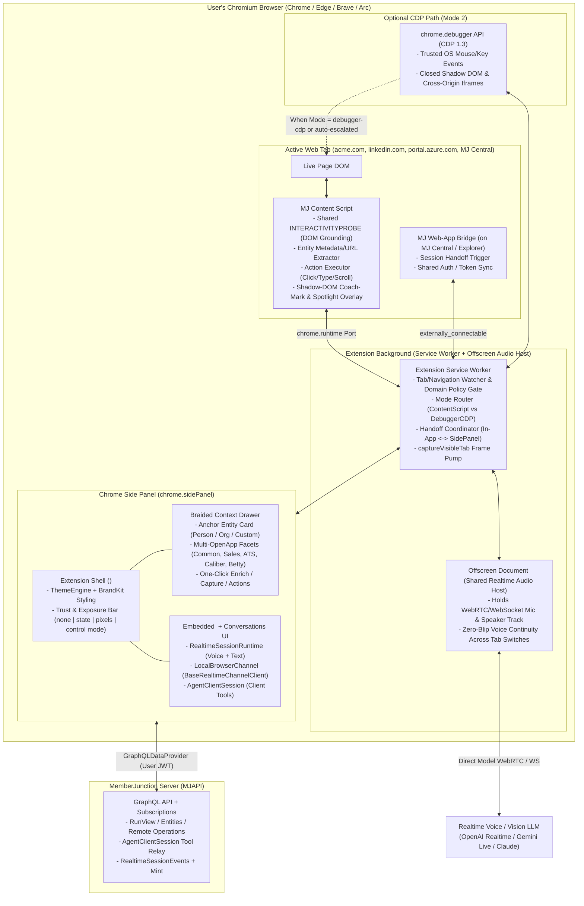
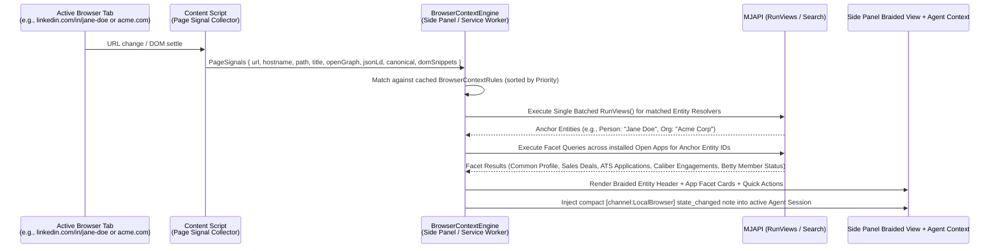
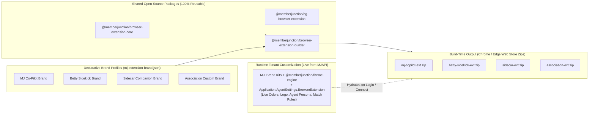

# MemberJunction Browser Extension — Unified Architecture, Multi-App Braiding & White-Label Distribution Plan

**Status:** Plan for review (2026-11-08)
**Branch:** `plan/browser-extension-architecture`
**Companion specifications:**
- [`packages/RealtimeRuntime/README.md`](../packages/RealtimeRuntime/README.md) (`RealtimeSessionRuntime`, `BaseRealtimeChannelClient`, Channels v2, Exposure Policy)
- [`plans/realtime/channels-v2/README.md`](realtime/channels-v2/README.md) (`RealtimeChannelDescriptor`, `ContextTool`, `<mj-realtime-widget>`, `VideoSourceArbiter`)
- [`packages/AI/AgentsClient/README.md`](../packages/AI/AgentsClient/README.md) (`AgentClientSession`, `ClientToolRegistry`)
- [`packages/AI/ComputerUse/README.md`](../packages/AI/ComputerUse/README.md) & [`DOM_SELECTION_AND_REPLAY.md`](../packages/AI/ComputerUse/docs/DOM_SELECTION_AND_REPLAY.md) (`BaseBrowserAdapter`, `ExtractInteractiveElements`, DOM Grounding & Replay)
- [`guides/REMOTE_BROWSER_GUIDE.md`](../guides/REMOTE_BROWSER_GUIDE.md) (`IRemoteBrowserSession`, Control Modes & Strategies, Model-Blind Credentials)
- [`packages/ThemeEngine/README.md`](../packages/ThemeEngine/README.md) & [`packages/OpenApp/Engine/src/manifest/manifest-schema.ts`](../packages/OpenApp/Engine/src/manifest/manifest-schema.ts)

---

## 0. Executive Summary & One-Line Thesis

> **The one-line thesis:** We are **not** building a separate browser-agent stack. We are packaging MemberJunction's existing framework-agnostic [`RealtimeSessionRuntime`](../packages/RealtimeRuntime/README.md), [`AgentClientSession`](../packages/AI/AgentsClient/README.md), [`<mj-realtime-widget>`](../packages/Angular/Generic/realtime-widget/README.md), and [`ComputerUse`](../packages/AI/ComputerUse/README.md) DOM-grounding engine into a **Manifest V3 Browser Extension (`chrome.sidePanel`)** that:
> 1. **Controls and coaches across the user's real browser tabs** via a configurable **Dual-Mode Adapter** (**Mode 1: Content Script + DOM Grounding + Visual Spotlights** by default; **Mode 2: `chrome.debugger` CDP Attach** when deep OS-level/iframe/canvas automation is needed; plus **Mode 3: `'auto'` escalation**).
> 2. **Braids context, entity profiles, and actions across every installed Open App** (`bizapps-common`, `bizapps-sales`, `bizapps-ats`, `bizapps-caliber`, `bizapps-forms`, `bizapps-community`, etc.) purely from metadata rules as the user visits customer websites, LinkedIn profiles, or SaaS admin consoles.
> 3. **Hands off live text and voice sessions seamlessly** between in-tab MJ apps (**MJ Central**, **MJ Explorer**) and the persistent Browser Extension Side Panel so an agent can walk a user through cross-domain OAuth setups, HubSpot/Salesforce connections, or Azure Managed Services configurations without dropping the voice call.
> 4. **Stamps and themes into any brand or product persona** (**MemberJunction Sidekick**, **Betty**, **Sidecar**, or an association's custom member companion) via build-time manifest stamping + runtime [`@memberjunction/theme-engine`](../packages/ThemeEngine/README.md) and `MJ: Brand Kits`.

---

## 1. Why a Local Browser Extension — and How It Complements `RemoteBrowser` & In-Tab Widgets

MemberJunction today has two ways an agent interacts with web UIs. A Browser Extension completes the triad by solving what neither of the first two can do:

| Dimension | In-Tab MJ App / `<mj-realtime-widget>` | Server-Side `RemoteBrowser` (Cloud CDP) | **MJ Browser Extension (`LocalBrowserChannel`)** |
|---|---|---|---|
| **Where it runs** | Inside a single web page / MJ Explorer tab | Server container or BaaS (Browserbase, Steel) | `chrome.sidePanel` + Content Scripts / `chrome.debugger` in the user's real browser |
| **Cross-domain survival** | Dies or loses visibility when navigating to a third-party domain (`CORS` / `COOP`) | Survives navigation, but in an isolated cloud sandbox | **Persists across every tab and domain** while the Side Panel stays open |
| **Auth, SSO, Passkeys & Password Managers** | N/A on third-party sites | Cold browser; no user cookies, no 1Password/Bitwarden, no hardware WebAuthn/YubiKey, blocked by Conditional Access | **Inherits the user's real authenticated sessions, passkeys, password manager, and trusted device/IP** |
| **Bot / Datacenter IP blocking** | N/A | Frequently challenged by LinkedIn, Google, Microsoft Entra ID, Cloudflare | **Zero datacenter IP friction** — traffic originates from the user's residential/corporate browser |
| **On-page visual coaching** | Only inside the host page | Via remote screencast stream | **Native Shadow-DOM Coach Marks & Spotlights** drawn directly over the live page at 60fps |
| **Best use cases** | Working inside MJ Explorer or a single customer portal | Headless background tasks, public scraping, sandboxed product demos | **CRM/LinkedIn ambient entity intelligence, MJ Central OAuth setup, Azure/SaaS guided admin, "Sidecar/Betty" browsing companion** |

---

## 2. High-Level System Architecture



---

## 3. Pillar 1: Dual-Mode Configurable Browser Control (`ContentScript` Default + `DebuggerCDP` + `Auto`)

A core requirement of this architecture is supporting **both** browser-control mechanisms behind a single unified adapter interface (`BaseBrowserAdapter` from [`@memberjunction/computer-use`](../packages/AI/ComputerUse/src/browser/BaseBrowserAdapter.ts) + `BaseRealtimeChannelClient` from [`@memberjunction/realtime-runtime`](../packages/RealtimeRuntime/README.md)), **defaulting to Mode 1 (`'content-script'`)** and making the mode configurable across four levels.

### 3.1 The Three Control Modes

| Mode Key | Mechanism | UX Impact | Capabilities & Tradeoffs |
|---|---|---|---|
| **`'content-script'`** *(Recommended Default)* | MV3 Content Script + `chrome.tabs` + `chrome.scripting` + `chrome.tabs.captureVisibleTab` | **Clean UX:** Zero Chrome warning banners. Supports floating **Coach-Mark / Spotlight overlays** directly on the page. | Runs the shared `INTERACTIVITYPROBE` ([`element-extraction.ts`](../packages/AI/ComputerUse/src/browser/element-extraction.ts)) in-page to produce indexed `InteractiveElement[]` (`[0] button "Register"`, `[1] textbox "Redirect URI"`). Executes clicks, focus, value assignment + synthetic `input`/`change` events, scrolling, and navigation. |
| **`'debugger-cdp'`** *(Power / High-Compatibility Mode)* | `chrome.debugger.attach({ tabId }, '1.3')` speaking raw Chrome DevTools Protocol | Chrome displays a persistent `"<Brand Name> is debugging this browser"` banner at the top of the viewport while attached. | Full parity with [`PlaywrightBrowserAdapter`](../packages/AI/ComputerUse/src/browser/PlaywrightBrowserAdapter.ts) / [`CdpRemoteBrowserSession`](../guides/REMOTE_BROWSER_GUIDE.md): dispatches hardware-level trusted events (`Input.dispatchMouseEvent`, `Input.dispatchKeyEvent` with `isTrusted: true`), pierces closed Shadow DOM roots (`DOM.describeNode` with `pierce: true`), inspects cross-origin `<iframe>` targets, and drives HTML5 `<canvas>` apps. |
| **`'auto'`** *(Adaptive Escalation)* | Starts in `'content-script'`; escalates to `'debugger-cdp'` on demand, then detaches immediately after the step completes | Banner-free 95% of the time; briefly attaches CDP only when a step requires it (respecting policy). | Automatically escalates when: (a) a target element sits inside a cross-origin `<iframe>` or closed shadow root, (b) a synthetic content-script click fails its postcondition because the framework checks `event.isTrusted`, or (c) a playbook step explicitly sets `requireTrustedInput: true`. |

### 3.2 Reusing `@memberjunction/computer-use` Without Duplication

Look at [`packages/AI/ComputerUse/src/browser/element-extraction.ts`](../packages/AI/ComputerUse/src/browser/element-extraction.ts): `INTERACTIVITYPROBE` is already a self-contained, zero-dependency in-page DOM walker that returns `RawInteractiveElement[]` (`role`, `name`, `xpath`, `scope`, `value`, `x`, `y`, `width`, `height`, `scrollable`, `disabled`), and [`engine/replay.ts`](../packages/AI/ComputerUse/docs/DOM_SELECTION_AND_REPLAY.md) already implements target healing (`ReresolveTarget` by role + name + scope + bounding box).

We will extract the pure browser-context probe and target-resolution helpers into a zero-Playwright subpath export (`@memberjunction/computer-use/browser-probe`) so:
1. **`PlaywrightBrowserAdapter`** (server-side `ComputerUse` and `RemoteBrowser`) continues using it via `page.evaluate(INTERACTIVITYPROBE)`.
2. **`ContentScriptBrowserAdapter`** (extension Mode 1) runs the **exact same `INTERACTIVITYPROBE` and `ReresolveTarget` heal ladder** directly inside the content script!
3. **`ChromeDebuggerBrowserAdapter`** (extension Mode 2) runs over `chrome.debugger.sendCommand` using the same action/perception vocabulary.

```typescript
// packages/BrowserExtension/Core/src/adapters/ExtensionBrowserAdapter.ts
import { BaseBrowserAdapter, InteractiveElement, BrowserAction, ActionExecutionResult } from '@memberjunction/computer-use';

export type ExtensionBrowserControlBackend = 'content-script' | 'debugger-cdp' | 'auto';

export interface ExtensionBrowserAdapterConfig {
    /** Default: 'content-script' */
    ControlBackend: ExtensionBrowserControlBackend;
    /** Whether 'auto' mode asks the user in the Side Panel before attaching chrome.debugger */
    PromptBeforeDebuggerAttach: boolean;
    /** Automatically detach chrome.debugger after idle timeout (ms). Default: 15_000 */
    DebuggerIdleDetachMs: number;
    /** Enable on-page visual Coach Marks / Spotlights when the agent points at or clicks elements */
    EnableVisualCoachMarks: boolean;
}
```

### 3.3 The 4-Layer Configuration Cascade for Control Mode

Following MJ's standard configuration cascade (mirroring [`RealtimeSessionRuntime` channel scoping](../packages/RealtimeRuntime/README.md)):

```
1. Code Default ('content-script')
   ↓ overridden by
2. Brand / Application Default (mj-extension-brand.json / Application.AgentSettings.BrowserExtension)
   ↓ overridden by
3. Agent / Playbook / Domain Rule (e.g., Agent TypeConfiguration or BrowserContextRule for a specific domain)
   ↓ overridden by (within policy ceiling)
4. User Runtime Toggle in the Side Panel Trust Bar (persisted per-domain via UserInfoEngine)
```

* **Enterprise Safety Ceiling:** If an organization's `Application.AgentSettings.BrowserExtension.AllowDebuggerCDP` is set to `false` (for example, in a lightweight member-facing association extension where `chrome.debugger` permission shouldn't even be requested), the build-time manifest omits the `"debugger"` permission entirely and locks the runtime to `'content-script'`.

### 3.4 `LocalBrowserChannel` — First-Class Realtime Channel v2 Plugin

The extension registers `LocalBrowserChannel` (extending [`BaseRealtimeChannelClient`](../packages/RealtimeRuntime/README.md)), exposing a `RealtimeChannelDescriptor` whose verbs mirror `RemoteBrowserChannel` **plus** human-coaching verbs that only make sense in a local browser:

| Verb | `InvokableBy` | `ReturnsChannelData` | Description |
|---|---|---|---|
| `Navigate` | `'agent'` | — | Navigate active tab (or open a new tab in the current window) to a URL (validated against `NavigationGuard` domain allow/blocklist). |
| `GetPageContext` | `'agent'` | `'state'` | Returns current URL, title, extracted metadata/JSON-LD, matched MJ entities, and the indexed `InteractiveElement[]` list from `INTERACTIVITYPROBE`. |
| `GetPageText` | `'agent'` | `'state'` | Returns visible rendered text (or current user text selection via `window.getSelection()`). |
| `DescribePage` | `'agent'` | `'pixels'` | Captures viewport via `chrome.tabs.captureVisibleTab` and routes through `EnableVisualPerception` / `VideoSourceArbiter`. |
| `ClickElement` | `'agent'` | — | Clicks an element by grounded index (`[i]`) or role+name+scope target; animates a visual pulse on the element before clicking. |
| `FillInput` | `'agent'` | — | Fills an input/textarea/select by index or target. Refuses `type="password"` unless using model-blind `{{credential}}` injection. |
| `HighlightElement` | `'agent'` | — | **Coach-Mark Verb:** Draws an animated branded spotlight ring + optional floating callout badge (`"Step 2: Click 'Create App Registration'"`) anchored to element `[i]` without clicking it, waiting for the human to click. |
| `ClearHighlights` | `'agent' \| 'user'` | — | Clears active coach-mark overlays on the page. |
| `WaitForUserAction` | `'agent'` | `'state'` | Pauses autonomous execution and waits for a user-driven DOM event, URL transition (e.g. OAuth callback / MFA completion), or explicit "Continue" click in the Side Panel. |
| `RunPlaybookStep` | `'agent'` | `'state'` | Executes a deterministic [`ComputerUse` replay step](../packages/AI/ComputerUse/docs/DOM_SELECTION_AND_REPLAY.md) with `replayHeal` fallback. |

---

## 4. Pillar 2: Multi-App "Braiding" & Metadata-Driven Extensibility

As a user browses the web, the extension acts as a **contextual lens into all of their MemberJunction Open Apps simultaneously**. We call this **Context Braiding**: rather than hardcoding CRM logic or forcing the user to switch between isolated app views, the extension resolves the page's real-world subject and **braids** together the knowledge, entities, components, and actions of every installed Open App.

### 4.1 How Context Braiding Works End-to-End



### 4.2 Zero Hardcoded Apps — The 3 Extension Seams for Open Apps

Following MemberJunction's core rule (*"what differs between use cases is metadata, not code"*), the extension core knows **nothing** about `bizapps-common`, `bizapps-sales`, `bizapps-ats`, `bizapps-caliber`, or `Betty`. Instead, any Open App (or customer instance) plugs into the browser extension through three declarative seams shipped in its standard Skyway metadata migrations:

#### Seam 1: `BrowserContextRule` (URL & DOM → Entity Resolution)
Defines when a web page matches an MJ Entity and how to either **find** an existing record or **extract** a candidate record from the page:

```typescript
export interface BrowserContextRuleSpec {
    /** Unique rule key, e.g. 'common.organization.by-domain' or 'common.person.linkedin' */
    Key: string;
    /** Owning Open App or package, e.g. '@mj-biz-apps/common' */
    SourceApp: string;
    Name: string;
    Priority: number;
    IsActive: boolean;

    /** 1. When does this rule fire? */
    UrlMatch: {
        /** Glob or regex patterns, e.g. ['*://*.linkedin.com/in/*'] or ['*://*/*'] for generic domain match */
        IncludePatterns: string[];
        /** Excluded domains (e.g. google.com, localhost, internal apps) */
        ExcludePatterns?: string[];
    };

    /** 2. How do we extract signals from the page? */
    Extractor: {
        /** Registered BaseBrowserPageExtractor class name (default: 'StandardPageExtractor') */
        DriverClass: string;
        /** Optional CSS/XPath/JSON-LD/Meta selectors mapped to logical signal keys */
        Selectors?: Record<string, {
            Source: 'url-param' | 'url-regex' | 'hostname-root' | 'meta' | 'json-ld' | 'css-text' | 'css-attr';
            Expression: string;
            Attribute?: string;
        }>;
    };

    /** 3. How do we resolve those signals to an MJ Entity record? */
    EntityResolution: {
        /** Target MJ Entity Name, e.g. 'MJ_BizApps_Common: Organizations' or 'MJ_BizApps_Common: People' */
        EntityName: string;
        /** Parameterized RunView ExtraFilter template using extracted signal keys, e.g.
         *  "WebsiteDomain = {{hostnameRoot}}" or "LinkedInURL LIKE '%{{linkedinSlug}}%'" */
        FilterTemplate: string;
        /** Fallback secondary lookup (e.g., match Person by FullName + Organization Name if LinkedInURL isn't stored yet) */
        FallbackFilterTemplate?: string;
        /** Max rows to return (always bounded per MJ rule) */
        MaxRows: number;
    };

    /** 4. If no record exists yet (or fields are newer on the page), how do extracted signals map to entity fields? */
    CandidateFieldMapping?: Record<string, string>;
}
```

#### Seam 2: `BrowserEntityFacet` (Multi-App Braiding Around a Resolved Entity)
Once Seam 1 resolves an anchor entity (for example, `MJ_BizApps_Common: Organizations` with `ID = '…'` or `MJ_BizApps_Common: People` with `ID = '…'`), **other Open Apps** can braid their own contextual slices onto that anchor without duplicating the URL matcher!

```typescript
export interface BrowserEntityFacetSpec {
    Key: string;
    /** Which anchor entity triggers this facet? e.g. 'MJ_BizApps_Common: People' or 'MJ_BizApps_Common: Organizations' */
    AnchorEntityName: string;
    /** Owning Open App (used for badge, icon, and permission scoping) */
    ApplicationName: string;
    Title: string;
    IconClass: string;
    Sequence: number;

    /** Data query to load related records for this facet (batched via RunViews) */
    Query: {
        EntityName: string;
        /** Filter referencing the anchor record, e.g. "PersonID = '{{AnchorRecordID}}'" or
         *  polymorphic "SubjectEntityName = '{{AnchorEntityName}}' AND SubjectID = '{{AnchorRecordID}}'" */
        FilterTemplate: string;
        OrderBy?: string;
        MaxRows: number;
        Fields?: string[];
    };

    /** How to render the facet in the Side Panel */
    Surface: {
        /** 'entity-cards' (standard MJ compact cards), 'metric-summary', or 'component-spec' (InteractiveComponent) */
        Renderer: 'entity-cards' | 'metric-summary' | 'component-spec';
        ComponentArtifactID?: string;
        EmptyStateBehavior: 'hide' | 'show-quick-create';
    };

    /** Contextual Quick Actions / Agent Prompts surfaced in this facet */
    QuickActions?: Array<{
        Label: string;
        IconClass: string;
        Kind: 'agent-prompt' | 'remote-operation' | 'open-in-explorer' | 'create-related-record';
        Target: string;
        ParamsTemplate?: Record<string, string>;
    }>;
}
```

#### Concrete Example of Multi-App Braiding on a Single LinkedIn Profile (`linkedin.com/in/alex-rivera`):
1. **`bizapps-common` (Anchor Match):** Matches `linkedin.com/in/alex-rivera` → resolves `MJ_BizApps_Common: People` ("Alex Rivera, VP of Operations at Horizon Health") and parent `MJ_BizApps_Common: Organizations` ("Horizon Health"). Diff detector notices Alex's title on LinkedIn changed from *Director* to *VP* and offers a 1-click **"Sync Title to MJ"** chip.
2. **`bizapps-sales` (Braided Facet):** Sees the `Organizations` anchor → braids **"2 Active Deals ($140k pipeline) — Stage: Technical Review"** + Quick Action: *"Log LinkedIn Touchpoint"*.
3. **`bizapps-ats` (Braided Facet):** Sees the `People` anchor → braids **"Past Applicant (2025)"** or, if unmatched, offers *"Add to Talent Pool / Link to Open Job"*.
4. **`bizapps-caliber` (Braided Facet):** Sees polymorphic `SubjectEntityName = 'MJ_BizApps_Common: People'` → braids **"Executive Leadership Assessment — Completed (Score: 4.6/5)"** + Quick Action: *"Send New Caliber Invite"*.
5. **`bizapps-tasks` (Braided Facet):** Braids **"1 Open Follow-up Task due tomorrow"**.
6. **Betty / Association App (`bizapps-community` / `bizapps-committees`):** Braids **"Member Status: Gold Tier (Renewed 2026) · Chair, Healthcare Policy Committee"**.

All six facets load in **two batched `RunViews()` round-trips** (one for Anchor Resolution, one for all active Facet Queries in parallel), respecting the user's entity permissions and RLS automatically.

---

## 5. Pillar 3: Seamless Session Handoff (MJ Central / MJ Explorer ↔ Browser Extension)

When a user is working in **MJ Central** (configuring a hosted MJ environment, setting up OAuth connectors, managing cloud resources) or **MJ Explorer** (chatting with Sage/Skip or a voice agent) and the workflow needs to move to external websites, the transition to the Browser Extension must feel effortless, automatic, and continuous.

### 5.1 Two Complementary Handoff Topologies

We design **both** topologies so that users with the extension already installed get a **literal 0ms zero-blip transition**, while sessions started before opening the extension still hand off cleanly in under a second:

#### Topology A: Extension-Hosted Shared Session Daemon (Zero-Blip Voice & Text — Default when Extension is Detected)

In Chromium Manifest V3, a regular web tab's WebRTC audio connection is destroyed the moment that tab navigates to another origin or closes, and cannot be moved to another DOM document without renegotiating ICE/WebRTC. **However**, an Extension **Offscreen Document** (`chrome.offscreen`) or **Side Panel** (`chrome.sidePanel`) lives in the `chrome-extension://<id>` origin and persists across any number of tab navigations, new tabs, or OAuth redirects.

```mermaid
sequenceDiagram
    participant Central as MJ Central / MJ Explorer Tab
    participant Bridge as MJ Extension Web Bridge<br/>(externally_connectable)
    participant Offscreen as Extension Offscreen / SidePanel Host<br/>(RealtimeSessionRuntime)
    participant ThirdParty as HubSpot / Azure Portal Tab

    Central->>Bridge: 1. Page boot: DetectExtension() -> { installed: true, capabilities }
    Central->>Bridge: 2. User starts Voice/Co-Agent Session in MJ Central
    Bridge->>Offscreen: 3. StartRealtimeSession() hosted in Extension runtime;<br/>project state/orb/transcript into MJ Central UI
    Note over Central,Offscreen: User talks to Agent while looking at MJ Central
    Offscreen->>Bridge: 4. Agent invokes TransitionToExtensionSidePanel({ reason: "OAuth setup on HubSpot" })
    Bridge->>Offscreen: 5. chrome.sidePanel.open({ windowId }) — Side Panel slides open instantly
    Offscreen->>ThirdParty: 6. LocalBrowserChannel.Navigate("https://app.hubspot.com/...")
    Note over Offscreen,ThirdParty: ZERO AUDIO DROP: The exact same WebRTC stream stays live<br/>while the main tab navigates to HubSpot and completes OAuth!
    ThirdParty->>Central: 7. OAuth Redirect returns to MJ Central (or Agent navigates back)
    Central->>Bridge: 8. MJ Central re-attaches in-page surface (or user keeps Side Panel open)
```

* **Why this is magical:** Because `RealtimeSessionRuntime` runs inside the Extension context whenever the extension is present, popping out to the Side Panel is just a **UI surface change**, not a network or WebRTC reconnect. The voice agent can literally say *"I'm opening the side panel and taking you to HubSpot now—keep talking to me if you have questions"* without a single frame of audio clipping.

#### Topology B: Warm Session Continuity Handoff (Mid-Session Pop-Out / Pop-In Fallback)

When a session starts inside a standalone web tab (or on a machine where the user just installed/enabled the extension mid-workflow) and then transitions to the extension:

1. **Handoff Payload (`ExtensionSessionHandoffPayload`):**
   ```typescript
   export interface ExtensionSessionHandoffPayload {
       HandoffID: string;
       SourceOrigin: string;
       ApiUrl: string;
       ConversationID: string;
       AgentSessionID: string;
       AgentID: string;
       ApplicationID?: string;
       Mode: 'text' | 'voice';
       /** Ephemeral handoff ticket or user JWT (never placed in URL query strings) */
       AuthTicket: string;
       /** Active workflow / playbook state so the agent knows what step triggered the handoff */
       ContinuationContext: {
           ActiveGoal?: string;
           PlaybookKey?: string;
           CurrentStepIndex?: number;
           PendingTargetUrl?: string;
           SourceAppContext?: Record<string, string>;
       };
   }
   ```
2. **Execution Flow:**
   - The web app calls `chrome.runtime.sendMessage(extensionId, { type: 'mj:session-handoff', payload })` (authorized via Manifest V3 `externally_connectable`).
   - The Extension Service Worker validates the origin, stores the handoff ticket in `chrome.storage.session` (in-memory, encrypted, cleared on browser close), and calls `chrome.sidePanel.open({ windowId })`.
   - For **Text/Agent sessions**, [`AgentClientSession`](../packages/AI/AgentsClient/README.md) in the Side Panel calls `StartSession(payload.AgentSessionID)` and loads the existing `ConversationID`—zero interruption.
   - For **Voice sessions**, the Side Panel `<mj-realtime-widget>` connects using `conversationId: payload.ConversationID` and chains `LastSessionID: payload.AgentSessionID`, injecting a silent system context note (`[Session handed off from MJ Central to Browser Extension Side Panel; user is now navigating to: <PendingTargetUrl>]`) so the voice agent picks up right where it left off.

---

## 6. Pillar 4: Guided Cross-Site Workflows (MJ Central OAuth, Azure Admin & Managed Services)

### 6.1 Concrete Walkthrough 1: MJ Central Integration & OAuth Setup (e.g., HubSpot / Salesforce / Slack)

1. **Start in MJ Central:** An admin opens MJ Central → *Integrations → Connect HubSpot*.
2. **Agent Co-Pilot Initiation:** The MJ Central Setup Agent sees that HubSpot requires creating a Private App or OAuth App in the customer's HubSpot Developer/Admin portal with specific scopes (`crm.objects.contacts.read`, `crm.objects.companies.read`, etc.) and a tenant-specific Redirect URI (`https://tenant.mjcentral.io/api/oauth/hubspot/callback`).
3. **Automatic Side Panel Transition:**
   - The agent asks: *"Want me to walk you through this in HubSpot? I'll pop into the side panel and guide you step by step."*
   - The Side Panel opens, holding the tenant's required Scopes and Redirect URI in its `ContinuationContext`.
4. **Guided Navigation & Coach Marks:**
   - The extension opens `https://app.hubspot.com/` in the main tab.
   - If the user isn't logged into HubSpot yet, `SensitivePageGuard` detects the login/SSO screen: the agent waits quietly (*"Log into your HubSpot account with your usual login or passkey—I'll resume as soon as you're on the dashboard"*).
   - Once on the dashboard, `LocalBrowserChannel` uses DOM grounding (`INTERACTIVITYPROBE`) to locate Settings → Integrations → Connected Apps, either clicking them directly (in **Autopilot** mode) or drawing a glowing **Coach-Mark Spotlight** around each button while explaining via voice (in **Co-Pilot / Guide** mode).
5. **Auto-Filling Non-Secret Config & Model-Blind Secret Capture:**
   - On the Redirect URI and Scopes form, the agent fills the exact Redirect URI and checks the required OAuth scope boxes.
   - When HubSpot displays the **Client ID** and **Client Secret**:
     - The Client ID is read via `LocalBrowserChannel`.
     - For the **Client Secret**, the extension renders a secure **"Copy Secret Directly to MJ Central Vault"** button in the Side Panel (or captures it via a model-blind `{{hubspot_client_secret}}` vault pipe). **The secret bytes go straight from the Content Script → MJ Central's encrypted credential endpoint over HTTPS and NEVER enter the LLM context, prompt logs, or `ConversationDetail` transcript!**
6. **Return & Verify:** The agent triggers the OAuth test handshake, verifies the green status in MJ Central, and closes the loop.

### 6.2 Concrete Walkthrough 2: Managed Services & Cloud Infrastructure (Azure Portal / Entra ID / DNS)

Managed services engineers and customer IT admins frequently run complex multi-step runbooks across Azure Portal (`portal.azure.com`), Microsoft Entra ID, AWS Console, or Cloudflare:
* **Playbook-Driven Execution with [`ComputerUse` DOM Replay](../packages/AI/ComputerUse/docs/DOM_SELECTION_AND_REPLAY.md):**
  - Common procedures (e.g., *"Create an Entra ID App Registration for MJ Explorer + MJAPI with SPA Redirect URIs, API Expose Scopes, and App Roles"*) are stored as versioned **Guided Playbooks** combining natural-language agent instructions with deterministic `ComputerUse` DOM target selectors (`Role`, `Name`, `Scope`, `Postcondition`).
  - Because `ComputerUse`'s `ReresolveTarget` heal ladder is built in, minor Azure Portal UI updates are healed automatically, while major deviations fall back to the LLM controller with live visual/DOM perception.
  - Every mutating step in a cloud console supports a **Pre-Execution Confirmation Gate** in the Side Panel (showing the exact resource name, subscription, and action before clicking *Create* or *Delete*).

---

## 7. Pillar 5: White-Label Branding & Multi-Persona Distribution ("Betty", "Sidecar", Associations)

We know that MemberJunction's Browser Extension technology will not ship solely as a single "MemberJunction" extension. Organizations will want to package and brand it as their own signature product:
- **MemberJunction Co-Pilot** (for MJ Explorer, MJ Central, and enterprise BizApps users)
- **Betty Browser Sidekick** (giving association staff and executives instant member, company, committee, and community context as they browse the web or LinkedIn)
- **Sidecar Companion** (staying with learners and professionals across the web to deliver micro-coaching, contextual knowledge, and guided workflows)
- **Customer / Association-Branded Sidekicks** (e.g., an industry trade association shipping *"ACME Industry Pulse"* to its members or staff)

To support this **the MJ way**—with **zero forked repositories and zero copy-pasted extension code**—branding and persona customization are architected as a **Two-Layer System**:



### 7.1 Layer 1: Build-Time Brand Stamping (`mj-extension-brand.json`)

Chrome Web Store and Microsoft Edge Add-ons require static fields in `manifest.json` (`name`, `short_name`, `description`, `icons`, `action`, `permissions`, `externally_connectable`) at package upload time.

`@memberjunction/browser-extension-builder` (`mj-ext-build --brand ./brands/betty/mj-extension-brand.json`) takes a declarative `ExtensionBrandConfig` and emits a complete, signed/zipped Manifest V3 distribution:

```typescript
export interface ExtensionBrandConfig {
    /** Unique brand slug (e.g. 'mj-copilot', 'betty', 'sidecar') */
    BrandKey: string;
    /** Chrome Web Store display name (max 45 chars), e.g. 'Betty — Association Intelligence Sidekick' */
    ExtensionName: string;
    ShortName: string;
    Description: string;
    Version: string;

    /** Visual identity & @memberjunction/theme-engine seeds baked in as pre-login defaults */
    Branding: {
        Icons: { '16': string; '32': string; '48': string; '128': string };
        LogoSvgPath: string;
        /** Passed directly to @memberjunction/theme-engine derive(ThemeSeeds) */
        ThemeSeeds: {
            primary: string;
            accent?: string;
            tertiary?: string;
            neutralChroma?: number;
            vibrancy?: number;
            radius?: number;
            fontFamily?: string;
        };
        DefaultColorMode: 'light' | 'dark' | 'system';
    };

    /** Default Agent Persona & Terminology */
    Persona: {
        AssistantDisplayName: string;       // e.g. 'Sage', 'Betty', 'Sidecar'
        AvatarAssetPath?: string;
        WelcomeHeadline: string;            // e.g. 'Hi, I'm Betty. Browse any member org or LinkedIn profile for instant context.'
        SuggestedPrompts: string[];
        CoachMarkAccentColor?: string;
    };

    /** Connection & Tenant Discovery */
    Connection: {
        /** Pre-bound MJAPI URL (for single-tenant/SaaS builds) or 'user-configurable' / 'central-discovery' */
        DiscoveryMode: 'fixed-endpoint' | 'central-tenant-lookup' | 'user-configurable';
        DefaultApiUrl?: string;
        /** Web app origins allowed to trigger zero-blip handoffs via externally_connectable */
        TrustedWebAppOrigins: string[];
        /** Optional pinned Application Name / Agent Name on the server */
        DefaultApplicationName?: string;
        DefaultAgentName?: string;
    };

    /** Feature & Permission Profile (tailors manifest.json permissions to avoid store review friction) */
    Capabilities: {
        DefaultControlBackend: 'content-script' | 'debugger-cdp' | 'auto';
        /** If false, omits "debugger" from manifest.json permissions completely! */
        IncludeDebuggerPermission: boolean;
        EnableVoiceCoAgent: boolean;
        EnableAmbientEntityMatching: boolean;
        EnableGuidedPlaybooks: boolean;
    };
}
```

* **Why `IncludeDebuggerPermission: boolean` is crucial for branded builds:** A consumer/member-facing extension (e.g. a lightweight **Sidecar** or **Betty** build focused on ambient context + voice coaching + content-script spotlights) can set `IncludeDebuggerPermission: false` so its `manifest.json` never requests the scary `debugger` permission in the Chrome Web Store, while an admin/power-user build (**MJ Central / Managed Services Co-Pilot**) sets `IncludeDebuggerPermission: true` (or puts `"debugger"` in `optional_permissions` so Chrome only prompts if the user switches to Mode 2!).
* **Recommended Default in Manifest V3:** Put `"debugger"` in **`optional_permissions`**! That way, installing the extension **never** shows a debugger permission warning at install time, Mode 1 (`'content-script'`) works out of the box, and `chrome.permissions.request({ permissions: ['debugger'] })` is only invoked if the user or domain config opts into Mode 2 (`'debugger-cdp'`).

### 7.2 Layer 2: Runtime Dynamic Branding (`@memberjunction/theme-engine` + `MJ: Brand Kits`)

Even within a single published extension in the Chrome Web Store (for example, an association platform where 200 different associations use the "Betty" extension, or 500 enterprises use the "MJ Co-Pilot" extension), the extension dynamically re-skins itself at runtime after authentication:
1. On login, the Side Panel reads the tenant's active `MJ: Brand Kits` row (or `Application.AgentSettings.BrowserExtension.BrandKitID`).
2. It feeds the brand kit's color and typography seeds into [`@memberjunction/theme-engine`](../packages/ThemeEngine/README.md)'s `derive(seeds)` + `emitOverlayCss()`.
3. Because every MJ Angular component (`<mj-realtime-widget>`, `<mj-entity-card>`, Side Panel chrome) uses semantic `--mj-*` CSS design tokens, **the entire Side Panel and the on-page Coach-Mark Spotlight overlays immediately adopt the customer's exact brand colors, dark/light mode ramps, logo, and agent persona** with zero rebuild!

---

## 8. Security, Privacy, Exposure & Enterprise Governance

Giving an AI extension visibility and control inside a user's real browser requires uncompromising, visible security controls. We build directly on [`@memberjunction/realtime-runtime`'s Exposure Policy](../packages/RealtimeRuntime/README.md) (`'none' | 'state' | 'pixels'`) and [`@memberjunction/computer-use`'s `NavigationGuard`](../packages/AI/ComputerUse/src/browser/NavigationGuard.ts):

### 8.1 The Persistent "Trust & Perception Bar" in the Side Panel
At the top of the Side Panel, the user always sees the current tab's domain (`portal.azure.com`) and four clear, instant controls:
1. **Perception / Exposure Level (`ResolveChannelExposure`):**
   - **`None` (Paused / Private):** Extension reads nothing from this tab.
   - **`State` (DOM & Entity Match Only — Default for Ambient Browsing):** Extension extracts URL/DOM structure and matches MJ entities; no screenshots are captured.
   - **`Pixels` (Live Visual Perception):** Enables the change-driven `captureVisibleTab` frame pump (`EnableVisualPerception`) with the visible **"Agent can see this tab"** chip from Channels v2.
2. **Control Mode (`RemoteBrowserControlMode`):**
   - **`ObserveOnly`** (Ambient Sidekick)
   - **`GuideOnly`** (Coach Marks & Spotlights; human clicks)
   - **`Collaborative`** (Agent fills & clicks non-destructive steps; human can take over anytime)
3. **Engine Backend Selector:**
   - **`Content Script` (Default)** | **`Auto`** | **`Debugger (CDP)`**
4. **Emergency Stop / Takeover:** Clicking anywhere on the page or pressing `Esc` immediately halts an active agent action or playbook step and hands control back to the user.

### 8.2 Automatic `SensitivePageGuard` (Zero-Trust Redaction)
Before any DOM probe or `captureVisibleTab` runs, `SensitivePageGuard` checks:
- **Blocked Domains:** Consumer banking, healthcare portals, personal email, password vaults, and admin-configured `BlockedDomains` wildcards (`*.1password.com`, `*.okta.com/login/*`) automatically force Exposure to `'none'`.
- **Password / MFA / Payment Fields:** `INTERACTIVITYPROBE` masks the `.value` of any `input[type="password"]`, `autocomplete="cc-*"`, or `autocomplete="one-time-code"` field before the payload leaves the content script. When a page exhibits an active login or MFA challenge during a guided workflow, the channel automatically switches to `WaitForUserAction` until authentication completes.
- **Model-Blind Secret Transport:** API keys or OAuth client secrets copied from third-party developer consoles during guided setup use a dedicated encrypted vault action that bypasses LLM context and conversation transcripts completely.

---

## 9. Package Layout & Repository Architecture

Following [`guides/UI_LAYERING_GUIDE.md`](../guides/UI_LAYERING_GUIDE.md) and MJ's strict package rules (no cross-package re-exports, `BaseSingleton` for all singletons, zero `any` types, framework-neutral core packages):

| Package | Path | Platform | Responsibility |
|---|---|---|---|
| `@memberjunction/computer-use` *(existing — add subpath)* | `packages/AI/ComputerUse` | `both` | Extract pure DOM probe (`INTERACTIVITYPROBE`) and target heal helpers into a zero-Playwright browser-safe module so both `PlaywrightBrowserAdapter` and `ContentScriptBrowserAdapter` share one implementation. |
| **`@memberjunction/browser-extension-core`** *(new)* | `packages/BrowserExtension/Core` | `browser` (framework-agnostic) | `LocalBrowserChannel` (`BaseRealtimeChannelClient`), `ContentScriptBrowserAdapter`, `ChromeDebuggerBrowserAdapter`, `BrowserContextEngine` (URL/DOM rule matcher + multi-app facet braider), `ExtensionSessionHandoffCoordinator`, `SensitivePageGuard`, and `ExtensionBrandConfig` types. Zero Angular dependencies. |
| **`@memberjunction/ng-browser-extension`** *(new)* | `packages/Angular/Generic/browser-extension` | `browser` (Angular 21) | Standalone Angular components for the Side Panel shell (`<mj-extension-side-panel>`), Trust & Perception Bar, Braided Entity Context Drawer (composing `<mj-entity-card>` + `<mj-entity-record-detail-panel>`), Playbook Stepper, and the Web-App Handoff Service (`MJExtensionBridgeService`) for MJ Explorer / MJ Central. |
| **`@memberjunction/browser-extension-host`** *(new)* | `packages/BrowserExtension/Host` | `browser` (MV3 App) | The Manifest V3 entry points: `service-worker.ts`, `content-script.ts` (including the Shadow-DOM Coach-Mark / Spotlight overlay renderer), `offscreen-audio.ts`, and `sidepanel.html` mounting `<mj-extension-side-panel>` + `<mj-realtime-widget>`. |
| **`@memberjunction/browser-extension-builder`** *(new)* | `packages/BrowserExtension/Builder` | `node` (CLI) | Build & brand-stamping CLI (`mj-ext-build`) that takes an `mj-extension-brand.json` profile (MJ Co-Pilot, Betty, Sidecar, or custom) and outputs a store-ready Manifest V3 folder and `.zip`. |

---

## 10. Metadata & JSONType Lockstep Strategy (Zero Core DDL Required for Phase 1)

Following the pattern established in [Channels v2 §4.2](realtime/channels-v2/README.md):
1. **Phase 1 requires zero database DDL migrations** by extending `IAgentSettings` in lockstep (`metadata/entities/JSONType-interfaces/IAgentSettings.ts` ↔ `@memberjunction/ai-core-plus`):
   - `Application.AgentSettings.BrowserExtension`: holds the application's `BrowserContextRuleSpec[]`, `BrowserEntityFacetSpec[]`, default `ControlBackend` (`'content-script' | 'debugger-cdp' | 'auto'`), `AllowDebuggerCDP`, and optional `BrandKitID`.
   - Every Open App (`bizapps-common`, `bizapps-sales`, `bizapps-ats`, `bizapps-caliber`, `Betty`) already has an `MJ: Applications` row and can declare its `BrowserContextRules` and `BrowserEntityFacets` right inside its `Application.AgentSettings` metadata JSON!
2. **Seeded `MJ: AI Agent Channels` Metadata Row:**
   - Add the `LocalBrowser` channel row in `metadata/ai-agent-channels/` (`ClientPluginClass: 'LocalBrowserChannel'`, `DefaultAvailability: 'opt-in'`, `MaxExposure: 'pixels'`).
3. **User Preferences via `UserInfoEngine`:**
   - Per-domain trust, exposure, and control-backend preferences persist to `MJ: User Settings` under key `mj.browserExtension.domainPolicy.v1` via `UserInfoEngine` (never `localStorage`, per MJ Critical Rule 8), mirrored into `chrome.storage.session` for fast content-script checks.

---

## 11. Phased Implementation Roadmap & Acceptance Criteria

### Phase 1: Foundation, Dual-Mode `LocalBrowserChannel` & Side Panel Host
- **T1.1 — Shared DOM Grounding Probe Extraction:** Factor `INTERACTIVITYPROBE` and `ReresolveTarget` in `@memberjunction/computer-use` so they can be imported without Playwright (`@memberjunction/computer-use` unit tests stay 100% green).
- **T1.2 — `@memberjunction/browser-extension-core` & Dual-Mode Adapters:**
  - Implement `ContentScriptBrowserAdapter` (Mode 1 default: DOM probe, click/fill/scroll, `captureVisibleTab`, Shadow-DOM Coach-Mark & Spotlight overlay).
  - Implement `ChromeDebuggerBrowserAdapter` (Mode 2: `chrome.debugger` CDP 1.3 attach, trusted mouse/key dispatch, iframe/shadow-DOM piercing, idle auto-detach).
  - Implement `'auto'` escalation mode and the 4-layer configuration cascade (`code → app/brand → agent/domain → user`).
  - Implement `SensitivePageGuard` (password/CC/OTP masking, blocked-domain enforcement, auth-screen auto-pause).
- **T1.3 — `LocalBrowserChannel` (`BaseRealtimeChannelClient`):**
  - Register `LocalBrowserChannel` with v2 `RealtimeChannelDescriptor` (`Navigate`, `GetPageContext`, `GetPageText`, `DescribePage`, `ClickElement`, `FillInput`, `HighlightElement`, `ClearHighlights`, `WaitForUserAction`, `RunPlaybookStep`).
  - Wire `EnableVisualPerception` to `chrome.tabs.captureVisibleTab` so `'pixels'` exposure flows through `VideoSourceArbiter` and respects the "Agent can see" chip.
- **T1.4 — MV3 Extension Host & `<mj-extension-side-panel>`:**
  - Build Service Worker, Content Script, Offscreen Audio Host, and Side Panel Angular shell hosting `<mj-realtime-widget>` + Trust & Perception Bar.
  - Put `"debugger"` in `optional_permissions` so default Mode 1 installs with minimal permissions.

### Phase 2: Multi-App Context Braiding & Open App Extensibility
- **T2.1 — `BrowserContextEngine` (Matcher + Batched Facet Braider):**
  - Extend `IAgentSettings` in lockstep with `BrowserExtension` config (`ContextRules`, `EntityFacets`).
  - Implement `StandardPageExtractor` (URL, root domain, OpenGraph, Schema.org JSON-LD, meta tags, CSS selectors) and `LinkedInPageExtractor` (`@RegisterClass(BaseBrowserPageExtractor, ...)`).
  - Implement two-stage batched `RunViews()` execution: Stage 1 resolves Anchor Entities; Stage 2 resolves all matching `BrowserEntityFacetSpec` queries across installed Open Apps in parallel.
- **T2.2 — Braided Context Drawer UI & Inbound Capture/Enrichment:**
  - Render resolved Anchor Entity header (`<mj-entity-card>`) + collapsible Open App Facets + Quick Actions.
  - Implement **Page-to-Entity Diff & Capture** (preview extracted fields from a website or LinkedIn profile against an existing or new `MJ_BizApps_Common: Organizations` / `People` record and save via MJ Entity CRUD).
- **T2.3 — Reference Open App Metadata Configurations:**
  - Author default metadata rules for `bizapps-common` (Organization by domain, Person by LinkedIn URL) and demonstrate multi-app facet braiding with Sales/ATS/Caliber/Betty facets.

### Phase 3: Seamless Session Handoff & Guided OAuth / Admin Playbooks
- **T3.1 — `MJExtensionBridgeService` & Zero-Blip Voice/Text Handoff:**
  - Implement `externally_connectable` handshake between MJ web apps (MJ Explorer, MJ Central) and the Extension Service Worker.
  - Implement **Topology A** (Extension Offscreen/SidePanel shared audio/session host for 0ms transitions) and **Topology B** (Warm mid-session handoff via `ExtensionSessionHandoffPayload` + `LastSessionID` continuity).
- **T3.2 — Guided Cross-Site Playbooks & Model-Blind Vault Pipe:**
  - Implement Guided Playbook runner supporting `HighlightElement` coach marks, `WaitForUserAction` on login/OAuth consent pages, and model-blind secret capture (`CopySecretToMJVault` without LLM exposure).
  - Ship reference playbooks for **MJ Central OAuth Connector Setup** (HubSpot / Entra ID App Registration).

### Phase 4: White-Label Brand Stamping Factory ("Betty", "Sidecar", Custom Brands)
- **T4.1 — `@memberjunction/browser-extension-builder` (`mj-ext-build`):**
  - Build CLI that reads `mj-extension-brand.json`, validates it with Zod, derives initial theme CSS via `@memberjunction/theme-engine`, stamps `manifest.json` (including conditional `debugger` permission), bundles assets, and outputs a store-ready `.zip`.
- **T4.2 — Runtime `BrandKit` + `ThemeEngine` Synchronization:**
  - Hydrate tenant `MJ: Brand Kits` and `ThemeEngine` seeds on login so a single installed extension dynamically adopts the tenant's colors, dark/light ramps, logo, and agent persona.
- **T4.3 — Reference Brand Profiles:**
  - Ship ready-to-build brand configurations in `packages/BrowserExtension/Brands/`:
    1. `mj-copilot` (MemberJunction Co-Pilot)
    2. `betty` (Betty — Association & Community Intelligence Sidekick)
    3. `sidecar` (Sidecar — Continuous Learning & Workflow Companion)

---

## 12. Verification & Testing Matrix

| Tier | What is Tested | How |
|---|---|---|
| **Unit Tests (Vitest)** | `ContentScriptBrowserAdapter`, `ChromeDebuggerBrowserAdapter` (mocked `chrome.*` APIs), 4-layer mode cascade, `SensitivePageGuard` password/OTP redaction, `BrowserContextEngine` URL matching + batched `RunViews` facet braiding, `ExtensionSessionHandoffCoordinator`, and `mj-ext-build` manifest generator. | `cd packages/BrowserExtension/Core && pnpm test` (no browser or DB required). |
| **DOM & Component Tests** | Coach-Mark Spotlight overlay positioning/cleanup, Trust & Perception Bar toggles, Braided Entity Drawer rendering, `<mj-realtime-widget>` integration in Side Panel. | Vitest + JSDOM / happy-dom in `@memberjunction/ng-browser-extension`. |
| **End-to-End Playwright Extension Harness** | Launching Chromium with `--load-extension=dist/mj-copilot`:<br/>1. Visiting a sample customer domain → Side Panel braids Organization + People + App Facets.<br/>2. Starting a session in MJ Explorer/Central → triggering Handoff → Side Panel opens and navigates to mock OAuth provider → Coach Marks highlight buttons → model-blind secret capture completes.<br/>3. Switching between Mode 1 (`content-script`) and Mode 2 (`debugger-cdp`). | Playwright persistent context with MV3 extension loaded. |
