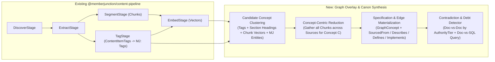

# Canon-First Onboarding, Semantic Graph Overlay & Ambient Canon Intelligence

## Status
- **Status**: Active Implementation (`feat/canon-first-onboarding-and-health`)
- **Date**: 2026-11-02
- **Supersedes / Unifies**:
  - Extends [`plans/canon-semantic-graph.md`](canon-semantic-graph.md) (generalizing `CanonConcept` → `GraphConcept` scoped by `GraphID`, adding `Graph.GraphType`, and wiring `MJ: Content Sources` Graph Overlays).
  - Connects to [`plans/agent-recursive-improvement-and-canon.md`](agent-recursive-improvement-and-canon.md) (PR #5869) and `plans/agent-memory-sleep-and-canon.md` (PR #6213) for the ambient learning & approval substrate (`MJ: AI Agent Learning Cycles`).
- **PR / Branch Conflict Audit (Verified 2026-11-02)**:
  - Audited all open/merged PRs, remote branches, and worktrees: only **MJ Canon Layer 1 (`MJ: Entity Alternate Base Views`)** shipped in code (PR #6022). Zero code exists in any PR or branch for the Semantic Graph tables/engine, Content Source graph overlays, or TaskGraph DAG similarity & telemetry scoring.

---

## 1. Executive Summary & Architectural Doctrine

The **Canon-First** methodology rests on two architectural loops:
1. **Loop 1 — Codification, Grounding & Promotion**:
   - Ingest organizational knowledge (400–4,000 page manuals, bylaws, board policies, SOPs) through MJ's existing `@memberjunction/content-pipeline` (`MJ: File Storage` → `MJ: Content Sources` → `MJ: Content Items` → `MJ: Content Item Chunks` + `MJ: Content Item Tags` + Vectors).
   - Layer a generic **Semantic Graph & Concept Synthesis** process on top of `ContentPipeline` so documents compile into higher-level **`MJ: Graph Concepts`** (`__mj.GraphConcept`) and typed **`MJ: Graph Edges`** (`__mj.GraphEdge`) rather than flooding `MJ: AI Agent Notes` with thousands of flat prose rules.
   - Run **deterministic DAGs** (`WorkflowSpec` / Flow `MJ: AI Agents`) where the recipe is known, **Loop agents** where it isn't, and **promote what repeats** by detecting recurring successful ad-hoc `TaskGraph` runs and converting them into canonized Flow Workflows.
2. **Loop 2 — Ambient Canon Health, Drift Telemetry & Triage**:
   - Score the **entire executable canon** (Workflows/DAGs, Actions, Queries, Skills, and Graph Concepts)—not just agent memory notes—across six drift signals:
     1. **Usage Velocity Decay** (trailing invocation rate vs. historical baseline, normalized against underlying entity activity),
     2. **Exception & Escalation Rate** (how often a deterministic Flow DAG fails a step, takes a recovery branch, or hands off to a Loop sub-agent / Human rescue task),
     3. **Shadow Bypass Correlation** (when a saved Workflow's usage decays while a cluster of modified ad-hoc Loop `TaskGraph`s grows on the same operators/entities),
     4. **Outcome Drift** (approval rates, retry rates, rubric scores shifting off baseline),
     5. **Input Drift** (incoming payload shapes/distributions diverging from baseline),
     6. **Overlap & Contradiction** (Doc-vs-Doc, Doc-vs-SQL Query, or duplicate Workflows/Queries).

### Core Separation of Concerns: `GraphConcept` vs. `AIAgentNote`

| Layer | MJ Entity | Role | Volume & Lifecycle |
|---|---|---|---|
| **1. Concept & Policy Spine** | **`MJ: Graph Concepts`** (`__mj.GraphConcept`) + **`MJ: Graph Edges`** | Authoritative hub for domain terms, metrics, policies, and processes. Scoped to a `GraphID` (`GraphType = 'Canon'` for organizational canon, or `'Knowledge'` for general GraphRAG over content sources). | **50–300 concepts per graph.** Curated, versioned, linked to data & execution below. |
| **2. Executable & Analytical Leaves** | **`MJ: Queries`**, **`Alternate Base Views`**, **`MJ: AI Skills`**, **`MJ: Actions`**, **Flow `MJ: AI Agents`** | Connected to their governing `GraphConcept` via `Defines`, `Measures`, `Implements`, and `Governs` edges. | Loaded **on-demand** via graph expansion or progressive skill/workflow invocation. |
| **3. Verbatim Evidence** | **`MJ: Content Items`** + **`MJ: Content Item Chunks`** + **`MJ: Content Item Tags`** | Raw segmented text, section breadcrumbs, tags, and vectors produced by `@memberjunction/content-pipeline`. Linked to `GraphConcept`s via `SourcedFrom` / `Mentions` edges. | Thousands of chunks; used for standard RAG and as verifiable citation provenance. |
| **4. Conversational Scratchpad (Used Sparingly)** | **`MJ: AI Agent Notes`** | User/team personal preferences, 3–5 hard agent constraints, and short-term `Provisional` in-flight corrections that **graduate into `GraphConcept`s** (or Skills/Queries) during ambient learning cycles. | Small, self-cleaning; never used as a bulk policy warehouse. |

---

## 2. Deliverable 1: Generic Semantic Graph Substrate & `MJ: Content Sources` Graph Overlay

### 2.1 Generalizing `CanonConcept` → `GraphConcept` and Typing `Graph`

In [`plans/canon-semantic-graph.md`](canon-semantic-graph.md), five of the six tables (`Graph`, `GraphEdgeType`, `GraphEdgeTypeEndpoint`, `GraphEdgeProvider`, `GraphEdge`) are generic, while `CanonConcept` was left specific to Canon with a globally unique `Name` and no `GraphID`.

We unify the schema so **every Graph can own Concepts**, and **`Canon` is a first-class `GraphType`**:

1. **`${flyway:defaultSchema}.Graph` (`MJ: Graphs`)**:
   - `ID UNIQUEIDENTIFIER NOT NULL DEFAULT NEWSEQUENTIALID()`
   - `Name NVARCHAR(255) NOT NULL` (`UNIQUE`)
   - `Description NVARCHAR(MAX) NULL`
   - `GraphType NVARCHAR(30) NOT NULL DEFAULT N'Knowledge'` (`CHECK (GraphType IN (N'Canon', N'Knowledge', N'Network', N'Custom'))`)
   - `LoadMode NVARCHAR(20) NOT NULL DEFAULT N'Preload'` (`CHECK (LoadMode IN (N'Preload', N'OnDemand'))`)
   - `Status NVARCHAR(20) NOT NULL DEFAULT N'Active'` (`CHECK (Status IN (N'Active', N'Disabled'))`)

2. **`${flyway:defaultSchema}.GraphConcept` (`MJ: Graph Concepts`)**:
   - `ID UNIQUEIDENTIFIER NOT NULL DEFAULT NEWSEQUENTIALID()`
   - `GraphID UNIQUEIDENTIFIER NOT NULL` (FK → `Graph.ID`)
   - `ParentID UNIQUEIDENTIFIER NULL` (self-FK → `GraphConcept.ID` for fast taxonomy trees alongside `Broader Than` graph edges)
   - `Name NVARCHAR(255) NOT NULL` (`UNIQUE (GraphID, Name)`)
   - `ConceptType NVARCHAR(30) NOT NULL DEFAULT N'Term'` (`CHECK (ConceptType IN (N'Domain', N'Term', N'Policy', N'Metric', N'Process'))`)
   - `Description NVARCHAR(MAX) NOT NULL` — crisp 1–3 sentence summary (~100 tokens) used in `DescribeForPrompt()` subgraph rendering.
   - `Specification NVARCHAR(MAX) NULL` — synthesized markdown specification (decision rules, thresholds, exceptions, inline chunk citations) loaded when drilling into the concept.
   - `Synonyms NVARCHAR(MAX) NULL` — JSON `string[]` (`@jsonType`).
   - `AuthorityTier NVARCHAR(30) NOT NULL DEFAULT N'Reference'` (`CHECK (AuthorityTier IN (N'Bylaws', N'BoardPolicy', N'ExecutiveSOP', N'DepartmentPractice', N'Reference', N'Inferred'))`)
   - `Status NVARCHAR(20) NOT NULL DEFAULT N'Draft'` (`CHECK (Status IN (N'Draft', N'Proposed', N'Approved', N'Deprecated'))`)

3. **`${flyway:defaultSchema}.GraphEdgeType`, `GraphEdgeTypeEndpoint`, `GraphEdgeProvider`, `GraphEdge`**:
   - Retained from [`plans/canon-semantic-graph.md`](canon-semantic-graph.md) with extended seeded edge types for both Canon and Content Source GraphRAG:
     - **Schema & Analytical**: `Subsets`, `Is A`, `References`, `Reads`, `Composes`, `Field Of`, `Defines`, `Measures`, `Describes`
     - **Conceptual & Policy**: `Broader Than`, `Preferred Over`, `Same As`, `Related To`, `Contradicts`
     - **Executable & Provenance**:
       - `Implements` (`MJ: AI Skills` / `MJ: Actions` / `MJ: AI Agents` → `MJ: Graph Concepts`)
       - `Governs` (`MJ: Graph Concepts` → `MJ: Entities` / `MJ: Actions` / `MJ: AI Agents`)
       - `SourcedFrom` (`MJ: Graph Concepts` → `MJ: Content Items` / `MJ: Content Item Chunks`, with `Attributes` JSON carrying `{ sectionPath, pageRange, effectiveDate, excerpt }`)
       - `Mentions` (`MJ: Content Item Chunks` → `MJ: Graph Concepts` / `MJ: Entities`)

### 2.2 `MJ: Content Sources` Graph Overlay Configuration

A `Content Source` can optionally project its ingested `Content Items`, `Chunks`, and `Tags` into a target `Graph`:
- **One Content Source → One Dedicated Graph**: e.g., *"Annual Conference Papers"* → Graph `"Conference Knowledge"` (`GraphType = 'Knowledge'`).
- **Multiple Content Sources → One Shared Graph**: e.g., *"Bylaws Storage"*, *"Board Policies"*, and *"Finance Manual"* all point to Graph `"MJ Canon"` (`GraphType = 'Canon'`).

**Schema & JSONType additions on `MJ: Content Sources`**:
- Additive nullable column on `${flyway:defaultSchema}.ContentSource`:
  - `GraphID UNIQUEIDENTIFIER NULL` (FK → `${flyway:defaultSchema}.Graph(ID)`)
- Additive `GraphOverlay?: IContentSourceGraphOverlayConfig` property on `IContentSourceConfiguration`:
  ```typescript
  export interface IContentSourceGraphOverlayConfig {
      /** Enable automatic concept & graph-edge extraction after Tag + Embed stages. */
      EnableGraphOverlay?: boolean;
      /**
       * How extracted concepts interact with the target Graph's existing GraphConcepts:
       * - 'constrained': Only link chunks (SourcedFrom / Mentions) to existing GraphConcepts; never create new concepts.
       * - 'propose-only': Match existing concepts and create new GraphConcepts / GraphEdges as Status='Proposed' (default for 'Canon' graphs).
       * - 'auto-grow': Automatically create/merge GraphConcepts and GraphEdges as Status='Approved' (default for 'Knowledge' GraphRAG graphs).
       */
      ConceptTaxonomyMode?: 'constrained' | 'propose-only' | 'auto-grow';
      /** Default AuthorityTier stamped on concepts/edges extracted from this source. */
      AuthorityTier?: 'Bylaws' | 'BoardPolicy' | 'ExecutiveSOP' | 'DepartmentPractice' | 'Reference';
      /**
       * Level of cross-checking against live MJ metadata:
       * - 'none': Document-only GraphRAG (concepts, tags, chunks).
       * - 'schema-and-queries': Link concepts to MJ Entities, Fields, Alternate Base Views, and Queries.
       * - 'full-canon': Also link to Actions, Skills, and Flow Workflows, and emit Contradicts edges when docs disagree with each other or with SQL queries.
       */
      GroundingMode?: 'none' | 'schema-and-queries' | 'full-canon';
      /** Minimum similarity/confidence score (0.0-1.0) required to link a chunk to an existing GraphConcept without LLM disambiguation. Default 0.82. */
      ConceptMatchThreshold?: number;
      /** Maximum new GraphConcepts that may be proposed/created per pipeline run. NULL = unlimited. */
      MaxNewConceptsPerRun?: number;
  }
  ```

---

## 3. Deliverable 2: Canon & Concept Synthesis Over `Content Items` / `Chunks` / `Tags`

Rather than duplicating `@memberjunction/content-pipeline`'s `Discover` → `Extract` → `Segment` → `Tag` → `Embed` stages, Concept & Graph synthesis operates **directly on the outputs those stages already produce**:



### How One-Time Onboarding (4,000-Page Manual) and Incremental Updates Work Identically

1. **Step 1 — Deterministic Seed Grouping (Tags + Structural Headings + Schema Match)**:
   - Group `Content Item Chunks` that share governed `MJ: Content Item Tags` (`TagID`), normalized section heading paths (`Chunk.Decorator`), or lexical/synonym matches against existing `GraphConcept`s and `MJ: Entities`.
   - This deterministic pre-clustering prevents chunk-by-chunk LLM calls from inventing 5,000 near-duplicate concepts.
2. **Step 2 — Concept Routing (`constrained` vs. `propose-only` vs. `auto-grow`)**:
   - Each cluster is matched against existing `GraphConcept`s in `GraphID` (by normalized name, `Synonyms`, and embedding similarity $\ge \text{ConceptMatchThreshold}$).
   - Unmatched clusters (when `ConceptTaxonomyMode !== 'constrained'`) become candidate `GraphConcept`s classified by `ConceptType` (`Domain | Term | Policy | Metric | Process`).
3. **Step 3 — Concept-Centric Synthesis & Incremental Merge**:
   - For each affected `GraphConcept`, gather its linked `Content Item Chunks` (sorted by `AuthorityTier`, then effective date) + any linked MJ `Entity` / `Query` / `Alternate Base View` metadata.
   - Synthesize/update `Description` and `Specification` (with inline chunk citations), and write `SourcedFrom`, `Describes`, `Defines`, `Measures`, and `Implements` edges into `MJ: Graph Edges`.
   - When `GroundingMode === 'full-canon'`, compare claims across chunks and against linked SQL queries to emit `Contradicts` edges (`Status = 'Proposed'`) whenever two sources or a source and a SQL view disagree.

---

## 4. Deliverable 3: Ambient Intelligence for Executable Canon (Deterministic DAG Comparison, Promotion & Telemetry)

### 4.1 Deterministic DAG Fingerprinting & Similarity (`@memberjunction/ai-core-plus`)

Every completed runtime `TaskGraph` (`MJ: Tasks` + `MJ: Task Dependencies`, projected via [`ProjectTaskRowsToSpec`](../packages/AI/CorePlus/src/task-graph/task-rows-to-spec.ts)) and every saved Flow workflow (`MJ: AI Agents` Type = `'Flow'`, compiled via [`FlowGraphCompiler`](../packages/AI/CorePlus/src/task-graph/flow-graph-compiler.ts)) is represented as a `TaskGraphSpec`.

We introduce a pure, zero-dependency **DAG Canonicalization & Similarity Engine** (`packages/AI/CorePlus/src/task-graph/dag-similarity.ts`):

1. **Canonical Node Operator Signature (`CanonicalNodeSignature`)**:
   - Each node $v \in V(G)$ is mapped to a normalized operator token stripping ephemeral IDs, coordinates, and run-specific literals:
     $$\text{OpSig}(v) = \texttt{kind} \mathbin{\|} \texttt{normalizedTarget(agentName / actionName / promptName)} \mathbin{\|} \texttt{sortedInputKeys} \mathbin{\|} \texttt{controlFlowShape}$$
2. **Weisfeiler-Lehman (WL) Topological Graph Hash (`ExactStructureHash` & Subtree Feature Multiset)**:
   - Compute deterministic bottom-up (ancestors) and top-down (descendants) Weisfeiler-Lehman hash refinements over $k = 2$ iterations:
     $$h^{(0)}(v) = \text{Hash}(\text{OpSig}(v)), \quad h^{(t)}(v) = \text{Hash}\!\left(h^{(t-1)}(v) \mathbin{\|} \text{sort}\{h^{(t-1)}(u) : u \in \text{Predecessors}(v)\} \mathbin{\|} \text{sort}\{h^{(t-1)}(w) : w \in \text{Successors}(v)\}\right)$$
   - The sorted multiset of final node hashes yields an isomorphism-invariant **`ExactStructureHash`**: two task graphs with identical operator topology produce the exact same hash regardless of node array order or `tempId` naming!
3. **Fuzzy Structural Similarity (`ComputeDAGSimilarity`)**:
   - To compare graphs that differ by an extra step, a reordered branch, or an optional check, we compute a weighted combination of three deterministic metrics in $[0, 1]$:
     - **Operator Multiset Jaccard ($J_{\text{ops}}$)**: overlap of canonical operator multisets.
     - **Directed Operator-Bigram Jaccard ($J_{\text{edges}}$)**: overlap of directed dependency pairs $(\text{OpSig}(u) \xrightarrow{\text{condKind}} \text{OpSig}(v))$ (plus transitive 2-hop reachability bigrams so inserting a logging node between $A \to B$ still preserves the $A \leadsto B$ signal!).
     - **WL Subtree Kernel Cosine ($S_{\text{wl}}$)**: cosine similarity over the TF vectors of depth-0, depth-1, and depth-2 WL subtree hashes.
     $$\text{Sim}(G_1, G_2) = 0.30 \cdot J_{\text{ops}}(G_1, G_2) + 0.40 \cdot J_{\text{edges}}(G_1, G_2) + 0.30 \cdot S_{\text{wl}}(G_1, G_2)$$
4. **Clustering & Saved-Workflow Cross-Check (`FindPromotionCandidates`)**:
   - Cluster successful ad-hoc runtime task graphs with $\text{Sim} \ge \theta_{\text{cluster}}$ (default $0.75$).
   - Compare each cluster's medoid (most representative graph + highest completion cleanliness) against all existing saved Flow workflows:
     - **Discovery / Routing Failure ($\text{Sim} \ge 0.85$ with Saved Workflow $W$)**: The Loop agent is re-inventing $W$ from scratch instead of invoking $W$. Emit a `DiscoveryGap` finding recommending wiring $W$ or updating $W$'s `UsageGuidance` cue.
     - **Shadow Evolution ($0.40 \le \text{Sim} < 0.85$ with Saved Workflow $W$ + $W$ has decaying usage or high exception rate)**: Emit an `EvolveWorkflow` proposal showing the structural diff between $W$ and the new cluster medoid.
     - **Net-New Promotion ($\text{Sim} < 0.40$ with all saved workflows, cluster size $\ge N_{\min}$, success rate $\ge S_{\min}$)**: Emit a `PromoteToWorkflow` candidate ready for `ConvertTaskGraphToAgentSpec`!

### 4.2 Deterministic Workflow Usage Decay & Exception Telemetry (`workflow-telemetry.ts`)

For every saved canonized Workflow (and executable canon item), compute a **Canon Health Scorecard** from historical run records over a configurable trailing window (e.g., 30 days) vs. a prior baseline window (e.g., 30–120 days):

| Metric | Formula / Signal | Actionable Triage Verdict |
|---|---|---|
| **Usage Velocity Ratio** | $\text{VelocityRatio} = \dfrac{\text{RunsPerDay}_{\text{recent}}}{\max(\text{RunsPerDay}_{\text{baseline}}, \epsilon)}$ | • `Dormant`: $0$ runs in $\ge 60$d → `Prune / Deprecate`<br>• `UsageDecay`: $\text{VelocityRatio} < 0.30$ while domain activity is stable → `InvestigateBypass` |
| **Domain-Adjusted Activity Ratio** | Compares workflow's `VelocityRatio` against total ad-hoc agent/task runs touching the same operators or entities in the same window | Distinguishes **true seasonal quietness** (both dropped) from **workflow abandonment** (workflow dropped while ad-hoc runs stayed high). |
| **Exception & Loop-Escalation Rate** | Fraction of runs with failed/blocked tasks, recovery-edge activations, or handoffs to open-ended Loop sub-agents / Human rescue tasks | When $\text{EscalationRate}_{\text{recent}} - \text{EscalationRate}_{\text{baseline}} \ge 0.15$ (or absolute $\ge 0.25$), pinpoints the exact hotspot node (`HotspotStepSignatures`) and recommends `ReExtractOrAdjustStep`. |
| **Shadow-Bypass Match** | Links a decaying or high-exception Workflow $W$ to a recurring ad-hoc `TaskGraph` cluster $C$ with $0.40 \le \text{Sim}(W, C) < 0.85$ | Emits `SupersedeWithCluster` proposal with the exact added/removed operator steps. |

---

## 5. Implementation Sequence on `feat/canon-first-onboarding-and-health`

1. **Step 1 (Complete)**: Unified architecture & schema plan (`plans/canon-first-onboarding-and-ambient-health.md`).
2. **Step 2 (Immediate — Pure TS Engine in `@memberjunction/ai-core-plus`)**:
   - Implement `packages/AI/CorePlus/src/task-graph/dag-similarity.ts` (canonicalization, WL topological hashing, operator-bigram + transitive-reachability similarity, agglomerative clustering, medoid selection, and saved-workflow cross-check).
   - Implement `packages/AI/CorePlus/src/task-graph/workflow-telemetry.ts` (usage velocity decay, domain-adjusted activity comparison, node-level exception/escalation hotspot detection, and shadow-bypass correlation).
   - Export from `@memberjunction/ai-core-plus` and verify with comprehensive Vitest suites (`dag-similarity.test.ts` and `workflow-telemetry.test.ts`).
3. **Step 3 — Database Migration & CodeGen (Deliverable 1 Schema)**:
   - Author the 4-part T-SQL migration in `migrations/v6/` creating `Graph`, `GraphEdgeType`, `GraphEdgeTypeEndpoint`, `GraphEdgeProvider`, `GraphEdge`, `GraphConcept`, and adding `ContentSource.GraphID` + extended properties.
   - Run CodeGen and wire polymorphic FKs in `metadata/entities/.polymorphic-fk-entity-fields.json` and JSONTypes (`IContentSourceGraphOverlayConfig`, `IGraphEdgeAttributes`, etc.).
4. **Step 4 — `GraphEngine`, `ConceptSynthesisService` & ContentPipeline `GraphStage` (Deliverable 1 & 2 Runtime)**:
   - Implement `BaseGraphEdgeProvider`, built-in providers, and `GraphEngine` (`Expand`, `Subgraph`, `FindConcepts`, `DescribeForPrompt`).
   - Implement `GraphStage` (`@memberjunction/content-pipeline`) and `ConceptSynthesisService` turning `Content Items`, `Chunks`, and `Tags` into `GraphConcept`s, `GraphEdge`s, and contradiction alerts.
