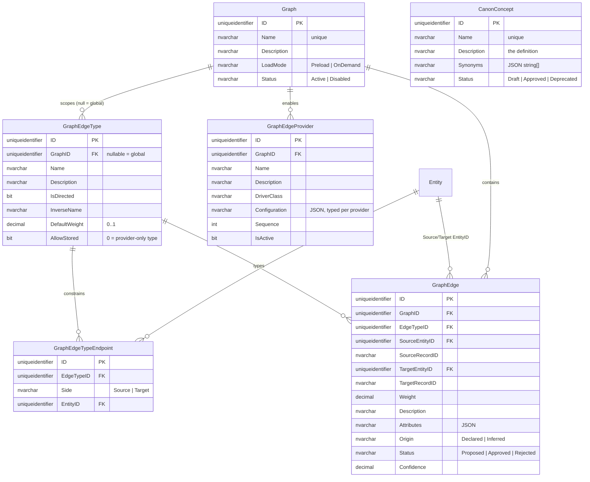

# MJ Semantic Graph: extensible structure, with MJ Canon as the first graph

## Status
- **Status**: **Design for review. Not scheduled for implementation.** This is the basic structure, for Jordan and Robert to iterate on and resolve the open questions. Do not build any phase until it is approved. Once approved, G1 can start independently; G2 needs alternate-views Phases 1 and 5 merged.
- **Created**: 2026-10-23. **Revised** the same day: generalized from a canon-only graph to an extensible graph over any entity record and any edge type. Canon is the first graph built on it.
- **Author**: Claude (Claude Code session), for review
- **Proposed owners**: Jordan (lead), Robert (review), per the original note
- **Branch**: `claude/alternate-base-views` (same PR as the alternate base views plan)
- **Depends on**: [`plans/alternate-base-views.md`](alternate-base-views.md) Phase 1 for canon's alternate-view nodes, and Phase 5 for `Reads` edges to a specific alternate view. The graph substrate itself (G1) does not depend on it.
- **Reviewed against**: `next` @ `48c974e76`

## Overview

MJ has no general way to express "these things are connected, here is how, and here is how
strongly". What exists is structural and per-feature:
- foreign keys (`EntityField.RelatedEntityID`, `EntityRelationship`)
- IS-A parents (`Entity.ParentID`)
- query-to-entity (`MJ: Query Entities`) and query-to-query (`MJ: Query Dependencies`)
- a loose any-to-any link table (`MJ: Record Links`)

None of it carries semantics, weight or provenance, and nothing lets an agent walk it.

This document defines a **semantic graph substrate** with three properties.

**Any record of any entity can be a node.** A metadata object (an entity, a query, an alternate
view, a business concept) and a business-data row (a person, an organization, an invoice) are
addressed the same way: `EntityID` + `RecordID`.

**Any edge type can be defined in metadata.** Each type is directed or not, has a default weight, an
inverse label and optional endpoint constraints. No code change is needed to add one.

**Edges can come from any source.** They come from three places:
- **Stored edges.** People declare them, or AI proposes them for approval.
- **Derived edges.** Pluggable **edge providers** compute them from data MJ already has. Built-ins
  cover foreign keys, join tables and canon metadata. A generic provider turns any MJ Query into
  edges. A custom provider is one class plus one metadata row.
- **Several named graphs side by side.** "MJ Canon" is the first. A member network, a product
  taxonomy or an app's knowledge graph are others. Each has its own edge types and providers.

**MJ Canon** is a curated graph over canon objects: concepts, entities, fields, alternate views
and queries. Its purpose is agent accuracy. For example, "open AR" is **defined by**
`Invoices.Open`, **measured by** "Open AR by Quarter", and is **narrower than** "accounts
receivable". The engine answers neighborhood and path questions under the caller's permissions. An
agent action turns a question into a small relevant subgraph for prompt context.

## Goals & Non-Goals

### Goals
- **Nodes.** Any entity record is a node, addressed by MJ's polymorphic `EntityID` + `RecordID` convention. There is no hard-coded node list.
- **Edge types** live in metadata: directionality, inverse, default weight, optional source/target entity constraints.
- **Named graphs** partition edges, types and providers.
- **Providers.** Derived edges come from a provider contract (`@RegisterClass` + a metadata row, the Permission Domains pattern), with built-ins for FKs, join tables, Queries and canon metadata.
- **Stored edges** are typed, weighted, described, carry provenance (`Declared` / `Inferred`) and review status (`Proposed` / `Approved` / `Rejected`), and take free-form `Attributes`.
- **Two scales.** Small metadata graphs are preloaded and cached; data-scale graphs (millions of rows) expand on demand.
- **Permissions on every node:** entity `CanRead` and row-level security for data records; `UserCanRun` / `UserCanUse` for queries and alternate views.
- **One engine API** on both tiers, an agent action, and a generic viewer on the existing `@memberjunction/ng-graph-view`.

### Non-Goals (this structure)
- **Automatic inference.** The columns support it; the inference process is a later phase.
- **Embeddings and semantic search.** v1 matches text against names and synonyms.
- **A graph database.** Storage stays relational and RunView-based. Path queries are bounded (depth ≤ 4, node cap) expansions, not arbitrary graph algorithms.

## Background & Context
- **Polymorphic FK convention.** An `EntityID` + `RecordID` pair, with `EntityField.EntityIDFieldName` declared in `metadata/entities/.polymorphic-fk-entity-fields.json` (`metadata/CLAUDE.md` § Polymorphic Foreign Keys; [`plans/polymorphic-foreign-keys.md`](polymorphic-foreign-keys.md)). Forms, grids and pickers resolve and link targets from it. Record IDs are written with `CompositeKey.ToCompactURLSegment()` (a bare value for single-column keys) and read with `CompositeKey.FromURLSegment(entityInfo, …)`, so composite keys work.
- **`MJ: Record Links` was considered and rejected** as the edge store. Weight, status and provenance would live in its `Metadata` JSON, out of reach of filters and indexes. Its free-text `LinkType` is not a governed vocabulary, and the table is general app data with its own consumers. It can become one more edge source instead: a `Record Links` provider (below).
- **Provider precedent.** `MJ: Permission Domains` rows name a `ProviderClassName`; `PermissionEngine` discovers them through the ClassFactory with no engine change ([`guides/UNIFIED_PERMISSIONS_GUIDE.md`](../guides/UNIFIED_PERMISSIONS_GUIDE.md) §4). Edge providers follow the same pattern.
- **Viewer.** `@memberjunction/ng-graph-view` (`packages/Angular/Generic/graph-view`, `mjUILayer: widgets`): `GraphNode` {`ID`, `Label`, `Category`, `Badge`, …} and `GraphEdge` {`SourceID`, `TargetID`, `Label`, `Direction`, `Weight`, `Style`} map directly onto this model.

## Architecture / Design

### Concepts

| Term | Meaning |
|---|---|
| **Graph** | A named partition, e.g. "MJ Canon" or "Member Network". It owns edge types, providers and stored edges, and declares whether it is preloaded or expanded on demand. |
| **Node** | Any `(EntityID, RecordID)`. A node exists the moment an edge or a seed references it; there is no node table. Its label comes from the entity's name field, its icon from `Entity.Icon`. |
| **Edge type** | Metadata: name, description, directed or not, inverse label, default weight, optional endpoint constraints. Graph-scoped, or global when `GraphID` is null (e.g. `Related To`, `Same As`). |
| **Stored edge** | A row in `MJ: Graph Edges`: declared by a person, or inferred and proposed. |
| **Derived edge** | Produced at read time by an **edge provider**. Never stored, so it cannot drift from its source. |
| **Edge provider** | A class registered with `@RegisterClass(BaseGraphEdgeProvider, '<DriverClass>')`, enabled per graph by a `MJ: Graph Edge Providers` row with JSON `Configuration`. |

Every edge, stored or derived, carries:
- a **Type** and a **Direction** (from the type)
- a **Weight** (0–1): retrieval pull
- a **Description**: what this connection means in plain language
- **Attributes**: optional JSON, e.g. `{ "Role": "Board Member", "Since": "2021-04-01" }`
- an **Origin** (`Derived` | `Declared` | `Inferred`) and a **Status** (`Proposed` | `Approved` | `Rejected`)
- a **Confidence** (0–1, inferred edges only), distinct from Weight

Default traversal uses approved and derived edges only.

### Data model



`CanonConcept` is not part of the substrate. It is an ordinary entity that the MJ Canon graph uses
as its vocabulary node; any graph can use any entity as nodes the same way.

The migration's hand-written half, following [`migrations/CLAUDE.md`](../migrations/CLAUDE.md)
(`sp_addextendedproperty` on every column; CodeGen output appended; no `__mj_*` columns or FK
indexes):

```sql
-- migrations/v6/V<YYYYMMDDHHMM>__v6.2.x__Semantic_Graph.sql
CREATE TABLE ${flyway:defaultSchema}.Graph (
    ID UNIQUEIDENTIFIER NOT NULL DEFAULT NEWSEQUENTIALID(),
    Name NVARCHAR(255) NOT NULL,
    Description NVARCHAR(MAX) NULL,
    LoadMode NVARCHAR(20) NOT NULL DEFAULT 'Preload',
    Status NVARCHAR(20) NOT NULL DEFAULT 'Active',
    CONSTRAINT PK_Graph PRIMARY KEY (ID),
    CONSTRAINT UQ_Graph_Name UNIQUE (Name),
    CONSTRAINT CK_Graph_LoadMode CHECK (LoadMode IN ('Preload', 'OnDemand')),
    CONSTRAINT CK_Graph_Status CHECK (Status IN ('Active', 'Disabled'))
);

CREATE TABLE ${flyway:defaultSchema}.GraphEdgeType (
    ID UNIQUEIDENTIFIER NOT NULL DEFAULT NEWSEQUENTIALID(),
    GraphID UNIQUEIDENTIFIER NULL,
    Name NVARCHAR(100) NOT NULL,
    Description NVARCHAR(MAX) NOT NULL,
    IsDirected BIT NOT NULL DEFAULT 1,
    InverseName NVARCHAR(100) NULL,
    DefaultWeight DECIMAL(5,4) NOT NULL DEFAULT 1.0,
    AllowStored BIT NOT NULL DEFAULT 1,
    CONSTRAINT PK_GraphEdgeType PRIMARY KEY (ID),
    CONSTRAINT FK_GraphEdgeType_Graph FOREIGN KEY (GraphID) REFERENCES ${flyway:defaultSchema}.Graph(ID),
    CONSTRAINT UQ_GraphEdgeType_Graph_Name UNIQUE (GraphID, Name),
    CONSTRAINT CK_GraphEdgeType_DefaultWeight CHECK (DefaultWeight >= 0 AND DefaultWeight <= 1)
);

CREATE TABLE ${flyway:defaultSchema}.GraphEdgeTypeEndpoint (
    ID UNIQUEIDENTIFIER NOT NULL DEFAULT NEWSEQUENTIALID(),
    EdgeTypeID UNIQUEIDENTIFIER NOT NULL,
    Side NVARCHAR(10) NOT NULL,
    EntityID UNIQUEIDENTIFIER NOT NULL,
    CONSTRAINT PK_GraphEdgeTypeEndpoint PRIMARY KEY (ID),
    CONSTRAINT FK_GraphEdgeTypeEndpoint_EdgeType FOREIGN KEY (EdgeTypeID) REFERENCES ${flyway:defaultSchema}.GraphEdgeType(ID),
    CONSTRAINT FK_GraphEdgeTypeEndpoint_Entity FOREIGN KEY (EntityID) REFERENCES ${flyway:defaultSchema}.Entity(ID),
    CONSTRAINT UQ_GraphEdgeTypeEndpoint UNIQUE (EdgeTypeID, Side, EntityID),
    CONSTRAINT CK_GraphEdgeTypeEndpoint_Side CHECK (Side IN ('Source', 'Target'))
);

CREATE TABLE ${flyway:defaultSchema}.GraphEdgeProvider (
    ID UNIQUEIDENTIFIER NOT NULL DEFAULT NEWSEQUENTIALID(),
    GraphID UNIQUEIDENTIFIER NOT NULL,
    Name NVARCHAR(255) NOT NULL,
    Description NVARCHAR(MAX) NULL,
    DriverClass NVARCHAR(255) NOT NULL,
    Configuration NVARCHAR(MAX) NULL,
    Sequence INT NOT NULL DEFAULT 0,
    IsActive BIT NOT NULL DEFAULT 1,
    CONSTRAINT PK_GraphEdgeProvider PRIMARY KEY (ID),
    CONSTRAINT FK_GraphEdgeProvider_Graph FOREIGN KEY (GraphID) REFERENCES ${flyway:defaultSchema}.Graph(ID),
    CONSTRAINT UQ_GraphEdgeProvider_Graph_Name UNIQUE (GraphID, Name)
);

CREATE TABLE ${flyway:defaultSchema}.GraphEdge (
    ID UNIQUEIDENTIFIER NOT NULL DEFAULT NEWSEQUENTIALID(),
    GraphID UNIQUEIDENTIFIER NOT NULL,
    EdgeTypeID UNIQUEIDENTIFIER NOT NULL,
    SourceEntityID UNIQUEIDENTIFIER NOT NULL,
    SourceRecordID NVARCHAR(400) NOT NULL,
    TargetEntityID UNIQUEIDENTIFIER NOT NULL,
    TargetRecordID NVARCHAR(400) NOT NULL,
    Weight DECIMAL(5,4) NOT NULL DEFAULT 1.0,
    Description NVARCHAR(MAX) NULL,
    Attributes NVARCHAR(MAX) NULL,
    Origin NVARCHAR(20) NOT NULL DEFAULT 'Declared',
    Status NVARCHAR(20) NOT NULL DEFAULT 'Approved',
    Confidence DECIMAL(5,4) NULL,
    CONSTRAINT PK_GraphEdge PRIMARY KEY (ID),
    CONSTRAINT FK_GraphEdge_Graph FOREIGN KEY (GraphID) REFERENCES ${flyway:defaultSchema}.Graph(ID),
    CONSTRAINT FK_GraphEdge_EdgeType FOREIGN KEY (EdgeTypeID) REFERENCES ${flyway:defaultSchema}.GraphEdgeType(ID),
    CONSTRAINT FK_GraphEdge_SourceEntity FOREIGN KEY (SourceEntityID) REFERENCES ${flyway:defaultSchema}.Entity(ID),
    CONSTRAINT FK_GraphEdge_TargetEntity FOREIGN KEY (TargetEntityID) REFERENCES ${flyway:defaultSchema}.Entity(ID),
    -- 4 × 16 + 2 × 800 = 1664 bytes, inside SQL Server's 1700-byte nonclustered key limit; hence NVARCHAR(400)
    CONSTRAINT UQ_GraphEdge UNIQUE (GraphID, EdgeTypeID, SourceEntityID, SourceRecordID, TargetEntityID, TargetRecordID),
    CONSTRAINT CK_GraphEdge_Weight CHECK (Weight >= 0 AND Weight <= 1),
    CONSTRAINT CK_GraphEdge_Confidence CHECK (Confidence IS NULL OR (Confidence >= 0 AND Confidence <= 1)),
    CONSTRAINT CK_GraphEdge_Origin CHECK (Origin IN ('Declared', 'Inferred')),
    CONSTRAINT CK_GraphEdge_Status CHECK (Status IN ('Proposed', 'Approved', 'Rejected')),
    CONSTRAINT CK_GraphEdge_NoSelfLoop CHECK (NOT (SourceEntityID = TargetEntityID AND SourceRecordID = TargetRecordID))
);

CREATE TABLE ${flyway:defaultSchema}.CanonConcept (
    ID UNIQUEIDENTIFIER NOT NULL DEFAULT NEWSEQUENTIALID(),
    Name NVARCHAR(255) NOT NULL,
    Description NVARCHAR(MAX) NOT NULL,
    Synonyms NVARCHAR(MAX) NULL,
    Status NVARCHAR(20) NOT NULL DEFAULT 'Draft',
    CONSTRAINT PK_CanonConcept PRIMARY KEY (ID),
    CONSTRAINT UQ_CanonConcept_Name UNIQUE (Name),
    CONSTRAINT CK_CanonConcept_Status CHECK (Status IN ('Draft', 'Approved', 'Deprecated'))
);
-- + sp_addextendedproperty for every column above
```

**Rules the CHECKs cannot express** live in server subclasses (`ValidateAsync`, per
[`guides/BASE_ENTITY_SERVER_PATTERNS.md`](../guides/BASE_ENTITY_SERVER_PATTERNS.md)).

`MJGraphEdgeEntityServer` checks that:
- both endpoints resolve to real records
- their entities satisfy the type's endpoint rows, if any
- the type has `AllowStored = 1` and belongs to the edge's graph, or is global
- a record ID is at most 400 characters
- an undirected edge is stored in one canonical orientation (lower node key first), so the unique key also catches a reversed duplicate
- an `Inferred` edge is created as `Proposed`

`MJGraphEdgeTypeEntityServer` enforces `(GraphID, Name)` uniqueness for global (`NULL`) types.
PostgreSQL treats NULLs as distinct in unique constraints; SQL Server does not.

`MJGraphEdgeProviderEntityServer` checks that `DriverClass` is registered and that `Configuration`
validates against the provider's schema.

**Metadata:**
- Polymorphic-FK declarations (`SourceRecordID → SourceEntityID`, `TargetRecordID → TargetEntityID`) in `.polymorphic-fk-entity-fields.json`.
- JSONTypes for `CanonConcept.Synonyms` (`string`, array), `GraphEdge.Attributes` (`Record<string, unknown>`-shaped `IGraphEdgeAttributes`), and `GraphEdgeProvider.Configuration` (`IGraphEdgeProviderConfiguration`, a discriminated union by `DriverClass`).
- New `metadata/graphs/` directories, ordered after `entities` in `metadata/.mj-sync.json`.

### Edge providers

```typescript
// packages/MJCoreEntities/src/graph/BaseGraphEdgeProvider.ts
export interface GraphNodeRef { EntityName: string; RecordID: string; }
export interface GraphEdgeRequest {
    Nodes?: GraphNodeRef[];                  // expand around these; undefined = enumerate all (Preload graphs only)
    Direction: 'Out' | 'In' | 'Both';
    EdgeTypes?: string[];
}
export interface GraphProviderContext<TConfig> {
    Graph: MJGraphEntity; Config: TConfig; User: UserInfo; Provider: IMetadataProvider & IRunViewProvider;
}
export abstract class BaseGraphEdgeProvider<TConfig = unknown> {
    /** true = can enumerate every edge cheaply (metadata-scale); false = only expands around given nodes */
    public abstract get SupportsEnumeration(): boolean;
    /** Every read goes through RunView/RunQuery with ctx.User, so entity permissions and RLS apply. */
    public abstract GetEdges(request: GraphEdgeRequest, ctx: GraphProviderContext<TConfig>): Promise<GraphEdgeView[]>;
}
```

**Built-in providers.** Each is a class plus `@RegisterClass`; enabling one is a metadata row.

| DriverClass | Scale | Configuration | Produces |
|---|---|---|---|
| `ForeignKeyEdgeProvider` | data | `{ EntityName, ForeignKeyField, EdgeType, Reverse? }` | record → referenced record, e.g. Invoice → Customer |
| `JoinEntityEdgeProvider` | data | `{ JoinEntity, SourceField, TargetField, EdgeType, WeightField?, AttributeFields? }` | many-to-many through a join entity, e.g. Person → Organization "Member Of" via Memberships |
| `QueryEdgeProvider` | either | `{ QueryName, Parameters? }`; the query returns `SourceEntity, SourceRecordID, TargetEntity, TargetRecordID[, EdgeType, Weight, Description]` | **any edge set expressible as an MJ Query**. Runs through `RunQuery` under the caller, so query permissions apply. |
| `RecordLinkEdgeProvider` | data | `{ LinkTypes?, EdgeType }` | existing `MJ: Record Links` rows as edges |
| `EntityMetadataEdgeProvider` | metadata | `{ Include: ('References' \| 'IsA' \| 'FieldOf')[] }` | entity → entity FK and IS-A edges, field → entity |
| `QueryMetadataEdgeProvider` | metadata | `{ Include: ('Reads' \| 'Composes')[] }` | query → entity / alternate view (Query Entities, including `AlternateBaseViewID`), query → query |
| `AlternateBaseViewEdgeProvider` | metadata | `{}` | alternate view → owning entity (`Subsets`) |

Metadata-scale providers read from already-loaded metadata and `QueryEngine` caches, with no
queries. Data-scale providers batch one `RunViews` per expansion step. They never query per node.

### The MJ Canon graph (first graph, seeded via metadata)

**Graph** "MJ Canon", `LoadMode = Preload`.

**Providers:** `EntityMetadataEdgeProvider` (References, IsA, FieldOf), `QueryMetadataEdgeProvider`
(Reads, Composes), `AlternateBaseViewEdgeProvider`.

**Edge types** (all with `AllowStored = 0` for the provider-only ones):

| Name | Scope | From → To | Directed | Inverse | Default weight | Stored? | Meaning |
|---|---|---|---|---|---|---|---|
| Subsets | Canon | Alternate Base View → Entity | yes | Has Subset | 1.0 | no | rows are a subset of the entity's rows |
| Is A | Canon | Entity → Entity | yes | Has Subtype | 1.0 | no | IS-A child |
| References | Canon | Entity → Entity | yes | Referenced By | 0.6 | no | FK; description names the field |
| Reads | Canon | Query → Entity / Alternate Base View | yes | Read By | 0.8 | no | query selects from it |
| Composes | Canon | Query → Query | yes | Composed Into | 0.9 | no | `{{query:"…"}}` composition |
| Field Of | Canon | Entity Field → Entity | yes | Has Field | 1.0 | no | only for fields that take part in a stored edge |
| Defines | Canon | Alternate Base View / Query → Canon Concept | yes | Defined By | 1.0 | yes | the canonical definition |
| Measures | Canon | Query → Canon Concept | yes | Measured By | 0.9 | yes | computes a metric about the concept |
| Describes | Canon | Entity / Entity Field → Canon Concept | yes | Described By | 0.7 | yes | holds data about the concept |
| Broader Than | Canon | Canon Concept → Canon Concept | yes | Narrower Than | 0.8 | yes | concept hierarchy |
| Preferred Over | Canon | X → X | yes | Superseded By | 0.9 | yes | use the source instead of the target |
| Same As | **global** | any ↔ any | no | — | 1.0 | yes | equivalent nodes |
| Related To | **global** | any ↔ any | no | — | 0.5 | yes | catch-all; weight carries strength |

Endpoint constraints in the From → To column are `MJ: Graph Edge Type Endpoints` rows; "any" means none.

**Example from the original note:**


**The same substrate on business data.** A second graph, "Member Network" (`LoadMode = OnDemand`),
needs no new code:
- a `JoinEntityEdgeProvider` over Memberships: Person → Organization, "Member Of"
- a `JoinEntityEdgeProvider` over Committee Members: Person → Committee, "Serves On"
- a `QueryEdgeProvider` over a "Co-attendance" query: Person ↔ Person, "Attended With", weighted by shared events
- stored `Related To` edges people add by hand

### Engine

`GraphEngine` lives in `@memberjunction/core-entities` (both tiers). It extends `BaseEngine` and is
lazily configured.

**Loading:**
- It caches graphs, edge types, endpoints and providers (metadata-scale).
- For `Preload` graphs it also caches stored edges and the output of enumerating providers. These rebuild on BaseEngine entity events, on metadata refresh, and when `QueryEngine` arrays emit.
- For `OnDemand` graphs, each expansion step calls providers with `Nodes` and loads stored edges with one batched filtered RunView on `MJ: Graph Edges`.

**API sketch** (public members PascalCase):

```typescript
export interface GraphNodeView { Key: string; EntityName: string; RecordID: string; Label: string; Icon: string | null; Description: string | null; }
export interface GraphEdgeView {
    ID: string;                      // stored edge ID, or 'derived:<provider>:<type>:<sourceKey>:<targetKey>'
    GraphName: string; TypeName: string; Source: GraphNodeRef; Target: GraphNodeRef; IsDirected: boolean;
    Weight: number; Description: string | null; Attributes: Record<string, unknown> | null;
    Origin: 'Derived' | 'Declared' | 'Inferred'; Status: 'Proposed' | 'Approved' | 'Rejected'; Confidence: number | null;
}
export interface GraphTraversalOptions {
    Direction?: 'Out' | 'In' | 'Both';      // default 'Both'
    EdgeTypes?: string[];
    MinWeight?: number;
    IncludeProposed?: boolean;               // default false
    Depth?: number;                          // default 2, max 4
    MaxNodes?: number;                       // default 50; hard cap 200 for OnDemand graphs
}
// on GraphEngine
GetEdges(graphName: string, node: GraphNodeRef, options: GraphTraversalOptions, user: UserInfo): Promise<GraphEdgeView[]>;
Subgraph(graphName: string, seeds: GraphNodeRef[], options: GraphTraversalOptions, user: UserInfo): Promise<{ Nodes: GraphNodeView[]; Edges: GraphEdgeView[] }>;
DescribeForPrompt(subgraph: { Nodes: GraphNodeView[]; Edges: GraphEdgeView[] }): string;

// packages/MJCoreEntities/src/engines/CanonGraphEngine.ts — canon conveniences over GraphEngine('MJ Canon')
FindConcepts(text: string, user: UserInfo): GraphNodeView[];   // v1: name + synonym match
CanonContext(question: string, options: GraphTraversalOptions, user: UserInfo): Promise<{ Nodes: GraphNodeView[]; Edges: GraphEdgeView[] }>;
```

**Node keys** are `<entityID>|<recordID>`, held in `UUIDMap`s and normalized with `NormalizeUUID`.
UUIDs are never compared with `===`.

**Expansion is best-first.** A path's score is the product of its edge weights, decayed by depth,
so definitional edges are followed before weak `Related To` ones. It stops at `MaxNodes`.

**Labels and permissions resolve together.** After each expansion step, the engine fetches labels
with one batched `RunViews` per entity: `ResultType: 'simple'`, primary keys plus the entity's name
field, filtered to the new record IDs, under the caller. A row that does not come back is invisible
to that user, because of entity read permission or row-level security. Its node and edges are
dropped. One mechanism serves both purposes for any entity, so the graph never reveals that a
record exists.

Metadata nodes use metadata checks instead, with no query:

| Node | Visible when |
|---|---|
| Entity | `CanRead` |
| Query | `UserCanRun` |
| Alternate view | `UserCanUse` |
| Canon Concept | read permission on its entity |

### Agent surface
- **Action `Get Graph Context`** (`packages/Actions/CoreActions/src/custom/data/`). A thin wrapper over `GraphEngine`, per `packages/Actions/CLAUDE.md`. Inputs: `GraphName` (default "MJ Canon"), `Question` and/or seed nodes (entity name + record ID, or concept names), `Depth`, `MaxNodes`. Returns the subgraph as JSON and as `DescribeForPrompt` text.
- **`Get Entity Details`** gains a short "Canon" section: the concepts it `Describes`, its alternate views, and the queries that `Read` it or `Measure` its concepts.
- **Skip's consumption lives outside this repo.** The action and entity metadata are MJ's contract.

### Authoring and review
- **Graphs, edge types, endpoints, providers and declared edges** ship as `metadata/` JSON with `@lookup` references (e.g. `"SourceEntityID": "@lookup:MJ: Entities.Name=MJ: Queries"`, `"SourceRecordID": "@lookup:MJ: Queries.Name=Open AR by Quarter"`). They can also be edited through CodeGen-generated Explorer forms.
- **Open Apps** ship their own graphs, edge types and providers the same way. Their providers are classes in their own packages, registered with `@RegisterClass`.
- **Inferred edges** arrive `Proposed` with a `Confidence`. Approval requires the `MJ: Authorizations` capability `Graph: Approve Edges`, checked by `AuthorizationEvaluator` in the server subclass.
- **Record Changes** stays on for every graph entity, so edits are audited.

### Viewer (later phase)
A generic **Graph Explorer** dashboard (an L3 surface in `ng-dashboards`) hosts `<mj-graph-view>`:
- a graph picker and a seed search
- `Category` = entity, `Badge` = status, `Weight` → thickness, dashed `Style` for `Proposed`
- hop expansion calls `Subgraph` for the clicked node
- `NodeNavigated` → `NavigationService` opens the record
- a review queue for proposed edges

A record form can embed the same view, showing that record's neighborhood.

## Implementation Plan

> **Not scheduled.** These phases describe the eventual build once the design is approved. They
> are not part of the alternate base views handoff.

### Phase G1: Substrate
1. **Migration** (above) + CodeGen. Changeset `minor`. PostgreSQL is converted at release.
2. **Metadata:** polymorphic-FK declarations, JSONTypes, `metadata/.mj-sync.json` ordering.
3. **Server subclasses** for `GraphEdge`, `GraphEdgeType`, `GraphEdgeProvider` and `CanonConcept` validation.
4. **`BaseGraphEdgeProvider`** and the built-in data providers: `ForeignKeyEdgeProvider`, `JoinEntityEdgeProvider`, `QueryEdgeProvider`, `RecordLinkEdgeProvider`. Each gets a `LoadXxx()` tree-shaking anchor and a typed `Configuration`.
5. **`GraphEngine`:** Preload/OnDemand loading, best-first `Subgraph`, the label-and-permission resolution step, `DescribeForPrompt`.
6. **Unit tests:**
   - each provider against a mocked RunView/RunQuery
   - endpoint constraints and canonical orientation
   - expansion order and caps
   - the permission drop (a row missing from the label fetch removes its node and edges)
   - validation refusals: provider-only type stored, self-loop, endpoint violation, `Inferred` + `Approved`, oversize record ID

### Phase G2: MJ Canon
1. **Metadata providers:** `EntityMetadataEdgeProvider`, `QueryMetadataEdgeProvider`, `AlternateBaseViewEdgeProvider`.
2. **`metadata/graphs/`:** the "MJ Canon" graph, its edge types and endpoints, and its provider rows.
3. **`CanonGraphEngine`:** `FindConcepts`, `CanonContext`.
4. **Agents:** the `Get Graph Context` action and its metadata row; the `Get Entity Details` canon section.
5. **Examples:** a few concepts and edges in `metadata-optional/` (not shipped by default) to exercise the path end to end.

### Phase G3: Integration tests
Bundle `semantic-graph` in the deterministic tier:
- canon derived edges match live metadata
- a `JoinEntityEdgeProvider` fixture expands correctly
- a `QueryEdgeProvider` fixture respects query permissions
- an RLS-restricted record is invisible over the client transport
- `Get Graph Context` output is stable for a fixed fixture

### Phase G4: Graph Explorer viewer
The dashboard above, plus the record-form embed and the proposed-edge review queue.

### Phase G5: Inference and semantic lookup (later)
1. **A curator agent or Record Process** proposes `Describes`, `Defines`, `Measures` and `Same As` edges (canon), or edges for any graph that opts in, as `Inferred` + `Proposed` with a `Confidence`.
2. **Vectorize** concept names, descriptions and synonyms, and edge descriptions, through MJ's existing entity-document vectorization, so lookup matches by meaning.

## Risks & Open Questions

**Risks**
- **Data-scale fan-out.** A popular node can have thousands of edges. Mitigations:
  - providers must honor `EdgeTypes` and the engine's per-step limit
  - `MaxNodes` hard-caps at 200
  - expansion is best-first, so high-weight edges win
  - a provider may also declare its own per-node limit in `Configuration`
- **Noise from FK edges.** Low default weights and best-first expansion keep `References` from crowding out definitional edges. Tune on real instances.
- **Stale stored edges.** A `Defines` edge can outlive the definition it points to. Record Changes now; G5 can flag edges whose endpoints changed since approval.
- **Provider cost is per call.** Data providers run under the caller and are not cached across users. Caching them safely needs the same RLS-aware fingerprinting RunView already has, so they should go through RunView rather than raw SQL. The provider contract requires this.

**Open questions**
1. **Per-graph node configuration.** Is a `MJ: Graph Node Types` table needed (which entities a graph shows, label field override, icon, color), or are endpoint constraints plus entity defaults enough for v1?
2. **A SQL view over a graph** (`vwGraphEdges`, stored edges plus enumerable provider output) for SQL-native consumers such as Skip's data layer? v1 is engine-only.
3. **Review columns** (`ReviewedByUserID`, `ReviewedAt`) on `GraphEdge` now, or Record Changes until G5?
4. **Concept naming across Open Apps.** `Name` is globally unique. Namespace (`Sales: Pipeline`) or `Same As` edges between app concepts?
5. **One weight or two.** One `Weight` plus `Confidence` for inferred edges in v1. Separate relevance vs strength later?
6. **Graph-level permissions.** Should a whole graph be restrictable by role (a new permission domain), beyond per-node visibility?

## Files to Modify

| File | Phase | Change |
|---|---|---|
| `migrations/v6/V<ts>__v6.2.x__Semantic_Graph.sql` (new) | G1 | six tables + CodeGen output |
| `metadata/entities/.polymorphic-fk-entity-fields.json`, JSONType definitions, `metadata/.mj-sync.json` | G1 | polymorphic FKs, typed JSON, ordering |
| `packages/MJCoreEntitiesServer/src/custom/` (new server subclasses) | G1 | validation |
| `packages/MJCoreEntities/src/graph/` (new: `BaseGraphEdgeProvider`, built-in providers, `GraphEngine`) | G1–G2 | substrate |
| `packages/MJCoreEntities/src/engines/CanonGraphEngine.ts` (new) | G2 | canon conveniences |
| `packages/MJCoreEntities/src/generated/**` | G1 | regenerated |
| `metadata/graphs/` (new), `metadata/authorizations/` | G1–G2 | MJ Canon graph, types, providers; `Graph: Approve Edges` |
| `packages/Actions/CoreActions/src/custom/data/get-graph-context.action.ts` (new), `metadata/actions/` | G2 | agent action |
| `packages/Actions/CoreActions/src/custom/data/get-entity-details.action.ts` | G2 | canon section |
| `packages/TestingFramework/integration-test-suite/src/checks/semantic-graph.checks.ts` (new) + IT registration | G3 | integration bundle |
| `packages/Angular/Explorer/dashboards/src/GraphExplorer/` (new) | G4 | viewer |

## References
- [`plans/alternate-base-views.md`](alternate-base-views.md), canon layer 1, and its implementation handoff
- [`plans/polymorphic-foreign-keys.md`](polymorphic-foreign-keys.md); `metadata/CLAUDE.md` § Polymorphic Foreign Keys
- `packages/Angular/Generic/graph-view/` (`src/lib/models/graph-models.ts`)
- [`guides/UNIFIED_PERMISSIONS_GUIDE.md`](../guides/UNIFIED_PERMISSIONS_GUIDE.md) (provider-registry precedent), [`guides/CACHING_AND_PUBSUB_GUIDE.md`](../guides/CACHING_AND_PUBSUB_GUIDE.md), [`guides/BASE_ENTITY_SERVER_PATTERNS.md`](../guides/BASE_ENTITY_SERVER_PATTERNS.md)
