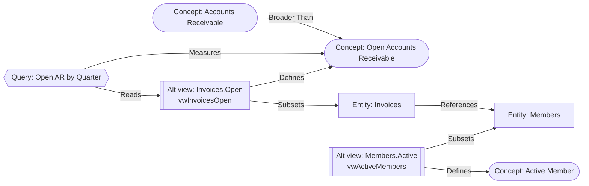
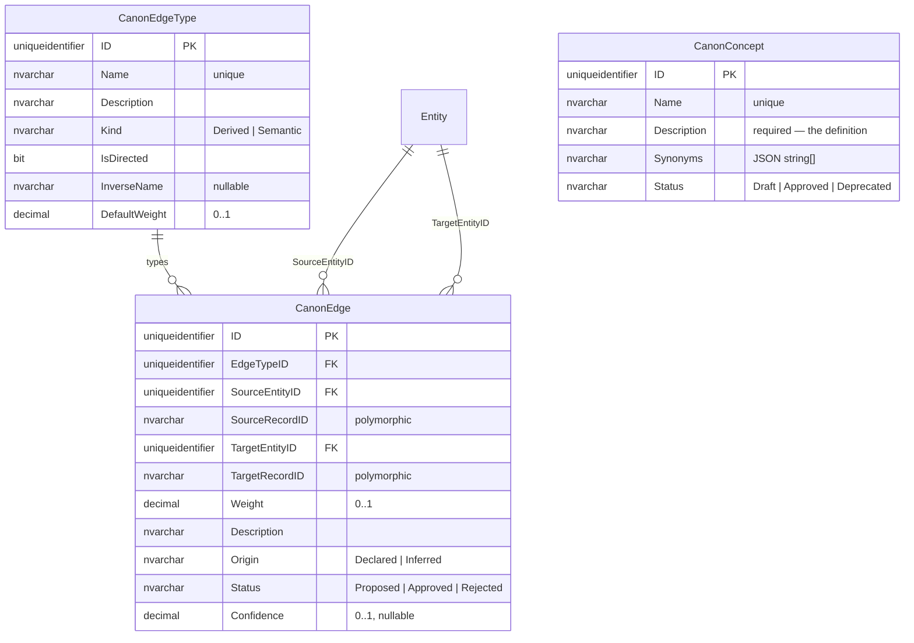

# MJ Canon Semantic Graph: basic structure

## Status
- **Status**: Draft. This is the basic structure only, for review and iteration.
- **Created**: 2026-10-23
- **Author**: Claude (Claude Code session), for review
- **Proposed owners**: Jordan (lead), Robert (review), per the original note
- **Branch**: `claude/alternate-base-views` (same PR as the alternate base views plan)
- **Depends on**: [`plans/alternate-base-views.md`](alternate-base-views.md), Phase 1 (alternate views exist as metadata rows), and Phase 5 for `Reads` edges to a specific alternate view
- **Reviewed against**: `next` @ `48c974e76`

## Overview

MJ Canon is the layered set of reusable, trusted definitions an MJ instance runs on:
- **Base views** join and compute.
- **Alternate base views** define canonical row sets ("this is what an active member is").
- **Queries** aggregate and join on top of those ("open AR by quarter").

Each layer inherits the business logic of the one below.

What MJ lacks is a way to say how these pieces relate *semantically*. The only graph-like
structure today is structural:
- foreign keys (`EntityField.RelatedEntityID`, `EntityRelationship`)
- IS-A parents (`Entity.ParentID`)
- query-to-entity (`MJ: Query Entities`)
- query-to-query composition (`MJ: Query Dependencies`)

None of it carries meaning, strength, or a link to the business vocabulary people and agents use.
Skip can see that `Invoices` has a `CustomerID`; it cannot see that "open AR" is defined by
`Invoices.Open`, measured by the "Open AR by Quarter" query, and is a narrower idea than "accounts
receivable".

This document defines the basic structure for a **canon semantic graph**:
- **Nodes** are canon objects plus business concepts.
- **Edges** are typed, weighted and described. Some are **derived** automatically from metadata MJ already has; some are **declared** by people or **proposed** by AI and approved.
- **`CanonGraphEngine`** answers neighborhood and path questions under the caller's permissions.
- **An agent action** turns a question into a small, relevant subgraph for prompt context.

The goal is accuracy: agents that start from the canon instead of re-deriving business rules from
raw tables.

## Goals & Non-Goals

### Goals
- A minimal, extensible schema: concepts, edge types, edges. Edges use MJ's polymorphic `EntityID` + `RecordID` convention, so any canon object can be a node.
- Derived edges computed from existing metadata. Never duplicated into tables, so they cannot drift.
- Typed, weighted, described edges with provenance (`Declared` / `Inferred`) and review status (`Proposed` / `Approved` / `Rejected`).
- One engine API, permission-filtered per user, usable on server and client.
- An agent-facing action that returns canon context for a question.
- A clear path to a viewer (the existing `@memberjunction/ng-graph-view`), AI-proposed edges and embeddings, without schema changes.

### Non-Goals (this structure)
- **Automatic edge inference.** The columns exist; the inference process is a later phase.
- **Embeddings and semantic search.** Concept lookup is name/synonym match in v1.
- **Record-level graphs.** The graph is over metadata (definitions), not business data rows.
- **Sharing canon across instances.** Canon ships with apps through `metadata/`, like any other metadata.

## Background & Context
- **Polymorphic FK convention.** An `EntityID` + `RecordID` pair, with `EntityField.EntityIDFieldName` declared on the record-ID field in `metadata/entities/.polymorphic-fk-entity-fields.json` (see `metadata/CLAUDE.md` § Polymorphic Foreign Keys, and [`plans/polymorphic-foreign-keys.md`](polymorphic-foreign-keys.md)). Forms, grids and pickers resolve and link targets from that declaration. Record IDs are persisted with `CompositeKey.ToCompactURLSegment()`; every v1 node entity has a single UUID key, so this is the bare ID.
- **`MJ: Record Links` was considered and rejected.** It already links any record to any record (`SourceEntityID/SourceRecordID → TargetEntityID/TargetRecordID`, free-text `LinkType`, `Metadata` JSON). But weight, status and provenance would live in JSON, out of reach of SQL filters and indexes. `LinkType` is not a governed vocabulary. The table is general-purpose app data, so canon edges would share its permissions and caching with unrelated links.
- **Existing structural relations** become derived edges:

  | Source | Location |
  |---|---|
  | FK fields | `EntityFieldInfo.RelatedEntityID` |
  | IS-A parents | `EntityInfo.ParentID` |
  | Query → entity | `QueryEngine.QueryEntities` / `QueryInfo.Entities`; plus `AlternateBaseViewID` once the alternate-views plan lands |
  | Query → query | `QueryInfo.Dependencies` (`queryInfo.ts`, "QueryDependencies") |
  | Alternate view → entity | `EntityInfo.AlternateBaseViews` |

- **Viewer.** `@memberjunction/ng-graph-view` (`packages/Angular/Generic/graph-view`, `mjUILayer: widgets`) renders force-directed graphs. Its `GraphNode` carries `ID`, `Label`, `Category`, `Badge`; its `GraphEdge` carries `SourceID`, `TargetID`, `Label`, `Direction`, `Weight`, `Style`. That maps directly onto this model.

## Architecture / Design

### Nodes

A node is `(NodeEntityID, NodeRecordID)`. v1 allows these node entities; the allow-list lives in
one constant in the engine and the server validator:

| Kind | Entity | Example |
|---|---|---|
| Concept | `MJ: Canon Concepts` (new) | "Active Member", "Open Accounts Receivable" |
| Entity | `MJ: Entities` | `Members`, `Invoices` |
| Entity Field | `MJ: Entity Fields` | `Invoices.DueDate` |
| Alternate Base View | `MJ: Entity Alternate Base Views` | `Members.Active` → `vwActiveMembers` |
| Query | `MJ: Queries` | "Open AR by Quarter" |

Later candidates, which need no schema change: `MJ: Query Fields`, `MJ: AI Agents`, `MJ: Actions`, `MJ: Dashboards`.

### Edges

Edges fall into two kinds:
- **Derived** edges are computed by the engine from existing metadata and are never stored.
- **Semantic** edges are stored rows, either `Declared` by a person or `Inferred` by a process.

Every edge has:
- **Type**: from the governed `MJ: Canon Edge Types` vocabulary.
- **Direction**: from the type; undirected types are symmetric.
- **Weight**, 0–1: how strongly the edge should pull during retrieval. Derived edges take their type's `DefaultWeight`.
- **Description**: what this specific connection means, in plain language.
- **Origin and Status**: `Derived` | `Declared` | `Inferred`; `Proposed` | `Approved` | `Rejected`. Default traversal uses only approved and derived edges.
- **Confidence**, 0–1, inferred edges only: how sure the proposing process is. This is distinct from Weight.

### Seed edge types

These are seeded via `metadata/canon-edge-types/`; new types are metadata rows, not code.

| Name | Kind | From → To | Directed | Inverse | Default weight | Meaning |
|---|---|---|---|---|---|---|
| Subsets | Derived | Alternate Base View → Entity | yes | Has Subset | 1.0 | rows of the view are a subset of the entity's rows |
| Is A | Derived | Entity → Entity | yes | Has Subtype | 1.0 | IS-A child of the parent entity |
| References | Derived | Entity → Entity | yes | Referenced By | 0.6 | a foreign key; the edge description names the field |
| Reads | Derived | Query → Entity / Alternate Base View | yes | Read By | 0.8 | the query selects from it |
| Composes | Derived | Query → Query | yes | Composed Into | 0.9 | `{{query:"…"}}` composition |
| Field Of | Derived | Entity Field → Entity | yes | Has Field | 1.0 | synthesized only for fields that take part in a semantic edge |
| Defines | Semantic | Alternate Base View / Query → Concept | yes | Defined By | 1.0 | the canonical definition of the concept |
| Measures | Semantic | Query → Concept | yes | Measured By | 0.9 | computes a metric about the concept |
| Describes | Semantic | Entity / Entity Field → Concept | yes | Described By | 0.7 | holds data about the concept |
| Broader Than | Semantic | Concept → Concept | yes | Narrower Than | 0.8 | concept hierarchy |
| Same As | Semantic | Concept ↔ Concept | no | — | 1.0 | synonymous concepts, e.g. across domains or apps |
| Preferred Over | Semantic | X → X (same kind) | yes | Superseded By | 0.9 | use the source instead of the target for this purpose |
| Related To | Semantic | any ↔ any | no | — | 0.5 | catch-all; the weight carries the strength |

### Example

From the original note:



An agent asked "how much do active members owe this quarter?" resolves "active members" →
`Members.Active` and "owe" → Open Accounts Receivable → `Invoices.Open` / "Open AR by Quarter". It
starts from those definitions instead of writing new filters.

### Data model



The migration's hand-written half, following [`migrations/CLAUDE.md`](../migrations/CLAUDE.md)
(`sp_addextendedproperty` on every column; CodeGen output appended; no `__mj_*` columns or FK
indexes):

```sql
-- migrations/v6/V<YYYYMMDDHHMM>__v6.2.x__Canon_Semantic_Graph.sql
CREATE TABLE ${flyway:defaultSchema}.CanonConcept (
    ID UNIQUEIDENTIFIER NOT NULL DEFAULT NEWSEQUENTIALID(),
    Name NVARCHAR(255) NOT NULL,
    Description NVARCHAR(MAX) NOT NULL,
    Synonyms NVARCHAR(MAX) NULL,
    Status NVARCHAR(20) NOT NULL DEFAULT 'Draft',
    CONSTRAINT PK_CanonConcept PRIMARY KEY (ID),
    CONSTRAINT UQ_CanonConcept_Name UNIQUE (Name),
    CONSTRAINT CK_CanonConcept_Status CHECK (Status IN ('Draft', 'Approved', 'Deprecated'))
);

CREATE TABLE ${flyway:defaultSchema}.CanonEdgeType (
    ID UNIQUEIDENTIFIER NOT NULL DEFAULT NEWSEQUENTIALID(),
    Name NVARCHAR(100) NOT NULL,
    Description NVARCHAR(MAX) NOT NULL,
    Kind NVARCHAR(20) NOT NULL,
    IsDirected BIT NOT NULL DEFAULT 1,
    InverseName NVARCHAR(100) NULL,
    DefaultWeight DECIMAL(5,4) NOT NULL DEFAULT 1.0,
    CONSTRAINT PK_CanonEdgeType PRIMARY KEY (ID),
    CONSTRAINT UQ_CanonEdgeType_Name UNIQUE (Name),
    CONSTRAINT CK_CanonEdgeType_Kind CHECK (Kind IN ('Derived', 'Semantic')),
    CONSTRAINT CK_CanonEdgeType_DefaultWeight CHECK (DefaultWeight >= 0 AND DefaultWeight <= 1)
);

CREATE TABLE ${flyway:defaultSchema}.CanonEdge (
    ID UNIQUEIDENTIFIER NOT NULL DEFAULT NEWSEQUENTIALID(),
    EdgeTypeID UNIQUEIDENTIFIER NOT NULL,
    SourceEntityID UNIQUEIDENTIFIER NOT NULL,
    SourceRecordID NVARCHAR(400) NOT NULL,
    TargetEntityID UNIQUEIDENTIFIER NOT NULL,
    TargetRecordID NVARCHAR(400) NOT NULL,
    Weight DECIMAL(5,4) NOT NULL DEFAULT 1.0,
    Description NVARCHAR(MAX) NULL,
    Origin NVARCHAR(20) NOT NULL DEFAULT 'Declared',
    Status NVARCHAR(20) NOT NULL DEFAULT 'Approved',
    Confidence DECIMAL(5,4) NULL,
    CONSTRAINT PK_CanonEdge PRIMARY KEY (ID),
    CONSTRAINT FK_CanonEdge_EdgeType FOREIGN KEY (EdgeTypeID) REFERENCES ${flyway:defaultSchema}.CanonEdgeType(ID),
    CONSTRAINT FK_CanonEdge_SourceEntity FOREIGN KEY (SourceEntityID) REFERENCES ${flyway:defaultSchema}.Entity(ID),
    CONSTRAINT FK_CanonEdge_TargetEntity FOREIGN KEY (TargetEntityID) REFERENCES ${flyway:defaultSchema}.Entity(ID),
    -- 3 × 16 + 2 × 800 bytes = 1648, inside SQL Server's 1700-byte nonclustered key limit; hence NVARCHAR(400)
    CONSTRAINT UQ_CanonEdge UNIQUE (EdgeTypeID, SourceEntityID, SourceRecordID, TargetEntityID, TargetRecordID),
    CONSTRAINT CK_CanonEdge_Weight CHECK (Weight >= 0 AND Weight <= 1),
    CONSTRAINT CK_CanonEdge_Confidence CHECK (Confidence IS NULL OR (Confidence >= 0 AND Confidence <= 1)),
    CONSTRAINT CK_CanonEdge_Origin CHECK (Origin IN ('Declared', 'Inferred')),
    CONSTRAINT CK_CanonEdge_Status CHECK (Status IN ('Proposed', 'Approved', 'Rejected')),
    CONSTRAINT CK_CanonEdge_NoSelfLoop CHECK (NOT (SourceEntityID = TargetEntityID AND SourceRecordID = TargetRecordID))
);
-- + sp_addextendedproperty for every column above
```

The CHECKs are structural only: bounds, enums, no self-loops. The rules that need metadata live in
the server subclass `MJCanonEdgeEntityServer` (`ValidateAsync`):
- both nodes are allow-listed and resolve to a real record
- the edge type is `Semantic` (derived types are never stored)
- the node kinds fit the type
- an undirected type is stored in one canonical orientation (lower node key first), so the unique key also catches the reversed duplicate
- an `Inferred` edge can only be created as `Proposed`

**Metadata:**
- `metadata/entities/.polymorphic-fk-entity-fields.json` gains `EntityIDFieldName` for `SourceRecordID → SourceEntityID` and `TargetRecordID → TargetEntityID`.
- `Synonyms` gets JSONType `string` with `JSONTypeIsArray: true`.
- The seed edge types go in `metadata/canon-edge-types/`, ordered after `entities` in `metadata/.mj-sync.json`.

### Engine

`CanonGraphEngine` lives in `@memberjunction/core-entities`, so it runs on both tiers. It extends
`BaseEngine` and is lazily configured: `await CanonGraphEngine.Instance.Config(false, user, provider)`.

**Loading.** It caches `MJ: Canon Edge Types`, `MJ: Canon Concepts` and `MJ: Canon Edges`, all
metadata-scale. It builds derived edges in memory from the provider's metadata and `QueryEngine`:
- It rebuilds when metadata refreshes and when `QueryEngine`'s query-entity / dependency arrays emit (`ObserveProperty`).
- Event-driven invalidation of the stored edges comes from BaseEngine for free.

**API sketch** (public members PascalCase):

```typescript
export type CanonNodeKind = 'Concept' | 'Entity' | 'EntityField' | 'AlternateBaseView' | 'Query';
export interface CanonNode { Key: string; Kind: CanonNodeKind; EntityName: string; RecordID: string; Name: string; Description: string | null; }
export interface CanonEdgeView {
    ID: string;                      // stored edge ID, or 'derived:<type>:<sourceKey>:<targetKey>'
    TypeName: string; Source: CanonNode; Target: CanonNode; IsDirected: boolean;
    Weight: number; Description: string | null;
    Origin: 'Derived' | 'Declared' | 'Inferred'; Status: 'Proposed' | 'Approved' | 'Rejected';
}
export interface CanonTraversalOptions {
    Direction?: 'Out' | 'In' | 'Both';       // default 'Both'
    EdgeTypes?: string[];                     // default: all
    MinWeight?: number;                       // default 0
    IncludeProposed?: boolean;                // default false
    Depth?: number;                           // default 2, max 4
    MaxNodes?: number;                        // default 50
}
// on CanonGraphEngine
GetNode(entityName: string, recordID: string, user: UserInfo): CanonNode | undefined;
GetEdges(node: CanonNode, options: CanonTraversalOptions, user: UserInfo): CanonEdgeView[];
Subgraph(seeds: CanonNode[], options: CanonTraversalOptions, user: UserInfo): { Nodes: CanonNode[]; Edges: CanonEdgeView[] };
FindConcepts(text: string, user: UserInfo): CanonNode[];            // v1: name + synonym match
DescribeForPrompt(subgraph: { Nodes: CanonNode[]; Edges: CanonEdgeView[] }): string;
```

**Node keys** are `<entityID>|<recordID>`, both normalized with `NormalizeUUID`, held in `UUIDMap`s.
UUIDs are never compared with `===`.

**`Subgraph` expansion is best-first.** A path's score is the product of its edge weights, decayed by
depth, so strong definitional edges (`Defines`, `Subsets`) are followed before weak `Related To`
ones. It stops at `MaxNodes`.

**Permissions** are applied in every call. A node the user cannot see is removed along with its edges:

| Node kind | Visible when |
|---|---|
| Entity | entity `CanRead` |
| Query | `UserCanRun` |
| Alternate view | `UserCanUse` (alternate-views plan D11) |
| Concept / edge row | read permission on the canon entities |

So the graph never reveals that a restricted object exists.

### Agent surface
- **Action `Get Canon Context`** (`packages/Actions/CoreActions/src/custom/data/`). A thin wrapper over `CanonGraphEngine`, per `packages/Actions/CLAUDE.md`. Inputs: `Question` and/or `EntityNames` / `ConceptNames`, plus `Depth` and `MaxNodes`. Seeds come from `FindConcepts(Question)` plus the named nodes. Returns the subgraph as JSON and as `DescribeForPrompt` text.
- **`Get Entity Details`** gains a short "Canon" section listing the concepts the entity `Describes`, its alternate views, and the queries that `Read` it or `Measure` its concepts.
- **QueryGen** can take `Defines` and `Measures` edges as preferred sources when generating SQL for a concept. This is a follow-up once G2 lands.
- **Skip's consumption lives outside this repo.** The action and entity metadata are MJ's contract.

### Authoring and review
- **Declared edges and concepts** ship as `metadata/` JSON with `@lookup` references, e.g. `"SourceEntityID": "@lookup:MJ: Entities.Name=MJ: Queries"` and `"SourceRecordID": "@lookup:MJ: Queries.Name=Open AR by Quarter"`. They can also be edited in Explorer through the CodeGen-generated forms.
- **Inferred edges** arrive as `Proposed` with a `Confidence`. Moving one to `Approved` requires a `MJ: Authorizations` capability, `Canon: Approve Edges`, checked by `AuthorizationEvaluator` in the server subclass (see [`guides/UNIFIED_PERMISSIONS_GUIDE.md`](../guides/UNIFIED_PERMISSIONS_GUIDE.md) §5.1).
- **Record Changes** stays on for all three entities, so canon edits are audited.

### Viewer (later phase)
An Explorer "Canon" dashboard (an L3 surface in `ng-dashboards`) hosts `<mj-graph-view>`:
- `CanonNode` → `GraphNode`, with `Category` = Kind and `Badge` = Status.
- `CanonEdgeView` → `GraphEdge`, with `Label` = TypeName, `Weight` → thickness, `Style` dashed for `Proposed`.
- `NodeNavigated` → `NavigationService` opens the record.
- A side panel shows a concept's definition and a review queue of proposed edges.

## Implementation Plan

### Phase G1: Schema and engine
1. Migration (above) + CodeGen. Changeset `minor`. PostgreSQL is converted at release.
2. Seed edge types and polymorphic-FK metadata in `metadata/`, shipped by the release seed.
3. `MJCanonEdgeEntityServer` validation; `MJCanonConceptEntityServer` (case-insensitive unique `Name`, normalized `Synonyms`).
4. `CanonGraphEngine`:
   - derived edges from FK, IS-A, Query Entities (+ `AlternateBaseViewID`), Query Dependencies, and alternate views
   - stored edges
   - the API above, with the permission filter
   - `LoadCanonGraphEngine()` tree-shaking anchor
5. **Unit tests:**
   - each derived-edge source
   - orientation of undirected edges
   - best-first expansion and the `MaxNodes` cap
   - permission filtering, so a hidden query's edges disappear
   - validation refusals: derived type, self-loop, disallowed kind, `Inferred` + `Approved`

### Phase G2: Agent surface and first canon
1. `Get Canon Context` action, plus its metadata row (`metadata/actions/`).
2. The `Get Entity Details` canon section.
3. A small set of example concepts and edges in `metadata-optional/` (not shipped by default) to exercise the path end to end.
4. Integration bundle `canon-graph` in the deterministic tier:
   - derived edges match live metadata
   - permission filtering on the client transport
   - action output is stable for a fixed fixture

### Phase G3: Explorer viewer
The dashboard described above, on `@memberjunction/ng-graph-view`, plus the proposed-edge review queue.

### Phase G4: Inference and semantic lookup (later)
1. A "Canon Curator" agent or Record Process that proposes `Describes`, `Defines`, `Measures` and `Same As` edges, using query SQL, descriptions and usage. It writes `Inferred` + `Proposed` edges with a `Confidence`.
2. Vectorize concept names, descriptions and synonyms (and optionally edge descriptions) through MJ's existing entity-document vectorization, so `FindConcepts` matches by meaning, not only by name.

## Risks & Open Questions

**Risks**
- **Graph noise from derived `References` edges.** FK edges are numerous. A low default weight (0.6) and best-first expansion keep them from crowding out definitional edges. Tune with real instances.
- **Stale semantic edges.** A `Defines` edge can outlive a changed definition. Record Changes and a "last reviewed" marker (open question 4) are the mitigation; G4 could flag edges whose endpoints changed since approval.

**Open questions**
1. **Concepts as first-class nodes.** Proposed yes: users and agents start from words, and without concepts the graph only connects implementations to each other. The alternative is to tag existing objects with terms.
2. **Node allow-list growth.** Should `MJ: AI Agents`, `MJ: Actions`, `MJ: Dashboards` and `MJ: Query Fields` join in G2, or wait for a use case?
3. **A SQL view over the graph.** Should derived edges also be exposed as a SQL view (`vwCanonEdges`, a union of stored and derived) for SQL-native consumers such as Skip's data layer? v1 is engine-only.
4. **Review metadata on edges.** `ReviewedByUserID` / `ReviewedAt` columns now, or rely on Record Changes until G4?
5. **Concept names across Open Apps.** `Name` is globally unique. Should apps namespace concepts (`Sales: Pipeline`), or rely on `Same As` edges between app-specific concepts?
6. **One weight or two.** v1 has one `Weight`, with `Confidence` only for inferred edges. Should there be a separate relevance (for retrieval) and strength (for the relationship)?

## Files to Modify

| File | Phase | Change |
|---|---|---|
| `migrations/v6/V<ts>__v6.2.x__Canon_Semantic_Graph.sql` (new) | G1 | three tables + CodeGen output |
| `metadata/canon-edge-types/` (new), `metadata/.mj-sync.json`, `metadata/entities/.polymorphic-fk-entity-fields.json` | G1 | seed types, ordering, polymorphic FKs, `Synonyms` JSONType |
| `packages/MJCoreEntitiesServer/src/custom/` (two server subclasses) | G1 | validation |
| `packages/MJCoreEntities/src/engines/CanonGraphEngine.ts` (new) | G1 | engine |
| `packages/MJCoreEntities/src/generated/**` | G1 | regenerated |
| `metadata/authorizations/` | G1 | `Canon: Approve Edges` |
| `packages/Actions/CoreActions/src/custom/data/get-canon-context.action.ts` (new), `metadata/actions/` | G2 | agent action |
| `packages/Actions/CoreActions/src/custom/data/get-entity-details.action.ts` | G2 | canon section |
| `packages/TestingFramework/integration-test-suite/src/checks/canon-graph.checks.ts` (new) + IT registration | G2 | integration bundle |
| `packages/Angular/Explorer/dashboards/src/Canon/` (new) | G3 | viewer |

## References
- [`plans/alternate-base-views.md`](alternate-base-views.md), canon layer 1
- [`plans/polymorphic-foreign-keys.md`](polymorphic-foreign-keys.md); `metadata/CLAUDE.md` § Polymorphic Foreign Keys
- `packages/Angular/Generic/graph-view/` (`GraphNode` / `GraphEdge` in `src/lib/models/graph-models.ts`)
- [`guides/UNIFIED_PERMISSIONS_GUIDE.md`](../guides/UNIFIED_PERMISSIONS_GUIDE.md), [`guides/CACHING_AND_PUBSUB_GUIDE.md`](../guides/CACHING_AND_PUBSUB_GUIDE.md), [`guides/BASE_ENTITY_SERVER_PATTERNS.md`](../guides/BASE_ENTITY_SERVER_PATTERNS.md)
