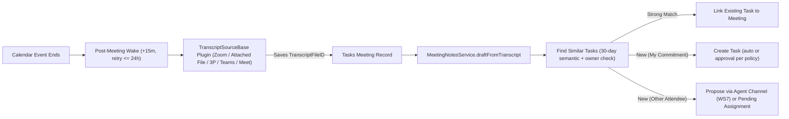
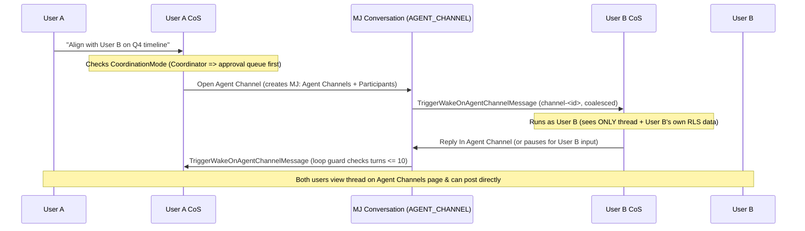
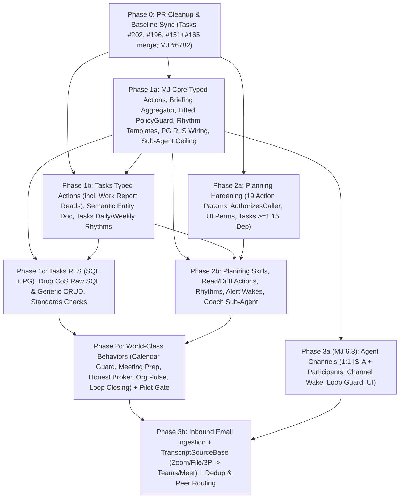

# Chief of Staff — Extensible Skills Plan (MJ, Tasks, Planning)

**Date:** Nov 20, 2026  
**Author:** @Amith Nagarajan  
**Status:** Re-validated against afternoon `next` merges — in active parallel execution across `MJ`, `bizapps-tasks`, and `bizapps-planning`  
**Baseline refs audited:**
- `MemberJunction/MJ` `next` (`68c7b1d873`, Nov 20, 2026) + open PR `#6782`
- `MemberJunction/bizapps-tasks` `next` (`7aad5d0`, Nov 20, 2026 — post `#202`, `#201`, `#200`, `#165`, `#154`) + parallel `tasks-ux-redesign` (`OrganizationID` scoping, `BizAppsTasks.BulkUpdateTasks`, `BizAppsTasks.InstantiateTemplate`, UX redesign)
- `MemberJunction/bizapps-planning` `next` (`0383a46`, Nov 20, 2026 — bumped to MJ `6.3.0-edge.1` with `lts/6.2` cut)
- `MemberJunction/bizapps-common` `next` (`2874c29`, Nov 20, 2026) + parallel `feat/company-org-mirror` (`Organization.LinkedCompanyID`, `BizAppsCommon.SyncCompaniesToOrganizations`)

---

## Summary

The Chief of Staff becomes useful out of the box when MJ core stays generic and every installed Open App teaches it through skills that bundle typed domain actions, specialist sub-agents, rhythms, and UI pages. Today the platform plumbing mostly exists, but installing BizApps Tasks changes nothing on released branches because its Chief of Staff extensions sit on two unmerged branches (`#151` and `#165`), and BizApps Planning has no Chief of Staff skill, no declared `MJ: Action Params` on its 19 existing actions, and a hidden migration dependency on Tasks `#165`.

This plan covers **three repos** (`MemberJunction/MJ`, `MemberJunction/bizapps-tasks`, `MemberJunction/bizapps-planning`) and **seven workstreams**:

1. **MJ core (`MemberJunction/MJ`).** Remove ad-hoc SQL and generic CRUD from the Chief of Staff; ship typed actions for its own data plus a deterministic `Assemble My Briefing` aggregator; lift `AgentDataPolicyGuard` so per-user narrowed policies remain enforced on typed actions; enforce sub-agent policy ceilings; add offered rhythm templates with a code-enforced recurring-routine gate; add proactive suggestions; fix and wire inbound utility-mailbox email; harden cross-user/event wakes; and wire PostgreSQL RLS `GetPlatformFilterText` in MJ Core.
2. **The extension contract.** One repeatable recipe every Open App follows: skill, grant (with override protection), typed actions (with `AuthorizesCaller` and policy-guard compliance), optional skill sub-agents, briefing role, offered rhythms, trusted event wakes, Chief of Staff app pages, and teardown.
3. **BizApps Tasks (`MemberJunction/bizapps-tasks`).** Sequence active security/human-task/UX PRs (`#202`, `#196`, UX redesign), cleanly merge and reconcile `#151` and `#165` (including their `teardown/V1__*` and `TSK-08` collisions), replace raw SQL / generic CRUD with typed task and work-report actions (including missing Work Report read actions), add Tasks RLS (SQL Server + PostgreSQL parity), ship daily/weekly rhythms, and wire `Agent Task` hooks.
4. **BizApps Planning (`MemberJunction/bizapps-planning`).** Bump its `mj-bizapps-tasks` dependency to pick up `TaskType.ExtensionEntity` from `#165`; backfill `MJ: Action Params`, `AuthorizesCaller`, and UI permissions on its 19 existing `Planning.*` actions; add typed read/write/briefing/drift actions; ship three skills (including `Align Strategic Planning Coach` via `MJ: AI Skill Sub Agents`); and wire OKR rhythms and alert-driven wakes.
5. **World-class Chief of Staff behaviors.** Calendar guard, meeting prep (with live-calendar self-healing), meeting follow-up, honest broker, org pulse, and loop closing (with sent-mail scan watermarks and dismissed-candidate memory).
6. **Meeting transcripts to commitments.** Introduce `TranscriptSourceBase` plugins alongside Tasks' existing `Meeting.TranscriptFileID`, starting with Zoom + attached/third-party transcripts, then Microsoft Teams and Google Meet (with Slack scoped to AI Canvas notes pending API verification), feeding `MeetingNotesService.draftFromTranscript` and semantic deduplication before creating tasks or routing commitments.
7. **Agent-to-agent conversations.** My Chief of Staff talks to yours inside a shared, observable MJ conversation thread (`MJ: Conversation Types` = `AGENT_CHANNEL` with a 1-to-1 IS-A `MJ: Agent Channels` extension table and a 1-to-many `MJ: Agent Channel Participants` child table), waking peers via a dedicated domain-authorized trigger method with hard loop and rate guards.

The principle running through all of it: **a Chief of Staff is not a database expert.** It gets narrow, strongly typed tools that even a low-cost model calls reliably, per-user policy narrowing stays enforced in code across typed actions and sub-agents, and domain business rules stay in `BaseEntity` subclasses so every pathway enforces them identically.

---

## Design Principles

1. **Generic core, smart through installs.** One Chief of Staff agent ships in MJ core and knows nothing about any business app. Each Open App installs skills, actions, sub-agents, rhythms, and nav pages bound to it, so it grows smarter automatically. Skills are orthogonal to core, upgrade independently, and can be granted to other agents.
2. **Typed domain actions, not generic CRUD.** A `Create Task` action with 5–10 typed properties is easy for any model to call accurately. `Create Record` requires entity names and field/value maps, consumes more reasoning, invites entity confusion (such as `MJ: Tasks` vs `MJ_BizApps_Tasks: Tasks`), and fails more often on low-cost models. Generic CRUD stays in MJ, but the Chief of Staff does not hold it.
3. **Tighter aperture through policy — enforced in code.** An agent can be allowed `Create Task` and `Update Task` while generic `Create Record` and `Update Record` are removed, and per-user policies (`DefaultDataAccessMode`, `EntityAccessRules`, `ActionPolicyRules`, `CoordinationMode`) are enforced by shared runtime code on typed actions and delegated sub-agents — never only in prompt instructions.
4. **Rules live in `BaseEntity` subclasses.** Business rules (who may assign to whom, status transitions, creator immutability, self-approval guards, visibility) live in each app's entity subclasses so typed actions, generic actions, UI, and GraphQL API all enforce the exact same invariants.
5. **Ad-hoc SQL is for data specialists only.** `Query Builder` and `Database Research Agent` keep `Run Ad-hoc Query`. Every other agent, the Chief of Staff included, uses typed actions and `Scoped Search`. Note that `CreateAdhocSQLAuthorizer` already refuses any entity view with RLS or denied fields — so adding RLS to Tasks immediately breaks any raw-SQL skill.
6. **One agent, a thousand personal instances.** `MJ: AI Agent User Policies` holds one row per `(AgentID, UserID)` so a junior engineer and the CEO tailor their own Chief of Staff through conversation or the Governance page. Agent notes are a softer memory overlay; the policy row governs authority and behavior.

**Deliberate non-decision:** `InstructionsOverride` remains a single free-text field for now. Sub-policies with a parent ID may come later once real usage and Governance monitoring show how instructions naturally split.

---

## Where Things Stand Today (Codebase-Verified Nov 20, 2026)

| Area | What Exists Today | Verified Gaps & Traps |
| --- | --- | --- |
| **Core CoS agent** | `Chief of Staff` (`Loop`, `AcceptsSkills = All`, `SkillActivationMode = Auto`), 17 actions, 1 system prompt, plus 12 `TypeConfiguration.realtime.directActions` | Granted `Create/Update/Delete/Get Record` and `Run Ad-hoc Query`; prompt queries 5 core views (`vwAIAgentUserPolicies`, `vwUserRoutines`, `vwUserRoutineRuns`, `vwAIAgentRequests`, `vwUsers`) + `vwEntityFields` with raw SQL; `realtime.directActions` also lists `Get Record` and `Query Scheduled Jobs` (not even in the 17 actions) |
| **Per-user policy** | `MJ: AI Agent User Policies` (onboarding status, nickname, `CoordinationMode`, 4 channel modes, `DefaultDataAccessMode`, `EntityAccessRules`, `ActionPolicyRules`, `InstructionsOverride`); `BaseAgent.checkUserActionPolicy` enforces `ActionPolicyRules` | **`AgentDataPolicyGuard` lives in `CoreActions` and is only called by generic CRUD/query actions** — NOT by `RunView`, `BaseEntity.Save()`, or custom typed actions. Also no Governance monitoring of `InstructionsOverride` size/edit count |
| **Sub-agents** | `BaseAgent.ExecuteSubAgent` passes `contextUser` to child `AgentRunner` (inheriting role permissions & RLS); `MJ: AI Skill Sub Agents` (`AISkillSubAgent`) exists for skill-bundled sub-agents | `checkUserActionPolicy` looks up policies by **sub-agent ID**, so child agents run with `policy = null` and bypass CoS policy narrowing (`ReadOnly`, `Observer`, etc.). CoS prompt also suggests delegating to `Query Builder` (re-opening `Run Ad-hoc Query`) |
| **Wakes & routines** | `Schedule Next Agent Wake`, 3-tier wake gate, `UserRoutineDispatcherDriver` executes as routine owner and fails closed; MJ PR `#6782` tightens `MJUserRoutineEntityServer` owner checks | `ScheduleNextAgentWakeAction` **allows `ScheduleMode = 'Recurring'` in code** (prompt-only restriction today); no `Rhythm Templates` entity so apps cannot offer rhythms |
| **Event & cross-user wakes** | `AgentWakeTriggerService` handles approval resolution, incoming `InterAgent` requests, and workstream wakes; `resolveRoutineSaveUser` (including missing-system-user log line) and `SendInterAgentRequestAction.resolveRequestSaveUser` save as system user | **`TriggerWakeForWorkstream` rejects non-Owner cross-user callers (`POLICY_DENIED`)**, blocking UI-user server hooks (task assignment, unblock, channel reply) unless elevated or routed via domain-authorized methods; `SendInterAgentRequestAction` reads target policy as sender's `contextUser` and only blocks `Observer` in code (`Coordinator` approval is prompt-only); `guides/BUILT_IN_AGENTS_GUIDE.md` still calls cross-user fix pending |
| **Inbound email** | `RouteInboundUtilityMailboxWake` validates utility mailbox, internal sender, and policy | Zero production callers; **`resolveVerifiedInternalSender` builds a role-less `UserInfo` instead of loading via `UserCache`** (documented in `packages/AI/Agents/README.md`) |
| **Calendar & email** | Read, free/busy, find times, create/update/respond/cancel events; list, search, draft, send, reply, forward mail via Graph or Gmail, hard-pinned to `contextUser.Email` (or utility mailbox) | Plumbing ready; calendar guard and sent-mail loop-closing behaviors not built yet |
| **Skills & app pages** | `MJ: AI Skills`, `MJ: AI Skill Actions` (`ExposeToModel`), `MJ: AI Skill Sub Agents`, `Find Candidate Skills`, `NavItem.*` merged by `BaseApplication.GetNavItems()` | Ready to use; no app ships a CoS skill on a released branch; no briefing `Role` column on `AISkillAction`; no override-safe grant mechanism for upgrades |
| **Ad-hoc SQL & RLS** | `CreateAdhocSQLAuthorizer` → `ResolverBase.assertFullQueryUsesReadableEntityViews` → `ClientClauseScreen.AssertUnscopedRead` **already refuses** any view with RLS or denied fields | Because raw SQL refuses RLS-protected entities, adding RLS to Tasks immediately breaks raw-SQL skills. Separate PG gap: `RowLevelSecurityFilterInfo.GetPlatformFilterText()` is **not wired into `MarkupFilterText`** yet |
| **Human tasks / approvals** | MJ `#6763` & `#6777` (merged Nov 19–20) ship pluggable `BaseHumanTaskProvider` for workflows and `MJ: AI Agent Requests`; `bizapps-tasks` PR `#196` (open) implements `BizAppsTasksHumanTaskProvider` | CoS Approvals & Wakes vs. Tasks Approval Inbox convergence not yet decided |
| **Tasks: `#151` (`feat/cos-extension`)** | Unmerged (Oct 30, updated Nov 6): `Chief of Staff Tasks & Priorities` skill, Priorities & To-dos page, `teardown/V1__*`, `TSK-08` bundle | Built against MJ 6.1.x workarounds (`7d45bf6`), `mj-app.json` at `v1.10.0`, instructions-only using raw SQL + generic CRUD |
| **Tasks: `#165` (`feat/work-bus-and-15five-reports`)** | Unmerged (updated Nov 20): `TaskType.ExtensionEntity`, `Work reports` skill, `Draft/Submit/Review Work Report` actions, Reports page, Work Report RLS, `teardown/V1__*`, `TSK-08` bundle | Collides with `#151` on **`teardown/V1__*` & `teardown-pg/V1__*`**, **3 `.mj-sync.json` files**, `mj-app.json`, `TSK-08`, and Angular/Core/Test barrels; **missing `Get/List Work Reports` read actions**; returns generic `ResultCode: 'ERROR'`; `.work-report-rls-filters.json` lacks PostgreSQL `PlatformVariants` |
| **Tasks: `next`, security & UI** | RLS on Meetings only (5 filters with PG `PlatformVariants`); `TaskType` `On*ActionID` hooks + polymorphic AI Agent assignees; PR `#202` (open) consolidates security/hooks & flips `PreventSelfApproval = true`; active local Tasks UX redesign (`an-dev-12`) | No RLS on `Tasks`, `TaskAssignments`, or `TaskCheckIns`; no Entity Document for semantic search; no end-to-end `Agent Task` hook behavior |
| **Tasks: Meetings** | Meetings, attendees, series, agenda, notes (1:1 RLS), `Meeting.TranscriptFileID` + UI support, `MeetingNotesService.draftFromTranscript`, `Tasks: Meeting Notes from Transcript`, `Tasks: Draft Meeting Agenda`, `acceptProposedTask`, `ZoomVideoProvider` (create/update/delete), calendar-native Teams/Meet | `VideoProviderBase` has no transcript fetch; `ZoomVideoProvider` has no transcript fetch despite `.video-providers.json` claiming `SupportsTranscripts: true`; Teams/Meet have empty `DriverClass`; no Slack; no task deduplication; no post-meeting trigger |
| **Planning (`next`)** | 24 entities, 19 `Planning.*` actions, `Align Strategic Planning Coach` (Loop, 18 of 19 actions), 6 alert rule types (`StaleCheckIn`, `CriticalNumberTierDrop`, `KeyResultBelowPace`, `SeatOverloaded`, `OverdueHuddleStuck`, `VacantSeat`), `PriorityTask` IS-A `Task` (`PRIORITY`) | **All 19 actions have zero `MJ: Action Params` in metadata** and take raw UUIDs; **none declare `AuthorizesCaller = true`**; no `UI`-role entity permissions or RLS; initial migration writes `TaskType.ExtensionEntity` (requires Tasks `#165`, though `mj-app.json` pins `>=1.10.0`); no CoS skills, rhythms, or CoS links |
| **Agent-to-agent** | `Send Inter-Agent Request` writes `MJ: AI Agent Requests` and wakes target | Not a shared observable thread; `MJ: Conversation Types` (6.3) exists on `next` (`v6.3.0-edge.1`) for building `Agent Channels` |

---

## Workstream 1 — MJ Core Chief of Staff

Core removes ad-hoc SQL and generic CRUD from the Chief of Staff, adds typed actions (including deterministic briefing assembly), preserves narrowed per-user policies across typed actions and sub-agents, enforces recurring-routine governance in code, wires inbound email, hardens cross-user/event wakes, and enables PostgreSQL RLS platform variants. All work ships in `MemberJunction/MJ` (`@memberjunction/ai-core-plus`, `@memberjunction/actions`, `@memberjunction/core-actions`, `@memberjunction/ai-agents`, `@memberjunction/core`, `@memberjunction/ng-dashboards`, metadata, and migrations).

### 1.1 Typed Actions for Core Agent Data & Briefing Assembly

These replace every `Run Ad-hoc Query` call in today's prompt and give the `Loop`-type Chief of Staff a deterministic, one-call briefing collector. Every action runs as `ContextUser`, declares `public static override readonly AuthorizesCaller = true;`, respects `AgentDataPolicyGuard`, and returns compact JSON plus a one-line `Summary`.

| New Action | Replaces / Purpose | Inputs | Returns |
| --- | --- | --- | --- |
| `Get My Agent Context` | Onboarding reconnaissance queries | `AgentName` (default: calling agent) | Policy summary, pending approval count, next 3 wakes, communication capabilities summary, installed skills, offered rhythms not yet enabled |
| `Assemble My Briefing` | Deterministic multi-app briefing fan-out (replaces relying on the `Loop` prompt to remember every installed app) | `Since` (optional ISO timestamp; defaults to last briefing wake), `IncludeCore` (default `true`) | Executes core summary + every `MJ: AI Skill Actions` row with `Role IN ('Briefing', 'Both')` across skills granted to the calling agent (filtered by `AISkillPermissionHelper`) in parallel as `ContextUser`, returning `{ sections: [...], warnings: [...], generatedAt }` |
| `List My Agent Routines` | `vwUserRoutines` SQL query | `Status`, `RoutineType`, `IncludeFired` | Name, `WorkstreamKey`, `ScheduleMode`, schedule/cron, next & last run, last status |
| `Get Routine Run Results` | `vwUserRoutineRuns` SQL query | `WorkstreamKey` or `RoutineName`, `Limit` | Recent runs with status, result summary, and conversation link |
| `List My Pending Approvals` | `vwAIAgentRequests` SQL query | `IncludeInformation` (default `false`), `Since` | Pending requests for the user with ID, type, priority, expiry, request summary |
| `Cancel Agent Wake` | Ad-hoc routine updates | `WorkstreamKey` | Disables the matching `AgentWake` routine cleanly |
| `Find Colleague` | `vwUsers` SQL query | `Name` or `Email`, `Limit` | Matching active users the caller can see, plus whether they have an active Chief of Staff policy (inter-agent reachable) |

`Configure Agent User Policy`, `Schedule Next Agent Wake`, `Send Inter-Agent Request`, `Verify My Communication Capabilities`, and the calendar/email/telephony actions stay.

### 1.2 Remove Ad-Hoc SQL and Generic CRUD From the Agent

1. Drop `Run Ad-hoc Query`, `Create Record`, `Update Record`, and `Delete Record` from `metadata/agents/.chief-of-staff-agent.json`. Keep `Get Record` only during the transition until every installed skill provides typed reads, then drop it as well.
2. **Update `TypeConfiguration.realtime.directActions.actionNames`** in `.chief-of-staff-agent.json`: remove `Get Record` and `Query Scheduled Jobs` (which is not in the agent's action grants) and add the relevant core typed read actions (`Get My Agent Context`, `Assemble My Briefing`, `List My Agent Routines`, `List My Pending Approvals`, `Find Colleague`) so voice/realtime sessions stay aligned with chat.
3. Keep `Scoped Search`: it is semantic, typed, and enforces user permissions.
4. Rewrite `metadata/prompts/templates/chief-of-staff/chief-of-staff.template.md`, replacing the "Data Foundation, SQL Rules" section (dialect rules + 5 core view schemas) with a concise "Your tools" section documenting the typed core actions and `Assemble My Briefing`.
5. Add a repo standard check in `check:standards` (`packages/MJCLI/src/commands/standards/`) that fails when:
   - Any agent outside an explicit allow-list (`Query Builder`, `Database Research Agent`) is granted `Run Ad-hoc Query`, directly or through a skill.
   - Any skill bundles generic CRUD actions (`Create Record`, `Update Record`, `Delete Record`, `Write Entity Fields`).

**Verified fact on ad-hoc SQL & RLS:** `CreateAdhocSQLAuthorizer` (`packages/MJServer/src/resolvers/AdhocQueryResolver.ts` → `ResolverBase.assertFullQueryUsesReadableEntityViews` → `ClientClauseScreen.AssertUnscopedRead`) **already refuses** any query touching an entity with RLS or denied fields. There is no RLS bypass to patch in ad-hoc SQL; instead, the operational consequence is the reverse — the moment Tasks adds RLS (Workstream 3.4), every raw-SQL read in PR `#151`'s skill stops working. Typed actions must ship before or with Tasks RLS.

### 1.3 Lift `AgentDataPolicyGuard` for Typed Domain Actions (Critical Security Prerequisite)

Today `AgentDataPolicyGuard` (`packages/Actions/CoreActions/src/custom/crud/agent-data-policy-guard.ts`) is only invoked by the generic CRUD and query actions. Neither `RunView`, `BaseEntity.Save()`, nor custom typed actions run it — meaning removing generic CRUD without updating typed actions would silently bypass `DefaultDataAccessMode` (`ReadOnly` / `AllowListOnly`), `EntityAccessRules`, `FieldWriteRules`, and `MaskRecordFields`.

1. Lift `AgentDataPolicyGuard` (or its core evaluation + field-masking surface) out of `@memberjunction/core-actions` into `@memberjunction/ai-core-plus` (or `@memberjunction/actions`), keeping a clean re-export-free import path for all Open App action packages.
2. Provide a small, ergonomic helper / base mixin (`GuardTypedEntityRead`, `GuardTypedEntityWrite`, `MaskTypedOutputRows`) that:
   - Reads the active agent context (`AgentUserPolicyEngine.Instance.GetExecutingAgentID()` or `params.Context.AgentID`).
   - Evaluates `EntityAccessRules` + `DefaultDataAccessMode` (`ReadOnly` blocks writes with `POLICY_DENIED`; `AllowListOnly` restricts entities; `ApprovalRequired` returns `APPROVAL_REQUIRED`).
   - Masks any denied field patterns on returned DTOs before returning output to the LLM.
3. Require all core typed actions (1.1), Tasks typed actions (3.3), and Planning typed actions (4.2) to call this guard (Workstream 2 Standard #10).

### 1.4 Offered Rhythms & Code-Enforced Recurring Gate

Apps need to propose recurring routines without the agent unilaterally creating cron schedules.

- **New entity `MJ: AI Agent Rhythm Templates`** (migration + PostgreSQL counterpart):
  - `ID`, `AgentID` (FK → `MJ: AI Agents`), `SkillID` (nullable FK → `MJ: AI Skills`), `Name`, `WorkstreamKey` (unique per `AgentID`), `Description`, `DefaultCronExpression`, `DefaultWakeGate` (JSON), `WakeReason`, `OfferAt` (`'Onboarding' | 'Install' | 'Both'`), `Status` (`'Active' | 'Inactive'`).
- **New action `List Available Rhythms`**: Returns active templates for the calling agent (filtered to core + installed skills the user can access via `AISkillPermissionHelper`) that the user does not already have enabled.
- **New action `Enable Agent Rhythm`**: Accepts `WorkstreamKey` (and optional `CronExpression` override, `Timezone` defaulting to user's timezone, `ConfirmedByUser: boolean`). Creates/updates the user's `AgentWake` routine from the template only when explicitly confirmed; validates against the template's `AgentID`/`SkillID`.
- **Code-enforced recurring gate in `ScheduleNextAgentWakeAction`**: Today `schedule-next-agent-wake.action.ts` allows `ScheduleMode = 'Recurring'` unconditionally (the restriction is prompt-only). Tighten `ScheduleNextAgentWakeAction` so that when invoked inside an agent run (`params.Context.AgentID` present), creating a **new** `Recurring` routine requires either a matching `RhythmTemplateID` / `Enable Agent Rhythm` path OR queues/requires user approval, while `OneShot` and `Adaptive` self-wakes (and modifying an already-enabled user routine) remain allowed.

### 1.5 Proactive Suggestions

- Ship a core weekly rhythm template `capability-review` (`OfferAt = 'Onboarding'`).
- New entity **`MJ: AI Agent Suggestions`**: `ID`, `AgentID`, `UserID`, `Kind` (`'Rhythm' | 'Skill' | 'Behavior' | 'Integration'`), `TargetKey` (dedup key such as template `WorkstreamKey` or skill name), `Summary`, `Status` (`'Offered' | 'Accepted' | 'Declined' | 'Expired'`), `OfferedAt`, `RespondedAt`.
- On `capability-review` wakes, the agent compares installed skills, available rhythms, and recent requests against prior suggestions, proposing **at most two** new capabilities per briefing and never repeating a declined `TargetKey`.
- Installing a new app skill never triggers a thundering herd of wakes across all users; each user discovers it organically at their next briefing or `capability-review`.

### 1.6 Inbound Email to the Agent's Utility Mailbox

`AgentWakeTriggerService.RouteInboundUtilityMailboxWake` exists and validates mailbox, internal sender, and policy, but has zero callers and one known bug.

1. **Fix `resolveVerifiedInternalSender` first** (documented in `packages/AI/Agents/README.md:729`): replace the synthesized role-less `UserInfo` with a real lookup through `UserCache.Instance.FindUser({ Email })` so downstream policy checks and typed actions see the user's real roles and permissions.
2. Add an ingestion driver per provider: Microsoft Graph change notifications on active `MJ: AI Bridge Agent Identities` (`IdentityType = 'Email'`), Gmail push notifications, and a 1-minute scheduled poll fallback.
3. Coordinate the provider webhook/poll infrastructure with Living Canon's continuous email ingest (`MJ #6769`) so MJ maintains one shared mailbox ingestion layer rather than parallel Graph/Gmail pollers.
4. The driver invokes `RouteInboundUtilityMailboxWake` with `messageID`, `fromAddress`, `toAddress`, `subject`, `bodyPreview`, and `receivedAtISO`; the agent reads the full thread via `Manage My Email Inbox and Drafts`, treats it strictly as an instruction from the verified internal sender, and replies in thread. External senders remain rejected.

### 1.7 Cross-User Wakes & Trusted Server Event Wakes

Verified status of existing code:
- `AgentWakeTriggerService.resolveRoutineSaveUser` **already** saves cross-user wakes as `UserCache.Instance.GetSystemUser()` **and already logs** when no system user is cached (`AgentWakeTriggerService.ts:797-799`).
- `SendInterAgentRequestAction.resolveRequestSaveUser` already saves cross-user `MJ: AI Agent Requests` rows as `systemUser`.

Remaining work in 1.7:
1. **Fix `SendInterAgentRequestAction` two subtle gaps** (`send-inter-agent-request.action.ts`):
   - Resolve target user's policy using `requestSaveUser` (`systemUser`) rather than sender's `contextUser` (line 165), so it won't fail if `MJ: AI Agent User Policies` gains user-scoped read RLS.
   - Enforce `CoordinationMode = 'Coordinator'` approval gating **in code** (currently only `'Observer'` is blocked in code at line 153; `'Coordinator'` relies solely on the prompt).
2. **Solve `TriggerWakeForWorkstream`'s non-Owner block for server event hooks**:
   - `TriggerWakeForWorkstream` (`AgentWakeTriggerService.ts:552-558`) returns `POLICY_DENIED` whenever `contextUser` is not the target user and not an `Owner`/System user.
   - Establish the sanctioned pattern for domain event handlers (Tasks assignment/unblock in 3.5, Planning alert firing in 4.3): the handler first verifies domain authorization under the acting `contextUser` (already guaranteed when triggered inside an authorized entity save/hook), then calls `TriggerWakeForWorkstream` with `UserCache.Instance.GetSystemUser()` and records `triggeredByUserID` in `resumeState`.
   - For Workstream 7, add a dedicated `TriggerWakeOnAgentChannelMessage` method on `AgentWakeTriggerService` (mirroring `TriggerWakeOnIncomingInterAgentRequest`) that validates channel membership before elevating to `systemUser`.
3. **Integration tests & docs**:
   - Add a deterministic two-UI-role-user round-trip test in `IT157` (User A's CoS → User B's CoS → User B responds → User A's CoS wakes), verifying compatibility with MJ PR `#6782`'s tightened `MJUserRoutineEntityServer` owner checks.
   - Update `guides/BUILT_IN_AGENTS_GUIDE.md` in the same PR (removing the stale "fix is pending" line and aligning the Tasks extension note with actual merged status).

### 1.8 Sub-Agent Policy Ceiling Propagation & Verification

- **Verified:** `BaseAgent.ExecuteSubAgent` (`base-agent.ts:14635`) already passes `contextUser: params.contextUser` to the child `AgentRunner`, so MJ entity permissions and RLS are inherited.
- **Gap to close:** `BaseAgent.checkUserActionPolicy` (`base-agent.ts:14276`) resolves policy by `params.agent.ID` (the child agent), so when CoS delegates to `Align Strategic Planning Coach` or `Research Agent`, `policy` is `null` and CoS's narrowed policy (`ReadOnly`, `Observer`, `ActionPolicyRules`, `RequireApprovalForExternalComms`) is bypassed.
- **Fix:**
  1. Carry `parentPolicyContext` / effective policy ceiling down `ExecuteSubAgent` so a sub-agent's effective policy is the **intersection (strictest narrowing)** of the parent agent's active policy and the sub-agent's own policy (if any).
  2. Decide and enforce whether Chief of Staff may delegate to `Query Builder` (Open Question #12) so removing `Run Ad-hoc Query` from CoS cannot be bypassed by delegating to `Query Builder`.
  3. Add deterministic verification for both `contextUser` inheritance and parent-policy ceiling propagation to `IT157`.

### 1.9 PostgreSQL RLS Platform Variants (`GetPlatformFilterText`)

- **Verified gap:** `RowLevelSecurityFilterInfo.GetPlatformFilterText(platform)` exists in `packages/MJCore/src/generic/securityInfo.ts:563`, but has **zero runtime callers** — `MarkupFilterText` still evaluates SQL Server `FilterText` only.
- **Fix:** Wire `GetPlatformFilterText(provider.PlatformKey)` into `MarkupFilterText` (and `GetUserRowLevelSecurityWhereClause`) so Meetings RLS, Work Reports RLS, and new Tasks RLS (Workstream 3.4) execute cleanly on both SQL Server and PostgreSQL hosts.

### 1.10 Policy Growth Monitoring

`InstructionsOverride` stays free text. Add an admin-only panel on the Chief of Staff **Governance** page (`packages/Angular/Explorer/dashboards/src/ChiefOfStaff/chief-of-staff-governance.component.ts`) showing `InstructionsOverride` character length, edit count (via `RecordChanges` or counter), last updated timestamp, and a threshold flag (default 4,000 characters). Revisit sub-policies after one quarter of pilot telemetry.

---

## Workstream 2 — The Extension Contract

Every Open App that extends the Chief of Staff ships the same **8-part contract** as metadata + code inside its own repo. Core never learns the app exists. Tasks and Planning are the first two adopters; Software Factory, Sales, Accounting, and Committees follow the exact same recipe.

| # | Part | Where It Lives | Rule |
| --- | --- | --- | --- |
| 1 | **Skill** | `MJ: AI Skills` row + `templates/<name>.skill.md` | `ActivationMode = Auto` unless the skill mutates plans of record or communicates externally (`RequestedOnly`); instructions describe domain workflows and result-code branching in plain language — **zero SQL, zero view names** |
| 2 | **Grant** | `MJ: AI Agent Skills` row targeting `Chief of Staff` | May also grant to the app's own agents; respects customer local-override protection (see below) |
| 3 | **Typed actions** | `MJ: Actions` (+ `MJ: Action Params`) + `MJ: AI Skill Actions` | `ExposeToModel = 1` for tools, `ExposeToModel = 0` + `Role = 'Briefing'` for briefing-only collectors; full `MJ: Action Params` metadata required; zero generic CRUD, zero ad-hoc SQL |
| 4 | **Specialist sub-agents** *(optional)* | `MJ: AI Skill Sub Agents` | Attaches domain specialist agents (e.g., `Align Strategic Planning Coach`, Software Factory agent) so they become available to CoS only when the skill activates, governed by the parent policy ceiling (1.8) |
| 5 | **Offered rhythms** | `MJ: AI Agent Rhythm Templates` (1.4) | Default cron, timezone-aware, deterministic wake gate; offered at onboarding/install, never auto-enabled without user confirmation |
| 6 | **Event wakes** | Server handlers calling `AgentWakeTriggerService` | Trigger only for users with the matching rhythm/policy enabled; coalesced per `WorkstreamKey`; uses sanctioned cross-user dispatch (1.7) |
| 7 | **App pages** | `MJ: Application Settings` (`NavItem.<app>.<page>`) on Chief of Staff app | Standard `BaseResourceComponent` loading its own data, publishing agent context, and reloading cleanly |
| 8 | **Teardown** | `teardown/` and `teardown-pg/` (uniquely versioned `V<n>__`) | Removes skills, grants, skill actions, skill sub-agents, rhythm templates, and nav items, and disables user routines created from the app's templates |

### Typed Action Standards (10 Rules)

1. **Verb + Noun naming:** `Find Tasks`, `Record Key Result Progress`. One action per clear intent, never a mega-action with a mode switch.
2. **5–10 simple typed parameters:** Scalars (strings, numbers, ISO dates, enums), fully declared in `MJ: Action Params` with descriptions and `IsRequired`. No entity names, no arbitrary field/value maps, no raw JSON blobs as required input.
3. **Identity resolution in code:** "Me" is resolved from `ContextUser` inside the action (e.g., `ContextUser` → linked `MJ_BizApps_Common: People` and/or `MJ: Employees`). The model never passes its own `PersonID` or `UserID`.
4. **Business rules live in `BaseEntity` subclasses:** Actions delegate to services that persist via `BaseEntity` objects so UI, GraphQL, and agent pathways enforce identical validation and hooks.
5. **Reads via `RunView` or `RunSemanticEntitySearch`:** Entity permissions, RLS, and FLS always apply.
6. **Model-friendly output:** Compact JSON with record IDs, display names, status, deep links, hard row/byte caps, plus a one-line `Summary`.
7. **Idempotent creates:** Optional `ClientRequestKey` on create actions so retried wakes cannot duplicate records.
8. **Canonical result codes for prompt branching:** `SUCCESS`, `NOT_FOUND`, `AMBIGUOUS` (returning top candidates), `PERMISSION_DENIED`, `NO_PERSON_RECORD`, `APPROVAL_REQUIRED`, `POLICY_DENIED`, `NO_ACTIVITY`, `VALIDATION_ERROR`.
9. **Explicit caller authorization (`AuthorizesCaller = true`):** Every custom action class MUST declare `public static override readonly AuthorizesCaller = true;` and validate `ContextUser` so non-Owner UI users can invoke it via GraphQL (`ActionResolver.assertCanRunAction`) as well as inside agent runs.
10. **Narrowed policy enforcement (`AgentDataPolicyGuard`):** Every typed action reading or writing domain entities MUST invoke the shared policy guard (1.3) so `DefaultDataAccessMode`, `EntityAccessRules`, `FieldWriteRules`, and `MaskRecordFields` remain enforced.

### Briefing Sections Contract

- Add a `Role` column (`'Tool' | 'Briefing' | 'Both'`, default `'Tool'`) to `MJ: AI Skill Actions`, directly mirroring `AISkillAction.ExposeToModel` (already on the junction table since v6.1.x). Placing `Role` on `MJ: AI Skill Actions` classifies **how the skill uses that action** without hardcoding action names or overloading `MJ: Action Categories` (which is UI taxonomy).
- Each app ships one `Get My <App> Briefing` action (`Since`, optional `MaxItems`) bound to its skill with `Role = 'Briefing'` and `ExposeToModel = 0` (keeping briefing-only collectors out of the LLM's regular tool list).
- Core's `Assemble My Briefing` action (1.1) reads `AIEngine.Instance.SkillActions` in memory, filters to `Role IN ('Briefing', 'Both')` across skills granted to the calling agent (checked via `AISkillPermissionHelper`), invokes them in parallel as `ContextUser`, and returns one structured briefing payload to the Chief of Staff `Loop` agent.

### Downstream Customization & Upgrade-Safe Grants

A customer repo may extend an app's skills or disable/replace an app-shipped skill grant. To prevent `mj sync push` or `mj app upgrade` from re-enabling a locally disabled grant:
- Add `AllowMetadataSyncUpdate BIT NOT NULL DEFAULT 1` on `MJ: AI Agent Skills` (or a dedicated `MJ: AI Agent Skill Overrides` table that wins at runtime in `BaseAIEngine`). When an admin disables or replaces a grant locally, the flag flips to `0` (or writes an override row), and release `Metadata_Sync` migrations skip overwriting it.

### Interoperability With `BaseHumanTaskProvider` (`MJ #6777` + Tasks `#196`)

MJ core now supports pluggable human-task providers (`humanTasks.defaultProvider: 'BizAppsTasks'`), allowing `MJ: AI Agent Requests` to surface as native Tasks approval tasks. The Chief of Staff contract must keep `MJ: AI Agent Requests` as the canonical wake/approval trigger while explicitly defining UX deduplication when `BizAppsTasksHumanTaskProvider` is enabled (Open Question #11).

### Contract Acceptance Criteria (Any App)

- Installing the app surfaces its skill(s) in `Find Candidate Skills` and its briefing action in `Assemble My Briefing` with zero manual configuration.
- Plain domain prompts (*"what's on my plate?"*, *"how are our Q4 priorities tracking?"*) activate the skill and invoke **only** typed actions (zero generic CRUD, zero raw SQL).
- Uninstalling / running teardown leaves zero orphaned skills, grants, skill sub-agents, rhythm templates, nav items, or active routines.

---

## Workstream 3 — BizApps Tasks Extension

Tasks becomes the Chief of Staff's operational backbone for planned work: to-dos, assignments, approvals, 15Five work reports, and meeting follow-ups, backed by typed actions, RLS, daily/weekly rhythms, and agent task execution hooks.

### 3.1 Current Merge State & Parallel Alignment (Updated Nov 20 Afternoon)

The major foundational wave has now **merged onto `bizapps-tasks/next`** (`7aad5d0`):
- **Merged:** `#202` (consolidated security hardening, hook dispatch, `PreventSelfApproval = true`), `#201` (`SaveReturnMode`), `#200` (`RelatedRecordCollection`), **`#165`** (`TaskType.ExtensionEntity`, 15Five Work Reports, `teardown/V1__Remove_Work_Reports_Extension.sql`, `TSK-08`), and **`#154`** (Time Tracking & `LinkAgentRunToTaskAction`).
- **In-flight parallel track (`tasks-ux-redesign` + `bizapps-common` `feat/company-org-mirror`):** Adds `Organization.LinkedCompanyID`, `Task`/`TaskCategory`/`TaskTemplate.OrganizationID` (`V202611201600__v1.15.x__Organization_Scoping.sql`), redesigned Angular pages + standalone `@mj-biz-apps/tasks-ng-widgets`, and 3 agent-callable Remotable Operations (`BizAppsCommon.SyncCompaniesToOrganizations`, `BizAppsTasks.BulkUpdateTasks`, `BizAppsTasks.InstantiateTemplate`).
- **Parallel execution rules:**
  1. Supersede `#151` (`feat/cos-extension`, now dirty post-`#165`): ship the typed `Chief of Staff Tasks & To-dos` skill and `teardown/V2__Remove_Chief_of_Staff_Tasks_Skills.sql` / `TSK-09` cleanly without touching `packages/Angular/` or adding `Task.Visibility` schema columns until `tasks-ux-redesign` merges.
  2. Teach the Tasks skill to prefer `BizAppsTasks.BulkUpdateTasks` (multi-task edits) and `BizAppsTasks.InstantiateTemplate` (playbook instantiation) and to scope by `MJ_BizApps_Common: Organizations` (`LinkedCompanyID`) rather than `CompanyID` directly.
  3. Hold `Task.Visibility` + Tasks RLS (`3.4`) until `V202611201600` (`OrganizationID`) merges so RLS can be `OrganizationID`-aware with zero CodeGen collisions.

### 3.2 Skills

| Skill | Covers | Activation | Status |
| --- | --- | --- | --- |
| `Chief of Staff Tasks & To-dos` (renamed from `Chief of Staff Tasks & Priorities`) | Personal to-dos, reminders that stay on the list, assignments to/from others, statuses, check-ins | `Auto` | Exists on `#151`; rewrite instructions wholly around typed actions (3.3) |
| `Work reports` | Daily 15Five drafting, author approval, supervisor's CoS review | `Auto` | Exists on `#165`; upgrade actions & instructions per 3.3 (add read actions, code-side identity, canonical result codes) |
| `Meetings` | Agenda prep, transcript → notes, commitments → deduplicated tasks | `Auto` | New (Workstream 6) |

When Planning is installed, strategic priorities move to Planning's skill (3.7).

### 3.3 Typed Action Catalog (Tasks & Work Reports)

All actions follow the 10 standards in Workstream 2 (`AuthorizesCaller = true`, `AgentDataPolicyGuard`, `ContextUser` → `People` resolution in code, `MJ: Action Params` metadata, canonical result codes).

| Action | Key Inputs | Notes |
| --- | --- | --- |
| `Find Tasks` | `Scope` (`Mine`, `AssignedToMe`, `CreatedByMe`, `DelegatedByMe`, `Team`), `Status`, `DueBefore`, `DueAfter`, `TypeCode`, `IncludePriorities` (default `false` when Planning installed), `ParentTaskID`, `Query`, `Limit` | Structured `RunView` filters + semantic search (`RunSemanticEntitySearch` over new `MJ_BizApps_Tasks: Tasks` Entity Document, lexical fallback when no vector index is synced); RLS + policy guard applied |
| `Get Task` | `TaskID` | Full details, subtasks, assignees, dependencies, links, last 5 activities/comments/check-ins |
| `Create Task` | `Name`, `Description`, `DueAt`, `Priority`, `TypeCode`, `Visibility` (`Standard`/`Private`), `ParentTaskID`, `AssigneeEmail`, `ClientRequestKey` | Creator = caller's `Person` (resolved in code); assignee resolved by email/name with `AMBIGUOUS` candidates; idempotent on `ClientRequestKey` |
| `Update Task` | `TaskID`, optional `Name`, `Description`, `DueAt`, `Priority`, `Status`, `PercentComplete`, `BlockedReason`, `Visibility` | Status/transition rules enforced in `TaskEntityServer` |
| `Complete Task` | `TaskID`, `CompletionNote` | Low-friction completion shortcut even cheap models call reliably |
| `Assign Task` | `TaskID`, `AssigneeEmail` or `AgentName` or `RoleName`, `Role` (`Primary`/`Reviewer`/`Observer`) | Supports People, MJ Roles, and AI Agents via the polymorphic assignee pair |
| `Add Task Update` | `TaskID`, `Note`, `PercentComplete`, `Confidence`, `HealthStatus` | Writes a `Task Check In` or `Task Comment` |
| `Find Similar Tasks` | `Text`, `AssigneeEmail`, `Since`, `Limit` | Semantic + lexical dedup check before creating tasks (Workstreams 5 & 6) |
| `Get My Tasks Briefing` | `Since`, `MaxItems` | `Role = 'Briefing'`, `ExposeToModel = 0`: overdue, due today, blocked, newly assigned, waiting on others, pending approvals |
| `Get Work Report` *(NEW — closes `#165` gap)* | `WorkReportID` | Returns report header, status, author, supervisor feedback, and linked `Work Report Items` (needed for supervisor review once raw SQL & `Get Record` are dropped!) |
| `List Work Reports` *(NEW — closes `#165` gap)* | `Scope` (`Mine`, `TeamPendingReview`, `TeamRecent`), `Status`, `Since`, `Limit` | Lets author and supervisor CoS discover drafts and submitted reports via RLS-safe `RunView` |
| `Draft Work Report` / `Submit Work Report` / `Review Work Report` | Upgrade from `#165` | Keep core service logic, **but** upgrade to Workstream 2 compliance: remove prompt-side `PersonID`/`MJ: Employees` lookups, normalize `ResultCode`s from generic `ERROR` to `NO_PERSON_RECORD`/`PERMISSION_DENIED`/`NOT_FOUND`, and wire `AgentDataPolicyGuard` |

### 3.4 Row-Level Security on Tasks (SQL Server + PostgreSQL Parity)

Today anyone with read permission on `MJ_BizApps_Tasks: Tasks` sees every task (only Meetings has RLS on `next`, and Work Reports has SQL-Server-only RLS on `#165`).

1. Add `Visibility` (`'Standard' | 'Private'`, default per Open Question #2 — recommended `'Standard'`) on `Task` (if not already present) plus RLS filters for `Tasks`, `TaskAssignments`, `TaskCheckIns`, `TaskComments`, and `TaskActivities`:
   - Visible when `Visibility = 'Standard'`, OR caller is creator (`CreatedByPersonID`), an assignee (directly via `People` or via `MJ: Roles`), or creator/owner of `RootParentID`.
2. Ship **both SQL Server `FilterText` AND PostgreSQL `PlatformVariants`** on all Tasks RLS filters AND backfill PostgreSQL `PlatformVariants` on `#165`'s `.work-report-rls-filters.json`.
3. **Hard sequencing:** Ships **after** 3.3 (typed actions) because `CreateAdhocSQLAuthorizer` refuses RLS-protected views; PostgreSQL runtime enforcement depends on MJ 1.9 (`GetPlatformFilterText`).

### 3.5 Rhythms and Event Wakes

| Rhythm Template | Default Cadence & Gate | Behavior |
| --- | --- | --- |
| `tasks-daily-triage` | Weekdays 07:30 local; skip when unchanged | Overdue, due today, blocked, newly assigned, waiting on others; proposes drops/delegations and schedules meeting prep/transcript wakes |
| `tasks-weekly-review` | Friday 15:00 local | Closed vs. slipped, waiting on others, open loops, team pulse signals |
| `daily-15five` | Weekdays 17:00 local; skip on `NO_ACTIVITY` | Calls `Draft Work Report`; notifies author for approval before submission |

**Event wakes** (for users with `tasks-daily-triage` enabled, coalesced by `WorkstreamKey` via sanctioned server-side wake dispatch per 1.7):
- Task assigned to me by another user.
- Blocking dependency completed, unblocking my task.
- A task I own crosses overdue.

### 3.6 Task Types That Hand Work to Agents (`Agent Task`)

Built on top of `#202`'s hardened hook dispatcher and Tasks' existing `TaskType.On*ActionID` hooks + polymorphic AI Agent assignees:

1. Assigning a task to an `MJ: AI Agents` assignee fires `OnAssignActionID`, which launches that agent via `AgentRunner` with the task payload as input, executing under the **assigning user's `contextUser`** (bounded by policy ceiling 1.8).
2. The executing agent posts progress as `Task Comments` / `Task Check Ins` and transitions status; a human assignee remains accountable for acceptance/review.
3. Completion, failure, or human-input pause wakes the assigner's Chief of Staff via the normal event-wake path (or `BizAppsTasksHumanTaskProvider` if enabled).
4. Software Factory builds directly on this primitive (a GitHub issue task assigned to the Factory agent).

### 3.7 Coexistence When Planning Is Installed

Tasks retains `Priority Objective` and `Key Result` task types (respecting MJ's Publish-Then-No-Breaking-Changes policy) for teams running Tasks without Planning. When Planning is installed, strategic priorities live in `MJ_BizApps_Planning: Priority Tasks` (IS-A `Task`, type code `PRIORITY`), owned by the Planning skill. The Tasks skill explicitly defers priority queries to Planning, and `Find Tasks` defaults to excluding `PRIORITY` / `Priority Objective` / `Key Result` types when Planning is detected unless explicitly requested.

### 3.8 App Quality & Alignment With Active Tasks UX Redesign

The Tasks UI is where users inspect and approve what their Chief of Staff did. Fold these requirements directly into the active Tasks UX redesign (`an-dev-12`, `plans/tasks-ux-redesign/`) rather than scheduling a second UI rewrite:
- Clean personal To-Do home view with instant quick-capture.
- Explicit Accept / Decline flow on delegated assignments.
- Visible "Created by your Chief of Staff" provenance badge + PR `#165` ambient field-suggestion cards.
- Mobile-ready responsive experience.

### 3.9 BizApps Common & `People` Auto-Linking

Both Tasks and Planning have deep FK dependencies on `MJ_BizApps_Common: People` (`CreatedByPersonID`, `OrganizerPersonID`, `PersonID`, `AccountabilitySeatAssignment`), while Work Reports also reads supervisor chains from core `MJ: Employees` (`SupervisorID`). Rather than ripping out the Common dependency, consolidate user→person resolution (`User.LinkedEntityRecordID` + `People.LinkedUserID` + active email fallback) into one shared helper and provide an optional admin/onboarding auto-link path so active users don't hit `NO_PERSON_RECORD`.

---

## Workstream 4 — BizApps Planning Extension

Planning turns the Chief of Staff into the keeper of the strategic plan: it tracks quarterly priorities, key results, 4-tier critical numbers, accountability seats, and huddles, detects execution drift deterministically, and escalates what is off pace.

### 4.1 Hard Prerequisites & Package Hardening (Found in Validation)

Before adding skills, close four gaps found in `bizapps-planning/next` (`b794c66`):

1. **Dependency alignment on Tasks PR `#165`:** `V202611130900__v1.0.x__Initial_Planning_Schema.sql:394` inserts `TaskType.ExtensionEntity = 'MJ_BizApps_Planning: Priority Tasks'`, which requires Tasks `#165` (`v1.15.x`). Bump `bizapps-planning/mj-app.json`'s `mj-bizapps-tasks` range from `>=1.10.0 <2.0.0` to `>=1.15.0 <2.0.0` once `#165` ships.
2. **Backfill `MJ: Action Params` metadata on all 19 existing `Planning.*` actions:** Today `metadata/actions/.planning-actions.json` defines **zero** `MJ: Action Params` rows across all 19 actions, leaving LLMs with empty tool schemas. Author complete, typed `MJ: Action Params` definitions (with descriptions, defaults, and `IsRequired`) for all 19 actions.
3. **Caller authorization & UI permissions:** Add `public static override readonly AuthorizesCaller = true;` + `AgentDataPolicyGuard` compliance across all 19 actions in `packages/Actions/src/PlanningActions.ts`, add `UI`-role `MJ: Entity Permissions` metadata for Planning entities, and evaluate RLS for sensitive plans/versions.
4. **Name/context ergonomics:** Existing `Planning.*` actions take strict UUIDs (`PlanID`, `PlanningPeriodID`, `PriorityTaskID`, `HuddleID`, `StuckID`). Allow optional active-plan/current-period defaults in code and pair them cleanly with the new typed `Find` / `Get` read actions below so models never guess UUIDs.

### 4.2 Skills

| Skill | Covers | Activation | Bundled Sub-Agents |
| --- | --- | --- | --- |
| `Strategic Plan & OKRs` | Plans, current period, priorities, key results, check-ins, critical numbers, alerts, accountability chart, drift detection | `Auto` | `Align Strategic Planning Coach` (via `MJ: AI Skill Sub Agents`, governed by 1.8 policy ceiling) |
| `Huddles` | Huddle prep briefs, digests, raising and resolving stucks | `Auto` | — |
| `Planning Administration` | Period rollover, plan versions & sign-off, strategy pack PDF, closeout backfill, execution channel dispatch | `RequestedOnly` (mutates plan of record) | `Align Strategic Planning Coach` |

### 4.3 Typed Action Catalog (New Reads/Writes + Hardened Existing 19)

| Action | Status | Skill | Notes |
| --- | --- | --- | --- |
| `Get Plan Summary` | New | Plan & OKRs | Active plan, purpose/core values, current period elapsed %, top priorities & RAG rollup |
| `Find Priorities` | New | Plan & OKRs | `Scope` (`Mine`, `MyTeam`, `Company`), `Health`, `PeriodID` (default current), `Query`, `Limit` |
| `Get Priority` | New | Plan & OKRs | Priority details, key results, recent check-ins, dependencies, linked execution tasks |
| `Record Priority Check In` | New | Plan & OKRs | `PriorityTaskID`, `ConfidenceScore`, `HealthStatus`, `Wins`, `Blockers`, `NextSteps` (author resolved from `ContextUser`) |
| `Record Key Result Progress` | New | Plan & OKRs | `KeyResultID`, `CurrentValue`, `Note` (recomputes parent objective rollup) |
| `Get Critical Numbers Status` | New | Plan & OKRs | Current period 4-tier RAG status, latest entries, recent tier drops |
| `List My Planning Alerts` | New | Plan & OKRs | Open alerts for priorities/KPIs/seats the user owns or sponsors |
| `Get Alignment Gaps` | New (4.5) | Plan & OKRs | Deterministic drift & alignment report for user/team/company |
| `Get My Planning Briefing` | New | Plan & OKRs | `Role = 'Briefing'`, `ExposeToModel = 0`: pace delta, stale check-ins, KR pace gaps, KPI tier drops, open alerts, upcoming huddles |
| `Raise Huddle Stuck` | New | Huddles | `HuddleID` (or current user's huddle), `Description`, `NeedsHelpFromEmail`, `TaskID` (optional) |
| `Planning.EvaluatePeriodPace`, `CalculateObjectiveRollup`, `CalculateCriticalNumberHealth`, `RecordCriticalNumberCheckIn`, `DecomposePriorityToTasks`, `EvaluateAccountabilityChart`, `EvaluateAlertRules`, `UpdateAlertStatus`, `GetExecutionTrackRecord` | Existing (hardened per 4.1) | Plan & OKRs | Backfill `MJ: Action Params`, `AuthorizesCaller`, policy guard |
| `Planning.PrepareHuddleBrief`, `RunHuddleDigest`, `ResolveHuddleStuck` | Existing (hardened per 4.1) | Huddles | Backfill `MJ: Action Params`, `AuthorizesCaller`, policy guard |
| `Planning.RolloverPeriod`, `CreatePlanVersion`, `RecordPlanVersionDecision`, `ComparePlanVersions`, `GenerateStrategyPackPdf`, `BackfillPeriodCloseouts`, `DispatchPriorityChannel` | Existing (hardened per 4.1) | Administration | Backfill `MJ: Action Params`, `AuthorizesCaller`, policy guard; also consider granting `GenerateStrategyPackPdf` to `Align Strategic Planning Coach` |

### 4.4 Rhythms and Event Wakes

| Rhythm Template | Default Cadence & Gate | Behavior |
| --- | --- | --- |
| `planning-weekly-okr-review` | Monday 08:00 local | Pace per priority, KRs below pace, stale check-ins, KPI tier drops; prompts user for due check-ins |
| `planning-midquarter-checkpoint` | Daily check, gated to fire once when period passes 50% elapsed | Frank mid-quarter read: on pace, at risk, what should be cut or re-scoped |
| `planning-huddle-prep` | Scheduled ahead of each huddle session the user attends | Top-of-mind brief, open stucks, due items |
| `planning-period-close` | Last week of each planning period | Drafts rollover dispositions (Carry / Complete / Drop) for confirmation |

**Event wakes:** When `Planning.EvaluateAlertRules` raises any of the 6 shipped alert types (`StaleCheckIn`, `CriticalNumberTierDrop`, `KeyResultBelowPace`, `SeatOverloaded`, `OverdueHuddleStuck`, `VacantSeat`), the server handler wakes the item owner's Chief of Staff (via sanctioned cross-user dispatch 1.7); `Critical` alerts also wake the plan owner's Chief of Staff.

### 4.5 Deterministic Alignment & Drift (`Get Alignment Gaps`)

Turns *"make sure we aren't drifting"* into deterministic code rather than LLM guesswork. For a user, team, or plan in the current period, returns:
- Active tasks linked to no priority (effort drifting away from strategy).
- Priorities with zero active tasks or no check-in in 14+ days (strategy without execution).
- Key results whose completion trails period elapsed % beyond threshold.
- Vacant accountability seats or owners carrying too many concurrent priorities.

When combined with Workstream 5 (Calendar Guard), overlays calendar hours spent per priority so the Chief of Staff has concrete evidence for honest-broker observations.

### 4.6 KPIs & Strategy Sessions

- **KPIs:** Critical numbers are populated via MJ queries/record processes or external integrations; CoS reads them via `Get Critical Numbers Status` and never improvises KPI math.
- **Strategy sessions:** Before quarterly/annual planning, CoS builds an input pack (`Get Plan Summary`, `GetExecutionTrackRecord`, open SWOT items, alerts, frank drift read). For deep strategy formulation (drafting next quarter's priorities/KRs), CoS delegates to **`Align Strategic Planning Coach`** bundled via `MJ: AI Skill Sub Agents` (4.2) under the user's CoS policy ceiling (1.8).

### 4.7 Later: Living Canon Integration

Watching how the Canon evolves as an organizational decision log can enrich drift detection (decisions contradicting the active plan). Deferred until after core phases — note that per `MJ #6797` (Nov 20), Canon's `GraphStage` does not yet write `Contradicts` edges with the shipped stages, and continuous ingest is still in planning (`MJ #6769`).

---

## Workstream 5 — World-Class Chief of Staff Behaviors

All six executive Chief of Staff behaviors are built from Workstreams 1–4 plus targeted lightweight state where needed for idempotency.

| Behavior | User Value | Built From | Rhythm / Trigger | Lightweight State Needed |
| --- | --- | --- | --- | --- |
| **Guard the calendar** | Evening + weekly audit of calendar time vs. stated priorities; proposes declines, delegations, and focus blocks | Core calendar actions, Planning priorities (or policy `InstructionsOverride`), `Get Alignment Gaps` | `calendar-daily-review`, `calendar-weekly-review` (core templates) | None beyond routine watermark |
| **Prep meetings** | Concise one-page brief before qualifying meetings: attendees, goals, open tasks/commitments between you and them, prior notes, related priorities | Calendar, `Find Tasks`, `Get Meeting Notes`, email search, Planning reads | Morning triage schedules one-shot wakes (`meeting-prep-<eventId>`) before qualifying meetings | **Wake-time live re-check:** verify event still exists/unchanged; exit silently if cancelled, reschedule if moved |
| **Follow up meetings** | Decisions & commitments captured, owners & due dates set, deduplicated tasks created or routed, chased to completion | Workstream 6 | One-shot wake at meeting end + 15 min (or provider webhook later) | Meeting `TranscriptFileID` / processed flag |
| **Honest broker** | Candid, evidence-backed observations the user rarely hears elsewhere (*"You named X your #1 priority and spent 0 hours on it in 3 weeks"*) | `Get Alignment Gaps`, calendar hours, commitment history | Inside daily/weekly briefings (max 2 per briefing) | Track surfaced observations so it doesn't nag identically every day |
| **Read the org's pulse** | Team-level work signals worth a human conversation: stalled work, rising stucks, falling confidence, unowned priorities, bouncing assignments | Tasks activity, Planning check-ins/stucks, accountability chart | Weekly review | None beyond routine watermark |
| **Close every loop** | Every *"I'll send you..."* / *"let me check..."* becomes a tracked `Follow-up` task, auto-closed when replied or completed | Sent email (when `EmailChannelMode >= ReadOnly`), meeting transcripts, chat; `Follow-up` task type + `Find Similar Tasks` | Daily triage | **Sent-mail scan watermark** (`lastScannedSentAt` / message IDs) + **dismissed-commitment memory** so ignored messages aren't re-proposed daily |

### Key Guardrails

- **Calendar guard:** Decline/delegate proposals go through `Manage My Calendar Event` (`Operation = 'Respond'`), so `CalendarChannelMode = 'ProposeWithApproval'` queues approvals automatically. Flags zero focus blocks in the next 3 days, double bookings, and agenda-less meetings.
- **Honest broker (core prompt):** State plainly, once, with concrete evidence and one suggested move; max two hard truths per briefing; user can tune tone/directness in policy, never switch off surfacing real priority-vs-behavior gaps.
- **Org pulse:** Strictly scoped to records the user already has permission/RLS to read; analyzes *work and team patterns*, never individual wellbeing/motives; framed as *"worth a conversation"*, never a verdict; never reads other people's email or private chats.
- **Loop closing:** Without Tasks installed, commitments fall back to one-shot `AgentWake` reminders.

---

## Workstream 6 — Meeting Transcripts to Commitments

Most of the downstream pipeline already exists in `bizapps-tasks` Meetings (`Meeting.TranscriptFileID`, `MeetingNotesService.draftFromTranscript`, `Tasks: Meeting Notes from Transcript`, `Tasks: Draft Meeting Agenda`, `acceptProposedTask`, 1:1 private RLS). This workstream closes the upstream transcript-ingestion, deduplication, and routing gaps.

### Design & Pragmatic Provider Sequencing

1. **`TranscriptSourceBase` plugin contract (in MJ core or shared package, registered via `ClassFactory`):**
   - `FindTranscript(meetingContext)` and `FetchTranscript(ref)` — decoupled from `VideoProviderBase` because organizations frequently record with a tool different from the conferencing platform.
   - Store fetched transcripts as `Meeting.TranscriptFileID` (already wired in `bizapps-tasks` schema and UI!), inheriting the meeting's `Visibility` / 1:1 attendee RLS.
2. **Phased provider rollout (accounting for real-world API/licensing constraints):**
   - **Wave A (cleanest APIs / immediate value):**
     - Existing `Meeting.TranscriptFileID` (manual upload or webhook-attached file).
     - **Zoom Cloud Recordings** (Server-to-Server OAuth; also brings `ZoomVideoProvider` in line with `.video-providers.json`'s `SupportsTranscripts: true`).
     - **Third-party recorder webhooks/plugins** (Fathom, Fireflies, Granola, Otter) — often the fastest path in real companies.
   - **Wave B (enterprise tenant-admin setup required):**
     - **Microsoft Teams** (`onlineMeetings/transcripts` via Graph — requires tenant admin Application Access Policy and organizer scope).
     - **Google Meet** (Meet REST API `conferenceRecords.transcripts` — requires Google Workspace Business Standard/Enterprise + OAuth).
   - **Wave C (deferred pending API check):**
     - **Slack Huddles** — Slack does not expose a public raw huddle audio/transcript API; scope to reading Slack AI Canvas huddle notes only if confirmed on target Slack plan (Open Question #10).
3. **Trigger & reconciliation:** Daily triage schedules one-shot wakes (`meeting-transcript-<eventId>`) at `EndsAt + 15 min` for qualifying meetings; wake retries via wake gate up to 24 hours and stops once processed (webhooks can replace polling later). If no `Meeting` row exists for the calendar event, create a lightweight one linked to the event.
4. **Deduplication & ownership routing:**
   - Run `Find Similar Tasks` over the proposed owner's open tasks (last 30 days). Strong matches link the meeting to the existing task instead of duplicating.
   - User's own commitments become tasks (auto-created or queued for approval per `CoordinationMode`).
   - Other attendees' commitments are routed to their Chiefs of Staff via Agent Channels (Workstream 7) or created as pending-acceptance assignments when the user is organizer and assignment rules allow — never silently dumped onto teammates' active lists.

### New Typed Actions (`Meetings` Skill in `bizapps-tasks`)

| Action | Purpose |
| --- | --- |
| `Get My Upcoming Meetings` | Today's/upcoming meetings with prep status, attendees, and linked records |
| `Prepare Meeting Brief` | Live calendar re-check + one-page brief from attendees, open tasks, prior notes, and aligned priorities |
| `Process Meeting Transcript` | Locate/fetch transcript (`TranscriptSourceBase` or `TranscriptFileID`), run `draftFromTranscript`, deduplicate proposals |
| `Accept Meeting Commitments` | Accept selected proposals, creating/linking self-tasks and proposing peer commitments |
| `Get Meeting Notes` | Notes, decisions, and outcomes of a past meeting (respecting 1:1 RLS) |

### Later: Live Room Attendance

MJ's LiveKit realtime bridge already supports multi-agent rooms. Live voice/video participation in Zoom/Teams/Meet calls remains a future extension; nothing in Phases 0–3 depends on it.

---

## Workstream 7 — Agent-to-Agent Conversations

My Chief of Staff coordinates with yours inside an observable MJ conversation thread that both humans can read and join — not over email.

### Schema & Design (Corrected for MJ 6.3 IS-A `ConversationType`)

1. **Corrected MJ 6.3 Conversation Type schema:**
   - Add `Agent Channel` (`Code = 'AGENT_CHANNEL'`) to `MJ: Conversation Types` (shipped in `v6.3.0-edge.0`) with `ExtensionEntity = 'MJ: Agent Channels'` and `DriverClass = 'AgentChannelConversationDriver'`.
   - **1-to-1 IS-A Extension Table — `MJ: Agent Channels`** (shared PK `ID` + FK → `Conversation.ID`, matching `MJ: Comments` pattern): `Topic`, `ChannelStatus` (`'Open' | 'PausedForHuman' | 'Resolved'`), `RelatedEntityID`, `RelatedRecordID` (decorated with `EntityField.EntityIDFieldName` per `AGENTS.md` §2e!), `ReplyBy`, `ConsecutiveAgentTurns`, `LastHumanMessageAt`, `HourlyWakeCount`, `HourlyWakeWindowStart`.
   - **1-to-many Child Table — `MJ: Agent Channel Participants`**: `ID`, `AgentChannelID` (FK → `AgentChannel.ID`), `UserID`, `AgentID`, `Role` (`'Initiator' | 'Participant'`), `LastSeenDetailID`, `JoinedAt`.
2. **Typed Actions (Core):**
   - **`Open Agent Channel`**: `ParticipantEmails`, `Topic`, `Message`, optional `RelatedEntity` + `RelatedRecordID`, `ReplyBy`. Enforces `CoordinationMode` in code (`Observer` → `POLICY_DENIED`; `Coordinator` → queues approval first unless `ConfirmedApprovalRequestID` supplied; `Autonomous` → creates directly within policy). Creates `Conversation` + `AgentChannel` + `Participants`, posts first message, writes tracking `InterAgent` request(s), and wakes target agents.
   - **`Reply In Agent Channel`**: `ConversationID`, `Message`, `Resolve` (boolean). Enforces participant membership and loop guard before saving.
   - **`Get Agent Channel`**: Returns channel metadata, participants, ordered messages, and open requests (strictly RLS-scoped to participants + audit admins).
3. **Domain-authorized wake on reply:**
   - Add **`AgentWakeTriggerService.TriggerWakeOnAgentChannelMessage`** (instead of calling `TriggerWakeForWorkstream` directly as the posting UI user, which fails with `POLICY_DENIED`). It validates that the poster is an active participant, checks the loop guard and hourly wake cap, and coalesces wakes under `WorkstreamKey = channel-<conversationId>`.
4. **Humans in the loop & multi-party rooms:**
   - Add an **Agent Channels** page in the Chief of Staff app where users watch live channels, get notified when a channel pauses or needs input, and post directly (posting as a human resets `ConsecutiveAgentTurns = 0`).
   - Supports 2+ agents, including non-CoS specialists like Software Factory.

### Code-Enforced Guardrails

- **No cross-user data leakage:** Each agent executes strictly as its own user; it reads only the channel thread and its own user's records through RLS/FLS + `AgentDataPolicyGuard`-protected typed actions. *(Note: do not rely on attempting to scan free-text LLM prose for DB FLS; prevent leakage at the data-read boundary before sensitive fields enter the model's context, reinforced by prompt data-boundary rules.)*
- **CoordinationMode enforced in code:** `Observer` cannot open channels; `Coordinator` requires explicit approval per channel initiation; `Autonomous` operates within policy.
- **Hard loop & rate guard (in `AgentChannelConversationDriver`):** Max **10 consecutive agent turns** without a human message and max **N wakes/channel/hour** (e.g., 6). Crossing either transitions `ChannelStatus = 'PausedForHuman'` and notifies participating users.
- **Visibility RLS:** `MJ: Agent Channels` and `MJ: Agent Channel Participants` are restricted by RLS (SQL Server + PostgreSQL `PlatformVariants`) to active participants and audit admins.

---

## Security Model (Code-Enforced Boundaries)

| Pathway | Code Enforcement Point | Current Status |
| --- | --- | --- |
| **Domain writes (typed actions, UI, API)** | `BaseEntity` subclasses + Entity Permissions + `AuthorizesCaller = true` + lifted `AgentDataPolicyGuard` (1.3) | `BaseEntity`/Permissions exist; **lifted `AgentDataPolicyGuard` for typed actions is NEW (1.3)** |
| **Domain reads (typed actions)** | `RunView` (Permissions, RLS, FLS) + lifted `AgentDataPolicyGuard` (`DefaultDataAccessMode`, `EntityAccessRules`, `MaskRecordFields`) | `RunView` RLS/FLS exists (SQL Server); **PG `GetPlatformFilterText` wiring (1.9) + `AgentDataPolicyGuard` on typed reads (1.3) are NEW** |
| **Action-level policy rules** | `BaseAgent.checkUserActionPolicy` (`ActionPolicyRules`) | Exists for root agent; **parent-policy ceiling propagation to sub-agents is NEW (1.8)** |
| **Ad-hoc SQL** | `CreateAdhocSQLAuthorizer` (refuses RLS/FLS views) + `check:standards` agent allow-list | Authorizer exists; **allow-list check is NEW (1.2)** |
| **Generic CRUD on CoS / skills** | Removed from CoS agent; blocked in skills by `check:standards` | **NEW (1.2)** |
| **Recurring routines** | `ScheduleNextAgentWakeAction` enforces template/approval gate on `Recurring` in code | Currently prompt-only; **code gate is NEW (1.4)** |
| **Scheduled & self-woken runs** | `UserRoutineDispatcherDriver` executes as routine owner and fails closed | Exists |
| **Cross-user & event wakes** | `AgentWakeTriggerService` (`resolveRoutineSaveUser` as system user + `TriggerWakeOnAgentChannelMessage` + sanctioned server-handler pattern) | Approval/InterAgent exists; **Integration test + `SendInterAgentRequest` fixes + channel wake method are NEW (1.7, 7)** |
| **Sub-agents** | `ExecuteSubAgent` inherits `contextUser` + parent policy ceiling | `contextUser` exists; **policy ceiling + IT157 proof are NEW (1.8)** |
| **Outbound email, calendar, calls** | Channel modes + approval queue before transport + mandatory AI call disclosure | Exists |
| **Inbound email** | Active utility mailbox + verified internal sender resolved via `UserCache` + active policy | Routing exists; **`UserCache` sender fix + Graph/Gmail ingestion are NEW (1.6)** |
| **Agent channels** | `CoordinationMode` gate in code + participant RLS + 10-turn/hourly loop guard + data-read FLS/policy masking | **NEW (7)** |
| **Tasks & transcripts visibility** | Meetings 1:1 RLS (extended to `TranscriptFileID`) + new Tasks RLS (SQL + PG) | Meetings RLS exists; **Tasks RLS (3.4) + Work Reports PG variant are NEW** |

---

## Phasing & Hard Dependencies

Four execution phases gated by concrete user-visible milestones, ending in Blue Cypress-wide rollout. Sizing happens after the in-flight Tasks UI & open PR cleanups merge and this plan is re-validated.

### Hard Dependencies (Non-Negotiable Ordering)

1. **Tasks `#202` + `#151` + `#165` merged (Phase 0)** before Planning migrations/packaging (`TaskType.ExtensionEntity`) and before `Agent Task` hooks (3.6).
2. **Lifted `AgentDataPolicyGuard` (1.3)** before or with Tasks/Planning typed actions (3.3, 4.2) so dropping generic CRUD never weakens policy enforcement.
3. **Tasks typed actions + Work Report read actions (3.3)** before **Tasks RLS (3.4)** and before dropping `Run Ad-hoc Query` / `Get Record` (1.2).
4. **MJ Core `GetPlatformFilterText` wiring (1.9)** before enabling Tasks/Work Reports RLS on PostgreSQL hosts.
5. **Rhythm templates + code-enforced recurring gate (1.4)** before any app rhythm (3.5, 4.4) or Calendar Guard (5).
6. **Verified cross-user wakes + sub-agent policy ceiling (1.7, 1.8)** before Agent Channels (7), supervisor work-report reviews, and delegating to `Align Strategic Planning Coach` (4.6).
7. **`Find Similar Tasks` (3.3)** before Loop Closing (5) and Transcript Commitments (6).
8. **Agent Channels (7, MJ 6.3)** before routing other attendees' meeting commitments to peer Chiefs of Staff (6).

### Repo Ownership Map

| Repo | Phases | Primary Deliverables |
| --- | --- | --- |
| `MemberJunction/MJ` | 0, 1, 3 | Core typed actions + `Assemble My Briefing`, prompt + `realtime.directActions` update, lifted `AgentDataPolicyGuard`, `check:standards` rules, `Rhythm Templates`, `Suggestions`, recurring wake code gate, sub-agent policy ceiling, PG `GetPlatformFilterText`, inbound email (`UserCache` fix + ingestion), Governance monitoring, `TranscriptSourceBase`, `Agent Channels` (6.3) |
| `MemberJunction/bizapps-tasks` | 0, 1, 2, 3 | Merge `#202`/`#196`/`#151`/`#165` + UX redesign alignment, typed task & work-report actions (incl. `Get/List Work Reports`), Tasks Entity Document, Tasks RLS (SQL + PG), rhythms & event wakes, `Agent Task` hooks, `Meetings` skill + transcript plugins (Zoom / file / 3P → Teams / Meet) |
| `MemberJunction/bizapps-planning` | 2 | Bump `mj-bizapps-tasks >=1.15.0`, backfill `MJ: Action Params` + `AuthorizesCaller` + UI permissions on 19 existing actions, 10 new typed read/write/briefing/drift actions, 3 skills + `Align Strategic Planning Coach` via `AISkillSubAgent`, rhythms & alert wakes |

---

## Testing, Evals & Pilot Acceptance

Every phase gate is proven by automated integration tests and rubric-scored agent evals run on both the default model and a low-cost model (verifying that narrow typed actions make low-cost execution reliable).

### Automated Test Matrix

| Layer | Repo | Coverage |
| --- | --- | --- |
| **Unit (Vitest)** | All 3 | Every typed action: params, `ContextUser` resolution, `AuthorizesCaller`, `AgentDataPolicyGuard` narrowing/masking, canonical result codes, idempotent `ClientRequestKey` creates |
| **IT157 (extended)** | MJ | Core typed actions + `Assemble My Briefing`; CoS holds zero ad-hoc SQL or generic CRUD (chat & realtime); rhythm enable/cancel + code-enforced recurring gate; two UI-role users completing a cross-user wake round trip (with `#6782`); sub-agents inherit both `contextUser` AND parent policy ceiling; inbound email resolves sender via `UserCache` and rejects external senders; PG `GetPlatformFilterText` parity |
| **Agent Channel bundle** | MJ | Open (respecting `CoordinationMode`), reply, `TriggerWakeOnAgentChannelMessage` coalescing, loop guard pauses at 10 agent turns and resets on human message, non-participant blocked by RLS |
| **Repo checks (`check:standards`)** | MJ, apps | No agent outside allow-list holds `Run Ad-hoc Query` (direct or via skill); no skill bundles generic CRUD; every skill-bundled action declares `MJ: Action Params` and `AuthorizesCaller = true` |
| **TSK-08 / TSK-09+ bundles** | Tasks | Install adds skills, grants, pages, rhythm templates; teardown removes them cleanly; typed reads/writes respect Tasks & Work Reports RLS; `Find Tasks` works with and without vector index; `Find Similar Tasks` links instead of duplicating; Work Report supervisor review works without raw SQL or `Get Record` |
| **Planning bundle** | Planning | Clean migration on Tasks `>=1.15.0`; install & teardown; alert firing wakes item owner's CoS once (and plan owner on Critical); `Get Alignment Gaps` returns exact expected gaps on fixture plan; `Align Strategic Planning Coach` executes under CoS policy ceiling |

### Agent Evals (`MJ: AI Agent Rubrics`, Default + Low-Cost Model)

- *"What's on my plate today?"*, *"add 'send the deck to Amith' to my list"*, *"remind me Wednesday to call Mom"* (asserts `Find Tasks` / `Create Task` / `Schedule Next Agent Wake`, zero SQL/CRUD, zero `MJ: Tasks` confusion).
- *"Give me my morning briefing"* (asserts single `Assemble My Briefing` call combining Core + Tasks + Planning).
- *"How are our OKRs doing?"* and mid-quarter checkpoint wake.
- Briefing where calendar hours contradict the #1 priority (asserts honest-broker note appears once with concrete evidence).
- Transcript containing an already-tracked commitment (asserts `Find Similar Tasks` links existing task, zero duplicate created).
- Two Chiefs of Staff coordinating a meeting via an Agent Channel (asserts zero cross-user data leakage, loop guard honored).

### Pilot Measures (Phase 2 Gate)

- % of pilot users enabling ≥1 rhythm and keeping it active after 2 weeks.
- Briefing open rate; suggestion accept vs. decline ratio.
- Duplicate tasks created per week (target: near zero).
- `InstructionsOverride` length distribution across users.
- Model token cost per active user per day (tracking low-cost triage vs. specialist strategy runs).

---

## Open Questions & Decisions Needed

Twelve decisions are open (original 10 plus 2 surfaced by codebase validation). Items marked **Blocks Phase X** need sign-off before sizing that phase.

- [ ] **1. MJ version for rollout** *(Blocks Phase 3)* — *Recommended:* Run Phases 0–2 on **6.2 LTS** (`v6.2.x`); target **6.3** (`v6.3.0-edge.1` is already cut) for Phase 3 (`Agent Channels` via `MJ: Conversation Types`, field suggestions, subtype folding).
- [ ] **2. Default task visibility under RLS** *(Blocks Phase 1c)* — *Recommended:* **`Standard`** default (visible to org, matching Meetings RLS) with **`Private`** opt-in for personal to-dos and 1:1 follow-ups. Confirm whether PostgreSQL hosts are in scope for Phase 1c (requires MJ 1.9).
- [ ] **3. Who accepts other attendees' meeting commitments** *(Blocks Phase 3b)* — *Recommended:* Route to their Chief of Staff as a proposal (Workstream 7) or create a **pending-acceptance assignment** (3.8) — never silently populate teammates' active lists.
- [ ] **4. Make BizApps Common optional?** *(Blocks Phase 1b)* — *Recommended:* **No — keep Common required** (Tasks, Meetings, Work Reports, and Planning all hold hard FKs to `MJ_BizApps_Common: People`), and eliminate `NO_PERSON_RECORD` friction with a unified auto-link / auto-provision helper.
- [ ] **5. Tasks priority types once Planning is installed** *(Blocks Phase 2b)* — *Recommended:* Keep `Priority Objective` and `Key Result` in schema (Publish-Then-No-Breaking-Changes), exclude them from CoS `Find Tasks` by default when Planning is installed, and offer an optional one-time migration action.
- [ ] **6. Marking briefing actions** *(Blocks Phase 1a)* — *Recommended:* Add a **`Role` column** (`'Tool' | 'Briefing' | 'Both'`) on `MJ: AI Skill Actions` (matching `ExposeToModel`), paired with `ExposeToModel = 0` on briefing-only actions so `Assemble My Briefing` invokes them deterministically without cluttering tool schemas.
- [ ] **7. Override-safe skill grants** *(Blocks Phase 2)* — *Recommended:* Add `AllowMetadataSyncUpdate BIT DEFAULT 1` on `MJ: AI Agent Skills` (or a separate `MJ: AI Agent Skill Overrides` table) so `mj app upgrade` and `mj sync push` never revert a customer's local skill disable/replacement.
- [ ] **8. Rhythm defaults at rollout** *(Blocks Phase 2c)* — *Recommended:* Offered & **opt-in**, with a 1-click **"Enable recommended rhythms"** onboarding bundle (Daily Triage + Weekly Review + Calendar Guard).
- [ ] **9. Default `CoordinationMode` for Blue Cypress employees** *(Blocks Phase 2c)* — *Recommended:* **`Coordinator`** (tracks, drafts, proposes via approval queue — immediately useful without the trust anxiety of `Autonomous`).
- [ ] **10. Slack huddle transcripts** *(Blocks Phase 3b)* — *Recommended:* Defer raw Slack huddle audio/transcripts (no public Slack API); confirm whether Slack AI Canvas notes are available on the target Slack tier before committing.
- [ ] **11. *(New)* CoS Approvals & Wakes vs. `BizAppsTasksHumanTaskProvider` (`MJ #6777` + Tasks `#196`)** *(Blocks Phase 1/2 UX)* — When a host sets `humanTasks.defaultProvider: 'BizAppsTasks'`, should CoS approvals unify into Tasks' Approval Inbox, stay in CoS Approvals & Wakes, or cross-link with deduplicated notifications?
- [ ] **12. *(New)* CoS delegation to `Query Builder`** *(Blocks Phase 1a)* — Once `Run Ad-hoc Query` is removed from CoS, should CoS still be allowed to delegate analytical questions to `Query Builder` (subject to the new sub-agent policy ceiling 1.8), or should CoS rely purely on typed actions and `Scoped Search`?

---

## Risks & Mitigations

| Risk | Mitigation |
| --- | --- |
| Too many nudges causing users to mute CoS | Skip-if-unchanged wake gates, max 2 hard truths per briefing, `MJ: AI Agent Suggestions` history, opt-in rhythms, sent-mail scan watermark + dismissed-candidate memory |
| Model cost across an entire org on daily wakes | Deterministic Tier 0/1 wake gates + `Assemble My Briefing` single-call fan-out + low-cost models for triage; expensive models only for deep strategy (`Align Strategic Planning Coach`) |
| Policy bypass via typed actions or sub-agents | Lift `AgentDataPolicyGuard` (1.3), enforce `AuthorizesCaller = true`, propagate parent policy ceiling to sub-agents (1.8), enforce recurring-routine gate in code (1.4) |
| Duplicate tasks from transcripts & loop closing | Mandatory `Find Similar Tasks` before creates + `ClientRequestKey` idempotency; link existing tasks on strong matches |
| "Org pulse" perceived as surveillance | Team-level work signals only, strictly bounded by caller's RLS/permissions, framed as conversation starters, never reading others' private mail/chat |
| Docs drifting ahead of code | Update `guides/BUILT_IN_AGENTS_GUIDE.md` and package READMEs in the exact same PR as code changes |
| Skill & tool sprawl as more Open Apps attach | Semantic skill discovery (`Find Candidate Skills`), `ExposeToModel = 0` for briefing-only collectors, skill expiration (`MJ #6516`), narrow domain-scoped skills |

---

## Post-PR-Cleanup Reassessment Checklist (Before Execution)

Once the current Tasks UI redesign and open PR cleanup wrap up, re-verify these 6 items across the 3 worktrees before beginning Phase 1 implementation:

1. **Tasks `next` status:** Confirm merge state of `#202` (security/hooks), `#196` (`BizAppsTasksHumanTaskProvider`), `#151` (`feat/cos-extension`), `#165` (`feat/work-bus-and-15five-reports`), `#154` (time tracking), `#182` (offboarding), and `an-dev-12` (Tasks UX redesign).
2. **MJ `next` status:** Confirm merge state of `#6782` (routine owner checks), `#6769` (Living Canon ingest), `#6516` (skill expiration), and any `AgentWakeTriggerService` / `BaseAgent` updates.
3. **Planning `next` status:** Confirm any new PRs or migrations landed since `b794c66`.
4. **Worktree sync:** Rebase/merge `origin/next` into `feat/cos-extensible-skills` across all three worktrees (`MJ`, `bizapps-tasks`, `bizapps-planning`) and apply migrations cleanly to the dedicated dev database (`MJ_CoS_Skills_Dev`).
5. **Sign off Decisions #1–#12** above (especially #1, #2, #6, #11, #12 before Phase 1 code starts).
6. **Size & kick off Phase 1** across `MJ` and `bizapps-tasks`.
