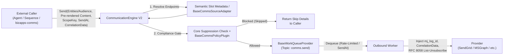
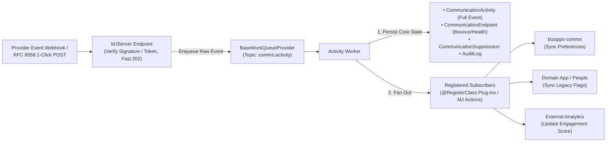

# MemberJunction Communications V2 (Comms V2) — High-Level Design

**Status:** Implemented. Where this design and the code differ, the code and [`guides/COMMUNICATIONS_V2_GUIDE.md`](../../guides/COMMUNICATIONS_V2_GUIDE.md) are authoritative.  
**Scope:** Core Framework Architecture (`MJ Core`), Turn-Key App Separation (`bizapps-comms`), and Domain Integration (`bizapps-common` and customer-specific apps)

---

## 1. Executive Summary & Design Philosophy

**Comms V2** evolves MemberJunction’s existing email infrastructure ("Comms V1") into an enterprise-grade, channel-agnostic **message delivery, compliance, and telemetry framework**.

### Guiding Architectural Principles ("The MJ Way")
1. **100% Framework in MJ Core:** Comms V2 lives entirely in MJ Core as generic infrastructure—never coupled to specific CRM schemas (`People`, `Contacts`, `Members`) or marketing app concepts.
2. **Metadata + `@RegisterClass` Extensibility:** Domain packages map their entities into **semantic slots** via metadata and optionally register code plug-ins via `MJGlobal.Instance.ClassFactory` to customize policy enforcement, endpoint resolution, and event consumption.
3. **Strict Separation of Orchestration vs. Transport:** Comms V2 is strictly a **delivery and feedback plane**. Deciding *who* to message, *what* to write (AI drafting / template rendering), and *when* to advance a sequence lives outside this framework.
4. **Works Out of the Box, Scales to Cloud:** Queueing for both outbound blasts and inbound telemetry uses a pluggable `WorkQueue` abstraction—backed by a lease-locked MJ database driver by default, with clean `@RegisterClass` swap-ins for AWS SQS/SNS or Azure Service Bus.

---

## 2. Explicit Scope Boundaries

| In Scope (MJ Core Comms V2) | Out of Scope (External Callers / `bizapps-comms`) |
| :--- | :--- |
| • **Pre-Rendered Message Dispatch:** Single, bulk, and heterogeneous per-recipient bespoke payloads (`Subject`, `Body`, `HTMLBody`). | • **Template Rendering & AI Copywriting:** Callers pass final rendered content; no LLM drafting or template engine execution in Comms V2. |
| • **Semantic Endpoint Discovery:** Resolving target addresses from arbitrary MJ Entities via metadata slots and adapters. | • **Sequence & Campaign State Machines:** Drip delays, branching, and deciding *who* receives or continues to receive messages (e.g., an external engagement engine, Marketing Agents). |
| • **Transport Compliance & Suppression Firewall:** Canonical endpoints, bounce/complaint tracking, scoped/global opt-outs, RFC 8058 1-click unsubscribe headers & endpoint, and full audit trail. | • **Preference Center & Subscription Catalogs:** Business-level `SubscriptionType` definitions, Opt-In vs. Opt-Out campaign rules, and soft `DeliveryPreferences` (e.g., *"Tuesdays at 9am"*), which move to **`bizapps-comms`**. |
| • **Full Activity Telemetry:** Persisting `Queued`, `Sent`, `Delivered`, `Deferred`, `SoftBounced`, `HardBounced`, `Opened`, `Clicked`, `Unsubscribed`, and `SpamComplaint` events. | • **Inbound Reply Handling:** Ingesting, threading, or classifying human email replies is explicitly excluded from Comms V2. |
| • **Pluggable WorkQueue & Subscribers:** Outbound blast throttling/retries and inbound webhook fan-out to `@RegisterClass` plug-ins and MJ Actions. | • **SMS Carrier Implementation:** Core abstractions are SMS-ready (`ChannelID`, `CommunicationEndpoint`), but SMS sending/A2P 10DLC compliance is deferred. |

---

## 3. Three-Tier Package & Responsibility Breakdown

```
┌─────────────────────────────────────────────────────────────────────────┐
│  TIER 3: DOMAIN PACKAGES (bizapps-common, customer apps, custom)        │
│  • Metadata mappings: Entity fields ──► Comms V2 semantic slots         │
│  • Optional thin @RegisterClass adapters (e.g., child-table lookups,    │
│    syncing unsubscribes to legacy entity columns, analytics push)       │
└───────────────────────────────────┬─────────────────────────────────────┘
                                    │
┌───────────────────────────────────▼─────────────────────────────────────┐
│  TIER 2: BIZAPPS-COMMS (Turn-Key Communications OpenApp)                │
│  • SubscriptionType catalog (Marketing, Informational, Operational)     │
│  • Opt-In vs. Opt-Out rules & DeliveryPreferences ("Tuesdays 9am")      │
│  • Customer-facing Preference Center UI & <mj-comms-preferences> widget │
│  • @RegisterClass plug-ins writing opt-outs through to Core Suppression │
└───────────────────────────────────┬─────────────────────────────────────┘
                                    │
┌───────────────────────────────────▼─────────────────────────────────────┐
│  TIER 1: MJ CORE COMMS V2 (Pure Framework)                              │
│  • Dispatch Engine, Semantic Slot Resolver, Policy Gate                 │
│  • CommunicationEndpoint, CommunicationSuppression, Activity Log        │
│  • RFC 8058 1-Click Unsubscribe Endpoint & Provider Webhook Ingestion   │
│  • Pluggable WorkQueue (Default DB Driver + AWS/Azure Adapter Seam)     │
└─────────────────────────────────────────────────────────────────────────┘
```

### Tier 1: MJ Core Package Responsibilities

| Package | Responsibilities |
| :--- | :--- |
| **[`@memberjunction/communication-types`](../../packages/Communication/base-types)** | • V2 Dispatch & Batch contracts (supporting per-recipient bespoke content, `ScopeKey`, `SendAt`, `CorrelationData`).<br>• Plug-in base classes: `BaseCommsSourceAdapter`, `BaseCommsPolicyPlugin`, `BaseCommsActivitySubscriber`.<br>• Channel-agnostic endpoint, suppression, and normalized activity event types. |
| **[`@memberjunction/communication-engine`](../../packages/Communication/engine)** | • Unified `"Send to these people"` orchestrator.<br>• Resolves arbitrary MJ Entities / `AudienceSource`s via metadata semantic slots & `BaseCommsSourceAdapter`.<br>• Executes the Pre-Send Compliance Gate (Core Suppression + registered `BaseCommsPolicyPlugin`s).<br>• Injects `mj_log_id`, caller `CorrelationData`, and RFC 8058 `List-Unsubscribe` headers.<br>• Enqueues outbound batches onto the WorkQueue and coordinates inbound activity fan-out. |
| **[`packages/Communication/providers/*`](../../packages/Communication/providers)** *(starting with `sendgrid`)* | • Maps `mj_log_id` and caller `CorrelationData` to vendor tracking metadata (e.g., SendGrid `custom_args`).<br>• Enables open/click tracking settings when configured.<br>• Implements provider-specific Event Webhook signature verification (e.g., SendGrid ECDSA) and normalizes raw vendor payloads into `CommunicationActivity` events. |
| **[`@memberjunction/queue`](../../packages/MJQueue)** | • Defines `BaseWorkQueueProvider` (`Enqueue`, `EnqueueBatch`, `Consume`, `Ack`, `Nack`, `DeadLetter`, `ScheduledAt`).<br>• Provides default **`DatabaseWorkQueueProvider`** with atomic lease locking, exponential backoff retries, dead-lettering, and scheduled delivery.<br>• Supports `@RegisterClass` cloud drivers (`AWS_SQS`, `Azure_ServiceBus`) via configuration. |
| **[`@memberjunction/server`](../../packages/MJServer)** | • Exposes fast HTTP webhook ingestion routes (`/comms/webhooks/:provider`) that verify signatures, enqueue raw events onto `comms.activity`, and return `200/202` immediately.<br>• Exposes the RFC 8058 One-Click Unsubscribe endpoint (`/comms/unsubscribe`) handling headless `POST` requests and optional redirect to a configured Preference Center URL. |
| **Core Schema (`__mj`)** | • Minimal essential entities: `CommunicationEndpoint`, `CommunicationSuppression`, `CommunicationConsentAuditLog`, `CommunicationActivity`, plus semantic slot metadata extensions and WorkQueue lease columns. |

### Tier 2: `bizapps-comms` (Separate OpenApp Package)
Moving communication preferences out of `bizapps-common` into a dedicated **`bizapps-comms`** package decouples the turn-key communications solution from `Common: People`:
* **Models & UI:** `SubscriptionType` management, `DeliveryPreferences` (send windows, timezone, frequency caps), and the customer-facing Preference Center page.
* **Reusable Explorer Widget:** Generic `<mj-comms-preferences [EntityID] [RecordID]>` component usable on *any* entity form (`People`, `Members`, `User`).
* **Core Integration:** Registers a `BaseCommsPolicyPlugin` (enforcing Opt-In/Opt-Out rules and computing `SendAt`), writes opt-outs through to MJ Core's `CommunicationSuppression`, and registers a `BaseCommsActivitySubscriber` to keep its preference records synchronized when 1-click unsubscribes occur.

### Tier 3: Domain Packages (`bizapps-common`, customer apps, etc.)
* **Declarative Metadata:** Maps domain entity fields into Comms V2 semantic slots (`Email`, `SMS`, `FullName`, `Timezone`). For example, `bizapps-common` maps `People`, while a domain app maps its own `Members` entity—with zero changes to MJ Core or `bizapps-comms`.
* **Optional Code Plug-ins:** If an entity stores contact methods in child tables (e.g., `PersonContactMethods`), a thin `BaseCommsSourceAdapter` resolves them. If legacy columns exist (e.g., `Members.DoNotEmail`), a thin `BaseCommsActivitySubscriber` syncs inbound opt-outs back to those columns.

---

## 4. Core Architectural Flows

### Flow A: Outbound Dispatch & Compliance Gate



### Flow B: Inbound Activity, Unsubscribes & Telemetry Fan-Out



---

## 5. Core Data Model Overview (`__mj`)

1. **`CommunicationEndpoint`**
   * Canonical, normalized transport address (`ChannelID` + `NormalizedValue`, e.g., `Email | jane@example.com`).
   * Stores endpoint-level deliverability health (`SoftBounceCount`, `LastBouncedAt`, `LastDeliveredAt`, `IsGloballySuppressed`).
   * Ensures that if `Common: People #101` and `Association: Members #42` share `jane@example.com`, opt-outs and bounces protect both automatically.
2. **`CommunicationSuppression` + `CommunicationConsentAuditLog`**
   * Tracks *"This endpoint/entity is blocked from That scope"*:
     * `CommunicationEndpointID` (FK)
     * `EntityID` + `RecordID` (nullable polymorphic FK decorated with `EntityField.EntityIDFieldName`)
     * `ScopeKey` (`NULL` = Global non-operational block; opaque string = specific stream/subscription)
     * `ChannelID` (`NULL` = all channels, or specific channel like `Email` / `SMS`)
     * `Reason` (`UserUnsubscribe`, `HardBounce`, `SpamComplaint`, `AdminBlock`)
     * `Source` (`OneClickHeader`, `PreferenceCenter`, `ProviderWebhook`, `AdminUI`, `API`)
     * `CommunicationLogID` (FK tracing the exact message that triggered the opt-out)
     * `EffectiveAt`, `IPAddress`, `UserAgent`, `ChangedByUserID`
   * Companion `CommunicationConsentAuditLog` preserves immutable append-only history across status transitions.
3. **`CommunicationActivity`**
   * Full normalized log of every event (`CommunicationLogID`, `CommunicationEndpointID`, `EventType`, `OccurredAt`, `TargetURL` for clicks, `IPAddress`, `UserAgent`, `CorrelationData`, `RawPayload`).

---

## 6. Open Items to Confirm Before Implementation Planning

1. **`bizapps-common` PR #356 Transition:** Confirm whether the preference tables in `bizapps-common` can be cleanly migrated/moved into the new `bizapps-comms` package without breaking published OpenApp version contracts.
2. **Legacy Comms V1 Compatibility:** Confirm that existing Comms V1 template-rendering methods (`EntityCommunicationsEngine` / `SendToAudience`) remain intact for backward compatibility while new callers target the Comms V2 pre-rendered dispatch API.
3. **Cloud WorkQueue Priority:** Confirm whether Phase 1 ships strictly with the default `DatabaseWorkQueueProvider` (plus the `BaseWorkQueueProvider` interface) and defers concrete `AWS_SQS` / `Azure_ServiceBus` driver implementations to a follow-up phase.
