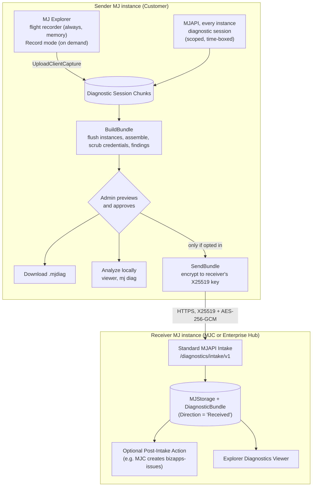
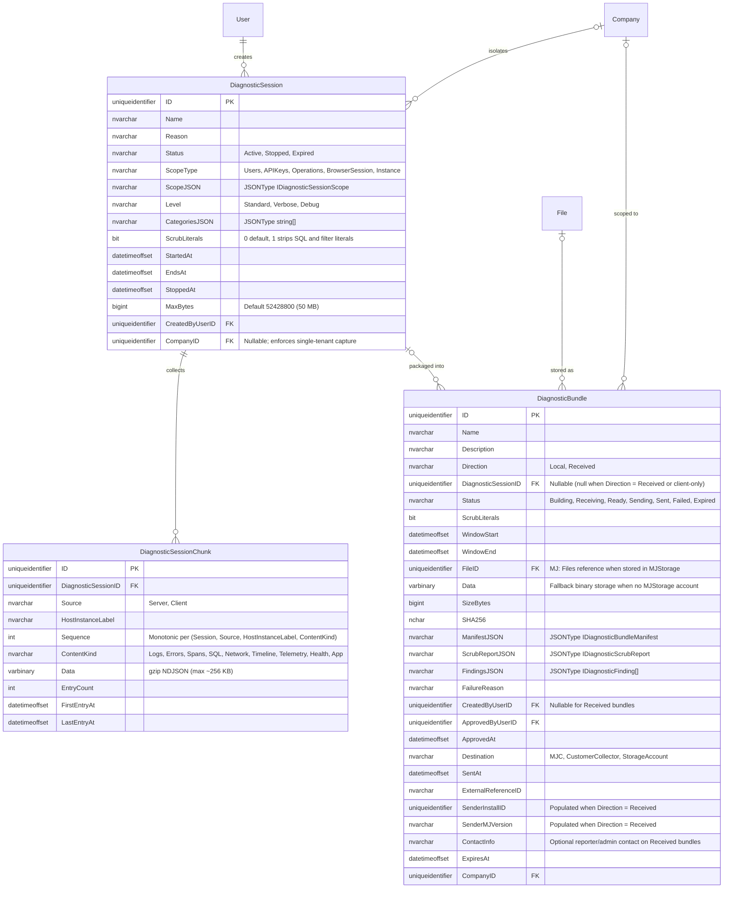

# Diagnostic Bundles: user log export, scoped server diagnostics, opt-in sharing, and standard MJAPI intake

## Status
- **Status**: Draft (plan only, no code)
- **Priority**: High
- **Created**: 2026-11-02
- **Implementation owner**: `CaelebB-BC`
- **Reviewer once implemented**: `cadam11`
- **Receive / intake side**: Standard MJAPI capability in `@memberjunction/diagnostics-server`, enabled on MJC and available to self-hosted enterprise hubs (see [Standard MJAPI intake & MJC deployment](#standard-mjapi-intake--mjc-deployment))
- **Branch**: `claude/diagnostic-bundles`
- **Target release**: `6.2.0-edge.8`, then the 6.2 LTS baseline (see [Release targeting](#release-targeting))

## Overview

MJ is moving into many more, and much larger, production deployments. When a customer reports a slow screen, a hang, or a bug, we have no reliable way to see what happened. Neither tier keeps a log buffer. Nothing ties a click in MJ Explorer to the server request and SQL behind it. Server verbosity is fixed at boot. Issue #5510 is the clearest example: event-loop stalls froze every Explorer session in production, and nothing recorded when, for how long, or what was running.

This plan adds an on-demand **diagnostic bundle**: a credential-scrubbed, local capture of one incident from both MJ Explorer and MJAPI. A user can download their client-side capture from Explorer. An admin can start a scoped, time-boxed server diagnostic session, combine both halves into one structured `.mjdiag` file, preview exactly what it contains, and then download it or send it encrypted to MemberJunction Central (**MJC**) or to their own central MJ collector instance.

Crucially, **both the send side and the receive (intake) side are standard MJAPI functionality** in `@memberjunction/diagnostics-server`. Any MJAPI instance can be configured to receive encrypted bundles, verify and optionally decrypt them into `MJStorage` and the `DiagnosticBundle` table, view them in the Explorer Diagnostics dashboard, and trigger a post-intake Action (which MJC uses to file a `bizapps-issues` record and alert maintainers).

The bundle is deliberately separate from Phone Home (#2970), which is continuous, de-identified, aggregate telemetry. The bundle is per incident, actionable (preserving real UUIDs, SQL statements, and filters by default while scrubbing credentials and omitting mutation parameter values), customer-reviewed, and never sent without an admin's action. The two share building blocks, so Phone Home and the OpenTelemetry exporter (#2281) can be built on this work later: one entry format (OpenTelemetry field names), one trace ID, one runtime-minted install ID, consent recorded as Audit Log rows, and one transport.

## Release targeting

- **Priority: high.** Larger and more numerous production deployments need this now, and 6.2 will be a widely adopted release.
- **Preferred path: land in `next` for `6.2.0-edge.8`, and use edge.8 as the baseline for the 6.2 candidate cut** (the `pre exit` → `6.2.0` → `lts/6.2` dance in `plans/lts-process.md` §5.2). That puts the feature in 6.2.x LTS from day one, with no line backport.
- **Scope for edge.8:** Phases 0–2 at minimum. **All schema changes land in Phase 0, in one migration**, so the 6.2 line starts with the final tables and every later phase is code only. Anything that misses edge.8 reaches `lts/6.2` by `backport lts/6.2` label (lts-process §5.2 rule 2).
- **6.1 backport:** possible, because migrations can ride labeled line patches (lts-process §12), but it is not the preferred path. Decide after 6.2 ships, based on which production deployments are still on 6.1. Independently, the security fixes in Phase 0 (0.1–0.4) qualify for `backport lts/6.1` on their own merits under lts-process §5.3.

## Goals & Non-Goals

### Goals
- A user can download a client diagnostic file from MJ Explorer in two clicks, including the minutes before they decided to report.
- An admin can start a server diagnostic session scoped to a user (or API key, browser tab, operation, or the whole instance) for at most 60 minutes, on a multi-instance deployment, without a restart.
- One trace ID links each client request to its server span, SQL statements, log lines and any event-loop stall.
- One `.mjdiag` file holds both halves, in a documented format that standard tools can read, keeping real UUIDs, SQL text, and filters actionable while scrubbing credentials and omitting mutation parameter values.
- Nothing leaves an instance unless an admin holding a dedicated authorization previews a bundle and sends it, to a destination the instance has opted in to.
- Any MJAPI instance can opt in to **receive** bundles (`Diagnostics.Intake.Enabled`), powering both MJC's central support intake and enterprise customers' self-hosted hub-and-spoke collection.
- MJ ships tooling to analyze a bundle (rules-based findings, CLI, Explorer viewer), usable by customers on local bundles and by maintainers on received bundles alike.
- Zero measurable overhead when no session is active; low overhead for the requests a session targets.

### Non-Goals
- Continuous telemetry to MJ (that is Phone Home, #2970).
- Exporting metrics and traces to customer monitoring stacks (that is #2281; this plan makes it cheaper but does not build it).
- Capturing content payloads: prompt text, agent step I/O, message bodies, HTTP request/response bodies, cache row contents, audio, transcripts, or mutation SQL parameter values. Never captured.
- Heavy PII regex scanning (Luhn, phone numbers) or UUID hashing that obscures which record, entity, or filter caused a failure.
- Session replay or DOM capture.

## Background & Context

Findings from a review of `next` on 2026-11-02 (paths under `packages/` unless noted):

| Area | What exists | Gap |
|---|---|---|
| Log calls | `LogError`, `LogStatus`, `LogStatusEx`, `LogWarning` in `MJCore/src/generic/logging.ts`; output via `logToConsole` | Console only, no sink or buffer. About 900 direct `console.*` calls in MJServer, AI and Actions bypass it. Production MJAPI drops every `LogStatus` line (`NODE_ENV === 'production'` check). |
| Runtime verbosity | `MJ_VERBOSE` env var read per call; `telemetry.level` config | `isDebugLogLevel()` is memoized at boot (`MJServer/src/context.ts:47`). `SetVerboseLogging()` only acts in a browser, yet `MJServer/src/index.ts:467` relies on it. |
| Telemetry | `TelemetryManager` (`MJCore/src/generic/telemetryManager.ts`) records RunView, RunQuery, engine loads and coalescing, with analyzers for duplicate views and missed parallelism | Off by default in the browser. Event buffer trims with `filter()` per event (not a ring buffer); `_activeEvents` is never capped. Save, Delete and `ExecuteGQL` are not timed. `TelemetryResolver` has no authorization check. |
| SQL capture | SQL logging sessions (`GenericDatabaseProvider` `CreateSqlLogger`, `SqlLogger.ts`, `MJServer/src/resolvers/SqlLoggingConfigResolver.ts`, Explorer settings page) | Parameter values written verbatim; no per-statement timing; files on one instance's local disk; no call sites in `PostgreSQLDataProvider`. `SqlLoggingConfigResolver.checkOwnerAccess` looks up users in `UserCache` by email instead of `context.userPayload.userRecord`, bypassing `IsScopeLimitedPrincipal`. SQL Server errors embed the full query and `JSON.stringify(parameters)` (`SQLServerDataProvider.ts:322-325`). Generated GraphQL field resolvers call static `SQLServerDataProvider.ExecuteSQLWithPool` (monkey-patched on PG at `MJServer/src/index.ts:591` to call `thePgPool.query` directly) and `ExtendConnectionPoolWithQuery` (`MJServer/src/util.ts:237`), which bypass instance provider hooks. |
| Binary columns on SQL Server | `BaseEntity` stores `varbinary(MAX)` as base64; `SQLServerDataProvider.renderSaveCallBindingWithSuffix` (`SQLServerDataProvider.ts:1609-1617`) | Eagerly converts binary fields from base64 → 2× hex string (`FormatBinaryLiteral`) + `simpleParams` even when SQL logging is off, then `Buffer.from(..., 'hex')`, and `spCreate`/`spUpdate` echoes `SELECT * FROM vw...` back over TDS. A 25 MB `DiagnosticBundle.Data` column would allocate >300 MB of strings/Buffers per `Save()`. |
| Request context | `x-session-id` per browser tab (read at `MJServer/src/context.ts`); per-request providers | No request or trace ID anywhere. No general per-request timing; `integrationOperationTracer` (`MJServer/src/apolloServer/index.ts`) covers `Integration*` operations only. Global CORS (`globalCors.ts`) and GraphQL route CORS (`MJServer/src/index.ts:1608`) set separate headers; the GraphQL route's `exposedHeaders` overwrites global CORS on GraphQL responses. |
| Client errors | `SanitizeGraphQLError` strips variable values | No Angular `ErrorHandler`, `window.onerror` or `unhandledrejection` handler; errors reach the console only. |
| Startup and stalls | `StartupManager` per-engine `loadDurationMs`; `StartupLogger` phase timings; PR #5615 adds an event-loop stall monitor | No browser performance marks. `StartupLogger` instance is local to `Serve()` and discarded. The loading screen's Reset (`shell.component.ts` `ResetApplication`) deletes all IndexedDB databases (`window.indexedDB.databases()`), wiping any diagnostic evidence with it. |
| Environment header | About dialog `CopyDiagnostics()`; GraphQL `Info` (`InfoResolver.ts`); System Diagnostics "Export JSON" | Export requires telemetry on; its timestamps render as 1970 (`performance.now()` treated as epoch). `InfoResolver` sets `Arch` from `os.platform()`. |
| MCP diagnostic tools | `loadAgentRunDiagnosticTools` in `AI/MCPServer/src/Server.ts:2158-2402` | `List_Recent_Agent_Runs` interpolates `agentName` unescaped; `Get_Agent_Run_Summary`, `Get_Agent_Run_Step_Detail`, and `Get_Agent_Run_Step_Full_Data` interpolate `runId` (`z.string()`) into `ExtraFilter` unescaped; `Get_Agent_Run_Step_Full_Data` writes unredacted step I/O to `path.resolve(process.cwd(), props.outputFile)` on the server filesystem (path traversal / arbitrary file overwrite). |
| Persisted runs | Agent and Prompt Runs, Action Execution Logs, Scheduled Job Runs, API Key Usage Logs, all with timings | Free-text columns hold client data (rendered prompts, step I/O, message bodies). Usable for timings and statuses only. |
| Outbound channel | Feedback dialog → `FeedbackResolver` | Files **public** GitHub issues in `MemberJunction/MJ` by default, screenshots included. Must never carry bundles. |
| Instance identity | `HostInstanceIdentity` (`hostname:port:pid:bootId`, `MJServer/src/agentSessions/HostInstance.ts`) | Per process, contains hostname. No install ID. A seeded one would be identical on every install. |
| Multi-instance | Redis pub/sub when `REDIS_URL` is set (`RedisLocalStorageProvider.PublishMessage`, fan-out precedents in `MJServer/src/index.ts` with `ProcessUUID` self-filter) | No bus without Redis; the database is the only shared medium. |
| Scrubbing primitives | `RedactParams` (`Actions/Base/src/ParamRedaction.ts`), `RedactArg` + `@NoLog` (`MJServer/src/logging/`), `SanitizeGraphQLError` (`GraphQLDataProvider/src/sanitizeGraphQLError.ts`), `SanitizeForPersistence` | Good key-based credential masking exists, but is not wired into a general log/URL/SQL credential scrubber. |
| Settings | `MJ: Instance Configurations` via `InstanceConfigEngine` (`MJCoreEntities/src/engines/InstanceConfigEngine.ts`), seeded from `metadata/instance-configurations/` | Cached to clients, so never store secrets there. |

Related work: #2970 (Phone Home design, parked), #2281 (OpenTelemetry), #5510 and PR #5615 (event-loop stalls), PR #4214 (client analytics providers proposal, which also flags the missing `ErrorHandler`), #667 (user activity auditing).

## Architecture / Design

### Principles
1. **Local first, standard intake everywhere.** Capture, assembly, findings and viewing run on every MJ instance. Any MJ instance can also enable standard bundle intake (`Diagnostics.Intake.Enabled`) to receive encrypted bundles from other instances — powering MJC's support intake and enterprise hub-and-spoke collection with the same code.
2. **Nothing leaves without an admin's send.** Sending requires the `Diagnostics: Send Externally` authorization, an instance opt-in, an allowed destination, and a preview of that exact bundle.
3. **Actionable by default; scrub credentials, never obscure structure.** Operational logs (`LogStatus`, `LogError`, `TelemetryManager`, SQL statements) do not generally log PII. Hashing UUIDs or stripping every `ExtraFilter` literal makes bundles useless for debugging ("record `rec_4d1e8a0f` failed"). Instead, keep real UUIDs (`UserID`, `RecordID`, `AgentRunID`), real SQL statements, and real `ExtraFilter` strings by default, while **never recording mutation parameter values or content payloads** and **always scrubbing credentials/tokens in place**. Never fail a bundle closed on heuristic regexes.
4. **Optional literal scrubbing (`ScrubLiterals`) for regulated environments.** Admins in strict compliance environments (or instances with `Diagnostics.RequireLiteralScrubbing = true`) can toggle `ScrubLiterals` to replace SQL and `ExtraFilter` literals with `?` before export.
5. **Tell the person being recorded.** Explorer shows an indicator while a server session targets the current user.
6. **Audit every step** as Audit Log rows (pattern: `agentVisionConsentAudit.ts`), including local builds, downloads, external sends, and intake receipts.
7. **Targeted, not global.** A session elevates logging only for the requests it matches. Untargeted requests pay one cheap check.
8. **Self-observability immunity.** Diagnostic polling, chunk flushing, bundle assembly, and intake never record themselves (`WithoutDiagnosticCapture`), preventing feedback loops under `Instance`-scoped sessions.
9. **One tenant per session and bundle** on multi-tenant instances (`CompanyID` enforced at capture time on `DiagnosticSession`, not just at bundle build time).

### Credential scrubbing & data hygiene

| Data | Default (`ScrubLiterals: false`) | Optional Strict Mode (`ScrubLiterals: true` or `Diagnostics.RequireLiteralScrubbing = true`) |
|---|---|---|
| SQL (`ISqlObserver`) | Executed SQL statement text + duration + row count + parameter names/types/byte-lengths. **Mutation (`Save`/`Delete`) parameter values are never recorded.** | Same, plus inline SQL literals (`'...'`, `N'...'`, `0x...`, numbers) normalized to `?`, SQL comments stripped, and `IN (?, ?, ...)` lists collapsed to `IN (? /* ×N */)`. |
| `RunView` `ExtraFilter`, `OrderBy` | Full filter and `OrderBy` text (credential tokens still scrubbed) | Literals normalized to `?` |
| URLs | Full path kept; sensitive query-string params (`token`, `code`, `key`, `secret`, `sig`, `password`, `sm_*`) masked as `[REDACTED]`; URL fragments dropped | Route templates (or path with UUIDs/segments); all query strings and fragments dropped |
| GraphQL variables | Key/type shape + non-secret scalar filter inputs; keys matching `RedactParams` (`password`, `secret`, `token`, `apiKey`, `credential`, `authorization`, `@NoLog`) masked | Key/type shape (`VariableShape`) only |
| Error messages & stacks | Full error class, message, and stack trace (credential scrubber applied) | Same |
| Users, Record IDs, HostInstanceLabel | **Kept as stored** (real UUIDs, role names, host instance labels) so records can be looked up directly | Kept as stored (or optional HMAC-SHA256 pseudonymization if explicitly requested in `mj diag`) |

**Never included at any setting:** prompt text, agent step I/O, message bodies, HTTP request or response bodies, cache row contents, auth headers (`Authorization`, `Cookie`, `x-api-key`, `x-mj-api-key`), audio, transcripts, or SQL parameter values from mutations (`spCreate*`/`spUpdate*`). A screenshot is a separate, explicit, off-by-default attachment.

**Always-on in-place credential scrubber** (runs on free-text log messages, error messages/stacks, and string metadata; **masks in place with `[REDACTED:<KIND>]` and never fails a bundle closed**):
- `Bearer <token>` headers and raw JWTs (`eyJ[A-Za-z0-9_-]+\.[A-Za-z0-9_-]+\.[A-Za-z0-9_-]+`)
- MJ API keys (`mj_sk_[A-Za-z0-9_]+`) and Secure Messaging tokens (`sm_[A-Za-z0-9_]+`)
- Connection strings containing credentials (`Password=...`, `Pwd=...`, `redis://:...@`, `postgresql://user:pass@`, `mssql://user:pass@`)
- PEM private keys (`-----BEGIN .* PRIVATE KEY-----`)
- Object properties whose key name matches `RedactParams` (`/password|passwd|secret|token|apikey|api_key|authorization|cookie|credential|privatekey|client_secret/i`)
- Strings over 32 KB are truncated before regex evaluation to guarantee zero ReDoS or event-loop stall during scrubbing.
- **Startup-safe client scrubbing:** Client-side scrubbing has zero dependency on `Metadata.Provider.Entities` being loaded, so exports from the stuck-loading screen work reliably before metadata initialization finishes.

### Components

New packages (names indicative; follow `guides/UI_LAYERING_GUIDE.md`):

| Package | Layer | Responsibility |
|---|---|---|
| `@memberjunction/diagnostics` (`packages/Diagnostics/Core`) | L0, isomorphic | Entry envelope types, bounded ring buffers, in-place credential scrubber, optional SQL/filter literal normalizer, zero-dep `.mjdiag` ZIP writer/reader (`CompressionStream('deflate-raw')` + table-driven CRC-32), X25519/AES-256-GCM envelope codec, findings rule engine, Perfetto/OTLP exporters. No MJ server deps; usable in browser, server and CLI. |
| `@memberjunction/diagnostics-server` (`packages/Diagnostics/Server`) | Server | `DiagnosticSessionManager`, `AsyncLocalStorage` request context, server log sink and console tap, Apollo span plugin, `ISqlObserver` registration, chunk writer, health snapshot, bundle assembler, outbound MJC/collector transport, **standard MJAPI intake endpoints**, Remote Operation implementations, retention job driver. Registered in `@memberjunction/server-bootstrap`. |
| `@memberjunction/ng-diagnostics` (`packages/Angular/Generic/diagnostics`) | L1/L2 | Client flight recorder service, Report-a-problem dialog, recording indicator, bundle preview and viewer components. No Router imports. All observers/timers run inside `NgZone.runOutsideAngular()`. |
| Explorer surfaces | L3 | About dialog button, user menu item, loading-screen download, Admin → Monitoring "Diagnostics" dashboard (local sessions/bundles + received bundles tab when intake is enabled), System Diagnostics export. |
| `mj diag` (`packages/MJCLI/src/commands/diag/`) | CLI | `inspect`, `scrub`, `timeline`, `slow`, `export --perfetto|--otlp`. |

Bootstrap manifests: the server package belongs in `@memberjunction/server-bootstrap` only. `packages/Angular/Bootstrap*` must not gain server-only dependencies (see their `CLAUDE.md`).

### Flow



### Sequence: user reports a problem, admin sends it to MJC (or Enterprise Hub)

```mermaid
sequenceDiagram
    participant U as User (Explorer)
    participant API as Sender MJAPI (any instance)
    participant DB as Sender DB
    participant A as Admin (Explorer)
    participant RCV as Receiver MJAPI (MJC / Hub)
    U->>API: Report a problem (optional self-scoped session if SelfServiceRecording)
    API->>DB: Insert DiagnosticSession (Active, EndsAt, CompanyID)
    API-->>API: Other instances pick it up (Redis or 15 s poll)
    U->>API: Reproduces (traceparent on every request)
    API->>DB: Flush gzip NDJSON chunks (per instance, WithoutDiagnosticCapture)
    U->>API: Stop + UploadClientCapture (credential-scrubbed ring buffers)
    API-->>API: Broadcast mj:diagnostics:flush so all instances flush tail chunks
    API->>DB: DiagnosticBundle (Building → Ready)
    A->>API: GetBundlePreview
    A->>API: SendBundle (requires Send Externally + opt-in)
    API->>RCV: POST /diagnostics/intake/v1/bundles (metadata) → referenceId + uploadUrl
    API->>RCV: PUT encrypted bytes, POST /complete
    RCV->>RCV: Verify SHA-256, decrypt metadata/findings, store in MJStorage, run Post-Intake Action
    API->>DB: Bundle Sent + ExternalReferenceID; Audit Log rows on both instances
```

### Correlation & Middleware Ordering (highest-leverage change)

- **Client (`GraphQLDataProvider`)**:
  - Mint `traceId` (16-byte hex) and `spanId` (8-byte hex) **per call inside `ExecuteGQL` and `ExecuteGQLWithProgress`** (not in a shared `GraphQLClient` `requestMiddleware`, which cannot correlate concurrent requests that fail before headers return).
  - Pass `traceparent: 00-${traceId}-${spanId}-01` via per-request headers to `this._client.request(query, variables, requestHeaders)` on HTTP, `xhr.setRequestHeader('traceparent', ...)` on `ExecuteGQLWithProgress`, and `payload.extensions.traceparent` on `graphql-ws` operations.
  - On `JWT_EXPIRED` token-refresh retry (`ExecuteGQL` line 3709 and `ExecuteGQLWithProgress` line 3636), **preserve the same `traceId` with a fresh `spanId`** so the initial 401, the token refresh, and the retry appear under one trace in the waterfall.
  - Record the network entry in the flight recorder inside `ExecuteGQL` / `ExecuteGQLWithProgress`'s `finally` block using the closure's `traceId`, `performance.now()` duration, operation name, variable shape, and status — guaranteeing capture even on network errors or timeouts.
- **CORS (`MJServer`)**:
  - Notice `MJServer` has **two** CORS mounts: `CreateGlobalCorsMiddleware` (`packages/MJServer/src/globalCors.ts:35`, before auth) and a second `cors({ exposedHeaders: ['X-MJ-Cache-Seq', 'X-MJ-Server-ID'] })` on `graphqlRootPath` (`packages/MJServer/src/index.ts:1608`). The second mount overwrites `Access-Control-Expose-Headers` on GraphQL responses.
  - Add `X-MJ-Trace-ID` to `exposedHeaders` in **both** `CreateGlobalCorsMiddleware` and the `graphqlRootPath` CORS config (and ensure `traceparent` is allowed on preflight).
- **Three-stage incremental session matching & WebSocket support (`MJServer`)**:
  - Because `BaseServerMiddleware.GetPreAuthMiddleware` runs before authentication (`CreateUnifiedAuthMiddleware`), before tenant resolution (`mwPostAuth`), and before `BodyParser.json()` / GraphQL parsing — and does not run per message on `graphql-ws` WebSockets — session matching runs incrementally in 3 stages on the mutable `DiagnosticContext` held in `AsyncLocalStorage`:
    1. **Stage 1 — Pre-Auth HTTP (`GetPreAuthMiddleware`)**: Parse incoming `traceparent` (or mint one), echo `X-MJ-Trace-ID` on `res`, open the `AsyncLocalStorage` context, and evaluate `Instance` and `BrowserSession` (`x-session-id`) session scopes so 401 auth failures are captured.
    2. **Stage 2 — Post-Auth HTTP (`GetPostAuthMiddleware`) & WS connection**: Populate `UserID`, `APIKeyID`, and `CompanyID` (from `req.userPayload` / tenant context) onto the active `DiagnosticContext`. Enforce `session.CompanyID === ctx.CompanyID` for multi-tenant isolation, and evaluate `Users` and `APIKeys` session scopes.
    3. **Stage 3 — Apollo `didResolveOperation` / `ExecuteRemoteOperationResolver` / `graphql-ws` `onSubscribe`**: Evaluate `Operations` session scope against the resolved GraphQL `operationName` and, for `ExecuteRemoteOperation`, `variables.input.operationKey`. For `graphql-ws` subscription operations, read `ctx.extra` / `payload.extensions.traceparent` and enter `AsyncLocalStorage` for the operation execution.

### Logging sink and context (MJCore)

`logging.ts` gains a sink registry, a context provider, and a self-capture suppression helper. Both tiers use them; the server backs the provider with `AsyncLocalStorage`, the browser with a per-tab value.

```typescript
export type LogSeverity = 'Trace' | 'Debug' | 'Info' | 'Warning' | 'Error' | 'Critical';

export interface LogEntry {
    TimestampMs: number;          // epoch ms (not performance.now())
    Severity: LogSeverity;
    Category?: string;
    Message: string;
    Args?: unknown[];             // passed through the credential scrubber before storage
    ErrorName?: string;
    ErrorStack?: string;
    Metadata?: Record<string, unknown>;
    VerboseOnly: boolean;
}

export interface DiagnosticContext {
    TraceID?: string;
    SpanID?: string;
    BrowserSessionID?: string;
    UserID?: string;
    CompanyID?: string;
    SessionID?: string;
    SessionEndsAtMs?: number;
    /** True while inside WithoutDiagnosticCapture() so chunk flushes/polls never record themselves. */
    SuppressCapture?: boolean;
    /** Dynamic getter or evaluated state: true when SessionID is still active, not expired, and !SuppressCapture. */
    IsCaptured: boolean;
    /** Elevated level for captured work; undefined = configured default. */
    Level?: 'Standard' | 'Verbose' | 'Debug';
}

export interface IDiagnosticContextProvider {
    Current(): DiagnosticContext | undefined;
    WithoutDiagnosticCapture<T>(fn: () => T): T;
    RunDetached<T>(fn: () => T): T;
}

export type LogSink = (entry: LogEntry, context: DiagnosticContext | undefined) => void;

export function RegisterLogSink(sink: LogSink): () => void;          // returns unregister
export function SetDiagnosticContextProvider(provider: IDiagnosticContextProvider | null): void;
export function WithoutDiagnosticCapture<T>(fn: () => T): T;
export function RunDetachedFromDiagnosticContext<T>(fn: () => T): T;
```

Rules:
- Every `Log*` call checks `_sinks.length > 0 && !_inSinkDispatch` first (zero allocation when no sink is registered), builds a `LogEntry`, and invokes sinks **before** the console decision when `!Current()?.SuppressCapture`. A `LogStatus` suppressed from the console in production still reaches a sink when the context is captured.
- `IsVerboseLoggingEnabled()` returns true when `Current()?.IsCaptured && (Current()?.Level === 'Verbose' || Current()?.Level === 'Debug')`, else falls back to a module-level `_nodeVerboseEnabled` flag on Node or today's env/browser logic.
- `SetVerboseLogging()` sets the module-level flag on Node as well as `window.MJ_VERBOSE` in the browser, fixing the no-op that `MJServer/src/index.ts:467` relies on.
- **No duplicate console-tap entries:** `logToConsole` in `logging.ts` calls the unwrapped original `console.log`/`console.error` references (or sets a synchronous `_inMJLogToConsole = true` guard around `console.*`). The console tap (`diagnostics-server` at boot, `MJExplorer/src/main.ts` before bootstrap) skips calls while `_inMJLogToConsole` is true, so `LogError`/`LogStatus` are recorded once (structured, from `logging.ts`) and only direct `console.*` calls that bypassed `MJCore` are captured by the tap.
- Console tap argument serialization is bounded to **8 KB per entry** with object depth ≤ 4 and `WeakSet` cycle detection so `console.log(largeObject)` never stalls the event loop.
- Sinks must never throw into callers; wrap with a re-entrancy flag (`_inSinkDispatch`) and count failures.

### Server diagnostic sessions

- `DiagnosticSessionManager` (singleton via `BaseSingleton`) holds the active sessions. Load at boot, poll every ~15 s inside `WithoutDiagnosticCapture` (single small query on `Status='Active' AND EndsAt > now`), and subscribe to Redis channel `mj:diagnostics:sessions` when `REDIS_URL` is set (stamp and filter `MJGlobal.Instance.ProcessUUID`, as the existing fan-outs do). Expiry is computed dynamically from `EndsAtMs` (`Date.now() < session.EndsAtMs`), never an in-process timer alone. Worker-role instances (`MJ_SERVER_ROLE`) participate.
- **Multi-tenant isolation at capture time**: `DiagnosticSession` stores `CompanyID`. On multi-tenant instances, a session matches a request only when `session.CompanyID === ctx.CompanyID` (or when an Owner explicitly starts an instance-wide session on a single-tenant host). Chunks from different tenants are never mixed.
- **Background work & `AsyncLocalStorage` hygiene**:
  - `ScheduledJobEngine` runs, agent runs (`BaseAgent`), `WorkQueue` consumers, `TaskGraph` tasks, and `LongRunning` Remote Operations snapshot or open a `DiagnosticContext` for the user they act for.
  - In `SQLServerDataProvider`, transactional queue items (`this._sqlQueue`, `SQLServerDataProvider.ts:2446`) capture `Current()` when enqueued and restore it when `concatMap` executes the query so queued statements keep the caller's `TraceID`.
  - Shared lazy engine initializations (`BaseEngine.Config`) and periodic background refresh timers run inside `RunDetachedFromDiagnosticContext` (`AsyncLocalStorage.exit`) so a captured user request that happens to trigger a lazy engine load does not permanently attach its `TraceID` or `SessionID` to a process-lifetime `setInterval`.
- **Request spans**: an Apollo plugin modeled on `integrationOperationTracer` records operation name and type, top-level selection field names (never inline AST argument literals), variable shapes, duration, status, error class, SQL statement count and total SQL time. Remote Operations add `OperationKey`, mode, scope and outcome, never raw inputs.
- **Complete `ISqlObserver` coverage across SQL Server and PostgreSQL**:
  - Register `ISqlObserver` **globally/statically on `GenericDatabaseProvider`** (alongside static `GenericDatabaseProvider.LogSQLStatement`) with `(statementText, parameterSummary, durationMs, rowCount, errorClass, isMutation, contextUser)`.
  - Call `ISqlObserver` from:
    1. `SQLServerDataProvider`: `executeSQLCore` (which covers both instance `ExecuteSQL` and static `ExecuteSQLWithPool`) and `ExecuteSQLBatchWithConnection`.
    2. `PostgreSQLDataProvider`: a single central `executeObservedQuery` helper called by `ExecuteSQL`, `executeOnOwnConnection`, `RunColocatedSQL`, and `options.connectionSource`.
    3. `MJServer` shims: the PostgreSQL monkey-patch of `SQLServerDataProvider.ExecuteSQLWithPool` (`MJServer/src/index.ts:591`) and `ExtendConnectionPoolWithQuery` (`MJServer/src/util.ts:237`), so generated GraphQL field-resolver queries (`dataSource.query` / `ExecuteSQLWithPool`) are timed and counted on both SQL Server and PostgreSQL.
  - Skip observer notification when `options?.ignoreLogging === true` or `Current()?.SuppressCapture === true`.
  - Record parameter names, SQL types, and byte lengths only — **never parameter values on mutations (`Save`/`Delete`)**. The existing `SqlLogger` file mode stays as-is for CodeGen capture.
- **Chunk writer & multi-instance flush**:
  - Per-instance in-memory buffer → gzip NDJSON chunk rows every 10 s or 256 KB inside `WithoutDiagnosticCapture()`, using the queued-save pattern in `plans/fire-and-forget-logging-audit.md`.
  - `DiagnosticSessionChunk.Sequence` is a monotonic counter per `(DiagnosticSessionID, Source, HostInstanceLabel, ContentKind)` held in memory by each writer.
  - Hard cap per session (default 50 MB across the session, configurable via `MaxBytes BIGINT`); on cap, stop capturing and record a `CapReached` entry.
  - **Multi-instance flush on stop/build:** When `StopSession` or `BuildBundle` runs, publish `{ action: 'flush', sessionId }` on Redis channel `mj:diagnostics:sessions` (and when a poll detects a session transitioned out of `Active`, immediately flush any buffered entries for that session). `BuildBundle` flushes the local instance via `WaitForPendingChunkSaves()`, awaits the Redis flush ack (up to 3 s) or poll settle window when other instances have active chunks, and then assembles the bundle so tail chunks from other replicas are never lost.
  - **Shutdown & crash recovery:** Register `DiagnosticSessionManager` with `ShutdownRegistry` to flush in-memory chunks on `SIGTERM`/`SIGINT`. At boot (alongside `SweepInterruptedRuns` in `MJServer/src/index.ts:1671`), sweep any `DiagnosticBundle` rows stranded in `Building`, `Sending`, or `Receiving` by a dead process to `Failed` (`FailureReason = 'Interrupted by server restart'`).
- **Health snapshot** (taken at build time, from the instance building the bundle plus per-instance snapshots written as chunks at session start/stop): MJ and Node versions, OS family, DB platform and version, migration level (max successful version in `flyway_schema_history`), server role, loaded Open Apps and versions (retain the `loadDynamicAppPackages` result), the retained `StartupLogger` summary, `StartupManager.GetRegistrations()` timings, engine census, `LocalCacheManager.GetStats()`, `ScheduledJobsService.GetStatus()`, event-loop stalls (#5615), `TelemetryManager` insights, and an allowlist of non-secret config flags.

### Client capture (MJ Explorer)

- **Flight recorder** (always on, memory only, cleared on reload): ring buffers of 1,000 log entries, 500 network records, 200 navigation entries, all errors (capped at 200). Listed in `plans/MEMORY_LEAK_AUDIT.md`.
- **`NgZone` isolation**: All flight-recorder listeners (`PerformanceObserver`, `window` `error` and `unhandledrejection`, IndexedDB flush timers, and `GetMySessionStatus` polling) MUST be registered inside `NgZone.runOutsideAngular(...)` so diagnostic instrumentation never triggers Angular change-detection cycles.
- **Error capture**: Angular `ErrorHandler` provided from explorer-core's module `forRoot`, `window` `error` and `unhandledrejection` listeners, and error notifications shown through `MJNotificationService`.
- **Network**: GraphQL operation name, duration, status, response bytes, trace ID (captured directly in `ExecuteGQL` and `ExecuteGQLWithProgress`); WebSocket state transitions from `SocketConnectivity$`.
- **Startup timeline**: `performance.mark` at preload (`main.ts`), auth init, each phase of GraphQL client setup, metadata load, `StartupManager` completion, `OnFirstResourceLoadComplete` (`shell.component.ts`); Navigation Timing; a `PerformanceObserver` for long tasks. Export uses `performance.timeOrigin` to convert to epoch.
- **Record mode** (on demand): raises `TelemetryManager` to `standard`, enables verbose for this tab, and persists the buffers to a dedicated IndexedDB database (`MJ_Diagnostics`) with a **1-second coalesced/debounced flush** (plus immediate flush on `visibilitychange === 'hidden'`, `pagehide`, and unhandled errors) and a 2-hour TTL so reload and startup problems survive without causing an IDB write storm. Ends itself after 30 minutes. Shows the recording indicator. This is ephemeral diagnostic data, not a user preference, so it does not go through `UserInfoEngine`.
- **Preserving evidence across Reset / ClearClientCache**: Update `shell.component.ts` `ResetApplication()` (`window.indexedDB.databases()`) and `GraphQLDataProvider.ClearClientCache()` to **skip deleting `MJ_Diagnostics`** by default so pre-reset crash evidence survives even if the user clicks Reset before downloading.
- **Entry points**: About dialog (beside "Copy diagnostics"), user menu "Report a problem", the stuck-loading screen (offer one-click download **before** Reset runs), System Diagnostics "Export JSON" (fix timestamps, include the new buffers).
- **Download** uses `ExportService.DownloadResult`; `.mjdiag` zip writing uses a ~100-line zero-dependency ZIP builder in `@memberjunction/diagnostics` over native `CompressionStream('deflate-raw')` (RFC 1951 raw deflate + table-driven CRC-32 + ZIP Central Directory; never raw `gzip` inside `.zip`).

### `TelemetryManager` changes
- Replace per-event `filter()` trimming with real ring buffers; cap `_activeEvents` (default 1,000, evict oldest on overflow).
- Add `OnEvent(callback)` (the hook #2281 proposes) so diagnostics and, later, OpenTelemetry consume the same events.
- Instrument `Save`, `Delete`, and `ExecuteGQL` under the existing `Network` category, attaching ` traceId` from `DiagnosticContext` when present.
- Pass parameter objects through the credential scrubber (or optional literal normalizer when `ScrubLiterals` is on).
- Export `performance.timeOrigin` with every export.

### Bundle format (`.mjdiag`, format version 1)

A standard `.zip` archive of JSON and NDJSON files. Entries use OpenTelemetry log and span field names (`timestamp`, `severity_text`, `body`, `attributes`, `trace_id`, `span_id`). Target under 5 MB typical; 25 MB hard cap.

| Path | Contents |
|---|---|
| `manifest.json` | Format version (`1`), bundle ID, install ID, time window, `scrubLiterals` boolean, creator user ID, consent record, file list with SHA-256, scrubbing summary (counts of masked credential tokens per rule per file) |
| `README.txt` | Plain-language contents and scrubbing summary for the admin deciding whether to send |
| `environment.json` | Client and server MJ versions, Open Apps and versions, browser family and version, OS family, DB platform and version, migration level, server role, instance count, non-secret config flags |
| `findings.json` | Rules-based findings computed at export |
| `client/logs.ndjson`, `client/errors.ndjson` | Client log entries and errors |
| `client/network.ndjson` | One record per GraphQL call (with `trace_id`) |
| `client/timeline.json` | Startup marks, Navigation Timing, long tasks, routes visited (query tokens masked) |
| `client/telemetry.json` | `TelemetryManager` events, patterns, insights |
| `server/<instance>/logs.ndjson` | Session-scoped server log entries per instance |
| `server/spans.ndjson` | Per-request spans with SQL count and time |
| `server/sql.ndjson` | Executed SQL statements with durations, row counts, and parameter types/counts |
| `server/health.json` | Health snapshots |
| `apps/<app>/<section>.json` | Open App contributor sections |

### Opt-in, permissions, and settings

Instance Configurations (category `Diagnostics`), seeded with defaults via `metadata/instance-configurations/`:

| FeatureKey | Default | Meaning |
|---|---|---|
| `Diagnostics.Capture.Enabled` | `true` | Admins can run sessions and build bundles locally |
| `Diagnostics.SelfServiceRecording` | `false` | Non-admin users may start a self-scoped server session from Report a problem; the result goes to the admin queue, never directly out |
| `Diagnostics.RequireLiteralScrubbing` | `false` | When `true`, forces `ScrubLiterals = true` (SQL/filter literals replaced with `?`) on all sessions and bundles |
| `Diagnostics.External.Enabled` | `false` | Bundles may leave the instance at all |
| `Diagnostics.External.Destinations` | `[]` | Allowed destinations: `MJC`, `CustomerCollector`, `StorageAccount` |
| `Diagnostics.External.CollectorUrl` | `""` | Base URL of a `CustomerCollector` MJAPI intake (when sending to a self-hosted hub instead of MJC) |
| `Diagnostics.MaxSessionMinutes` | `60` | Hard cap on a session |
| `Diagnostics.RetentionDays` | `14` | Local purge of sessions, chunks and bundles |
| `Diagnostics.Intake.Enabled` | `false` | Enables standard MJAPI bundle receiving (`/diagnostics/intake/v1`) on this instance (turned on for MJC and enterprise collector hubs) |
| `Diagnostics.Intake.StorageProviderID` | `""` | Optional `MJ: File Storage Providers` ID where received `.mjdiag` files are stored |
| `Diagnostics.Intake.DecryptOnIngest` | `true` | Decrypt incoming bundles using the receiver's X25519 private key in `MJ: Credentials` and index `manifest.json`/`findings.json` into `DiagnosticBundle` |
| `Diagnostics.Intake.RetentionDays` | `30` | Retention period before received bundles are purged |
| `Diagnostics.Intake.OnBundleReceivedActionID` | `""` | Optional `MJ: Actions` ID invoked after a bundle is received (MJC wires this to create a `bizapps-issues` record and notify maintainers) |

- `mj.config.cjs` kill switch `diagnostics.allowExternal: false` overrides the database, for operators who must guarantee nothing leaves.
- Destination and intake secrets (customer collector API keys, MJC support token, receiver X25519 private key) live in `MJ: Credentials`, never in Instance Configurations, which cache to clients.
- **Install ID**: `Instance.InstallID`, a random UUID minted on first boot by `diagnostics-server` (insert if absent, then re-read so concurrent first boots converge on one value). Never seeded by migration or metadata. Phone Home reuses it.
- **Authorizations** (`metadata/authorizations`, role mapping in `metadata/authorization-roles`): `Diagnostics: Run Sessions` and `Diagnostics: Send Externally`, deliberately separate; the Owner user type is a fallback. Default role mapping to the administrator role; confirm role names during implementation.
- **API scopes** (`metadata/api-scopes`): `diagnostics:read`, `diagnostics:manage`, `diagnostics:send`, `diagnostics:ingest` (used by sender instances authenticating to a receiver MJAPI's intake endpoint with an `mj_sk_*` User API Key).
- Refuse scope-limited principals (magic-link and widget guest sessions) on every diagnostics operation (`IsScopeLimitedPrincipal`).
- **Audit Log types** (`metadata/audit-log-types`): Diagnostics Session Started, Session Stopped, Bundle Built, Bundle Previewed, Bundle Downloaded, Bundle Sent, Bundle Send Failed, Bundle Received, Sharing Settings Changed.

### API changes: Remote Operations & Routes

Metadata rows in `metadata/remote-operations/.diagnostics-operations.json`, category `Diagnostics`, `GenerationType: 'Manual'`, types under `metadata/remote-operations/types/`. Server classes register with `@RegisterClass(BaseRemotableOperation, '<key>')` and override `Authorize`. Thin Actions over the same engine expose them to agents.

| OperationKey | Mode | Scope | Purpose |
|---|---|---|---|
| `Diagnostics.StartSession` | Sync | `diagnostics:manage` | Create a session (scope, level, categories, minutes, `scrubLiterals`, reason) |
| `Diagnostics.StopSession` | Sync | `diagnostics:manage` | Stop a session now and broadcast multi-instance flush |
| `Diagnostics.GetMySessionStatus` | Sync | none (self only) | Drives the recording indicator; returns only sessions targeting the caller |
| `Diagnostics.UploadClientCapture` | Sync | `diagnostics:manage` or targeted user / self-service | Upload client buffers to a session as chunks (re-scrubbed server-side, size-capped). **Authorized when caller is targeted by an active or ≤5 min stopped session**, or when `SelfServiceRecording` is on, or with `diagnostics:manage`. |
| `Diagnostics.BuildBundle` | LongRunning | `diagnostics:manage` | Flush participating instances, assemble, scrub credentials, compute findings; emits progress |
| `Diagnostics.GetBundlePreview` | Sync | `diagnostics:read` | Manifest, README, scrubbing summary, findings, per-file samples |
| `Diagnostics.SendBundle` | LongRunning | `diagnostics:send` | Encrypt and deliver to an allowed destination (`MJC`, `CustomerCollector`, `StorageAccount`) |

**Binary HTTP routes** (registered via `ApiRoute()` from `@memberjunction/server` — never bare `app.use`; binary payloads never travel through GraphQL):
1. **Signed Bundle Download (`GET ${ApiRoute('/diagnostics/bundles/:bundleId/download')}?token=...`)**:
   - Token is a short-lived (≤ 60 s), single-use HMAC-SHA256 capability bound to `(bundleId, userId, expiresAt, nonce)` (or redirects to an `MJStorage` pre-authenticated download URL when `FileID` is set).
   - Sets `Cache-Control: no-store, private`, `Content-Disposition: attachment; filename="<bundleId>.mjdiag"`, `X-Content-Type-Options: nosniff`, and `Referrer-Policy: no-referrer`.
   - Writes a `Bundle Downloaded` Audit Log row on redemption.
2. **Standard MJAPI Intake (`${ApiRoute('/diagnostics/intake/v1/*')}`, active only when `Diagnostics.Intake.Enabled = true`)**:
   - See [Standard MJAPI intake & MJC deployment](#standard-mjapi-intake--mjc-deployment) below.

### Encryption & Envelope Specification
- **Algorithm**: Hybrid encryption using Node `node:crypto` built-ins: ephemeral **X25519** ECDH (`crypto.generateKeyPairSync('x25519')` + `crypto.diffieHellman`), **HKDF-SHA256** (`hkdfSync('sha256', sharedSecret, salt, Buffer.from('mj-diagnostic-bundle-v1:' + keyId, 'utf8'), 32)`), and **AES-256-GCM** (12-byte random IV, 16-byte auth tag).
- **Authenticated Header (AAD)**: The binary payload begins with magic bytes `MJDB` (4 bytes) + version `0x01` (1 byte) + `uint32BE` header byte length + canonical UTF-8 JSON header `{ v: 1, keyId, alg: 'X25519-HKDF-SHA256-AES-256-GCM', epk, salt, iv, tag, installId, bundleId, plaintextSha256 }`. The canonical JSON header (excluding `tag`) is passed to `cipher.setAAD()` / `decipher.setAAD()` so any tampering with `keyId`, `installId`, `bundleId`, or `plaintextSha256` invalidates the GCM tag.
- **Key authenticity (preventing intake MITM)**: MJ ships MJC's pinned X25519 public key(s) in config defaults (`diagnostics.mjc.publicKeys`) and an offline MJC root Ed25519 verification key. If MJ refreshes MJC's current X25519 key from `GET /diagnostics/intake/v1/public-key`, the key descriptor MUST carry a valid Ed25519 signature from the pinned root key. Self-hosted `CustomerCollector` destinations configure their receiver's public key (or pin its fingerprint) in `mj.config.cjs` / `MJ: Credentials`.

### Standard MJAPI intake & MJC deployment

Instead of building a bespoke, MJC-only intake service outside the repo, **receiving diagnostic bundles is a standard MJAPI capability** in `@memberjunction/diagnostics-server` (gated by `Diagnostics.Intake.Enabled`, default `false`). MJC turns it on in production; enterprise customers running hub-and-spoke topologies can turn it on for their own central MJ collector instance.

#### Intake HTTP contract (`${ApiRoute('/diagnostics/intake/v1')}`)
1. **`GET /public-key`**
   - Returns `{ keyId, publicKey, algorithm: 'X25519', signature? }` from the receiver's configured intake keypair (`MJ: Credentials`).
2. **`POST /bundles`**
   - **Auth**: Sender authenticates with a scoped MJ User API Key (`X-API-Key: mj_sk_*` carrying scope `diagnostics:ingest`) or, on MJC, an MJC-issued tenant/support token validated by middleware.
   - **Body**: `{ installId, bundleId, formatVersion, mjVersion, scrubLiterals, sizeBytes, plaintextSha256, encryptedSha256, keyId, summary?, contact? }`.
   - **Validation**: Enforces rate limits (per `installId` and IP), verifies `sizeBytes <= 26_214_400` (25 MB), creates a `DiagnosticBundle` row with `Direction = 'Received'`, `Status = 'Receiving'`, `SenderInstallID = installId`, `SenderMJVersion = mjVersion`, `ContactInfo = contact`, and returns `201 { referenceId, uploadUrl, uploadExpiresAt }`.
   - **Upload target**: When `Diagnostics.Intake.StorageProviderID` is configured and supports pre-authenticated uploads, `uploadUrl` can be an `MJStorage` presigned PUT URL; otherwise it points to `PUT ${ApiRoute('/diagnostics/intake/v1/bundles/:referenceId/payload')}` with a short-lived signed upload token.
3. **`PUT /bundles/:referenceId/payload`**
   - Streams the encrypted payload with a hard byte counter (aborts immediately if bytes exceed `sizeBytes`), computes the streaming SHA-256, and writes to `MJStorage` (`MJ: Files` row linked via `DiagnosticBundle.FileID`) or parameterized binary storage.
4. **`POST /bundles/:referenceId/complete`**
   - **Body**: `{ encryptedSha256, plaintextSha256 }`.
   - Verifies hashes. When `Diagnostics.Intake.DecryptOnIngest` is `true`, decrypts the `MJDB` stream using the receiver's private key from `MJ: Credentials`, verifies `plaintextSha256`, extracts `manifest.json`, `environment.json`, and `findings.json` into the `DiagnosticBundle` row (`ManifestJSON`, `FindingsJSON`, `SizeBytes`), and stores the `.mjdiag` file in `MJStorage`.
   - Sets `Status = 'Ready'` and `ExpiresAt = now + Diagnostics.Intake.RetentionDays`, writes a `Bundle Received` Audit Log row, and returns `{ status: 'received', referenceId, retentionUntil }`.
   - **Post-intake hook (MJC integration)**: If `Diagnostics.Intake.OnBundleReceivedActionID` is set, invokes that Action asynchronously via `ActionEngineServer` with `{ BundleID, ReferenceID, SenderInstallID, SenderMJVersion, Summary, ContactInfo, FindingsCount }`. On MJC, this Action creates the `bizapps-issues` record with the bundle link and environment fields and notifies maintainers.

### Findings engine and analysis tooling
- **Rules first** (in the core package, run at export and in every viewer): slow requests with their SQL, N+1 and duplicate RunViews (reuse `TelemetryManager` analyzers), event-loop stalls with work in flight, cache miss rates, oversized payloads, startup phases over budget, socket drops, client errors correlated to server errors by trace ID. Output `findings.json` with rule ID, severity, evidence pointers (trace IDs) and a remediation hint.
- **Explorer viewer**: client-plus-server waterfall by trace ID, findings, environment. Opens a local bundle, a **received bundle** (when intake is enabled on the instance), or a `.mjdiag` file dropped from disk.
- **Exports**: Chrome Trace Event JSON (opens in Perfetto or Speedscope), OTLP JSON (Jaeger, Grafana Tempo).
- **Maintainer skill** in this repo (`.claude/skills/analyze-diagnostic-bundle/`), modeled on `.claude/commands/debug-agent-run.md`: maps findings to source files and known issues.

### Open App extension point
`BaseDiagnosticContributor` (server and client variants), registered with `@RegisterClass`, returns named sections and declares a data class for every field (`count`, `duration_ms`, `enum`, `status`, `metadata_id`, `scrubbed_text`). A CI test walks registered contributors and rejects undeclared fields, a lighter version of the #2970 schema DSL. This also gives apps one home for today's scattered health surfaces (GraphQL health queries, `ServerExtension.HealthCheck()`, readiness modules, CLI doctors). First adopters, tracked in their own repos: Caliber (operational health, host readiness, realtime session lifecycle), Orders (extension health, checkout step attempts, webhook outcomes), Accounting (JE batch status, finance exception counts), Forms (automation run and outbox status), Sonar (recompute durations), Common (ActivitySync counters). Anonymous edges (Forms respondents, Orders checkout, Caliber widget, Secure Messaging portal) can be targeted by operation key, and their URL query tokens are always masked.

## Implementation Plan

### Phase 0: Foundations, security fixes, and all schema (target: edge.8)
1. **Authorize `TelemetryResolver` and harden `SqlLoggingConfigResolver`** (`MJServer/src/resolvers/TelemetryResolver.ts`, `MJServer/src/resolvers/SqlLoggingConfigResolver.ts`): require `Diagnostics: Run Sessions` or Owner on `TelemetryResolver`; in both resolvers check `IsScopeLimitedPrincipal(context.userPayload?.userRecord)` (using `context.userPayload.userRecord` instead of looking up `UserCache.Instance.Users` by email, which bypassed magic-link/widget guest confinement); remove debug `console.log` in `SqlLoggingConfigResolver`. Candidate for `backport lts/6.1`.
2. **Stop embedding parameter values in SQL errors & stop eager binary hex allocation** (`SQLServerDataProvider/src/SQLServerDataProvider.ts:322-325, 1609-1617`): in error messages keep parameter names, types, and byte lengths only (check `PostgreSQLDataProvider` for the same pattern); in `renderSaveCallBindingWithSuffix`, skip eager `FormatBinaryLiteral` (2× hex string) and `simpleParams` construction for binary fields when SQL logging is off, binding `Buffer.from(base64, 'base64')` directly to `@p$n`. Candidate for `backport lts/6.1`.
3. **Stop logging `REDIS_URL`** (`MJServer/src/index.ts:502`): log host and port only, credentials stripped. Candidate for `backport lts/6.1`.
4. **Harden MCP agent-run diagnostic tools** (`AI/MCPServer/src/Server.ts:2158-2402`, `loadAgentRunDiagnosticTools`):
   - In `List_Recent_Agent_Runs`: `EscapeSQLString` for `agentName`, allowlist for `status`.
   - In `Get_Agent_Run_Summary`, `Get_Agent_Run_Step_Detail`, and `Get_Agent_Run_Step_Full_Data`: validate `runId` as `z.string().uuid()` and escape before building `ExtraFilter`.
   - In `Get_Agent_Run_Step_Full_Data`: remove arbitrary server filesystem writes (`path.resolve(process.cwd(), props.outputFile)` + `fs.writeFile`) so remote MCP callers cannot traverse paths or write files onto the server host; return bounded JSON inline. Candidate for `backport lts/6.1`.
5. **Fix verbosity plumbing** (`MJCore/src/generic/logging.ts`): `SetVerboseLogging` sets a module-level flag on Node; keep production console suppression for `LogStatus` but route to sinks; ensure `logToConsole` calls unwrapped original `console.*` (or sets `_inMJLogToConsole`) so the console tap never duplicates `Log*` calls.
6. **Land #5615** (event-loop stall monitor); its warnings flow through the sink once item 8 lands.
7. **Small correctness fixes**: System Diagnostics timestamps (`performance.timeOrigin + startTime`); `InfoResolver` `Arch` → `os.arch()`; remove stale `'MJ: Query Execution Histories'` from `DEFAULT_HIGH_CHURN_SYSTEM_ENTITIES`.
8. **Sink and context API** in `logging.ts` (`RegisterLogSink`, `SetDiagnosticContextProvider`, `WithoutDiagnosticCapture`, `RunDetachedFromDiagnosticContext`); unit tests prove no allocation when no sink is registered and zero self-capture recursion.
9. **Create `@memberjunction/diagnostics`** with envelope types, ring buffers, in-place credential scrubber, optional SQL/filter literal normalizer, zero-dep `.mjdiag` ZIP writer/reader (`deflate-raw` + CRC-32), X25519/AES-256-GCM codec with AAD, findings engine skeleton.
10. **Correlation & CORS**: client `traceparent` minted per call in `GraphQLDataProvider.ExecuteGQL` and `ExecuteGQLWithProgress` (preserving `traceId` across token-refresh retries) and `graphql-ws` extensions; 3-stage server middleware + Apollo/WS context entry with `AsyncLocalStorage`; expose `X-MJ-Trace-ID` in **both** `globalCors.ts` and `MJServer/src/index.ts:1609`.
11. **Client error capture**: `ErrorHandler`, `error` and `unhandledrejection` listeners (inside `NgZone.runOutsideAngular()`), bounded console tap in `MJExplorer/src/main.ts`.
12. **Migration + 4-step CodeGen + metadata JSON**:
    - Author one migration file (`migrations/v6/V<YYYYMMDDHHMM>__v6.2.x__Diagnostic_Bundles.sql`) with all three tables (`DiagnosticSession`, `DiagnosticSessionChunk`, `DiagnosticBundle`).
    - Follow the mandatory 4-step sequence in `migrations/CLAUDE.md` so JSONType lookups and Remote Operations do not fail or wipe `remote_operations.ts`:
      1. `mj migrate`
      2. `mj codegen --skipfiles` (creates `Entity` and `EntityField` rows and emits `CodeGen_Run_*.sql` to append after 50 blank lines)
      3. `mj sync push --dir=metadata --ci` (pushes `JSONTypeDefinition` metadata, Instance Configurations, Authorizations, role mappings, API scopes including `diagnostics:ingest`, Audit Log types, Remote Operation category and rows)
      4. `mj codegen --skipdb` (regenerates TypeScript entity subclasses, `remote_operations.ts`, MJServer resolvers, and Explorer forms)
      5. Revert `sync` block write-backs in `metadata/**/*.json` and verify with `npm run check:codegen-tail`.
    - Add `MJ: Diagnostic Session Chunks` to `DEFAULT_HIGH_CHURN_SYSTEM_ENTITIES`.
13. **Install ID** minted on first boot.

### Phase 1: Client export (target: edge.8)
1. Flight recorder service in `@memberjunction/ng-diagnostics` over core ring buffers (`NgZone.runOutsideAngular()`); network capture in `ExecuteGQL`/`ExecuteGQLWithProgress`; navigation capture with query-token masking.
2. Startup marks and long-task observer (`main.ts`, auth init, GraphQL setup, `StartupManager`, `shell.component.ts` `OnFirstResourceLoadComplete`).
3. `TelemetryManager` changes (ring buffers, `_activeEvents` cap, `OnEvent`, Save/Delete/ExecuteGQL timing with `traceId`, `timeOrigin`, credential scrubbing).
4. Record mode with 1-second debounced IndexedDB persistence (`MJ_Diagnostics`), immediate flush on `pagehide`/`visibilitychange`, 2-hour TTL, 30-minute auto-off, recording indicator, and preservation in `ResetApplication()` / `ClearClientCache()`.
5. Entry points: About dialog, user menu Report a problem, loading screen (before Reset), System Diagnostics export.
6. Client-only `.mjdiag` bundle build and download.
7. `mj diag inspect` and `mj diag scrub`.

### Phase 2: Server sessions and combined bundles (target: edge.8)
1. `DiagnosticSessionManager` (load, poll inside `WithoutDiagnosticCapture`, Redis channel `mj:diagnostics:sessions` for start/stop/flush, 3-stage matching with `CompanyID` tenant isolation, dynamic `EndsAtMs` check, `ShutdownRegistry` drain, boot-time orphan sweep).
2. Server log sink + console tap → chunk writer with `WithoutDiagnosticCapture`, per-instance `(DiagnosticSessionID, Source, HostInstanceLabel, ContentKind)` sequence counter, session byte caps, and queued saves.
3. Apollo span plugin ( HTTP and `graphql-ws`); Remote Operation spans.
4. Global `ISqlObserver` on `GenericDatabaseProvider` wired into `SQLServerDataProvider` (`executeSQLCore`, `ExecuteSQLBatchWithConnection`), `PostgreSQLDataProvider` (`executeObservedQuery`), `MJServer/src/index.ts:591` PG `ExecuteSQLWithPool` shim, and `MJServer/src/util.ts:237` `ExtendConnectionPoolWithQuery`.
5. Context propagation into scheduled jobs, agent runs, `WorkQueue` consumers, `TaskGraph`, `SQLServerDataProvider` `_sqlQueue`, and `LongRunning` Remote Operations; `RunDetachedFromDiagnosticContext` on shared engine/cache background timers.
6. Health snapshot (retain `StartupLogger` summary and `loadDynamicAppPackages` result).
7. Remote Operations: `StartSession`, `StopSession`, `GetMySessionStatus`, `UploadClientCapture` (allowing targeted non-admin users + server-side re-scrubbing), `BuildBundle` (with multi-instance flush wait and direct parameterized binary write), `GetBundlePreview`; hardened single-use signed download route via `ApiRoute()`.
8. Admin → Monitoring → **Diagnostics** dashboard: start/stop sessions, list local and received bundles, preview (manifest, README, scrubbing summary, file browser), download. Recording indicator for targeted users.
9. Self-service recording path (behind `Diagnostics.SelfServiceRecording`).
10. Retention purge scheduled job (pattern: `ActionLogRetentionScheduledJobDriver`, purging expired local sessions/chunks/bundles and expired received bundles).
11. `BaseDiagnosticContributor` + CI test.

### Phase 3: Standard MJAPI intake, outbound send, and analysis (edge.8 if ready, else backport to `lts/6.2`)
1. **Standard MJAPI Intake** (`${ApiRoute('/diagnostics/intake/v1')}` in `@memberjunction/diagnostics-server`): `GET /public-key`, `POST /bundles`, `PUT /bundles/:referenceId/payload`, `POST /bundles/:referenceId/complete`; `diagnostics:ingest` scope check and rate limiting; streaming SHA-256 verification and X25519/AES-256-GCM decryption via `MJ: Credentials`; `MJStorage` persistence; `Diagnostics.Intake.OnBundleReceivedActionID` post-intake hook.
2. **`SendBundle`**: settings gate, kill switch, X25519/AES-256-GCM encryption with AAD and Ed25519 key-signature check, three-step upload to `MJC` or `CustomerCollector` with retries, status and `ExternalReferenceID` update (without loading/re-saving the `Data` blob), audit rows.
3. Findings rules v1.
4. Bundle viewer (L2) used by the Diagnostics dashboard for both local and received bundles; open local `.mjdiag` files from disk.
5. Perfetto and OTLP exports; `mj diag timeline`, `slow`, `export`.
6. Maintainer skill (`.claude/skills/analyze-diagnostic-bundle/`).
7. Open App contributors (in their repos).

### Phase 4: Converge (later, separate plans)
OpenTelemetry exporter (#2281) on `TelemetryManager.OnEvent` and the same trace IDs; Phone Home (#2970) on the same install ID, consent records and MJC transport.

## Migration & Data

One T-SQL migration in `migrations/v6/` (`V<YYYYMMDDHHMM>__v6.2.x__Diagnostic_Bundles.sql`), following `migrations/CLAUDE.md`: no `__mj_CreatedAt`/`__mj_UpdatedAt`, no FK indexes, `sp_addextendedproperty` on every table and column, CHECK values written for people, 50 blank lines then the appended CodeGen output, no literal `Sequence` on `EntityField` inserts. PostgreSQL is transpiled at release; do not hand-write `migrations-pg/`. Metadata ships as JSON under `metadata/`; the release `Metadata_Sync` carries it. The changeset is `minor` (migration branch).



Entity & binary storage rules (via `metadata/`, not migration inserts):
- `TrackRecordChanges = 0` for `MJ: Diagnostic Session Chunks` and `MJ: Diagnostic Bundles` (high churn, binary payloads).
- Entity permissions grant Read only to the roles mapped to `Diagnostics: Run Sessions`; all chunk and bundle mutations/downloads from the browser go through Remote Operations and the signed download route.
- **Zero binary round-trip on `DiagnosticBundle` updates**: `RunView` omits `varbinary(MAX)` columns by default (`IncludeBinaryFields: false`). When `FileID` (`MJStorage`) is not configured and `DiagnosticBundle.Data` is used as the fallback store, write and stream `Data` via direct parameterized SQL (`UPDATE [${schema}].[DiagnosticBundle] SET [Data] = @data WHERE [ID] = @id` and `SELECT [Data] FROM ... WHERE [ID] = @id`) so status updates (`Building` → `Ready` → `Sending` → `Sent`) never load or re-save the multi-MB binary column through `BaseEntity.Save()`.
- Typed JSON interfaces for the `*JSON` columns per `guides/JSONTYPE_GUIDE.md`. Seed rows (categories, authorizations, scopes, audit log types, instance configuration defaults, remote operations) are metadata JSON with `uuidgen` primary keys.

## Testing Strategy

- **Unit** (Vitest, per package):
  - Ring buffer bounds and `_activeEvents` cap.
  - Sink registry no-allocation when empty; `WithoutDiagnosticCapture` re-entrancy suppression; console tap deduplication (proving `LogError`/`LogStatus` are emitted once, not twice, and cyclic/huge objects in `console.log` are truncated at 8 KB).
  - Context provider precedence, dynamic `EndsAtMs` expiry check, and `RunDetachedFromDiagnosticContext` timer isolation.
  - In-place credential scrubber corpus (JWTs, `Bearer` headers, `mj_sk_*` keys, `sm_*` tokens, connection strings with passwords, PEM blocks, `RedactParams` object keys, URL query tokens) — verifying credentials are masked in place and normal numbers/timestamps/UUIDs are never mangled or rejected.
  - Optional `ScrubLiterals` SQL and filter normalizer (T-SQL `N'...'`, `0x...`, `[Identifiers]`, PG `$$...$$`, `"Identifiers"`, comments, collapsed `IN (? /* ×N */)` lists).
  - Zero-dep `.mjdiag` ZIP writer/reader round trip (`deflate-raw` + CRC-32) and X25519/AES-256-GCM encryption/decryption with AAD tampering rejection and Ed25519 key-signature verification.
  - Findings rules on fixtures.
- **Integration tier** (`pnpm run test:integration`): a new bundle (`IT-Diagnostics`) that starts a session for the test user, performs `RunView`, `Save`, a Remote Operation and a failing query, stops, uploads client capture, builds a bundle, sends it to the **standard MJAPI intake endpoint** on the test server, and asserts:
  - Spans, SQL (including `ExecuteSQLWithPool` field-resolver queries) and logs share trace IDs.
  - Real entity/record UUIDs and `ExtraFilter`s are preserved while mutation parameter values and canary credentials are scrubbed.
  - The intake endpoint verifies SHA-256, decrypts the bundle, creates the `Direction = 'Received'` `DiagnosticBundle` row with `FindingsJSON` populated, and fires the post-intake hook.
- **Multi-instance**: two MJAPI processes with Redis (instant start/stop and `mj:diagnostics:flush` on build) and without Redis (poll-based flush); one bundle contains both instances' tail chunks without loss.
- **PostgreSQL parity**: `ISqlObserver` fires on `PostgreSQLDataProvider` (`ExecuteSQL`, `executeOnOwnConnection`, `RunColocatedSQL`, and the `MJServer/src/index.ts:591` `ExecuteSQLWithPool` shim).
- **Playwright**: Report a problem → download; loading-screen download before Reset (and verify `MJ_Diagnostics` IDB survives `ResetApplication`); indicator appears only for the targeted user; preview shows the scrubbing summary and findings; viewer opens both local and received bundles.
- **Performance budget**: no session active → no measurable change on a `RunView` microbenchmark and on `/healthcheck` probe latency; session active → p95 overhead under 5% for targeted requests, zero for untargeted ones, and zero `ApplicationRef.tick()` calls triggered by browser diagnostic observers.

## Risks & Decisions Resolved

- **Hot-path overhead.** Mitigation: short-circuit before allocation (`_sinks.length === 0`), skip eager hex string conversion on binary saves in `SQLServerDataProvider`, run browser observers outside `NgZone`, benchmarks in CI.
- **Self-observability feedback loops.** Mitigation: `WithoutDiagnosticCapture` + `ignoreLogging: true` around all session polls, chunk flushes, intake writes, and bundle assembly.
- **Actionability vs. secret leakage.** Resolved: keep real UUIDs, SQL statements, and filters by default (omitting mutation parameter values and scrubbing credentials/tokens in place); offer `ScrubLiterals` as an opt-in flag for regulated environments rather than crippling default bundles or failing closed on Luhn/phone false positives.
- **Receive-side architecture.** Resolved: build bundle intake (`/diagnostics/intake/v1`) as standard MJAPI functionality in `@memberjunction/diagnostics-server` (off by default via `Diagnostics.Intake.Enabled`). MJC enables it with its `MJStorage` provider and `bizapps-issues` post-intake Action; enterprise customers can enable it on their own central MJ collector instance.
- **Chunk table growth & binary bloat.** Mitigation: per-session byte caps, direct parameterized streaming for bundle binary data (no `BaseEntity` `SELECT *` echo on status updates), retention purge scheduled job, excluded from Record Changes and browser cache fan-out.
- **Multi-tenant leakage.** Mitigation: `CompanyID` on both `DiagnosticSession` and `DiagnosticBundle`; enforced at request-matching time so two tenants never share a session or chunk.
- **Open: MJC intake authentication** for self-hosted customers: standard MJAPI intake supports scoped `mj_sk_*` API keys (`diagnostics:ingest`); MJC team to confirm whether self-hosted instances use an MJC-issued `mj_sk_*` key or an MJC support token.
- **Open: retention period and data-processing terms** MJ publishes for bundles sent to MJC (default intake retention is 30 days via `Diagnostics.Intake.RetentionDays`).
- **Open: two-person approval** before an external send for regulated customers (Phase 3 enhancement if requested).

## Files to Modify

| File | Change |
|---|---|
| `packages/MJCore/src/generic/logging.ts` | Sink registry, context provider, `WithoutDiagnosticCapture`, `RunDetachedFromDiagnosticContext`, Node `SetVerboseLogging`, sink routing before console decision, `_inMJLogToConsole` guard against duplicate console-tap capture |
| `packages/MJCore/src/generic/telemetryManager.ts` | Ring buffers, `_activeEvents` cap, `OnEvent`, Save/Delete/ExecuteGQL instrumentation with `traceId`, `timeOrigin`, credential scrubbing |
| `packages/MJCore/src/generic/providerBase.ts` | Time Save/Delete under `Network`; pass scrubbed params to telemetry |
| `packages/GenericDatabaseProvider/src/GenericDatabaseProvider.ts` | Global/static `ISqlObserver` registration and dispatch |
| `packages/SQLServerDataProvider/src/SQLServerDataProvider.ts` | Observer calls in `executeSQLCore` and `ExecuteSQLBatchWithConnection`; no parameter values in errors; skip eager binary hex string / `simpleParams` allocation when SQL logging is off; preserve `DiagnosticContext` across `_sqlQueue` |
| `packages/PostgreSQLDataProvider/src/*` | Central `executeObservedQuery` helper across all `.query()` paths; same error hygiene |
| `packages/GraphQLDataProvider/src/graphQLDataProvider.ts` | Per-call `traceparent` minting in `ExecuteGQL` and `ExecuteGQLWithProgress` (preserving `traceId` on token-refresh retry) and `graphql-ws` extensions; network flight-recorder records; preserve `MJ_Diagnostics` IDB in `ClearClientCache` |
| `packages/MJServer/src/globalCors.ts` | Expose `X-MJ-Trace-ID` header |
| `packages/MJServer/src/index.ts` | Expose `X-MJ-Trace-ID` on `graphqlRootPath` CORS (line 1609); route PG `ExecuteSQLWithPool` shim (line 591) through `ISqlObserver`; retain `StartupLogger` summary and dynamic package list; `REDIS_URL` credential stripping; boot sweep for interrupted bundles |
| `packages/MJServer/src/util.ts` | Route `ExtendConnectionPoolWithQuery` through `ISqlObserver` |
| `packages/MJServer/src/context.ts` | Replace memoized debug level with context-aware check |
| `packages/MJServer/src/apolloServer/index.ts` | Register span plugin (HTTP + `graphql-ws` `AsyncLocalStorage` entry and Stage 3 operation matching) |
| `packages/MJServer/src/middleware/BaseServerMiddleware.ts` | (consumer) diagnostics middleware subclass lives in `diagnostics-server` (Stage 1 pre-auth + Stage 2 post-auth matching) |
| `packages/MJServer/src/resolvers/TelemetryResolver.ts` | Authorization + `IsScopeLimitedPrincipal` check |
| `packages/MJServer/src/resolvers/SqlLoggingConfigResolver.ts` | `IsScopeLimitedPrincipal(context.userPayload?.userRecord)` check; remove debug `console.log` |
| `packages/MJServer/src/resolvers/InfoResolver.ts` | `Arch` → `os.arch()` fix |
| `packages/MJServer/src/broadcast/BaseCacheInvalidationBroadcastProvider.ts` | High-churn list update (`MJ: Diagnostic Session Chunks`, `MJ: Diagnostic Bundles`, remove stale `'MJ: Query Execution Histories'`) |
| `packages/AI/MCPServer/src/Server.ts` | Escape `List_Recent_Agent_Runs` filter; validate `runId` as UUID + escape in `Get_Agent_Run_Summary`, `Get_Agent_Run_Step_Detail`, `Get_Agent_Run_Step_Full_Data`; remove arbitrary `outputFile` server disk writes |
| `packages/ServerBootstrap/*` | Register `diagnostics-server` |
| `packages/Diagnostics/Core/**` | New isomorphic package (`@memberjunction/diagnostics`) |
| `packages/Diagnostics/Server/**` | New server package (`@memberjunction/diagnostics-server`), including standard MJAPI intake routes (`/diagnostics/intake/v1`) |
| `packages/Angular/Generic/diagnostics/**` | New Angular package (`@memberjunction/ng-diagnostics`) |
| `packages/Angular/Explorer/explorer-core/src/lib/about/about-dialog.component.ts` | Download diagnostics button |
| `packages/Angular/Explorer/explorer-core/src/lib/shell/shell.component.ts` | Startup marks; loading-screen download before Reset; preserve `MJ_Diagnostics` IDB in `ResetApplication()`; recording indicator |
| `packages/Angular/Explorer/explorer-core/**` (user menu, module `forRoot`) | Report a problem item; `ErrorHandler` provider |
| `packages/Angular/Explorer/dashboards/src/SystemDiagnostics/system-diagnostics.component.ts` | Timestamp fix; export new buffers |
| `packages/Angular/Explorer/dashboards/src/Admin/**` | Diagnostics dashboard under Monitoring (local sessions/bundles + received bundles viewer) |
| `packages/MJExplorer/src/main.ts` | Bounded console tap and preload mark before bootstrap |
| `packages/MJCLI/src/commands/diag/**` | `mj diag` commands |
| `packages/AI/Agents` / `packages/Scheduling` / WorkQueue consumers | Diagnostic context propagation for background work + `RunDetachedFromDiagnosticContext` for shared timers |
| `migrations/v6/V<ts>__v6.2.x__Diagnostic_Bundles.sql` | Three tables + 50 blank lines + CodeGen output |
| `metadata/instance-configurations/` | `Diagnostics.*` and `Diagnostics.Intake.*` defaults |
| `metadata/authorizations/`, `metadata/authorization-roles/` | Two authorizations and role mappings |
| `metadata/api-scopes/` | `diagnostics:read`, `diagnostics:manage`, `diagnostics:send`, `diagnostics:ingest` scopes |
| `metadata/audit-log-types/` | Diagnostics audit types (including `Bundle Downloaded` and `Bundle Received`) |
| `metadata/remote-operation-categories/`, `metadata/remote-operations/` | Category, seven operations, type files |
| `.claude/skills/analyze-diagnostic-bundle/` | Maintainer skill |
| `guides/DIAGNOSTIC_BUNDLES_GUIDE.md` + `guides/README.md` | Operator and developer guide (including MJC & enterprise collector intake setup) |

## References

- #2970 MJ Telemetry Sharing System ("Phone Home"), converted from PR #2484
- #2281 Add OpenTelemetry support for production metrics and tracing
- #5510 MJAPI event-loop stall hangs every Explorer session; PR #5615
- PR #4214 Client analytics providers proposal (missing `ErrorHandler`)
- #667 User login/activity auditing
- `plans/lts-process.md` (§5.2 candidate cut and backports, §5.3 eligibility, §12 migrations on lines)
- `plans/fire-and-forget-logging-audit.md`, `plans/hotspot-perf-optimization.md`, `plans/MEMORY_LEAK_AUDIT.md`
- `plans/prompt-run-data-storage-and-step-redaction.md`
- `guides/REMOTE_OPERATIONS_GUIDE.md`, `guides/FIELD_LEVEL_SECURITY_GUIDE.md`, `guides/SERVER_SCALING_AND_BROADCAST_ARCHITECTURE.md`, `guides/UI_LAYERING_GUIDE.md`, `guides/JSONTYPE_GUIDE.md`, `guides/INTEGRATION_TESTING_QUICKSTART.md`
