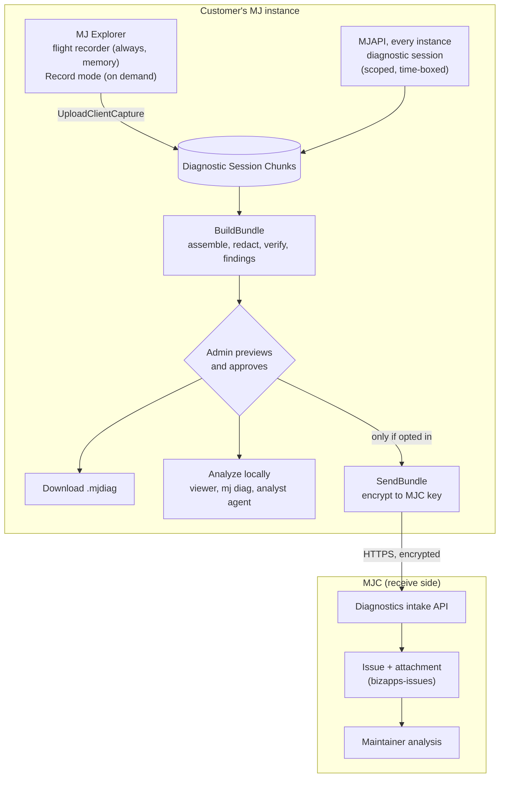
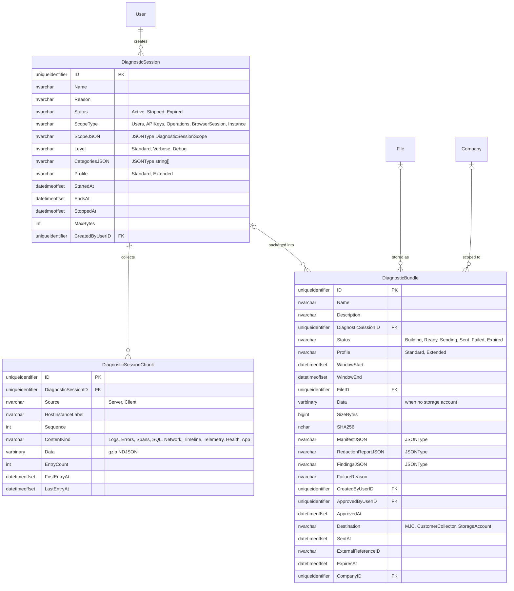

# Diagnostic Bundles: user log export, scoped server diagnostics, and opt-in sharing

## Status
- **Status**: Draft (plan only, no code)
- **Priority**: High
- **Created**: 2026-11-02
- **Implementation owner**: `CaelebB-BC`
- **Reviewer once implemented**: `cadam11`
- **MJC receive side**: owned by the MJC team (see [MJC receive side](#mjc-receive-side))
- **Branch**: `claude/diagnostic-bundles`
- **Target release**: `6.2.0-edge.8`, then the 6.2 LTS baseline (see [Release targeting](#release-targeting))

## Overview

MJ is moving into many more, and much larger, production deployments. When a customer reports a slow screen, a hang, or a bug, we have no reliable way to see what happened. Neither tier keeps a log buffer. Nothing ties a click in MJ Explorer to the server request and SQL behind it. Server verbosity is fixed at boot. Issue #5510 is the clearest example: event-loop stalls froze every Explorer session in production, and nothing recorded when, for how long, or what was running.

This plan adds an on-demand **diagnostic bundle**: a redacted, local capture of one incident from both MJ Explorer and MJAPI. A user can download their client-side capture from Explorer. An admin can start a scoped, time-boxed server diagnostic session, combine both halves into one structured file, preview exactly what it contains, and then download it or send it encrypted to MemberJunction. The receive side (intake, storage, triage, analysis) runs on **MJC**.

The bundle is deliberately separate from Phone Home (#2970), which is continuous, de-identified, aggregate telemetry. The bundle is per incident, richer, customer-reviewed, and never sent without an admin's action. The two share building blocks, so Phone Home and the OpenTelemetry exporter (#2281) can be built on this work later: one entry format (OpenTelemetry field names), one trace ID, one runtime-minted install ID, consent recorded as Audit Log rows, and one transport to MJC.

## Release targeting

- **Priority: high.** Larger and more numerous production deployments need this now, and 6.2 will be a widely adopted release.
- **Preferred path: land in `next` for `6.2.0-edge.8`, and use edge.8 as the baseline for the 6.2 candidate cut** (the `pre exit` → `6.2.0` → `lts/6.2` dance in `plans/lts-process.md` §5.2). That puts the feature in 6.2.x LTS from day one, with no line backport.
- **Scope for edge.8:** Phases 0–2 at minimum. **All schema changes land in Phase 0, in one migration**, so the 6.2 line starts with the final tables and every later phase is code only. Anything that misses edge.8 reaches `lts/6.2` by `backport lts/6.2` label (lts-process §5.2 rule 2).
- **6.1 backport:** possible, because migrations can ride labeled line patches (lts-process §12), but it is not the preferred path. Decide after 6.2 ships, based on which production deployments are still on 6.1. Independently, the security fixes in Phase 0 (0.1–0.4) qualify for `backport lts/6.1` on their own merits under lts-process §5.3.

## Goals & Non-Goals

### Goals
- A user can download a redacted client diagnostic file from MJ Explorer in two clicks, including the minutes before they decided to report.
- An admin can start a server diagnostic session scoped to a user (or operation, or the whole instance) for at most 60 minutes, on a multi-instance deployment, without a restart.
- One trace ID links each client request to its server span, SQL statements, log lines and any event-loop stall.
- One `.mjdiag` file holds both halves, in a documented format that standard tools can read.
- Nothing leaves an instance unless an admin holding a dedicated authorization previews a bundle and sends it, to a destination the instance has opted in to.
- MJ ships tooling to analyze a bundle (rules-based findings, CLI, Explorer viewer, analyst agent), usable by customers to tune their own environment, not only by MJ.
- Zero measurable overhead when no session is active; low overhead for the requests a session targets.

### Non-Goals
- Continuous telemetry to MJ (that is Phone Home, #2970).
- Exporting metrics and traces to customer monitoring stacks (that is #2281; this plan makes it cheaper but does not build it).
- Capturing content: prompt text, agent step I/O, message bodies, request/response bodies, cache contents, audio, transcripts. Never, at any profile.
- Session replay or DOM capture.
- Building the MJC intake service itself (owned by the MJC team; this plan defines the contract it must meet).

## Background & Context

Findings from a review of `next` on 2026-11-02 (paths under `packages/` unless noted):

| Area | What exists | Gap |
|---|---|---|
| Log calls | `LogError`, `LogStatus`, `LogStatusEx`, `LogWarning` in `MJCore/src/generic/logging.ts`; output via `logToConsole` | Console only, no sink or buffer. About 900 direct `console.*` calls in MJServer, AI and Actions bypass it. Production MJAPI drops every `LogStatus` line (`NODE_ENV === 'production'` check). |
| Runtime verbosity | `MJ_VERBOSE` env var read per call; `telemetry.level` config | `isDebugLogLevel()` is memoized at boot (`MJServer/src/context.ts:47`). `SetVerboseLogging()` only acts in a browser, yet `MJServer/src/index.ts:467` relies on it. |
| Telemetry | `TelemetryManager` (`MJCore/src/generic/telemetryManager.ts`) records RunView, RunQuery, engine loads and coalescing, with analyzers for duplicate views and missed parallelism | Off by default in the browser. Fingerprints and `sampleParams` keep literal filter values even at `basic`. Event buffer trims with `filter()` per event (not a ring buffer); `_activeEvents` is never capped. Save, Delete and `ExecuteGQL` are not timed. `TelemetryResolver` has no authorization check. |
| SQL capture | SQL logging sessions (`GenericDatabaseProvider` `CreateSqlLogger`, `SqlLogger.ts`, `MJServer/src/resolvers/SqlLoggingConfigResolver.ts`, Explorer settings page) | Parameter values written verbatim; no per-statement timing; files on one instance's local disk; no call sites in `PostgreSQLDataProvider`. SQL Server errors embed the full query and `JSON.stringify(parameters)` (`SQLServerDataProvider.ts:322-325`). |
| Request context | `x-session-id` per browser tab (read at `MJServer/src/context.ts`); per-request providers | No request or trace ID anywhere. No general per-request timing; `integrationOperationTracer` (`MJServer/src/apolloServer/index.ts`) covers `Integration*` operations only. |
| Client errors | `SanitizeGraphQLError` strips variable values | No Angular `ErrorHandler`, `window.onerror` or `unhandledrejection` handler; errors reach the console only. |
| Startup and stalls | `StartupManager` per-engine `loadDurationMs`; `StartupLogger` phase timings; draft PR #5615 adds an event-loop stall monitor | No browser performance marks. `StartupLogger` instance is local to `Serve()` and discarded. The loading screen's Reset (`shell.component.ts` `ResetApplication`) wipes storage and any evidence with it. |
| Environment header | About dialog `CopyDiagnostics()`; GraphQL `Info` (`InfoResolver.ts`); System Diagnostics "Export JSON" | Export requires telemetry on; its timestamps render as 1970 (`performance.now()` treated as epoch). `InfoResolver` sets `Arch` from `os.platform()`. |
| Persisted runs | Agent and Prompt Runs, Action Execution Logs, Scheduled Job Runs, API Key Usage Logs, all with timings | Free-text columns hold client data (rendered prompts, step I/O, message bodies). Usable for timings and statuses only. |
| Outbound channel | Feedback dialog → `FeedbackResolver` | Files **public** GitHub issues in `MemberJunction/MJ` by default, screenshots included. Must never carry bundles. |
| Instance identity | `HostInstanceIdentity` (`hostname:port:pid:bootId`, `MJServer/src/agentSessions/HostInstance.ts`) | Per process, contains hostname. No install ID. A seeded one would be identical on every install. |
| Multi-instance | Redis pub/sub when `REDIS_URL` is set (`RedisLocalStorageProvider.PublishMessage`, fan-out precedents in `MJServer/src/index.ts` with `ProcessUUID` self-filter) | No bus without Redis; the database is the only shared medium. |
| Redaction primitives | `RedactParams` (`Actions/Base/src/ParamRedaction.ts`), `RedactArg` + `@NoLog` (`MJServer/src/logging/`), `GetIndexRestrictedFieldNames` (`MJCore/src/generic/indexRestrictedFields.ts`), `EncryptionEngine.IsEncrypted`, `SanitizeForPersistence` | No general log scrubber; no PII classification on `EntityField`. |
| Settings | `MJ: Instance Configurations` via `InstanceConfigEngine` (`MJCoreEntities/src/engines/InstanceConfigEngine.ts`), seeded from `metadata/instance-configurations/` | Cached to clients, so never store secrets there. |

Related work: #2970 (Phone Home design, parked), #2281 (OpenTelemetry), #5510 and draft PR #5615 (event-loop stalls), PR #4214 (client analytics providers proposal, which also flags the missing `ErrorHandler` and search text in the `resource/search/:searchInput` route), #667 (user activity auditing).

Open Apps built on MJ shape the privacy bar: candidate voice and transcripts (Caliber), anonymous public respondents (Forms), payments and journal entries (Orders, Accounting), candidate HR data (ATS), secure messages (Secure Messaging). Several expose anonymous edges with tokens in URLs. 81 Remote Operations across seven apps are the main server boundary.

## Architecture / Design

### Principles
1. **Local first.** Capture, assembly, findings and viewing all run on the customer's instance. The default output is a file the admin downloads.
2. **Nothing leaves without an admin's send.** Sending requires the `Diagnostics: Send Externally` authorization, an instance opt-in, an allowed destination, and a preview of that exact bundle.
3. **Redact at capture, verify at export.** Do not record what cannot ship. At export, re-scan every file; a hit fails the bundle closed instead of shipping it.
4. **Shapes, not values, by default.** Normalized SQL and filters, variable shapes, route templates, error classes.
5. **Pseudonymize identity.** User and record IDs become HMAC-SHA256 values keyed by a per-bundle salt that never leaves the instance. Consistent within a bundle, unlinkable across bundles, reversible only by the customer.
6. **Use existing metadata.** Drop `Encrypt` fields, `@NoLog` args, fields any role is denied (`GetIndexRestrictedFieldNames`), action params with `LogValue` off.
7. **Tell the person being recorded.** Explorer shows an indicator while a server session targets the current user.
8. **Audit every step** as Audit Log rows (pattern: `agentVisionConsentAudit.ts`).
9. **Targeted, not global.** A session elevates logging only for the requests it matches. Untargeted requests pay one cheap check.
10. **One tenant per bundle** on multi-tenant instances.

### Redaction profiles

| Data | Standard (default) | Extended (admin chooses per bundle; capped by `Diagnostics.MaxProfile`) |
|---|---|---|
| SQL | Normalized statement (literals → `?`) + duration | Adds literal values; encrypted and restricted fields still masked |
| Filters, OrderBy | Shape only | Full text |
| URLs | Route templates | Full path; query strings and fragments always dropped |
| GraphQL variables | Key/type shape (`VariableShape`) | Key/type shape |
| Error messages | Error class + scrubbed message | Full message; secrets scanner still applies |
| Users | Pseudonym + role names | Pseudonym + role names |
| Record IDs | Pseudonymized | As stored |

Never included at any profile: prompt text, agent step I/O, message bodies, request or response bodies, cache contents, auth tokens, audio, transcripts. A screenshot is a separate, explicit, off-by-default attachment.

The secrets scanner (backstop for every profile) matches at least: JWTs, `Bearer` headers, MJ API keys, connection strings with credentials, magic-link tokens, Secure Messaging `sm_` tokens, emails, phone numbers, and card numbers passing Luhn.

### Components

New packages (names indicative; follow `guides/UI_LAYERING_GUIDE.md`):

| Package | Layer | Responsibility |
|---|---|---|
| `@memberjunction/diagnostics` (`packages/Diagnostics/Core`) | L0, isomorphic | Entry envelope types, bounded ring buffers, redactor and secrets scanner, SQL/filter normalizer, pseudonymizer (WebCrypto), route templater, `.mjdiag` writer/reader, findings rule engine, Perfetto/OTLP exporters. No MJ server deps; usable in browser, server and CLI. |
| `@memberjunction/diagnostics-server` (`packages/Diagnostics/Server`) | Server | `DiagnosticSessionManager`, `AsyncLocalStorage` request context, server log sink and console tap, Apollo span plugin, SQL observer, chunk writer, health snapshot, bundle assembler, MJC transport, Remote Operation implementations, retention job driver. Registered in `@memberjunction/server-bootstrap`. |
| `@memberjunction/ng-diagnostics` (`packages/Angular/Generic/diagnostics`) | L1/L2 | Client flight recorder service, Report-a-problem dialog, recording indicator, bundle preview and viewer components. No Router imports. |
| Explorer surfaces | L3 | About dialog button, user menu item, loading-screen download, Admin → Monitoring "Diagnostics" dashboard, System Diagnostics export. |
| `mj diag` (`packages/MJCLI/src/commands/diag/`) | CLI | `inspect`, `verify-redaction`, `timeline`, `slow`, `export --perfetto|--otlp`. |

Bootstrap manifests: the server package belongs in `@memberjunction/server-bootstrap` only. `packages/Angular/Bootstrap*` must not gain server-only dependencies (see their `CLAUDE.md`).

### Flow



### Sequence: user reports a problem, admin sends it

```mermaid
sequenceDiagram
    participant U as User (Explorer)
    participant API as MJAPI (any instance)
    participant DB as Database
    participant A as Admin (Explorer)
    participant MJC as MJC intake
    U->>API: Report a problem (optional self-scoped session if SelfServiceRecording)
    API->>DB: Insert DiagnosticSession (Active, EndsAt)
    API-->>API: Other instances pick it up (Redis or 15 s poll)
    U->>API: Reproduces (traceparent on every request)
    API->>DB: Flush gzip NDJSON chunks (per instance)
    U->>API: Stop + UploadClientCapture (redacted ring buffers)
    API->>DB: DiagnosticBundle (Building → Ready)
    A->>API: GetBundlePreview
    A->>API: SendBundle (requires Send Externally + opt-in)
    API->>MJC: POST /bundles (metadata) → referenceId + upload URL
    API->>MJC: PUT encrypted bytes, POST complete
    API->>DB: Bundle Sent + ExternalReferenceID; Audit Log rows
```

### Correlation (highest-leverage change)

- `GraphQLDataProvider` sends a W3C `traceparent` header on every HTTP call (add a `requestMiddleware` beside the existing `responseMiddleware` in `CreateNewGraphQLClient`), on the XHR progress path (`ExecuteGQLWithProgress`), and in the `graphql-ws` operation payload extensions.
- MJAPI pre-auth middleware (`BaseServerMiddleware.GetPreAuthMiddleware`) parses `traceparent` or mints one, opens an `AsyncLocalStorage` scope `{ TraceID, SpanID, BrowserSessionID, UserID?, SessionMatch? }`, and echoes `x-mj-trace-id` on the response. Post-auth middleware fills in the user.
- Add `traceparent` to CORS allowed headers and `x-mj-trace-id` to exposed headers (`MJServer/src/index.ts`, global CORS around line 1491), or the browser will drop them.
- Every entry on both tiers carries the trace ID. Using the W3C header makes the later OpenTelemetry exporter (#2281) nearly free.

### Logging sink and context (MJCore)

`logging.ts` gains a sink registry and a context provider. Both tiers use them; the server backs the provider with `AsyncLocalStorage`, the browser with a per-tab value.

```typescript
export type LogSeverity = 'Trace' | 'Debug' | 'Info' | 'Warning' | 'Error' | 'Critical';

export interface LogEntry {
    TimestampMs: number;          // epoch ms (not performance.now())
    Severity: LogSeverity;
    Category?: string;
    Message: string;
    Args?: unknown[];             // passed through the redactor before storage
    ErrorName?: string;
    ErrorStack?: string;
    Metadata?: Record<string, unknown>;
    VerboseOnly: boolean;
}

export interface DiagnosticContext {
    TraceID?: string;
    SpanID?: string;
    BrowserSessionID?: string;
    UserID?: string;
    /** True when an active diagnostic session matches this request or tab. */
    IsCaptured: boolean;
    /** Elevated level for captured work; undefined = configured default. */
    Level?: 'Standard' | 'Verbose' | 'Debug';
}

export interface IDiagnosticContextProvider {
    Current(): DiagnosticContext | undefined;
}

export type LogSink = (entry: LogEntry, context: DiagnosticContext | undefined) => void;

export function RegisterLogSink(sink: LogSink): () => void;          // returns unregister
export function SetDiagnosticContextProvider(provider: IDiagnosticContextProvider | null): void;
```

Rules:
- Every `Log*` call builds a `LogEntry` and calls sinks **before** the console decision, only when at least one sink is registered (length check first, no allocation otherwise). A `LogStatus` suppressed from the console in production still reaches a sink when the context is captured.
- `IsVerboseLoggingEnabled()` returns true when `Current()?.Level` is `Verbose` or `Debug`, else falls back to today's env/browser logic.
- `SetVerboseLogging()` works on Node (module flag), fixing the no-op that `MJServer/src/index.ts:467` relies on.
- Sinks must never throw into callers; wrap and count failures.
- Console tap (`diagnostics-server` at boot, `MJExplorer/src/main.ts` before bootstrap) wraps `console.error`/`warn`/`log`/`info`/`debug`, forwarding to the original and, when captured, to the sink.

### Server diagnostic sessions

- `DiagnosticSessionManager` (singleton via `BaseSingleton`) holds the active sessions. Load at boot, poll every ~15 s (single small query on `Status='Active' AND EndsAt > now`), and subscribe to Redis channel `mj:diagnostics:sessions` when `REDIS_URL` is set (stamp and filter `MJGlobal.Instance.ProcessUUID`, as the existing fan-outs do). Expiry is computed from `EndsAt`, never an in-process timer. Worker-role instances (`MJ_SERVER_ROLE`) participate.
- **Matching**: a request is captured when its user, API key, browser session ID, or Remote Operation key matches an active session scope, or when an `Instance` scope is active. Matching runs once per request in the pre-auth/post-auth middleware and is stored in the context.
- **Background work** inherits context: `ScheduledJobEngine` runs, agent runs (`BaseAgent`), WorkQueue consumers, and LongRunning Remote Operations open a context for the user they act for.
- **Request spans**: an Apollo plugin modeled on `integrationOperationTracer` records operation name and type, duration, status, error class, SQL statement count and total SQL time. Remote Operations add key, mode, scope and outcome, never inputs.
- **SQL observer**: add an `ISqlObserver` hook to `GenericDatabaseProvider` with `(statementText, parameterShapes, durationMs, rowCount, errorClass, contextUser)`. Call it from `SQLServerDataProvider` (`executeSQLCore`) and add the equivalent call sites to `PostgreSQLDataProvider`. Measure per-statement duration there. The existing `SqlLogger` file mode stays as-is for CodeGen capture.
- **Chunk writer**: per-instance in-memory buffer → gzip NDJSON chunk rows every 10 s or 256 KB, using the queued-save pattern in `plans/fire-and-forget-logging-audit.md`. Hard cap per session (default 50 MB, configurable); on cap, stop capturing and record a `CapReached` entry.
- **Health snapshot** (taken at build time, from the instance building the bundle plus per-instance snapshots written as chunks at session start/stop): MJ and Node versions, OS family, DB platform and version, migration level (max successful version in `flyway_schema_history`), server role, loaded Open Apps and versions (retain the `loadDynamicAppPackages` result), the retained `StartupLogger` summary, `StartupManager.GetRegistrations()` timings, engine census, `LocalCacheManager.GetStats()`, `ScheduledJobsService.GetStatus()`, event-loop stalls (#5615), `TelemetryManager` insights, and an allowlist of non-secret config flags.

### Client capture (MJ Explorer)

- **Flight recorder** (always on, memory only, cleared on reload): ring buffers of 1,000 log entries, 500 network records, 200 navigation entries, all errors (capped at 200). Listed in `plans/MEMORY_LEAK_AUDIT.md`.
- **Error capture**: Angular `ErrorHandler` provided from explorer-core's module `forRoot`, `window` `error` and `unhandledrejection` listeners, and error notifications shown through `MJNotificationService`.
- **Network**: GraphQL operation name, duration, status, response bytes, trace ID; WebSocket state transitions from `SocketConnectivity$`.
- **Startup timeline**: `performance.mark` at preload (`main.ts`), auth init, each phase of GraphQL client setup, metadata load, `StartupManager` completion, `OnFirstResourceLoadComplete` (`shell.component.ts`); Navigation Timing; a `PerformanceObserver` for long tasks. Export uses `performance.timeOrigin` to convert to epoch.
- **Record mode** (on demand): raises `TelemetryManager` to `standard` with redaction on, enables verbose for this tab, and persists the buffers to IndexedDB with a 2-hour TTL so reload and startup problems survive. Ends itself after 30 minutes. Shows the recording indicator. This is ephemeral diagnostic data, not a user preference, so it does not go through `UserInfoEngine`.
- **Routes**: record route templates from the Angular router config (for example `resource/search/:searchInput`), never the concrete URL.
- **Entry points**: About dialog (beside "Copy diagnostics"), user menu "Report a problem", the stuck-loading screen (offer download **before** Reset wipes storage), System Diagnostics "Export JSON" (fix timestamps, include the new buffers).
- **Download** uses `ExportService.DownloadResult`; gzip via native `CompressionStream`; zip writing from the core package (no new runtime dependency in the browser bundle if avoidable).

### `TelemetryManager` changes
- Redaction mode (default on): fingerprints, `sampleParams`, insight messages and `params` use normalized filter text, never literal values.
- Replace per-event `filter()` trimming with real ring buffers; cap `_activeEvents`.
- Add `OnEvent(callback)` (the hook #2281 proposes) so diagnostics and, later, OpenTelemetry consume the same events.
- Instrument `Save`, `Delete`, and `ExecuteGQL` under the existing but unused `Network` category.
- Export `performance.timeOrigin` with every export.

### Bundle format (`.mjdiag`, format version 1)

A zip of JSON and NDJSON. Entries use OpenTelemetry log and span field names (`timestamp`, `severity_text`, `body`, `attributes`, `trace_id`, `span_id`). Target under 5 MB typical; 25 MB hard cap.

| Path | Contents |
|---|---|
| `manifest.json` | Format version, bundle ID, install ID, time window, profile, creator pseudonym, consent record, file list with SHA-256, redaction report (counts per rule per file) |
| `README.txt` | Plain-language contents and redaction summary for the admin deciding whether to send |
| `environment.json` | Client and server MJ versions, Open Apps and versions, browser family and version, OS family, DB platform and version, migration level, server role, instance count, non-secret config flags |
| `findings.json` | Rules-based findings computed at export |
| `client/logs.ndjson`, `client/errors.ndjson` | Client log entries and errors |
| `client/network.ndjson` | One record per GraphQL call |
| `client/timeline.json` | Startup marks, Navigation Timing, long tasks, route templates visited |
| `client/telemetry.json` | Redacted `TelemetryManager` events, patterns, insights |
| `server/<instance>/logs.ndjson` | Session-scoped server log entries per instance (instance label pseudonymized) |
| `server/spans.ndjson` | Per-request spans with SQL count and time |
| `server/sql.ndjson` | Normalized statements with durations |
| `server/health.json` | Health snapshots |
| `apps/<app>/<section>.json` | Open App contributor sections |

### Opt-in, permissions, and settings

Instance Configurations (category `Diagnostics`), seeded with defaults via `metadata/instance-configurations/`:

| FeatureKey | Default | Meaning |
|---|---|---|
| `Diagnostics.Capture.Enabled` | `true` | Admins can run sessions and build bundles locally |
| `Diagnostics.SelfServiceRecording` | `false` | Non-admin users may start a self-scoped server session from Report a problem; the result goes to the admin queue, never directly out |
| `Diagnostics.External.Enabled` | `false` | Bundles may leave the instance at all |
| `Diagnostics.External.Destinations` | `[]` | Allowed destinations: `MJC`, `CustomerCollector`, `StorageAccount` |
| `Diagnostics.MaxProfile` | `Standard` | Highest profile an admin may choose |
| `Diagnostics.MaxSessionMinutes` | `60` | Hard cap on a session |
| `Diagnostics.RetentionDays` | `14` | Local purge of sessions, chunks and bundles |

- `mj.config.cjs` kill switch `diagnostics.allowExternal: false` overrides the database, for operators who must guarantee nothing leaves.
- Destination secrets (customer collector tokens, MJC support token if required) live in MJ Credentials, never in Instance Configurations, which cache to clients.
- **Install ID**: `Instance.InstallID`, a random UUID minted on first boot by `diagnostics-server` (insert if absent, then re-read so concurrent first boots converge on one value). Never seeded by migration or metadata. Phone Home reuses it.
- **Authorizations** (`metadata/authorizations`, role mapping in `metadata/authorization-roles`): `Diagnostics: Run Sessions` and `Diagnostics: Send Externally`, deliberately separate; the Owner user type is a fallback. Default role mapping to the administrator role; confirm role names during implementation.
- **API scopes** (`metadata/api-scopes`): `diagnostics:read`, `diagnostics:manage`, `diagnostics:send`.
- Refuse scope-limited principals (magic-link sessions) on every diagnostics operation (`IsScopeLimitedPrincipal`).
- **Audit Log types** (`metadata/audit-log-types`): Diagnostics Session Started, Session Stopped, Bundle Built, Bundle Previewed, Bundle Sent, Bundle Send Failed, Sharing Settings Changed.

### API changes: Remote Operations

Metadata rows in `metadata/remote-operations/.diagnostics-operations.json`, category `Diagnostics`, `GenerationType: 'Manual'`, types under `metadata/remote-operations/types/`. Server classes register with `@RegisterClass(BaseRemotableOperation, '<key>')` and override `Authorize`. Thin Actions over the same engine expose them to agents.

| OperationKey | Mode | Scope | Purpose |
|---|---|---|---|
| `Diagnostics.StartSession` | Sync | `diagnostics:manage` | Create a session (scope, level, categories, minutes, profile, reason) |
| `Diagnostics.StopSession` | Sync | `diagnostics:manage` | Stop a session now |
| `Diagnostics.GetMySessionStatus` | Sync | none (self only) | Drives the recording indicator; returns only sessions targeting the caller |
| `Diagnostics.UploadClientCapture` | Sync | `diagnostics:manage` or self when self-service is on | Upload redacted client buffers to a session as chunks (chunked, size-capped) |
| `Diagnostics.BuildBundle` | LongRunning | `diagnostics:manage` | Assemble, redact, verify, compute findings; emits progress |
| `Diagnostics.GetBundlePreview` | Sync | `diagnostics:read` | Manifest, README, redaction report, per-file samples |
| `Diagnostics.SendBundle` | LongRunning | `diagnostics:send` | Encrypt and deliver to an allowed destination |

Bundle download uses a short-lived signed route registered with `ApiRoute()` from `@memberjunction/server` (never `app.use`; see `packages/MJAPI/CLAUDE.md`), or an MJStorage presigned URL when the bundle is stored there. Binary payloads do not travel through GraphQL.

### Encryption
Hybrid encryption with Node built-ins: ephemeral X25519 ECDH, HKDF-SHA256, AES-256-GCM. The recipient key is identified by key ID. MJ ships MJC's current public key(s) in config defaults (`diagnostics.mjc.publicKeys`) and may refresh them from MJC over TLS. Customer collectors supply their own public key. The bundle's SHA-256 is computed before encryption and recorded locally and at MJC.

### MJC receive side

The receive side of log sharing runs on **MJC**. This repo builds the MJ-side client against the contract below; the MJC team owns the service, storage, access control, and retention. The contract is a starting proposal for the MJC owners to confirm or change.

1. `POST {mjcBaseUrl}/api/diagnostics/v1/bundles` with `{ installId, bundleId, formatVersion, mjVersion, profile, sizeBytes, sha256, keyId, summary?, contact? }` → `201 { referenceId, uploadUrl, uploadExpiresAt }`.
2. `PUT {uploadUrl}` with the encrypted bytes.
3. `POST {mjcBaseUrl}/api/diagnostics/v1/bundles/{referenceId}/complete` with `{ sha256 }` → `{ status: 'received', retentionUntil }`.

MJC responsibilities: authenticate senders (MJC-hosted instances automatically; self-hosted via a support token issued by MJC, stored in MJ Credentials), rate limiting, private-key custody (KMS), storage, creating an Issue with the bundle attached (bizapps-issues is already planned as MJC's feedback destination; it needs an attachment link and structured environment fields), maintainer notification, published retention and purge, and an analysis environment where bundles are decrypted. `referenceId` is shown to the admin and stored on the bundle row.

### Findings engine and analysis tooling
- **Rules first** (in the core package, run at export and in every viewer): slow requests with their SQL, N+1 and duplicate RunViews (reuse `TelemetryManager` analyzers), event-loop stalls with work in flight, cache miss rates, oversized payloads, startup phases over budget, socket drops, client errors correlated to server errors by trace ID. Output `findings.json` with rule ID, severity, evidence pointers (trace IDs) and a remediation hint.
- **Explorer viewer**: client-plus-server waterfall by trace ID, findings, environment. Opens a bundle from the server or a local file.
- **Exports**: Chrome Trace Event JSON (opens in Perfetto or Speedscope), OTLP JSON (Jaeger, Grafana Tempo).
- **Diagnostic Analyst agent**, shipped as metadata: reads findings and summaries, never raw logs; explains likely causes and environment changes (for example separating worker and API roles per #5510). Runs on the customer's configured models, so analysis needs no sharing.
- **Maintainer skill** in this repo (`.claude/skills/analyze-diagnostic-bundle/`), modeled on `.claude/commands/debug-agent-run.md`: maps findings to source files and known issues.

### Open App extension point
`BaseDiagnosticContributor` (server and client variants), registered with `@RegisterClass`, returns named sections and declares a data class for every field (`count`, `duration_ms`, `enum`, `status`, `metadata_id`, `scrubbed_text`). A CI test walks registered contributors and rejects undeclared fields, a lighter version of the #2970 schema DSL. This also gives apps one home for today's scattered health surfaces (GraphQL health queries, `ServerExtension.HealthCheck()`, readiness modules, CLI doctors). First adopters, tracked in their own repos: Caliber (operational health, host readiness, realtime session lifecycle), Orders (extension health, checkout step attempts, webhook outcomes), Accounting (JE batch status, finance exception counts), Forms (automation run and outbox status), Sonar (recompute durations), Common (ActivitySync counters). Anonymous edges (Forms respondents, Orders checkout, Caliber widget, Secure Messaging portal) can be targeted by operation key at Standard only, and their URL tokens are always dropped.

## Implementation Plan

### Phase 0: Foundations, fixes, and all schema (target: edge.8)
1. **Authorize `TelemetryResolver`** (`MJServer/src/resolvers/TelemetryResolver.ts`): require `Diagnostics: Run Sessions` or Owner; refuse scope-limited principals. Candidate for `backport lts/6.1`.
2. **Stop embedding parameter values in SQL errors** (`SQLServerDataProvider/src/SQLServerDataProvider.ts:322-325`): keep parameter names and types only; check the PostgreSQL provider for the same pattern. Candidate for `backport lts/6.1`.
3. **Stop logging `REDIS_URL`** (`MJServer/src/index.ts:502`): log host only, credentials stripped. Candidate for `backport lts/6.1`.
4. **Escape the MCP agent-run filter** (`AI/MCPServer/src/Server.ts`, `List_Recent_Agent_Runs`): `EscapeSQLString` for `agentName`, allowlist for `status`. Candidate for `backport lts/6.1`.
5. **Fix verbosity plumbing** (`MJCore/src/generic/logging.ts`): `SetVerboseLogging` works on Node; keep production console suppression for `LogStatus` but route to sinks.
6. **Land #5615** (event-loop stall monitor); its warnings flow through the sink once item 8 lands.
7. **Small correctness fixes**: System Diagnostics timestamps (`performance.timeOrigin + startTime`); `InfoResolver` `Arch` → `os.arch()`; remove stale `'MJ: Query Execution Histories'` from `DEFAULT_HIGH_CHURN_SYSTEM_ENTITIES`.
8. **Sink and context API** in `logging.ts` (see design); unit tests prove no allocation when no sink is registered.
9. **Create `@memberjunction/diagnostics`** with envelope types, ring buffers, redactor, scanner, normalizers, pseudonymizer, `.mjdiag` writer/reader, findings engine skeleton.
10. **Correlation**: client `traceparent` in `GraphQLDataProvider` (HTTP, XHR, WS); server middleware with `AsyncLocalStorage`; CORS allow/expose headers.
11. **Client error capture**: `ErrorHandler`, `error` and `unhandledrejection` listeners, console tap in `MJExplorer/src/main.ts`.
12. **Migration** (one file, all three tables) + CodeGen + metadata JSON (Instance Configurations, Authorizations, role mappings, API scopes, Audit Log types, Remote Operation category and rows). Add `MJ: Diagnostic Session Chunks` to `DEFAULT_HIGH_CHURN_SYSTEM_ENTITIES`.
13. **Install ID** minted on first boot.

### Phase 1: Client export (target: edge.8)
1. Flight recorder service in `@memberjunction/ng-diagnostics` over core ring buffers; network middleware; navigation and route templates.
2. Startup marks and long-task observer (`main.ts`, auth init, GraphQL setup, `StartupManager`, `shell.component.ts` `OnFirstResourceLoadComplete`).
3. `TelemetryManager` changes (redaction mode, ring buffers, `_activeEvents` cap, `OnEvent`, Save/Delete/ExecuteGQL timing, `timeOrigin`).
4. Record mode with IndexedDB persistence, TTL, auto-off, indicator.
5. Entry points: About dialog, user menu Report a problem, loading screen (before Reset), System Diagnostics export.
6. Client-only bundle build and download.
7. `mj diag inspect` and `mj diag verify-redaction`.

### Phase 2: Server sessions and combined bundles (target: edge.8)
1. `DiagnosticSessionManager` (load, poll, Redis channel, matching, expiry).
2. Server log sink + console tap → chunk writer with caps and queued saves.
3. Apollo span plugin; Remote Operation spans.
4. `ISqlObserver` with per-statement timing in SQL Server and PostgreSQL providers; normalizer.
5. Context propagation into scheduled jobs, agent runs, WorkQueue consumers, LongRunning Remote Operations.
6. Health snapshot (retain `StartupLogger` summary and `loadDynamicAppPackages` result).
7. Remote Operations: `StartSession`, `StopSession`, `GetMySessionStatus`, `UploadClientCapture`, `BuildBundle`, `GetBundlePreview`; signed download route via `ApiRoute()`.
8. Admin → Monitoring → **Diagnostics** dashboard: start/stop sessions, list bundles, preview (manifest, README, redaction report, file browser), download. Recording indicator for targeted users.
9. Self-service recording path (behind `Diagnostics.SelfServiceRecording`).
10. Retention purge scheduled job (pattern: `ActionLogRetentionScheduledJobDriver`).
11. `BaseDiagnosticContributor` + CI test.

### Phase 3: Send to MJC and analysis (edge.8 if ready, else backport to `lts/6.2`)
1. `SendBundle`: settings gate, kill switch, encryption, three-step MJC upload with retries, status and reference ID, audit rows.
2. Findings rules v1.
3. Bundle viewer (L2) used by the Diagnostics dashboard; open local files.
4. Perfetto and OTLP exports; `mj diag timeline`, `slow`, `export`.
5. Diagnostic Analyst agent (metadata).
6. Maintainer skill.
7. Open App contributors (in their repos).

### Phase 4: Converge (later, separate plans)
OpenTelemetry exporter (#2281) on `TelemetryManager.OnEvent` and the same trace IDs; Phone Home (#2970) on the same install ID, consent records and MJC transport.

## Migration & Data

One T-SQL migration in `migrations/v6/` (`V<YYYYMMDDHHMM>__v6.2.x__Diagnostic_Bundles.sql`), following `migrations/CLAUDE.md`: no `__mj_CreatedAt`/`__mj_UpdatedAt`, no FK indexes, `sp_addextendedproperty` on every column, CHECK values written for people, 50 blank lines then the appended CodeGen output, no literal `Sequence` on `EntityField` inserts. PostgreSQL is transpiled at release; do not hand-write `migrations-pg/`. Metadata ships as JSON under `metadata/`; the release `Metadata_Sync` carries it. The changeset is `minor` (migration branch).



Entity settings (via `metadata/`, not migration inserts): `TrackRecordChanges = 0` for chunks (high churn, binary); entity permissions grant Read only to the roles mapped to `Diagnostics: Run Sessions`; all chunk and bundle access from the browser goes through Remote Operations; list views never select `Data` (use `Fields` with `ResultType: 'simple'`). Typed JSON interfaces for the `*JSON` columns per `guides/JSONTYPE_GUIDE.md`. Seed rows (categories, authorizations, scopes, audit log types, instance configuration defaults, remote operations) are metadata JSON with `uuidgen` primary keys.

## Testing Strategy

- **Unit** (Vitest, per package): ring buffer bounds; sink registry no-allocation when empty; context provider precedence; SQL and filter normalizer (literals, GUIDs, dates, `IN` lists, nested quotes); pseudonymizer stability within a bundle and divergence across salts; route templater; `.mjdiag` round trip; findings rules on fixtures.
- **Redaction corpus**: a fixture set seeded with canary secrets and PII (JWTs, API keys, connection strings, `sm_` tokens, emails, cards). Standard-profile export must contain none; the verify pass must fail the bundle closed when a canary is injected after redaction.
- **Integration tier** (`pnpm run test:integration`): a new bundle (for example "IT-Diagnostics") that starts a session for the test user, performs RunView, Save, a Remote Operation and a failing query, stops, builds a bundle, and asserts spans, SQL and logs share trace IDs, no literal values appear at Standard, and chunk rows exist. Client-first transport per `guides/INTEGRATION_TESTING_QUICKSTART.md`.
- **Multi-instance**: two MJAPI processes with Redis (instant start/stop) and without Redis (poll-based, within 20 s); one bundle contains both instances' chunks.
- **PostgreSQL parity**: the SQL observer fires and normalizes on PG.
- **Playwright**: Report a problem → download; loading-screen download before Reset; indicator appears only for the targeted user; preview shows the redaction report.
- **Performance budget**: no session active → no measurable change on a RunView microbenchmark and on `/healthcheck` probe latency; session active → p95 overhead under 5% for targeted requests, zero for untargeted ones.
- **MJC contract**: a stub intake verifies the three-step upload, retries, decryption with the test key, and SHA-256 match.

## Risks & Open Questions

- **Hot-path overhead.** Mitigation: short-circuit before allocation (`plans/hotspot-perf-optimization.md`), benchmarks in CI.
- **Redaction misses.** Mitigation: Standard by default, capture-time redaction, fail-closed verify, canary corpus, admin preview of every file.
- **Chunk table growth.** Mitigation: per-session caps, retention purge, excluded from Record Changes and browser cache fan-out.
- **Monitoring of employees.** Mitigation: visible indicator, admin-only sessions, audit trail; customers decide policy.
- **Multi-tenant leakage.** Mitigation: one Company per bundle; tests with two tenants.
- **Open: MJC intake authentication** for self-hosted customers (support token vs. other). MJC team to decide.
- **Open: retention period and data-processing terms** MJ publishes for received bundles.
- **Open: self-service.** Should non-admins start self-scoped server sessions, or only submit client captures to their admin?
- **Open: Extended off-instance.** Allowed at all, or only for on-site work?
- **Open: two-person approval** before an external send for regulated customers?
- **Open: bizapps-issues readiness** as MJC's destination (attachment links, structured environment and confidence fields, its planned GitHub provider).

## Files to Modify

| File | Change |
|------|--------|
| `packages/MJCore/src/generic/logging.ts` | Sink registry, context provider, Node `SetVerboseLogging`, sink routing before console decision |
| `packages/MJCore/src/generic/telemetryManager.ts` | Redaction mode, ring buffers, `_activeEvents` cap, `OnEvent`, new instrumentation, `timeOrigin` |
| `packages/MJCore/src/generic/providerBase.ts` | Time Save/Delete under `Network`; pass redacted params to telemetry |
| `packages/GenericDatabaseProvider/src/GenericDatabaseProvider.ts` | `ISqlObserver` hook |
| `packages/SQLServerDataProvider/src/SQLServerDataProvider.ts` | Observer call with per-statement timing; no parameter values in errors |
| `packages/PostgreSQLDataProvider/src/*` | Observer call sites; same error hygiene |
| `packages/GraphQLDataProvider/src/graphQLDataProvider.ts` | `traceparent` request middleware (HTTP, XHR, WS); network records |
| `packages/MJServer/src/index.ts` | CORS headers; diagnostics middleware registration; retain `StartupLogger` summary and dynamic package list; `REDIS_URL` redaction |
| `packages/MJServer/src/context.ts` | Replace memoized debug level with context-aware check |
| `packages/MJServer/src/apolloServer/index.ts` | Register span plugin |
| `packages/MJServer/src/middleware/BaseServerMiddleware.ts` | (consumer) diagnostics middleware subclass lives in `diagnostics-server` |
| `packages/MJServer/src/resolvers/TelemetryResolver.ts` | Authorization check |
| `packages/MJServer/src/resolvers/InfoResolver.ts` | `Arch` fix |
| `packages/MJServer/src/broadcast/BaseCacheInvalidationBroadcastProvider.ts` | High-churn list update |
| `packages/AI/MCPServer/src/Server.ts` | Escape `List_Recent_Agent_Runs` filter |
| `packages/ServerBootstrap/*` | Register `diagnostics-server` |
| `packages/Diagnostics/Core/**` | New package |
| `packages/Diagnostics/Server/**` | New package |
| `packages/Angular/Generic/diagnostics/**` | New package |
| `packages/Angular/Explorer/explorer-core/src/lib/about/about-dialog.component.ts` | Download diagnostics |
| `packages/Angular/Explorer/explorer-core/src/lib/shell/shell.component.ts` | Startup marks; loading-screen download before Reset; recording indicator |
| `packages/Angular/Explorer/explorer-core/**` (user menu, module `forRoot`) | Report a problem item; `ErrorHandler` provider |
| `packages/Angular/Explorer/dashboards/src/SystemDiagnostics/system-diagnostics.component.ts` | Timestamp fix; export new buffers |
| `packages/Angular/Explorer/dashboards/src/Admin/**` | Diagnostics dashboard under Monitoring |
| `packages/MJExplorer/src/main.ts` | Console tap and preload mark before bootstrap |
| `packages/MJCLI/src/commands/diag/**` | `mj diag` commands |
| `packages/AI/Agents` / `packages/Scheduling` / WorkQueue consumers | Diagnostic context propagation for background work |
| `migrations/v6/V<ts>__v6.2.x__Diagnostic_Bundles.sql` | Three tables + CodeGen output |
| `metadata/instance-configurations/` | `Diagnostics.*` defaults |
| `metadata/authorizations/`, `metadata/authorization-roles/` | Two authorizations and role mappings |
| `metadata/api-scopes/` | `diagnostics:*` scopes |
| `metadata/audit-log-types/` | Diagnostics audit types |
| `metadata/remote-operation-categories/`, `metadata/remote-operations/` | Category, seven operations, type files |
| `metadata/agents/` (or equivalent) | Diagnostic Analyst agent |
| `.claude/skills/analyze-diagnostic-bundle/` | Maintainer skill |
| `guides/DIAGNOSTIC_BUNDLES_GUIDE.md` + `guides/README.md` | Operator and developer guide |

## References

- #2970 MJ Telemetry Sharing System ("Phone Home"), converted from PR #2484
- #2281 Add OpenTelemetry support for production metrics and tracing
- #5510 MJAPI event-loop stall hangs every Explorer session; draft PR #5615
- PR #4214 Client analytics providers proposal (missing `ErrorHandler`, search text in URLs)
- #667 User login/activity auditing
- `plans/lts-process.md` (§5.2 candidate cut and backports, §5.3 eligibility, §12 migrations on lines)
- `plans/fire-and-forget-logging-audit.md`, `plans/hotspot-perf-optimization.md`, `plans/MEMORY_LEAK_AUDIT.md`
- `plans/prompt-run-data-storage-and-step-redaction.md`
- `guides/REMOTE_OPERATIONS_GUIDE.md`, `guides/FIELD_LEVEL_SECURITY_GUIDE.md`, `guides/SERVER_SCALING_AND_BROADCAST_ARCHITECTURE.md`, `guides/UI_LAYERING_GUIDE.md`, `guides/JSONTYPE_GUIDE.md`, `guides/INTEGRATION_TESTING_QUICKSTART.md`
