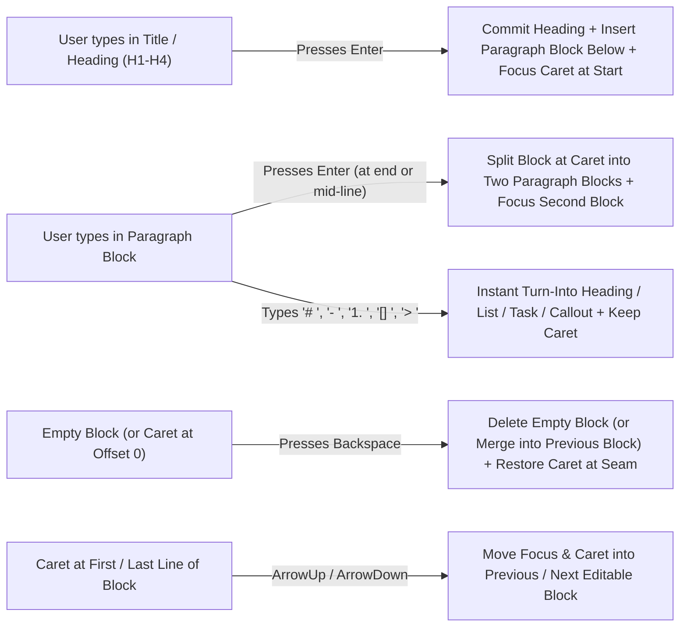

# MJ Docs, Slides, Sheets & Library — Next-Horizon Product & Architecture Plan

**Status:** Active Roadmap Plan  
**Baseline:** Post-PR `#6215`, `#6600`, `#6608` (`v6.3.x`)  
**Primary Packages:** `@memberjunction/ng-artifacts`, `@memberjunction/ng-conversations`, `@memberjunction/ng-explorer-core`, `@memberjunction/core-entities`, `@memberjunction/ai-agents`, `@memberjunction/server`

---

## 1. Executive Summary

Following the delivery of MemberJunction's foundational **Docs, Slides, Sheets & Library** suite (`#6215`, `#6600`, `#6608`) — including the Yjs CRDT collaboration server, single-use HMAC ticket authentication, Redis multi-node relay, viewer-scoped `:::mj-block` live data execution, `O5`/`O6` cryptographic freeze governance, headless `SpreadsheetEngine` / `SlideDeckEngine` / `DocumentLiveBlockEngine`, optimistic-concurrency agent tool libraries, and stateless Connected Cloud Drives — this plan defines the next four horizons of product and engineering execution:

1. **Horizon 1 (P0 / Immediate): Flow-First Authoring in MJ Docs (The 80% Use Case) & Desktop-Class Editing Ergonomics**
2. **Horizon 2 (P1): Cross-Artifact Live Linking & Governed Data Fabrics**
3. **Horizon 3 (P2): Proactive & Autonomous Multi-Artifact Agent Workflows**
4. **Horizon 4 (P3): Enterprise Governance, Connected Drive Round-Trip Sync & Protected Ranges**

---

## 2. Horizon 1 (P0): Flow-First Continuous Document Authoring in MJ Docs (The 80% Use Case)

### 2.1 Problem Statement: Why Simple Document Editing Feels Clunky Today

In `MarkdownArtifactViewerComponent` (`packages/Angular/Generic/artifacts/src/lib/components/plugins/markdown-artifact-viewer.component.ts`), a document is segmented into discrete `DocumentRenderSegment` blocks (`heading`, `paragraph`, `list`, `table`, `callout`, `code`, `block`). Today:
- **`OnEditableBlockKeydown` (`L4340–4350`) only handles `Escape` and `/`**:
  - Pressing **`Enter` inside a Title / Heading block** (`editable-heading-<id>`, `L748–756`) inserts a raw DOM newline inside the heading's `contenteditable="true"` div, which `CommitEditableHeading` (`L4369`) strips back out on `(blur)` (`.replace(/\n+/g, ' ')`) instead of committing the heading and inserting a new paragraph block right below it with active focus.
  - Pressing **`Enter` inside a Paragraph block** (`editable-paragraph-<id>`, `L931–941`) inserts a raw line break inside the same DOM node rather than splitting the block at the caret into a new paragraph block below (with `Shift+Enter` reserved for soft line breaks).
- **Empty blocks cannot be deleted with `Backspace`**:
  - `CommitEditableParagraph` (`L4383`) and `CommitEditableHeading` (`L4370`) return early when `!nextText`, so clearing a block's text and pressing `Backspace` leaves the stale block stranded instead of deleting it and moving the caret to the end of the previous block.
- **No arrow-key flow across block boundaries**:
  - Pressing `ArrowDown` at the last visual line of a block or `ArrowUp` at the first visual line of a block traps the caret inside that block's `contenteditable` node instead of seamlessly transitioning focus into the adjacent block.
- **No click-below-canvas auto-append**:
  - Clicking into the open whitespace below the last block does nothing, forcing the user to hunt for a `+ Add Block` button just to start typing.
- **No instant Markdown prefix auto-conversion**:
  - Typing `# `, `## `, `- `, `1. `, `[] `, or `> ` at the start of a paragraph block does not transform the block into a Heading, List, Task List, or Callout until blur.

### 2.2 Flow-First UX & Technical Design (`MarkdownArtifactViewerComponent`)



#### Key Interactions to Implement in `markdown-artifact-viewer.component.ts`

1. **`Enter` on Heading / Title -> Flow Immediately into Body Paragraph Below**:
   - In `OnEditableBlockKeydown(seg, event)`: when `seg.BlockType === 'heading'` and `event.key === 'Enter'` (`!event.shiftKey`):
     - Call `event.preventDefault()`.
     - Split the heading text at the current DOM selection offset (`beforeCaret`, `afterCaret`).
     - Commit the heading with `beforeCaret` (`# ${beforeCaret}`), insert a new paragraph segment immediately after `seg` initialized with `afterCaret` (or an empty editable paragraph draft if `afterCaret` is empty), and focus the new paragraph block on the next animation frame via `focusEditableSegment(nextSegmentId, 'start')`.
2. **`Enter` vs. `Shift+Enter` in Paragraph Blocks**:
   - **`Enter` (`!event.shiftKey`)**: Splits the current paragraph block at the caret offset into `[beforeCaret, afterCaret]`, creates a new paragraph block immediately below with `afterCaret`, and places the caret at offset `0` of the new block.
   - **`Shift+Enter`**: Inserts a soft line break (`\n`) within the current block.
   - **Double-`Enter` at the end of a List (`OnListItemKeydown`, `L4586`) or Callout**: When the user presses `Enter` on an **empty** trailing list item, exit the list by removing the empty bullet and inserting a fresh paragraph block below the list with focus.
3. **`Backspace` / `Delete` Block Merging & Empty Block Removal**:
   - When the caret is at offset `0` (with no selection range) and the user presses `Backspace`:
     - If the current block is a `heading`, `list`, or `callout` and its text is empty, **turn it back into a plain `paragraph` block in place** first (matching Notion/Google Docs ergonomics).
     - If the current block is already a `paragraph`:
       - If empty, remove the block and move the caret to the end of the preceding editable block.
       - If non-empty and the preceding block is a `paragraph` or `heading`, merge the current block's text onto the end of the preceding block and place the caret right at the merge seam.
4. **Cross-Block `ArrowUp` / `ArrowDown` / `ArrowLeft` / `ArrowRight` Caret Navigation**:
   - Add a caret-boundary helper (`isCaretOnFirstVisualLine(el)` / `isCaretOnLastVisualLine(el)` using `Selection.getRangeAt(0).getBoundingClientRect()` vs. `el.getBoundingClientRect()`):
     - `ArrowUp` on the first visual line (or `ArrowLeft` at offset `0`) focuses the previous editable block at its end.
     - `ArrowDown` on the last visual line (or `ArrowRight` at `text.length`) focuses the next editable block at its start.
5. **Instant Markdown Input Rules (Auto-Formatting Shortcuts)**:
   - In `OnEditableBlockInput(seg, event)` on a `paragraph` segment, inspect the text before the caret when ` ` (Space) is typed at the start of the block:
     - `# `, `## `, `### `, `#### ` -> Convert segment in place to `heading` (`H1`–`H4`) and focus `.mj-docs-editable-heading__text`.
     - `- ` or `* ` -> Convert segment in place to bullet `list` and focus `.mj-docs-editable-list__text`.
     - `1. ` -> Convert segment in place to ordered `list`.
     - `[] ` or `[ ] ` -> Convert segment in place to task `list`.
     - `> ` -> Convert segment in place to `callout` (`NOTE`).
     - ```` ``` ```` -> Convert segment in place to `code` block.
6. **Click-Below-Canvas & Ghost Trailing Paragraph**:
   - Always render a lightweight trailing "Click or press Enter to continue writing, or type `/` for commands…" placeholder zone at the bottom of `.mj-docs-canvas` in edit mode so clicking anywhere below the last block immediately focuses or appends a paragraph block without clicking any toolbar button.

---

## 3. Horizon 1 (Continued): Desktop-Class Editing Ergonomics Across Docs, Slides & Sheets

### 3.1 Scoped Collaborative Undo / Redo (`Y.UndoManager` per User Origin)
- **Current Foundation**: `DocumentCollaborationSession` (`packages/Angular/Generic/artifacts/src/lib/services/document-collaboration.service.ts:1259-1484`) tags all local user transactions with `'local'` and remote/server updates with `'remote'`.
- **Implementation Plan**:
  - Instantiate a `Y.UndoManager` inside `DocumentCollaborationSession` tracking `[this.ContentText, this.Doc.getMap('slidesById'), this.Doc.getArray('slideOrder'), this.Doc.getMap('deckMeta'), this.Doc.getMap('sheetCellsByCoord'), this.Doc.getMap('worksheetsById'), this.Doc.getArray('sheetOrder'), this.Doc.getMap('workbookMeta')]` with `trackedOrigins: new Set(['local'])` and `captureTimeout: 500`.
  - Expose `Undo()`, `Redo()`, `CanUndo$`, and `CanRedo$` on `DocumentCollaborationSession`, wired to `Cmd/Ctrl+Z` and `Cmd/Ctrl+Shift+Z` / `Ctrl+Y` plus toolbar buttons in Docs, Slides, and Sheets.
  - Because remote human edits and server-side AI agent commits use non-`'local'` origins, pressing `Cmd/Ctrl+Z` strictly undoes only the active user's own edits.

### 3.2 MJ Sheets Keyboard Navigation & Rectangular TSV/HTML Clipboard (`Cmd/Ctrl+C` / `Cmd/Ctrl+V`)
- **Current Foundation**: `SpreadsheetArtifactViewerComponent` (`packages/Angular/Generic/artifacts/src/lib/components/plugins/spreadsheet-artifact-viewer.component.ts`) supports single-cell click, `Shift+Click`, drag range selection, `Cmd/Ctrl+Click` multi-ranges, and live peer presence overlays.
- **Implementation Plan**:
  - **Keyboard Grid Navigation**: Wire `ArrowUp`/`Down`/`Left`/`Right` (and `Shift+Arrow*` to expand `SelectedRange`), `Tab`/`Shift+Tab`, `Enter`/`Shift+Enter`, `F2` (begin inline edit), and `Delete`/`Backspace` (call `SpreadsheetEngine.Instance.ClearRange` across all segments in `SelectedRanges`).
  - **Rectangular Copy/Paste (`@HostListener('copy')` / `@HostListener('paste')`)**:
    - On copy: serialize the active range into `text/plain` (TSV) and `text/html` (`<table>`) on the system clipboard.
    - On paste: parse TSV/HTML clipboard matrices and apply all cells in a single `Doc.transact(..., 'local')` batch update via `SpreadsheetEngine.Instance.SetCell`.

### 3.3 Column/Row Drag-Resize in Sheets & Filmstrip Thumbnail Drag-Reorder in Slides
- **Current Foundation**: `SpreadsheetColumnSpec.WidthPx` / `SpreadsheetRowSpec.HeightPx` (`UpdateWorksheetStructure`, `document-collaboration.service.ts:1437`) and `session.ReorderSlidesInDeck(orderedSlideIds)` (`document-collaboration.service.ts:1301`) are already implemented in the CRDT layer.
- **Implementation Plan**:
  - Add pointer-drag resize handles on column and row headers in `SpreadsheetArtifactViewerComponent`.
  - Add HTML5 drag-and-drop (`draggable="true"`, `dragstart`, `dragover`, `drop`) on slide filmstrip thumbnails in `SlideDeckArtifactViewerComponent`.

### 3.4 Native `.docx` & `.pptx` Export Parity for Charts & Whiteboards
- **Implementation Plan**:
  - Extend `DocumentImportExportService.ConvertMarkdownToDocxBytes` (`document-import-export.service.ts`) and `SlideDeckExportService.ExportToPptxPackage` (`slide-deck-export.service.ts`) to render embedded `SheetChartID` charts and `Whiteboard` blocks into DrawingML `<c:chartSpace>` XML or high-DPI PNG media relationships (`word/media/imageN.png`, `ppt/media/imageN.png`).

---

## 4. Horizon 2 (P1): Cross-Artifact Live Linking & Governed Data Fabrics

### 4.1 Guided UI Picker & "Update from Source Workbook" Banner for Sheet Charts in Docs & Slides
- **Current Foundation**: `DocumentBlockSpec` (`DocumentLiveBlockEngine.ts:186-192`) and `ArtifactDocumentBlock.Execute` (`L891-918`) already execute cross-artifact `SheetChartID` and `SheetRange` blocks with full viewer permission checks (`ArtifactPermissionEngine.Instance.ResolvePermissions`).
- **Implementation Plan**:
  - Add **"Embed Sheet Chart / Range"** to the Docs `/` slash menu and Slides region inspector.
  - Build a 3-step modal picker: (1) Select `Excel Spreadsheet` artifact, (2) Select Worksheet + `ChartID` or `SheetRange` / `NamedRange`, (3) Choose **Pin to Version (`VersionID`)** vs. **Track Latest (`VersionID: null`)**.
  - When a pinned workbook publishes a newer version (`vM > vN`), render a 1-click **"Update from Source Workbook (`vN -> vM`)"** badge on the embedded chart/table in Docs and Slides.

### 4.2 Cross-Workbook `=MJ.IMPORTRANGE("<ArtifactID|Name>", "Sheet!A1:D20")`
- **Implementation Plan**:
  - Extend `SpreadsheetEngine.ParseMjCustomFunctionFormula` and `EvaluateMjCustomFunctions` with `=MJ.IMPORTRANGE(artifactIdOrName, rangeOrNamedRange, [versionNumber])`.
  - Enforce zero-trust viewer permissions via `ArtifactPermissionEngine.Instance.ResolvePermissions(provider, targetArtifactId, viewingUser)`—rendering `#MJ_ACCESS_DENIED!` if the viewer lacks `CanRead` on the source workbook, or spilling the evaluated 2D matrix into the destination sheet when authorized.

---

## 5. Horizon 3 (P2): Proactive & Autonomous Agent Workflows

### 5.1 Multi-Artifact Collection Synthesis ("Strategy Doc + Revenue Sheet -> Executive Slide Deck")
- **Implementation Plan**:
  - Add cross-artifact orchestration tools (`inspect_collection_artifacts`, `synthesize_deck_from_artifacts`) in `@memberjunction/ai-agents` so an agent can inspect outlines across multiple Docs and Sheets in a Collection and generate a `Presentation` artifact with live-linked `SheetChartID` blocks and `BigNumber` KPI slides.
  - Add a **"Synthesize with AI"** action button in `LibraryWorkspaceComponent` (`library-workspace.component.ts`).

### 5.2 Inline `/ai` Copilot in Docs/Slides & Opt-In `=MJ.AI(...)` Formula in Sheets
- **Implementation Plan**:
  - **Docs & Slides Inline `/ai` Prompt Bar**: Add `/ai` to `GetSlashCommands` (`document-collaboration.service.ts:3296`) so users can draft, rewrite, or summarize inline at the caret without opening the right-hand comment drawer (defaulting to word-level redline `Suggesting Mode` in Docs).
  - **Sheets `=MJ.AI(prompt, [cellOrRange...])`**: Add a content-hash-cached, on-demand batch AI formula function with explicit row caps and a manual "Run AI Formulas" trigger so opening a workbook never consumes LLM tokens automatically.

### 5.3 Scheduled "Living Reports" via MJ Routines
- **Implementation Plan**:
  - Author a server-side Action/Routine (`RefreshAndSnapshotArtifactAction`) that loads a target Doc, Sheet, or Slide Deck on a cron schedule, refreshes its `Live` blocks / `LiveTables` / `=MJ.QUERY` formulas, saves immutable version `vN+1`, computes the structured diff (`vN -> vN+1`), and posts an interactive diff summary card into a linked `MJ: Conversations` thread.

---

## 6. Horizon 4 (P3): Enterprise Governance, Connected Drive Sync & Protected Ranges

### 6.1 1-Click Connected Drive Round-Trip Sync (Preserving the Zero-`MJ: Files` Invariant)
- **Current Foundation**: `LibraryRemoteDrivePaneComponent` and `LibraryCreationService` import and export remote files statelessly with zero `MJ: Files` rows.
- **Implementation Plan**:
  - Record lightweight provenance metadata inside `MJArtifactVersionEntity.Configuration` (`connectedDriveLink: { accountId, objectPath, providerName, lastSyncedAt, remoteETag }`)—requiring zero schema migrations and zero `MJ: Files` rows.
  - Surface a **"Sync with [Drive]"** split button in the viewer header supporting **Push `vN` to `<objectPath>`** (with ETag conflict check) and **Pull Latest from `<objectPath>` as `vN+1`** (opening `<mj-artifact-version-compare>` to inspect changes).

### 6.2 Protected Ranges & Locked Slide/Doc Regions
- **Implementation Plan**:
  - Add `ProtectedRanges?: Array<{ RangeID: string; Range: string; AllowedUserIDs?: string[]; LockFormulasOnly?: boolean }>` to `WorksheetSpec`, `Locked?: boolean` to `SlideSpec`/`SlideRegionSpec`, and `<!-- mj-lock: owner-only -->` block metadata in Docs.
  - Enforce locks in both the Angular editors and `ArtifactCollaborationServer` / `SpreadsheetToolLibrary` so formula columns and approved legal/template sections cannot be overwritten by non-owner collaborators or agents.

### 6.3 Compliance Audit Logging & Frozen-Only External Guest Links
- **Implementation Plan**:
  - Emit structured compliance audit records on `FreezeDocumentLiveBlock` (`O5` acknowledgment), `PublishArtifactVersionToConnectedDrive`, binary exports, and permission changes.
  - Support expiring, read-only external guest share tokens bound to a specific `MJ: Artifact Versions` ID, gated on all embedded blocks/tables in that version being in `Mode === 'Frozen'`.

---

## 7. Prioritized Delivery Sequence

| Phase | Initiative | Primary Target Files | Est. Effort |
|---|---|---|---|
| **P0.1** | **MJ Docs Flow-First Continuous Authoring (`Enter` on Title -> Body, Block Split/Merge, Arrow Flow, Markdown Shortcuts)** | `packages/Angular/Generic/artifacts/src/lib/components/plugins/markdown-artifact-viewer.component.ts` | **2–3 days** |
| **P0.2** | **MJ Sheets Multi-Select, Drag Range Selection & Live Collaborator Cell Overlays** | `packages/Angular/Generic/artifacts/src/lib/components/plugins/spreadsheet-artifact-viewer.component.ts` | **Done (PR Ready)** |
| **P0.3** | **Per-User `Y.UndoManager` (`Cmd/Ctrl+Z` / `Cmd/Ctrl+Y`) Across Docs, Slides & Sheets** | `packages/Angular/Generic/artifacts/src/lib/services/document-collaboration.service.ts` | **2–3 days** |
| **P0.4** | **MJ Sheets Keyboard Navigation & TSV/HTML Clipboard (`Cmd/Ctrl+C` / `Cmd/Ctrl+V`)** | `packages/Angular/Generic/artifacts/src/lib/components/plugins/spreadsheet-artifact-viewer.component.ts` | **3–4 days** |
| **P1.1** | **Column/Row Drag-Resize in Sheets & Filmstrip Drag-Reorder in Slides** | `spreadsheet-artifact-viewer.component.ts`, `slide-deck-artifact-viewer.component.ts` | **2–3 days** |
| **P1.2** | **Cross-Artifact Sheet Chart/Range Picker & "Update from Source Workbook" Pill** | `markdown-artifact-viewer.component.ts`, `slide-deck-artifact-viewer.component.ts` | **3–5 days** |
| **P2.1** | **1-Click Connected Drive Provenance & Push/Pull Sync** | `library-creation.service.ts`, `library-remote-drive-pane.component.ts` | **4 days** |
| **P2.2** | **Multi-Artifact Collection Synthesis & Inline `/ai` Copilot** | `@memberjunction/ai-agents`, `@memberjunction/ng-artifacts`, `@memberjunction/ng-conversations` | **1–2 weeks** |
| **P3.1** | **`=MJ.IMPORTRANGE`, Scheduled Living Reports, Protected Ranges & Compliance Audit** | `SpreadsheetEngine.ts`, `ArtifactCollaborationServer.ts`, `@memberjunction/ai-agents` | **2–3 weeks** |
