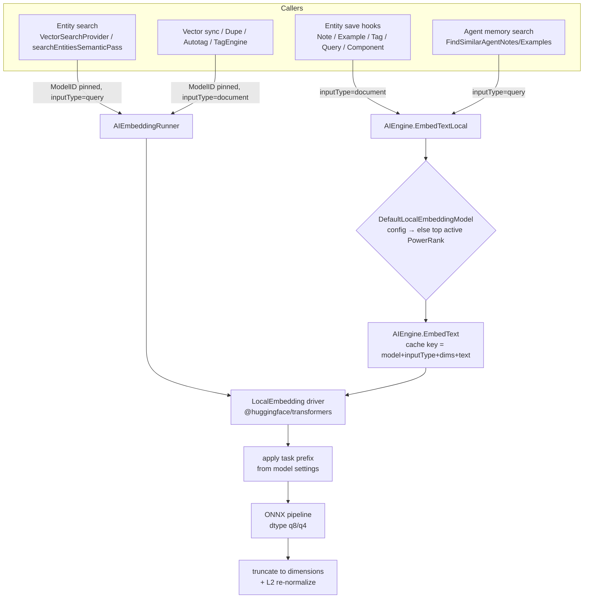
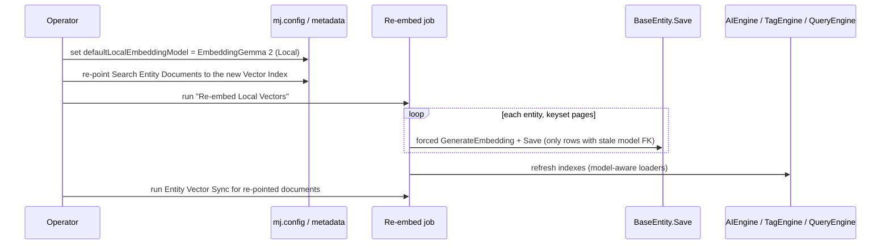

# EmbeddingGemma 2 as MJ's Local Embedding Model

## Status
- **Status**: Draft. Phase 0 is done (2026-10-12): no-go for making it the default, go for an opt-in model. Phase 1 is implemented and Phase 2 is reduced to an opt-in model row. See [Go/no-go](#go--no-go-2026-10-12).
- **Created**: 2026-10-07
- **Author**: Amith Nagarajan + Claude
- **Owner**: Colin Brockman
- **Branch**: `claude/embeddinggemma-2-local-embeddings`

## Overview

MemberJunction embeds text locally in several places: entity search, agent memory (notes and
examples), tag matching, the query catalog, components and QueryGen. Today these run on six small
`Xenova/*` models (mostly 384-d, 256–512 token context) through `@xenova/transformers` **2.17**.
Google released **EmbeddingGemma 2** on 2026-10-06. It is a 740M-parameter open model (Apache 2.0)
on the Gemma 4 architecture:
- **Output:** 768-d vectors that can be truncated to 512, 256 or 128 dimensions (Matryoshka).
- **Context:** an **8k-token** window, versus 256–512 for our current local models.
- **Modalities:** text, code, images, audio and video in one vector space.
- **Text path:** about 270M parameters. The q4 text weights are 175 MB on disk, but measured RSS
  is 0.6–0.9 GB after load (see [Phase 0 findings](#phase-0-findings-runtime-spike)).
- **Runtimes:** ONNX via transformers.js, sentence-transformers, Ollama and llama.cpp.

On paper it is a large step up in quality and context length over every local model we ship. It is
also the local counterpart of the cloud `Gemini Embedding 2` model already in our metadata.

**Re-embedding every stored vector is acceptable.** Local inference costs nothing per call, and the
corpora are small: metadata documents, notes, examples, tags, queries and components. The real
obstacle is the plumbing. MJ has no way to change the local embedding model safely:
- The "default local model" is whichever model has the highest `PowerRank`.
- Nothing re-embeds stored vectors when that default changes.
- A corpus with mixed dimensions makes the in-memory vector index throw. The error is caught and
  logged, so agent memory search simply stops working.

This plan therefore:
1. Benchmarks the model on MJ's own retrieval tasks before committing.
2. Builds the plumbing for a model switch: a newer runtime, query/document intent, an explicit
   default, and a re-embed job.
3. If the benchmark wins, makes EmbeddingGemma 2 **the** local model everywhere and re-embeds
   everything.

## Goals & Non-Goals

### Goals
- **Decide with data.** Produce a measured comparison of EmbeddingGemma 2 against our current local
  models on MJ retrieval tasks (recall@k, MRR, CPU latency, RSS), with a written go/no-go.
- **Run it in-process.** `LocalEmbedding` must run EmbeddingGemma 2 inside MJAPI. No external process
  should be required.
- **Support asymmetric retrieval.** Callers can say whether a text is a *query* or a *document*, and
  drivers apply the model's convention.
- **Honor `dimensions` locally.** `LocalEmbedding` should truncate and re-normalize to the requested
  size.
- **Make the default explicit.** The local default must be a deliberate setting, not a side effect of
  `PowerRank`.
- **Re-embed reliably.** A single job re-embeds every persisted local vector to the current default
  model, and is safe to re-run.
- **Fail loudly on stale vectors.** Loaders must never mix vectors from different models in one index.
- **Cut over** (if the go/no-go passes):
  - Notes, examples, tags, queries, components and QueryGen move to EmbeddingGemma 2.
  - Entity search gets a new EmbeddingGemma 2 Vector Index, with Search Entity Documents re-pointed to it.

### Non-Goals
- **Multimodal embedding** (images, audio, video) is out of scope. It is noted as follow-up work for
  Content Autotagging via `AIEngine.EmbedContent`.
- **In-browser (WebGPU) embedding** in MJExplorer is out of scope. All embedding stays server-side.
- **Retiring the six `Xenova/*` models** is out of scope. They stay available and selectable.
- **External vector DB indexes** (Pinecone, Qdrant, SQL Server, pgvector) only get documentation of
  the re-index procedure. No automation.

## Background & Context

### How a local embedding is produced today
- **Driver:** `packages/AI/Providers/LocalEmbeddings/src/models/localEmbedding.ts`.
  - Registered as `@RegisterClass(BaseEmbeddings, 'LocalEmbedding')`.
  - Loads `@xenova/transformers` 2.17 via `eval('import(...)')` (line 81).
  - Hardcodes `pipeline('feature-extraction', id, { quantized: true })` (185) and
    `{ pooling: 'mean', normalize: true }` (309, 369).
  - Ignores `params.dimensions`.
  - Returns an **empty vector on error** instead of failing (332–342, 397–407).
  - `useQuantized` is stored but never read (436–439).
- **Model metadata:** six models in `metadata/ai-models/.ai-models.json` (lines ~1229–1483), each
  with one `MJ: AI Model Vendors` child (`VendorID` = LocalEmbeddings, `DriverClass` = `LocalEmbedding`,
  `APIName` = `Xenova/...`). There is no dimension column; `MaxOutputTokens` informally holds it.

| Model | APIName | PowerRank | Dims | Max tokens |
|---|---|---|---|---|
| gte-small (Local) | Xenova/gte-small | 7 | 384 | 512 |
| paraphrase-multilingual-MiniLM-L12-v2 (Local) | Xenova/paraphrase-multilingual-MiniLM-L12-v2 | 7 | 384 | 128 |
| all-mpnet-base-v2 (Local) | Xenova/all-mpnet-base-v2 | **9** | 768 | 384 |
| all-MiniLM-L12-v2 (Local) | Xenova/all-MiniLM-L12-v2 | 7 | 384 | 256 |
| bge-small-en-v1.5 (Local) | Xenova/bge-small-en-v1.5 | 8 | 384 | 512 |
| all-MiniLM-L6-v2 (Local) | Xenova/all-MiniLM-L6-v2 | 6 | 384 | 256 |

### Two ways a model gets chosen

**1. The "local default", decided by `PowerRank`.**
- `AIEngine.LocalEmbeddingModels` (`packages/AI/Engine/src/AIEngine.ts:1013`) filters to
  type = Embeddings and Vendor = LocalEmbeddings, then sorts by `PowerRank` descending. It does
  **not** filter `IsActive`.
- `EmbedTextLocal` (1043) always uses the first model in that list. Today that is all-mpnet-base-v2.
- These callers use it:
  - **Save hooks** through `EmbedTextLocalHelper` (`packages/MJCoreEntitiesServer/src/custom/util.ts:10`),
    called from `BaseEntity.GenerateEmbedding` (`packages/MJCore/src/generic/baseEntity.ts:~7014`):
    - `MJAIAgentNoteEntityServer` (Note)
    - `MJAIAgentExampleEntityServer` (ExampleInput)
    - `MJTagEntityServer` ("Name: Description")
    - `MJComponentEntityServer` (FunctionalRequirements, TechnicalDesign)
    - `MJQueryEntityServer` (Name + UserQuestion + Description)
  - **Agent memory search:** `AIEngine.FindSimilarAgentNotes` / `FindSimilarAgentExamples`.
  - **QueryGen:** `packages/QueryGen/src/vectors/EmbeddingService.ts`. Its `modelName` constructor
    argument is unused.
  - **`GenericDatabaseProvider.searchEntitiesSemanticPass`**, but only when `EntityDocument.AIModelID`
    is null.
  - **`RunAIPromptResolver.selectEmbeddingModelBySize`**
    (`packages/MJServer/src/resolvers/RunAIPromptResolver.ts:577`). It picks "small" (lowest rank)
    or "medium" (middle **by index**), so adding any model shifts what callers get.

**2. A pinned model, through `AIEmbeddingRunner` with `ModelID`.**
- Source: `packages/AI/Prompts/src/embedding/AIEmbeddingRunner.ts`.
- Callers:
  - **Entity search:** `SearchEngine/src/generic/VectorSearchProvider.ts` groups indexes by
    `EmbeddingModelID` and passes `Dimensions`.
  - **Vector sync:** `AI/Vectors/Sync/src/models/entityVectorSync.ts` uses `EntityDocument.AIModelID`
    plus `VectorIndex.Dimensions`.
  - **Duplicate detection:** `AI/Vectors/Dupe/src/duplicateRecordDetector.ts`. It passes
    `VectorIndex.Dimensions` (`:546`, `:909`).
  - **Content Autotagging:** `ContentAutotagging/src/Engine/generic/AutotagBaseEngine.ts` uses
    ContentSource → ContentType → the first VectorIndex.
  - **TagEngine:** `AI/Knowledge/TagEngine/src/TagEngine.ts` takes the "Tag Semantic Matching"
    prompt's model, which today is all-MiniLM-L6-v2 at 384-d.
- **Every Search Entity Document** (`metadata/entity-documents/.entity-documents.json`) uses
  **gte-small (Local)** through the "Default - SVS + gte-small (Local)" Vector Index
  (`metadata/vector-indexes/.svs-default-gte-small.json`).

### How vectors are tied to a model
- **Model FK columns:** `EmbeddingModelID` on AIAgentNote, AIAgentExample, Tag, Query, ContentItem,
  ContentSource and ContentType. Component has `FunctionalRequirementsVectorEmbeddingModelID` and
  `TechnicalDesignVectorEmbeddingModelID`. VectorIndex carries `EmbeddingModelID` and `Dimensions`.
- **EntityRecordDocument** is tied to a model only through its EntityDocument / VectorIndex.
- **Storage:** vectors are stored as JSON plus a float32 binary companion. Readers prefer the binary
  form via `ReadStoredVector` (`packages/AI/Vectors/Memory/src/models/StoredVector.ts`).
- **Re-embed logic** exists only in TagEngine (`RebuildTagEmbeddings`, ~379). Elsewhere:
  - `GenerateEmbedding` re-embeds only when the record is new or the source field is dirty. It never
    re-embeds because the **model** changed.
  - `AIEngine.RegenerateEmbeddings` only re-reads stored vectors.
- **Dimension mismatch:** `SimpleVectorService.validateAndSetDimensionCount`
  (`packages/AI/Vectors/Memory/src/models/SimpleVectorService.ts:~1280`) **throws**.
  - `AIEngine.RefreshNoteEmbeddings` / `RefreshExampleEmbeddings` catch and log it, so agent memory
    search silently degrades.
  - `QueryEngineServer.RefreshQueryEmbeddings` (`QueryEngineServer.ts:199`) does **not** catch it.
    On `Config` the error is logged and rethrown (`:182`), so a mismatch fails the query engine load;
    from the `DataChange$` subscription (`:256`) it is not caught at all.
  - At query time a mismatch does not throw: `SimpleVectorService` logs and returns no results.
  - None of them filters on `EmbeddingModelID`.

### Existing defects found during the survey (fix in Phase 1)
1. **Tags are written with one model and indexed with another.** `MJTagEntityServer` embeds with
   the default local model (mpnet, 768-d) and stamps that ID, but TagEngine's index is pinned to
   MiniLM-L6 (384-d). `TagEngine.AddOrUpdateSingleTagEmbeddingFromPersisted` (~446) does not check
   the model, so `AddVector` throws on every live tag save. The error is caught and logged at
   `MJTagEntityServer.server.ts:83`. (The cold-load paths are already model-aware:
   `tryHydrateFromPersisted` (~333) and `RebuildTagEmbeddings` (~379) re-embed on a model mismatch.
   Only the single-tag save path is broken.)
2. **Inactive models can become the default.** `LocalEmbeddingModels` doesn't filter `IsActive`.
   Integration check AE5 (`ai-embeddings.checks.ts:312`) instead *asserts* every local model is
   active, with a message claiming `EmbedTextLocal` filters them, so adding any inactive local model
   fails AE5. `TagEngine.getSmallestEmbeddingModel` (~1229) and `selectEmbeddingModelBySize` have the
   same gap.
3. **`BGEReRanker` uses an undeclared package.** It imports `@xenova/transformers`
   (`packages/SearchEngine/src/rerankers/BGEReRanker.ts:56`, a real dynamic `import()`) but
   `packages/SearchEngine/package.json` doesn't declare it (its doc comment at `:17` says
   `optionalDependencies`, which only lists `cohere-ai`), so it likely fails to resolve under strict
   pnpm.
4. ~~**Duplicate detection ignores `Dimensions`.**~~ Withdrawn on verification (2026-10-12):
   `duplicateRecordDetector` passes `VectorIndex.Dimensions` at `:546` and `:909`.
5. **`LocalEmbedding` hides failures.** It returns `[]` on failure, so callers can persist or cache
   an empty vector without noticing. Callers that do **not** check the length, so an empty vector
   gets through: `EmbedTextLocalHelper` (`util.ts:14`), `BaseEntity.GenerateEmbedding`
   (`baseEntity.ts:7021`, which persists `"[]"` and stamps the model ID for Notes, Examples and
   Components), `searchEntitiesSemanticPass` (`GenericDatabaseProvider.ts:6108`), QueryGen
   `EmbeddingService` (`:52`) and the React test harness (`component-runner.ts:2751`).
6. **`QueryEngineServer.RefreshQueryEmbeddings` rethrows a dimension mismatch** (see above), so one
   stale query vector fails the whole query engine load rather than degrading it.

### What EmbeddingGemma 2 needs that we don't have
| Need | Today |
|---|---|
| `@huggingface/transformers` **≥ 4.3.1** (4.3.0 has no `embedding_gemma2`). Uses `dtype`/`device`, not `quantized` | v2.17 only |
| Query/document task prompts (`task: search result \| query: …`, `title: none \| text: …`) | No concept in `EmbedTextParams` / `EmbeddingRunParams` |
| Matryoshka truncation (768 → 512/256/128) plus re-normalize | `dimensions` ignored by the local driver |
| 8k-token inputs, truncated by the driver (the tokenizer declares no max length, so nothing else truncates) | Callers don't truncate. `MaxInputTokens` caps at 512 |
| Text-only loading (the stock `feature-extraction` pipeline loads the vision and audio encoders too) | Not applicable to today's text-only models |
| A safe model switch | No re-embed job. Loaders not model-aware |

> ✅ **Verified 2026-10-12** against the model cards and a runtime spike. The repo IDs, prompts,
> dtypes and output name are recorded in [Phase 0 findings](#phase-0-findings-runtime-spike).

## Architecture / Design

### Design decisions

**D1 — Upgrade `LocalEmbedding` in place to `@huggingface/transformers`.**
- The `Xenova/*` repos ship v3-compatible ONNX, so one runtime serves all local models. Verified:
  all six load on 4.3.1 with `dtype: 'q8'` (the same `model_quantized.onnx` file v2.17 loads).
- It avoids carrying two copies of onnxruntime. This is required, not just tidy: loading
  `@xenova/transformers` and `@huggingface/transformers` in one process aborted on macOS (exit 134,
  two native `sharp`/libvips copies). So `BGEReRanker` must move in the same change (fixes defect 3).
- **Drift is not uniformly tiny.** Between the old and new runtime, gte-small gives 0.9997 on
  Linux x64 (the MJAPI target), and the five non-mpnet models give 0.9953–0.9993 on macOS.
  **all-mpnet-base-v2, today's default, gives 0.948 on Linux x64.** Its quantized file is itself low-fidelity on Linux: about **0.80** cosine to its own fp32
  model on both runtimes. The stored `EmbeddingModelID` doesn't change, so the model-aware loaders
  (D4) cannot see this. The runtime upgrade must ship with a forced re-embed of every
  mpnet-embedded row (D6), even on a no-go for EmbeddingGemma 2.
- **Fallback:** if any existing model breaks on v4, add a sibling driver class
  (`LocalEmbeddingHF`) and point only EmbeddingGemma 2's vendor row at it. Not needed so far.

**D2 — Query/document intent is a first-class optional parameter.** Add `inputType` to the core
param types. Each driver maps it to its own convention. Callers never write model-specific prefixes.
```ts
// packages/AI/Core/src/generic/embed.types.ts
export type EmbeddingInputType = 'query' | 'document';

export type EmbedTextParams = BaseParams & {
    text: string;
    dimensions?: number;
    /** Retrieval role of this text. Drivers for asymmetric models apply their own
     *  prompt/prefix; symmetric models ignore it. Omitted = 'document'. */
    inputType?: EmbeddingInputType;
};
// same field on EmbedTextsParams and EmbedContentParams
```
- `EmbeddingRunParams` (`packages/AI/Prompts/src/embedding/embedding-runner.types.ts`) gains
  `InputType?: EmbeddingInputType`, passed through in `executeOnCandidate`.
- `AIEngine.EmbedText(model, text, apiKey?, options)` gains `options.inputType` and
  `options.dimensions`, and `buildEmbeddingCacheKey` must include **both**.
- **Where the prefixes live: in metadata, not in driver code.** Hardcoding Gemma strings in
  `LocalEmbedding` is a special case; it would just be the next model's `if`.
  - **Recommended (2026-10-12): an `Embedding` section in the existing `ModelConfiguration`
    cascade.** `MJ: AI Model Types`, `MJ: AI Models` and `MJ: AI Model Vendors` already carry a typed
    JSON `ModelConfiguration` bag (`packages/AI/Core/src/generic/modelConfiguration.ts`, mirrored in
    `metadata/entities/JSONType-interfaces/IAIConfiguration.ts`). Its documented boundary rule is
    *"anything a driver or runner consumes at call time belongs HERE … do not add a capability
    column per knob."* `AIEngineBase.GetEffectiveModelConfiguration(modelID, modelVendorID)` already
    resolves it from the engine cache. No migration and no new columns.
    ```ts
    export interface EmbeddingConfigurationSettings {
        QueryPrefix?: string | null;     // 'task: search result | query: '
        DocumentPrefix?: string | null;  // 'title: none | text: '
        DType?: string | null;           // local ONNX precision; absent = 'q8' (not built: the driver always loads q8)
    }
    ```
  - The two earlier options are dropped: new `AIModelVendor` columns break that boundary rule, and
    nothing populates an embedding driver's `SetAdditionalSettings` from metadata today, so
    "driver settings keyed by `APIName`" would mean the strings live in code.
  - The prefix is applied before the driver call by one shared helper in `@memberjunction/ai`,
    used by both resolution paths (`AIEngine.EmbedText` and `AIEmbeddingRunner`). That also covers
    Gemini Embedding 2, which has no task parameter and expects the instruction in the text
    (`geminiEmbedding.ts:29`). Drivers with a native parameter (Cohere) map `inputType` and carry no
    prefix.
- Existing drivers map `inputType` as follows:
  - **Cohere:** `search_query` / `search_document`
  - **Bedrock (Cohere-on-Bedrock):** `input_type`
  - **Gemini:** the task prefix
  - **OpenAI / Mistral:** ignore it

**D3 — Make the local default an explicit setting.**
- `AIEngine` gets `DefaultLocalEmbeddingModel`:
  1. an explicitly configured model name, set at server startup from an `mj.config.cjs` key (for
     example `aiSettings.defaultLocalEmbeddingModel`) via `AIEngine.SetDefaultLocalEmbeddingModel()`
     — *implemented instead as the `MJ_DEFAULT_LOCAL_EMBEDDING_MODEL` environment variable, so
     every process agrees (Phase 1 step 6); a name that matches no active local model turns local
     embedding off rather than falling back*
  2. else the highest `PowerRank` **active** local model (today's behavior, minus defect 2)
- `EmbedTextLocal`, `EmbedTextLocalHelper`, QueryGen and the null-`AIModelID` fallback all go through
  it.
- `PowerRank` goes back to meaning "quality rank" and never silently re-points the platform.
- `selectEmbeddingModelBySize` stops picking by array index. "small" = lowest-rank active model,
  "medium"/default = `DefaultLocalEmbeddingModel`.

**D4 — Loaders are model-aware.** Each of these loads only rows whose `EmbeddingModelID` equals the
model its index serves:
- `AIEngine.RefreshNoteEmbeddings` / `RefreshExampleEmbeddings` and their single-row add paths
- `QueryEngineServer.RefreshQueryEmbeddings`
- `TagEngine.AddOrUpdateSingleTagEmbeddingFromPersisted`

Mismatched rows are counted and reported, with one warning per load that gives the count and points
to the re-embed job. They never reach `AddVector`.

**D5 — Re-embed when the model changed, not only when the text changed.**
- `BaseEntity.GenerateEmbedding` also re-embeds when `modelField.Value` differs from the current
  default model ID. Records then heal lazily on their next save.
- Add a **forced** variant used by the bulk job. Both still go through `BaseEntity.Save()`; no
  direct SQL DML (see `.claude/rules/data-access.md`).

**D6 — Re-embed job.**
- A server-side `LocalEmbeddingMigrationService`, exposed as an Action ("Re-embed Local Vectors")
  and an `mj` CLI command. *(Built as the Action alone, on the record set processor; see Phase 1
  step 10.)*
- For each persisted-vector entity (Agent Notes, Agent Examples, Tags, Queries, Components):
  1. Iterate records whose model FK ≠ the target, using keyset pagination (`AfterKey`).
  2. Batch-embed with `inputType: 'document'`.
  3. Save through `BaseEntity`.
  4. Refresh the matching engine index at the end.
- Idempotent and resumable, because already-migrated rows are skipped by the FK filter.
- Reports per-entity counts.
- **Entity search** re-embeds through the existing vector sync for each re-pointed Entity Document,
  not this service.
- **TagEngine** reuses `RebuildTagEmbeddings`.

### Component / flow design





### API changes
- **`@memberjunction/ai`:** `EmbeddingInputType`, and `inputType?` on `EmbedTextParams`,
  `EmbedTextsParams` and `EmbedContentParams`. Additive.
- **`@memberjunction/ai-prompts`:** `EmbeddingRunParams.InputType?`. Additive.
- **`@memberjunction/aiengine`:**
  - `EmbedText` options gain `inputType` / `dimensions`.
  - New `DefaultLocalEmbeddingModel` getter and `SetDefaultLocalEmbeddingModel(name)`. *(Built
    without the setter: the environment variable sets it.)*
  - `EmbedTextLocal(text, options?)`.
  - All additive.
- **GraphQL `EmbedText` mutation:** optional `inputType` argument. Additive.
  `GraphQLAIClient.EmbedText` and the React runtime `utilities.ai.EmbedText` follow.
- **New Action:** "Re-embed Local Vectors" (params: `TargetModel?`, `Entities?`, `DryRun`).

## Implementation Plan

### Phase 0: Benchmark and go/no-go (no production code)
1. **Spike the runtime.** In a scratch script (or `packages/AI/Core/scripts/live-embedding-checks/`),
   load the EmbeddingGemma 2 ONNX via `@huggingface/transformers`. Record:
   - the required library version and working `dtype`s
   - the output tensor and pooling to use
   - cold-load time, RSS and per-text CPU latency (p50/p95) at 128/512/2k tokens, for q8 and q4
2. **Quick quality signal with no code.** Add temporary local-only `AI Model` + `AI Model Vendor`
   rows for the existing `OllamaEmbedding` driver (`packages/AI/Providers/Ollama/src/models/ollama-embeddings.ts`),
   with Ollama serving EmbeddingGemma 2. Run it on pinned-model paths only.
3. **Evaluation harness.** Compare gte-small, bge-small, all-mpnet and EmbeddingGemma 2 (768 and
   256 dims) on MJ's own data:
   - **Entity search:** queries against MJ Entities/Actions/Agents/Prompts/AI Models/Queries
     documents, with hand-labeled targets (30–50 queries).
   - **Agent memory:** note/example retrieval from a labeled sample.
   - **Tag matching:** labeled content → tag pairs from Content Autotagging fixtures.
   - **Query catalog:** natural-language questions → the expected Query.
   - **Metrics:** recall@5/10, MRR, latency and RSS.
4. **Write the go/no-go** as a section appended to this plan.
   - **Gate:** EmbeddingGemma 2 beats the current best local model on recall@10 / MRR on at least 3
     of 4 tasks, with acceptable CPU latency on the MJAPI target hardware.
   - **Also decide the stored dimension** (768 vs 256), using the quality/storage trade-off measured
     in step 3.

### Phase 1: Plumbing, independent of model choice (ship even on a no-go)
1. **Runtime upgrade** (`packages/AI/Providers/LocalEmbeddings`) — *done*:
   - Replace `@xenova/transformers` with `@huggingface/transformers` ^4.3.1 in `package.json`.
   - Load `AutoTokenizer` + `AutoModel` with `dtype: 'q8'` (the same file `quantized: true` loaded),
     dropping a multimodal model's vision/audio encoder configs. The dead `useQuantized` setting is
     removed. So is `TRANSFORMERS_LOCAL_URL`, because neither runtime has an `env.localURL`, so it
     never did anything.
   - Keep the memoized module load, documented as a category-3 dynamic import (measured ~80–150 ms
     and ~50 MB RSS on import), with the dependency declared.
   - **Honor `dimensions`:** slice, then L2 re-normalize; requesting more than the native size
     fails the call.
   - **Truncate input** with a new optional `maxInputTokens` param (on `EmbedTextParams` and
     `EmbedTextsParams`, beside `dimensions`), applied in the tokenizer. The model files can't supply
     the window (EmbeddingGemma 2's tokenizer declares none, and its config claims 131k–262k), so the
     catalog's `MaxInputTokens` is the source.
     Real token counts come from the attention mask. The resolvers start passing
     `MaxInputTokens` in step 5.
   - **Batching:** `SupportsBatchEmbeddings` + `embedBatch` replace the `Promise.all` override, so
     `BaseEmbeddings.EmbedTexts` enforces the 1:1 vector count. A call holds at most 32 texts and
     8,192 padded tokens, so 8k-token documents go one at a time instead of 32 to a tensor.
   - **`inputType` prefixes are not applied in the driver.** Per D2 they're applied by the
     resolvers (steps 4 and 5), so the driver ignores `inputType`.
   - **Keep the `[]`-on-failure contract (defect 5, revised).** `BaseEmbeddings` documents it as
     the deliberate convention for every provider (`baseEmbeddings.ts`, "ERROR CONVENTION"), and
     most callers check the length. Throwing only in `LocalEmbedding` would make one provider
     differ. Instead, `AIEngine.EmbedText` returns `null` for an empty vector, so every caller that
     embeds through it (`EmbedTextLocalHelper`, `searchEntitiesSemanticPass`, the React test harness,
     QueryGen) sees a failure it already handles, and `BaseEntity.GenerateEmbedding` checks the length
     for any other embedder.
2. **`BGEReRanker`** — *done*: its import moves to `@huggingface/transformers` (`dtype: 'q8'` for
   `quantized: true`), declared in `packages/SearchEngine/package.json` `optionalDependencies`
   (defect 3).
   - **New finding: it has never reranked.** It passed `[query, doc]` pairs to the
     `text-classification` pipeline, which accepts only strings, on both runtimes (`text.replace is
     not a function`). Every call threw inside its try and returned the first N candidates
     unchanged. Its unit tests mocked the pipeline, so they passed. Explorer offers it in the
     Search Scope form as "BGE (local, free)".
   - The fix (score pairs with the tokenizer's `text_pair` option and
     `AutoModelForSequenceClassification`, sigmoid to 0..1, 32 pairs per call) is a standalone bug
     fix, so it goes in its own PR.
3. **Core params** — *done*: `EmbeddingInputType` + `inputType?` on the three embed param
   types, and the D2 `Embedding` section (`QueryPrefix` / `DocumentPrefix`) in
   `modelConfiguration.ts` and its JSONType mirror `IAIConfiguration.ts`, plus the shared
   `ApplyEmbeddingInputPrefix` helper. Cohere maps `inputType` to `search_query` / `search_document`
   per call (the `AdditionalSettings` override still applies when it's omitted); Cohere-on-Bedrock
   sends `input_type` from it. Gemini needs no driver change: its instruction rides in the text, so
   a Gemini row just carries the prefixes in its `ModelConfiguration`.
4. **Runner** — *done*: `EmbeddingRunParams.InputType`. `executeOnCandidate` calls
   `AIEngine.PrepareEmbeddingInput` (catalog prefix + the model-vendor row's `MaxInputTokens`) and
   passes `inputType`, `maxInputTokens` and `dimensions` to the driver.
5. **AIEngine** — *done*:
   - `LocalEmbeddingModels` filters `IsActive` (defect 2).
   - `DefaultLocalEmbeddingModel`: the `MJ_DEFAULT_LOCAL_EMBEDDING_MODEL` model, else the highest
     PowerRank active one. A name that matches no active local model turns local embedding off with an
     error, so processes can't silently disagree. It is resolved once per process (PowerRank ties
     break by name), so a catalog edit can't switch the model under a built index.
     `EmbedTextLocal(text, { inputType })` uses it.
   - `EmbedText` options gain `inputType` / `dimensions`; the cache key includes both and hashes the
     prefixed text, and an omitted `inputType` gets its own key (Cohere maps it differently from
     `'document'`). `PrepareEmbeddingInput` is the one place a text gets its prefix and cap. A failed
     embed returns `null`.
   - `FindSimilarAgentNotes` / `FindSimilarAgentExamples` embed the query as `'query'`.
   - `RefreshNoteEmbeddings` / `RefreshExampleEmbeddings` / `AddOrUpdateSingle*` keep only vectors
     from the default model (`IsDefaultLocalEmbeddingModel`), with one warning naming the count left
     out (D4). `WithDefaultEmbeddingModel` is the one filter; `QueryEngineServer` uses it too.
6. **MJServer** — *done*. The default model is set by the `MJ_DEFAULT_LOCAL_EMBEDDING_MODEL`
   environment variable, read by `AIEngine` itself, rather than the planned `aiSettings` key in
   mj.config.cjs: a config key reached MJAPI only, so the `mj` CLI (which runs the re-embed action),
   MCP/A2A servers and workers embedded with a different default and re-embedded MJAPI's rows back.
   Also: `selectEmbeddingModelBySize` is now "small" = lowest-PowerRank active,
   otherwise the default model; the `EmbedText` mutation takes an optional, validated `inputType`.
   `GraphQLAIClient.EmbedText` and the system-user client send it only when set (so an older server
   still answers), and the React runtime / test harness pass it through.
7. **BaseEntity / MJCoreEntitiesServer** — *done*. Instead of a "forced mode" flag, a
   protected hook `BaseEntity.IsEmbeddingStale(modelID)` (default `false`, so nothing changes for
   other subclasses). `GenerateEmbedding` re-embeds when the hook says the stored vector's model is
   stale. The five vectorized server entities override it with `IsLocalEmbeddingStaleHelper` (not
   the default local model ⇒ stale), so a record heals on its next save and the re-embed job is just
   "save the stale rows" (D5). The hook is asked only for a field that holds a vector, the same rows
   the job selects, so a row whose embed failed doesn't retry on every unrelated save. Query and Tag,
   which embed in their own save paths, check it there. `EmbedTextLocalHelper` passes
   `inputType: 'document'`.
   - A leftover `MJQueryEntityServer` branch cleared the vector on any save of a query with no
     Description (from when the vector embedded the Description alone). With the hook it made the
     vector flip on every save, so it is removed; the composite text has never needed a Description.
8. **TagEngine** — *done*. Decision taken: **follow the platform default.**
   `resolveTagEmbeddingModel` now prefers `AIEngine.DefaultLocalEmbeddingModel`, then the "Tag
   Semantic Matching" prompt's model, then the smallest active embedding model. This also ends a
   ping-pong found in review: the save hook wrote mpnet vectors and the cold load re-embedded those
   tags with the prompt's MiniLM and persisted them, so a tag flipped models on every save-then-boot.
   `AddOrUpdateSingleTagEmbeddingFromPersisted` drops a tag from another model (defect 1); the
   text being resolved is embedded as a `'query'`. The prompt binding now only matters on a host with
   no local model, so Phase 2 needs no prompt change.
9. **Other consumers** — *done*:
   - **QueryEngineServer:** loads `AIEngine` first, then keeps only default-model vectors through
     `AIEngine.WithDefaultEmbeddingModel`, which also removes the rethrow-on-mismatch failure
     (defect 6). `FindSimilarQueries`
     has no runtime caller left (the catalog action moved to the search engine); its doc tells
     callers to embed as `'query'`.
   - **QueryGen `EmbeddingService`:** unchanged. It already embeds with the default model through
     `EmbedTextLocal`; candidate and golden queries are both documents, because comparing a query
     description with another is symmetric. Its unused `modelName` argument stays, to keep the API.
   - **`VectorSearchProvider` / `searchEntitiesSemanticPass`:** query side uses `'query'`.
     `searchEntitiesSemanticPass` does not pass `VectorIndex.Dimensions`, so it assumes an index stored
     at the model's native size; this matters only if Phase 2 picks a truncated dimension.
   - **`entityVectorSync`, `AutotagBaseEngine`, `duplicateRecordDetector`:** unchanged; omitted
     `inputType` means `'document'`, and autotag dedup and dupe detection compare documents with
     documents.
10. **Re-embed job (D6)** — *done*:
    - The "Re-embed Local Vectors" Action (`CoreActions`) runs each of Notes, Examples, Tags, Queries
      and Components through the record set processor (`KeysetSource` with a stale-model filter +
      `FunctionRecordProcessor`; see `guides/RECORD_SET_PROCESSING_GUIDE.md`), one
      `BaseEntity.Save()` per row, and reports found / re-embedded / failed counts per entity. The
      substrate supplies keyset paging, per-row isolation, an error-rate circuit breaker and a
      `MJ: Process Runs` history. Each row is loaded just before its save, so an edit made during the
      run isn't overwritten. No separate service class was needed.
    - Params `EntityNames`, `DryRun` and `Force`, output `Report`; its metadata is in
      `metadata/actions/.reembed-local-vectors.json`.
      The plan's `TargetModel` param was dropped: the target is always the default model, because
      that is what `Save()` re-embeds with.
    - **No `mj ai reembed` command:** `mj ai actions run -n "Re-embed Local Vectors"` already runs
      it from the CLI.
    - **`Force`** (added after review): re-embeds every stored vector, including rows already
      recorded as the default model, by clearing each row's model column before the save. This is
      the forced re-embed D1 requires for the runtime upgrade, which the model-ID check cannot see.
      If a forced row's re-embed fails, its model column is put back, so the row is left as it was.
    - **Preflight:** before saving anything, the job embeds a test text with the default model and
      stops if that fails, so a model that can't load changes no rows.
    - **Honest counts:** a row counts as re-embedded only if every column that held a vector still
      holds one, now from the default model. Tag and Query saves keep their existing vector when only
      the model is stale and the embed fails; before that fix a failed embed cleared it and the job
      counted it as a success.
    - With no active local model at all, nothing counts as stale, so saves don't attempt (and fail)
      to embed.
    - **Restart afterwards:** the in-memory note, example, tag and query indexes are built at load, so
      the MJ server processes pick up the re-embedded vectors on restart.

### Phase 2: EmbeddingGemma 2 metadata (reduced to opt-in by the go/no-go)
The benchmark was a no-go for the default (see [Go/no-go](#go--no-go-2026-10-12)), so the cutover
items are not done. What ships is the model, available to opt into:
1. **AI Model + vendor row** — *done*, in a new file
   `metadata/ai-models/.embeddinggemma-2-models.json`: `EmbeddingGemma 2 (Local)`, LocalEmbeddings,
   `DriverClass: LocalEmbedding`, `APIName: onnx-community/embeddinggemma-2-ONNX`,
   `MaxInputTokens: 2048`, `MaxOutputTokens: 768`. The model accepts 8,192 tokens, but one 8,192-token
   text peaked at 8.4 GB (see the benchmark's "Speed and memory"), so the row caps inputs at 2,048 (1.6 GB).
   - **`PowerRank` 8**, below all-mpnet-base-v2's 9. This answers open decision #1 (opt-in, not an
     implicit cutover), and it is also an honest quality rank: it tied mpnet on English retrieval.
   - **No prefixes in `ModelConfiguration`.** The benchmark found the model-card prefixes equal or
     worse on 3 of 4 tasks. If real MJ data shows otherwise, add
     `{ "Embedding": { "QueryPrefix": "task: search result | query: ", "DocumentPrefix": "title: none | text: " } }`
     to the vendor row; no code changes.
2. **Not done (no-go):** a new Vector Index, re-pointing the Search Entity Documents, and a default
   change. The Tag Semantic Matching prompt needs no change in any case (Phase 1 step 8).
3. **Opt-in runbook** (documented in the MJServer README): set
   `MJ_DEFAULT_LOCAL_EMBEDDING_MODEL='EmbeddingGemma 2 (Local)'` for every MJ process and restart, then run
   `mj ai actions run -n "Re-embed Local Vectors"` (`--param "DryRun=true"` to count first), and
   restart again so the in-memory indexes load the new vectors. Entity
   search keeps its gte-small index unless an operator adds a Gemma Vector Index, re-points the
   Entity Documents and runs vector sync. Keep the index at 768 dimensions:
   `searchEntitiesSemanticPass` doesn't pass `Dimensions`.

### Phase 3 (follow-up, separate plan): multimodal
- Content Autotagging embeds images and audio through `AIEngine.EmbedContent` into the same space as
  text, enabling cross-modal search over content items.

## Migration & Data
- **No schema migration.** The D2 `Embedding` section lives in the existing `ModelConfiguration`
  JSON columns. Adding it edits `metadata/entities/JSONType-interfaces/IAIConfiguration.ts` and its
  mirror in `@memberjunction/ai`; the generated `ModelConfigurationObject` types follow at the next
  `mj sync push` + `mj codegen --skipdb`. Runtime code reads the `@memberjunction/ai` type, so it
  doesn't wait on CodeGen.
- **Metadata:** the PR adds declarative JSON only. The consolidated `Metadata_Sync` migration is
  produced at release by the build engineer.
- **Data:** every persisted local vector (Notes, Examples, Tags, Queries, Components) and every
  Search EntityRecordDocument is re-embedded by the job and by vector sync. External vector DB
  indexes need a new index at the new dimension plus a re-sync. Document this; don't automate it.
- **Upgraded hosts with no config set:** the default falls back to the highest-`PowerRank` active
  model, which stays all-mpnet-base-v2 (EmbeddingGemma 2 ships at `PowerRank` 8). There is no model
  switch, but the runtime upgrade still changes mpnet's vectors, so the release notes must tell
  operators to run the re-embed job.

## Testing Strategy
- **Unit tests, `LocalEmbeddings`:**
  - `dtype` passthrough
  - prefix application per `inputType`
  - `dimensions` truncation + re-normalization (unit norm, correct length, error when larger than
    native)
  - token-based truncation
  - empty result on load failure, and the load retried on the next call
  - batched calls
- **Unit tests, `AIEngine`:**
  - default resolution (config wins, inactive filtered, PowerRank fallback)
  - cache key includes `inputType` / `dimensions`
  - loaders skip mismatched-model rows and report the count
- **Unit tests, `AIEmbeddingRunner`:** `InputType` reaches the driver.
- **Unit tests, `BaseEntity.GenerateEmbedding`:**
  - re-embeds on model mismatch
  - doesn't re-embed when model and text are unchanged
  - forced mode
- **Unit tests, TagEngine:** model-aware single-tag add.
- **Unit tests, `RunAIPromptResolver`:** `selectEmbeddingModelBySize` is stable when models are added.
- **Other drivers:** Cohere, Bedrock and Gemini map `inputType`.
- **Integration (deterministic tier):**
  - Extend `ai-embeddings.checks.ts` (AE1–AE5) and `.IT45-ai-embeddings.json`.
  - Fix AE5's `IsActive` claim.
  - Add: a model switch followed by the re-embed job leaves zero stale rows and a working note index.
  - Add: query/document embeddings differ for EmbeddingGemma 2.
- **Live check:** extend `packages/AI/Core/scripts/live-embedding-checks/` with an EmbeddingGemma 2
  case (load, embed, dims, norm).
- **Benchmarks:** the Phase 0 harness stays in the repo so future model swaps get the same go/no-go.
- **Performance:** measure save latency for a Note/Tag save with EmbeddingGemma 2 on CPU. If p95 is
  unacceptable, see the save-path risk below.

## Risks & Open Questions
- **Runtime support:** resolved. `@huggingface/transformers` 4.3.1 (released 2026-10-06, the model's
  release day) runs it in-process on macOS arm64, Linux arm64 and Linux x64. 4.3.0 does not.
- **Save-path latency:** about 270M parameters on CPU makes synchronous embedding in `Save()`
  noticeably slower than MiniLM: measured p50 63 ms at 128 tokens and 147 ms at 512 (q8, one
  text, Apple M-series CPU), against 6–25 ms for the current models. Mitigations, in order:
  1. move save-hook embedding off the save path (save, then embed asynchronously and update)
  2. keep a small model for save hooks and EmbeddingGemma 2 for search only
  3. 256-d output (doesn't cut compute, only storage)
  q4 is **not** a latency mitigation on CPU: it was slower than q8 at 512 tokens (226 vs 147 ms)
  and 2k tokens (1129 vs 756 ms). It only saves memory. Re-measure on the MJAPI target hardware.
- **Memory:** measured 0.6 GB (q4) to 0.9 GB (q8) RSS after load, rising to 1.6–2.0 GB after a
  2k-token input and 8.4 GB after an 8k-token one (ONNX Runtime keeps its arena); a full batch peaks
  at 2.7–3.7 GB. The catalog row caps inputs at 2,048 tokens for this reason. Check against container limits. Don't load the
  vision/audio encoders.
- **Implicit cutover on upgrade:** *resolved by the go/no-go: opt-in.* The row ships at `PowerRank`
  8, so an upgraded host keeps all-mpnet-base-v2 unless it sets `MJ_DEFAULT_LOCAL_EMBEDDING_MODEL`.
  The cost of a cutover also argues for opt-in: with the model-aware loaders, a switch leaves every
  old vector out of agent memory, tag and query indexes until the re-embed runs.
- **Prompt strings and repo IDs:** *verified against the model cards* (Phase 0 findings).
- **The runtime upgrade still changes mpnet's vectors** (0.948 cosine on Linux x64) under the same
  `EmbeddingModelID`, so the model-aware loaders don't catch it. *Release notes must tell operators
  to run "Re-embed Local Vectors" after upgrading* (the changeset says so).
- **Multilingual:** check quality against `paraphrase-multilingual-MiniLM-L12-v2` for non-English
  hosts during Phase 0.
- **External vector DBs:** a dimension change requires new indexes. Only document it here.

## Files to Modify

| File | Change |
|------|--------|
| `packages/AI/Providers/LocalEmbeddings/package.json` | `@xenova/transformers` → `@huggingface/transformers` |
| `packages/AI/Providers/LocalEmbeddings/src/models/localEmbedding.ts` | dtype, prefixes/`inputType`, `dimensions` truncation + renorm, token truncation, throw on failure, true batching |
| `packages/AI/Providers/LocalEmbeddings/src/__tests__/LocalEmbedding.test.ts` | New/updated tests |
| `packages/AI/Providers/LocalEmbeddings/README.md` | Runtime, settings, EmbeddingGemma 2 |
| `packages/AI/Core/src/generic/embed.types.ts` | `EmbeddingInputType`, `inputType?` |
| `packages/AI/Providers/Cohere/src/models/CohereEmbedding.ts` | Map `inputType` |
| `packages/AI/Providers/Bedrock/src/models/bedrockEmbedding.ts` | Map `inputType` |
| `packages/AI/Providers/Gemini/src/geminiEmbedding.ts` | Map `inputType` to the task prefix |
| `packages/AI/Prompts/src/embedding/embedding-runner.types.ts` | `InputType?` |
| `packages/AI/Prompts/src/embedding/AIEmbeddingRunner.ts` | Pass `inputType` to the driver |
| `packages/AI/Engine/src/AIEngine.ts` | `IsActive` filter, `DefaultLocalEmbeddingModel`, `EmbedText` options + cache key, model-aware loaders, query-side `inputType` |
| `packages/AI/Engine/src/__tests__/AIEngine.test.ts` | Tests |
| `packages/MJCore/src/generic/baseEntity.ts` | `GenerateEmbedding` model-mismatch + forced mode |
| `packages/MJCoreEntitiesServer/src/custom/util.ts` | `inputType: 'document'` |
| `packages/MJCoreEntitiesServer/src/custom/MJTagEntityServer.server.ts` | Follows TagEngine model decision |
| `packages/MJCoreEntitiesServer/src/engines/QueryEngineServer.ts` | Model-aware refresh |
| `packages/AI/Knowledge/TagEngine/src/TagEngine.ts` | Model-aware single-tag add; default-model decision |
| `packages/AI/Knowledge/TagEngine/src/__tests__/TagEngine.embeddingModel.test.ts` | Tests |
| `packages/QueryGen/src/vectors/EmbeddingService.ts` | Default model, `inputType`, drop unused `modelName` |
| `packages/SearchEngine/src/generic/VectorSearchProvider.ts` | Query-side `inputType` |
| `packages/SearchEngine/src/rerankers/BGEReRanker.ts` + `packages/SearchEngine/package.json` | New runtime, declared dependency |
| `packages/GenericDatabaseProvider/src/GenericDatabaseProvider.ts` | Query-side `inputType`; default-model fallback |
| `packages/AI/Vectors/Sync/src/models/entityVectorSync.ts` | Document-side `inputType` |
| `packages/AI/Vectors/Dupe/src/duplicateRecordDetector.ts` | `inputType` |
| `packages/ContentAutotagging/src/Engine/generic/AutotagBaseEngine.ts` | Document-side `inputType` |
| `packages/MJServer/src/resolvers/RunAIPromptResolver.ts` | `selectEmbeddingModelBySize`, `inputType` arg |
| `packages/AI/Engine/src/AIEngine.ts` (env) | `MJ_DEFAULT_LOCAL_EMBEDDING_MODEL` (replaces the planned `aiSettings` config key) |
| `packages/GraphQLDataProvider/src/graphQLAIClient.ts`, `packages/React/runtime/src/utilities/runtime-utilities.ts` | Optional `inputType` passthrough |
| New: `LocalEmbeddingMigrationService` + Action class, `packages/MJCLI` `ai reembed` command | Re-embed job |
| `metadata/ai-models/.ai-models.json` | EmbeddingGemma 2 (Local) + vendor row |
| `metadata/vector-indexes/.svs-embeddinggemma-2.json` (new) | New Vector Index |
| `metadata/entity-documents/.entity-documents.json` | Re-point Search documents |
| `metadata/prompts/.embedding-prompts.json` | Tag Semantic Matching model |
| `metadata/actions/...` | "Re-embed Local Vectors" Action |
| `packages/TestingFramework/integration-test-suite/src/checks/ai-embeddings.checks.ts`, `metadata-optional/integration-test/tests/integration/.IT45-ai-embeddings.json` | Integration coverage |
| `packages/AI/Core/scripts/live-embedding-checks/` | EmbeddingGemma 2 live check + benchmark harness |
| `.changeset/*.md` | `minor`: the `IAIConfiguration.ts` JSONType edit and the Phase 2 rows are under `metadata/` |

## Go / no-go (2026-10-12)

**No-go for making EmbeddingGemma 2 the default local model. Go for shipping it as an opt-in model.**
Full results, data and caveats are in
`packages/AI/Core/scripts/live-embedding-checks/EMBEDDINGGEMMA2-BENCHMARK.md`; re-run with
`node packages/AI/Core/scripts/live-embedding-checks/embedding-benchmark.mjs`.

- **Gate** (beat the current best local model on recall@10 / MRR in at least 3 of 4 tasks): it
  passes narrowly on macOS counting every query, fails on English queries alone, and fails on Linux,
  where MJAPI runs (2 of 4). The wins come from the non-English queries.
- **Where it clearly wins:** multilingual retrieval (non-English entity-search MRR 0.917, against
  0.310 for all-mpnet-base-v2) and an 8,192-token window, which the short test documents didn't
  exercise.
- **Prefixes:** the model-card prefixes didn't help on this data (equal or worse MRR on 3 of 4
  tasks), so the catalog row ships without them.
- **Dimension:** 768 if a Gemma vector index is ever built; 256 is within noise on English but loses
  some multilingual MRR.
- **mpnet's Linux quantization loss barely changes its ranking**, so it is not a quality reason to
  switch. The runtime-upgrade re-embed is still needed for compatibility (old and new vectors don't
  match).
- **Caveats:** AI-written labels, two synthetic tasks, 26–54 queries per task, short documents, a
  laptop CPU. Revisit the default with real data from an MJ database.

## Phase 0 findings (runtime spike)

Measured 2026-10-12 with `@huggingface/transformers` 4.3.1 (onnxruntime-node 1.30.0) and, for the
comparison, `@xenova/transformers` 2.17.2 (onnxruntime-node 1.14.0). Latency and memory are from an
Apple M-series Mac (darwin-arm64, Node 24). Fidelity checks were repeated in `node:24-bookworm-slim`
containers on linux-arm64 and linux-x64. This covers Phase 0 step 1 (the runtime spike); the
retrieval benchmark (step 3) is in [Go/no-go](#go--no-go-2026-10-12).

### The model, verified from the model cards
- **ONNX repo:** `onnx-community/embeddinggemma-2-ONNX` (not gated, Apache 2.0). Source model
  `google/embeddinggemma-2`. Architecture `EmbeddingGemma2Model`, `model_type: embedding_gemma2`.
- **Runtime:** needs `@huggingface/transformers` **≥ 4.3.1**. 4.3.0 doesn't know `embedding_gemma2`.
- **Prompts** (`config_sentence_transformers.json`): query `task: search result | query: `,
  document `title: none | text: `. A real document title can replace `none`.
- **Output:** the ONNX graph returns `last_hidden_state` (per token, already 768-d after the
  512→768 projection) and `sentence_embedding`. Mean-pooling `last_hidden_state` over the attention
  mask and L2-normalizing, which is what the `feature-extraction` pipeline does, equals
  `sentence_embedding` exactly (cosine 1.0). Scores match the model card's example (0.853 vs 0.854).
- **Text-only loading:** the stock pipeline loads every encoder. A config with `vision_config` and
  `audio_config` set to `null` (`AutoConfig.from_pretrained`, then `{ config }` on the load) loads
  only the text session.
- **Truncation:** the tokenizer declares no `model_max_length` (it reads as 1e30), so the pipeline
  never truncates. A 10,009-token input ran untruncated in 11.9 s, past the 8,192-token window.
  `model_max_length` is read-only in v4, so the driver tokenizes itself with
  `max_length = MaxInputTokens` and runs `AutoModel` directly. The same pass yields real token counts
  (the attention mask). Capped at 512 tokens, that input took 250 ms.
- **MRL:** slicing to 256 and re-normalizing kept the card example's ranking (Mars first).
- **Query vs document:** the same sentence embedded with each prefix gives 0.945–0.947 cosine, so
  the prefixes really change the vector.

### EmbeddingGemma 2 on CPU (text only, darwin-arm64)

| dtype | Text weights | Cold load | RSS after load | p50 @128 tok | p50 @512 | p50 @2k | RSS after 2k | 32 short texts, one call |
|---|---|---|---|---|---|---|---|---|
| q8 | 314 MB | 8.5 s | 0.89 GB | 63 ms | 147 ms | 756 ms | 1.97 GB | 179 ms |
| q4 | 175 MB | 7.2 s | 0.69 GB | 63 ms | 226 ms | 1,129 ms | 1.55 GB | 318 ms |

- Cold load includes a cached-file read, not the download.
- q8 is the right CPU default: faster than q4 above 128 tokens, and lossless.
- One batched call for 32 short texts (179 ms) is about 6× faster than 32 single calls (1,184 ms).
  This supports Phase 1's "true batching" item.
- For comparison, the current models on v4 q8 take 6–10 ms per ~100-token text, and
  all-mpnet-base-v2 takes 25 ms.

### Quantization fidelity: cosine to fp32, same platform

| Model | Runtime | darwin-arm64 | linux-arm64 | linux-x64 |
|---|---|---|---|---|
| EmbeddingGemma 2 q8 | v4 | 0.99996 | 1.0000 | 1.0000 |
| EmbeddingGemma 2 q4 | v4 | 0.986–0.992 | 0.986–0.992 | 0.986–0.992 |
| all-mpnet-base-v2 quantized | v2.17 | 0.81–0.92 | 0.82 | 0.81 |
| all-mpnet-base-v2 q8 | v4 | 0.99 | 0.79 | 0.81 |
| gte-small quantized | v2.17 and v4 | 0.999 | 0.999 | 0.999 |
| all-MiniLM-L6-v2 quantized | v2.17 and v4 | 0.994–0.997 | not run | not run |

- EmbeddingGemma 2 at q8 is effectively lossless on every platform tested.
- **all-mpnet-base-v2, the current default local model, is badly degraded by quantization on
  Linux**: about 0.80 cosine to its own fp32 model, on both runtimes. Its fp32 output is identical
  across runtimes (1.0000), with identical tokens, so the loss is in the quantized weights and the
  ONNX Runtime kernels, not in tokenization. On macOS the new runtime happens to hide it (0.99),
  so it doesn't show on a Mac dev box.
- Old-runtime vs new-runtime vectors for the same model: on linux-x64, all-mpnet-base-v2 0.948 and
  gte-small 0.9997. On darwin-arm64 the five non-mpnet models measured 0.9953–0.9993, and mpnet 0.81.
- **Consequences:**
  - D1 (in-place upgrade) holds, but the runtime upgrade must ship with a forced re-embed of
    mpnet-embedded rows (Notes, Examples, Tags, Queries, Components): run "Re-embed Local Vectors"
    with `Force=true` after upgrading.
  - mpnet may be worth running at fp32 or fp16 if it stays in use, which would need the per-model
    `DType` setting from D2 (not built). That is independent of the Gemma decision.

### Not yet measured
- Retrieval quality on *real* MJ data (the step 3 benchmark used repo metadata plus synthetic
  sets; see the go/no-go above).
- Latency and RSS on the actual MJAPI CPU (Linux x64). CPU-limited linux-arm64 containers were
  measured on 2026-10-13; see "Speed and memory" in `EMBEDDINGGEMMA2-BENCHMARK.md`.

The retrieval harness is `packages/AI/Core/scripts/live-embedding-checks/embedding-benchmark.mjs`.

## References
- Google: [EmbeddingGemma 2 announcement](https://blog.google/innovation-and-ai/technology/developers-tools/embeddinggemma-2/)
- Model cards (verify details): `huggingface.co/google/embeddinggemma-2`, `huggingface.co/onnx-community/embeddinggemma-2-ONNX`
- [EmbeddingGemma 2 developer guide](https://developers.googleblog.com/embeddinggemma-2-the-developer-guide/)
- MJ guides: `guides/BASE_ENTITY_SERVER_PATTERNS.md` (persisted embeddings), `guides/BINARY_FIELDS_GUIDE.md`,
  `guides/ENTITY_SEARCH_GUIDE.md`, `guides/SEARCH_OVERVIEW_GUIDE.md`, `guides/TAXONOMY_TAGGING_GUIDE.md`,
  `guides/AGENT_MEMORY_GUIDE.md`, `guides/KEYSET_PAGINATION_GUIDE.md`, `guides/RECORD_SET_PROCESSING_GUIDE.md`
