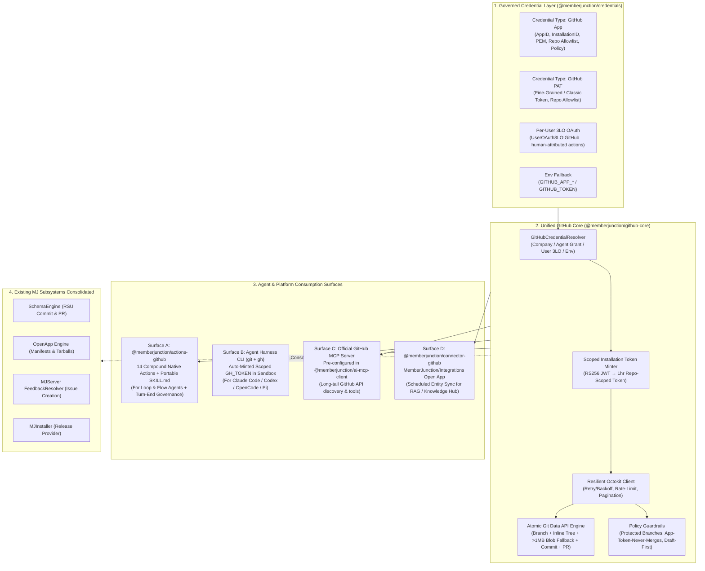
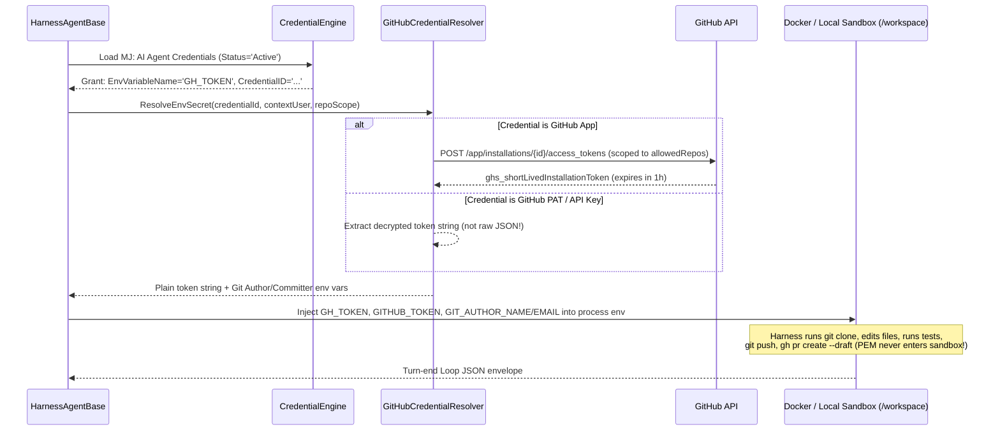

# First-Class GitHub Integration for MemberJunction Agents — Architecture & Design Plan

**Status**: Implemented (Phase 1 Complete)
**Audience**: MJ Core & AI Agent Contributors
**Related Plans & Packages**:
- [`plans/skill-scaling-and-semantic-discovery.md`](./skill-scaling-and-semantic-discovery.md) — Skill Scaling, Semantic Discovery & Hybrid Prioritization Architecture
- [`plans/external-agent-harness.md`](./external-agent-harness.md) — External Agent Harness (`@memberjunction/ai-agent-harness`)
- [`plans/autodev/PLAN.md`](./autodev/PLAN.md) — Autonomous Development Engine (`autodev`)
- [`plans/multi-repo-feedback-routing.md`](./multi-repo-feedback-routing.md) — Multi-Repo Feedback Issue Routing
- [`packages/AI/MCPClient/`](../packages/AI/MCPClient/) — MJ MCP Client & `AgentToolAdapter`
- [`packages/Credentials/Engine/`](../packages/Credentials/Engine/) — `CredentialEngine` & Encrypted Vault
- [`packages/Integration/INTEGRATION_ACTIONS.md`](../packages/Integration/INTEGRATION_ACTIONS.md) — Connector-Driven Integration Actions

---

## 1. Executive Summary & Core Thesis

MemberJunction agents need first-class capabilities to read repositories, search code, inspect and diagnose CI/CD runs, triage issues, commit multi-file changes, review code, and raise Pull Requests.

A study of the MemberJunction codebase reveals two critical facts:
1. **MemberJunction already contains four separate, siloed Octokit/GitHub implementations** across `@memberjunction/schema-engine`, `@memberjunction/open-app-engine`, `@memberjunction/server`, and `@memberjunction/installer` — none of which are exposed to AI agents or integrated with `CredentialEngine`.
2. **MemberJunction has two fundamentally different agent execution substrates** (`LoopAgentType`/`FlowAgentType` running in-process on MJServer vs. `HarnessAgentType` running coding CLIs like Claude Code and Codex inside Docker/local sandboxes), and **neither MCP, CLI, nor API alone serves both substrates well**.

### The Architectural Bet: One Foundation, Four Consumption Surfaces

Rather than choosing *between* MCP, CLI, or API, we build **one shared GitHub foundation (`@memberjunction/github-core` + `CredentialEngine`)** and expose it through **four purpose-fit surfaces**:

---

## 2. Audit of What Exists in MemberJunction Today

### 2.1 Four Disconnected GitHub / Octokit Islands

| Subsystem | Location | What It Already Does Well | Limitations |
|---|---|---|---|
| **SchemaEngine (RSU)** | [`GitHubAppAuth.ts`](../packages/SchemaEngine/src/GitHubAppAuth.ts) [`RuntimeSchemaManager.ts`](../packages/SchemaEngine/src/RuntimeSchemaManager.ts#L2473-L2742) | Zero-dependency RS256 JWT signing (`node:crypto`) + repo-scoped installation token exchange (`contents: write`, `pull_requests: write`). Atomic in-process Git Data API multi-file commit (`apiCreateTreeFromFiles` with inline files up to 1MB and `createBlob` fallback) + PR creation without shelling out to `git`. | Locked inside `RuntimeSchemaManager` private methods; reads raw `process.env` (`GITHUB_APP_ID`, `GITHUB_APP_INSTALLATION_ID`, `GITHUB_APP_PRIVATE_KEY`); unreachable by agents. |
| **OpenApp Engine** | [`github-client.ts`](../packages/OpenApp/Engine/src/github/github-client.ts) | URL parsing with monorepo subpath support (`ParseGitHubUrl`), transient network error retry (`RequestWithRetry` on `ECONNRESET`, 502/503/504), per-repo `TokenMap` resolution, release/tag listing, and `.tar.gz` streaming extraction. | Read-only; bespoke `GitHubClientOptions`; no `CredentialEngine` or GitHub App support. |
| **MJServer Feedback** | [`FeedbackResolver.ts`](../packages/MJServer/src/resolvers/FeedbackResolver.ts) [`multi-repo-feedback-routing.md`](./multi-repo-feedback-routing.md) | Uses `@octokit/rest` + `@octokit/auth-app` (`createAppAuth`) or PAT to create formatted issues with labels/assignees; plans repo allowlisting. | Hardcoded to GraphQL `SubmitFeedback` mutation; duplicates private-key loading logic; not an MJ Action. |
| **MJInstaller** | [`GitHubReleaseProvider.ts`](../packages/MJInstaller/src/adapters/GitHubReleaseProvider.ts) | Lists tags/releases and downloads release zipballs. | Unauthenticated / standalone HTTP client. |

### 2.2 Existing Agent Substrates & Critical Gaps Found

1. **Agent Harness (`@memberjunction/ai-agent-harness`) — Credential Resolution Bug & Token Minting Gap**:
   - [`HarnessAgentBase.resolveGrantedEnvironment()`](../packages/AI/AgentHarness/src/HarnessAgentBase.ts#L543-L589) loads `MJ: AI Agent Credentials` rows and injects them into the sandbox environment (`LocalDirectorySandboxProvider` or `DockerSandboxProvider`).
   - **Critical Gap 1**: [`HarnessAgentBase.loadCredentialValue()`](../packages/AI/AgentHarness/src/HarnessAgentBase.ts#L631-L643) calls `GetEntityObject('MJ: Credentials')` + `credential.Load()` directly instead of using [`CredentialEngine.Instance.getCredential()`](../packages/Credentials/Engine/src/CredentialEngine.ts). As documented in [`ApolloEnrichment/src/lists/credentials.ts`](../packages/Actions/ApolloEnrichment/src/lists/credentials.ts#L160-L163), bypassing `CredentialEngine` skips `MJ: Audit Logs`, skips `LastUsedAt` stamping, ignores expiration policies, and ignores `IsActive`.
   - **Critical Gap 2**: `credential.Values` is a **JSON object string** (e.g., `{"apiKey": "ghp_..."}`), not a bare token string. Injecting `credential.Values` directly sets `GITHUB_TOKEN='{"apiKey":"ghp_..."}'`, which breaks `gh`, `git`, and CLI harnesses inside the sandbox.
   - **Critical Gap 3**: For a GitHub App credential, the sandbox needs a **short-lived, repo-scoped installation token** in `GH_TOKEN` / `GITHUB_TOKEN` — **never** the App's RSA private key PEM inside the container.
2. **Credential Engine (`@memberjunction/credentials`) — Missing GitHub Schemas**:
   - [`.credential-types.json`](../metadata/credential-types/.credential-types.json) defines 18 credential types (including `DocuSign JWT`, `AWS IAM`, `Azure Service Principal`, `MCP OAuth Token`), plus 3LO per-user OAuth support (`UserDelegatedOAuthCredentialValues` in [`types.ts`](../packages/Credentials/Engine/src/types.ts#L291)), but has **no `GitHub App` or `GitHub Personal Access Token` credential type**.
3. **Security Invariant (`check-app-token-no-merge.mjs`)**:
   - [`.github/scripts/check-app-token-no-merge.mjs`](../.github/scripts/check-app-token-no-merge.mjs) documents a vital MemberJunction security rule: *an identity that mints a GitHub App token with `contents: write` can both open a PR and merge it, bypassing review unless an explicit policy boundary prevents App tokens from merging PRs.* Our agent GitHub integration must enforce this invariant in code.

---

## 3. Why All Four Surfaces Matter: Channel Trade-Off Matrix

Different agent types and tasks have starkly different operational profiles:

| Dimension | Surface A: Curated MJ Actions (`@memberjunction/actions-github`) | Surface B: Sandbox CLI (`git` + `gh` in `AgentHarness`) | Surface C: Official GitHub MCP Server (`@memberjunction/ai-mcp-client`) | Surface D: Integration Connector (`@memberjunction/connector-github`) |
|---|---|---|---|---|
| **Primary Agent Type** | `LoopAgentType`, `FlowAgentType`, and Turn-End steps of `HarnessAgentType` | `HarnessAgentType` (Claude Code, Codex, OpenCode, Pi) & `autodev` | `LoopAgentType` needing ad-hoc / long-tail GitHub API endpoints | Scheduled Sync + Knowledge Hub / RAG + Webhook Wakeups |
| **Requires Local Clone / Shell?** | **No** — 100% in-process via Octokit REST/GraphQL | **Yes** — runs in `/workspace` container or local worktree | **No** — remote HTTP/SSE or managed Stdio | **No** — runs in Integration Engine |
| **Token & Turn Efficiency** | **Highest** — 1 compound Action replaces 5–8 raw API calls | **High** (inside turn) — harness iterates locally over files/tests | **Low–Medium** — exposes 40–80 granular tools; multi-file commit takes 5+ turns | **N/A** — background batch sync into SQL/Vector DB |
| **Multi-File Code Editing & Running Tests** | Poor (limited to generating/updating known files in memory) | **Best-in-class** (full repo clone, compiler, test runner, `git diff`) | Poor (file-by-file REST payloads, no test execution) | N/A |
| **Governance & HITL (`MJ: AI Agent Requests`)** | **Native** — per-action permissions, `MaxExecutionsPerRun`, Plan Mode, HITL approval | Governed at **Turn Boundary** + pre-minted token repo/permission scoping | Governed via `MCPServerConnectionPermissions` & `MCPToolAction` | Governed via `CompanyIntegration` & Entity Permissions |

### Key Design Insight: Compound Actions vs. Granular MCP Tools
In raw GitHub REST / MCP, committing 3 files and opening a PR requires the LLM to orchestrate 6 sequential tool calls (`getRef` → `createRef` → `createTree` → `createCommit` → `updateRef` → `createPullRequest`), passing SHA hashes between turns. Any hallucinated SHA or rate-limit blip strands an orphan branch.
By lifting RSU's atomic [`gitCommitAndPRViaAPI`](../packages/SchemaEngine/src/RuntimeSchemaManager.ts#L2473-L2496) into a single compound MJ Action (**`GitHub - Commit Files and Create PR`**), an in-process agent accomplishes the entire workflow in **one deterministic tool call**.

---

## 4. Detailed Architecture by Pillar

### Pillar 1: Unified GitHub Core (`@memberjunction/github-core`) & Credential Types

#### 4.1.1 New Credential Types in `metadata/credential-types/`

1. **`GitHub App`** (`schemas/github-app.schema.json`):
   - `appId` (string, required, `isSecret: false`) — GitHub App ID or Client ID.
   - `installationId` (string, required, `isSecret: false`) — GitHub App Installation ID for the target org/account.
   - `privateKey` (string, required, `isSecret: true`) — RSA Private Key in PEM format (automatically normalizes escaped `\n` literals via [`ReadPrivateKey`](../packages/SchemaEngine/src/GitHubAppAuth.ts#L50) logic).
   - `allowedRepositories` (string, optional, `isSecret: false`) — Comma-separated list or glob of `owner/repo` targets this credential may access (e.g., `MemberJunction/*,BlueCypress/Skip-Client-Open-App`). Enforced at token-mint time by scoping the installation token request's `repositories` array!
   - `defaultOwner` (string, optional, `isSecret: false`) — Default GitHub org/owner when not specified in an action call (e.g., `MemberJunction`).
   - `allowMerge` (boolean, optional, default `false`) — Enforces the `app-token-never-merges` rule by default. When `false`, `@memberjunction/github-core` refuses `MergePullRequest` calls using this credential.
   - `defaultPRMode` (`'draft' | 'ready'`, optional, default `'draft'`) — Whether PRs opened by agents using this credential default to draft mode.
   - `apiBaseUrl` (string, optional, default `'https://api.github.com'`) — Supports GitHub Enterprise Server (GHES).

2. **`GitHub Personal Access Token`** (`schemas/github-pat.schema.json`):
   - `token` (string, required, `isSecret: true`) — Fine-grained PAT (`github_pat_...`) or classic PAT (`ghp_...`).
   - `allowedRepositories` (string, optional, `isSecret: false`) — Client-side allowlist guard (`owner/repo`).
   - `defaultOwner` (string, optional, `isSecret: false`).
   - `allowMerge` (boolean, optional, default `false`).
   - `defaultPRMode` (`'draft' | 'ready'`, optional, default `'draft'`).
   - `apiBaseUrl` (string, optional, default `'https://api.github.com'`).

3. **Per-User Delegated OAuth (`UserOAuth3LO:GitHub`)**:
   - Uses existing [`CredentialEngine.StoreUserDelegatedCredential` / `GetUserDelegatedCredential`](../packages/Credentials/Engine/src/types.ts#L291-L320) (`ownerUserId` strictly checked against `contextUser.ID`).
   - Used when an agent performs a human-attributed operation (such as approving a PR or merging after a human clicks "Approve" in an `MJ: AI Agent Requests` HITL prompt, satisfying GitHub's "author cannot approve own PR" rule).

#### 4.1.2 `GitHubCredentialResolver` Resolution Chain

Every call into `@memberjunction/github-core` resolves credentials through a deterministic, auditable priority chain:
1. **Explicit `CredentialID` / `CredentialName`** (passed via Action param or Agent Credential grant) → resolved and decrypted via `CredentialEngine.Instance.getCredential()`.
2. **Per-User 3LO (`UseUserDelegatedAuth: true`)** → `CredentialEngine.Instance.GetUserDelegatedCredential('GitHub', contextUser.ID, contextUser)`.
3. **`CompanyID` Lookup** → active `MJ: Company Integrations` row for `Integration = 'GitHub'` → `CredentialID` via `CredentialEngine` (UUID-validated filter, matching [`ApolloEnrichment/src/lists/credentials.ts`](../packages/Actions/ApolloEnrichment/src/lists/credentials.ts#L120-L165)).
4. **Default Credential for Type** → `CredentialEngine.Instance.getDefaultCredential('GitHub App')` or `'GitHub Personal Access Token'`.
5. **Process Environment Fallback** → `GITHUB_APP_ID` + `GITHUB_APP_INSTALLATION_ID` + `GITHUB_APP_PRIVATE_KEY` (or `_PATH`), then `GITHUB_TOKEN` / `GH_TOKEN`.

#### 4.1.3 Scoped Installation Token Minting & Caching (`GitHubTokenManager`)
- Generalizes [`SchemaEngine/src/GitHubAppAuth.ts`](../packages/SchemaEngine/src/GitHubAppAuth.ts):
  - Signs RS256 App JWT (`iat = now - 60s`, `exp = now + 540s`).
  - Exchanges JWT at `POST /app/installations/{installation_id}/access_tokens` with **explicit `repositories: [repo]` and least-privilege `permissions`** (e.g., `{ contents: 'read', metadata: 'read' }` for read-only calls or sandbox read-only postures; `{ contents: 'write', pull_requests: 'write', issues: 'write', actions: 'read' }` for write operations).
  - Validates target `owner/repo` against the credential's `allowedRepositories` policy **before** minting.
  - Caches minted installation tokens in-memory keyed by `(installationId, sortedRepos, permissionsHash)` for 50 minutes (tokens expire at 60 minutes), avoiding redundant token-mint API calls across multi-step agent runs.

#### 4.1.4 `GitHubClient` (Octokit Wrapper + Atomic Git Data Operations)
- Wraps `@octokit/rest` (and `octokit.graphql` for complex queries like PR review threads).
- Hooks every request with [`RequestWithRetry`](../packages/OpenApp/Engine/src/github/github-client.ts#L250) (exponential backoff on `ECONNRESET`, `ETIMEDOUT`, HTTP 502/503/504, and secondary rate-limit `Retry-After` headers).
- Provides first-class methods for:
  - **Atomic Multi-File Commit (`CommitFiles`)**: Creates a new branch (or targets an existing non-protected branch), builds a Git tree inline for files ≤ 1MB with automatic `git.createBlob` base64 fallback for files > 1MB (supports file deletions via `sha: null`), creates a signed/authored commit, updates the branch ref, and optionally opens/updates a PR.
  - **Policy Guards**:
    - Refuses direct commits/pushes to protected branches (`main`, `master`, `next`, `production`, plus repo default branch).
    - Refuses `MergePullRequest` if `credential.allowMerge === false`, returning a descriptive `MERGE_NOT_PERMITTED_FOR_CREDENTIAL` result code.

---

### Pillar 2: Curated Native MJ Actions (`@memberjunction/actions-github`) & Portable Skill (`SKILL.md`)

Located at `packages/Actions/GitHub` (`@memberjunction/actions-github`), registered under Action Category `System > GitHub` (or `Development > GitHub`).

All actions share a common base class **`GitHubBaseAction`** that handles:
- Common optional inputs: `Owner`, `Repo` (or `Repository` in `owner/repo` or full GitHub URL format), `CredentialID`, `CompanyID`, `UseUserDelegatedAuth`.
- Standardized output parameters and structured `ActionResultSimple` result codes (`SUCCESS`, `CREDENTIALS_NOT_FOUND`, `REPO_NOT_ALLOWED`, `PROTECTED_BRANCH_VIOLATION`, `MERGE_NOT_PERMITTED`, `RATE_LIMITED`, `NOT_FOUND`, `GITHUB_API_ERROR`).

#### The 14 First-Class Actions

| # | Action Name | DriverClass | Purpose & Why It Is Designed This Way |
|---|---|---|---|
| 1 | `GitHub - Get Repository Context` | `GitHubGetRepositoryContextAction` | Returns repo metadata (default branch, visibility, topics, languages), top-level directory tree, `README.md` preview, and latest 3 releases in **1 call** so an agent can orient itself on any repo in one turn. |
| 2 | `GitHub - Read Repository File` | `GitHubReadRepositoryFileAction` | Reads 1 or more files (`Paths: string[]`) at a given `Ref` (branch/tag/SHA) with optional `StartLine`/`EndLine` slicing and automatic truncation guard for huge files. Batching `Paths` avoids N separate turns to read 5 related files. |
| 3 | `GitHub - List Repository Tree` | `GitHubListRepositoryTreeAction` | Fetches the recursive Git tree (`git.getTree`) with optional `PathPrefix`, `GlobPattern`, and `MaxDepth` filtering. Lets agents find files across a monorepo instantaneously. |
| 4 | `GitHub - Search Code` | `GitHubSearchCodeAction` | Searches code across a repository or organization (`search.code` with text-match fragments enabled), returning file paths, matched line snippets, and blob SHAs. |
| 5 | `GitHub - Commit Files and Create PR` | `GitHubCommitFilesAndCreatePRAction` | **The flagship compound action.** Accepts `BaseBranch`, `HeadBranch` (auto-generated if omitted), `Files: Array<{ path, content, encoding?, delete? }>`, `CommitMessage`, `PRTitle`, `PRBody`, `Draft` (defaults to credential's `defaultPRMode`), `Labels`, `Reviewers`. Executes branch creation + atomic tree commit + PR creation in one step. |
| 6 | `GitHub - Commit Files to Branch` | `GitHubCommitFilesToBranchAction` | Commits 1+ file additions/updates/deletions to an existing (or new) **non-protected** branch via the Git Data API without creating a new PR (used for iterating on an open PR based on review feedback). |
| 7 | `GitHub - Get Pull Request Context` | `GitHubGetPullRequestContextAction` | **Compound PR inspection.** Fetches PR metadata, changed files list + unified patch diffs (with size cap), review states + inline review comments, and latest CI check-run / status conclusions in **1 tool call**. |
| 8 | `GitHub - Create Pull Request` | `GitHubCreatePullRequestAction` | Opens a PR between existing `Head` and `Base` branches with `Title`, `Body`, `Draft`, `Labels`, `Assignees`, `Reviewers`. |
| 9 | `GitHub - Submit Pull Request Review` | `GitHubSubmitPullRequestReviewAction` | Submits a PR review (`Event: 'COMMENT' | 'APPROVE' | 'REQUEST_CHANGES'`, `Body`, and optional inline `Comments: Array<{ path, line, side?, body }>`). |
| 10 | `GitHub - Merge Pull Request` | `GitHubMergePullRequestAction` | Merges a PR (`MergeMethod: 'squash' | 'merge' | 'rebase'`, `CommitTitle`, `CommitMessage`, `ExpectedHeadSha`). Strictly gated by `allowMerge` on the credential + checks green verification. |
| 11 | `GitHub - Search Issues and PRs` | `GitHubSearchIssuesAndPRsAction` | Searches issues and pull requests using structured filters (`State`, `Labels`, `Assignee`, `Author`, `Type: 'issue' | 'pr' | 'all'`, `Query`, `Sort`) and returns a clean summary array. |
| 12 | `GitHub - Create or Update Issue` | `GitHubCreateOrUpdateIssueAction` | Creates a new issue (when `IssueNumber` is omitted) or updates an existing issue (`Title`, `Body`, `State`, `Labels`, `Assignees`, `Milestone`). Can also back `FeedbackResolver`. |
| 13 | `GitHub - Add Issue or PR Comment` | `GitHubAddCommentAction` | Posts or updates a markdown comment on an Issue or PR (`IssueNumber`, `Body`, optional `CommentID` to update an existing agent status comment in place). |
| 14 | `GitHub - Get Workflow Run and Logs` | `GitHubGetWorkflowRunAndLogsAction` | Lists recent workflow runs for a branch/PR or inspects a specific `RunID`, returning failed jobs, failed steps, and **automatically extracting the tail of failed job logs** so an agent can diagnose CI failures in one turn. Also supports `Operation: 'inspect' | 'rerun-failed' | 'dispatch'`. |

#### Portable Agent Skill (`SKILL.md`)
We author a portable skill definition (`GitHub Repository & PR Steward`) compatible with [`SkillMarkdownConverter`](../packages/AI/Agents/src/SkillMarkdownConverter.ts) and `MJ: AI Skills`:
- Lists the 14 `actions` in YAML frontmatter.
- Provides concise operational instructions for agents:
  - Always start with `GitHub - Get Repository Context` or `GitHub - List Repository Tree` before reading files.
  - Batch file reads via `GitHub - Read Repository File` (`Paths` array).
  - Never attempt to commit directly to `main` or `next`; use `GitHub - Commit Files and Create PR` with `Draft: true` unless instructed otherwise.
  - When diagnosing CI failures on a PR, call `GitHub - Get Pull Request Context` followed by `GitHub - Get Workflow Run and Logs` with the failing `RunID`.

---

### Pillar 3: Agent Harness CLI (`git` + `gh`) & Sandbox Token Minting (`@memberjunction/ai-agent-harness`)

When a coding agent runs on `HarnessAgentType` (Claude Code, Codex CLI, OpenCode, Gemini CLI, Pi), it operates inside a sandbox workspace (`DockerSandboxProvider` or `LocalDirectorySandboxProvider`) where native `git` and `gh` CLI commands are the natural, high-bandwidth interface.

#### Specific Changes in `@memberjunction/ai-agent-harness`
1. **Fix `HarnessAgentBase.loadCredentialValue()`** ([`HarnessAgentBase.ts:631`](../packages/AI/AgentHarness/src/HarnessAgentBase.ts#L631-L643)):
   - Replace raw `GetEntityObject` + `Load` with `CredentialEngine.Instance.getCredential()` so every harness credential resolution writes an `MJ: Audit Logs` entry, updates `LastUsedAt`, checks `IsActive`, and enforces expiration policy.
   - Extract the scalar secret from the JSON `values` based on credential type:
     - For `API Key` / `GitHub Personal Access Token`: extract `values.token ?? values.apiKey`.
     - For `GitHub App`: call `GitHubCredentialResolver.MintTokenForCredential(values, repoScope)` so the sandbox receives a **1-hour, repository-scoped `ghs_...` installation token** — never the raw JSON or the RSA private key!
2. **Automatic Dual Injection (`GH_TOKEN` + `GITHUB_TOKEN`) & Git Identity**:
   - When an agent is granted a GitHub credential under `GH_TOKEN` or `GITHUB_TOKEN`, automatically populate both `GH_TOKEN` and `GITHUB_TOKEN` (since `gh` prefers `GH_TOKEN` while Octokit/tools often check `GITHUB_TOKEN`), plus `GIT_TERMINAL_PROMPT=0`.
   - Set default `GIT_AUTHOR_NAME`, `GIT_COMMITTER_NAME` (`"<AgentName> (MJ Agent)"`), and `GIT_AUTHOR_EMAIL`, `GIT_COMMITTER_EMAIL` so agent commits have clean, auditable provenance in `git log`.
3. **Turn-End Governance Integration**:
   - Inside the sandbox, the harness uses `git` and `gh` for high-frequency local operations (cloning, branching, running tests, pushing feature branches, creating draft PRs).
   - Because the minted installation token is scoped to `allowedRepositories` and cannot bypass `allowMerge: false`, high-consequence operations (like merging a PR or requesting human sign-off) flow through the **Turn-End Loop Protocol** via `MJ: AI Agent Requests` (HITL) and `GitHub - Merge Pull Request`.

---

### Pillar 4: Pre-Configured Official GitHub MCP Server (`@memberjunction/ai-mcp-client`)

MemberJunction's [`MCPClientManager`](../packages/AI/MCPClient/src/MCPClientManager.ts) already supports `StreamableHTTP`, `SSE`, and `Stdio` transports and auto-syncs MCP tools into MJ Actions via [`MCPToolAction`](../packages/Actions/CoreActions/src/custom/mcp/mcp-tool.action.ts).

To make GitHub MCP a turnkey experience:
1. **Seed Metadata in `metadata/mcp-servers/`**:
   - **GitHub Official Remote MCP Server**:
     - `Name`: `GitHub Remote MCP`
     - `TransportType`: `StreamableHTTP`
     - `ServerURL`: `https://api.githubcopilot.com/mcp/`
     - `DefaultAuthType`: `Bearer`
     - `Status`: `Active`
   - **GitHub Local Stdio MCP Server (Optional / Self-Hosted)**:
     - `Name`: `GitHub MCP (Stdio)`
     - `TransportType`: `Stdio`
     - `Command`: `npx`
     - `CommandArgs`: `["-y", "@modelcontextprotocol/server-github"]`
2. **Enhance `MCPClientManager` Auth Resolution for `GitHub App` Credentials**:
   - In [`MCPClientManager.ts`](../packages/AI/MCPClient/src/MCPClientManager.ts), when an `MCPServerConnection` references a `CredentialID` of type `GitHub App` (instead of a static `API Key`), automatically mint/refresh a 1-hour installation token via `@memberjunction/github-core` and pass it as the `Bearer` token (for `StreamableHTTP`) or `GITHUB_PERSONAL_ACCESS_TOKEN` env var (for `Stdio`).

---

### Pillar 5: Inbound/Outbound GitHub Connector (`MemberJunction/Integrations/Platform/GitHub`)

In the `MemberJunction/Integrations` repository (following [`CONNECTOR_LIFECYCLE_GUIDE.md`](../../Integrations/CONNECTOR_LIFECYCLE_GUIDE.md) and [`INTEGRATION_ACTIONS.md`](../packages/Integration/INTEGRATION_ACTIONS.md)):
- Package: `@memberjunction/connector-github` under `Integrations/Platform/GitHub/`.
- Extends `BaseIntegrationConnector` (`IntegrationName = 'GitHub'`).
- Exposes standard Integration Objects for scheduled watermark sync and generic CRUD/Search/List:
  1. `repositories` (`SupportsWrite: false` — synced for catalog/RAG)
  2. `issues` (`SupportsWrite: true` — Get, Create, Update, Search, List)
  3. `pull_requests` (`SupportsWrite: true` — Get, Create, Update, Search, List)
  4. `releases` (`SupportsWrite: false` — Get, List)
  5. `commits` (`SupportsWrite: false` — Get, List)
  6. `workflow_runs` (`SupportsWrite: false` — Get, List)
- **Why this complements `@memberjunction/actions-github`**:
  - The Integration Connector syncs GitHub Issues, PRs, and Releases into MemberJunction SQL tables and Vector Indexes on a schedule so **Knowledge Hub**, **Entity Documents**, and **Pre-Execution RAG** can semantically search across historical issues and PRs without hitting GitHub's API rate limits at query time.
  - `@memberjunction/actions-github` provides the live, compound engineering workflows (multi-file atomic tree commits, unified diffs, CI log extraction, code search, PR reviews) that do not map to flat table CRUD.

---

## 5. Phased Implementation Plan

### Phase 1: Foundation, Credential Types, Compound Actions, Skill & Harness CLI Fix (Immediate)
1. **Credential Types & Schemas (`MJ/metadata/credential-types/` & `@memberjunction/credentials`)**:
   - Add `metadata/credential-types/schemas/github-app.schema.json` and `github-pat.schema.json`.
   - Register `GitHub App` and `GitHub Personal Access Token` in `metadata/credential-types/.credential-types.json`.
   - Add TypeScript interfaces `GitHubAppCredentialValues` and `GitHubPATCredentialValues` to `packages/Credentials/Engine/src/types.ts`.
2. **GitHub Core + Compound Actions Package (`packages/Actions/GitHub` — `@memberjunction/actions-github`)**:
   - Implement core module (`src/core/`):
     - `GitHubAppAuth.ts`: RS256 JWT generation, PEM newline normalization, installation token minting with repository + permission scoping, and 50-minute token cache.
     - `GitHubCredentialResolver.ts`: 5-step credential resolution (`CredentialID` → `3LO User OAuth` → `CompanyIntegration` → `Default Credential` → `Env Fallback`) + `allowedRepositories` glob/list matcher.
     - `GitHubClient.ts`: Octokit factory with transient error retry (`RequestWithRetry`), `CommitFilesViaApi` (atomic multi-file tree builder with >1MB blob fallback and file deletion support), protected-branch guard, and `allowMerge` policy enforcement.
   - Implement the 14 MJ Actions (`src/actions/`):
     1. `GetRepositoryContextAction`
     2. `ReadRepositoryFileAction`
     3. `ListRepositoryTreeAction`
     4. `SearchCodeAction`
     5. `CommitFilesAndCreatePRAction`
     6. `CommitFilesToBranchAction`
     7. `GetPullRequestContextAction`
     8. `CreatePullRequestAction`
     9. `SubmitPullRequestReviewAction`
     10. `MergePullRequestAction`
     11. `SearchIssuesAndPRsAction`
     12. `CreateOrUpdateIssueAction`
     13. `AddCommentAction`
     14. `GetWorkflowRunAndLogsAction`
   - Author Action Metadata (`metadata/action-categories/` & `metadata/actions/.github-actions.json`) and portable `SKILL.md` (`packages/Actions/GitHub/SKILL.md`).
   - Write comprehensive Vitest unit tests covering JWT signing, installation token minting, repo allowlist enforcement, `allowMerge` blocking, protected-branch blocking, and all 14 actions.
3. **Agent Harness CLI Token Minting & Credential Engine Fix (`@memberjunction/ai-agent-harness`)**:
   - Update `HarnessAgentBase.loadCredentialValue()` and `resolveGrantedEnvironment()` in `packages/AI/AgentHarness/src/HarnessAgentBase.ts` to resolve via `CredentialEngine.Instance.getCredential()`, extract scalar secrets from JSON `Values`, mint short-lived scoped tokens for `GitHub App` credentials, auto-populate both `GH_TOKEN` and `GITHUB_TOKEN`, and inject default Git author/committer identity env vars.
   - Add unit tests in `packages/AI/AgentHarness/src/__tests__/`.

### Phase 2: Codebase Consolidation & Turnkey GitHub MCP Catalog
1. Refactor `SchemaEngine` (`RuntimeSchemaManager`), `OpenApp/Engine` (`github-client.ts`), `MJServer` (`FeedbackResolver`), and `MJInstaller` (`GitHubReleaseProvider`) to use shared auth/client utilities.
2. Add `GitHub App` dynamic Bearer token minting support to `MCPClientManager` in `@memberjunction/ai-mcp-client`.
3. Seed Official GitHub Remote MCP Server metadata (`metadata/mcp-servers/.github-mcp.json`).

### Phase 3: `MemberJunction/Integrations` Connector & Webhook Triggers
1. Scaffold `@memberjunction/connector-github` in `MemberJunction/Integrations/Platform/GitHub/` implementing `BaseIntegrationConnector` for `repositories`, `issues`, `pull_requests`, `releases`, `commits`, and `workflow_runs`.
2. Add inbound GitHub webhook verification (HMAC SHA-256) to trigger `AgentWakeTriggerService` on `@mj-agent` mentions, `agent-ok` issue labels, or failed CI check suites.
