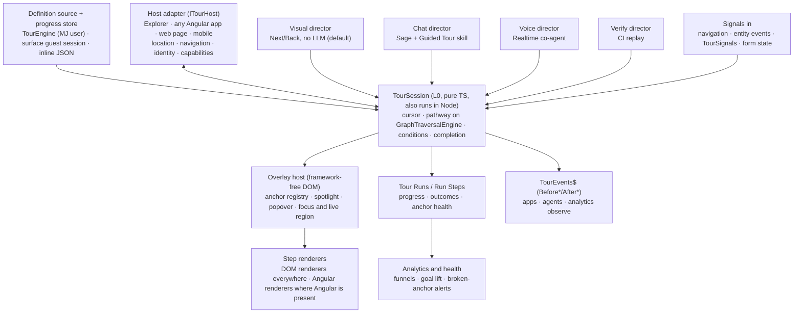
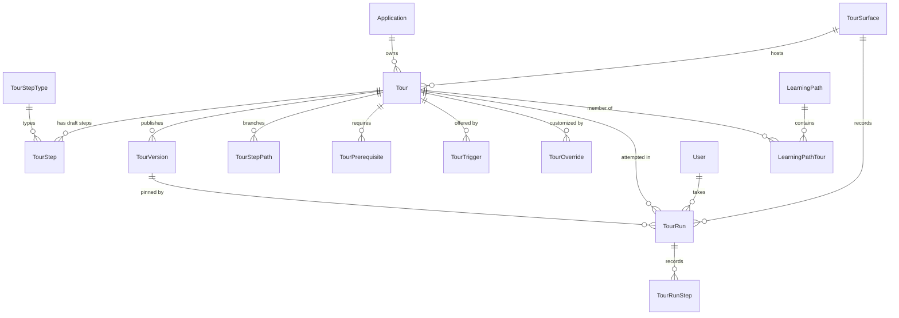
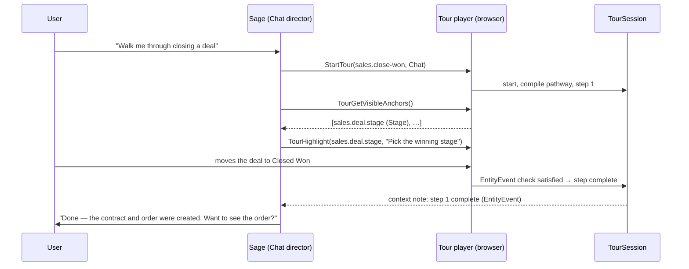
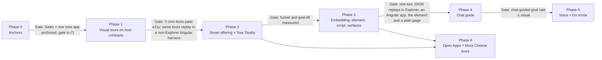

# Guided Tours: a Framework Primitive for In-App Guidance

## Status
- **Status**: Draft (plan-only, for review before any code)
- **Created**: 2026-11-04
- **Author**: Amith Nagarajan + Claude
- **Branch**: `claude/guided-tours`
- **Companion doc**: [MJ Guided Tours — Design Proposal](https://claude.ai/artifact/R2s29bJUkhy2iboGB2qmxQ). That doc is the narrative version; **this file is the plan of record** and supersedes it where they differ. The main additions here are hosts beyond Explorer (§4.2), the extension model (§5), agent integration (§10) and the default tour catalogs (§16–§17).

---

## 1. Overview

MJ needs built-in in-app guidance comparable to Appcues, Pendo, WalkMe, Whatfix, Userpilot and Chameleon:

- product tours
- hints and beacons
- announcements
- checklists and learning paths
- per-user progress, prerequisites, optional and branching paths, and suggested tours

MJ should not bolt one of those overlays on. It should build guidance as a framework primitive, because MJ owns everything those tools have to reverse-engineer: the metadata, the component tree, the data, the permissions, the release pipeline and the agents.

The plan rests on four ideas:

1. **Tours are metadata.** A tour is a set of rows: tour, steps, paths, triggers and prerequisites. Open Apps ship them in their release migrations, like nav items and applications, and host admins customize them through overrides that survive upgrades.
2. **Everything is a plugin.** Every behavior is a ClassFactory-registered class with a logic half and, where relevant, a UX half. This covers step types, anchor resolvers, completion checks, triggers, eligibility policies, presenters, directors, and tour-level and step-level drivers. MJ ships a standard library of each, and any app can add or override them, for all tours or for one tour or step.
3. **One tour session, many directors.** A headless `TourSession` holds the pathway and the user's progress. Who drives it is pluggable:
   - a no-LLM visual player (the default)
   - Sage in chat
   - the realtime co-agent in voice
   - a verify director that replays tours in CI

   Every agent can start a tour, see that one is running, and help without derailing it.
4. **Anchors are semantic and checked in CI.** Steps target named things: a registered anchor key, a form field, a section, a nav item by DriverClass. They never target CSS paths. A standards gate fails any PR that breaks a tour, and a replay director turns every tour into a smoke test.
5. **Any host, not only Explorer.** The engine and the overlay are framework-free, and Explorer is the first host, not a special case. The same tour definition runs in five places:
   - Explorer
   - any Angular app, MJ-connected or not
   - an Angular custom element (`<mj-tour-host>`)
   - a single `<script>` tag on any HTML page
   - the MJ mobile app

   Navigation, identity, persistence and the agent bridge are host adapters. This mirrors MJ's public realtime widget, which already ships both as an Angular Elements custom element and as a script-tag loader with guest sessions.

The plan also covers the content:

- default tours for MJ core: an intro to MJ, user tours per app, admin tours, builder tours and learning paths
- follow-on tours for each BizApps Open App
- demo tours for More Cheese

---

## 2. Goals and non-goals

### Goals
- A metadata model for tours, steps, branching paths, prerequisites, triggers, learning paths, per-user runs and admin overrides, in core `__mj`.
- A pluggable class model that apps can use to extend or override tour behaviour **end to end** (a tour driver and presenter) or **per step** (step types, plus a per-step driver override). The extension points are:
  - step types
  - anchor resolvers
  - completion checks
  - triggers
  - eligibility policies
  - directors
- A standard step-type library that covers the patterns every major vendor converged on.
- Semantic, CI-verified anchoring, plus a runtime record of which anchor strategy resolved for each step.
- Per-user progress that follows the user across devices, and per-user preferences through `UserInfoEngine`.
- Agents can start tours, see the active tour and its step, guide a tour in chat or voice on rails, and answer questions mid-tour.
- Offering is respectful: on-demand entry points first, and a global interruption budget aware of dirty forms, open dialogs and live sessions.
- Analytics built on real goals (data facts), not completion counts.
- WCAG 2.2 AA conformance for every standard renderer.
- Default tours shipped for MJ core, the BizApps Open Apps, and More Cheese.
- **Host independence.** The same tour runs in Explorer, a non-Explorer Angular app, the `<mj-tour-host>` custom element, a plain HTML page through one script tag, and the mobile app. There are no Explorer imports below L3, and no Angular imports in the engine or the overlay, and the `ui-layers` standard enforces both.

### Non-goals (for this plan)
- A visual WYSIWYG content editor on par with Appcues' builder. Tour Studio is structured editing plus an element picker; rich design is out of scope.
- Surveys and NPS. They are adjacent and could later become a step type, but are not designed here.
- A React-specific wrapper. React apps use the custom element or the script API; a hook can follow later.
- Guiding users through third-party SaaS we do not control, such as Salesforce. External pages are supported when their owner adds the script or element; we never inject into sites we do not own.
- Practice sandboxes that create throwaway records. This is listed as an open question because of cross-app side effects (§20).
- Framework-wide localization. The tour content model is ready for it, but i18n is a separate initiative.

---

## 3. Background and context

### 3.1 What the market teaches

Research covered Appcues, Pendo, WalkMe/SAP, Whatfix, Userpilot, Userflow, Chameleon, UserGuiding, Product Fruits, Intercom, Jimo, Usetiful, Frigade, Usertour, Stonly and Amplitude Guides & Surveys (formerly Command AI). It also covered the open-source libraries Shepherd, Driver.js, Intro.js, Joyride, Reactour, NextStep and ngx-ui-tour. Findings that shape this plan:

- **Who starts the tour matters most.** Chameleon's 2024 benchmark puts average completion at 33.5%, against 64% when the user launched the tour. Produktly's 2026 study of 88 companies found 23% for auto-started tours and 69% for user-opened ones.
- **Length matters.** Completion is about 72% at 3 steps and 16% at 7 or more. A progress indicator adds about 12%.
- **Completion is a vanity metric.** In Userpilot's data, raising checklist completion did not move retention. Goals have to be outcomes.
- **Anchors are the top maintenance cost.** Whatfix puts manual reselection at 4–5 hours per app change, and every vendor ends up asking developers to add stable `data-*` attributes. Single-page-app timing ("element not found") forces polling.
- **Guide by default; do it for the user only when asked.** In a CHI 2025 study, semi-automated "do it with me" guidance beat full automation on control, usefulness and learnability. Kelleher and Pausch's in-app *Stencils* tutorials were 26% faster with fewer errors.
- **The leaders are inferring what a framework knows.** Pendo's Novus parses customer code, Whatfix's ScreenSense and WalkMe use vision models, and Frigade watches network calls to discover actions. AI "do it for me" features replay recorded clicks; Userflow's Action Flows cannot be undone and warn against destructive use.
- **Throttling converged on a global budget.** That means caps per period, tag groups, priority and a critical bypass, plus "smart delay" until the user pauses (Chameleon).
- **Licensing.** Shepherd (v14 and later) and Intro.js are AGPL or paid, so we build our own renderer. Driver.js's single-SVG-mask overlay and ngx-ui-tour's anchor-directive registry are the best models.

Vendor figures are vendor-reported. Several vendor domains were blocked from the research environment, so some claims come from search summaries. Treat them as directional. Sources are in §22.

### 3.2 What MJ already has

Nothing tour-shaped exists: there is no tour, coach-mark or spotlight component, and no tour library in any `package.json`. Most of the underlying layers already exist:

| Need | Existing piece | Where |
|---|---|---|
| Where the user is | `AppContextSnapshot$` (app, nav item, user, view, capabilities), fed by `NavigationService.SetAgentContext` | `packages/Angular/Explorer/shared/src/lib/navigation.service.ts` (:270, :294); `packages/AI/CorePlus/src/app-context.ts` |
| Agents act in the browser, in chat and voice | Client tools: `SetAgentClientTools`, global `registerClientTools`, `ClientToolRequestManager`; realtime `ContextTool` via `ClientContextChannel` | `navigation.service.ts:308`; `packages/Angular/Explorer/explorer-app/src/lib/explorer-app.component.ts` (`registerClientTools`, ~:1181); `packages/AI/Agents/src/ClientToolRequestManager.ts`; `packages/Angular/Generic/conversations/src/lib/components/realtime/channels/client-context-channel.ts` |
| Client-tool precedence | `ResolveClientTools` (override > session > app > static) | `packages/AI/CorePlus/src/client-tool-resolver.ts` |
| A prompt-level tour today | `BuildTourGuidanceClause()`; its comment says it should become "a dedicated Tour skill once that agent primitive exists" | `packages/AI/Agents/src/realtime/realtime-tool-broker.ts:100` |
| An agent mode that lasts across turns | Skills with `ActivationScope = 'Conversation'` | `guides/AGENT_SKILLS_AND_PLAN_MODE_GUIDE.md` §1.6c |
| UI commands in agent replies | `actionableCommands` / `automaticCommands` (open:resource, notification, …) | `packages/AI/CorePlus/src/ui-commands.ts` |
| Branching pathway engine | `GraphTraversalEngine`: pure TypeScript and browser-safe, with conditional and exclusive edges, `SelectOutgoingEdges`, `AdvanceFrontier`. Flow agents already compile onto it | `packages/AI/CorePlus/src/task-graph/graph-traversal-engine.ts`, `flow-graph-compiler.ts` |
| Anchors on every generated form | `data-field-name`, `data-section-key`, `data-rail-key`, plus `OnNavigateToCommentAnchor` (switch rail group, expand section, scroll, pulse) | `packages/Angular/Generic/base-forms/src/lib/field/form-field.component.ts:207`; `.../container/record-form-container.component.ts` (~:3225) |
| Conditions and audiences | `CompositeFilter.FromJSON(json).Evaluate(ctx)` (both tiers) and `mj-filter-builder` | `guides/FILTER_BUILDER_AND_EVALUATION.md` |
| Per-user preferences | `UserInfoEngine` settings: synchronous read, debounced write | `packages/MJCoreEntities/src/engines/UserInfoEngine.ts` |
| Cached, reactive config | `BaseEngine` + `ObserveProperty`. `InteractiveFormsEngine` is the template, kill switch included | `packages/MJCore/src/generic/baseEngine.ts`; `packages/MJCoreEntities/src/engines/interactive-forms.ts` |
| Global / Role / User overrides | Entity Form Contributions scoping | `plans/form-contributions.md` |
| Goals proven by data | `BaseEntityEvent` (save, delete) on the MJGlobal bus | `packages/MJCore/src/generic/baseEntity.ts` |
| Cancelable event contract | `Before*` / `After*` event-args classes | `guides/UI_LAYERING_GUIDE.md` §6 |
| Nudges | `MJ: User Notifications` + `NotificationEngine`; `IsNotificationClickable` special-cases resource types | `packages/Communication/notifications/`; `packages/Angular/Explorer/explorer-core/src/lib/user-notifications/user-notifications.component.ts` |
| Command palette | `OmnibarProvider` subclasses | `packages/Angular/Explorer/explorer-core/src/lib/omnibar/providers/` |
| First-run hook | `MJ_PRE_SHELL_GUARD`, declared and never implemented | `packages/Angular/Explorer/explorer-app/src/lib/pre-shell-guard.ts` |
| Overlay and picker precedent | Component feedback panel: positioned overlay plus capture-phase click picker | `packages/Angular/Generic/artifacts/src/lib/components/plugins/component-feedback-panel/component-feedback-panel.component.ts` |
| Element perception for authoring and health checks | ComputerUse `INTERACTIVITYPROBE`, accessibility snapshots, role+name re-resolution | `packages/AI/ComputerUse/src/browser/` |
| A CI gate on UI hooks | The Sales selector gate checks every harness selector against mounted templates | `bizapps-sales/scripts/assert-harness-selectors.mjs` |
| Deterministic rails before each LLM turn | Marketing's strategy-onboarding state machine | `bizapps-marketing/packages/Core/src/business/strategy/onboardingStateMachine.ts` |
| Shipping UI to any web page | `@memberjunction/realtime-widget`: a script-tag loader that reads `data-*` attributes, mints a scoped anonymous guest session from a publishable key, and mounts inside a shadow DOM with CSP-nonce support. `<mj-realtime-widget>` is registered through `@angular/elements` | `packages/Web/RealtimeWidget/`; `packages/Angular/Generic/realtime-widget/src/lib/realtime-widget.element.ts` |
| Public surfaces and guest identity | `MJ: Conversation Widget Instances` (`PublicKey`, `AllowedOrigins`, `AuthStrategy`, `GuestRole`, `RateLimitPerMinute`, `RememberReturningVisitors`) and `WidgetSessionService.MintGuestSession` | `packages/MJServer/src/realtimeWidget/WidgetSessionService.ts` |
| Layer enforcement | `ui-layers` standard: `runtime` packages may not import Angular; `widgets` may not import the router or Explorer | `packages/Standards/src/checks/ui-layers.ts` |

**Gaps this plan closes:**
- no generic anchored popover or spotlight (CDK overlay exists; an arrowed popover does not)
- almost no stable hooks on shell chrome (header buttons are found by CSS class)
- no stable nav-item ID (items are matched by `Label`, which hosts can rename)
- no per-resource "loaded" stream (`LoadCompleteEvent` only feeds the first-load flag and tab titles)
- no z-index layer above dialogs (`--mj-z-dialog` is 1200)
- no end-user product analytics
- agents in `NativeOnly` tool-calling mode get no client tools and no skills (`packages/AI/Agents/src/native-tools/native-control-config.ts`)

---

## 4. Architecture



The central decision is to separate four things:
- *what the tour is*: the session, its pathway and its progress
- *who drives it*: a director
- *how each step behaves and looks*: step types and renderers
- *where it runs*: the host

The tour is data, and the session owns state. Directors, step types, presenters and drivers are plugins. The host (Explorer, another Angular app, any web page) is an adapter. Explorer is the first host, not a special case.

### 4.1 Packages (following the UI layering guide and the `ui-layers` standard)

| Package | Layer (`mjUILayer`) | Holds |
|---|---|---|
| `@memberjunction/tours-runtime` (`packages/Tours/Runtime`) | `runtime`: pure TypeScript, no Angular, no DOM; runs in Node | `TourSession`; the pathway compiler onto `GraphTraversalEngine`; anchor-descriptor and step-config types; the logic-half base classes (`BaseTourDriver`, `BaseTourStepType`, `BaseTourCompletionCheck`, `BaseTourTrigger`, `BaseTourEligibilityPolicy`, `BaseTourDirector`) and their standard implementations; the host, source, store and capability contracts (§4.2); `TourAgentToolkit` (agent tool schemas and handlers); the `TourEvents` contract. The server uses it too, for `Suggest Tours` and the Verify director |
| `@memberjunction/tours-dom` (`packages/Tours/Dom`) | `runtime`: framework-free, needs a DOM, no Angular | The overlay host (one fixed element with a shadow root); `AnchorRegistry` with the `data-mj-tour-anchor` attribute scanner; the DOM halves of the semantic resolvers; the spotlight mask; popover positioning (`@floating-ui/dom`, MIT); focus management, live region and keyboard; `BaseTourDomRenderer` and the standard DOM renderers (Spotlight, Action, Beacon, Modal, Banner, Navigate, Choice, Checkpoint); the `Overlay` and `SidePanel` presenters; `WebTourHost` |
| `TourEngine` in `@memberjunction/core-entities` (`packages/MJCoreEntities/src/engines/tours.ts`) | Both tiers | The MJ-connected definition source and progress store: cached definitions and the current user's runs, `ObserveProperty` streams, `ActiveSession$`, and the `Tours.Enabled` kill switch |
| `@memberjunction/ng-tours` (`packages/Angular/Generic/tours`) | `widgets`: no router, no Explorer | The `mjTourAnchor` directive (sets the attribute and registers eagerly); `BaseTourStepRenderer` and the adapter that mounts Angular renderers inside the DOM overlay; the rich renderers that need Angular (Media, FieldEntry, EmbeddedComponent, AskAgent, KnowledgeCheck); `mj-tour-host`; the `MJ_TOUR_HOST` injection token; `RegisterTourElements()`, which defines `<mj-tour-host>` as a custom element through `@angular/elements` (the `realtime-widget.element.ts` pattern) |
| `@memberjunction/tours-web` (`packages/Web/Tours`) | `runtime`: plain TypeScript | The script-tag loader (`mj-tours.js`) and `MountTours()`; guest sessions from a surface's publishable key; the surface definition source and progress store; static mode; an optional loader for the rich-step custom-element bundle |
| Explorer integration (`explorer-core`, `explorer-app`, `dashboards`) | `surface` / `shell` | `ExplorerTourHost` (NavigationService, workspace state, `ResourceLoaded$`, agent bridge); header launcher; `OmnibarToursProvider`; Home learning-path card; the "tour" notification type; the **Tour Studio** app |
| `@memberjunction/tours-server` (`packages/Tours/Server`) | Server | Remote Operations (server predicates, batched run recording, publish, surface tour delivery); Actions (`Start Tour For User`, `Suggest Tours`, `Get Tour Progress`, `Assign Learning Path`); `BaseTourServerPredicate`; server entity subclasses; guest-session minting for tour surfaces |

`tours-dom` is declared `runtime` so the `ui-layers` gate forbids any Angular import. It is the one `runtime` package that touches the DOM, which is acceptable for a renderer package; its README says so, and §20 asks whether it deserves its own layer value.

### 4.2 Hosts: running tours outside Explorer

Everything a tour needs from its surroundings goes through a host adapter, so the same tour JSON runs in each of these hosts:

| Host | How tours mount | Identity and progress | Navigation | Agent guide | Step renderers |
|---|---|---|---|---|---|
| MJ Explorer | Built in: `ExplorerTourHost` and `mj-tour-host` in the shell | MJ user; `TourEngine` | `NavigationService` | Sage in chat; realtime co-agent in voice | DOM and Angular, all types |
| Any MJ-connected Angular app (a member portal, a custom app) | `ng-tours`, `<mj-tour-host>`, and the app's own `ITourHost` provided under `MJ_TOUR_HOST` | MJ user; `TourEngine` over the app's provider | The app's own router, behind its host adapter (Generic packages stay router-free) | `ng-conversations` chat or `<mj-realtime-widget>`, if the app embeds them | DOM and Angular, all types |
| Any Angular app, as a custom element | `RegisterTourElements()`, then `<mj-tour-host surface-key="…">` | Guest session from a surface key, or an MJ session the page already holds | Navigation intents emitted as DOM events, handled by the app | `<mj-realtime-widget>` | DOM and Angular |
| Any HTML page (React, server-rendered, static site) | One `<script>` tag (`mj-tours.js`) or `MountTours()` | Guest session from a surface key; an MJ session if one is present | URL intents: `location.assign` or an `OnNavigate` callback | `<mj-realtime-widget>` linked to the surface | Standard DOM set; rich types if the custom-element bundle is loaded |
| Static page with no MJ backend | `MountTours({ Definitions })` | In memory, or a callback the page supplies | URL intents | None | Standard DOM set |
| MJ mobile app | `tours-runtime` with native renderers registered under the same keys | MJ user | Mobile navigation | Mobile chat and voice | Native |

**The host contract** (in `tours-runtime`):

```typescript
/** What a tour needs from wherever it runs. Explorer is one implementation. */
export interface ITourHost {
    /** What this host can do; tours that need more are not offered here. */
    readonly Capabilities: TourHostCapabilities;
    /** Where the user is now, and every change. */
    readonly Location$: Observable<TourLocation>;
    /** Carry out a navigation intent (app + nav item, record, or URL). Resolves when the destination is ready. */
    Navigate(intent: TourNavigationIntent): Promise<boolean>;
    /** The signed-in MJ user, a guest visitor, or nobody. */
    readonly Principal: TourPrincipal;
    /** Optional: register the tour agent toolkit with whatever agent surface this host has. */
    AttachAgentBridge?(toolkit: TourAgentToolkit): void;
}

export interface TourHostCapabilities {
    Navigation: 'MJ App' | 'Url' | 'None';
    EntityEvents: boolean;   // BaseEntity events are observable in this page
    MJForms: boolean;        // generated MJ forms render here (FormField / FormSection anchors)
    Angular: boolean;        // Angular renderers can be mounted
    Agent: 'None' | 'Chat' | 'Voice' | 'Chat and Voice';
    Persistence: 'MJ User' | 'Guest' | 'Memory';
}

/** Where definitions come from and where progress goes. */
export interface ITourDefinitionSource {
    GetTours(location: TourLocation): Promise<TourDefinition[]>;
}
export interface ITourProgressStore {
    GetRuns(): Promise<TourRunRecord[]>;
    RecordEvents(events: TourRunEvent[]): Promise<void>;
}
```

Each contract has three implementations:

| Implementation | For |
|---|---|
| `EngineTourSource` / `EngineProgressStore` | MJ users, over `TourEngine` |
| `SurfaceTourSource` / `SurfaceProgressStore` | Guests, over a surface's guest session and scoped Remote Operations |
| `InlineTourSource` / `MemoryProgressStore` | Static pages, optionally with a callback telemetry sink |

**Capabilities gate tours.** Step types, triggers, completion checks and anchor strategies declare the capabilities they need (`RequiredCapabilities`). Examples:
- `EntityEvent` needs `EntityEvents`.
- `FormField` needs `MJForms`.
- `AskAgent` needs `Agent`.

The eligibility chain skips a tour whose needs the host cannot meet, and Tour Studio warns when a tour is assigned to a surface that cannot run it.

**Anchors on any page.** The canonical anchor is a plain attribute, `data-mj-tour-anchor="portal.renew"`. A page MJ does not build can be toured by adding attributes, or by calling `RegisterAnchor(key, element)`. Role-and-name and selector anchors work anywhere. MJ's form anchors (`data-field-name`, `data-section-key`) work wherever MJ forms render, inside Explorer or not.

**The script API.** Exported functions are PascalCase, per MJ naming.

```html
<script type="module" src="https://cdn.example.org/mj-tours.js"
        data-surface-key="ts_live_xxx" data-api-url="https://api.example.org"></script>
<button data-mj-tour-anchor="portal.renew">Renew membership</button>
```

```typescript
import { MountTours } from '@memberjunction/tours-web';

const tours = await MountTours({
    SurfaceKey: 'ts_live_xxx',
    ApiUrl: 'https://api.example.org',
    OnNavigate: intent => router.push(intent.Url),   // optional; the default is location.assign
});
await tours.Start('portal.renewal');
tours.Signal('portal.renewal.paid', { Amount: 120 }); // feeds Signal completion checks and triggers
tours.On('AfterStepComplete', e => analytics.track(e.StepKey));

// Static mode, no MJ backend:
await MountTours({ Definitions: [/* tour JSON */], Store: 'memory' });
```

**Isolation, theming and CSP** follow the realtime widget:
- The overlay host is one fixed-position element on `document.body` with a shadow root, so host CSS cannot leak in or out.
- `--mj-*` token defaults ship inlined, and a host restyles by setting custom properties on the host element.
- CSP: the page allows the script origin and the API origin, plus either `style-src 'unsafe-inline'` or a nonce read the way the realtime widget's `csp-nonce.ts` does.
- **Accessibility across the shadow boundary.** `aria-describedby` cannot point from a shadow root to light-DOM elements, so action-step descriptions are mirrored into a visually hidden light-DOM node. Focus return is tracked across the boundary.

**Public surfaces and guests.**
- `MJ: Tour Surfaces` (§6) declares each place tours run outside MJ-authenticated hosts. Each surface has a publishable key, allowed origins, an auth strategy, a guest role, a rate limit and visitor retention. It can optionally link a `MJ: Conversation Widget Instances` row to provide a chat or voice guide on that page.
- Guest sessions reuse the `WidgetSessionService.MintGuestSession` pattern (`packages/MJServer/src/realtimeWidget/WidgetSessionService.ts`). A "Tour Guest" role can read only published tours assigned to that surface and record only its own runs, through scoped Remote Operations, with no entity CRUD.
- Server predicates run as the guest, so they see only what the guest may see.
- Guest progress is keyed by `VisitorKey`, as `Conversation.VisitorKey` already is.

**What stays Explorer-only** (correctly, at L3): the header launcher, the omnibar provider, the Home learning-path card, the tour notification type, and Tour Studio.

---

## 5. The extension model

Every tour behaviour follows the MJ pattern: a metadata row or JSON key names a class, the class is registered with `@RegisterClass`, and resolution goes through `MJGlobal.ClassFactory`. Last registration wins, so apps override framework defaults by import order, exactly as custom forms do. Where a behaviour has a visual side, it is split into a **logic half** (L0, pure TypeScript, testable without a DOM, runs in any host) and a **UX half**. The UX half comes in two flavors under the same key:

- a framework-free `BaseTourDomRenderer`, which works on any page
- an Angular `BaseTourStepRenderer`, used where Angular is present

The overlay mounts the best registration the host can run (§4.2). The mobile host registers native UX halves under the same keys, as it does for `BaseMobileResource`.

### 5.1 Plugin points

| Plugin base | Selected by | Standard implementations shipped by MJ | Example app extensions |
|---|---|---|---|
| `BaseTourStepType` (logic) + `BaseTourDomRenderer` and/or `BaseTourStepRenderer` (UX) | `MJ: Tour Step Types` row → `DriverClass` / `RendererClass` | Spotlight, Action, Beacon, Modal, Banner, Navigate, Choice, Checkpoint, Media, FieldEntry, EmbeddedComponent, AskAgent, KnowledgeCheck, WaitForSignal (§5.3) | Caliber `PracticeConversation` (starts a short roleplay session); Sales `BoardDrag` (guides dragging a card between stages); Forms `FillSampleForm` |
| Per-step override (subclass of the step type's class) | `MJ: Tour Steps.DriverClass` (nullable) | n/a | One special step in one tour, e.g. Sales' close-won step that also checks a contract and order were provisioned |
| `BaseTourDriver` (tour-level logic) | `MJ: Tours.DriverClass` (null = `Default`) | `Default` | Sales `QuoteToCashTourDriver` adds the current deal to the condition context and owns cross-app branching |
| `BaseTourPresenter` (tour-level UX; DOM or Angular) | `MJ: Tours.PresenterClass` (null = `Overlay`) | `Overlay` (spotlight + popover), `SidePanel` (a docked step list for long setup tours), `Embedded` (inside a host component such as an empty state) | More Cheese branded `ICFWelcomePresenter` |
| `BaseTourAnchorResolver` | `ITourAnchor.Strategy` | `Registered`, `FormField`, `FormSection`, `FormRailGroup`, `FormToolbarAction`, `NavItem`, `RailPage`, `AppSwitcher`, `GridColumn`, `Omnibar`, `ChatComposer`, `Role`, `Selector` | Sales `DealBoardColumn` (resolves a Kanban column by a pipeline-stage flag, never by stage name); Caliber `StudioDomain` |
| `BaseTourCompletionCheck` | `ITourCompletion.Checks[].Type` | `NextButton`, `AnchorInteraction`, `Navigation`, `Signal`, `EntityEvent`, `FieldState`, `ServerPredicate`, `AgentConfirmed`, `All`, `Any` | Orders `OrderReachedStatus`; Accounting `BatchDispatched` |
| `BaseTourServerPredicate` (server) | `ServerPredicate` check config | `HasRecords` (entity + filter, as the user), `QueryReturnsRows`, `AuthorizationHeld` | Sales `UserOwnsPipeline` |
| `BaseTourTrigger` | `MJ: Tour Triggers.TriggerType` | `FirstVisit`, `EntityFormOpened`, `Signal`, `AppUpgraded`, `Struggle`, `Schedule`, `AgentSuggested` | Accounting `BatchFailed` offers "Fix a failed batch" |
| `BaseTourEligibilityPolicy` | Registered globally; all apply | `AudiencePolicy`, `PrerequisitePolicy`, `PermissionPolicy`, `StatusPolicy` (completed, dismissed, snoozed), `InterruptionBudgetPolicy` | "Only after company setup is complete" (Accounting); a licence-tier policy |
| `BaseTourDirector` | Session `Mode` | `Visual`, `Chat`, `Voice`, `Verify` (CI replay), `Recorder` (authoring capture in Tour Studio) | Marketing could wrap its strategy-onboarding agent as a director |

The type keys for triggers, completion checks, anchor strategies and server predicates are **open strings** resolved against the ClassFactory. They are not CHECK-constrained, because a CHECK constraint would stop apps adding their own. `mj sync push` validation and the `tour-anchors` standard (§13) report an unknown key. Tour Studio lists the registered keys for authors.

### 5.2 The base classes (sketch)

```typescript
// @memberjunction/tours-runtime — logic half. Pure TypeScript; no Angular, no DOM.

/** Shared by every step type. TConfig is the step's typed Configuration (a JSONType interface). */
export abstract class BaseTourStepType<TConfig extends object = object> {
    /** Authoring-time and sync-push validation of the step's Configuration. */
    public abstract ValidateConfig(config: TConfig): TourValidationResult;

    /** Navigation and make-visible work before the step shows. The default runs the step's Prepare actions. */
    public async Prepare(ctx: TourStepContext<TConfig>): Promise<TourPrepareResult> { /* … */ }

    /** Anchors this step targets; empty for modal-style steps. */
    public GetTargets(ctx: TourStepContext<TConfig>): ITourAnchor[] { /* … */ }

    /** Completion used when the author specified none (e.g. Spotlight → NextButton). */
    public GetDefaultCompletion(ctx: TourStepContext<TConfig>): ITourCompletion { /* … */ }

    /** What an agent director is told about this step, and any step-specific tools it may call. */
    public DescribeForAgent(ctx: TourStepContext<TConfig>): TourStepAgentBrief { /* … */ }

    /** Static checks for the tour-anchors gate and the Verify director. */
    public GetHealthChecks(config: TConfig): TourHealthCheck[] { return []; }

    /** Lifecycle hooks. */
    public async OnEnter(ctx: TourStepContext<TConfig>): Promise<void> { }
    public async OnExit(ctx: TourStepContext<TConfig>, outcome: TourStepOutcome): Promise<void> { }
}

/** Tour-level logic. One per tour (MJ: Tours.DriverClass), default 'Default'. */
export class BaseTourDriver {
    /** Add domain facts to the CompositeFilter context (current deal, pipeline, company…). */
    public async BuildContext(ctx: TourContextBuilder): Promise<void> { }

    /** Synchronous, cancelable (UI layering §6 contract). */
    public BeforeTourStart(args: BeforeTourStartEventArgs): void { }
    public BeforeStepEnter(args: BeforeTourStepEnterEventArgs): void { }

    /** Override branching beyond Step Paths. Return null to accept the graph's choice. */
    public ResolveNextStep(ctx: TourSessionContext, candidates: TourStepRef[]): string | null { return null; }

    /** Goal evaluation; the default evaluates the tour's ITourGoal. */
    public async EvaluateGoal(ctx: TourSessionContext): Promise<boolean> { /* … */ }

    public async OnStepCompleted(ctx: TourSessionContext, step: TourStepRef, outcome: TourStepOutcome): Promise<void> { }
    public async OnTourEnded(ctx: TourSessionContext, outcome: TourRunOutcome): Promise<void> { }

    /** Extra framing for agent directors (domain vocabulary, cautions). */
    public DescribeForAgent(ctx: TourSessionContext): string { return ''; }
}

// @memberjunction/tours-dom — framework-free UX half. Works on any page.
export abstract class BaseTourDomRenderer<TConfig extends object = object> {
    /** Render into the overlay's container; return a handle the overlay updates and disposes. */
    public abstract Mount(container: HTMLElement, step: TourStepView<TConfig>,
                          session: TourSessionView, intents: TourRendererIntents): TourRendererHandle;
}

// @memberjunction/ng-tours — Angular UX half, mounted inside the same overlay by an adapter.
export abstract class BaseTourStepRenderer<TConfig extends object = object> extends BaseAngularComponent {
    @Input() Step!: TourStepView<TConfig>;       // read-only projection of the step
    @Input() Session!: TourSessionView;          // progress, mode, can-go-back…
    @Output() NextRequested = new EventEmitter<TourStepIntentEventArgs>();
    @Output() BackRequested = new EventEmitter<TourStepIntentEventArgs>();
    @Output() DismissRequested = new EventEmitter<TourStepIntentEventArgs>();
    @Output() ChoiceMade = new EventEmitter<TourChoiceEventArgs>();
}

// Registration, e.g. in bizapps-caliber:
@RegisterClass(BaseTourStepType, 'Caliber: Practice Conversation')
export class PracticeConversationStepType extends BaseTourStepType<IPracticeConversationStepConfig> { /* … */ }

@RegisterClass(BaseTourStepRenderer, 'Caliber: Practice Conversation')
@Component({ standalone: true, selector: 'caliber-tour-practice-step', /* … */ })
export class PracticeConversationStepRenderer extends BaseTourStepRenderer<IPracticeConversationStepConfig> { /* … */ }
export function LoadPracticeConversationStep() { /* tree-shaking anchor */ }
```

**Resolution order for a step's behaviour.** The step's own `DriverClass` comes first (a subclass for this one step). Otherwise the step type's `DriverClass` applies. The renderer is the step type's `RendererClass`, or its `Name` when that is null. The overlay mounts the Angular registration when the host has Angular and one exists, and otherwise the DOM registration. A step type with neither for a host is not offered there. A presenter can wrap or replace step renderers wholesale, for example `SidePanel` renders every step as a row in a docked list.

**Events.** `TourSession` emits class-based `Before*` / `After*` events:

| Event | Cancelable |
|---|---|
| `BeforeTourStart` / `AfterTourStart` | yes |
| `BeforeStepEnter` / `AfterStepEnter` | yes |
| `AfterStepComplete` | no (informational) |
| `BeforeTourEnd` / `AfterTourEnd` | yes |
| `AnchorMissing` | no (informational) |
| `DirectorChanged` | no (informational) |

They are exposed on `TourSession.Events$`, and engine-wide on `TourEngine.Events$`, so drivers, apps, analytics and agents all observe the same stream. Before-handlers are synchronous, per the layering guide.

**Component signals.** A component publishes semantic events with `TourSignals.Emit('sales.deal.stageChanged', payload)`, usually from inside its existing `After*` handlers. That is a component's explicit, documented contract with tours, and the `Signal` completion check and trigger consume it. Signal names are namespaced like anchor keys.

### 5.3 Standard step types (seeded in `metadata/tour-step-types/`)

| Step type | What the user sees | Default completion | Notes |
|---|---|---|---|
| Spotlight | Dimmed page with a cut-out around the anchor (one SVG `evenodd` mask, several cut-outs allowed) and a popover with title, body and "2 of 5" | `NextButton` | Modal (background inert) |
| Action | Non-modal popover asking the user to do something; the page stays fully usable | Required: author picks `Signal` / `EntityEvent` / `FieldState` / `Navigation` | F6 moves between popover and page |
| Beacon | A pulsing hotspot that opens a hint on click | Opened or dismissed | Pulse stops within 5 s (WCAG 2.2.2) |
| Modal | Centered card: welcome, announcement, recap | `NextButton` | One-step tours are announcements |
| Banner | Strip across the top of the current resource | Dismissed or call to action clicked | |
| Navigate | Moves the user to an app, nav item, rail page or record, after telling them | `Navigation` | WCAG 3.2: change of context announced |
| Choice | "What do you want to do first?" with 2–4 answers | Answer given | The answer feeds the Step Path conditions |
| Checkpoint | Recap plus an optional next tour or learning-path item | `NextButton` | |
| Media | Short video or image sequence, captions required | Ended or Next | Uses `ng-media-player` |
| FieldEntry | Guides filling one field; validates against the field's metadata | `FieldState` | Semantic `FormField` anchor |
| EmbeddedComponent | An MJ interactive component rendered in the popover | Component emits complete | Uses the interactive-components runtime |
| AskAgent | Opens Sage (chat or voice) with a seeded prompt, for an open-ended stop | `AgentConfirmed` or Next | Bridges a visual tour to a guided conversation |
| KnowledgeCheck | One or two questions to confirm understanding | Answered | Optional; scored with the Rubrics primitive later |
| WaitForSignal | A quiet "waiting for…" state while a background thing finishes | `Signal` | For long-running operations |

Each row ships with a `ConfigSchema` (JSON Schema, stored with `@file:`) and a typed JSONType interface under `metadata/entities/JSONType-interfaces/`. Tour Studio's step editor is generated from the schema.

---

## 6. Data model

All entities are in core `__mj` with the `MJ: ` prefix. Rich configuration lives in typed JSON fields (JSONType interfaces), so the shape can grow without migrations.



| Entity | What it is | Key fields |
|---|---|---|
| `MJ: Tour Step Types` | Registry of step types: the plugin catalog authors pick from | `Name`, `Description`, `DriverClass`, `RendererClass`, `ConfigSchema`, `SupportedModes` (Show/Guide/Do), `IsAgentCapable`, `Icon`, `Status` |
| `MJ: Tours` | One guidance experience | `Name`, `TourKey` (stable, namespaced, e.g. `sales.first-deal`), `Description`, `ApplicationID` (owning app; null = core), `SurfaceID` (null = MJ-authenticated hosts such as Explorer), `Status` (Draft, Active, Retired), `CurrentVersionID`, `EstimatedMinutes`, `AudienceFilter` (CompositeFilter JSON), `LaunchPolicy` (JSON), `Priority`, `ThrottleTags`, `DefaultGuideMode` (Visual, Chat, Voice, User Choice), `AllowAgentActions`, `GuideAgentID` (null = app default, then Sage), `DriverClass`, `PresenterClass`, `Goal` (`ITourGoal`), `StartLocation` (`ITourStartLocation`, including context requirements such as "any open record") |
| `MJ: Tour Versions` | Immutable published snapshot (same pattern as Rubric Versions and Sonar score-model versions) | `TourID`, `VersionNumber`, `Definition` (steps and paths as JSON), `PublishedAt`, `PublishedByUserID`, `ChangeSummary` |
| `MJ: Tour Steps` | Editable draft step | `TourID`, `StepKey` (stable), `Sequence`, `StepTypeID`, `DriverClass` (per-step override), `Title`, `Body` (Markdown, MJ template variables), `Configuration` (validated against the type's schema), `Anchor` (`ITourAnchor`), `Placement`, `Mode` (Show, Guide, Do), `Prepare` (`ITourStepPrepare`), `Completion` (`ITourCompletion`), `SkipWhen` (CompositeFilter), `OnMissing` (Skip, Center, Stall, AgentRecover), `IsOptional`, `GuideNotes` (agent-only context), `VoiceScript` (optional) |
| `MJ: Tour Step Paths` | Branch edge; linear tours need none | `TourID`, `FromStepID`, `ToStepID`, `Condition` (CompositeFilter over session context, or a choice key), `Label`, `Priority`, `IsDefault` |
| `MJ: Tour Prerequisites` | What must come first | `TourID`, `PrerequisiteType` (Tour, Role, Authorization, Application, Data), `RequiredTourID`, `Condition`, `Strength` (Required, Recommended) |
| `MJ: Tour Triggers` | When to offer | `TourID`, `TriggerType` (open key, §5.1), `Configuration`, `Delivery` (Offer, Beacon, Notification, Auto), `CooldownDays`, `Status` |
| `MJ: Learning Paths` | A curriculum, rendered as a checklist | `Name`, `PathKey`, `Description`, `ApplicationID`, `AudienceFilter`, `Status` |
| `MJ: Learning Path Tours` | Membership | `LearningPathID`, `TourID`, `Sequence`, `IsRequired` |
| `MJ: Tour Runs` | One attempt by one user or guest visitor: the progress ledger | `UserID` (null for guests), `VisitorKey` (guests), `SurfaceID`, `TourID`, `TourVersionID`, `Status` (Pending, In Progress, Completed, Dismissed, Snoozed, Abandoned, Failed), `GuideMode`, `DirectorType`, `CurrentStepKey`, `PathTaken` (JSON), `LaunchSource` (Launcher, Omnibar, Agent, Trigger, Notification, Link), `LaunchedByAgentRunID`, `StartedAt`, `CompletedAt`, `GoalMetAt`, `SnoozedUntil`, `ConversationID`, `AgentSessionID`, `IsHoldout` |
| `MJ: Tour Run Steps` | Telemetry per stop | `TourRunID`, `StepKey`, `EnteredAt`, `ExitedAt`, `Outcome` (Completed, Skipped, Already Known, Done By Agent, Anchor Missing, Dismissed), `AnchorResolution` (Registered, Semantic, Role, Selector, Failed), `QuestionCount` |
| `MJ: Tour Overrides` | Host-admin changes that never touch shipped rows | `TourID`, `Scope` (Global, Role, User), `RoleID`, `UserID`, `Precedence`, `Status`, `AudienceFilter`, `LaunchPolicy`, `IsDisabled` |
| `MJ: Tour Surfaces` | A place tours run outside MJ-authenticated hosts (a portal, a public page) | `Name`, `SurfaceKey`, `SurfaceType` (MJ Angular App, Web Page, Mobile App), `PublicKey`, `AllowedOrigins`, `AuthStrategy` (MJ User, Guest, Either), `GuestRoleID`, `ConversationWidgetInstanceID` (optional chat or voice guide), `RateLimitPerMinute`, `VisitorRetentionDays`, `Status` |

Rules:
- **Runs pin a version.** An app upgrade that rewrites a tour never corrupts someone's half-finished run. A run on a retired version finishes on its snapshot, or is offered a restart.
- **Shipped rows are never edited by host admins.** Their changes go into Tour Overrides, the same layering Form Chrome Rules and Form Contributions use, so customizations survive upgrades.
- **CHECK values are written for people**, per the readable-status-values standard (`In Progress`, not `InProgress`).

User preferences use the `UserInfoEngine` key `mj.tours.preferences.v1`. It holds offers on or off, preferred guide mode, voice, pace and show-beacons. Instance defaults use `InstanceConfigEngine` keys such as `Tours.Enabled`, `Tours.InterruptionBudget` and `Tours.DefaultGuideAgentID`. Per-app agent defaults live in the existing `Application.AgentSettings` (`IAgentSettings`).

---

## 7. Anchoring

A step stores an anchor descriptor, resolved at run time by the first rung of this ladder that finds a visible element:

1. **Registered key.** The canonical form is a plain attribute, `data-mj-tour-anchor="sales.deals.board"`, which works on any HTML page; the framework-free `AnchorRegistry` watches for it with a `MutationObserver`. In Angular, the `mjTourAnchor` directive sets the attribute and registers the element eagerly. Script hosts can also call `RegisterAnchor(key, element)`. The engine waits on registry events, with no polling. Keys are namespaced (`core.shell.*`, `sales.*`, `orders.*`) and declared in source, so CI can see them. This is the ngx-ui-tour model.
2. **Semantic.** These resolvers use metadata MJ already has:
   - `FormField`, `FormSection`, `FormRailGroup` via `data-field-name`, `data-section-key`, `data-rail-key`
   - `FormToolbarAction` by key
   - `NavItem` by DriverClass, never by label
   - `RailPage` by the stable `Id` in each section nav model
   - `AppSwitcher`, `GridColumn`, `Omnibar`, `ChatComposer`

   A resolver also makes its target reachable: open the record, switch the rail group, expand the section. That is `OnNavigateToCommentAnchor` generalized into a shared `FormAnchorNavigator` in `base-forms`, used by both comments and tours.
3. **Accessible role and name**, Playwright-style, for third-party widgets.
4. **CSS selector**, last resort; flagged by Tour Studio and the gate.

```json
{
  "Strategy": "FormField",
  "Entity": "MJ_BizApps_Sales: Deals",
  "Field": "Amount",
  "Fallbacks": [{ "Strategy": "Role", "Role": "spinbutton", "Name": "Amount" }]
}
```

**Contextual tours.** Semantic anchors can be parameterized from context: `"Entity": "{{Context.Record.EntityName}}"`. One tour such as `core.records` then runs on *any* entity form, which no overlay tool can do.

**When nothing resolves:** wait for a registry event (default 5 s), run `Prepare`, then apply `OnMissing`. Every resolution, including which rung succeeded, is recorded in Tour Run Steps.

---

## 8. Steps and completion

The rule is to **credit the outcome, not the click**. A step counts as done however the user got there: mouse, keyboard, another route, or the agent.

Completion checks (`ITourCompletion`, composable with `All` / `Any`):

- `NextButton`, for show-and-tell steps only
- `AnchorInteraction`: click, focus or change on the anchored element
- `Navigation`: from `NavigationService` / `WorkspaceStateManager` observables, plus the new `NavigationService.ResourceLoaded$`
- `Signal`: a named `TourSignals` event
- `EntityEvent`: a `BaseEntityEvent` save or delete on an entity whose record matches a CompositeFilter; goal-grade evidence
- `FieldState`: a field on the open form satisfies a condition
- `ServerPredicate`: a `BaseTourServerPredicate` evaluated by Remote Operation, batched and cached, always as the user
- `AgentConfirmed`: the agent confirms through a tool call; the weakest evidence, recorded as such

`SkipWhen` uses the same checks in reverse, so a step whose outcome is already true is skipped.

The step lifecycle runs in this order:
1. Prepare
2. Resolve the anchor
3. `BeforeStepEnter`
4. Render
5. Await completion
6. Record the outcome
7. `AfterStepComplete`
8. Pick the next step

Pause, dismiss and anchor-missing exit from any point.

---

## 9. Pathways, prerequisites and learning paths

- **No second graph engine.** At load, `tour-graph-compiler.ts` compiles steps and Step Paths into `GraphNode` / `GraphEdge` for `GraphTraversalEngine`, as `flow-graph-compiler.ts` does for Flow agents. Branch conditions, exclusive groups, optional edges and the "Skipped" cascade all come for free, and the whole thing runs in the browser.
- **Inside a tour:** steps run in `Sequence` unless paths say otherwise. Choice answers, roles, the current record and server-predicate results form the condition context, and `BaseTourDriver.BuildContext` can add domain facts. `ResolveNextStep` is the escape hatch for logic a condition cannot express.
- **Between tours:** prerequisites are either **Required** (the tour is not offered until met) or **Recommended** ("Take *Pipeline basics* first?", or a two-sentence agent recap).
- **Permission prerequisites are derived, not authored.** If an anchor is on an entity the user cannot update, or in an app they cannot access, that step is skipped. If the goal is impossible for them, the tour is never offered.
- **Across apps:** steps navigate through `NavigationService.SwitchToApp` with query params, which land synchronously before a cached component reattaches. Cross-app tours are owned by the *top-most* app in the dependency chain, because Common must stay consumer-blind (§17).
- **Learning paths** render as checklists on Home and in the launcher. Seed visible progress, always show the next concrete step, and never allow skipping a required item. ATS's readiness checklist states why: "a checklist item you may skip teaches people to skip the list."

---

## 10. Agents and tours

Tours are first-class for every agent, not only the guide.

The agent tools and context live in `tours-runtime` as a host-agnostic `TourAgentToolkit`: JSON schemas plus handlers. Each host attaches it to whatever agent surface it has:

- **Explorer**: `NavigationService.SetAgentClientTools` and `registerClientTools`
- **another Angular app**: its `ng-conversations` chat
- **a public page**: `<mj-realtime-widget>`'s browser-declared client tools, as Caliber already does

### 10.1 Agents can start tours
- **Global client tools**, defined once in `TourAgentToolkit`, attached in Explorer through `explorer-app.component.ts` `registerClientTools`, and declared in `metadata/client-tool-definitions/`, so they are available even when no tour is running. Bind them to Sage through `MJ: AI Agent Client Tools`.

  | Tool | Parameters |
  |---|---|
  | `StartTour` | `TourKey`, `Mode` (Visual, Chat, Voice), optional `StartAtStepKey` |
  | `ListTours` | `ForCurrentLocation`, `Query` |
  | `GetActiveTour` | — |
  | `PauseTour` | — |
  | `ResumeTour` | — |
  | `StopTour` | — |

- **UI command `start:tour`** in `packages/AI/CorePlus/src/ui-commands.ts`. An agent's reply can carry a **Show me** button (`actionableCommands`), handled by the conversations surface through the tour host.
- **Server Actions** (metadata plus `@memberjunction/tours-server` classes) for workflows, scheduled jobs, routines and any agent:

  | Action | What it does |
  |---|---|
  | `Start Tour For User` | Creates a Pending run and a "tour" notification; `ResourceConfiguration.type = 'tour'` is handled in `IsNotificationClickable` |
  | `Suggest Tours` | Ranked, eligible tours for a user and context |
  | `Get Tour Progress` | Progress for a user, tour or learning path |
  | `Assign Learning Path` | Assigns a path to a user or role |

- **How-do-I matching.** Tours are indexed with entity search (name, description, step titles and bodies). "How do I close a deal?" resolves to `sales.close-won`. Sage can answer from the tour's steps in text *and* offer to show it.

### 10.2 Agents know a tour is running
- **`AppContextSnapshot.ActiveTour`.** Add it to `packages/AI/CorePlus/src/app-context.ts`:
  - fields: `{ TourKey, Name, StepKey, StepTitle, StepIndex, StepCount, Mode, DirectorType, StartedAt }`
  - `AvailableTours`: up to 3 eligible tours for the current location
  - `FormatAppContextNote` prints "User is on step 3 of 5 of the tour *Closing your first deal* (visual)"

  Every agent receives this through the existing `buildAppContextSection`.
- **Realtime.** `TourEngine.Events$` is bridged into `ClientContextChannel`, so a voice co-agent hears "tour started" and "step completed" as context notes even when it is not the director.
- **Coexistence rule.** Only the session's **director** can move the cursor or perform steps. Any other agent may answer, pause, resume, or "hand back to the guide". The runtime enforces this, not the prompt.

### 10.3 Agent-guided tours: "rails with a leash"

The authored pathway is the rail, and the agent holds a cursor on it. The agent may:
- explain and answer questions
- take authored branches
- skip steps that are satisfied or already known
- pause, recover and resume

It may **not** invent steps, reorder the pathway, or point at UI the registry has not confirmed is on screen. This follows the same principle as Marketing's onboarding agent: deterministic state decides, the model narrates.

- **Chat director.** Sage, with a **Guided Tour** skill (`metadata/ai-skills/`, `ActivationScope = 'Conversation'`) activated when a tour starts in chat mode. The skill's instructions replace `BuildTourGuidanceClause`, which stays only for unscripted tours.
- **Voice director.** The Realtime Co-Agent, using the same tools through `ContextTool` (or a dedicated Tour channel if Channels-v2 descriptors make that cleaner). Completion events reach it through `RequestSpokenResponse`, the precedent the whiteboard channel set.
- **Modes per step:**
  - **Guide** (default): highlight, then wait for the user.
  - **Show**: highlight and explain.
  - **Do**: the agent performs the step, only when `AllowAgentActions`, the step type supports it, and the user confirms once per tour. It acts through typed client tools or Actions with the user's own permissions, never synthetic clicks, and Record Changes audits it.
  - **Skip**.
- **Session tools.** The tour player registers these while a session is live, through `SetAgentClientTools`. Names avoid dots for native tool-calling.

  | Tool | Purpose | Guard |
  |---|---|---|
  | `TourGetState` | Current step, path, remaining steps, guide notes | Read-only |
  | `TourGetVisibleAnchors` | Registered and semantic anchors on screen, with accessible names | The only source the agent may cite |
  | `TourHighlight` | Spotlight an anchor with an optional caption | Fails loudly if the anchor is not visible |
  | `TourGoToStep` | Move the cursor | Authored edges only, or back to a completed step; director only |
  | `TourPrepareStep` | Run the step's navigation and make-visible | Navigation consent once per tour |
  | `TourPerformStep` | Do mode | `AllowAgentActions` plus confirmation; director only |
  | `TourMarkKnown` | Skip ahead because the user already knows | Optional steps, unless the user confirms |
  | `TourSuggest` | Offer a prerequisite or the next path item | Eligibility applies |
  | Step-type tools | From `BaseTourStepType.DescribeForAgent` | Declared by the step type |

- **Grounding** comes from three places: the step's guide notes, entity and field descriptions from metadata, and Knowledge Hub or scoped search. After an answer the agent offers "back to step 4?".
- **Unscripted tours.** When no authored tour matches "show me around Orders", Sage composes an ephemeral tour from the app's nav items, rail pages and registered anchors. It labels the tour unscripted and offers to save it as a draft in Tour Studio.
- **Voice specifics:**
  - The highlight starts with the utterance.
  - Turns are short, and the user can interrupt.
  - The agent is silent while waiting for the user to act, and plays a soft cue on completion.
  - Commands: next, repeat, skip, show me, do it for me.
  - Every spoken line is mirrored as text.



**Failure modes and their guards:**

| Failure | Guard |
|---|---|
| The agent describes UI that is not there | It may cite only `TourGetVisibleAnchors` results; `TourHighlight` fails loudly |
| The agent drifts from the pathway | The runtime owns the cursor; `TourGoToStep` accepts authored edges only |
| The user wanders off | Registry and navigation events; answer, offer a way back, persist the run |
| The anchor is missing | Wait, prepare, diagnose (permission, empty data, collapsed panel), fall back to centered, log |
| The user already knows | `SkipWhen`, `TourMarkKnown`, an "I know this" button |
| Approval fatigue in Do mode | Rare, batched confirmations, once per tour |
| Cost and latency | Visual director by default; agent guidance opt-in; "Ask about this step" opens a cheap chat already loaded with the tour context |
| `NativeOnly` agents | No client tools or skills today; the guide runs in hybrid mode until that gap closes (§20) |

---

## 11. Launching, suggesting and throttling

**The default is to offer, not to auto-launch.** Entry points, ordered by how intentional they are:

1. A Tours and Help launcher in the shell header.
2. Sage ("how do I…" plus **Show me**).
3. The omnibar (`OmnibarToursProvider`).
4. `mj-empty-state` actions ("Take the 2-minute tour").
5. First-visit beacons.
6. Notifications ("What's new in Sales 6.22" after an Open App upgrade).
7. Capped auto-launch for genuinely critical flows.

**Eligibility pipeline.** The `BaseTourEligibilityPolicy` chain runs client-side over cached data, with no server call per navigation:
1. Active and not overridden off.
2. App installed and accessible.
3. Audience matches.
4. Prerequisites met.
5. Permissions allow it.
6. Not completed, dismissed or snoozed.
7. A trigger matched.
8. The interruption budget allows it.

Server predicates are batched and cached behind one Remote Operation.

**Interruption budget:**
- Instance defaults: at most one unrequested offer per session and per day. Tag-group caps, priority for collisions, and a critical-bypass flag.
- Never while a form is dirty, a dialog is open, the user is typing, a realtime session is live, or within a few seconds of load.

**Struggle signals** (a `Struggle` trigger plugin) produce a quiet offer from the Sage orb, never a modal:
- repeated validation failures on Save
- back-and-forth navigation between the same two screens
- a long idle on a never-used screen
- "how do I" omnibar searches

Tours are kept to five steps or fewer; longer journeys become learning paths.

---

## 12. Authoring and shipping

- **Source of truth.** `metadata/tours/` in each repo: one JSON per tour, `@file:` Markdown per step body, `@lookup` for applications, entities and step types. Step types are seeded in `metadata/tour-step-types/`. A tour lives in the same pull request as the screen it tours.
- **Shipping.** Feature PRs carry JSON only. Tours reach hosts in the release `Metadata_Sync` migration like every other metadata record (`guides/RELEASE_METADATA_MIGRATIONS_GUIDE.md`), so no new machinery is needed.
- **Host customization** goes through `MJ: Tour Overrides` only.
- **What's new.** When an Open App's installed version changes (`MJ: Open Apps`), tours tagged with that version become eligible as "What's new" offers.
- **Tour Studio** (new Explorer app, `packages/Angular/Explorer/dashboards/src/TourStudio/`, plus `metadata/applications/.tour-studio-application.json`):
  - a tour list with health and funnel numbers
  - a step editor generated from each step type's `ConfigSchema`
  - a pathway graph editor (reusing `ng-flow-editor` / `ng-task-graph-editor`)
  - a **pick element** mode that proposes the most stable anchor (registered, then semantic, then role) and warns before saving a CSS fallback; it builds on the component-feedback-panel picker and the Recorder director
  - preview as a role or a specific user
  - overrides and learning-path assignment
  - surface assignment, with a warning when a tour needs a capability the surface's host lacks
  - publish, which creates a Tour Version
- **AI-assisted authoring:**
  - "Draft a tour for this screen": an agent reads form sections, fields, descriptions, nav item, registered anchors and permissions.
  - "Record and narrate": the Recorder director captures the clicks; the agent writes the copy.
  - Headless authoring for coding agents through MCP / CLI.

  AI always produces drafts, and a person publishes.

---

## 13. Tour health

1. **Static gate.** A new `tour-anchors` check in `@memberjunction/standards` (`packages/Standards/src/checks/tour-anchors.ts`) runs via `mj standards check --check tour-anchors` and is adopted in each repo's `.mj-standards.json`. It checks that:
   - every registered key a tour references is declared by a mounted template
   - every semantic anchor names a real entity and field in generated metadata
   - every step type, check, trigger and resolver key is registered
   - CSS fallbacks are flagged

   The Sales selector gate (`assert-harness-selectors.mjs`) is the starting point for the "mounted template" analysis.
2. **Replay.** The `Verify` director walks each tour headless: it resolves every anchor, runs every `Prepare`, and follows the default path. It runs under the Testing Framework as a Playwright-backed test type, so tours become smoke tests. Sales' `20-demo-tour.spec.ts` is already a tour written as a spec.
3. **CodeGen diff.** When a regenerated form drops or renames a field or section, tours anchored to it are flagged.
4. **Runtime telemetry.** `AnchorResolution` and misses are recorded per step. Crossing a threshold pauses that tour's unrequested offers and notifies its owner. There is no silent self-healing, because it hides breakage.
5. **External surfaces.** The static gate cannot scan a page MJ does not build, so web surfaces rely on two things: the Verify director run against a URL (`mj tours verify --surface <key> --url <url>`), and runtime telemetry.

---

## 14. Analytics

The primary metric is the goal, not completion. Tour Studio's dashboard uses standard MJ queries over Tour Runs and Run Steps joined to domain data:
- **Funnel per tour:** offered, started, each step, completed, and the step where people leave.
- **Goal conversion within N days:** completers against non-starters against a **holdout** (per-tour %, `IsHoldout` on the run).
- **Guide-mode comparison:** visual against chat against voice, on completion, time and goal rate.
- **Question themes** from agent-guided runs, clustered, which surface content gaps.
- **Anchor health** per step and per release.

---

## 15. Accessibility and localization

- Informational steps are modal with the background inert. Action steps are non-modal, with F6 to move between tour and page (Firefox Feature Callout precedent).
- Focus moves into each step and is restored on close. Esc dismisses. Arrow keys are opt-in and never captured in form fields.
- `aria-labelledby` and `aria-describedby` on the step. On action steps the target points at the instruction.
- Polite live region for "Step 3 of 5" and completion (WCAG 4.1.3). No timed auto-advance (2.2.1). Beacons stop within 5 s (2.2.2). `prefers-reduced-motion` is respected.
- The popover never covers the focused element (2.4.11). Ring contrast is at least 3:1, targets at least 24 px, and steps reflow at 320 px.
- Colours use `--mj-*` tokens only. Add a `--mj-z-tour` layer above `--mj-z-dialog` in `packages/Angular/Generic/shared/src/lib/_tokens.scss`.
- Voice has text parity, and every voice command has a keyboard equivalent. Tested with NVDA, JAWS and VoiceOver, plus axe in DOM tests.
- **Localization.** MJ has no framework i18n yet. Step text is stored with a `Localizations` JSON keyed by locale, ready for it. Agent modes can deliver a tour in the user's language live.

---

## 16. Default tours: MJ core

Each tour has five steps or fewer and states its goal. Keys are namespaced. App names and nav items are the current MJ core applications (`metadata/applications/`).

### 16.1 Everyone

| Key | Tour | Audience | Steps (outline) | Goal |
|---|---|---|---|---|
| `core.welcome` | **Welcome to MemberJunction** (intro to MJ) | All users, offered on first sign-in | Modal welcome → Spotlight app switcher → Spotlight omnibar → Spotlight Sage → Choice "what next?" (records, data, chat) | User opens any app from the switcher |
| `core.home` | Make Home yours | All | Spotlight pins → Action "pin something" → Spotlight recents and favorites | A pin saved |
| `core.records` | Working with a record (contextual: any entity form) | All | Spotlight sections and rail → Spotlight toolbar (history, tags, add to list, favorite) → Spotlight comments → AskAgent "Ask AI about this record" | User opens record history or adds a comment |
| `core.data-explorer` | Find, filter and save a view | All (Data Explorer) | Navigate Data → Action open an entity → Action add a filter → Action save the view → Spotlight Queries | A user view saved |
| `core.lists` | Build and share a list | All (Lists) | Navigate Lists → Action create a list → Action add records → Spotlight share | A list with at least one record |
| `core.chat` | Working with Sage | All (Chat) | Spotlight composer → Action ask a question → Spotlight artifacts → Spotlight start a voice session | A conversation started |
| `core.dashboards` | Open and share a dashboard | All (Dashboards) | Navigate Library → Spotlight categories → Action open one → Spotlight share | A dashboard opened |
| `core.workflows-run` | Run a workflow | All (Workflows) | Navigate Workflows → Action start a run → Navigate Runs → Spotlight run status | A workflow run started |
| `core.settings` | Your settings, notifications and tours | All | Spotlight user menu → Spotlight theme → Spotlight notification preferences → Spotlight tour preferences | — (orientation) |

### 16.2 Administrators

| Key | Tour | App and nav items | Goal |
|---|---|---|---|
| `admin.overview` | The Admin console | Admin: Identity & Access, Data & Schema, Monitoring, Developer Tools | Each area visited |
| `admin.users-roles` | Add a user and assign roles | Permissions: User Access | A user with a role saved |
| `admin.resource-access` | Grant access and review the audit log | Permissions: Resource Access, Audit Log | A resource permission saved |
| `admin.ai-setup` | Connect an AI model | AI: Models, Configuration; Credentials | A model credential saved |
| `admin.credentials` | Manage credentials | Credentials: Credentials, Types, Audit Log | — |
| `admin.scheduling` | Schedule a job | Scheduling: Jobs, Activity | A scheduled job active |
| `admin.communication` | Set up a provider and a template | Communication: Providers, Templates | A template saved |
| `admin.integrations` | Connect an integration | Integrations: Integrations, Schedules | An integration configured |
| `admin.knowledge-hub` | Set up Knowledge Hub | Knowledge Hub: Configuration, Classify, Vectors | A content source configured |
| `admin.tours` | Manage tours | Tour Studio: overrides, learning paths, analytics | A learning path assigned to a role |

### 16.3 Builders

| Key | Tour | App | Goal |
|---|---|---|---|
| `builder.first-agent` | Build your first agent (voice-capable; AskAgent steps) | AI: Agents, Prompts | An agent saved and run once |
| `builder.workflow` | Build a workflow | Workflows | A workflow saved |
| `builder.form-studio` | Customize a form | Component Studio: Form Studio | A form contribution saved |
| `builder.predictive-studio` | Train a prediction | Predictive Studio: Studio, Models | A model trained |
| `builder.testing` | Write and run a test | Testing: Explorer, Runs | A test run completed |
| `builder.theme-studio` | Brand MJ | Theme Studio | A theme saved |
| `builder.tour-authoring` | Author a tour | Tour Studio (meta tour) | A draft tour saved |

### 16.4 Learning paths
- **MJ Essentials** (all users): `core.welcome`, `core.home`, `core.records`, `core.data-explorer`, `core.chat`.
- **MJ Administrator** (admin roles): `admin.overview`, `admin.users-roles`, `admin.resource-access`, `admin.ai-setup`, `admin.scheduling`, `admin.communication`, `admin.tours`.
- **MJ Builder**: `builder.first-agent`, `builder.workflow`, `builder.form-studio`, `builder.testing`, `builder.tour-authoring`.

Every core tour adds the anchors it needs to core components in the same PR, starting with the shell chrome.

---

## 17. Downstream tours: Open Apps and More Cheese

Each repo gets its own PR, after phase 2 ships in an MJ release. Each PR:
1. adds `mjTourAnchor` keys and `TourSignals` to its key screens
2. adopts the `tour-anchors` standard in `.mj-standards.json`
3. adds `metadata/tours/` (and optionally `metadata/tour-step-types/` plus classes)
4. ships everything in its next release seed

Cross-app tours live in the top-most app of their dependency chain. Consumer blindness forbids Common from naming its consumers.

Public-facing pages are hosts too (§4.2). Candidate- and respondent-facing pages, such as Caliber's session widget and Forms' respondent widget, can carry tours through a tour surface where that helps.

### 17.1 Open Apps

| Repo | Tours | Extension it showcases |
|---|---|---|
| bizapps-common | `common.person-360` (People: relationships, activities, contact methods); `common.organizations` | Semantic `FormSection` anchors on custom forms |
| bizapps-tasks | `tasks.my-work` (my tasks and approvals); `tasks.template` (admin: build a task template) | `EntityEvent` completion on task approval |
| bizapps-sales | `sales.first-deal` (pipeline → stage → priced lines → schedule; goal: a deal with lines saved); `sales.board` (drag between stages); `sales.close-won` (goal: deal in a won status; shows the contract and order it created); **`bizapps.quote-to-cash`**, the cross-app tour Sales → Contracts → Orders → Accounting, which requires those apps installed | `DealBoardColumn` anchor resolver; `BoardDrag` step type; `QuoteToCashTourDriver`; signals from the existing `After*` events |
| bizapps-orders | `orders.lifecycle` (draft → confirm → payment → bill, along the stage stepper); `orders.receivables` (aging, overdue); `orders.catalog` (admin: price a product); `orders.checkout-widget` (admin) | `OrderReachedStatus` completion check |
| bizapps-accounting | `accounting.company-setup` (admin, incl. CFO approver); `accounting.batch` (pick → preview → approve → dispatch); `accounting.fix-failed-batch` | `BatchFailed` trigger; `BatchDispatched` check; "setup complete" eligibility policy |
| bizapps-contracts | `contracts.templates` (templates and provisions); `contracts.renewals` (renewals and notice terms) | — |
| bizapps-caliber | `caliber.first-blueprint` (steps, routes, publish a rubric); `caliber.review` (review an assessment) | `PracticeConversation` step type (a short roleplay inside the tour); `StudioDomain` resolver |
| bizapps-ats | `ats.publish-job` (setup bar to publish); `ats.candidate-360` (read an interview, decide) | Chat director over the 360 |
| bizapps-forms | `forms.first-form` (Build → Design → Distribute); `forms.conditional-logic` | `FillSampleForm` step type |
| bizapps-marketing | `marketing.brand-setup` (first-run brand setup into the strategy assistant) | Evaluate wrapping the strategy-onboarding agent as a `BaseTourDirector` |
| bizapps-sonar | `sonar.first-model` (setup → factors → bands → publish) | `SidePanel` presenter for a long builder |
| committees, credentialing, fpna, issues, secure-messaging | One starter tour each, on the app's primary screen | Baseline adoption |

### 17.2 More Cheese (demo association, ICF)

These run on the More Cheese generated world: members, creameries, competitions, academy, advocacy, Predictive Studio renewal risk, Sonar engagement. They double as **demo scripts** and, through the Verify director, as demo smoke tests. More Cheese ships them in its release seed (it is an Open App), and its demo user is assigned the learning path.

| Key | Tour | Story |
|---|---|---|
| `icf.welcome` | Welcome to the ICF | The association at a glance: dashboards, members, what this demo shows |
| `icf.membership-manager` | A day as membership manager | Renewal-risk prediction → engagement score explanation → an at-risk member's 360 → outreach via Communication |
| `icf.world-cheese-cup` | Run the World Cheese Cup | Competition, entries, judging rounds, medals |
| `icf.academy` | Academy and certifications | Coursework, apprenticeships, credentials |
| `icf.advocacy` | Advocacy campaigns | Campaigns and legislative monitoring |
| `icf.ask-sage` | Ask Sage about the ICF (voice director showcase) | Sage narrates the association live, grounded in Knowledge Hub content and real data |
| `icf.website-visitor` | Explore the ICF (public website, script host) | A visitor tour on the More Cheese public site (`website/`), loaded with `mj-tours.js` and a guest surface key, with the realtime widget offered as a voice guide |

Learning path **ICF Staff Onboarding**: `icf.welcome`, `icf.membership-manager`, `icf.world-cheese-cup`, `icf.academy`. A branded `ICFWelcomePresenter` demonstrates the presenter extension point.

---

## 18. Implementation plan



No durations are given here; sizing follows review of this plan. Host independence is built in from phase 0, not retrofitted in phase 3. Phase 3 adds packaging and public surfaces on top of contracts that already exist.

### Phase 0 — Anchors (framework-free from the start; useful on their own for tests and agents)
1. **`@memberjunction/tours-runtime`** (`packages/Tours/Runtime`, `"mjUILayer": "runtime"`): the `ITourAnchor` types, `BaseTourAnchorResolver` (logic), and the anchor-key and namespace conventions.
2. **`@memberjunction/tours-dom`** (`packages/Tours/Dom`, `"mjUILayer": "runtime"`):
   - `AnchorRegistry`, with register and unregister events and `WaitFor(key, timeoutMs)`
   - the `data-mj-tour-anchor` `MutationObserver` scanner
   - `RegisterAnchor(key, element)`
   - the DOM halves of the semantic resolvers
3. **`@memberjunction/ng-tours`** (`packages/Angular/Generic/tours`, `"mjUILayer": "widgets"`): `MJTourAnchorDirective` (`[mjTourAnchor]`), which sets the attribute and registers eagerly.
4. **Extract `FormAnchorNavigator`** from `RecordFormContainerComponent.OnNavigateToCommentAnchor` (`base-forms/src/lib/container/record-form-container.component.ts`). Comments and tours then share "switch rail, expand section, scroll, pulse".
5. **Shell anchors.** Add anchors to the app switcher (`explorer-core/.../header/app-switcher.component.ts`), omnibar toggle, chat overlay, notifications, user menu, tab strip and Home.
6. **Stable nav-item keys.** Add an optional `Key` to `NavItem` (`base-application/src/lib/interfaces/nav-item.interface.ts`). Resolve `NavItem` anchors by `Key`, then by `DriverClass`, never by `Label`.
7. **`NavigationService.ResourceLoaded$`.** Emit it from the tab container when `LoadCompleteEvent` fires (`explorer-core/.../tabs/tab-container.component.ts`).
8. **`tour-anchors` standard.** `packages/Standards/src/checks/tour-anchors.ts`, with fixtures, adopted in `.mj-standards.json`. It recognizes both the attribute and the directive.
9. **Token.** Add `--mj-z-tour` to `_tokens.scss` and document it in the design-tokens rule.

### Phase 1 — Visual tours on the host contracts, and agents can start them
1. **Migration.** `migrations/v6/V<YYYYMMDDHHMM>__v6.<minor>.x__Guided_Tours.sql` creates the 13 tables in §6 (sketch in §19), followed by the appended CodeGen output.
2. **JSONType interfaces** in `metadata/entities/JSONType-interfaces/`: `ITourAnchor`, `ITourCompletion`, `ITourGoal`, `ITourStartLocation`, `ITourStepPrepare`, `ITourLaunchPolicy`, `ITourVersionDefinition`, plus one config interface per standard step type.
3. **CodeGen** after `mj sync push` of the JSONType definitions.
4. **`TourEngine`** (`packages/MJCoreEntities/src/engines/tours.ts`) on the `InteractiveFormsEngine` model, exposed to the runtime as `EngineTourSource` / `EngineProgressStore`.
5. **Runtime:**
   - `TourSession`, `tour-graph-compiler.ts`, the event-args classes, `TourSignals`
   - `BaseTourDriver` (`Default`), the standard logic step types and completion checks, the `Visual` director
   - the `ITourHost`, capability, source and store contracts
   - `InlineTourSource`, `MemoryProgressStore` and `TourAgentToolkit`
6. **DOM layer:**
   - the overlay host (shadow root), spotlight mask and popover positioning
   - focus management, live region and keyboard
   - `BaseTourDomRenderer`, the standard DOM renderers and the `Overlay` presenter
   - `WebTourHost`
   - DOM tests and axe checks
7. **ng-tours:** `BaseTourStepRenderer`, the Angular renderer adapter, `mj-tour-host` and the `MJ_TOUR_HOST` token.
8. **Explorer:** `ExplorerTourHost`; mount `mj-tour-host` in the shell; header launcher; `OmnibarToursProvider`; the notification type `tour` in `user-notifications.component.ts`; the Home learning-path card.
9. **A second host from day one.** A minimal non-Explorer Angular harness (`packages/Tours/examples/angular-host`) uses `ng-tours` with its own `ITourHost`, so Explorer coupling is caught in phase 1, not discovered in phase 3.
10. **Server package.** `@memberjunction/tours-server` (`packages/Tours/Server`) with:
    - the Remote Operations `Tours.RecordEvents` (batched) and `Tours.EvaluatePredicates`, plus their `metadata/remote-operations/` rows
    - server entity subclasses: version immutability, and step `Configuration` validated against `ConfigSchema`
    - the `HasRecords` and `QueryReturnsRows` predicates
11. **Agents can start tours:**
    - global tour client tools from `TourAgentToolkit`, attached by `ExplorerTourHost.AttachAgentBridge` (`explorer-app.component.ts` `registerClientTools`, plus `metadata/client-tool-definitions/` rows bound to Sage)
    - the `start:tour` UI command in `ui-commands.ts`
    - `AppContextSnapshot.ActiveTour` and `AvailableTours`
    - the Actions `Start Tour For User`, `Suggest Tours` and `Get Tour Progress`
12. **Seeds.** `metadata/tour-step-types/` and the first core tours: `core.welcome`, `core.records`, `core.chat`.

### Phase 2 — Smart offering, Tour Studio, health
1. **Triggers.** `BaseTourTrigger` with the standard implementations: FirstVisit, EntityFormOpened, Signal, AppUpgraded, Schedule, AgentSuggested.
2. **Eligibility.** The `BaseTourEligibilityPolicy` chain and `InterruptionBudgetPolicy`, aware of dirty forms, open dialogs and live sessions.
3. **Prerequisites and paths.** Prerequisites, Learning Paths with checklist rendering, permission-derived prerequisites, and the `Assign Learning Path` Action.
4. **Overrides.** The Tour Overrides merge in `TourEngine`.
5. **What's new.** Detect Open App version changes and offer the tours tagged with that version.
6. **Tour Studio** app and dashboard:
   - editor generated from `ConfigSchema`
   - graph editor
   - element picker and `Recorder` director
   - preview as a role or user
   - publish
   - analytics and holdouts
7. **`Verify` director.** A Testing Framework test type. Add replay tests for the core tours in `e2e/` and in the Angular harness.
8. **Runtime health.** Anchor-health telemetry and auto-pause, plus CodeGen-diff flagging.
9. **Remaining step types:** Media, FieldEntry, EmbeddedComponent, AskAgent, KnowledgeCheck, WaitForSignal (Angular renderers where they need Angular). Add the `SidePanel` and `Embedded` presenters.
10. **Content.** The remaining core tours (§16) and the three core learning paths.

### Phase 3 — Embedding: any Angular app, a custom element, any web page
1. **Tour surfaces.** `MJ: Tour Surfaces` behaviour:
   - guest-session minting for surfaces: generalize `WidgetSessionService.MintGuestSession`, or mirror it in a `TourSurfaceSessionService` (§20)
   - the "Tour Guest" role
   - scoped Remote Operations `Tours.GetSurfaceTours` and guest `Tours.RecordEvents`
   - allowed-origin and rate-limit enforcement
2. **`RegisterTourElements()` in `ng-tours`.** `<mj-tour-host>` through `@angular/elements`, with a guarded `customElements.define`, a CSP nonce, and methods forwarded to the component, following `packages/Angular/Generic/realtime-widget/src/lib/realtime-widget.element.ts`. Plus a rich-step element bundle.
3. **`@memberjunction/tours-web`** (`packages/Web/Tours`):
   - `mj-tours.js` and `MountTours()`
   - `SurfaceTourSource` / `SurfaceProgressStore`
   - static mode
   - the optional rich-step loader
   - a bundle-size budget enforced in CI
4. **Capability checks.** `RequiredCapabilities` on every plugin, eligibility filtering, Tour Studio warnings, and surface assignment.
5. **Web start locations.** URL-pattern start locations and a `FirstVisit` trigger by URL pattern, for web hosts.
6. **Examples and docs:**
   - `packages/Web/Tours/examples/`: a blank HTML page, a React page using the script, and static mode
   - the Angular Elements demo in `packages/AngularElements/`
   - an embedding chapter in `guides/GUIDED_TOURS_GUIDE.md`, with CSP guidance
7. **External verify.** `mj tours verify --surface <key> --url <url>` for pages MJ does not build.

### Phase 4 — Chat guide
1. **Guided Tour skill.** Add it to `metadata/ai-skills/` and activate it when a chat-mode run starts.
2. **Session tools** in `TourAgentToolkit`: `TourGetState`, `TourGetVisibleAnchors`, `TourHighlight`, `TourGoToStep`, `TourPrepareStep`, `TourMarkKnown`, `TourSuggest`, plus step-type tools through `DescribeForAgent`. Enforce director-only rights in the runtime.
3. **The toolkit attaches to `ng-conversations`** in any Angular host, not only Explorer's chat overlay.
4. **Grounding.** Step guide notes, metadata descriptions, Knowledge Hub and scoped search.
5. **How-do-I matching.** An entity-search index over tours, plus the "Show me" UI command.
6. **Unscripted tours.** Ephemeral tours composed from nav, rail and anchors, savable as drafts. Retire `BuildTourGuidanceClause` for scripted tours.
7. **AI drafting** in Tour Studio, and headless or MCP authoring.
8. **`NativeOnly` gap.** Decide whether to close it or require hybrid mode (§20).

### Phase 5 — Voice and Do mode
1. **Voice director** over the Realtime Co-Agent, bridging `TourEngine.Events$` into `ClientContextChannel` (or a Tour channel). Mirror every spoken line as text.
2. **Voice on external surfaces** through `<mj-realtime-widget>` linked to the surface. The browser declares the tour tools, and the server validates them the way Caliber's widget validates client tools (`bizapps-caliber/packages/Server/src/runtime/launch/client-tools.ts`).
3. **Do mode.** `TourPerformStep` through typed client tools and Actions, gated by consent and audited.
4. **Struggle trigger** heuristics, offered through the Sage orb (or the widget on external pages).
5. **Holdout experiments** surfaced in analytics.
6. **Mobile host renderers** under the same ClassFactory keys (`packages/MobileApp`).

### Phase 6 — Downstream content (one PR per repo, after an MJ release ships phase 2; public pages after phase 3)
1. **Each Open App in §17.1:** anchors, signals, the `tour-anchors` standard, tours, and any custom step types, triggers or checks.
2. **More Cheese (§17.2):**
   - the in-app tours, the ICF learning path and `ICFWelcomePresenter`
   - the public-website visitor tour through a tour surface
   - Verify replay as a demo smoke test

---

## 19. Migration and data

The DDL follows `migrations/CLAUDE.md`:
- plain DDL, no existence guards
- no `__mj_CreatedAt` / `__mj_UpdatedAt` columns and no FK indexes (CodeGen adds both)
- `sp_addextendedproperty` on every column
- 50 blank lines, then the appended CodeGen output, with no literal `Sequence` on `EntityField` inserts

PostgreSQL comes from the release-time converter. The sketch below shows three of the tables and abbreviates the descriptions:

```sql
CREATE TABLE ${flyway:defaultSchema}.TourStepType (
    ID UNIQUEIDENTIFIER NOT NULL DEFAULT NEWSEQUENTIALID(),
    Name NVARCHAR(100) NOT NULL,
    Description NVARCHAR(MAX) NULL,
    DriverClass NVARCHAR(255) NOT NULL,
    RendererClass NVARCHAR(255) NULL,
    ConfigSchema NVARCHAR(MAX) NULL,
    SupportedModes NVARCHAR(100) NOT NULL DEFAULT 'Show,Guide',
    IsAgentCapable BIT NOT NULL DEFAULT 1,
    Icon NVARCHAR(100) NULL,
    Status NVARCHAR(20) NOT NULL DEFAULT 'Active',
    CONSTRAINT PK_TourStepType PRIMARY KEY (ID),
    CONSTRAINT UQ_TourStepType_Name UNIQUE (Name),
    CONSTRAINT CK_TourStepType_Status CHECK (Status IN ('Active', 'Deprecated', 'Disabled'))
);

CREATE TABLE ${flyway:defaultSchema}.Tour (
    ID UNIQUEIDENTIFIER NOT NULL DEFAULT NEWSEQUENTIALID(),
    Name NVARCHAR(255) NOT NULL,
    TourKey NVARCHAR(150) NOT NULL,
    Description NVARCHAR(MAX) NULL,
    ApplicationID UNIQUEIDENTIFIER NULL,
    SurfaceID UNIQUEIDENTIFIER NULL,
    Status NVARCHAR(20) NOT NULL DEFAULT 'Draft',
    CurrentVersionID UNIQUEIDENTIFIER NULL,
    EstimatedMinutes INT NULL,
    AudienceFilter NVARCHAR(MAX) NULL,
    LaunchPolicy NVARCHAR(MAX) NULL,
    Priority INT NOT NULL DEFAULT 100,
    ThrottleTags NVARCHAR(500) NULL,
    DefaultGuideMode NVARCHAR(20) NOT NULL DEFAULT 'Visual',
    AllowAgentActions BIT NOT NULL DEFAULT 0,
    GuideAgentID UNIQUEIDENTIFIER NULL,
    DriverClass NVARCHAR(255) NULL,
    PresenterClass NVARCHAR(255) NULL,
    Goal NVARCHAR(MAX) NULL,
    StartLocation NVARCHAR(MAX) NULL,
    CONSTRAINT PK_Tour PRIMARY KEY (ID),
    CONSTRAINT UQ_Tour_TourKey UNIQUE (TourKey),
    CONSTRAINT FK_Tour_Application FOREIGN KEY (ApplicationID) REFERENCES ${flyway:defaultSchema}.Application(ID),
    CONSTRAINT FK_Tour_Surface FOREIGN KEY (SurfaceID) REFERENCES ${flyway:defaultSchema}.TourSurface(ID),
    CONSTRAINT FK_Tour_GuideAgent FOREIGN KEY (GuideAgentID) REFERENCES ${flyway:defaultSchema}.AIAgent(ID),
    CONSTRAINT CK_Tour_Status CHECK (Status IN ('Draft', 'Active', 'Retired')),
    CONSTRAINT CK_Tour_DefaultGuideMode CHECK (DefaultGuideMode IN ('Visual', 'Chat', 'Voice', 'User Choice'))
);
-- CurrentVersionID's FK to TourVersion is added after TourVersion is created (circular reference).

CREATE TABLE ${flyway:defaultSchema}.TourRun (
    ID UNIQUEIDENTIFIER NOT NULL DEFAULT NEWSEQUENTIALID(),
    UserID UNIQUEIDENTIFIER NULL,
    VisitorKey NVARCHAR(100) NULL,
    SurfaceID UNIQUEIDENTIFIER NULL,
    TourID UNIQUEIDENTIFIER NOT NULL,
    TourVersionID UNIQUEIDENTIFIER NOT NULL,
    Status NVARCHAR(20) NOT NULL DEFAULT 'In Progress',
    GuideMode NVARCHAR(20) NOT NULL DEFAULT 'Visual',
    DirectorType NVARCHAR(100) NOT NULL DEFAULT 'Visual',
    CurrentStepKey NVARCHAR(100) NULL,
    PathTaken NVARCHAR(MAX) NULL,
    LaunchSource NVARCHAR(30) NOT NULL,
    LaunchedByAgentRunID UNIQUEIDENTIFIER NULL,
    StartedAt DATETIMEOFFSET NULL,
    CompletedAt DATETIMEOFFSET NULL,
    GoalMetAt DATETIMEOFFSET NULL,
    SnoozedUntil DATETIMEOFFSET NULL,
    ConversationID UNIQUEIDENTIFIER NULL,
    AgentSessionID UNIQUEIDENTIFIER NULL,
    IsHoldout BIT NOT NULL DEFAULT 0,
    CONSTRAINT PK_TourRun PRIMARY KEY (ID),
    CONSTRAINT FK_TourRun_User FOREIGN KEY (UserID) REFERENCES ${flyway:defaultSchema}.[User](ID),
    CONSTRAINT FK_TourRun_Surface FOREIGN KEY (SurfaceID) REFERENCES ${flyway:defaultSchema}.TourSurface(ID),
    CONSTRAINT CK_TourRun_Principal CHECK (UserID IS NOT NULL OR VisitorKey IS NOT NULL),
    CONSTRAINT FK_TourRun_Tour FOREIGN KEY (TourID) REFERENCES ${flyway:defaultSchema}.Tour(ID),
    CONSTRAINT FK_TourRun_TourVersion FOREIGN KEY (TourVersionID) REFERENCES ${flyway:defaultSchema}.TourVersion(ID),
    CONSTRAINT CK_TourRun_Status CHECK (Status IN ('Pending', 'In Progress', 'Completed', 'Dismissed', 'Snoozed', 'Abandoned', 'Failed')),
    CONSTRAINT CK_TourRun_LaunchSource CHECK (LaunchSource IN ('Launcher', 'Omnibar', 'Agent', 'Trigger', 'Notification', 'Link', 'Learning Path'))
);
-- TourSurface is created before Tour. Remaining tables (TourSurface, TourVersion, TourStep, TourStepPath, TourPrerequisite, TourTrigger,
-- LearningPath, LearningPathTour, TourRunStep, TourOverride) follow the field lists in §6.
```

- **Row-level security:** Tour Runs and Run Steps are readable by their user. Guest runs are reachable only through the scoped surface Remote Operations. Aggregates go to an admin role through a dedicated permission or query.
- **Metadata seeds**, not SQL INSERTs: `metadata/tour-step-types/`, `metadata/tours/`, `metadata/learning-paths/`, `metadata/client-tool-definitions/` (the new tools), `metadata/ai-skills/` (Guided Tour), `metadata/remote-operations/`, `metadata/actions/`, `metadata/notifications/` (tour type), `metadata/applications/.tour-studio-application.json`, `metadata/instance-configurations/` (`Tours.*`). Every record has a `primaryKey` from `uuidgen` and no `sync` block. New directories go in `metadata/.mj-sync.json` `directoryOrder` after what they look up: step types before tours, tours before learning paths.
- **Ordering:** run `mj sync push` before `mj codegen`, because CodeGen reads JSONType definitions from the database. The PR carries the JSON; the release seed carries the rows.

---

## 20. Risks and open questions

**Risks**
- **Anchor coverage lags.** Tours are only as good as their anchors. *Mitigation:* phase 0 first, the gate in CI, and semantic anchors cover generated forms for free.
- **Tour fatigue.** *Mitigation:* offer first, the interruption budget, five-step cap, measurement against holdouts.
- **Agent drift or invented UI.** *Mitigation:* the runtime owns the cursor; agents cite only registry anchors; highlights fail loudly; agent evals in the Testing Framework.
- **Performance.** *Mitigation:* the packages are lazy-loaded; eligibility runs over cached data; there is no polling (registry events), and anchor resolution happens only for the active step.
- **Dependency weight.** `tours-runtime` depending on `@memberjunction/ai-core-plus` for `GraphTraversalEngine`. *Mitigation:* confirm the package boundary; extract graph traversal into its own small package if needed.
- **Plugin sprawl.** *Mitigation:* the step-type registry is metadata with `Status`; the standards gate reports unknown keys; Tour Studio shows the provenance of each plugin.
- **Bundle weight on public pages.** *Mitigation:* the script build carries only the DOM layer and the standard renderers, under a size budget in CI. The Angular rich-step bundle loads only when a tour needs it.
- **Shadow DOM and accessibility.** ARIA references do not cross shadow roots. *Mitigation:* mirrored light-DOM descriptions and focus tracking, covered by the accessibility audit on the plain-page host.
- **Guest abuse on public surfaces.** *Mitigation:* allowed origins, rate limits, and a guest role that can read only that surface's published tours and write only its own runs, with no entity CRUD.

**Open questions**
- [ ] Name: "Tour" (proposed) vs "Guide" vs "Walkthrough" ("Flow" is taken by Flow agents).
- [ ] Core `__mj` (proposed) vs a separate Open App.
- [ ] Do-mode policy: per-tour author flag plus once-per-tour consent (proposed)? Which actions are never eligible?
- [ ] Practice sandbox (sample records inside a tour): in scope, and with what sandbox-flag strategy, given cross-app side effects such as close-won provisioning orders and journal entries?
- [ ] Localization: ship the `Localizations` JSON now (proposed) or wait for framework i18n?
- [ ] `NativeOnly` agents: close the client-tools and skills gap, or require hybrid mode for guides?
- [ ] Anchor and signal namespaces: confirm `<app>.<area>.<thing>`, and who reviews collisions across apps.
- [ ] Should step types also be shippable as interactive components (no compile), the way Form Contributions allow runtime components?
- [ ] Retention for Tour Run Steps and agent-guided transcripts.
- [ ] Is a Tour channel (Channels-v2 descriptor) cleaner than `ContextTool` for the voice director?
- [ ] Guest sessions: generalize `WidgetSessionService` into a shared embed-surface service for both the realtime widget and tours, or keep a parallel `TourSurfaceSessionService`?
- [ ] When a guest later signs in, should their guest runs be claimed by the user?
- [ ] One surface per tour (`Tours.SurfaceID`, proposed), or a many-to-many assignment?
- [ ] Should `tours-dom` get its own `mjUILayer` value (framework-free but DOM-bound), or is `runtime` with a README note enough?

---

## 21. Testing strategy

- **Unit (vitest)** in `tours-runtime`: the session state machine, graph compiler (branches, optional steps, exclusive groups, skip cascade), condition evaluation, completion checks, eligibility chain and budget, director-only enforcement, version pinning.
- **DOM tests** (`vitest.dom`) in `ng-tours`: directive and registry register/unregister, `WaitFor` timeouts, each standard renderer's focus handling, keyboard, live region, reduced motion, and axe checks.
- **Standards check fixtures** for `tour-anchors`: missing key, unknown step type, selector fallback, a semantic anchor naming a non-existent field.
- **Integration tier:** a deterministic bundle, "IT — Guided Tours lifecycle". It starts a run, records events, completes it on an `EntityEvent` goal, verifies pinning, and verifies that override precedence works through the client transport (`guides/INTEGRATION_TESTING_QUICKSTART.md`).
- **Replay:** `Verify` director tests for every shipped core tour in `e2e/`. Each Open App adds its own.
- **Host conformance:** the same tour JSON replays in Explorer, the non-Explorer Angular harness, the `<mj-tour-host>` element demo, and a plain HTML page. `tours-runtime` tests run in Node with no DOM, and `tours-dom` tests run in a DOM test environment. A bundle-size budget covers `mj-tours.js`.
- **Agent evals** (Testing Framework): the guide never cites a non-registry anchor, never jumps a non-authored edge, answers off-path questions and offers to return, and respects Do-mode consent.
- **Accessibility audit** before phase 1's gate, with NVDA, JAWS and VoiceOver.

---

## 22. Files to modify or create

| File | Change |
|---|---|
| `packages/Tours/Runtime/**` (new) | `@memberjunction/tours-runtime`: session, compiler, base classes, standard logic plugins, events, signals, host/source/store contracts, agent toolkit |
| `packages/Tours/Dom/**` (new) | `@memberjunction/tours-dom`: overlay host, anchor registry and attribute scanner, DOM renderers, presenters, `WebTourHost` |
| `packages/Web/Tours/**` (new) | `@memberjunction/tours-web`: `mj-tours.js` loader, `MountTours()`, surface source and store, examples |
| `packages/Tours/examples/angular-host/**` (new) | Non-Explorer Angular reference host |
| `packages/MJServer/src/realtimeWidget/WidgetSessionService.ts` | Generalize guest-session minting for tour surfaces, or mirror it (§20) |
| `packages/AngularElements/**` | `<mj-tour-host>` element demo |
| `packages/Tours/Server/**` (new) | `@memberjunction/tours-server`: Remote Operations, Actions, server predicates, entity server subclasses |
| `packages/Angular/Generic/tours/**` (new) | `@memberjunction/ng-tours`: directive, Angular renderers and adapter, `mj-tour-host`, `MJ_TOUR_HOST`, `RegisterTourElements()` |
| `packages/MJCoreEntities/src/engines/tours.ts` (new) | `TourEngine` |
| `packages/Angular/Generic/base-forms/src/lib/container/record-form-container.component.ts` | Extract `FormAnchorNavigator`; comments use it |
| `packages/Angular/Explorer/explorer-core/src/lib/shell/**` | Mount `mj-tour-host`; header launcher; shell anchors |
| `packages/Angular/Explorer/explorer-core/src/lib/shell/components/header/app-switcher.component.ts` | Anchors |
| `packages/Angular/Explorer/explorer-core/src/lib/shell/components/tabs/tab-container.component.ts` | Emit `ResourceLoaded$` |
| `packages/Angular/Explorer/shared/src/lib/navigation.service.ts` | `ResourceLoaded$`; nav-item `Key` resolution |
| `packages/Angular/Explorer/base-application/src/lib/interfaces/nav-item.interface.ts` | Optional `Key` |
| `packages/Angular/Explorer/explorer-core/src/lib/omnibar/providers/omnibar-tours.provider.ts` (new) | Tours omnibar provider |
| `packages/Angular/Explorer/explorer-core/src/lib/user-notifications/user-notifications.component.ts` | Handle `tour` notifications |
| `packages/Angular/Explorer/explorer-app/src/lib/explorer-app.component.ts` | Global tour client tools; feed `ActiveTour` into the app context |
| `packages/Angular/Explorer/dashboards/src/Home/home-dashboard.component.ts` | Learning-path card |
| `packages/Angular/Explorer/dashboards/src/TourStudio/**` (new) | Tour Studio |
| `packages/AI/CorePlus/src/app-context.ts` | `ActiveTour`, `AvailableTours`, note formatting |
| `packages/AI/CorePlus/src/ui-commands.ts` | `start:tour` command |
| `packages/AI/Agents/src/realtime/realtime-tool-broker.ts` | Defer to the Guided Tour skill for scripted tours |
| `packages/Angular/Generic/conversations/src/lib/components/realtime/channels/client-context-channel.ts` | Stream tour events as context notes |
| `packages/Angular/Generic/shared/src/lib/_tokens.scss` | `--mj-z-tour` |
| `packages/Standards/src/checks/tour-anchors.ts` (new) + `.mj-standards.json` | Anchor gate |
| `migrations/v6/V<ts>__v6.<minor>.x__Guided_Tours.sql` (new) | Tables, plus CodeGen output |
| `metadata/entities/JSONType-interfaces/ITour*.ts` (new) | Typed JSON fields |
| `metadata/tour-step-types/`, `metadata/tours/`, `metadata/learning-paths/` (new) | Seeds and core tours |
| `metadata/client-tool-definitions/`, `metadata/ai-skills/`, `metadata/remote-operations/`, `metadata/actions/`, `metadata/notifications/`, `metadata/instance-configurations/`, `metadata/applications/` | New rows |
| `metadata/.mj-sync.json` | `directoryOrder` entries |
| `guides/GUIDED_TOURS_GUIDE.md` (new) + `guides/README.md` | Authoring and extension guide |
| Each Open App repo and `more-cheese` (phase 6) | Anchors, signals, standards adoption, `metadata/tours/`, optional plugins |

---

## 23. References

- Companion design doc: <https://claude.ai/artifact/R2s29bJUkhy2iboGB2qmxQ>
- MJ guides: `guides/UI_LAYERING_GUIDE.md`, `guides/FILTER_BUILDER_AND_EVALUATION.md`, `guides/AGENT_SKILLS_AND_PLAN_MODE_GUIDE.md`, `guides/REALTIME_CO_AGENTS_GUIDE.md`, `guides/REALTIME_CHANNELS_GUIDE.md`, `guides/CHAT_EXTENSIBILITY_GUIDE.md`, `guides/RELEASE_METADATA_MIGRATIONS_GUIDE.md`, `guides/WORKFLOW_AND_TASK_GRAPH_GUIDE.md`, `guides/FORMS_ARCHITECTURE_GUIDE.md`
- Related plans: `plans/realtime-client-context-coagent/`, `plans/form-contributions.md`, `plans/task-graph-primitive.md`
- Research (vendor figures are directional):
  - [Chameleon 2024 benchmark](https://www.chameleon.io/benchmark-report-24) · [Chameleon on tour length and triggers](https://www.chameleon.io/blog/mastering-product-tours) · [Chameleon Smart Delay](https://www.chameleon.io/whats-new/notify-users-without-interrupting-them-with-smart-delay)
  - [Produktly 2026 onboarding benchmarks](https://produktly.com/research/saas-onboarding-benchmarks-2026)
  - [Khurana et al., CHI 2025](https://arxiv.org/html/2504.15549) · [Kelleher & Pausch, Stencils](https://profiles.wustl.edu/en/publications/stencils-based-tutorials-design-and-evaluation/) · [NN/g on tutorials](https://www.nngroup.com/articles/mobile-tutorials/)
  - [Whatfix auto-reselection](https://support.whatfix.com/docs/element-reselection-automation) · [Userflow Action Flows](https://help.userflow.com/docs/action-flows) · [Userflow Adoption Agent](https://www.userflow.com/adoption-agent)
  - [Pendo Novus](https://www.pendo.io/pendo-blog/introducing-novus/) · [Pendo guide throttling](https://www.pendo.io/pendo-blog/introducing-guide-throttling-ordering/)
  - [Appcues MCP](https://docs.appcues.com/integration-documents/appcues-mcp-server) · [Amplitude headless Guides & Surveys](https://amplitude.com/releases/headless-guides-and-surveys-manage-guides-and-surveys-from-the-developer-api-cli-and-mcp) · [Frigade Assist API](https://frigade.com/updates/assist-api)
  - [ngx-ui-tour](https://github.com/hakimio/ngx-ui-tour) · [Driver.js](https://github.com/kamranahmedse/driver.js) · [Shepherd.js](https://github.com/shipshapecode/shepherd) · [Usertour](https://github.com/usertour/usertour)
  - [WCAG 2.2 Focus Not Obscured](https://www.w3.org/WAI/WCAG22/Understanding/focus-not-obscured) · [Firefox Feature Callout a11y](https://bugzilla.mozilla.org/show_bug.cgi?id=1781088)
