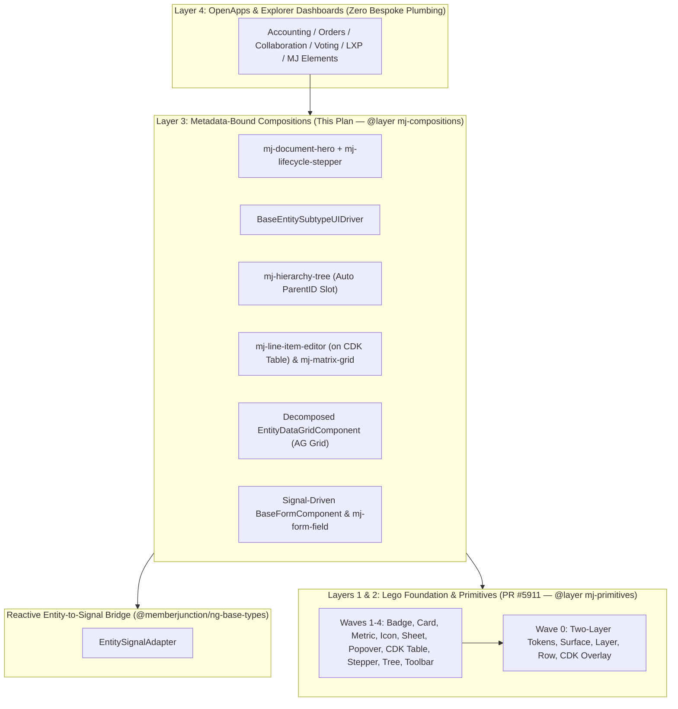

# Signal-Reactive `BaseEntity` Binding & Metadata-Driven Compositions on Lego

## Status
- **Status**: **Approved Design Plan — Assigned to @MattC-BC to weave into Lego ([#5911](https://github.com/MemberJunction/MJ/pull/5911)).**
- **Created**: 2026-10-29
- **Owner / Assignee**: `@MattC-BC`
- **Reviewed against**: `next` @ `1c1a993397` and `origin/docs/lego-ui-foundation` ([#5911](https://github.com/MemberJunction/MJ/pull/5911)) + `origin/docs/mj-elements-phase0-testpage` ([#5916](https://github.com/MemberJunction/MJ/pull/5916))
- **Related plans & guides**:
  - **Lego Foundation ([#5911](https://github.com/MemberJunction/MJ/pull/5911))**: `plans/ui-foundation/README.md` — 4-layer stack (Foundation -> Primitives -> Compositions -> App code), D1–D11 decisions, Wave 0–5+ catalog
  - **MJ Elements ([#5903](https://github.com/MemberJunction/MJ/pull/5903) / [#5916](https://github.com/MemberJunction/MJ/pull/5916))**: `plans/mj-elements.md` — zoneless host compatibility, `--keep-names` (`BaseSingleton`), `ngCspNonce`, light DOM + `@layer`
  - [`guides/BUILDING_UI_ON_MJ.md`](../guides/BUILDING_UI_ON_MJ.md) & [`guides/UI_LAYERING_GUIDE.md`](../guides/UI_LAYERING_GUIDE.md)
  - [`packages/OpenApp/PUBLISH_NO_BREAK_POLICY.md`](../packages/OpenApp/PUBLISH_NO_BREAK_POLICY.md) — Additive-within-an-era component contracts

---

## 1. Purpose & Alignment with Lego ([#5911](https://github.com/MemberJunction/MJ/pull/5911))

Lego (`#5911`) solves the bottom two layers of MJ's UI stack — **Foundation** (Wave 0 tokens, cascade layers, CDK layer service, surface/layer/row) and **Primitives** (Waves 1–4) — so apps can rearrange, restyle, and build any design without fighting encapsulated widgets.

This companion plan defines the **metadata-bound reactive bridge and Layer-3 compositions** that sit *directly on top of Lego's public primitives* across MJ's 89 Angular packages and 18+ OpenApps, while explicitly honoring every settled decision in `#5911` and `#5916`:

| Lego Decision / Seam (`#5911` & `#5916`) | How This Plan Aligns & Extends It |
|---|---|
| **D1 — `ViewEncapsulation.None` + named CSS `@layer`** | Every composition in §4 (`<mj-document-hero>`, `<mj-lifecycle-stepper>`, `<mj-hierarchy-tree>`, `<mj-line-item-editor>`, `<mj-matrix-grid>`) ships with `ViewEncapsulation.None`, composes **only** public Lego primitives, and puts any layout glue in `@layer mj-compositions` above `@layer mj-primitives` and below unlayered host CSS (preserving ladder rungs 1–4). |
| **D2 — Runtime open axes (`--mj-<role>-fill`, two-layer `--mj-<component>-*` tokens)** | Status badges, lifecycle steps, and document hero bands map `EntityField` value-list metadata / state-machine tones onto Lego's open semantic roles rather than hardcoded hex palettes or closed TypeScript union enums. |
| **D6 — Two Table Stories (CDK Table for simple cases; AG Grid stays for data grid)** | `<mj-line-item-editor>` (§4.5) builds on **Lego Wave 3's CDK table primitive**; `<mj-entity-data-grid>` (§4.4) **keeps AG Grid** and decomposes its 5,956-LOC monolith into focused services using Lego Wave 2/4 primitives for toolbars, popovers, chips, and state regions. |
| **D9 — Secondary Entry Points / Chunk Boundaries** | `EntitySignalAdapter` ships in `@memberjunction/ng-base-types` (zero UI bundle weight); heavy compositions ship via clean entry points so apps importing `surface` + `button` never pull AG Grid or tree/matrix bundles. |
| **D10 (OPEN in `#5911`) — Relationship to Higher-Level Explorer / Metadata Control Surfaces** | **Proposed Resolution for D10 -> Option (b), One Unified Stream**: Metadata-aware controls (`<mj-form-field>`, `BaseFormComponent`, `<mj-document-hero>`, `<mj-entity-data-grid>`) do **not** invent a parallel control surface or token vocabulary. They become **Layer-3 Lego Compositions** whose visual atoms are 100% Lego Wave 0–4 primitives and whose reactive state comes from `EntitySignalAdapter` (§3). |
| **§7 Machine-Readable Catalog (`tokens.json` + `components.json`)** | Layer-3 metadata compositions register in the **same generated catalog pipeline** with `layer: "composition"` and `metadataBindings` descriptors so AI coding agents know when a single metadata composition replaces 400 lines of bespoke form code. |
| **`#5916` MJ Elements Runtime Findings** | `EntitySignalAdapter` is **100% zoneless-ready** (drives Angular Signals directly from `BaseEntity.RegisterEventHandler` without `NgZone.onMicrotaskEmpty`), preserves class names (`--keep-names` safe with `BaseSingleton`), and propagates `CSP_NONCE` / `ngCspNonce`. |



---

## 2. Repo-Wide Evidence Driving This Plan

Auditing `packages/Angular/**` (89 packages) and all 18 `@mj-biz-apps/*` OpenApp repositories revealed two structural multipliers that pair directly with Lego's primitive catalog:

1. **Change-Detection Thrash & Zoneless Blocker**:
   - Across `packages/Angular/**`, there are **3,983 manual `cdr.detectChanges()` calls** and **2,116 `cdr.markForCheck()` calls**.
   - Why? `BaseEntity` emits mutations via `RaiseEvent` (`baseEntity.ts`), which is invisible to Angular's signal graph. Every form section, toolbar, field wrapper, and custom panel defensively calls `cdr.detectChanges()`, causing cascading full-subtree checks and blocking MJ Elements (`#5903` / `#5916`) from running cleanly inside zoneless host applications.
2. **Repeated 400–900 Line Bespoke Form Scaffolding Across OpenApps**:
   - **Custom Subtype Field Hydration**: `bizapps-collaboration` and `bizapps-voting` each wrote ~400-line custom UI + server drivers to render admin-defined custom fields (`QuestionTypes`, `PollTypeFields`) onto generated forms.
   - **Document Hero + Status Lifecycle Bars**: `accounting` (Journal Entries, Invoices), `orders` (Orders, Refunds), `issues`, and `grants` each hand-built header summary cards + status workflow bars + field-locking logic.
   - **Self-Referential `ParentID` Trees**: Account Charts, Product Categories, Org Structures, and Knowledge Taxonomies repeatedly hand-roll split tree + detail panes despite `EntityField.RelatedEntityID === Entity.ID` already declaring self-hierarchy in metadata.
   - **Inline Line-Item & Permission/Schedule Matrix Tables**: Invoice lines, Order lines, Journal Entry lines, and Role/Permission grids repeatedly rebuild keyboard-navigable editable tables from scratch.
   - **`EntityDataGridComponent` Monolith**: `packages/Angular/Generic/entity-viewer/src/lib/entity-data-grid/entity-data-grid.component.ts` is **5,956 lines** handling column generation, FLS filtering, cross-entity aggregates, view state persistence, inline editing, and export in one class.

---

## 3. Workstream 5.1: `EntitySignalAdapter<T>` & Zoneless-Ready Reactive Forms

### 3.1 `EntitySignalAdapter<T extends BaseEntity>` (`@memberjunction/ng-base-types`)

keep `@memberjunction/core` 100% framework-agnostic (zero `@angular/core` dependency in `MJCore`), and introduce `EntitySignalAdapter<T extends BaseEntity>` in `@memberjunction/ng-base-types`:

```typescript
import { computed, DestroyRef, Signal, signal, WritableSignal } from '@angular/core';
import { BaseEntity, BaseEntityEvent, EntityFieldInfo } from '@memberjunction/core';

export interface EntitySignalOptions {
    /** Automatically unregisters BaseEntity event listener when DestroyRef fires */
    readonly destroyRef?: DestroyRef;
    /** Reactive edit-mode signal from the enclosing BaseFormComponent or widget */
    readonly editMode?: Signal<boolean>;
}

export class EntitySignalAdapter<T extends BaseEntity> {
    private readonly _entitySig: WritableSignal<T | null>;
    private readonly _versionSig: WritableSignal<number> = signal(0);
    private readonly _fieldSignals = new Map<keyof T & string, Signal<T[keyof T & string] | undefined>>();
    private readonly _editableSignals = new Map<keyof T & string, Signal<boolean>>();

    /** Current bound entity instance (reactive across record navigation / refresh) */
    public readonly record: Signal<T | null>;

    /** Reactive dirty state across all fields */
    public readonly dirty: Signal<boolean>;

    /** Reactive save/delete/validate busy flags */
    public readonly isSaving: Signal<boolean>;
    public readonly isSaved: Signal<boolean>;

    /** Reactive validation result snapshot */
    public readonly validationErrors: Signal<readonly string[]>;

    /**
     * Typed per-field value signal. Lazily created and memoized per field name.
     * Updates synchronously whenever `entity.Set(field)` / typed setter mutates the value,
     * `Revert()` runs, or `Load()` / `Save()` completes.
     */
    public field<K extends keyof T & string>(fieldName: K): Signal<T[K] | undefined>;

    /**
     * Typed per-field dirty signal (`field.Dirty`).
     */
    public fieldDirty<K extends keyof T & string>(fieldName: K): Signal<boolean>;

    /**
     * Reactive editability combining:
     * 1. Enclosing form/component `editMode()` signal
     * 2. `EntityFieldInfo.ReadOnly` & Field-Level Security (`CanUpdate`)
     * 3. Declarative State-Machine / Field-Freeze rules (e.g., frozen when `Status === 'Posted'`)
     */
    public fieldEditable<K extends keyof T & string>(fieldName: K): Signal<boolean>;

    /** Rebinds adapter to a new entity record instance (e.g., drawer next/prev navigation) */
    public bind(entity: T | null): void;

    /** Explicit teardown when used outside a DestroyRef injection context */
    public dispose(): void;
}
```

### 3.2 `BaseEntity` Fine-Grained Field Change Notification Hook
Verify / add a lightweight synchronous field-mutation notification in `BaseEntity` (`packages/MJCore/src/generic/baseEntity.ts`, inside `EntityField.Value` setter when `oldValue !== newValue`):
- Emit an in-memory event `'field_changed'` (carrying `{ fieldName: string; oldValue: unknown; newValue: unknown }`) via `BaseEntity`'s existing event emitter — **only when at least one listener is registered** (`hasListeners` fast-path = `O(1)` boolean check, zero allocation on server batch `RunView`s).
- `EntitySignalAdapter` subscribes to `'field_changed'`, `'save_started'`, `'save'`, `'load_complete'`, and `'revert'`, bumping per-field signals in `O(1)` without scanning all 80+ `EntityField` objects on every keystroke.

### 3.3 Integration into `BaseFormComponent` & `<mj-form-field>` (`@memberjunction/ng-base-forms`)
1. Expose `public readonly entitySignals = new EntitySignalAdapter<BaseEntity>({ destroyRef: inject(DestroyRef), editMode: this.editModeSig });` on [`BaseFormComponent`](../packages/Angular/Generic/base-forms/src/lib/base-form-component.ts) alongside existing `record` getter/setter (`set record(val)` calls `this.entitySignals.bind(val)`).
2. Convert [`FormStateService`](../packages/Angular/Generic/base-forms/src/lib/form-state.service.ts) and `<mj-form-field>` (`packages/Angular/Generic/base-forms/src/lib/field/`) to `ChangeDetectionStrategy.OnPush` reading `entitySignals.field(fieldName)()` and `entitySignals.fieldEditable(fieldName)()`.
3. **100% Backward Compatibility**: Existing CodeGen-generated forms and custom subclass forms continue working untouched; new forms and migrated components drop `cdr.detectChanges()` completely and work inside both Zone.js Explorer and **zoneless MJ Elements (`#5916`)**.

---

## 4. Workstream 5.2: Layer-3 Metadata Compositions Built on Lego Primitives

Every composition below obeys Lego §4 Rules 1–4:
- **Zero private visual walls**: Built exclusively from public Lego Wave 0–4 primitives (`mj-surface`, `mj-row`, `mj-badge`, `mj-metric`, `mj-stepper`, `mj-tree`, `mj-table`, `mj-toolbar`, `mj-popover`).
- **`ViewEncapsulation.None` + `@layer mj-compositions`**.
- **Two-layer exposed CSS custom properties** defaulting to Lego semantic tokens.
- **Named content-projection slots** so any OpenApp can reorder, replace, or omit parts without forking the composition.

### 4.1 `<mj-document-hero>` & `<mj-lifecycle-stepper>` (Built on Lego Wave 1 + Wave 4)
Replaces bespoke 300-line header banners across `accounting`, `orders`, `grants`, `issues`, and `crm`:
- **Metadata Inputs**: `entitySignals` (or `[record]`), optional `[keyMetricFields]="['TotalAmount', 'BalanceDue']"`, `[statusField]="'Status'"`, `[documentNumberField]="'InvoiceNumber'"`.
- **Primitive Composition**:
  - Outer container: Lego Wave 0 `<mj-surface>` + `<mj-row>` with named slots `[mjHeroIdentity]`, `[mjHeroMetrics]`, `[mjHeroLifecycle]`, `[mjHeroActions]`.
  - Metrics strip: Lego Wave 1 `<mj-metric>` + `<mj-badge>` automatically formatted via `EntityFieldInfo.Type` / currency / date metadata.
  - Lifecycle bar: `<mj-lifecycle-stepper>` wrapping **Lego Wave 4's `<mj-stepper>`** primitive, auto-populated from the entity's declarative `Status` transitions (Track C 3.1), disabling invalid target transitions and exposing one-click transition buttons when `fieldEditable('Status')()` or `BaseRemotableOperation` verbs are authorized.

### 4.2 Framework-Level `BaseEntitySubtypeUIDriver` (`@memberjunction/ng-base-forms` + `@memberjunction/core`)
Consolidates the duplicate ~400-line custom-field subtype architectures in `bizapps-collaboration` and `bizapps-voting`:
- Metadata contract declaring subtype discriminator field (e.g., `TypeID`), definition entity (e.g., `PollTypeFields`), and value storage (`JSON` column or EAV child entity).
- `<mj-subtype-fields-section [record]="record" />` dynamically renders typed `<mj-form-field>` controls inside a Lego `<mj-surface>` section, participating automatically in `EntitySignalAdapter.dirty()`, validation, and save lifecycle.

### 4.3 Auto-Mounted `<mj-hierarchy-tree>` Panel (Built on Lego Wave 4 Tree + BaseFormPanel Slot)
- Whenever `EntityInfo` has a self-referential foreign key (`field.RelatedEntityID === entity.ID`, such as `ParentID`), `BaseFormComponent`'s panel-slot system (`packages/Angular/Generic/base-forms/src/lib/panel-slot/`) offers an opt-in / metadata-enabled **Hierarchy Explorer** side panel.
- Wraps **Lego Wave 4's `<mj-tree>`** primitive with lazy child `RunView` expansion, breadcrumb ancestry (Lego Wave 4 `<mj-breadcrumb>`), drag-to-reparent (guarded by cycle detection + `CanUpdate`), and `NavigationService` record selection.

### 4.4 Decomposing `EntityDataGridComponent` (5,956 LOC -> Cohesive Services + Lego Chrome, Keeping AG Grid per D6)
Per Lego **D6**, AG Grid remains MJ's full-featured data grid (`packages/Angular/Generic/entity-viewer/src/lib/entity-data-grid/entity-data-grid.component.ts`). Decompose its 5,956 lines without changing public `<mj-entity-data-grid>` inputs/outputs:
1. `EntityGridColumnBuilderService` — `EntityFieldInfo` -> `ColDef` mapping, FLS visibility (`entity-data-grid-field-security.test.ts`), polymorphic FK cell renderers (`EntityField.EntityIDFieldName`).
2. `EntityGridAggregateService` — Server-side & cross-entity aggregate expression coordination.
3. `EntityGridStatePersistenceService` — Debounced column width/sort/pin persistence strictly via `UserInfoEngine.Instance.SetSettingDebounced()` (`AGENTS.md` Rule 9).
4. `EntityGridExportCoordinatorService` — Bridges visible/filtered columns to `@memberjunction/ng-export-service`.
5. **Lego Chrome Re-base**: Replace bespoke toolbar buttons, filter pills, empty/loading states, and column-picker modals inside `entity-data-grid.component.html` with Lego Wave 1–4 primitives (`mj-toolbar`, `mj-chip`, `mj-state-region` per D5, `mj-popover` / `mj-sheet` per Wave 2), theming AG Grid's CSS variables directly from Lego Wave 0 `--mj-*` tokens.

### 4.5 `<mj-line-item-editor>` (Built on Lego Wave 3 CDK Table) & `<mj-matrix-grid>`
Per Lego **D6** ("A CDK-based primitive for the simple case; AG Grid stays as the data grid"):
- **`<mj-line-item-editor>`**: Built directly on **Lego Wave 3's CDK `<mj-table>`** primitive for parent-child transactional line items (Invoice Lines, Order Lines, Journal Entry Debit/Credit Lines):
  - Tab/Enter/Arrow cell navigation, inline FK autocomplete, automatic parent-total rollup signals (`computed()` summing child `EntitySignalAdapter` signals), add/clone/reorder/delete rows enlisted in a single `TransactionGroup` / `BaseRemotableOperation` save.
- **`<mj-matrix-grid>`**: Pivot/intersection editor over `(RowEntity, ColumnEntity, JunctionEntity)` (e.g., Role x Permission, Member x Committee, Tier x Entitlement) built on Lego Wave 3 CDK table + sticky headers + keyboard toggle/cell editors.

---

## 5. Sequencing with Lego Waves (`#5911` §5 & §9)

This work weaves directly into Lego's wave schedule so nothing is built twice or ahead of the primitive it consumes:

| Lego Wave (`#5911`) | Paired Deliverable from This Plan | Why Here |
|---|---|---|
| **Wave 0 (Foundation & Prototype Gate)** | Confirm **D10 = Option (b)**; ship `EntitySignalAdapter<T>` in `@memberjunction/ng-base-types` + `BaseEntity` `'field_changed'` fast-path; verify in `#5916` zoneless MJ Elements test host | Zero visual dependency on Wave 1+; unlocks zoneless signals immediately |
| **Waves 1 & 2 (Surface, Badge, Metric, Card, Sheet, Popover, Toast)** | Convert `BaseFormComponent` & `<mj-form-field>` to `OnPush` + `EntitySignalAdapter`; ship `BaseEntitySubtypeUIDriver` + migrate `bizapps-collaboration` / `bizapps-voting` | Uses Wave 1 surface/badge + Wave 2 overlays; eliminates first ~1,500 `cdr.detectChanges()` calls |
| **Wave 3 (Avatar, Skeleton, Chip, State Region, CDK Table)** | Ship `<mj-line-item-editor>` & `<mj-matrix-grid>` on Wave 3 CDK Table + first OpenApp conversion (`accounting` / `orders` line items) | Immediate real-world proof of Wave 3 CDK Table (Lego §4 Rule 2: each primitive lands with its first conversion) |
| **Wave 4 (Stepper, Breadcrumb, Tabs, Tree, Toolbar, Page Header)** | Ship `<mj-document-hero>`, `<mj-lifecycle-stepper>`, `<mj-hierarchy-tree>` panel slot, and `EntityDataGridComponent` decomposition + toolbar/chip/state-region re-base | Proves Wave 4 Stepper, Tree, Breadcrumb, and Toolbar on MJ's highest-traffic Explorer surfaces |
| **Catalog & Agent Tooling (§7)** | Emit Layer-3 composition schemas & `metadataBindings` into Lego's single `components.json` + `CLAUDE.md` UI rules | Ensures Claude/agents reach for `<mj-document-hero>` and `<mj-line-item-editor>` instead of generating 400 lines of bespoke HTML/CSS |

---

## 6. Guardrails & Verification Plan

1. **Strict `AGENTS.md` Compliance**:
   - Zero `any` types (`EntitySignalAdapter<T>` uses indexed access `T[K]`, deriving value-list unions directly from generated entity classes per Rule 2c).
   - Modern Angular `@if` / `@for` / `@switch` control flow and `inject()` DI (Rule 4).
   - All user grid/tree/panel state persisted exclusively via `UserInfoEngine.Instance` — never `localStorage` (Rule 9).
   - `@memberjunction/ng-generic-*` packages never import `@angular/router` (`packages/Angular/Generic/CLAUDE.md`).
2. **Test Gates (`AGENTS.md` Rule 6)**:
   - Unit tests for `EntitySignalAdapter` (`packages/Angular/Generic/base-types/src/__tests__/`) covering field signal granularity, FLS + state-freeze `fieldEditable()`, `Revert()`, record rebinding, and `DestroyRef` listener cleanup (zero leaked `BaseEntity` subscriptions).
   - Zoneless DOM tests verifying `<mj-form-field>`, `<mj-document-hero>`, and `<mj-line-item-editor>` update DOM synchronously on `entity.FieldName = newValue` with `provideExperimentalZonelessChangeDetection()` / `provideZonelessChangeDetection()` and zero `cdr.detectChanges()` calls.
   - Regression suite across `packages/Angular/Generic/base-forms` and `packages/Angular/Generic/entity-viewer` ensuring 100% pass rate on existing form and data-grid tests.
