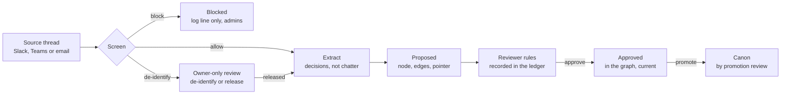
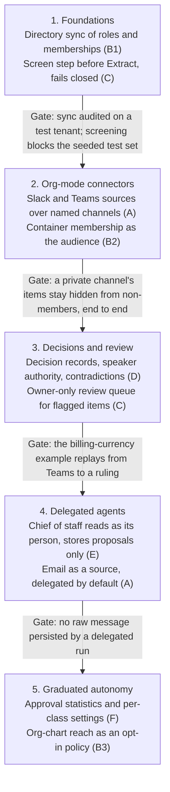

# Living Canon: continuous ingest from Slack, Teams and email

## Status

- **Status**: Draft proposal. Plan only, nothing built.
- **Created**: 2026-11-19
- **Sponsor**: Amith Nagarajan (`AN-BC`)
- **Checked against**: `next` at `8d445db1`. Paths are relative to the repo root.
- **Relation to other plans**: extends two open plans and is meant to fold into the Canon master plan after review:
  - [MJ 6675](https://github.com/MemberJunction/MJ/pull/6675): Canon master plan (coordination, decisions 1 to 7, governance, freeze until December 1).
  - [MJ 6765](https://github.com/MemberJunction/MJ/pull/6765): Canon unification (Canon as a property, one visibility rule, one context resolver).
- **Freeze**: nothing here asks for work before December 1. Like MJ 6765, this is a plan-only exception opened by the sponsor. It is to be evaluated alongside MJ 6765 at the December 3 review, where each workstream becomes `canon` issues.

## The idea

Most decisions an organization makes are never written into a document. They happen in a Slack thread, a Teams channel or an email reply, and the curated folders the content pipeline ingests today only hold what someone later wrote up. This plan adds continuous connectors to those systems so an agent can read the conversation as it happens, extract the decisions in it, and fold them into the semantic graph as proposals.

The graph absorbs them first. Canon is reached only by promotion, which starts as human review and can, per organization and per class of decision, become agent-decided once the record shows reviewers approve that class almost every time.

Four things make this safe enough to do:

- **Permissions come from the source.** A fact drawn from a private channel is visible to that channel's members, plus whoever an explicit org policy adds.
- **Sensitive topics are filtered before anything is stored**, including embeddings.
- **Pointers, not copies.** The graph keeps what was proposed and a link back to the original message, not the raw conversation.
- **Every decision is recorded**, whoever or whatever made it, so autonomy can be granted on evidence later.

A thread is screened before anything is stored; only an approved node can be promoted, and only by review. Review is per class of decision, and a class can earn autonomy later.

## What exists today, and the gaps

Most of the curated path is built; the continuous path, directory sync and sensitivity filtering are not. Each row was checked in the code.

| Area | On `next` today | Gap for this plan |
| --- | --- | --- |
| Content sources | Six source types: Cloud Storage, Entity, Local File System, RSS Feed, Website, Upload. Incremental Discover, exhaustive Sync, two-phase delete. | No Slack, Teams or email source. No notion of a thread, an edit or a message-level deletion. |
| Slack and Teams | `@memberjunction/messaging-adapters` lets people talk to MJ agents from Slack and Teams, mapping platform emails to MJ users. | Inbound chat to an agent only. Nothing reads channel history or keeps membership. |
| Acting as a user | `CredentialEngine` stores per-user delegated OAuth credentials; the MS Graph provider accepts a delegated user token. | No connector reads a user's mailbox or chats continuously with that token. |
| Directory roles | `MJ: Roles` has a `DirectoryID` column ("the ID of the role in the directory, for example Azure"), typed in by hand in the role dialog. New users get the static `newUserRoles` from config. Nine auth providers, including MSAL, Google, Okta, WorkOS. | Nothing syncs directory groups or memberships into roles and user roles. |
| Org chart | `MJ: Users.EmployeeID` links to `MJ: Employees`, which has `SupervisorID`. | Nothing fills it from a directory, and no permission rule reads it. |
| Row and record security | Entity permissions and RLS, field-level security, `PermissionEngine` domains, the search origin-record gate, audience intersection in search and the graph. | No rule of the form "visible to the members of this source container". |
| Sensitivity | Tag review queue (`RequiresReview`), field-level security, prompt-run redaction. | No PII or topic filter anywhere in the content pipeline. |
| Proposals | `Proposed` concepts and edges behind `Graph: Approve Edges`; MJ 6213's learning-cycle ledger (in review). | No decision-record shape, no speaker authority, no approval statistics by class. |

## Principles

1. **Filter before store.** The sensitivity check runs before any text, chunk or embedding is written. A vector of a sensitive message is still a copy of it.
2. **Pointers, not copies.** By default a message is read, judged and dropped. What persists is the proposal, a short excerpt where policy allows, and a pointer: source system, workspace, container, message ID and a deep link.
3. **Permissions come from the source, and are re-checked at the source.** Anything derived from a message is visible to the people who could see that message. Opening a pointer re-checks access in the origin system.
4. **Propose, don't decide.** Every machine-made change to the graph lands as `Proposed` through the one ledger (MJ 6675 decision 2). Machine output is `Origin = 'Inferred'` (decision 3).
5. **Record every decision.** Approvals, rejections and supersessions are kept with who made them and why. That record is what later justifies autonomy.
6. **Fail closed.** If a filter, a membership lookup or a permission check cannot answer, the message is skipped and logged, never ingested on a guess.
7. **Org policy, not code.** Which channels, which topics, who reviews, what may be auto-promoted: all are per-organization settings in that MJ instance.

## Workstream A: continuous connectors

Slack, Teams and email become content source types, built on the existing pipeline rather than beside it. A new source driver per platform implements `Discover` (new and changed messages since a watermark) and `Fetch` (one thread, as the reading principal).

What a conversation source needs that a folder source does not:

- **The thread is the unit, not the message.** A decision is usually a question, some back and forth, and a closing reply. The driver groups replies into one item per thread and re-opens it when a late reply lands.
- **Edits and deletions flow through.** An edited message re-runs the thread. A deleted one marks its derived proposals and edges for removal, through the delete stages (MJ 6765 finding F11 fixes their edge cleanup).
- **Containers are configured, never discovered silently.** An admin names the workspaces and channels a source may read, by include and exclude lists. DMs and private channels are off unless a delegated agent reads them as their member (Workstream E).
- **Two read modes.** *Org mode*: an app install with read scopes over the named channels. *Delegated mode*: a person's own token, reading only what that person can see.
- **Watermarks and rate limits.** One watermark per container, the platforms' rate limits honored, backfill bounded by a configurable start date.
- **A pointer on every item.** Platform, workspace, container, thread and message IDs, plus a deep link people can click to open the original in Slack, Teams or the mail client.

Email follows the same shape: the conversation (thread ID) is the item, mail folders and labels are the containers, and delegated mode is the default.

Open point: whether the connectors live in `@memberjunction/content-autotagging` next to the other drivers, or reuse the integration engine's connector base, which already handles credentials, watermarks and rate limits.

## Workstream B: permissions inherited from the source

Three pieces, each useful on its own.

### B1. Directory sync: roles and memberships

A scheduled sync reads groups and group memberships from Entra ID or Google Workspace and writes them to `MJ: Roles` and `MJ: User Roles`. MJ already does role-based access everywhere; this makes the roles come from one place.

- A role is linked to its group by the existing `Role.DirectoryID` column. Only roles with a `DirectoryID` are managed by the sync; hand-made roles are left alone.
- Memberships of managed roles follow the directory. A user removed from a group loses the role on the next run.
- The same run can fill `MJ: Employees` (title, manager) and link users through `Users.EmployeeID`, which gives B3 its org chart.
- Users the directory knows but MJ does not are created only if `autoCreateNewUsers` is on, as today.
- Every change is a normal entity save, so Record Changes audits it. A run that would remove more than a set share of memberships stops and asks, as the pipeline's Sync stage already does for deletions.

### B2. Container membership as an audience

A message's audience is its container's members: a channel, a group chat, a mail thread's recipients. Each derived item (proposal, concept, edge, excerpt) carries a reference to its source container, and visibility is checked against that container's membership.

- Membership is mirrored per container, refreshed on membership events and on a schedule, and mapped to MJ users through the email mapping the messaging adapters already use.
- A public channel can map to a directory role ("everyone in Finance") instead of a member list.
- This becomes one more step in the shared visibility rule (MJ 6765 Rule 3): a node derived from a container is visible only to its members, intersected across every reader of an audience.
- If a container's membership cannot be resolved, nothing derived from it is shown.
- Every container check writes Rule 3's visibility audit event (allowed, redacted or hidden, and why). Conversations are where an organization most needs to show who could see a decision drawn from them.

### B3. Org-chart reach, as an explicit policy

An organization can add reach beyond the members: for example, the chain of supervisors above a member, or named roles such as the board chair or the general counsel.

- Off by default, and set per organization and per container class. Reading a report's DMs is a legal question in some jurisdictions, so DMs are excluded unless the policy names them.
- Reach grants read access to derived items and pointers. It never lets a person open content in the origin system that the origin system would refuse them.
- Every read through reach is logged.

A board chair who should see everything is a policy line of the form "role Board Chair reads all derived items from all org-mode sources".

## Workstream C: sensitivity and PII filtering

A new pipeline step, `Screen`, runs on each fetched thread before `Extract` commits any text, so nothing reaches a content item, a chunk, an embedding model or the graph until it passes. Today `Extract` commits the extracted text to `MJ: Content Items` (`ContentItem.Text`, through `WorkingRecordCommitter`), which is why screening cannot be a later stage.

### Three outcomes

| Outcome | Example topics | What survives |
| --- | --- | --- |
| **Block** | Terminations, disciplinary matters, medical or legal matters about a person, compensation of named people | Nothing. A log line with the pointer and the rule that blocked it, visible to admins only. |
| **De-identify** | Performance reviews, hiring debriefs, customer complaints about a named person | Only the abstract lesson, with names, roles and other identifiers removed. Sent to the review queue before it reaches the graph. |
| **Allow** | Process, pricing, product, policy and operational decisions | Normal extraction (Workstream D). |

The topic list is org policy, kept in metadata, with a shipped default that leans toward Block.

### Layers, cheapest first

1. **Container policy.** A channel or folder can be marked Block or De-identify wholesale (`#hr-confidential`, `#legal`).
2. **Deterministic detectors.** Pattern and dictionary checks for identifiers (government IDs, account numbers, phone numbers, addresses, health terms) and for named people in the directory.
3. **A classifier prompt** that labels the thread's topic against the org's policy list and returns an outcome with a confidence.
4. **A second, independent check** for anything near a Block boundary: a different prompt, and if possible a different model.

A thread takes the strictest outcome any layer gives. Low confidence anywhere counts as the stricter outcome (principle 6).

### The owner-only review queue

Items marked De-identify, or flagged as possibly sensitive, wait in a review queue whose row-level security shows each item only to the owner of the original content (the author of the message, or the mailbox owner) and to named privacy reviewers. The reviewer sees the excerpt and the pointer, and can release, edit, de-identify further or discard. Their choice is recorded like any other decision (Workstream F), so the filters can be tuned against it.

## Workstream D: decisions into the graph

The extractor looks for decisions, not chatter: a question that got a closing answer, an explicit "we decided", a request that someone with authority approved. Everything else in the thread is ignored.

### A decision record

Each decision becomes a `Proposed` concept of type Policy or Process (the shipped types, per MJ 6675 decision 5), with its specification and edges:

| Part | Holds |
| --- | --- |
| Statement | One sentence: what was decided |
| Scope | What it applies to, linked by `Governs` or `Describes` edges to the entities, processes and existing concepts it touches |
| Decider | The MJ user who made or confirmed it, and their role at the time |
| Evidence | A `SourcedFrom` edge to the pointer: thread, message, deep link, date |
| Confidence | How sure the extractor is that a decision was made, separately from whether it is right |

Before a decision record is written, its edges are checked against the edge-type endpoint rows (MJ 6765 Rule 2): a `Governs` edge from something that cannot govern, for example, is dropped and counted, not put in front of a reviewer. The extractor is the highest-volume proposer Canon will have, so it is where this check saves the most review time.

### Who said it matters

The decider's standing becomes the decision's authority, the way a document source has an authority tier today:

- An org maps directory roles to authority per domain: a finance executive is high authority on billing, an engineering lead on engineering practice, a junior engineer is Reference everywhere.
- A proposal from a low-authority speaker is still recorded, but ranks low and is never a candidate for promotion on its own.
- "Ship without tests" from a junior engineer becomes, at most, a low-authority proposal that contradicts the engineering practice concept, which surfaces it to a steward instead of changing anything.

### Conflicts are shown, not settled by rank

When a new decision disagrees with an existing concept, the extractor writes a `Contradicts` edge and puts both in front of a reviewer, with dates and deciders. Authority orders the review queue; it does not pick a winner. Once a reviewer rules, the winning concept gets a `Supersedes` edge to the loser, which is marked Deprecated.

### Worked example: billing currency

1. **Earlier**: leadership decides the order system will not support foreign currencies. This exists as an approved concept: *Billing currency is USD only*.
2. **Later**: a finance executive decides customers may choose the currency they are billed in. The extractor proposes *Customers choose their billing currency*, authority high on billing, and writes a `Contradicts` edge to the earlier concept.
3. **The conflict surfaces** in the review queue for both deciders' domain, and to anyone asking an agent about billing currency: the agent answers that two decisions disagree, and links both.
4. **The original decider rules in a Teams thread**: everyone is billed in USD; the invoice may show a convenience conversion; payment in another currency is accepted and posted in USD.
5. **The extractor proposes the ruling**, linked to that thread. On approval it becomes the current concept, with `Supersedes` edges to both earlier ones, and the later decision is Deprecated with the reason recorded.

The downstream question that started the thread ("do we really want to implement all this foreign currency work?") is answered by Canon from then on.

## Workstream E: delegated agents that read as you

A delegated agent, such as a chief of staff, reads a person's Slack, Teams and email live with that person's own token, and stores only what it proposes. The raw content stays in the origin systems.

- **Identity.** The agent runs as the person, through the per-user delegated OAuth credentials `CredentialEngine` already stores. It can see exactly what the person can see, and nothing more.
- **No raw store.** Messages are read into the run, screened (Workstream C), judged, and dropped. Nothing is written to content items, chunks or vectors unless the person turns that on for named containers.
- **What it may write.** Proposals only: new or updated concepts and edges, `Contradicts` flags on Canon it thinks is wrong, suggested prunes of stale nodes. Each carries a pointer back to the message.
- **Who sees its proposals.** By default, only the person it acts for. Sharing a proposal more widely is a human act, and the shared item takes the source container's audience (Workstream B), never the person's own reach.
- **Pointers resolve at the source.** When anyone opens a pointer, the origin system checks their access. A pointer the reader cannot open shows only that a source exists.
- **Off switch.** Revoking the token stops reading at once; deleting the agent's proposals is one action.

This also suits a privacy-minded org that does not want any org-mode connector: each person can still opt in for themselves.

## Workstream F: graduated autonomy

Human review is the starting point everywhere. Autonomy is granted later, one class of decision at a time, on the record.

- **One ledger.** Every proposal from every proposer (connectors, delegated agents, the pipeline, DBAutoDoc, the learning loop) and every reviewer's ruling goes through MJ 6213's learning-cycle ledger, per MJ 6675 decision 2.
- **A class of decision** is a combination the org defines: concept type, domain, source, speaker authority. For example: Process decisions about invoice handling, from the Finance channel, decided by a Finance lead.
- **Approval statistics per class**: proposals, approvals, edits before approval, rejections, and reversals within 90 days.
- **A per-org setting per class**, with three values: *Review* (the default), *Auto with audit* (applied at once, listed in a weekly report, reversible), and *Auto*. The settings screen shows each class's statistics next to its switch.
- **Thresholds are org choices**, not shipped constants. A sensible default prompt: suggest *Auto with audit* after 200 rulings at 99.5% unedited approval with no reversals.
- **Pruning follows the same path.** "This concept has not been used or confirmed in 12 months" is a proposal like any other, reviewed until its class earns autonomy.
- **Promotion to Canon is its own class**, and the last one any org should automate. Graph changes can be autonomous long before Canon changes are.
- **Everything automated stays recorded**: the rule that allowed it, the statistics at the time, and the decision itself.

## Phases

Five phases, each shippable on its own. Directory sync and the screening step come first because every later phase depends on them, and both are useful without any new connector.

Each gate is the test that lets the next phase start; letters in brackets name the workstream.

## Decisions for review

1. **Graph first, Canon by promotion only.** Continuous sources never write to Canon directly.
2. **Pointers by default.** Raw messages are not persisted unless an org turns it on for named containers.
3. **Screening runs before `Extract` commits text**, as its own step, and fails closed.
4. **Directory sync manages only roles that carry a `DirectoryID`.**
5. **Org-chart reach is off by default**, set per org and per container class, and excludes DMs unless named.
6. **Conflicts are surfaced to a person**, never resolved by authority rank alone.
7. **Autonomy is granted per class of decision** from recorded approval statistics, with Canon promotion as the last class.

## Open questions

1. Where do the connectors live: the content pipeline's drivers, or the integration engine's connector base?
2. Should email be in the first release, or follow Slack and Teams?
3. Do de-identified lessons need a reviewer every time, or only above a sensitivity score?
4. How is a decider's authority set when the directory has no title or manager for them?
5. What does a reader see when an agent's answer rests on a pointer they cannot open: nothing, or "there is a source you can't see"?
6. Retention: how long do pointers, excerpts and the Block log live, and does an origin deletion purge them at once?
7. Which jurisdictions need org-chart reach disabled outright, and is that a shipped default by region?

## Risks

| Risk | Mitigation |
| --- | --- |
| Sensitive content leaks into the graph or a vector | Screen before store; strictest outcome wins; two independent checks near Block; owner-only review queue |
| Slop: casual opinions become "decisions" | Decisions only, not chatter; speaker authority; `Proposed` by default; human review |
| A powerful person's bad call becomes Canon | Contradictions surfaced with dates and deciders; supersession is a recorded human ruling |
| Stale membership exposes a private channel | Membership refreshed on events and on schedule; unresolvable membership hides the item |
| Directory sync strips access wrongly | Only `DirectoryID` roles managed; a large-removal run stops and asks; every change audited |
| Platform rate limits and API cost | Per-container watermarks, bounded backfill, thread-level batching |
| Trust: staff feel surveilled | Explicit container lists, visible policy, per-person opt-in for delegated agents, reach reads logged |

## References

- [MJ 6675](https://github.com/MemberJunction/MJ/pull/6675): Canon master plan
- [MJ 6765](https://github.com/MemberJunction/MJ/pull/6765): Canon unification
- [MJ 6213](https://github.com/MemberJunction/MJ/pull/6213): memory, learning cycles and Canon precedence
- [`guides/CONTENT_PIPELINE_GUIDE.md`](../guides/CONTENT_PIPELINE_GUIDE.md), [`guides/SEARCH_SCOPES_AND_RAG_GUIDE.md`](../guides/SEARCH_SCOPES_AND_RAG_GUIDE.md), [`guides/UNIFIED_PERMISSIONS_GUIDE.md`](../guides/UNIFIED_PERMISSIONS_GUIDE.md), [`guides/CANON_AND_SEMANTIC_GRAPHS_GUIDE.md`](../guides/CANON_AND_SEMANTIC_GRAPHS_GUIDE.md)
- [`packages/MessagingAdapters/README.md`](../packages/MessagingAdapters/README.md)

## Change log

| Date | Change |
|---|---|
| 2026-11-19 | Draft created from the sponsor's working doc. |
| 2026-11-20 | Tied to MJ 6765's additions from the TrustGraph comparison: container checks write the visibility audit event (B2), and decision records are validated against the edge-type contract before they are written (D). |
