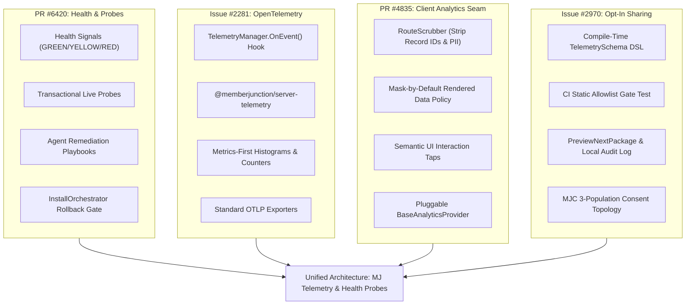
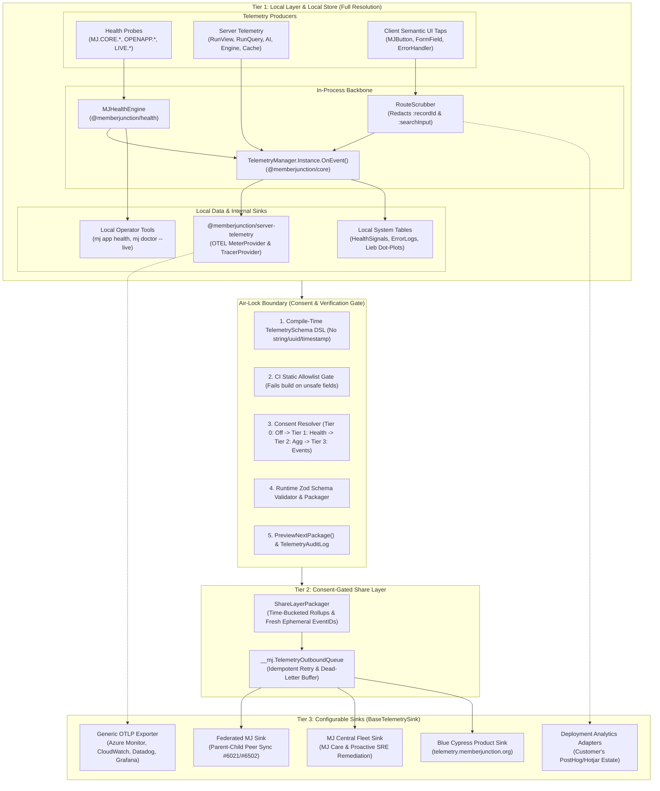
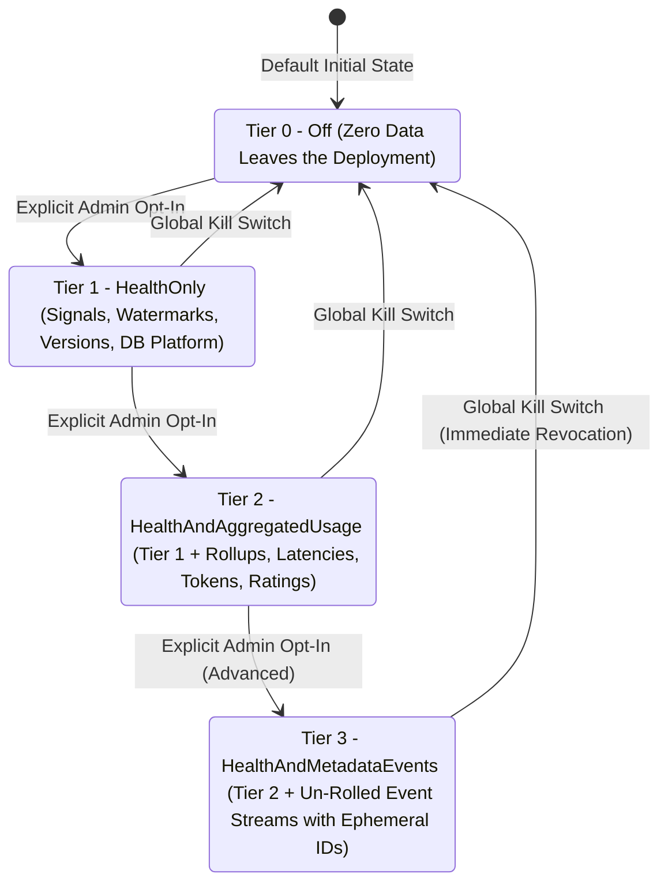
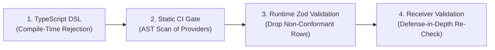
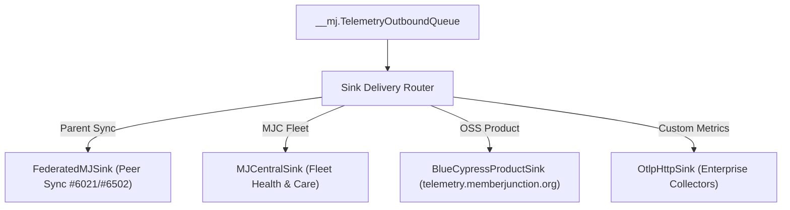
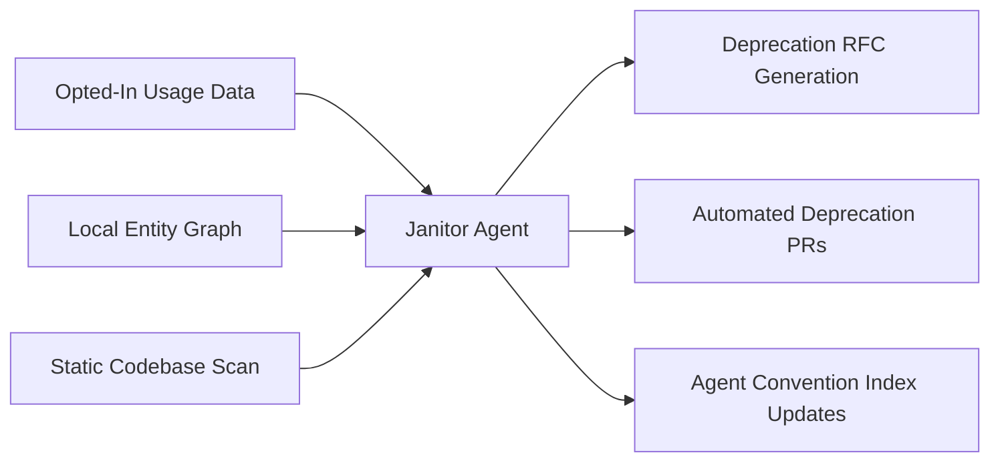
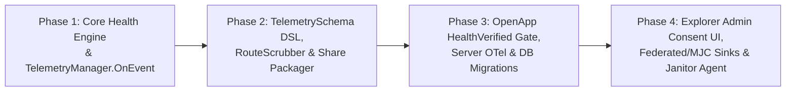

# MJ Telemetry & Health Probes: Unified Local-First Observability, Live Verification, Agent Remediation & Opt-In Sharing

- **Status:** Architecture Plan Proposed (Unified Plan for PR #6420)
- **Date:** November 11, 2026
- **Authors:** @amith-bc, @MS-BC, @MattC-BC, @cadam11
- **Target Packages & Modules:**
  - `@memberjunction/health` *(new core package: `packages/Health`)*
  - `@memberjunction/core` *(`packages/MJCore` — `TelemetryManager.Instance.OnEvent` hook & signal bus)*
  - `@memberjunction/server-telemetry` *(new package: `packages/ServerTelemetry` — OpenTelemetry meters, traces & bootstrap)*
  - `@memberjunction/open-app-engine` *(`packages/OpenApp/Engine` — manifest schema & orchestrator rollback gates)*
  - `@memberjunction/server` *(`packages/MJServer` — `/api/health/signals`, `/api/health/signals/verify`, `MJHealthResolver`, OTELMiddleware)*
  - `@memberjunction/cli` *(`packages/MJCLI` — `mj app health`, `mj doctor --live`)*
  - `@memberjunction/analytics` / `@memberjunction/ng-analytics` *(`packages/Angular/Generic` — `RouteScrubber`, semantic interaction taps, pluggable client analytics seam)*
  - `@memberjunction/telemetry` *(new package: `packages/Telemetry` — `TelemetrySchema` DSL, CI allowlist gate, packager & sink framework)*

---

## 1. Executive Summary, Principles & Unified Lineage

As MemberJunction (MJ) scales from single self-hosted server deployments to fleet-managed multi-tenant environments across **MJ Central (MJC)** — running hundreds or thousands of dedicated instances on low-cost **\$10–\$20/month AWS PostgreSQL** instances alongside Azure SQL and GCP deployments — the platform requires a cohesive, trustworthy, and battle-hardened observability and verification architecture.

Historically, this problem was addressed in separate silos:
1. **PR #6420** designed deterministic health signals (`GREEN`/`YELLOW`/`RED`), rolled-back live functional verification probes, and autonomous AI SRE agent remediation playbooks (`@memberjunction/health`).
2. **Issue #2970 / PR #2484** and Matt Chriest's July 2026 findings formulated the opt-in "Phone Home" telemetry sharing system, the compile-time schema DSL, the distinction between local per-user Lieb dot-plots and cross-install aggregate dot-plots, and the three-population MJ Central consent topology.
3. **Issue #2281** (by Craig Adam) specified OpenTelemetry production metrics and distributed tracing via a non-blocking `TelemetryManager.Instance.OnEvent` hook in `@memberjunction/core`, exporting OTLP histograms and counters without vendor lock-in.
4. **PR #4835** established the pluggable client-side analytics seam (`BaseAnalyticsProvider`), featuring fail-closed `RouteScrubber` mechanics and mask-by-default policies for rendered data.

This document unifies all four initiatives into a single coherent architecture: **MJ Telemetry & Health Probes**. It bridges passive operational health checks, active transactional live probes, server-side OpenTelemetry performance metrics, client-side scrubbed interaction taps, and opt-in cross-install sharing under one rigorous umbrella.



### The Five Core Architectural Principles

1. **Local First, Full Resolution:** The instance owner has absolute ownership of all telemetry. Full-resolution event logs, latencies, traces, health probe histories, and per-user activity dot-plots live inside the local database or customer-designated OpenTelemetry collector. Retention, scrubbing, and rollups are fully governed by local admin configuration.
2. **Off by Default Outside MJ Central (Explicit Opt-In):** For all self-hosted and independent instances, external sharing is completely disabled (`Tier 0: Off`) by default. Telemetry packages are never emitted unless an authorized administrator explicitly selects a consent tier.
3. **No PII, No Content — Enforced by Architecture, Not Policy:** The system provides cryptographic and structural guarantees against data leakage. The `TelemetrySchema` DSL completely lacks a generic `string` shape, lacks a raw `timestamp` type, and lacks a generic `uuid` type. Prompt text, completions, user IDs, conversation IDs, customer record primary keys, and search terms cannot exist in a shareable payload.
4. **Radical Transparency:** The administrator retains total visibility. Every field that can ever leave the machine is declared in published schema files and inspectable via the auto-generated in-app Schema Viewer. The `PreviewNextPackage()` facility renders the exact JSON payload before any bytes are transmitted, and an append-only local `TelemetryAuditLog` records every dispatch.
5. **Open and Portable on OpenTelemetry:** The platform builds directly on CNCF OpenTelemetry standards. Local and exported metrics use OTLP (HTTP/protobuf or gRPC). The platform avoids proprietary monitoring lock-in, integrating seamlessly with Azure Monitor, AWS CloudWatch, Datadog, Grafana, and Jaeger.

---

## 2. Architecture Overview: Three Horizontal Tiers

The architecture organizes data generation, validation, and transport into three horizontal tiers:



1. **Tier 1: Local Layer & Local Store:** Real-time event producers emit structured telemetry into `@memberjunction/core` (`TelemetryManager.Instance.OnEvent`) and `@memberjunction/health` (`MJHealthEngine`). Data is retained in full resolution within local system tables and exported to customer-managed OpenTelemetry collectors. Per-user Lieb dot-plots and operational diagnostics run locally and never leave the instance boundary.
2. **The Air-Lock Boundary:** Telemetry cannot transition from local storage to outbound transmission without passing through a five-stage verification pipeline: (1) compile-time DSL constraints, (2) static CI build-gate tests, (3) database-backed consent verification, (4) runtime Zod structural schema validation, and (5) dry-run previewing and local audit log recording.
3. **Tier 2: Consent-Gated Share Layer:** Encapsulates aggregation, watermarking (`__mj.TelemetryWatermark`), outbound spooling (`__mj.TelemetryOutboundQueue`), and ephemeral anonymization (replacing local entity run IDs with freshly minted payload `EventID`s).
4. **Tier 3: Configurable Sinks:** Pluggable destinations subclassing `BaseTelemetrySink` receive formatted, verified packages according to their configured consent tiers and delivery cadences.

---

## 3. Local Layer Part A — Three-Layer Health Signals, Rolled-Back Live Probes & Agent Remediation Playbooks (`@memberjunction/health`)

Phase 1 of `@memberjunction/health` establishes a deterministic health and verification model for MJ Core, Open Apps, server extensions, and connectors.

### 3.1 Three-Layer Verification Taxonomy

| Layer | Namespace | Focus Subsystems | Execution Mode |
|---|---|---|---|
| **Layer 1: Core Platform** | `MJ.CORE.*` | Database connection pools, schema migration parity, metadata cache freshness, work queue heartbeats, AI/embedding provider latency, runtime event loop lag. | `passive` (runs on every health poll) |
| **Layer 2: Installed Open Apps** | `OPENAPP.<APP>.*` | Open App manifest vs DB parity, required database objects (views, TVFs, SPs, seed rows), background pipeline processing lag (e.g. `ContentUploadIngestor`, digest queues), upstream dependency graph health. | `passive` (runs on every health poll) |
| **Layer 3: Live Verification** | `LIVE.<CORE\|APP>.*` | Active functional smoke tests exercising synthetic CRUD, RLS enforcement (`fnCollaborationAccess`), vector embeddings, and full workflow round-trips. | `live-test` (executed on install/upgrade gates and scheduled SRE verification) |

### 3.2 The `GREEN` / `YELLOW` / `RED` Domain & Agent Playbook Contracts

Ad-hoc, unstructured error strings are prohibited as primary health signals. Every signal evaluates to a strict tri-state severity:

```typescript
// packages/Health/src/types.ts

export type HealthStatus = 'GREEN' | 'YELLOW' | 'RED';
export type HealthLayer = 'core' | 'open-app' | 'server-extension' | 'connector' | 'live-test';
export type ProbeExecutionMode = 'passive' | 'live-test';

export interface AgentRemediationPlaybook {
  AgentInstructions: string;
  AllowedAutonomousActions: string[];
  MaxAutonomousAttempts: number;
  RetryCooldownSeconds: number;
  HumanEscalationCriteria: string;
  HumanOperatorRunbook?: string;
}

export interface HealthSignalDefinition {
  Code: string;
  Title: string;
  Layer: HealthLayer;
  OwnerApp: string;
  Mode: ProbeExecutionMode;
  Description: string;
  YellowPlaybook: AgentRemediationPlaybook;
  RedPlaybook: AgentRemediationPlaybook;
}

export interface HealthSignalEvaluation {
  Code: string;
  Title: string;
  Layer: HealthLayer;
  OwnerApp: string;
  Mode: ProbeExecutionMode;
  Status: HealthStatus;
  Summary: string;
  ObservedMetrics: Record<string, string | number | boolean | null>;
  Thresholds?: Record<string, string | number | boolean>;
  EvaluatedAt: string;
  DurationMs: number;
  ActivePlaybook?: AgentRemediationPlaybook;
  DiagnosticError?: string;
}

export interface InstanceHealthReport {
  OverallStatus: HealthStatus;
  MJVersion: string;
  DatabasePlatform: 'sqlserver' | 'postgresql';
  EvaluatedAt: string;
  TotalDurationMs: number;
  Mode: ProbeExecutionMode;
  SummaryCounts: {
    Green: number;
    Yellow: number;
    Red: number;
  };
  Signals: HealthSignalEvaluation[];
}
```

### 3.3 Core Platform Signal Catalog (`MJ.CORE.*`)

The following canonical signals are built into `@memberjunction/health` and evaluate across both SQL Server and PostgreSQL engines:

| Signal Code | Mode | `GREEN` Invariants | `YELLOW` Remediation Playbook | `RED` Remediation Playbook |
|---|---|---|---|---|
| `MJ.CORE.DB.CONNECTIVITY_AND_POOL` | `passive` | `SELECT 1` round-trip < 50ms; connection pool saturation < 75% max capacity. | **Agent:** Query `sys.dm_exec_requests` or `pg_stat_activity` for transactions blocked > 15s. Log top slow queries. Do not restart pool. | **Agent:** Check database instance connectivity. Attempt single connection pool recycle. If unresolved, escalate immediately with connection pool exhaustion diagnostics. |
| `MJ.CORE.SCHEMA.MIGRATION_PARITY` | `passive` | Applied Skyway/Flyway migration watermark strictly equals the running `@memberjunction/core` package version. | **Agent:** Pending non-breaking migration detected. Inspect migration history table and verify pending scripts. | **Agent:** Checksum mismatch or failed migration detected. Halt traffic; do not run auto-mutations. Escalate to human engineer with schema diff. |
| `MJ.CORE.METADATA.CACHE_PARITY` | `passive` | In-memory `Metadata.Entities` length matches database `SELECT COUNT(*) FROM __mj.Entity`. | **Agent:** Entity cache drift detected following dynamic DDL or OpenApp install. Dispatch `RefreshOpenAppMetadata` action once and re-verify. | **Agent:** Metadata cache empty or failed reload. Recycle MJServer worker process. If persistent, escalate with entity load error stack. |
| `MJ.CORE.QUEUE.WORKER_HEARTBEAT` | `passive` | Queue processor heartbeat < 60s old; dead-letter task ratio over last 1 hour < 5%. | **Agent:** Failed tasks between 5% and 15%. Inspect error codes on `MJ: Queue Tasks`. Retry transient network/timeout tasks (`RetryCount < 3`). | **Agent:** Heartbeat expired > 180s or failure rate > 15%. Restart queue worker process. If failures persist with SQL errors, pause queue and alert. |
| `MJ.CORE.AI.PROVIDER_READINESS` | `passive` | Default LLM and vector embedding model endpoints reachable with valid credentials. | **Agent:** Provider rate-limiting (HTTP 429) or fallback provider active. Shift non-critical agent jobs to secondary model; alert on quota burn. | **Agent:** Primary and fallback providers returning HTTP 401/403/5xx. Check key rotation in MJC vault. Escalate to human operator. |
| `MJ.CORE.OPENAPP.FLEET_STATUS` | `passive` | All records in `MJ: Open Apps` exhibit `Status = 'Active'` with stable installation checkpoints. | **Agent:** An Open App has remained in `Installing` or `Upgrading` for > 10m. Inspect orchestrator lock; if orphaned, resume upgrade step. | **Agent:** Open App in `Status = 'Error'`. Attempt one checkpoint resume; if failing, trigger snapshot rollback and page on-call SRE. |
| `MJ.CORE.RUNTIME.EVENT_LOOP_LAG` | `passive` | Node.js libuv event loop latency < 20ms (addressing Issue #5510). | **Agent:** Event loop lag between 20ms and 50ms for > 2m. Profile active GraphQL subscriptions, large JSON payloads, or un-indexed in-memory filters. | **Agent:** Event loop lag > 250ms for > 30s. Process at risk of heartbeat timeouts. Escalate with heap snapshot and active CPU profiles. |
| `MJ.CORE.LIVE.ENTITY_CRUD_AND_RLS` | `live-test` | Synthetic entity write, read, and RLS evaluation round-trip succeeds in < 500ms. | **Agent:** Transactional round-trip succeeded but exceeded 500ms latency budget. Record performance anomaly. | **Agent:** Synthetic write or permission validation failed with SQL error. Halt post-upgrade promotion and escalate with complete query trace. |

### 3.4 Open App Health Contracts & Reference Probes

Every Open App specifies its health invariants inside its server package. For example, `mj-bizapps-collaboration` and `mj-bizapps-community` register the following reference probes:

- `BIZAPPS.COLLAB.SCHEMA_AND_SEEDS`: Verifies table existence, validates `fnCollaborationAccess` Table-Valued Function (TVF) signature, and confirms required seed records (`SpaceType`: Team, Project, Committee, ClientPortal, Cohort, Community; `SpaceRoleType`).
- `BIZAPPS.COLLAB.UPLOAD_INGEST_PIPELINE`: Verifies that items uploaded to `SpaceItem` do not linger in `ContentUploadIngestor` chunking or embedding queues for > 30 minutes.
- `BIZAPPS.COLLAB.LIVE.ACCESS_REACH_PROBE`: In a rolled-back savepoint, generates a synthetic `Space`, assigns a `SpaceMember`, executes `fnCollaborationAccess`, and validates reachability.
- `BIZAPPS.COMMUNITY.DIGEST_SCHEDULER`: Evaluates scheduled digest generation jobs against expected execution schedules and checks email delivery bounce rates.

### 3.5 Safe Transactional Execution for Live Probes (`WithRolledBackTransaction`)

Live functional verification probes execute real database mutations to guarantee end-to-end viability without leaving orphaned records in production databases. `BaseHealthProbe` implements `WithRolledBackTransaction`:

```typescript
// packages/Health/src/BaseHealthProbe.ts

export abstract class BaseHealthProbe {
  public abstract get ProbeKey(): string;
  public abstract get OwnerApp(): string;
  public abstract get Mode(): ProbeExecutionMode;
  public abstract get SignalDefinitions(): readonly HealthSignalDefinition[];
  public abstract Evaluate(context: HealthProbeContext): Promise<HealthSignalEvaluation[]>;

  protected async WithRolledBackTransaction<T>(
    context: HealthProbeContext,
    fn: (txProvider: DatabaseProviderBase) => Promise<T>
  ): Promise<T> {
    const provider = context.DatabaseProvider;
    // Joins ambient transaction as savepoint if present, or opens a dedicated transaction
    const scope = await provider.BeginEntityTransaction();
    try {
      return await fn(provider);
    } finally {
      try {
        await scope.Rollback();
      } catch (rollbackError) {
        LogError(
          `BaseHealthProbe.WithRolledBackTransaction (${this.ProbeKey}): rollback failed. ` +
          `Error: ${rollbackError instanceof Error ? rollbackError.message : String(rollbackError)}`
        );
      }
    }
  }
}
```

### 3.6 OpenApp Manifest (`mj-app.json`) & `InstallOrchestrator` Rollback Gate

The OpenApp manifest specification (`packages/OpenApp/Engine/src/manifest/manifest-schema.ts`) includes an optional, backwards-compatible `"health"` block:

```jsonc
{
  "manifestVersion": 1,
  "name": "mj-bizapps-collaboration",
  "health": {
    "verifyOnInstall": true,
    "verifyOnUpgrade": true,
    "onUpgradeProbeFailure": "rollback", // 'rollback' | 'mark-error' | 'warn-only'
    "timeoutMs": 15000,
    "signals": [
      {
        "code": "BIZAPPS.COLLAB.SCHEMA_AND_SEEDS",
        "title": "Collaboration Schema & TVF Parity",
        "mode": "passive",
        "description": "Verifies collaboration tables, fnCollaborationAccess, and seed rows.",
        "yellowPlaybook": {
          "agentInstructions": "Execute RefreshOpenAppMetadata and re-evaluate.",
          "allowedAutonomousActions": ["RefreshOpenAppMetadata"],
          "maxAutonomousAttempts": 2,
          "retryCooldownSeconds": 60,
          "humanEscalationCriteria": "Escalate if state remains YELLOW after metadata refresh."
        },
        "redPlaybook": {
          "agentInstructions": "Attempt `mj app upgrade mj-bizapps-collaboration` once to resume migration. If still RED, do not route traffic and escalate.",
          "allowedAutonomousActions": ["ResumeOpenAppUpgrade"],
          "maxAutonomousAttempts": 1,
          "retryCooldownSeconds": 120,
          "humanEscalationCriteria": "Escalate immediately if migration resume fails."
        }
      }
    ]
  }
}
```

In `packages/OpenApp/Engine/src/install/install-orchestrator.ts`, the installation and upgrade lifecycles integrate the `'HealthVerified'` checkpoint:

```typescript
const INSTALL_STEP_ORDER: InstallStep[] = [
  'RecordCreated',
  'PackagesInstalled',
  'ConfigUpdated',
  'AngularExcludesUpdated',
  'Finalized',
  'HooksRun',
  'HealthVerified', // Evaluates passive + live probes before activating
];

const UPGRADE_STEP_ORDER: UpgradeStep[] = [
  'MigrationsApplied',
  'PackagesInstalled',
  'ConfigUpdated',
  'AngularExcludesUpdated',
  'RecordUpdated',
  'HooksRun',
  'DependenciesReplaced',
  'HealthVerified', // Evaluates live probes; triggers automated snapshot rollback on RED
];
```

If an upgrade evaluates any signal as `RED` and `onUpgradeProbeFailure === 'rollback'`, the orchestrator invokes `RestoreFileSnapshot`, restores database state, logs the structured `HealthSignalEvaluation[]` into `MJ: Open App Install Histories`, and leaves the application in its prior stable state.

---

## 4. Local Layer Part B — Unified OpenTelemetry Spine & Server Instrumentation (Integrating Issue #2281)

Issue #2281 provides enterprise production telemetry using native CNCF OpenTelemetry standards. Rather than duplicating existing instrumentation in `@memberjunction/core`, the architecture bridges in-process events to OpenTelemetry meters and tracers.

### 4.1 The `TelemetryManager.Instance.OnEvent` Hook

`packages/MJCore/src/generic/telemetryManager.ts` introduces an in-process synchronous event broadcast:

```typescript
// packages/MJCore/src/generic/telemetryManager.ts

export type TelemetryEventCallback = (
  event: TelemetryEvent,
  type: 'start' | 'end'
) => void;

export class TelemetryManager {
  private _eventCallbacks: TelemetryEventCallback[] = [];

  /**
   * Registers a callback invoked whenever telemetry events start or complete.
   * Callbacks are executed synchronously. Exceptions are caught and swallowed
   * so an observer error can never disrupt application execution.
   */
  public OnEvent(callback: TelemetryEventCallback): () => void {
    this._eventCallbacks.push(callback);
    return () => {
      const idx = this._eventCallbacks.indexOf(callback);
      if (idx >= 0) this._eventCallbacks.splice(idx, 1);
    };
  }

  private notifyCallbacks(event: TelemetryEvent, type: 'start' | 'end'): void {
    for (const cb of this._eventCallbacks) {
      try {
        cb(event, type);
      } catch {
        // Swallowed: observers must never break producers
      }
    }
  }
}
```

### 4.2 The `@memberjunction/server-telemetry` Package

A dedicated package (`packages/ServerTelemetry`) provides the server-side OpenTelemetry bridge:

1. **`bootstrap.ts` (ESM `--import` entrypoint):**
   - Discovered via `node --import @memberjunction/server-telemetry/bootstrap`.
   - Reads `mj.config.cjs` via cosmiconfig.
   - Evaluates standard OTel environment variables (`OTEL_EXPORTER_OTLP_ENDPOINT`, `OTEL_SERVICE_NAME`, `OTEL_TRACES_SAMPLER_ARG`), which override configuration file values.
   - Configures `MeterProvider`, `PeriodicExportingMetricReader`, and optionally `TracerProvider`.
   - Caches initialized providers in `GetGlobalObjectStore()`.
2. **`OTELMiddleware` (`BaseServerMiddleware` implementation):**
   - Subclasses `BaseServerMiddleware` and registers via `@RegisterClass(BaseServerMiddleware, 'OpenTelemetry')`.
   - Subscribes to `TelemetryManager.Instance.OnEvent()`.
   - Implements `GetPreAuthMiddleware()` and `GetPostRouteMiddleware()` to capture HTTP request latencies.
   - Provides Apollo Server plugins to record GraphQL operation execution latencies.

### 4.3 Standard OpenTelemetry Metrics Mapping

| Metric Name | Type | Key Dimensions / Attributes | Source Event |
|---|---|---|---|
| `mj.runview.duration` | Histogram | `entity`, `cached`, `row_count_bucket` | `RunView` completion |
| `mj.runquery.duration` | Histogram | `query_name`, `cached` | `RunQuery` completion |
| `mj.ai.duration` | Histogram | `model`, `vendor`, `operation` (chat/embedding) | AI operation completion |
| `mj.ai.tokens` | Counter | `model`, `direction` (input/output) | AI token count |
| `mj.engine.load.duration` | Histogram | `engine_class`, `cache_hit` | Engine initialization |
| `mj.cache.operations` | Counter | `cache_type`, `status` (hit/miss/evict) | Metadata & query caching |
| `mj.http.request.duration` | Histogram | `method`, `route`, `status_code` | Server HTTP middleware |
| `mj.graphql.operations` | Histogram | `operation_name`, `operation_type` | Apollo Server plugin |
| `mj.errors` | Counter | `category`, `error_class`, `operation` | EndEvent with error |
| `mj.health.probe.status` | Gauge | `signal_code`, `layer`, `owner_app` (0=RED, 1=YELLOW, 2=GREEN) | `MJHealthEngine` evaluation |
| `mj.health.probe.duration` | Histogram | `probe_key`, `mode` | `MJHealthEngine` evaluation |

### 4.4 Backward Compatibility & Graceful Degradation

Because `MJAPI` is a customizable host application template, `@memberjunction/server-telemetry` degrades gracefully across all deployment configurations:

| Host Application Scenario | Behavior |
|---|---|
| **Package installed + config present + `--import` bootstrap flag** | Full metrics and traces exported via OTLP; pre-execution hooks active. |
| **Package installed + config present, without `--import` flag** | `OTELMiddleware` detects missing global providers during `Initialize()` and instantiates providers lazily from config. |
| **Package installed, no `openTelemetry` section in `mj.config.cjs`** | Bootstrap and middleware detect missing configuration and become complete no-ops. |
| **Package not installed in `MJAPI`** | Core engine functions normally; `TelemetryManager` events have no OTEL observer; zero runtime overhead. |
| **Legacy `MJAPI` running older code** | Continues functioning without breakage. |

### 4.5 Configuration Schema (`mj.config.cjs`)

```typescript
// packages/MJServer/src/config.ts

const openTelemetrySchema = z.object({
  enabled: zodBooleanWithTransforms().default(false),
  serviceName: z.string().default('mjapi'),
  exporterEndpoint: z.string().optional(), // Defaults to http://localhost:4318
  exporterProtocol: z.enum(['http/protobuf', 'http/json', 'grpc']).default('http/protobuf'),
  metrics: z.object({
    enabled: zodBooleanWithTransforms().default(true),
    intervalMs: z.number().default(60000),
  }).default({}),
  traces: z.object({
    enabled: zodBooleanWithTransforms().default(false),
    sampleRate: z.number().min(0).max(1).default(1.0),
  }).default({}),
}).optional();
```

### 4.6 Local Per-User Analytics vs. Cross-Install Telemetry (The Lieb Dot-Plot Architecture)

Matt Chriest's review of David Lieb's YC lecture on dot-plots identified a critical architectural distinction:
- **David Lieb's Dot-Plot Model:** A grid where each horizontal row represents an **individual user**, each column represents a calendar day, and a cell dot indicates that the user executed a core value action. This exposes user churn, adoption cohorts, and power-user patterns.
- **The Privacy Invariant:** Shareable cross-install telemetry strictly excludes `User` identifiers. Cross-install payloads can never construct per-user dot-plots.
- **The Local Resolution:** MemberJunction delivers Lieb-style per-user dot-plots as an **in-situ Explorer feature** running entirely within the customer's deployment boundary. Because the local database maintains full-resolution run histories (`MJ: AI Agent Runs`, `MJ: Audit Logs`), the local administrative console renders per-user engagement matrices without a single user identifier or record ID leaving the deployment.

---

## 5. Local Layer Part C — Client UI Surface Telemetry, `RouteScrubber` & Optional Deployment Analytics Seam (Integrating PR #4835)

PR #4835 addresses client-side telemetry inside `MJExplorer`. Standard commercial analytics scripts (Hotjar, PostHog, Google Analytics) paste into `index.html` and inadvertently leak PII in URL paths, record primary keys, and unmasked text.

### 5.1 The `RouteScrubber` Specification

In MemberJunction, URLs contain database IDs and search terms (e.g., `resource/record/:entityName/:recordId` and `resource/search/:searchInput`). `RouteScrubber` sanitizes navigation paths before telemetry processing:

```typescript
// packages/Angular/Generic/analytics/src/RouteScrubber.ts

export interface ScrubbedRouteResult {
  RouteTemplate: string;
  ScrubbedPath: string;
  ResourceType?: string;
  EntityName?: string;
  ApplicationName?: string;
}

export class RouteScrubber {
  private static readonly KNOWN_ROUTES = [
    { pattern: /^app\/([^/]+)\/record\/([^/]+)\/([^/]+)/, template: 'app/:appName/record/:entityName/:recordId', scrubbed: (m: RegExpMatchArray) => `app/${m[1]}/record/${m[2]}/_id_` },
    { pattern: /^resource\/record\/([^/]+)\/([^/]+)/, template: 'resource/record/:entityName/:recordId', scrubbed: (m: RegExpMatchArray) => `resource/record/${m[1]}/_id_` },
    { pattern: /^resource\/search\/(.+)/, template: 'resource/search/:searchInput', scrubbed: () => 'resource/search/[REDACTED]' },
    { pattern: /^resource\/view\/([^/]+)/, template: 'resource/view/:viewId', scrubbed: () => 'resource/view/_id_' },
    { pattern: /^resource\/dashboard\/([^/]+)/, template: 'resource/dashboard/:dashboardId', scrubbed: () => 'resource/dashboard/_id_' },
  ];

  public static Scrub(rawUrl: string): ScrubbedRouteResult {
    const cleanUrl = rawUrl.split('?')[0].replace(/^\//, '');
    for (const route of this.KNOWN_ROUTES) {
      const match = cleanUrl.match(route.pattern);
      if (match) {
        return {
          RouteTemplate: route.template,
          ScrubbedPath: '/' + route.scrubbed(match),
        };
      }
    }
    // Fail closed on unrecognized routes
    return {
      RouteTemplate: 'unknown',
      ScrubbedPath: '/unknown',
    };
  }
}
```

1. **Record IDs are tokenized:** `:recordId` becomes `_id_`. Record primary keys are never hashed (a hash remains a stable correlate).
2. **Search terms are fully redacted:** `:searchInput` is replaced with `[REDACTED]`. (Furthermore, search terms should be migrated to transient state rather than URL path parameters).
3. **Query parameters are stripped:** All query string parameters are removed, preserving only an allowlist of non-PII system flags.
4. **Fails closed:** Any unmatched path resolves to `RouteTemplate: 'unknown'` and `ScrubbedPath: '/unknown'`.

### 5.2 Mask-by-Default Policy for Rendered Data

Commercial tools mask HTML `<input>` elements but capture raw DOM text nodes. In MemberJunction, read-only entity fields, detail forms, cards, and grid rows render sensitive business data directly in DOM text nodes.
- **Framework-Level Masking:** Standard components (`mj-form-field`, `mj-entity-data-grid`, `mj-entity-cards`) apply vendor-neutral masking attributes (`data-mj-mask="true"`) to all record values.
- **Adapter Translation:** Pluggable analytics adapters map `data-mj-mask` to vendor-specific suppression attributes (e.g., `data-hj-suppress` for Hotjar or `ph-no-capture` for PostHog).

### 5.3 Semantic UI Interaction Taps

Capturing clicks via raw DOM CSS paths (`div.k-grid > tbody > tr > button`) produces brittle analytics. MemberJunction instruments semantic choke points:

```mermaid
flowchart LR
    ROUTE["Angular Router (NavigationEnd)"] -->|ScrubbedPath| SEAM["Analytics Engine"]
    BTN["MJButtonDirective / mjClickable"] -->|Accessible Label| SEAM
    FORM["MjFormFieldComponent"] -->|EntityName + FieldName (No Values)| SEAM
    ERR["Global Angular ErrorHandler"] -->|Error Class + Route| SEAM
    SESS["MJGlobal Event Bus"] -->|Login / Logout State| SEAM
```

- **Buttons & Clickables (`MJButtonDirective`, `mjClickable`):** Emits `UI.Button.Clicked` containing the computed accessible label (e.g., `"Save"`, `"Approve Invoice"`), variant, and scrubbed route.
- **Form Fields (`MjFormFieldComponent`):** Emits `Form.Field.Focused` and `Form.Field.ValidationFailed` with `EntityName` and `FieldName`. **Field values are strictly excluded.**
- **Global Error Handling:** Implements an Angular `ErrorHandler` logging uncaught client exceptions to `MJ: Error Logs` and dispatching `App.Error` events with sanitized stacks.

### 5.4 Pluggable Deployment Analytics Seam (`BaseAnalyticsProvider`)

Customer deployments wishing to run product analytics (Hotjar, PostHog, Matomo) in their own environments do so via the `BaseAnalyticsProvider` seam:
- MJ Core distributes the abstract provider contract and no-op default implementation (`NullAnalyticsProvider`).
- No commercial vendor SDKs are bundled into core MJ packages.
- Analytics data flows directly from the customer's browser to the customer's private analytics account. No vendor data flows to MemberJunction.

---

## 6. Share Layer — Consent Tiers, Compile-Time `TelemetrySchema` DSL, CI Gate, Preview & Audit (Integrating Issue #2970)

The Share Layer governs the extraction and transmission of anonymized data to external endpoints.

### 6.1 Explicit Consent Tiers

Sharing is governed by four progressive consent tiers:



1. **Tier 0: `Off` (Default Everywhere):** No data is collected, packaged, or transmitted.
2. **Tier 1: `HealthOnly`:** Emits environment topology (`InstallProfile`: MJ version, database engine, OS family) and rollup health signal evaluations (`GREEN`/`YELLOW`/`RED`, signal counts, error classes).
3. **Tier 2: `HealthAndAggregatedUsage` (Primary Sharing Mode):** Includes Tier 1 plus daily rollups of system execution: per-agent and per-prompt run counts, latency percentiles (p50, p95, p99), token consumption totals, average user ratings, and feature adoption counts.
4. **Tier 3: `HealthAndMetadataEvents` (Advanced Event Sharing):** Includes Tier 2 plus un-rolled, minute-bucketed operational event metadata. **Bound by the identical metadata allowlist as Tier 2.** Every raw record carries an ephemeral, freshly minted `EventID` to prevent database correlation.

### 6.2 The `TelemetrySchema` DSL

The `TelemetrySchema` DSL enforces privacy at compile time. It excludes free text, raw timestamps, and generic UUIDs:

```typescript
// packages/Telemetry/src/schema.ts

export type TelemetryFieldType =
  | { kind: 'count' }                                       // Non-negative integer
  | { kind: 'duration_ms' }                                 // Non-negative floating-point latency
  | { kind: 'tokens' }                                      // Non-negative integer token count
  | { kind: 'rating'; min: number; max: number }            // Bounded numeric score
  | { kind: 'percentile'; buckets: readonly number[] }      // Distribution percentiles (e.g. [50, 95, 99])
  | { kind: 'enum'; values: readonly string[] }             // Compile-time static string union
  | { kind: 'metadata_uuid'; entity: SafeEntityType }       // Whitelisted metadata entities only
  | { kind: 'histogram'; bucketKey: SafeBucketKey }         // Pre-defined bucket distributions
  | { kind: 'date_bucket'; granularity: 'minute' | 'hour' | 'day' } // Bucketed time boundary
  | { kind: 'boolean' }                                     // Feature flag boolean
  | { kind: 'version_string' };                             // SemVer string matching /^\d+\.\d+\.\d+/

export type SafeEntityType =
  | 'Entity'
  | 'AIAgent'
  | 'AIAgentType'
  | 'AIPrompt'
  | 'AIModel'
  | 'AIVendor'
  | 'AIConfiguration'
  | 'Action'
  | 'Query'
  | 'Application'
  | 'OpenApp'
  | 'Dashboard';

export type SafeBucketKey =
  | 'error_class'
  | 'status_code'
  | 'model_family'
  | 'agent_type';

export type TelemetrySchema<T> = {
  readonly [K in keyof T]: TelemetryFieldType;
};
```

#### Why Types Are Excluded
- **No `string` type:** Arbitrary text fields can accidentally capture names, emails, prompt contents, or SQL fragments.
- **No `timestamp` type:** Microsecond timestamps enable cross-system correlation and user session reconstruction. Time is constrained to `date_bucket` (minimum 1-minute bucket).
- **No generic `uuid` type:** Unconstrained UUIDs could ingest record primary keys (`RecordID`, `UserID`, `ConversationID`). `metadata_uuid` requires validation against the `SafeEntityType` allowlist.

### 6.3 The Three-Layer Enforcement Pipeline



1. **Compile-Time DSL Verification:** TypeScript compiler rejects any provider schema containing undeclared types.
2. **Static CI Build Gate:** A dedicated test suite parses all `@RegisterClass(BaseTelemetryProvider, ...)` classes via AST analysis. It fails the build if field names match forbidden substrings (`Content`, `Message`, `Prompt`, `User`, `Email`, `Secret`, `Key`) or reference unapproved entities.
3. **Runtime Zod Validation:** The packager converts DSL definitions into runtime Zod schemas. Payloads violating constraints are dropped locally and flagged in `__mj.TelemetryAuditLog`.
4. **Receiver Defense-in-Depth:** Ingest endpoints re-validate incoming payloads against the canonical schema and reject unauthorized fields.

### 6.4 Administrative Transparency & Local Tables

Four dedicated database tables govern the telemetry lifecycle:

```sql
-- Core configuration and consent state
CREATE TABLE __mj.TelemetryConfig (
    InstallID UNIQUEIDENTIFIER NOT NULL PRIMARY KEY,
    ConsentTier NVARCHAR(50) NOT NULL DEFAULT 'Off', -- 'Off', 'HealthOnly', 'HealthAndAggregatedUsage', 'HealthAndMetadataEvents'
    ShareFriendlyLabel BIT NOT NULL DEFAULT 0,
    FriendlyLabel NVARCHAR(200) NULL,
    SigningKey VARBINARY(64) NOT NULL,
    EndpointURL NVARCHAR(500) NOT NULL DEFAULT 'https://telemetry.memberjunction.org/v1/package',
    BatchCadenceMinutes INT NOT NULL DEFAULT 60,
    CreatedAt DATETIMEOFFSET NOT NULL DEFAULT SYSDATETIMEOFFSET(),
    UpdatedAt DATETIMEOFFSET NOT NULL DEFAULT SYSDATETIMEOFFSET()
);

-- Idempotent provider watermarks
CREATE TABLE __mj.TelemetryWatermark (
    ProviderKey NVARCHAR(100) NOT NULL,
    Mode NVARCHAR(20) NOT NULL,
    LastBucketSentUtc DATETIMEOFFSET NOT NULL,
    UpdatedAt DATETIMEOFFSET NOT NULL DEFAULT SYSDATETIMEOFFSET(),
    CONSTRAINT PK_TelemetryWatermark PRIMARY KEY (ProviderKey, Mode)
);

-- Outbound delivery queue
CREATE TABLE __mj.TelemetryOutboundQueue (
    PackageID UNIQUEIDENTIFIER NOT NULL PRIMARY KEY,
    SinkKey NVARCHAR(50) NOT NULL,
    ConsentTier NVARCHAR(50) NOT NULL,
    PayloadJson NVARCHAR(MAX) NOT NULL,
    AttemptCount INT NOT NULL DEFAULT 0,
    NextAttemptAt DATETIMEOFFSET NOT NULL DEFAULT SYSDATETIMEOFFSET(),
    Status NVARCHAR(20) NOT NULL DEFAULT 'Pending', -- 'Pending', 'Delivered', 'DeadLetter'
    LastError NVARCHAR(MAX) NULL,
    CreatedAt DATETIMEOFFSET NOT NULL DEFAULT SYSDATETIMEOFFSET()
);

-- Append-only audit log
CREATE TABLE __mj.TelemetryAuditLog (
    AuditID UNIQUEIDENTIFIER NOT NULL PRIMARY KEY,
    SinkKey NVARCHAR(50) NOT NULL,
    ConsentTier NVARCHAR(50) NOT NULL,
    PackageManifestJson NVARCHAR(MAX) NOT NULL, -- Providers, row counts, checksums (no body)
    DispatchedAt DATETIMEOFFSET NOT NULL DEFAULT SYSDATETIMEOFFSET(),
    StatusCode INT NOT NULL,
    AcknowledgedAt DATETIMEOFFSET NULL
);
```

- **`PreviewNextPackage()` Inspector:** Runs extraction pipelines on demand and returns the exact JSON document to the administrative UI for inspection without sending data.
- **Auto-Rendered Schema Viewer:** Generates an exhaustive report from live provider code, displaying every field, data type, enum set, and description.

### 6.5 MJ Central 3-Population Consent Topology

Matt Chriest's findings document outlines three deployment populations across MJ Central:

| Deployment Population | Consent Surface | Transmission Path |
|---|---|---|
| **Hosted (Batteries-Included)** | MJC Signup Funnel (`/start/:tier/keys`) & MJC Environment Settings | SSM Parameter Store environment variable injection at container initialization. |
| **BYOC / BYOA (Azure/AWS)** | MJC Environment Creation Wizard & Settings | Terraform `custom_env_vars` JSON propagation. |
| **Self-Hosted OSS** | MJ Explorer Admin Settings Dashboard | Local administrator configuration via `__mj.TelemetryConfig`. |

#### The "Two Promises" Separation
MJC-managed environments manage two distinct operational channels:
1. **Hosting Operations Channel:** Infrastructure metrics, credit settlements, and container health monitored via `InstanceUsageService` for fleet operations.
2. **Anonymous Product Telemetry Channel:** Anonymized, opt-in feature and health metrics shared with the open-source engineering project.

The user interface explicitly presents both channels as separate toggles to preserve complete transparency.

---

## 7. Source-and-Sink Connectivity (`BaseTelemetrySink`)

Outbound delivery is decoupled through the `BaseTelemetrySink` abstraction:

```typescript
// packages/Telemetry/src/sink.ts

export interface SinkAckResult {
  Success: boolean;
  StatusCode: number;
  RetryAfterSeconds?: number;
  ErrorMessage?: string;
}

export abstract class BaseTelemetrySink {
  public abstract readonly SinkKey: string;
  public abstract readonly DisplayName: string;
  public abstract readonly RequiredConsentTier: 'HealthOnly' | 'HealthAndAggregatedUsage' | 'HealthAndMetadataEvents';
  public abstract readonly BatchCadenceMinutes: number;

  public abstract DeliverPackage(
    pkg: TelemetryPackage,
    context: SinkExecutionContext
  ): Promise<SinkAckResult>;
}
```



### Supported Sinks

1. **`FederatedMJSink` (Parent-Child Topology):** Connects distributed nodes to parent enterprise MemberJunction clusters using the `MJ Peer Sync` protocol (#6021/#6502). Enables centralized enterprise compliance monitoring across isolated business units.
2. **`MJCentralSink` (Fleet Management & MJ Care):** Emits health signals and operational diagnostics to MJ Central control planes, powering autonomous remediation and fleet vulnerability patch tracking.
3. **`BlueCypressProductSink` (OSS Product Analytics):** Transmits anonymized feature usage to `https://telemetry.memberjunction.org` to guide open-source roadmap investments, AI model defaults, and performance optimizations.
4. **`OtlpHttpSink` (Generic OpenTelemetry Exporter):** Dispatches standardized OTLP metrics payloads directly to corporate observability pipelines (Datadog, Grafana, CloudWatch, Dynatrace).

### Authentication & Packaging Security
Payloads sent to external sinks are packaged as compressed JSON documents signed with HMAC-SHA256 headers (`x-mj-signature: sha256=...`) computed using the installation's private `SigningKey`.

---

## 8. Guiding Platform Pruning: Janitor Agent, Dead-Code Detection & Review-Time Guardrails

Aggregated cross-install telemetry powers automated platform maintenance and prevents code sprawl.

### 8.1 The Autonomous Janitor Agent

The Janitor Agent operates as an autonomous background maintenance worker combining three signals:
1. **Cross-Install Adoption Counts:** Opted-in feature execution metrics identifying rarely used entities, queries, or actions.
2. **Local Instance Graph Analysis:** Active foreign keys, metadata dependencies, and user view usage.
3. **Static Codebase AST Scans:** References across core packages and Open App repositories.



When candidate components are identified (e.g., legacy action verbs or superseded UI layouts with zero usage over 90 days), the Janitor Agent automatically:
- Formulates a deprecation RFC issue with supporting usage data.
- Generates a non-breaking PR decorating the component with `@deprecated` notices and migration paths.
- Alerts engineering teams prior to major version removals.

### 8.2 Review-Time Pattern Index for Coding Agents

To prevent AI coding assistants from re-introducing obsolete patterns, the Janitor Agent publishes an updated `pattern-index.json`. Coding subagents verify proposed modifications against this index during automated pull request reviews.

### 8.3 Mitigating Self-Hosted Opt-In Bias

Because opt-in populations may over-represent managed cloud deployments relative to security-conscious air-gapped enterprise installations, the analytics pipeline applies post-stratification weighting:
- Metrics are stratified across deployment profiles (`cloud-managed`, `byoc`, `self-hosted-airgapped`).
- Pruning decisions require confirmation across multiple strata to avoid deprecating features vital to air-gapped enterprise users.

---

## 9. Phased Delivery Roadmap & Proposed Resolutions to Open Questions

### 9.1 Phased Implementation Roadmap



- **Phase 1: Core Health Engine & OpenTelemetry Event Hook (PR #6420 Focus):**
  - Implement `@memberjunction/health` with `MJHealthEngine`, `BaseHealthProbe`, `WithRolledBackTransaction`, and standard `MJ.CORE.*` probes *(completed)*.
  - Implement non-blocking `TelemetryManager.Instance.OnEvent()` hook in `@memberjunction/core`.
- **Phase 2: Telemetry Schema DSL, RouteScrubber & Packaging Contracts:**
  - Define `TelemetrySchema` DSL, `SafeEntityType`, and build the static CI allowlist gate test.
  - Deliver `RouteScrubber` and semantic interaction taps in Angular shared components.
  - Implement `ShareLayerPackager`, `PreviewNextPackage()`, and publish `docs/telemetry-shareable-schema.md`.
- **Phase 3: OpenApp Orchestration Gate, Server Telemetry & Database Migrations:**
  - Integrate `'HealthVerified'` step into `InstallOrchestrator` with automated file-snapshot rollback on `RED` signals.
  - Deliver `@memberjunction/server-telemetry` (`bootstrap.ts` and `OTELMiddleware`).
  - Deploy SQL migrations for `TelemetryConfig`, `TelemetryWatermark`, `TelemetryOutboundQueue`, and `TelemetryAuditLog`.
  - Mount `/api/health/signals` and `/api/health/signals/verify` endpoints.
- **Phase 4: Explorer Admin Dashboard, Sinks & Janitor Agent:**
  - Build Explorer Telemetry Settings, Schema Viewer, and Preview panels.
  - Implement local per-user Lieb dot-plots inside Explorer Admin.
  - Deliver pluggable sinks (`FederatedMJSink`, `MJCentralSink`, `BlueCypressProductSink`, `OtlpHttpSink`).
  - Implement the Autonomous Janitor Agent for data-driven deprecations.

### 9.2 Resolutions to Open Design Questions

| # | Question | Decision & Architectural Resolution |
|---|---|---|
| **1** | **Consent Tiers:** How granular should opt-in toggles be? | **Resolution:** 4 structured tiers (`Off`, `HealthOnly`, `HealthAndAggregatedUsage`, `HealthAndMetadataEvents`). Avoids complex matrix toggles while offering clear boundaries. |
| **2** | **Local Retention:** How long should raw operational telemetry be preserved locally? | **Resolution:** Default to 30 days for raw event buffers and 365 days for daily aggregated rollups, configurable by administrators. |
| **3** | **Push vs. Pull Transport:** Should the telemetry pipeline push outbound or expose pull endpoints? | **Resolution:** Outbound HTTPS push is the standard (compatible with firewalls and private subnets). Child nodes in federated parent-child topologies support pull via the Peer Sync protocol. |
| **4** | **MJC Provisioning Consent:** How is consent captured during automated provisioning? | **Resolution:** Separate explicit checkboxes during the MJC onboarding funnel and environment wizard, decoupling hosting operations from product telemetry. |
| **5** | **Small-Organization Anonymity:** How do we prevent re-identification in low-volume organizations? | **Resolution:** Enforce k-anonymity (minimum 5 active users) before feature-adoption rollups are emitted. |
| **6** | **Cloud Receiver Architecture:** Where should external telemetry terminate? | **Resolution:** A stateless ingest edge service (`telemetry.memberjunction.org`) deployed on serverless infrastructure, verifying HMAC signatures and spooling into cloud data warehouses independently from MJC core application logic. |

---

## 10. Security, Privacy & Compliance Verification

### 10.1 Threat Model & Countermeasures

| Threat Vector | Attack Scenario | Architectural Defense |
|---|---|---|
| **Rogue Provider Extension** | Malicious or buggy probe attempts to capture prompt text or credentials. | Compile-time DSL has no `string` shape. CI AST scanner rejects non-conforming types. Runtime Zod validator drops invalid payloads. |
| **Payload Interception** | Attacker intercepts outbound HTTP requests. | Strict TLS 1.3 encryption. Payload HMAC-SHA256 signature verification prevents tampering. |
| **Receiver Database Leak** | Compromise of central telemetry data warehouse. | No user IDs, customer names, conversation text, or record IDs exist in payloads. Ephemeral `EventID`s prevent cross-referencing. |
| **PII Exposure via URLs** | Sensitive search terms or record identifiers exposed in client page views. | `RouteScrubber` strips record IDs (`_id_`) and redacts search parameters (`[REDACTED]`). Fails closed on unknown paths. |
| **Denial of Service** | Misconfigured live probe consumes system resources. | Isolated provider execution. Hard per-probe timeout boundaries. Unconditional transaction rollback. |

### 10.2 Compliance Alignment

- **GDPR (Regulation EU 2016/679):** Conforms to Article 25 (Data Protection by Design and by Default) and Article 32 (Security of Processing). Zero personal data is transmitted; processing is local-first.
- **HIPAA Safe Harbor:** Satisfies 45 CFR § 164.514(b)(2) de-identification requirements. All 18 geographic, demographic, and temporal identifiers are excluded.
- **SOC 2 Type II:** Satisfies Trust Services Criteria for Security, Availability, and Confidentiality through local audit logs, explicit consent controls, and fail-closed security gates.

---

## 11. Multi-Database Parity & Operational Runbooks (SQL Server & AWS PostgreSQL)

MemberJunction supports both Microsoft SQL Server and AWS PostgreSQL (including low-cost **\$10–\$20/month RDS/Aurora db.t4g.micro** instances).

### 11.1 Query & DDL Dialect Parity

| Subsystem | SQL Server Dialect | PostgreSQL Dialect |
|---|---|---|
| **Connection Health** | `SELECT 1;` | `SELECT 1;` |
| **Active Query Diagnostics** | `SELECT session_id, status, command, wait_time FROM sys.dm_exec_requests WHERE session_id > 50;` | `SELECT pid, state, query, wait_event_type, wait_event FROM pg_stat_activity WHERE state != 'idle' AND pid != pg_backend_pid();` |
| **Transactional Savepoints** | `SAVE TRANSACTION savepoint_name;` / `ROLLBACK TRANSACTION savepoint_name;` | `SAVEPOINT savepoint_name;` / `ROLLBACK TO SAVEPOINT savepoint_name;` |
| **Temporal Data Types** | `DATETIMEOFFSET` with `SYSDATETIMEOFFSET()` | `TIMESTAMPTZ` with `CURRENT_TIMESTAMP` |
| **Payload Storage** | `NVARCHAR(MAX)` | `TEXT` |

### 11.2 Operational Sizing for Small PostgreSQL Deployments

When operating on entry-level AWS PostgreSQL hardware (\$10–\$20/month):
1. **Connection Throttling:** Small instances permit limited concurrent connections (e.g., 50–100). Health probes share the primary connection pool rather than opening dedicated connections.
2. **Event Loop Monitoring (#5510):** Single-core or fractional vCPU instances are vulnerable to event loop starvation. The `MJ.CORE.RUNTIME.EVENT_LOOP_LAG` probe provides early warning before connection dropouts occur.
3. **Savepoint Overhead:** Transactional savepoints (`WithRolledBackTransaction`) avoid WAL write overhead because rolled-back operations do not flush dirty pages to durable disk storage.

---

## 12. Detailed Schema & API Reference

### 12.1 TypeScript Contract Index

| Interface / Class | Defining Package | Role & Responsibility |
|---|---|---|
| `BaseHealthProbe` | `@memberjunction/health` | Abstract base class for all passive and live health checks. |
| `MJHealthEngine` | `@memberjunction/health` | Singleton executing probes, managing timeouts, and aggregating reports. |
| `HealthSignalDefinition` | `@memberjunction/health` | Declarative contract specifying signals, severity criteria, and playbooks. |
| `AgentRemediationPlaybook` | `@memberjunction/health` | Deterministic instructions and action allowlists for AI SRE agents. |
| `TelemetryManager` | `@memberjunction/core` | Core telemetry bus hosting the `OnEvent()` observer hook. |
| `OTELMiddleware` | `@memberjunction/server-telemetry` | Express/Apollo middleware mapping events to OpenTelemetry instruments. |
| `RouteScrubber` | `@memberjunction/analytics` | Pure TypeScript URL path sanitization and tokenization engine. |
| `BaseAnalyticsProvider` | `@memberjunction/analytics` | Pluggable client analytics seam for customer-owned analytics accounts. |
| `TelemetrySchema` | `@memberjunction/telemetry` | Compile-time DSL defining permitted shareable field types. |
| `BaseTelemetrySink` | `@memberjunction/telemetry` | Extensible destination adapter for outbound telemetry transmission. |

### 12.2 Cross-Reference to Published Schema

For complete formal schema definitions, JSON examples, entity allowlists, and operator verification procedures, see the companion normative specification:
[docs/telemetry-shareable-schema.md](file:///Users/amith/Dropbox/develop/MJ-factory-builder/docs/telemetry-shareable-schema.md).
