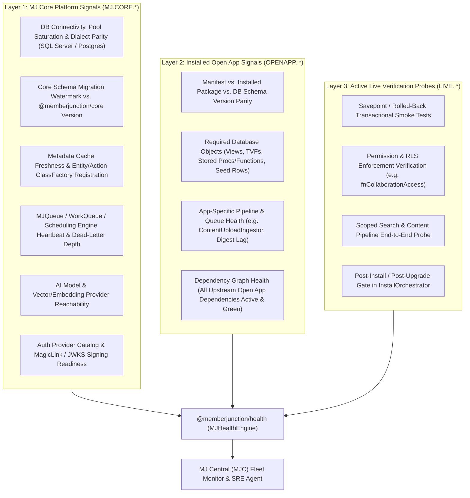

# MJ Core & Open App Health Signals, Live Verification Probes, and Agent Remediation Infrastructure

- **Status:** Plan Proposed (Plan-Only PR)
- **Date:** November 5, 2026
- **Authors:** @amith-bc, @MS-BC
- **Target Packages:**
  - `@memberjunction/health` *(new core package: `packages/Health`)*
  - `@memberjunction/open-app-engine` *(`packages/OpenApp/Engine`)*
  - `@memberjunction/server` *(`packages/MJServer`)*
  - `@memberjunction/server-extensions-core` *(`packages/ServerExtensionsCore`)*
  - `@memberjunction/cli` *(`packages/MJCLI`)*

---

## 1. Executive Summary & Problem Statement

As **MJ Central (MJC)** scales to auto-provision, upgrade, and operate hundreds or thousands of dedicated MemberJunction instances across clouds (including low-cost **\$10–\$20/month AWS PostgreSQL** instances for associations alongside Azure SQL and GCP deployments), each customer instance runs **MJ Core** plus a composable stack of **MJ Open Apps** (`mj-bizapps-common`, `mj-bizapps-collaboration`, `mj-bizapps-community`, `mj-bizapps-tasks`, `skip-client-open-app`, and AMS/community connectors).

Today, MJ's operational health surface has three structural gaps:

1. **Process Liveness != MJ Core Readiness:**
   - `GET /api/healthcheck` (`packages/MJServer/src/coreRoutes.ts`) returns a static `200 { status: 'ok' }`. It proves the Node process is listening, not that the database connection pool is healthy, metadata is synchronized, Skyway/Flyway migrations match the running code version, background queues/schedulers are ticking, or AI/embedding providers are reachable.
2. **No Per-Open-App Health Contract:**
   - `GET /api/health/extensions` (`packages/MJServer/src/coreRoutes.ts`) only invokes `BaseServerExtension.HealthCheck()` and returns an unstructured boolean `{ Healthy: boolean, Name: string, Details?: Record<string, unknown> }`.
   - Open Apps declared via `mj-app.json` (`packages/OpenApp/Engine/manifest.reference.jsonc`) have no contract for reporting schema parity, required seed records, background pipeline lag (e.g., `ContentUploadIngestor` or digest schedulers), or version drift between the database schema and installed npm packages.
3. **No Live Functional Verification Probes or Agent Remediation Playbooks:**
   - Neither MJ Core nor Open Apps ship **live functional smoke tests** that can be executed automatically after `mj app install` / `mj app upgrade` (or periodically by MJC) to verify that core workflows actually work end-to-end.
   - More importantly, when a check degrades or fails, there is **no standardized domain of `GREEN` / `YELLOW` / `RED` signals paired with deterministic remediation instructions and escalation boundaries** that an MJC SRE Agent can act upon autonomously and use to escalate to human engineers when needed.

### Architectural Thesis
**Health signals, live functional verification probes, and agent remediation playbooks must be first-class MJ Core Infrastructure (`@memberjunction/health` + `mj-app.json`)** so that:
- MJ Core ships a canonical catalog of platform health signals and live verification probes.
- Every Open App ships its own domain-specific health signals, post-upgrade live smoke tests, and agent remediation instructions inside its own repository alongside its migrations and code.
- MJ Central (MJC) and its SRE agents consume a single, uniform `GREEN` / `YELLOW` / `RED` signal contract across every instance and every installed Open App.

---

## 2. Three-Layer Verification Model



---

## 3. The Defined Domain of `GREEN` / `YELLOW` / `RED` Signals & Agent Playbooks

Every health check or live test in MJ evaluates to one or more **registered signals** from a deterministic catalog. Unstructured, ad-hoc error strings are never the primary contract; every signal has a stable `SignalCode`, explicit severity criteria, and explicit instructions for both an autonomous agent and a human operator.

### 3.1 Core TypeScript Contract (`@memberjunction/health`)

```typescript
export type HealthStatus = 'GREEN' | 'YELLOW' | 'RED';

export type HealthLayer = 'core' | 'open-app' | 'server-extension' | 'connector' | 'live-test';

export type ProbeExecutionMode = 'passive' | 'live-test';

/**
 * Declarative metadata for a known signal in the MJ Core or Open App signal catalog.
 * Can be declared in `mj-app.json` and/or registered in code on `BaseHealthProbe`.
 */
export interface HealthSignalDefinition {
    /**
     * Globally unique, dot-namespaced signal code.
     * Examples:
     * - 'MJ.CORE.DB.POOL_SATURATION'
     * - 'MJ.OPENAPP.SCHEMA_VERSION_PARITY'
     * - 'BIZAPPS.COLLAB.ACCESS_TVF_PARITY'
     * - 'BIZAPPS.COMMUNITY.DIGEST_QUEUE_LAG'
     */
    Code: string;

    /** Human-readable title for dashboards and alerts. */
    Title: string;

    /** Architectural layer this signal belongs to. */
    Layer: HealthLayer;

    /** Owning Open App name (e.g., 'mj-bizapps-collaboration') or '__mj' for MJ Core. */
    OwnerApp: string;

    /** Whether this signal is evaluated during fast passive polling or active live testing. */
    Mode: ProbeExecutionMode;

    /** Description of what invariant or subsystem this signal verifies. */
    Description: string;

    /**
     * Deterministic playbook for an autonomous SRE Agent when the signal is YELLOW (Degraded / Warning).
     */
    YellowPlaybook: AgentRemediationPlaybook;

    /**
     * Deterministic playbook for an autonomous SRE Agent when the signal is RED (Critical / Failing).
     */
    RedPlaybook: AgentRemediationPlaybook;
}

export interface AgentRemediationPlaybook {
    /**
     * Clear, step-by-step instructions written specifically for an AI SRE agent.
     * Defines what context to inspect, what safe remediation to attempt, and how to verify recovery.
     */
    AgentInstructions: string;

    /**
     * Explicit allow-list of MJ Action names, CLI commands, or MJC fleet operations
     * the agent is authorized to execute autonomously when this state triggers.
     */
    AllowedAutonomousActions: string[];

    /** Maximum number of autonomous remediation attempts before mandatory human escalation. */
    MaxAutonomousAttempts: number;

    /** Cooldown window in seconds between autonomous attempts. */
    RetryCooldownSeconds: number;

    /**
     * Deterministic rule stating when the agent MUST stop and escalate to a human operator,
     * and what diagnostic artifacts to attach to the escalation ticket/alert.
     */
    HumanEscalationCriteria: string;

    /** Recommended runbook steps for the human engineer who receives the escalation. */
    HumanOperatorRunbook?: string;
}
```

### 3.2 Runtime Signal Evaluation Result (`HealthSignalEvaluation`)

When `MJHealthEngine.Instance.Evaluate(options)` runs, each signal produces a self-contained evaluation payload:

```typescript
export interface HealthSignalEvaluation {
    /** Signal code from the registered catalog. */
    Code: string;
    Title: string;
    Layer: HealthLayer;
    OwnerApp: string;
    Mode: ProbeExecutionMode;

    /** Current evaluated state: GREEN, YELLOW, or RED. */
    Status: HealthStatus;

    /** Concise 1-sentence summary of the current state (e.g. "Pool utilization at 42% (threshold: 80%)"). */
    Summary: string;

    /** Structured metrics measured during the check (latencies, counts, versions, watermarks). */
    ObservedMetrics: Record<string, string | number | boolean | null>;

    /** Thresholds against which ObservedMetrics were compared. */
    Thresholds?: Record<string, string | number | boolean>;

    /** ISO-8601 timestamp when the probe executed. */
    EvaluatedAt: string;

    /** Execution duration of this probe in milliseconds. */
    DurationMs: number;

    /**
     * Populated automatically from the signal definition when Status is YELLOW or RED,
     * with template variables (e.g. {{appName}}, {{observedVersion}}) interpolated.
     */
    ActivePlaybook?: AgentRemediationPlaybook;

    /** Optional error stack or diagnostic snippet if an exception occurred during evaluation. */
    DiagnosticError?: string;
}

export interface InstanceHealthReport {
    /** Overall rollup status across all evaluated signals (RED if any RED, YELLOW if any YELLOW, else GREEN). */
    OverallStatus: HealthStatus;
    MJVersion: string;
    DatabasePlatform: 'sqlserver' | 'postgresql';
    EvaluatedAt: string;
    TotalDurationMs: number;
    Mode: ProbeExecutionMode;
    SummaryCounts: {
        Green: number;
        Yellow: number;
        Red: number;
    };
    Signals: HealthSignalEvaluation[];
}
```

---

## 4. `BaseHealthProbe` & ClassFactory Registration Pattern

Following MJ's standard extensibility architecture, health probes and live verification tests subclass `BaseHealthProbe` and register via `@RegisterClass(BaseHealthProbe, '...')`.

```typescript
import { RegisterClass } from '@memberjunction/global';
import type { DatabaseProviderBase, IMetadataProvider, UserInfo } from '@memberjunction/core';

export interface HealthProbeContext {
    DatabaseProvider: DatabaseProviderBase;
    MetadataProvider: IMetadataProvider;
    SystemUser: UserInfo;
    Mode: ProbeExecutionMode;
    /** Target Open App filter if checking a specific app. */
    AppFilter?: string;
    /** Timeout budget in milliseconds for this probe. */
    TimeoutMs: number;
}

export abstract class BaseHealthProbe {
    /** Unique probe key matching the @RegisterClass key. */
    abstract get ProbeKey(): string;

    /** Owning Open App name (e.g. 'mj-bizapps-collaboration') or '__mj' for MJ Core. */
    abstract get OwnerApp(): string;

    /** Execution mode ('passive' runs on every poll; 'live-test' runs on install/upgrade/scheduled verification). */
    abstract get Mode(): ProbeExecutionMode;

    /** Signals emitted by this probe. */
    abstract get SignalDefinitions(): readonly HealthSignalDefinition[];

    /**
     * Executes the probe and returns evaluations for its declared signals.
     * Note: If the probe throws an unhandled error or times out, `MJHealthEngine` catches it
     * and automatically emits a RED evaluation for the probe's signals with the exception attached.
     */
    abstract Evaluate(context: HealthProbeContext): Promise<HealthSignalEvaluation[]>;
}
```

### Safe Transactional Execution for `live-test` Probes (`RunInRolledBackSavepoint`)
A major concern with running "live tests" in production instances is avoiding leftover test data or side effects. `@memberjunction/health` will provide a helper on `BaseHealthProbe`:
- `protected async WithRolledBackTransaction<T>(context: HealthProbeContext, fn: (txProvider: DatabaseProviderBase) => Promise<T>): Promise<T>`
- This starts an isolated transaction/savepoint on an isolated `DatabaseProviderBase` (via `HostRuntimeService.CreateIsolatedProvider()`), executes the synthetic smoke test (e.g., creating a test `Space`, adding a `SpaceMember`, evaluating `fnCollaborationAccess`, verifying RLS visibility), asserts the invariants, and **unconditionally rolls back the transaction** before returning the `GREEN`/`YELLOW`/`RED` signal evaluation.

---

## 5. Standard Signal Catalogs

### 5.1 Built-in MJ Core Signals (`__mj`)

| Signal Code | Mode | `GREEN` Criteria | `YELLOW` Criteria & Agent Playbook | `RED` Criteria & Agent Playbook |
|---|---|---|---|---|
| `MJ.CORE.DB.CONNECTIVITY_AND_POOL` | `passive` | `SELECT 1` < 50ms; pool active connections < 75% of max. | Latency 50–250ms or pool 75–90%. **Agent:** Inspect long-running queries; log top 5 slow queries; monitor for 3 polls. | DB unreachable, timeout, or pool > 90%. **Agent:** Check DB instance status in MJC; attempt connection pool recycle once; if still RED, escalate immediately to human SRE with pg_stat_activity / dm_exec_requests snapshot. |
| `MJ.CORE.SCHEMA.MIGRATION_PARITY` | `passive` | Core `__mj` migration history matches running `@memberjunction/core` version with zero failed migrations. | Pending minor/optional migration or drift warning. **Agent:** Inspect `flyway_schema_history` / `skyway_schema_history`. | Failed migration row or major version mismatch between code and DB. **Agent:** Do not auto-mutate core schema; halt traffic and escalate to human operator with migration checksum diff. |
| `MJ.CORE.METADATA.CACHE_PARITY` | `passive` | `Metadata.Entities.length > 0` and matches `SELECT COUNT(*) FROM __mj.Entity`. | Entity count in memory differs from DB table count (stale cache after DDL/OpenApp install). **Agent:** Run `RefreshOpenAppMetadata` / provider metadata refresh action once and re-evaluate. | `Metadata.Entities` empty or refresh fails twice. **Agent:** Restart MJServer worker container via MJC; escalate if still RED after restart. |
| `MJ.CORE.QUEUE.WORKER_HEARTBEAT` | `passive` | Active queue processor heartbeat < 60s old; dead-letter / failed tasks in last 1h < 5%. | Failed tasks 5–15% or queue backlog growing for 15m. **Agent:** Inspect failure reasons on `MJ: Queue Tasks`; retry transient timeout tasks (`RetryCount < 3`). | Queue heartbeat stale > 180s or failure rate > 15%. **Agent:** Restart worker process once; if tasks fail with deterministic code/schema errors, pause queue and escalate to human with top error stack. |
| `MJ.CORE.AI.PROVIDER_READINESS` | `passive` | Default LLM & Embedding model credentials configured and reachable. | Elevated rate-limit (429) or fallback model active. **Agent:** Switch traffic to configured secondary provider/key if available; alert on quota usage. | Primary and fallback AI/Embedding providers failing with 401/403/5xx. **Agent:** Verify secret rotation status in MJC; escalate to human operator. |
| `MJ.CORE.OPENAPP.FLEET_STATUS` | `passive` | All installed rows in `MJ: Open Apps` have `Status = 'Active'` and `LastCompletedStep` settled. | An Open App is in `Installing` or `Upgrading` for > 10 minutes. **Agent:** Check active installer lock; if orphaned, run `mj app upgrade <name>` to resume from checkpoint. | Any Open App is in `Status = 'Error'` or has unresolved dependencies. **Agent:** Attempt `mj app upgrade <name>` resume once; if it fails again, trigger snapshot restore and escalate to human with `MJ: Open App Install Histories` log. |
| `MJ.CORE.LIVE.ENTITY_CRUD_AND_RLS` | `live-test` | Synthetic read + metadata permission check + rolled-back write succeeds in < 500ms. | Succeeds but latency > 500ms. **Agent:** Record performance regression metric for MJC trend analysis. | Synthetic CRUD or permission check throws SQL/provider error. **Agent:** Block post-upgrade promotion and escalate with full SQL/stack trace. |

### 5.2 Open App Signal Pattern (Example: `mj-bizapps-collaboration` & `mj-bizapps-community`)

Each Open App ships its own probes in its server package:

| Signal Code | Mode | What It Checks | Agent Playbook Summary (`YELLOW` / `RED`) |
|---|---|---|---|
| `BIZAPPS.COLLAB.SCHEMA_AND_SEEDS` | `passive` | Verifies `__mj_BizAppsCollaboration` tables, `fnCollaborationAccess` TVF, and required `SpaceType` (`Team`, `Project`, `Committee`, `ClientPortal`, `Cohort`, `Community`) & `SpaceRoleType` seeds exist and match package version. | **YELLOW:** Missing non-critical seed description -> run `RefreshOpenAppMetadata`. **RED:** `fnCollaborationAccess` missing or broken -> run `mj app upgrade mj-bizapps-collaboration` or roll back; escalate if DDL fails. |
| `BIZAPPS.COLLAB.UPLOAD_INGEST_PIPELINE` | `passive` | Checks `SpaceItem` uploads pending `ContentUploadIngestor` chunking/embedding for > 30 mins. | **YELLOW:** 1–10 stuck items -> re-trigger `ContentUploadIngestor` for stalled `SpaceItemID`s. **RED:** >10 items failing repeatedly -> inspect embedding provider & `MJ: Content Sources` config; escalate with sample error. |
| `BIZAPPS.COLLAB.LIVE.ACCESS_REACH_PROBE` | `live-test` | In a rolled-back savepoint, creates a test Space + Member, runs `fnCollaborationAccess`, asserts member has reach and non-member has zero reach. | **RED:** Permission boundary regression! Immediately mark app unhealthy, abort upgrade rollout in MJC, and page security/platform engineer. |
| `BIZAPPS.COMMUNITY.DIGEST_SCHEDULER` | `passive` | Verifies daily/weekly Personalized Digest scheduled job executed within its expected window and bounce/error rate < 2%. | **YELLOW:** Digest job delayed 15–60m -> re-trigger digest scheduler task. **RED:** Digest job failed or communication provider rejecting sends -> pause digest batch and escalate with provider error log. |
| `BIZAPPS.COMMUNITY.LIVE.FORUM_THREAD_PROBE` | `live-test` | In a rolled-back savepoint, creates a synthetic `ForumThread` + `ForumPost` inside a test Space, verifies RLS visibility and `EntityRecordDocument` vector chunk preparation. | **RED:** Halt `mj-bizapps-community` upgrade promotion; roll back to previous package snapshot and escalate. |

---

## 6. Open App Manifest (`mj-app.json`) & `InstallOrchestrator` Integration

### 6.1 Additive `"health"` Capability Block in `mj-app.json`

We extend `packages/OpenApp/Engine/src/manifest/manifest-schema.ts` and `manifest.reference.jsonc` with an optional, backwards-compatible `"health"` block:

```jsonc
{
  "manifestVersion": 1,
  "name": "mj-bizapps-collaboration",
  // ...
  "health": {
    // Optional: require all 'live-test' probes for this app to return GREEN (or YELLOW)
    // during `mj app install` and `mj app upgrade` before marking the app 'Active'.
    // Default: true when probes are registered for this app.
    "verifyOnInstall": true,
    "verifyOnUpgrade": true,
    // Action when a live-test probe returns RED during upgrade:
    // 'rollback' (restore file snapshot & set Status='Error') | 'mark-error' | 'warn-only'
    "onUpgradeProbeFailure": "rollback",
    "timeoutMs": 15000,
    // Declarative signal catalog so MJ Central (MJC) knows all possible signals,
    // severities, and agent playbooks for this app even before runtime evaluation:
    "signals": [
      {
        "code": "BIZAPPS.COLLAB.SCHEMA_AND_SEEDS",
        "title": "Collaboration Schema, fnCollaborationAccess & Seed Parity",
        "mode": "passive",
        "description": "Verifies __mj_BizAppsCollaboration schema objects and required SpaceType/SpaceRoleType seed rows.",
        "yellowPlaybook": {
          "agentInstructions": "Run RefreshOpenAppMetadata and re-evaluate in 60 seconds.",
          "allowedAutonomousActions": ["RefreshOpenAppMetadata"],
          "maxAutonomousAttempts": 2,
          "retryCooldownSeconds": 60,
          "humanEscalationCriteria": "Escalate if status remains YELLOW for > 15 minutes after metadata refresh."
        },
        "redPlaybook": {
          "agentInstructions": "Attempt `mj app upgrade mj-bizapps-collaboration` once to resume any incomplete migration. If still RED, do not route traffic and escalate immediately.",
          "allowedAutonomousActions": ["ResumeOpenAppUpgrade"],
          "maxAutonomousAttempts": 1,
          "retryCooldownSeconds": 120,
          "humanEscalationCriteria": "Escalate immediately if resume fails or fnCollaborationAccess is invalid."
        }
      }
    ]
  }
}
```

### 6.2 New `HealthVerified` Checkpoint in `InstallOrchestrator`

In `packages/OpenApp/Engine/src/install/install-orchestrator.ts`:
- Extend `INSTALL_STEP_ORDER` and `UPGRADE_STEP_ORDER`:
  ```typescript
  const INSTALL_STEP_ORDER: InstallStep[] = [
    'RecordCreated',
    'PackagesInstalled',
    'ConfigUpdated',
    'AngularExcludesUpdated',
    'Finalized',
    'HooksRun',
    'HealthVerified', // <-- NEW: runs passive + live-test probes for the app
  ];

  const UPGRADE_STEP_ORDER: UpgradeStep[] = [
    'MigrationsApplied',
    'PackagesInstalled',
    'ConfigUpdated',
    'AngularExcludesUpdated',
    'RecordUpdated',
    'HooksRun',
    'DependenciesReplaced',
    'HealthVerified', // <-- NEW: runs passive + live-test probes; triggers file-snapshot rollback if RED
  ];
  ```
- During `UpgradeApp`, if `HealthVerified` evaluates any signal for the upgraded app as `RED` and `onUpgradeProbeFailure === 'rollback'`, `InstallOrchestrator` automatically restores the pre-upgrade file snapshot (`RestoreFileSnapshot`), records the structured `HealthSignalEvaluation[]` JSON in `MJ: Open App Install Histories.ErrorMessage`, and leaves the app in a known state so MJC halts fleet rollout before affecting other customer instances.

### 6.3 CLI Commands (`@memberjunction/cli`)

Add `mj app health` (and `mj doctor --live`) to `packages/MJCLI`:
- `mj app health` — Evaluates all `passive` MJ Core + installed Open App health signals and prints a color-coded `GREEN` / `YELLOW` / `RED` table (or `--json` for MJC / CI).
- `mj app health mj-bizapps-collaboration --mode live-test` — Runs both passive and rolled-back live functional verification probes for `mj-bizapps-collaboration`.

---

## 7. MJServer HTTP Endpoints & GraphQL Surface

### 7.1 HTTP Endpoints (`packages/MJServer/src/coreRoutes.ts`)

1. **`GET /api/healthcheck` (Unchanged — Unauthenticated Liveness Probe):**
   - Kept ultra-lightweight (`200 { status: 'ok' }`) for ALB / Kubernetes container liveness probes that fire every 5 seconds without credentials.
2. **`GET /api/health/signals` (Authenticated / Scoped MJC Telemetry Endpoint):**
   - Query params: `?mode=passive` (default), `?layer=all|core|open-app`, `?app=<appName>`.
   - Protected by either a valid system/admin JWT or a scoped MJC API Key (`health:read`).
   - Returns `InstanceHealthReport` JSON (`HTTP 200` for `GREEN`/`YELLOW`, `HTTP 503` if `OverallStatus === 'RED'` and `?strictStatus=true`).
3. **`POST /api/health/signals/verify` (Authenticated Live-Test Execution Endpoint):**
   - Body: `{ apps?: string[], includeCore?: boolean, timeoutMs?: number }`.
   - Protected by `sysadmin` role or scoped MJC API Key (`health:verify`).
   - Executes `mode: 'live-test'` probes (using rolled-back savepoints) and returns the complete `InstanceHealthReport`.
4. **Backwards-Compatible Bridge for `BaseServerExtension.HealthCheck()`:**
   - Existing `BaseServerExtension` implementations are automatically wrapped by `ServerExtensionHealthProbeAdapter` so `/api/health/signals` includes all loaded server extensions alongside MJ Core and Open Apps.

---

## 8. Phased Implementation Plan

| Phase | Scope | Key Files & Deliverables |
|---|---|---|
| **Phase 1: `@memberjunction/health` Core Package & Built-in MJ Core Probes** | Create `packages/Health` (`@memberjunction/health`) with `MJHealthEngine`, `BaseHealthProbe`, `WithRolledBackTransaction`, `HealthSignalDefinition`, `HealthSignalEvaluation`, and built-in MJ Core probes (`MJ.CORE.DB.*`, `MJ.CORE.SCHEMA.*`, `MJ.CORE.METADATA.*`, `MJ.CORE.QUEUE.*`, `MJ.CORE.AI.*`, `MJ.CORE.OPENAPP.*`, `MJ.CORE.LIVE.*`). | `packages/Health/src/*` + unit tests in `packages/Health/src/__tests__/` |
| **Phase 2: `mj-app.json` Schema & `OpenApp/Engine` `HealthVerified` Gate** | Add optional `"health"` block to `manifest-schema.ts` & `manifest.reference.jsonc`; add `'HealthVerified'` checkpoint to `install-orchestrator.ts` with automatic file-snapshot rollback on `RED` upgrade probes; add `mj app health` CLI command. | `packages/OpenApp/Engine/src/manifest/manifest-schema.ts`, `packages/OpenApp/Engine/src/install/install-orchestrator.ts`, `packages/MJCLI/src/commands/app/health.ts` |
| **Phase 3: `MJServer` Routes, API Key Scopes & GraphQL Resolver** | Mount `/api/health/signals` and `/api/health/signals/verify`, bridge `BaseServerExtension.HealthCheck()`, and add `MJHealthResolver` for MJ Explorer Admin UI & MJC fleet polling. | `packages/MJServer/src/coreRoutes.ts`, `packages/MJServer/src/resolvers/MJHealthResolver.ts` |
| **Phase 4: Reference Open App Probes (`bizapps-collaboration` & `bizapps-community`)** | Ship passive & rolled-back live verification probes (`BIZAPPS.COLLAB.*` and `BIZAPPS.COMMUNITY.*`) as the reference implementation for all MJ Open Apps. | `MemberJunction/bizapps-collaboration` & `MemberJunction/bizapps-community` |

---

## 9. Verification & Testing Strategy

1. **Unit & Contract Tests (`packages/Health`):**
   - Verify signal catalog registration, duplicate signal code rejection, timeout isolation (a hung probe times out and emits `RED` with `ActivePlaybook` without blocking sibling probes), and `WithRolledBackTransaction` savepoint rollback guarantee on both SQL Server and PostgreSQL providers.
2. **Orchestrator Upgrade Rollback Tests (`packages/OpenApp/Engine`):**
   - Extend `install-orchestrator-upgrade-restore.test.ts` to verify that when an Open App's `HealthVerified` live probe returns `RED` after package installation, the orchestrator restores the pre-upgrade file snapshot and records the structured signal evaluation in `OpenAppInstallHistory`.
3. **Multi-Database Parity (SQL Server & AWS PostgreSQL):**
   - Verify all `MJ.CORE.*` probes execute cleanly on both `@memberjunction/sqlserver-dataprovider` and `@memberjunction/postgresql-dataprovider`.
