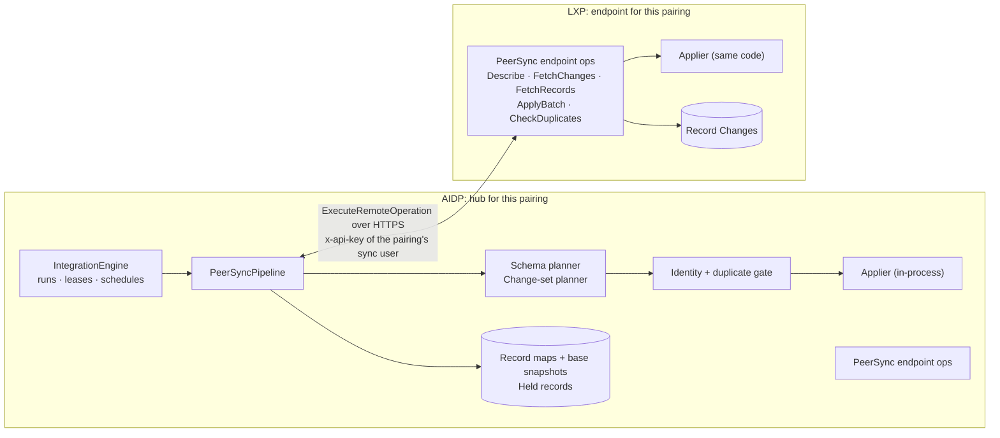

# MJ Peer Sync — a first-class MJ ↔ MJ connector

## Status
- **Status**: Draft — design spec, nothing built
- **Created**: 2026-10-23
- **Author**: Amith Nagarajan + Claude
- **Branch**: `mj-peer-sync-spec`
- **Grounded against**: MJ `next` at `f3b54c9c7` plus the BizApps sibling repos. Every `file:line` below is a pointer into that commit, from a code survey on 2026-10-22. Line numbers will drift.

## Summary

Two MemberJunction deployments should be able to keep a chosen set of entities in sync, one way or both ways. The motivating case is an LXP deployment and an AIDP deployment that share people, organizations and learning records. Two properties make this connector worth building rather than wiring up a generic one:

1. **Dependency intelligence.** Records land in foreign-key order, both across entities and within one entity. A parent the destination doesn't have is either fetched or the child waits. Cycles are broken safely. IS-A chains are handled. References to entities that aren't synced, such as Users, are mapped. Nothing is half-applied.
2. **Live duplicate checking.** Before a record is created on the destination it is checked in three ways:
   - against what already exists there: deterministic rules first, then vector similarity, then an LLM for the unclear cases;
   - against everything else arriving in the same run.

   Clear duplicates are **linked**, not created. Gray-zone cases are **held for review**, together with every record that depends on them.

This is tractable because MJ ↔ MJ is the one integration where both ends speak MJ metadata. Both sides share:
- the same entity model and, for entities installed from the same migrations, the same entity IDs;
- UUID keys and the same FK metadata;
- a built-in change log (Record Changes);
- a typed RPC mechanism (Remote Operations).

The connector doesn't have to *discover* the other side. It reads it.

---

## 1. Goals and non-goals

### Goals
1. **Per-entity direction.** Sync any selected set of entities between two deployments. Each entity syncs one way in either direction, or both ways.
2. **Dependency-safe ordering.** Apply changes in dependency order across entities and within an entity. This includes FK cycles, self-references, IS-A chains, and references to entities that aren't synced.
3. **Duplicate gate.** Check every would-be create for duplicates against the destination and against the rest of the run, before it is written. Then link, create or hold it according to policy.
4. **Nothing half-applied, nothing silently dropped.** A record that can't be applied waits in a visible queue, along with everything that depends on it. The cursor never skips it silently.
5. **BaseEntity on both sides.** Validation, Record Changes, cache invalidation, entity actions and permissions keep working. This is the whole reason this isn't database replication.
6. **One admin surface.** Reuse the Integration framework's operational pieces: connections, credentials, schedules, runs, leases, watermarks and record maps.
7. **Seconds, not minutes.** Propagate within seconds when both sides are reachable, without depending on that for correctness.

### Non-goals
- **Database-level replication or CDC.** It bypasses `BaseEntity`, which means stale server caches, no audit, no actions and no validation (see `.claude/rules/data-access.md`, "Never write direct SQL DML").
- **Live cross-deployment reads or joins.** External Data Sources already covers live, read-only access to another database.
- **Syncing MJ metadata itself** (entities, actions, agents, prompts). That is what `mj sync` and Open App releases are for.
- **A multi-master mesh in v1.** v1 is pairwise. Provenance is designed so a hub-and-spoke or mesh can follow without a protocol change.
- **Synchronous cross-deployment transactions** (two-phase commit). Consistency is eventual, in seconds to minutes.

---

## 2. The motivating scenario

- LXP and AIDP are each full MJ deployments, and both run bizapps-common (People, Organizations, Contact Methods, …).
- AIDP is the system of record for people and organizations. LXP owns enrollments and completions.
- Staff on **both** sides create people.

What we want:

| Data | Direction | Notes |
|---|---|---|
| People, Organizations | Two-way | Core fields owned by AIDP; some preferences owned by LXP; duplicates linked, not created |
| Enrollments, Completions, Certificates | LXP → AIDP | Must never arrive before their Person, Organization or Course |
| Courses, catalog | LXP → AIDP | Reference data for the learning records |

This exercises everything at once:
- FK closure: an enrollment needs its person.
- Identity: the same human was created independently on both sides.
- Aggregates: in bizapps-common a person's email lives in a child Contact Methods row (`/home/user/bizapps-common/packages/ActivitySync/src/identity.ts:96`), not on Person.
- User references that differ per deployment.
- Two-way conflicts.

---

## 3. What MJ already has, and the gaps

### 3.1 Reusable as is
| Capability | Where |
|---|---|
| Connections, credentials, schedules, runs with leases and fences, watermarks, record maps | `MJ: Company Integrations` and its child entities; `packages/Integration/engine/src/RunOwnershipService.ts:90`; `packages/Scheduling/engine/src/drivers/IntegrationSyncScheduledJobDriver.ts:73` |
| Per-entity `SyncDirection` (Pull / Push / Bidirectional), per-field `Direction`, `ConflictResolution` (SourceWins / DestWins / MostRecent / Manual) | `packages/Integration/engine/src/entity-types.ts:39-65` |
| Field-level 3-way merge of base, ours and theirs | `computePushCombine`, `IntegrationEngine.ts:3939` |
| Skipping unchanged records by content hash | `IntegrationEngine.ts:5145`, `:5286` |
| Watermark that never advances past a failed record | `IntegrationEngine.ts:3558-3615` |
| Typed RPC with scopes, `RequiresSystemUser` and an `Authorize` hook | Remote Operations: `guides/REMOTE_OPERATIONS_GUIDE.md`; `packages/MJServer/src/resolvers/ExecuteRemoteOperationResolver.ts:72-109` |
| User API keys with scopes, applications and row filters | `packages/APIKeys`; `packages/MJServer/src/context.ts:409-450,645-646` |
| Change log with deletes (the full pre-delete row is kept) and a JSON provenance column | `MJ: Record Changes`; `packages/MJCore/src/generic/databaseProviderBase.ts:2590-2597` |
| Provenance precedent: a server-only context stamped on Record Changes | `BaseEntity.SetCloneContext`, `packages/MJCore/src/generic/baseEntity.ts:5009`; `metadata/entities/JSONType-interfaces/IRecordChangeContext.ts:34-43` |
| Creates that keep a caller-supplied primary key | Generated `spCreate*` procs take `@ID uniqueidentifier = NULL` and branch on `IF @ID IS NOT NULL`, e.g. `migrations/v6/V202608201800__v6.1.x__Regenerate_Hierarchy_Views_And_FormChromeRule_Entity.sql:3155,3206` |
| Adopting an existing IS-A parent row | `BaseEntity.AttachToParent`, `baseEntity.ts:1633`. A child save writes its parent chain first: `baseEntity.ts:5191-5201` |
| Transactions with nested savepoints | `RunInEntityTransaction`, `packages/MJCore/src/generic/entityTransactionScope.ts:130` |
| Duplicate detection: vector search plus optional LLM, thresholds on the Entity Document, single-record checks | `DuplicateRecordDetector`: `GetDuplicateRecords` (`packages/AI/Vectors/Dupe/src/duplicateRecordDetector.ts:273`), `CheckSingleRecord` (`:416`), `CheckRecordValues` (`:502`) |
| Record merge with FK re-pointing | `DatabaseProviderBase.MergeRecords`, `databaseProviderBase.ts:2793-2880` |
| Field-comparison UI | `mj-record-merge-panel`, `packages/Angular/Generic/record-merge/src/lib/record-merge-panel.component.ts:28` |
| Precedents for dependency sorting and key remapping | `SortByEntityDependencyOrder` (`packages/RecordGraph/src/sort.ts:15`); RecordCloning key maps and `MapFieldsForClone`; MetadataSync `?allowDefer` two-phase saves; CodeGen `FindTrueCycles` (Tarjan, `packages/CodeGenLib/src/Database/entity-level-tree-cycles.ts:23`) |
| Change-notification hint | `cacheInvalidation` GraphQL subscription, `packages/MJServer/src/generic/CacheInvalidationResolver.ts` |

### 3.2 Gaps this design closes
| Gap | Evidence |
|---|---|
| The engine does no FK translation; values are copied straight across | `packages/Integration/engine/src/FieldMappingEngine.ts:81-87` |
| Dependency ordering is entity-level only, over the IntegrationObject graph. A cycle collapses everything into one layer with a warning | `IntegrationEngine.ts:2005-2049` |
| No ordering exists at the record level, and nothing does a general two-phase insert for cycles | Survey of RecordGraph, RecordCloning, MetadataSync; only MetadataSync's opt-in `?allowDefer` defers a field |
| Matching is exact equality, and with several matches the first row wins silently. The `MatchStrategy` column is never read | `packages/Integration/engine/src/MatchEngine.ts:460,549-553,660`; `entity-types.ts:41` |
| No batch "check these values for duplicates" API. New records aren't vectorized on save, so records arriving in the same run can't match each other | `duplicateRecordDetector.ts:416-530`; `guides/DUPLICATE_DETECTION_GUIDE.md:81-93` |
| Echo avoidance relies on one hard-coded System user ID | `IntegrationEngine.ts:3642` |
| No cursor column on Record Changes and no index on `ChangedAt`; `ChangedAt` is stamped before commit | `migrations/v5/B202607091514__v5.46.x__Baseline.sql:5081-5102`; proc at `migrations/v6/V202609302340__v6.2.x__RecordChange_ChangeContext_And_Clone_Source.sql:121` |
| No outbound webhooks. The cache-invalidation ring buffer is in memory, per process | `packages/MJServer/src/broadcast/BaseCacheInvalidationBroadcastProvider.ts:162-180` |
| No server-to-server client for a *user* API key. `GraphQLDataProvider` is a singleton, and its setup replaces the server's provider | `packages/GraphQLDataProvider/src/graphQLSystemUserClient.ts:23-38` (system key only); `graphQLDataProvider.ts:333-354`; `GraphQLDataProvider/src/config.ts:8-12` |

Section 19 lists defects found along the way that this connector depends on fixing.

---

## 4. Approaches considered

**A. A thin connector on today's engine pipeline**, implementing only `FetchChanges` and the CRUD methods.
- About a week of work, and it works for leaf entities with preserved keys.
- Rejected as the design:
  - no FK translation;
  - first-match-wins identity;
  - entity-level layering only;
  - record-by-record writes with no transactional batches;
  - no duplicate stage;
  - outbound sync currently finds no changes at all (Section 19, item 1).
- Kept as a possible throwaway spike.

**B. Database replication or CDC** (SQL Server CDC or transactional replication, PostgreSQL logical replication).
- Rejected: it bypasses `BaseEntity`. Caches stay stale indefinitely, no audit rows are written, and no actions or validation run.
- It also can't map users or IDs, can't check for duplicates, and replicates `__mj` tables that must stay per-deployment.

**C. A stand-alone peer-sync product** with its own connection, run and schedule entities.
- Rejected: it duplicates the Integration framework's operational surface.
- It also strands the generic improvements (FK translation, cycle-safe ordering, real matching) where the SaaS connectors can't benefit from them.

**D. (Chosen) A peer-sync pipeline inside the Integration framework.**
- It plugs in through **one seam**: a connector can supply its own pipeline. The engine still claims the run, holds the lease, loads the maps and records results.
- The heavy lifting lives in reusable, framework-agnostic modules:
  - the dependency planner;
  - the reference resolver;
  - the identity and duplicate gate;
  - the 3-way merge;
  - the applier.
- Both deployments install the same **endpoint** package.
- The generic engine can adopt the modules later for HubSpot, Salesforce and the rest.

---

## 5. Architecture



### 5.1 Roles
- **Both deployments install the same packages.** For a given pairing, one deployment is the **hub**: it owns the `MJ: Company Integrations` row, runs the pipeline, and holds the identity map, base snapshots and review queue. The other is the **endpoint**: it only answers `PeerSync.*` operations.
- **Put the hub where the reviewers work.** For LXP ↔ AIDP that is AIDP.
- **The endpoint keeps a pairing record too:** a `MJ: Company Integrations` row with `role: "Endpoint"`. It binds the hub's API-key user to the hub's deployment ID, so provenance can't be forged (Section 13).

### 5.2 Packages
| Package | Contents |
|---|---|
| `@memberjunction/peer-sync-engine` (`packages/PeerSync/engine`) | `PeerSyncPipeline`, `SchemaPlanner`, `ChangeSetPlanner`, `ReferenceResolver`, `IdentityGate`, `ThreeWayMerge` (lifted from `computePushCombine`), `PeerSyncApplier`, `PeerSyncClient`, and the `MemberJunctionConnector` class |
| `@memberjunction/peer-sync-server` (`packages/PeerSync/server`) | Server subclasses for the `PeerSync.*` Remote Operations; they are thin shells over the engine |
| Core changes | Record Change provenance and index, record-map columns, the held-records entity, API scopes, the seam on the Integration connector (Sections 16 and 17) |
| Angular (later phase) | Compatibility report, hold queue, cross-deployment duplicate banner |

The connector lives in its own package rather than in `@memberjunction/integration-connectors`. That keeps the vector and duplicate-detection dependencies out of the generic connectors package.

### 5.3 One run, end to end
1. **Claim.** The engine claims the run and lease as it does today, loads the entity maps, and hands off to `MemberJunctionConnector.RunPipeline` (Section 17).
2. **Handshake.** `PeerSync.Describe` checks the peer's deployment ID, protocol version and schema fingerprint against the pairing. A mismatch refuses the run (Section 7.5).
3. **Fetch.** Get the peer's change set since the peer cursor and the local change set since the local cursor (Section 8).
4. **Coalesce.** Keep the latest change per record and drop echoes of the hub's own sync writes.
5. **Resolve identity.** Use, in order: the identity map, the preserved key, the natural-key rules, then vectors (Section 10).
6. **Resolve references.** Turn each FK value into a destination key, an in-batch reference or a portable reference, per policy (Section 7.3).
7. **Close dependencies.** Fetch missing parents from the source where the policy allows it; otherwise hold (Section 9.2).
8. **Detect conflicts.** Run the 3-way merge for records changed on both sides (Section 11).
9. **Order.** Build a record-level DAG: upserts in topological order with two-phase deferrable FKs, then deletes in reverse order (Section 9).
10. **Apply.** Inbound units go through the in-process applier. Outbound units go to `PeerSync.ApplyBatch` on the peer. Each unit is one destination transaction.
11. **Record.** Write outcomes to run details, update record maps and base snapshots, and create or release holds.
12. **Advance cursors.** Move past everything applied or durably held; never past a retryable failure.

---

## 6. Protocol: the `PeerSync.*` Remote Operations

| Operation | Scope | Purpose |
|---|---|---|
| `PeerSync.Describe` | `sync:describe` | Returns:<br/>• deployment ID, protocol version, MJ version, installed Open Apps and their versions<br/>• per requested entity: ID, name, fields (type, length, nullability, PK, `RelatedEntityID`, value list), IS-A parent, `TrackRecordChanges`, `AllowRecordMerge`, unique constraints, Record Duplicate Entity Document<br/>• schema fingerprint<br/>• the peer's current time, used to seed cursors |
| `PeerSync.FetchChanges` | `sync:read` | Coalesced changes for a set of entities since a cursor, with the next cursor |
| `PeerSync.FetchRecords` | `sync:read` | Current rows by key. Used to close dependencies, release held records and load aggregates |
| `PeerSync.ApplyBatch` | `sync:apply` | Applies an ordered batch on that deployment, running the identity and duplicate gate, reference resolution and conflict check there. `Mode: 'DryRun'` returns the outcomes without writing |
| `PeerSync.CheckDuplicates` | `sync:check-duplicates` | Returns duplicate candidates for a set of unsaved values: the identity rules plus the vector stage. Used by the gate and by forms at entry time (Section 10.6) |

Operation metadata ships as `metadata/remote-operations` JSON, following `WorkQueue.*` (`metadata/remote-operations/.work-queue-operations.json`). CodeGen emits the typed bases, and the server package registers subclasses with `@RegisterClass(BaseRemotableOperation, 'PeerSync.ApplyBatch')`.

### 6.1 Shapes (sketch)

```ts
type FieldValue = string | number | boolean | null;
type FieldValues = Record<string, FieldValue>;

/** One coalesced change for one record, as the source sees it. */
interface PeerChange {
    Entity: string;                 // entity name on the source
    Key: string;                    // CompositeKey.ToURLSegment() of the source row
    Kind: 'Upsert' | 'Delete' | 'Merge';
    Row?: FieldValues;              // base-table fields only, read through RunView as the sync user (FLS applied)
    SourceVersion: string;          // the source row's __mj_UpdatedAt (ISO)
    ChangeIDs: string[];            // Record Change IDs coalesced into this entry
    Origin: { DeploymentID: string; UserEmail?: string };
    Merge?: { SurvivorKey: string; LoserKeys: string[] };
}

interface PeerCursor {
    HighWater: string;              // ISO ChangedAt
    SeenChangeIDs: string[];        // Record Change IDs at or after HighWater − SafetyLag already processed
}

interface FetchChangesInput {
    Entities: string[];
    Cursor: PeerCursor | null;      // null → snapshot mode (Section 8.8)
    MaxChanges: number;
    SafetyLagSeconds: number;
}

/** How the destination should resolve one FK field of an item. */
type ReferenceValue =
    | { Kind: 'Key'; Key: string }                                 // destination key already known
    | { Kind: 'InBatch'; Ref: string }                             // another item in this batch
    | { Kind: 'Natural'; Entity: string; Match: FieldValues }      // e.g. MJ: Users by Email
    | { Kind: 'Null' };

interface ApplyItem {
    Ref: string;                    // caller's handle, "<source entity>::<source key>"
    Entity: string;                 // destination entity name
    Kind: 'Upsert' | 'Delete';
    TargetKey?: string;             // known destination key (identity map or preserved key)
    Identity: 'Known' | 'Resolve';  // Resolve → run the identity + duplicate gate on the destination
    Values: FieldValues;            // already field-mapped, FK fields excluded
    References: Record<string, ReferenceValue>;
    Base?: FieldValues;             // last agreed values, for the destination-side conflict check
    Resolution?: HoldResolution;    // present when releasing a held item
}

type ApplyOutcome =
    | { Ref: string; Result: 'Created' | 'Updated' | 'Linked' | 'Deleted' | 'Unchanged'; TargetKey: string; AppliedValues: FieldValues }
    | { Ref: string; Result: 'Held'; Reason: HoldReason; Candidates?: DuplicateCandidate[]; BlockedBy?: string }
    | { Ref: string; Result: 'Failed'; Error: string; Retryable: boolean };

type HoldReason = 'PotentialDuplicate' | 'MissingDependency' | 'BlockedByHold'
    | 'Conflict' | 'ValidationFailed' | 'DeleteBlocked' | 'SchemaMismatch' | 'AmbiguousIdentity';
```

### 6.2 Why dedicated operations rather than the generic GraphQL API
- **Generic CRUD is typed per entity.** Each entity has its own `Create<X>`/`Update<X>` mutation, save options can't be set over the wire, and there is nowhere to carry sync provenance.
- **`SyncData` requires the system user** (`packages/MJServer/src/resolvers/SyncDataResolver.ts:17-58`). The shared system key is too powerful to hand to a peer.
- **`ExecuteTransactionGroup` defers its saves.** No read-your-writes, and no in-batch references beyond preserved keys (`.claude/rules/data-access.md`).
- **The duplicate gate has to run where the vectors live,** which is the destination.
- **Remote Operations give** typed input and output, `RequiredScope`, a CodeGen'd base, and a key to version by.

### 6.3 Transport and client
- **The client is `PeerSyncClient`:** a small fetch-based GraphQL client for `ExecuteRemoteOperation` that sends `x-api-key`.
  - It retries with backoff, honours `Retry-After`, gzips requests and caps request size: 200 items or 2 MB per batch by default.
  - It does **not** use `GraphQLDataProvider` inside MJAPI. Its constructor returns the global singleton, and `SetupGraphQLClient` would replace the server's own provider.
  - The alternative is to extend `GraphQLSystemUserClient` to accept a user key. Its stated purpose is already "server side code … talk to another MJAPI server".
- **Versioning:** `Describe` returns `ProtocolVersion`. A major-version mismatch refuses the run, and a minor mismatch disables only the features the older side lacks.

---

## 7. Identity

### 7.1 Keys are preserved by default
Generated `spCreate*` procs accept a caller-supplied `@ID` (Section 3.1), so a record that sync creates keeps **the same UUID on both sides**. That makes most identity work disappear:
- **FKs between synced records need no translation**, as long as the parent was also created by sync.
- **Soft links** (EntityID + RecordID pairs) also stay valid. They are mostly unnormalized today (`plans/polymorphic-foreign-keys.md:29-37`), so preserving keys is the only approach that keeps them correct without parsing them.
- **The identity map row is still written,** with `ExternalSystemRecordID = EntityRecordID`. Membership in the pairing is then explicit, and deletes and conflicts have base state.

Keys that can't be preserved:

| Primary key | Handling |
|---|---|
| Identity column (server-assigned) | Always mapped |
| Composite key | Preserved when every part is preserved or mapped; otherwise mapped, following RecordCloning's derived-key approach (`DeriveTargetKey`, `packages/RecordCloning/engine/src/CloneKeys.ts:110-134`) |

### 7.2 When keys differ: the identity map
Keys differ in two cases:
- a record that existed on both sides before the pairing;
- a record the duplicate gate **linked** instead of creating.

Both get a map entry from the source key to the destination key, and FK values pointing at them are translated through the map.

The map is `MJ: Company Integration Record Maps`, with new columns (Section 16). **Every lookup filters on `EntityID`.** Today's push lookup doesn't, which is a bug: `IntegrationEngine.ts:3796-3797`.

**Many-to-one guard.** Suppose a second source record tries to link to a destination record that is already linked. That means the *source* has a duplicate. Linking both would make the destination record bounce between two sources, so the record is held as `AmbiguousIdentity`, with a suggestion to merge on the source.

### 7.3 References to entities that aren't synced
Every FK whose target entity isn't in the synced set needs a **reference policy**. The schema planner infers a default, and the compatibility report shows it for confirmation.

| Policy | Meaning | Default when |
|---|---|---|
| `Reference` | The target exists on the destination under the same key; checked with a batched existence query | The target is seeded from metadata with fixed IDs (types, statuses, core lookups) |
| `MapByNaturalKey` | Sent as a portable reference, e.g. `MJ: Users` by `Email` or `MJ: Roles` by `Name`, and resolved by the destination | `MJ: Users`, `MJ: Roles`, or any entity with a configured natural key |
| `PullOnDemand` | Fetched from the source and included in the batch. Implicitly syncs the referenced rows only | The target is an app entity, such as Organization for a Person |
| `Null` | Dropped; only for nullable fields | Fallback for a nullable `MJ: Users` FK whose user has no match |
| `Default` | A fixed destination key, e.g. the pairing's sync user | Fallback for a non-nullable `MJ: Users` FK |
| `Hold` | The record waits until the reference resolves | Explicit opt-in |

Users differ per deployment. First login creates a new row (`packages/MJServer/src/auth/newUsers.ts:35-36`), and `SyncRolesAndUsers` already matches users by email and roles by name (`packages/MJServer/src/resolvers/SyncRolesUsersResolver.ts:80-86,315-353`). Natural-key mapping of users follows that precedent.

### 7.4 Matching entities across deployments
- **Match entities by ID first.** IDs agree when both sides installed from the same migrations: core entity IDs are literals in migrations, and Open Apps capture their CodeGen output the same way.
- **Fall back to name.** An entity that one deployment generated locally has a random ID (`packages/CodeGenLib/src/Database/manage-metadata.ts:7296-7323`).
- **The compatibility report shows:**
  - entities matched by name rather than ID;
  - fields present on only one side;
  - type or length mismatches;
  - value-list values that aren't allowed on the destination (these become holds, not failures);
  - required destination fields with no source value and no default (these block the entity map).

### 7.5 Deployment identity and pairing
- **Each deployment has a stable `DeploymentID`,** set explicitly in config (`peerSync.deploymentId`). `Describe` refuses to answer without one.
- **It is not derived from the database.** A restored copy of production would then claim production's identity, and a staging hub pointed at it would sync into production's identity map.
- **Pairing** stores the peer's `DeploymentID`, URL and schema fingerprint on both pairing records.
- **Every run's handshake re-checks them.** A changed deployment ID refuses the run. A changed fingerprint rebuilds the schema plan and pauses entity maps that are no longer compatible.

---

## 8. The change feed

### 8.1 Source of truth
- **Record Changes says *what* changed.** `PeerSync.FetchChanges` reads only `RecordID`, `Type`, `ChangedAt`, `Source`, `ChangeContext` and `ID` from it. It doesn't read `FullRecordJSON`, except to get the key of a delete.
- **The current row is read separately,** with one batched `RunViews` per entity as the sync user. Permissions and field-level security therefore apply exactly as they would for any user.

### 8.2 Cursor
`ChangedAt` is stamped when the change row is inserted inside the save, not when the transaction commits:
- SQL Server: `GETUTCDATE()` in the proc (`V202609302340…:121`).
- PostgreSQL: the column default `NOW()`.

So a slow transaction can commit a change stamped *earlier* than one the feed has already read. A plain high-water mark would skip it. The cursor therefore works like this:
- It is `HighWater` plus `SeenChangeIDs`. Each fetch re-reads from `HighWater − SafetyLag` and skips change IDs already seen.
- `SafetyLag` defaults to 120 s and must be longer than the longest save transaction. The report warns when observed transactions approach it.
- Applying is idempotent (content-hash compare), so re-reading inside the window is cheap and safe.
- An exact cursor is a later option: on SQL Server, `rowversion` plus `MIN_ACTIVE_ROWVERSION()`; on PostgreSQL, a transaction-snapshot equivalent. It isn't needed for correctness.

### 8.3 Coalescing
Per record, the latest change wins. Within one window:

| Sequence | Becomes |
|---|---|
| Create, then delete | Nothing, if the pairing never knew the record |
| Update, then delete | Delete |
| Delete, then re-create with the same key | Upsert |

### 8.4 Deletes
- **Deletes come from `Type = 'Delete'` rows.** The key is in `RecordID`, which is always the prefixed form (`ID|…`). Read it back with `CompositeKey.FromURLSegment`.
- **Whether to propagate them is a per-map policy:** `Propagate`, `Ignore`, `SoftOnDestination` (the existing `DeleteBehavior` values) or `Review`.

### 8.5 Entities that don't track Record Changes
- **Upserts:** a keyset watermark on (`__mj_UpdatedAt`, PK).
- **Deletes:** a periodic key reconciliation using partitioned hash rollups (`packages/Integration/engine/src/HashDiff.ts`; precedent `deleteOrphanedRecords`, `IntegrationEngine.ts:4088`).
- The compatibility report labels these entities "deletes are eventually consistent".

### 8.6 Index
Add `IX_RecordChange_EntityID_ChangedAt` on (`EntityID`, `ChangedAt`) INCLUDE (`RecordID`, `Type`, `Source`). None exists today (Section 3.2). Without it every fetch scans the largest table in the database.

### 8.7 Provenance and echo suppression
- **Stamping.** Every write the applier makes calls `BaseEntity.SetSyncContext(...)`, a new method modelled on `SetCloneContext`. The provider then stamps `Source = 'Sync'` and a `ChangeContext` of `Kind: 'Sync'`, carrying:
  - `OriginDeploymentID` (where the change was first made)
  - `PairingID`
  - `RunID`
  - `OriginChangeIDs`
  - `OriginUserEmail`
- **Not settable by clients.** Like the clone context, it can't be set over GraphQL.
- **Echo suppression.** `FetchChanges` drops a record when its latest change came from a sync write whose origin is the requester. If any change after that came from a person on this side, the record is sent. The 3-way merge resolves what's left.
- **This replaces the hard-coded System-user filter** (`IntegrationEngine.ts:3642`) for this connector.
- **It works for three or more deployments,** because it is keyed on origin, not on "who called".
- **The audit trail stays intact.** Sync writes are never `SkipRecordChanges`. The feed depends on them, and so does history.

### 8.8 Initial load (snapshot mode)
A `null` cursor means snapshot:
1. Take the peer's current time from `Describe` as `T0`.
2. Scan each entity in dependency order with keyset paging (`AfterKey`).
3. Run every row through the identity and duplicate gate. On the first load both sides already hold the same people, so the gate matters most here.
4. Switch to incremental from `T0 − SafetyLag`.

### 8.9 Dry run
- **What it does:** runs the full pipeline with `Mode: 'DryRun'` on both appliers. The gate, the reference resolution and the conflict check are all read-only.
- **What it reports:** counts of creates, links, holds by reason and conflicts, with samples.
- **Use it before going live,** especially before the initial load, to tune match rules and thresholds without writing anything.

---

## 9. Dependency intelligence

### 9.1 The static plan (built at configuration time, cached by schema fingerprint)
1. **Build the entity graph** of the synced set:
   - an edge for every `EntityFieldInfo.RelatedEntityID` whose target is in the set;
   - an edge for every IS-A parent link (`EntityInfo.ParentID`);
   - for FKs that leave the set, the reference policy (Section 7.3) instead of an edge.
2. **Find strongly connected components** with Tarjan's algorithm. `FindTrueCycles` in codegen-lib is the precedent. Lift a pure version into `@memberjunction/record-graph` so `SortByEntityDependencyOrder` can share it; today that function breaks cycles arbitrarily (`packages/RecordGraph/src/sort.ts:28`).
3. **Choose deferrable edges** for each component with a cycle, including self-references. These are nullable FK fields whose removal makes the component acyclic.
   - Prefer self-references, such as `Organization.ParentID`.
   - Then prefer optional "pointer" fields over structural ones.
   - The components are tiny, so an exhaustive search is fine.
   - A cycle made only of non-nullable FKs is a **configuration error**, reported with its edge list. SQL Server has no deferred constraints, so such a cycle can't be inserted as two separate rows.
4. **Treat each IS-A chain as one unit.** The leaf is what syncs, and the parent's fields travel with it.
5. **The output** is the entity levels plus the list of deferrable edges. It is shown in the compatibility report.

### 9.2 The change-set plan (built every run)
1. **Resolve references.** Each non-null FK value of each item becomes one of:
   - `InBatch`: the target is in this change set;
   - `Key`: known from the identity map, or a preserved key confirmed present by a batched existence check (one `RunViews` per target entity with key `IN` lists);
   - the result of the field's reference policy.
2. **Close dependencies.** For `PullOnDemand`, fetch missing parents with `FetchRecords` and add them to the change set, repeating until nothing new is added.
   - Bounded by `MaxClosureDepth` (default 4) and `MaxClosureRecords` (default 2,000). Hitting a bound holds the item as `MissingDependency` rather than failing the run.
   - **Fetched parents go through the identity and duplicate gate too.** A "missing" Organization may already exist on the destination under another ID.
3. **Load aggregates.** When an identity rule needs a record's children, the planner loads those children for the root before the gate runs. A Person matched by email needs its Contact Methods. See Section 10.4.
4. **Order with a record-level DAG** (Kahn's algorithm) over `InBatch` edges:
   - Self-references are ordered parents first.
   - Deferrable edges, and any record-level cycle the static plan allowed, use **two phases** in the same unit: insert with the deferrable FK set to null, then update it once the target exists.
5. **Run deletes after all upserts, in reverse topological order.** "Re-point the child, then delete the old parent" is then always safe. A delete is held as `DeleteBlocked` (or handled per policy) if the destination row has dependents that only exist on the destination.
6. **Propagate holds.** When an item is held, everything that depends on it through `InBatch` edges is held as `BlockedByHold`, with `BlockedByHeldRecordID` pointing at the root cause. Resolving the root releases its dependents, and the next run re-plans them. No child is ever written pointing at nothing.

### 9.3 Apply units and failures
- **Units.** Items are grouped into units by DAG level, up to N items each (default 200). Each unit runs in one destination transaction (`RunInEntityTransaction`).
- **Failures.** A unit that fails is split in half until the failing item is isolated. The rest of the unit then applies. Precedent: the engine's batched-write fallback.
- **Retryable versus permanent.** A retryable failure keeps the cursor where it is. A permanent failure, such as validation, becomes a hold (`ValidationFailed`, with `LatestResult.CompleteMessage`) and the cursor moves past it.
- **Holds don't block the cursor.** The held row stores its payload for review, but release re-fetches the current row from the source, so a stale payload is never applied.

---

## 10. Live duplicate checking

### 10.1 The gate
Every item that would be **created** on the destination (identity `Resolve`) passes through these stages, cheapest first. Each stage either decides or passes the item on.

| Stage | Question | Decides |
|---|---|---|
| 0. Known identity | Is the source key in the identity map, or does the preserved key exist on the destination? | Update, no gate |
| 1. Identity rules | Do deterministic, normalized natural keys match? | 1 hit → the rule's action (`Link` or `Review`); several hits → `Review`, never first-row-wins |
| 2. Vector candidates | Is there a similar destination record (the Record Duplicate Entity Document, TopK)? | ≥ absolute threshold → `Link` (if the policy allows); ≥ potential → stage 4 or `Review`; below → continue |
| 3. In-run index | Is there a similar record created earlier in this run, or currently held? | Same thresholds |
| 4. Reasoning (optional) | For the gray zone, what does the LLM say? Uses the Entity Document's `ReasoningMode` | `Link`, `Review` or `Create` |
| — | Nothing matched | `Create` |

**Stage 1 implementation.** Identity rules finally give the unused `MJ: Company Integration Entity Maps.MatchStrategy` column a meaning (JSON schema in Section 15). They run as one batched `RunView` per rule per entity, with `IN` lists of normalized values.
- Normalizers: `email` (trim + lowercase, the same as bizapps-common ActivitySync), `name` (Unicode fold + whitespace), `phone` (E.164) and `exact`.
- Destination unique constraints on synced entities are suggested as rules automatically, because a violation would fail the save anyway. `Describe` returns them.

**Stage 2 implementation.** It needs a new batch API in `@memberjunction/ai-vector-dupe`: `FindCandidatesForValues(entityDocumentID, rows, options)`.
- It renders each row through the Entity Document template, embeds all of them in **one** batched embedding call, and runs `QueryIndex` or `HybridQuery` per row.
- It is vector-only by default.
- Existing APIs don't fit. `CheckRecordValues` handles one record, requires the LLM Decision mode and is bounded at 2 s. `CheckSingleRecord` needs a saved, vectorized record.

**Stage 3 implementation.** The in-run index is an in-memory `SimpleVectorService` holding the embeddings of records this run created and records currently held. It catches two new "Jane Doe"s arriving in the same batch. After a record is created, its Entity Record Document is vectorized immediately through a new per-record path, `VectorizeRecords(entityDocumentID, keys)`. Today `EntityVectorSyncer` works only per entity or per list (`packages/AI/Vectors/Sync/src/models/entityVectorSync.ts:101`). Later runs and the entry-time check then see the new record straight away.

**Thresholds** come from the Entity Document's `PotentialMatchThreshold` and `AbsoluteMatchThreshold`. With none set, they fall back to 0.70 and 0.95, as the Duplicate Run server code does (`packages/MJCoreEntitiesServer/src/custom/MJDuplicateRunEntityServer.server.ts:142-149`).

**Cost control:**
- Rules run first.
- Vectors are batched.
- The LLM runs only in the gray zone, capped per run (`MaxReasoningCallsPerRun`), and respects the Entity Document's `AutomationLevel`.

### 10.2 What "Link" does
- **It writes the identity map entry** (source key to existing destination key) and records how and how confidently it matched (`MatchMethod`, `MatchScore`).
- **The item becomes an update,** under the map's `LinkMergeMode`:

  | Mode | Behaviour |
  |---|---|
  | `FillBlanks` (default) | Source values fill only empty destination fields |
  | `SourceWins` | Source values replace destination values |
  | `DestWins` | Destination values are kept |
  | `Review` | The update is held for a person to decide |

- **The base snapshot is seeded** from the merged result, so the next two-way run has a common ancestor.

### 10.3 Concurrent creation on both sides
Suppose Jane is created in LXP and in AIDP between two runs:
1. The hub fetches **both** change sets first, so the gate sees both Janes.
2. The inbound LXP-Jane matches local AIDP-Jane and is linked.
3. The outbound AIDP-Jane then finds itself already mapped, so no push create happens.

### 10.4 Aggregates: a record's identity can depend on its children
Some natural keys live in child records. In bizapps-common, a person's email is a Contact Methods row. Two things follow:
- **Matching:** the planner loads the children a rule names before the gate runs on the root (Section 9.2, step 3).
- **Child reconciliation:** when a root is **linked** to an existing destination record, its incoming children are matched against that record's existing children using child-level natural keys. For a Contact Method that is (`PersonID`, `Type`, normalized `Value`). Otherwise linking Jane would give the existing AIDP-Jane a second copy of her email.

### 10.5 Review
- **Where holds live:** in the hub's **Held Records** queue (Section 16). It is grouped by root cause, and dependents are shown under their blocker.
- **The review screen** shows the incoming record next to each candidate, using `mj-record-merge-panel`, with the matching rule or score and the LLM's reasoning when it ran.
- **The available actions:**
  - **Link to candidate**
  - **Create new**
  - **Merge on destination,** when `AllowRecordMerge` allows it
  - **Discard**
- **Resolving releases the record's dependents.**
- **Bulk actions** (for example, link every hold scoring ≥ 0.9 from a given rule) make the initial load reviewable in practice.

### 10.6 Entry time, across deployments
"Live" also means at the moment a person types. The form's existing entry-time check calls `CheckDuplicateEntry` (`packages/Angular/Generic/base-forms/src/lib/base-form-component.ts:814-872`; `packages/MJServer/src/resolvers/DuplicateEntryCheckResolver.ts:99`). Extend it:
- **Fan out to peers in parallel.** The check also calls `PeerSync.CheckDuplicates` on each paired deployment that syncs this entity, within the same 1.5 s client budget.
- **Merge the results into the banner,** for example: *"Possible match in AIDP: Jane Doe, 92%."*
- **Offer "Link".** It writes the identity map entry right away, so the next sync updates the existing record instead of creating a second one.

This is how duplicates stop being created in the first place, rather than being cleaned up afterwards.

### 10.7 Merges
- **Merges propagate through the change feed on their own.** `MergeRecords` re-points dependents with ordinary `BaseEntity` saves, then deletes the losing record. Both produce Record Changes. Upserts are applied before deletes (Section 9.2), so the peer re-points its dependents and then deletes the loser, in a safe order.
- **A `Merge` change is added on top,** built from `MJ: Record Merge Logs`, for two jobs:
  - **Identity map hygiene:** re-point the loser's map entries to the survivor.
  - **Dependents that only exist on the destination:** where the destination allows it, run `MergeRecords` there too. Otherwise those dependents are held as `DeleteBlocked` instead of the delete failing.

  bizapps-common People and Organizations are hard-delete and don't allow merges (`/home/user/bizapps-common/metadata/entities/.entities.json:6-11`), so they use the hold path.

---

## 11. Two-way sync and conflicts

- **Both sides are fetched before either is applied.** Records in both change sets are conflict candidates.
- **The base snapshot** of the last agreed mapped values is stored on the record map: `LastSyncedSnapshot` and `LastSyncedHash`. It is updated after every successful apply in either direction.
- **Merging is field-level and 3-way.** Lift `computePushCombine` (`IntegrationEngine.ts:3939`) into a pure `ThreeWayMerge(base, ours, theirs, policy)` that both pipelines use:
  - a field changed on one side only → that side's value;
  - both sides changed it to the same value → converged;
  - both changed it differently → the conflict policy.
- **Policies:** the existing `ConflictResolution` values (`SourceWins`, `DestWins`, `MostRecent`, `Manual`). Fields can also be owned by one side through the field map's `Direction`, and the conflict policy then never sees them. **Prefer ownership to `MostRecent`.** `MostRecent` compares each side's `__mj_UpdatedAt`, so it depends on both clocks agreeing.
- **Delete versus update:** a `DeleteVsUpdate` policy of `DeleteWins`, `UpdateWins` (which resurrects the record) or `Review`. The default is `Review`.
- **`Manual`** holds the record as `Conflict`, showing base, ours and theirs in the merge panel.

---

## 12. Applying on the destination

The applier runs in-process on the hub for inbound items and inside `PeerSync.ApplyBatch` on the peer for outbound items. It is the same code in both places.

- **Writes go only through `BaseEntity.Save()` and `Delete()`,** as the pairing's sync user, with `SetSyncContext` stamped on every entity.
- **Creates keep the preserved key** (`NewRecord`, then set the key, then `Save`).
- **IS-A:** if the parent row already exists on the destination, call `AttachToParent(parentKey)` before saving. Otherwise a plain save writes the parent chain.
- **Unchanged items are skipped** without saving, by content-hash compare. No save means no Record Change and no feed echo.
- **Entity Actions run by default.** They are the destination's own business logic. A per-map `SuppressEntityActions` option sets `EntitySaveOptions.SkipEntityActions` (server-side only) for actions that should fire only on a human create, such as a welcome email.
- **Record Changes are always written.** Contrast the engine's `writeSideEffects: 'suppressed'` mode, which this connector must not use.
- **A failed `Save()`/`Delete()` is held,** with `LatestResult.CompleteMessage`. Failures are never logged and forgotten.
- **Encrypted fields** arrive as plaintext over TLS and are re-encrypted with the destination's keys by the normal save path. The compatibility report flags them, and they can be excluded.
- **Binary fields are excluded by default** (`IncludeBinaryFields` opt-in).

---

## 13. Security

- **One sync user per pairing on each side,** with a user API key (`x-api-key`) scoped to `sync:describe`, `sync:read`, `sync:apply` and `sync:check-duplicates` (new scope paths in `metadata/api-scopes`). Never use the shared system key (`x-mj-api-key`). It authenticates as the system user and can do anything.
- **Visibility is enforced by the source.** The sync user's permissions and its API key's row filters limit what the peer can *see* (`context.ts:409-450`). For example, AIDP can let LXP receive only People who are members, and AIDP enforces that itself. The hub's good behaviour isn't relied on.
- **Provenance can't be forged.** The endpoint takes `OriginDeploymentID` for writes from its own pairing record for the authenticated key, never from the payload. `SetSyncContext` can't be set over GraphQL.
- **Credentials live in `MJ: Credentials`** and are referenced from the pairing's configuration. They are never inline.
- **Audit:** Record Changes on both sides carry the origin deployment, run and origin user's email.
- **PII:** syncing people between deployments is a data-sharing decision. Entities are opted in one by one, and fields can be excluded. The compatibility report lists what would cross.
- **Side note:** the seeded `entity:read` scope is not enforced anywhere in MJServer today. These operations enforce their own `RequiredScope` and don't rely on it.

---

## 14. Propagating in seconds

- **Baseline schedule:** every 1–5 minutes through the existing integration-sync scheduled job driver. A fetch with the new index is cheap.
- **Doorbell:**
  - The hub keeps a WebSocket subscription to the peer's `cacheInvalidation` feed, filtered to synced entities and authenticated with the sync user's key (`x-mj-user-api-key` in `connectionParams`).
  - The hub also listens to its own `BaseEntity` events.
  - Both are debounced (2 s by default) and call `EnqueueSync`. A second `RunSync` for the same pairing joins the run in flight (`IntegrationEngine.ts:1276-1279`).
- **The doorbell is only a hint.** The ring buffer behind it is in memory, per process, and resets on restart, so correctness always comes from the cursor. If the socket can't be held open, polling takes over at an adaptive interval.
- **Expected latency** is a few seconds end to end for small changes.

---

## 15. Configuration

Two JSON-typed configuration blobs, each with a JSONType interface under `metadata/entities/JSONType-interfaces/` so CodeGen gives them typed accessors.

**Pairing** (on `MJ: Company Integrations.Configuration`, as a `peerSync` section):
```json
{
  "peerSync": {
    "role": "Hub",
    "peerUrl": "https://lxp.example.org/graphql",
    "peerDeploymentID": "6F1C…",
    "credentialID": "A21B…",
    "safetyLagSeconds": 120,
    "batchSize": 200,
    "mode": "Apply",
    "doorbell": { "enabled": true, "debounceMs": 2000 },
    "maxReasoningCallsPerRun": 200,
    "referencePolicies": {
      "MJ: Users": { "policy": "MapByNaturalKey", "naturalKey": ["Email"], "fallback": "Null" },
      "MJ: Roles": { "policy": "MapByNaturalKey", "naturalKey": ["Name"] }
    }
  }
}
```

**Per entity** (on `MJ: Company Integration Entity Maps.MatchStrategy`):
```json
{
  "identity": "PreserveKeys",
  "rules": [
    { "name": "Email",
      "fields": [{ "via": { "entity": "<Contact Methods entity>", "joinField": "PersonID", "field": "Value", "filter": "<email type>" }, "normalize": "email" }],
      "onSingleMatch": "Link", "onMultipleMatch": "Review" },
    { "name": "Name + birth date",
      "fields": [{ "field": "FirstName", "normalize": "name" }, { "field": "LastName", "normalize": "name" }, { "field": "BirthDate" }],
      "onSingleMatch": "Review" }
  ],
  "vector": { "entityDocument": "People — Record Duplicate", "autoLinkAt": "Absolute", "reviewAt": "Potential", "reasoning": "GrayZoneOnly" },
  "linkMergeMode": "FillBlanks",
  "deleteVsUpdate": "Review",
  "deletes": "Review",
  "suppressEntityActions": ["Send Welcome Email"],
  "fkPolicies": { "OrganizationID": "PullOnDemand" },
  "childReconciliation": { "<Contact Methods entity>": ["Type", { "field": "Value", "normalize": "email" }] }
}
```
Field maps stay optional. The default is 1:1 over the field intersection, excluding view-only fields, `__mj_*` timestamps and binaries. Field maps add exclusions, transforms and per-field direction.

---

## 16. Data model changes

All are additive, in line with the publish-then-no-breaking-changes policy. They are T-SQL migrations in `migrations/v6/` with CodeGen output appended. Metadata JSON (scopes, operations, the Integration row) ships in the release's `Metadata_Sync`.

1. **`RecordChange`:**
   - add `'Sync'` to the `Source` CHECK constraint;
   - let `spCreateRecordChange_Internal` take `@IntegrationID`. The column exists but is never written (`V202609302340…:76-129`);
   - add the index from Section 8.6;
   - add `'Sync'` to `IRecordChangeContext.Kind`, plus an `IRecordChangeSyncContext`.
2. **`CompanyIntegrationRecordMap`:**
   - add `LastSyncedSnapshot` (NVARCHAR(MAX), JSON), `LastSyncedHash`, `LastSyncedAt`, `LastSyncedDirection`, `MatchMethod` (`PreservedKey` | `IdentityRule` | `Vector` | `Reasoning` | `Manual`) and `MatchScore`;
   - add indexes on (`CompanyIntegrationID`, `EntityID`, `EntityRecordID`) and (`CompanyIntegrationID`, `EntityID`, `ExternalSystemRecordID`).
3. **New `CompanyIntegrationHeldRecord`** (`MJ: Company Integration Held Records`). Columns:
   - `CompanyIntegrationID`, `CompanyIntegrationRunID`, `EntityID`, `Direction`, `SourceRecordID`
   - `Reason` (the `HoldReason` values)
   - `PayloadJSON`, `CandidatesJSON`
   - `BlockedByHeldRecordID` (self FK)
   - `Status` (`Held` | `Released` | `Resolved` | `Discarded`)
   - `Resolution`, `ResolutionJSON`, `ResolvedByUserID`, `ResolvedAt`
   - `AttemptCount`, `LastError`

   It is the review queue, the dependency hold and the dead-letter queue in one place.
4. **JSONType interfaces** for the pairing configuration and `MatchStrategy` (Section 15).
5. **Metadata:**
   - API scopes `sync:describe`, `sync:read`, `sync:apply`, `sync:check-duplicates`;
   - the five `PeerSync.*` Remote Operations;
   - an `MJ: Integrations` row (`Name: MemberJunction`, `ClassName: MemberJunctionConnector`).
6. **Config:** `peerSync.deploymentId` (required on any deployment that pairs).

`MJ: Company Integration Run Details.Action` is a free string, so the outcomes `Linked`, `Held` and `Unchanged` need no schema change.

---

## 17. Integration engine changes

1. **The seam.** Add an optional `RunPipeline(context)` to `BaseIntegrationConnector`.
   - When a connector implements it, `IntegrationEngine.RunSync` does its usual work (claims the run and lease, loads maps, opens the run row) and then delegates.
   - The context provides the fence check (`AssertOwnership`, which throws `RunOwnershipLostError`), the abort signal, the logger, progress, the watermark and record-map services, and run-detail writers.
   - This is roughly a 100-line change, and it keeps runs, leases, schedules and UI in one place.
2. **Lift-outs.** Move `ThreeWayMerge` (from `computePushCombine`), the reference resolver and the entity dependency planner (Tarjan plus deferrable edges) into pure modules with unit tests. The generic pipeline can later adopt them to gain FK translation and cycle-safe ordering for the SaaS connectors.
3. **The prerequisite fixes in Section 19.**

---

## 18. Observability and operations

- **Pairing dashboard:**
  - lag per entity (peer time minus cursor) and throughput;
  - outcomes per run (created, updated, linked, unchanged, held, failed);
  - holds by reason and their age;
  - conflicts;
  - LLM reasoning calls and cost.
- **Compatibility report** per pairing. It is regenerated when either side's schema fingerprint changes and is the place to approve reference policies, match rules and field exclusions.
- **Alerts:**
  - lag beyond a threshold;
  - holds older than N days;
  - a fingerprint mismatch that paused an entity map;
  - handshake refusals.
- **Every auto-link is auditable.** Its run detail records the rule or score, and the record map keeps `MatchMethod` and `MatchScore`.
- **Undo for links.** Unlinking a record map entry is supported. It turns the pair back into two independent records and holds any changes that were in flight.

---

## 19. Prerequisite fixes found while researching

The first three were checked directly against the code. The rest come from the code survey, with file and line.

1. **Incremental Push finds no changes and reports no error.** `loadChangedMJRecords` queries `EntityName: 'Record Changes'` (`packages/Integration/engine/src/IntegrationEngine.ts:3648`).
   - The entity is registered as `'MJ: Record Changes'` (`packages/MJCoreEntities/src/generated/entities/__mj.ts:122198`), and `EntityByName` has no alias for old names (`packages/MJCore/src/generic/providerBase.ts:5886-5894`).
   - The `RunView` fails, and `if (!result.Success) return [];` (`:3655`) turns that into "no changes".
   - This affects every connector using Push or Bidirectional today, not just this one.
2. **The push record-map lookup doesn't filter on `EntityID`.** It filters only on `EntityRecordID` and `CompanyIntegrationID` (`IntegrationEngine.ts:3796-3797`), so two entities with the same key value can collide.
3. **Echo suppression is keyed on a hard-coded System user ID** (`IntegrationEngine.ts:3642`). A sync running as any other user re-pushes its own writes.
4. **`MatchEngine` returns the first row when several match** (`MaxRows: 1`, `MatchEngine.ts:460,660`), with no ambiguity signal.
5. **`MJ: Company Integration Entity Maps.MatchStrategy` is never read** (it appears only in `entity-types.ts:41`).
6. **`RecordChange.IntegrationID` is never written.** The proc has no parameter for it.
7. **The cursor and the record-map lookup have no supporting indexes** (Sections 8.6 and 16). This isn't a bug, but it is a prerequisite for doing this at scale.

Items 1–3 need fixing before the generic Bidirectional mode can be trusted. Fix them in Phase 0 regardless of this connector.

---

## 20. Phases and effort

Rough estimates for one experienced MJ engineer. Treat them as sizing, not commitments.

| Phase | Scope | Estimate |
|---|---|---|
| **0. Prerequisites** | Section 19 fixes 1–3; Record Change `Sync` source, context and index; the `RunPipeline` seam; lift-outs with unit tests | ~1–1.5 weeks |
| **1. One-way, dependency-safe** | `Describe`, `FetchChanges`, `FetchRecords`, `ApplyBatch`; `PeerSyncClient`; deployment identity and handshake; compatibility report data; static plan (SCCs, deferrable edges); change-set plan (references, closure, record DAG, two-phase, deletes); preserved keys and the identity map; users by email; provenance and echo suppression; holds for missing dependencies and validation; snapshot load; dry run | ~3–4 weeks |
| **2. Two-way** | Outbound via `ApplyBatch`; base snapshots; `ThreeWayMerge`; field ownership; delete versus update; hold-resolution actions (generic forms plus a Resolve action) | ~2–3 weeks |
| **3. Live duplicate gate** | Identity rules (`MatchStrategy`), including rules through child records; `FindCandidatesForValues` in the duplicate-detection package; in-run index; per-record vectorize after create; gray-zone reasoning; child reconciliation on link; many-to-one guard; `Merge` changes; review UI built on `mj-record-merge-panel`; bulk resolve | ~3 weeks |
| **4. Seconds and entry time** | Doorbell subscription and debounce; `CheckDuplicates` fan-out from forms with a Link action; pairing dashboard and alerts | ~2–3 weeks |

**Total:** roughly 11–14 weeks. Phases 0–2 deliver LXP ↔ AIDP for people, organizations and learning records with dependency safety. Phase 3 is what makes it *great*.

---

## 21. Risks

| Risk | Mitigation |
|---|---|
| Record Changes reads at scale | The new index, narrow columns, and one `RunViews` per entity for current rows |
| Vector scale: `SimpleVectorService` is documented as unsuitable for "many hundreds of thousands of rows per EntityDocument" (`packages/AI/Vectors/Memory/src/models/SimpleVectorServiceProvider.ts:40-43`) | Use the pgvector or SQL Server vector providers for large People sets; the in-memory service is only for the in-run index |
| Clock skew under `MostRecent` | Prefer field ownership; report skew measured during the handshake |
| Long-lived holds pile up | Age alerts, bulk resolve, holds never block the cursor |
| Schema drift between deployments (different Open App versions) | Fingerprint on every handshake; incompatible maps pause instead of failing writes |
| Entity Actions firing on synced creates | Per-map `SuppressEntityActions`; the dry run shows which actions would fire |
| Restored database copies or misconfigured staging | Explicit `DeploymentID`, handshake refusal |
| Hard-delete entities losing history across the pairing | Default `deletes: "Review"` for People and Organizations |

---

## 22. Open questions

1. Is AIDP the hub for LXP ↔ AIDP? (Recommended: yes.)
2. Where should `DeploymentID` live: config only, or config plus a guarded database row?
3. Should Held Records also appear in the existing duplicate-review board? It is built on the Duplicate Run entities, which assume the record already exists locally.
4. Does the generic engine adopt the planner, resolver and merge modules in the same release, or later?
5. Do we need to sync between deployments on different database platforms (SQL Server ↔ PostgreSQL) in v1? The protocol is platform-neutral. UUID case is normalized with `NormalizeUUID` and compared with `UUIDsEqual`.
6. Which consent and data-residency rules apply to syncing people between these two deployments?
7. Is there appetite for three or more deployments (hub-and-spoke)? It mostly needs provenance, which this design already carries.

---

## Appendix A — reference map

| Topic | Location |
|---|---|
| Connector contract | `packages/Integration/engine/src/BaseIntegrationConnector.ts:399-611,949-984`; types `packages/Integration/engine/src/types.ts:171-182,651-722` |
| Connector resolution | `packages/Integration/engine/src/ConnectorFactory.ts:23-58` |
| Entity-map ordering | `IntegrationEngine.ts:1679-1680,2005-2113` |
| Pull, push, bidirectional dispatch | `IntegrationEngine.ts:2595-2626` |
| Push path and watermark safety | `IntegrationEngine.ts:3488-3620` |
| 3-way merge | `IntegrationEngine.ts:3928-4019` |
| Deletes | `IntegrationEngine.ts:4088-4192,5506-5549` |
| Run leases and fences | `packages/Integration/engine/src/RunOwnershipService.ts:90-253`; `IntegrationEngine.ts:666` |
| Matching | `packages/Integration/engine/src/MatchEngine.ts:112,297-348,460-553,660-724` |
| Duplicate detection | `packages/AI/Vectors/Dupe/src/duplicateRecordDetector.ts:203,273,416,502,1494-1568,2349-2417` |
| Entry-time check | `packages/MJServer/src/resolvers/DuplicateEntryCheckResolver.ts:99-164`; `packages/Angular/Generic/base-forms/src/lib/base-form-component.ts:814-872` |
| Merge | `packages/MJCore/src/generic/databaseProviderBase.ts:2793-2895` |
| Record Changes write path | `packages/SQLServerDataProvider/src/SQLServerDataProvider.ts:1748-1823`; `databaseProviderBase.ts:2530-2597` |
| Clone provenance precedent | `packages/MJCore/src/generic/baseEntity.ts:5003-5009`; `metadata/entities/JSONType-interfaces/IRecordChangeContext.ts` |
| IS-A | `baseEntity.ts:1633,5191-5201`; `packages/MJCore/docs/isa-relationships.md` |
| Dependency precedents | `packages/RecordGraph/src/sort.ts:15-85`; `packages/RecordCloning/engine/src/CloneMaterializer.ts:173-265`; `packages/MetadataSync/src/lib/record-dependency-analyzer.ts:611-744`; `packages/CodeGenLib/src/Database/entity-level-tree-cycles.ts:23` |
| Remote Operations | `guides/REMOTE_OPERATIONS_GUIDE.md`; `packages/MJServer/src/resolvers/ExecuteRemoteOperationResolver.ts` |
| API keys | `packages/APIKeys/Engine/src/APIKeyEngine.ts:57-606`; `packages/MJServer/src/auth/APIKeyScopeAuth.ts:45-50` |
| Server-to-server client precedent | `packages/GraphQLDataProvider/src/graphQLSystemUserClient.ts:23-128` |
| Change-notification hint | `packages/MJServer/src/generic/CacheInvalidationResolver.ts:27-273` |
