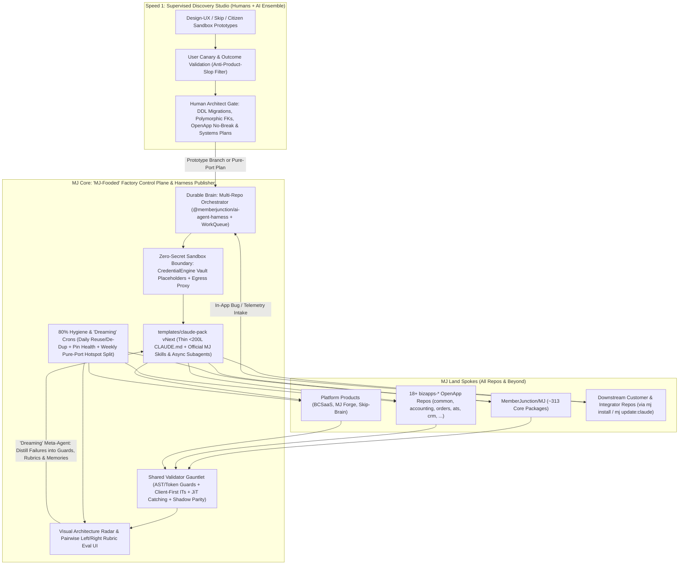
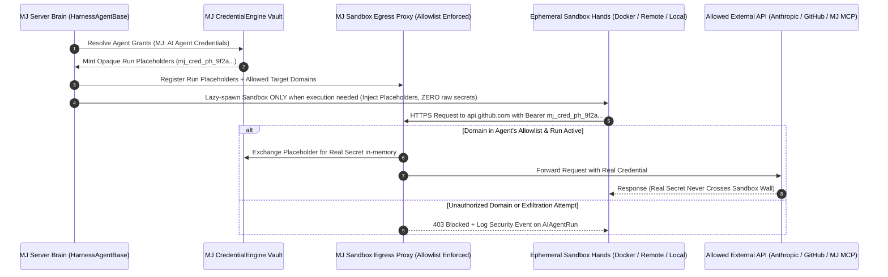
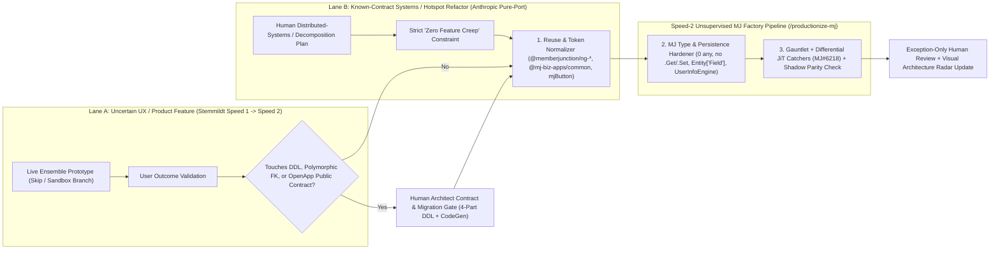
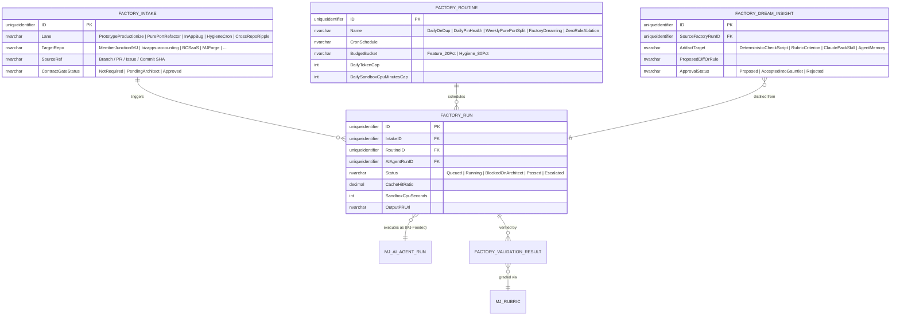

# Building the "MJ Land" Software Factory: Architecture & Investigation Blueprint

## Status
- **Status**: Draft — **November 2026 Architecture Study & Investigation (Not for Immediate Implementation)**
- **Target Investigation Window**: November 2026
- **Assigned Investigators**: `@rkihm-BC`, `@arie-glazier-bcc`
- **Created**: 2026-10-30
- **Author**: AN-BC + AI Architecture Study
- **Branch**: `an-bc/mj-software-factory-blueprint`
- **Related Issues & Internal Plans**:
  - [MJ#6218 — Differential "Catching JiTTests" + Rubric Triage for MJ CI & Testing Framework](https://github.com/MemberJunction/MJ/issues/6218)
  - [`plans/external-agent-harness.md`](./external-agent-harness.md) (`packages/AI/AgentHarness`)
  - [`plans/autodev/PLAN.md`](./autodev/PLAN.md)
  - [`plans/claude-md-context-refactor-spec.md`](./claude-md-context-refactor-spec.md)
  - [`packages/OpenApp/PUBLISH_NO_BREAK_POLICY.md`](../packages/OpenApp/PUBLISH_NO_BREAK_POLICY.md)

> [!NOTE]
> **Intent of This Plan-Only PR:** This document captures a three-source industry synthesis for **study and investigation in November 2026** by `@rkihm-BC` and `@arie-glazier-bcc`. It is **not** for immediate implementation. Its purpose is to evaluate which software-factory and agent-infrastructure primitives belong in **MJ Core**, how they radiate across **18+ `bizapps-*` OpenApp repos**, **platform products (`BCSaaS`, `MJ Forge`, `Skip-Brain`)**, and **downstream customer/integrator repos** ([`templates/claude-pack`](../templates/claude-pack/README.md)), and what sequence gives MemberJunction the highest engineering leverage without bureaucracy or slop.

---

## Overview

MemberJunction's ecosystem ("MJ Land") spans **MJ Core** (~313 `@memberjunction/*` packages) at the center, **18+ `bizapps-*` OpenApp repositories**, platform products (**`BCSaaS`**, **`MJ Forge`**, **`Skip-Brain`**), and downstream customer and citizen-builder repositories bootstrapped via `mj install` and [`templates/claude-pack`](../templates/claude-pack/README.md). MJ Core has already built impressive individual factory components — [`@memberjunction/ai-agent-harness`](../packages/AI/AgentHarness/) ([`plans/external-agent-harness.md`](./external-agent-harness.md)), [`autodev`](./autodev/PLAN.md), 20+ deterministic AST/regex CI guards in [`.github/scripts/`](../.github/scripts/), 925+ client-first integration checks in [`packages/TestingFramework/testing-integration/`](../packages/TestingFramework/testing-integration/CATALOG.md), and `@memberjunction/rubrics`. However, these capabilities remain mostly concentrated inside `MemberJunction/MJ`, while cross-repo hygiene, sandbox credential isolation, architectural mental-model maintenance, and human code-review queues still require heavy manual intervention.

This blueprint triangulates **three October 2026 industry architectures** and maps their agreements — as well as their productive tensions — onto MJ Land:
1. **The SDLC & Operating Model — Benedikt Stemmildt's *Building Your Software Factory*** (*Refactoring Podcast* Ep. 75 with Luca Rossi, Oct 30, 2026 + *hackers&wizards* 5-layer factory model: `Intake -> Orchestrator -> Workers -> Validators -> Feedback`).
2. **The Runtime, Security & Scale Infrastructure — Anthropic Platform Engineering's *Separating the Brain from the Hands*** (*Latent Space* podcast with **Katelyn Lesse**, Head of Engineering for Claude Platform, and **Angela Jiang**, Head of Product for Claude Platform, Oct 27, 2026).
3. **The Differential Behavioral Proof Engine — Meta Engineering's *Catching Bugs Before They Land: JiTTesting*** (Oct 29, 2026 / FSE 2026 `arXiv:2601.22832`, tracked in [MJ#6218](https://github.com/MemberJunction/MJ/issues/6218)).

Taken together, these three sources give MJ a complete blueprint:
- **From Stemmildt**: Unsupervised automation managed by exception, Two-Speed Delivery (rapid prototype discovery vs. factory productionizing), spending **80% of factory tokens on scheduled daily/weekly cleanup crons** to defeat architectural entropy, thin `<200`-line `CLAUDE.md` orientation maps, Zero-Rule ablation testing on model upgrades, and living visual churn/coupling heatmaps instead of line-by-line review.
- **From Anthropic**: Strict **Brain vs. Hands decoupling** (durable harness + externalized session state vs. lazy ephemeral sandboxes), **zero-secret sandboxes via Vault placeholders + Egress-Proxy credential injection** (highlighting a high-priority security upgrade for MJ's `packages/AI/AgentHarness`), **"Ant-Fooding" ("MJ-Fooding")** where internal factory & "Dreaming" self-improvement loops run on the exact same agent primitives shipped to customers, **pure-port + shadow-traffic parity** for major systems rewrites, **CPU capacity discipline** alongside token budgets, and **Skills + Reference Architectures replacing prose cookbooks** as downstream DevRel.
- **From Meta**: Diff-scoped, intent-conditioned (`fix` / `feat` / `refactor`) adversarial tests that prove behavioral deltas or guarantee zero-delta refactors before humans ever open a PR.

---

## Goals & Non-Goals

### Goals (November 2026 Investigation Scope)
- **Define MJ Land's Two-Speed Delivery & Contract Gate**: Separate fast prototype-first UX/feature discovery (Speed 1) from unsupervised factory productionizing and pure-port systems refactoring (Speed 2), with a hard human architect gate for database DDL migrations, polymorphic FKs, and [`PUBLISH_NO_BREAK_POLICY.md`](../packages/OpenApp/PUBLISH_NO_BREAK_POLICY.md) public contracts.
- **Upgrade `@memberjunction/ai-agent-harness` to Zero-Secret "Brain vs. Hands" Security**: Evaluate replacing direct sandbox env-var secret injection (`HarnessSessionConfig.Environment`) with Anthropic-style **Vault Placeholders + Egress-Proxy Credential Injection** backed by `@memberjunction/credentials` (`CredentialEngine`) and strict domain allowlists.
- **Evaluate "MJ-Fooding" as the Multi-Repo Factory Control Plane**: Assess running MJ's Software Factory (including "Dreaming" meta-agents that turn escaped bugs/review comments into permanent rubrics or guards) directly on MJ Core primitives (`@memberjunction/ai-agent-harness`, `packages/WorkQueue`, `MJ: AI Agent Runs`, `MJ: Rubrics`) on a pinned N-1 MJ release.
- **Design the 80/20 Hygiene Fleet Under Both Token AND CPU Budgets**: Scope daily deduplication/reuse crons, cross-repo pin health crons, and weekly hotspot-splitting crons across `MJ` + `bizapps-*` using Turborepo/diff-scoped execution and lazy sandbox spawning so CI CPU does not hit a wall.
- **Rationalize `templates/claude-pack` vNext & Benchmark Subagent Topologies**: Slim root `CLAUDE.md` below 200 lines and benchmark Stemmildt's **6 Orchestrator Skills → 12 Model-Pinned Subagents** against Anthropic's **Lead Agent + Dynamic Effort / Self-Assigned Async Sub-Leads** using `@memberjunction/testing-engine`.
- **Replace Line-by-Line Review Fatigue with Gauntlet + Visual Architecture Radar**: Export MJ Core's deterministic CI checks + Catching JiTTests ([MJ#6218](https://github.com/MemberJunction/MJ/issues/6218)) across all MJ Land repos and pair them with a visual churn/coupling dashboard and pairwise ("left/right") Rubric Eval UI.

### Non-Goals
- **Immediate implementation**: This PR introduces zero runtime code, CI workflow changes, or database migrations.
- **Weakening MJ's schema or strong-typing guarantees**: Speed-1 prototypes never merge to `next`/`main` without passing MJ's zero-`any`, zero-`.Get()/.Set()`, `Entity['Field']` derived-union, polymorphic FK, and OpenApp publish-no-break gates.
- **Unattended auto-merging of DDL or breaking public APIs**: Factory automation remains **human-on-the-loop (managed by exception)**.

---

## Background & Context: Comparing the Three Blueprints

### 1. Benedikt Stemmildt — *Building Your Software Factory* (*Refactoring Podcast* Ep. 75, Oct 30, 2026)

1. **"Supervised = Studio; Unsupervised = Factory" (`[24:08–26:17]`)**: Interactive chat pair-programming is a studio, not a factory. A factory is unsupervised process automation managed by exception across five layers (`Intake -> Orchestrator -> Workers -> Validators -> Feedback`), starting with as few as 3–4 autonomous loops.
2. **Two-Speed Delivery vs. Spec-Driven Waterfall (`[00:00–00:35]`, `[26:55–31:52]`)**: Writing exhaustive upfront markdown specs for product features recreates 1990s waterfall because users cannot predict UX needs before touching working software. Speed 1 builds rapid ensemble prototypes (`[06:19–06:58]`, `[28:13–28:29]`) and validates user outcomes; Speed 2 feeds the **working prototype code itself** into the Factory (`[28:35–28:49]`, `[31:25–31:49]`) to normalize components, harden types/security, and produce merge-ready PRs.
3. **The 80/20 Token Law (`[15:36–24:05]`)**: Only ~20% of factory tokens build net-new features; **~80% run scheduled cron routines fighting architectural entropy** — a **Daily Cleanup Cron** (`[20:14–20:54]`) catching duplicated UI widgets/logic within 24 hours of merge, and a **Weekly Architecture Cron** (`[20:55–21:20]`) decomposing overgrown modules, with per-routine token and KV-cache telemetry (`[21:40–24:05]`).
4. **Thin `CLAUDE.md` + 5–6 Skills Wrapping 10–15 Model-Pinned Subagents (`[34:10–41:01]`)**: Keep `CLAUDE.md` as a thin repo map; avoid switching models mid-chat (which invalidates the prompt KV-cache `[37:54–38:36]`) by having 5–6 top-level Skills deterministically dispatch 10–15 isolated, model-pinned specialist subagents, coordinated by an Always-On Orchestrator (`[39:07–41:01]`).
5. **Zero-Rule Baseline Ablation on Model Upgrades (`[31:55–34:10]`)**: On every major model jump, strip rules and skills to zero, observe raw model failures on real repo tasks, and only re-add rules the new model still fails without.
6. **Living Visual Heatmaps Over Line-by-Line Review (`[41:02–45:16]`)**: Nobody reads walls of auto-generated markdown ADRs. Reporter agents publish visual HTML **Churn Heatmaps** (exposing god-classes) and **Bounded-Context Coupling Maps** so humans preserve architectural mental models in seconds.
7. **Weaponize Skepticism Across Two High-Flow Roles (`[10:36–11:45]`, `[45:16–50:50]`)**: Channel generalist builders into **Product Engineers (Speed 1)** and skeptical systems craftsmen into **Factory Engineers (Speed 2)** who engineer the validators and harnesses so bad code *cannot* pass.

---

### 2. Anthropic Platform Engineering — *Separating the Brain from the Hands* (*Latent Space*, Oct 27, 2026)

1. **Separating the Brain from the Hands (`[06:54–07:25]`, `[42:40–43:55]`, `[1:03:28–1:04:55]`)**: Anthropic's first prototype of Managed Agents simply booted Claude Code inside a container and put an API on top (`[1:04:25–1:04:48]`). It suffered slow cold-starts, lost the entire agent session whenever a container crashed ("pets vs. cattle"), and mixed untrusted execution with secrets. Anthropic re-architected around three decoupled tiers:
   - **The Brain (Stateless/Durable Harness + Externalized Session Log)**: Runs on durable servers outside the container, returning first tokens immediately and surviving sandbox crashes (`[1:03:42–1:04:21]`). Also enables **"Cloud Brain, Local Hands"** (`[1:08:08–1:08:19]`).
   - **The Hands (Ephemeral Sandboxes)**: Provisioned lazily *only* when tool/code execution is required, and replaceable at any moment.
2. **Zero-Secret Sandboxes via Vault Placeholders + Egress Proxy (`[1:05:15–1:07:38]`)**: Initially built for latency/reliability, this split proved most vital for **security** (`[1:04:52–1:05:14]`). **Credentials never enter the sandbox.** Secrets live in an external Vault; the agent inside the sandbox sees only an opaque **placeholder**; when an outbound request leaves the sandbox (constrained by strict **domain allowlists / egress controls** `[1:06:30–1:06:53]`), an **Egress Proxy** injects the real credential *outside* the sandbox boundary (`[1:05:45–1:06:28]`). Prompt injection or malicious repo code literally cannot exfiltrate credentials it never possessed.
3. **"Ant-Fooding" & "Managed Agents All the Way Down" (`[04:31–05:28]`, `[31:00–31:35]`, `[46:20–47:48]`)**: Claude Code, Claude Cowork, and Anthropic's internal **"Dreaming"** continuous-memory loop are all built atop the same Claude Platform primitives exposed to customers. Specifically, **"Dreaming" is a Managed Agent inspecting a previous Managed Agent's session and writing distilled memories back** (`[46:23–46:45]`) — fueling a 4.7x jump in revenue per employee (`$1.4M -> $6.6M` `[01:28–01:43]`).
4. **Human Architecture Plan + "Pure Port" Discipline + Shadow-Traffic Verification (`[56:05–1:00:10]`, `[1:23:50–1:24:45]`)**: Facing a severe CPU wall, Anthropic ported its Python monolith Messages API to **Rust** in one sweep **without a single pre-existing Rust specialist on the team** (`[56:40–57:05]`), cutting CPU by **40–50%** and TTFT latency by **10–20%** (`[58:50–59:10]`). The three rules that made it safe: **(a) humans owned the distributed systems architecture plan**, **(b) strict "pure port" scope discipline (zero new features added during the port)** (`[59:20–1:00:08]`), and **(c) shadow-traffic parity verification** comparing Python vs. Rust outputs behind feature flags so humans didn't need deep line-by-line Rust code review (`[57:16–57:45]`, `[1:24:04–1:24:30]`).
5. **The Hidden CPU Capacity Wall (`[53:35–55:58]`)**: Everyone budgets for GPU tokens, but agentic coding triggers a **CPU crunch**: exponentially more AI-written PRs → exponentially more CI runs + sandbox VMs (`[54:13–55:30]`). Sandboxes and CI must be capacity-planned and run leanly without sacrificing tenant isolation (`[55:41–55:58]`).
6. **Engineering as Research & Pairwise ("Left/Right") Visual Eval UIs (`[32:20–33:45]`, `[48:35–52:25]`)**: Most agent teams have zero formal evals. Application engineering is merging with research: formalize target outcomes as evals first, diagnose whether failures stem from **bad evals, bad environments, or the model** (`[50:25–50:35]`), and avoid raw JSONL fatigue by having agents generate **visual left/right pairwise grading UIs** whose human ratings feed directly back into agent self-tuning (`[51:00–51:38]`).
7. **Dynamic Effort & Self-Organizing Async Subagents vs. Brittle Routers (`[1:16:37–1:18:35]`, `[1:44:38–1:46:25]`)**: Upfront task-complexity routers lack full task context and cause jarring persona shifts across model families (`[1:16:43–1:18:25]`); a **consistent frontier model with dynamic effort scaling (`low`/`medium`/`high`)** is cleaner. Furthermore, frontier models (Opus 5.5+) excel when **one Lead Agent dynamically assigns roles to parallel sub-leads**, provided the harness guarantees **(a) uniform shared state** and **(b) non-blocking asynchronous execution** (`[1:45:16–1:46:15]`).
8. **Skills & Reference Architectures Replace Cookbooks + Fighting Product/Doc Slop (`[1:21:05–1:26:50]`, `[1:38:15–1:40:15]`)**: Static copy-paste cookbooks are obsolete; Anthropic's highest-leverage DevRel asset is **an official Skill (`claude-api`) + Reference Architectures** loaded directly into coding agents. Internally, lower coding cost must never excuse **product slop** (shipping 10x more low-value features `[1:24:50–1:26:25]`) or **doc slop** (dumping unedited AI prose on teammates — *"send it back!"* `[1:21:25–1:23:15]`).

---

### 3. Side-by-Side Synthesis: Agreements, Productive Tensions & MJ Land Takeaways

| Dimension | Benedikt Stemmildt (*Software Factory*) | Anthropic Platform (*Brain vs. Hands*) | Meta (*Catching JiTTests*, [MJ#6218](https://github.com/MemberJunction/MJ/issues/6218)) | Synthesis for "MJ Land" (Core + BizApps + Beyond) |
| :--- | :--- | :--- | :--- | :--- |
| **Upfront Specs vs. Prototypes** | **Anti-spec for product discovery**: build live Speed-1 prototypes first; feed working code to Speed-2 factory. | **Pro-plan for systems work**: humans own distributed systems plans & invariants; resist feature creep during ports (`[57:16]`, `[59:30]`). | Condition test generation on explicit commit intent (`fix` / `feat` / `refactor`). | **Bifurcate by layer**: Use Prototype-First for Angular UI, Dashboards & Actions; require **upfront Architect Contract Plans** for DDL migrations, OpenApp schemas, and Core engine ports. |
| **Agent Harness & Security Boundary** | Local/CI worker harnesses running inside isolated repo sandboxes. | **Strict Brain vs. Hands**: durable harness + external session log; **zero secrets in sandbox** (Vault placeholders + Egress Proxy + allowlists). | Sandboxed differential test execution against base vs. patched target. | **Upgrade `@memberjunction/ai-agent-harness`**: Keep MJ's durable Loop turn protocol, and replace raw `Environment` secret injection with a **CredentialEngine Egress Proxy**. |
| **Model Routing & Subagents** | **Static pinning**: 5–6 Skills dispatching 10–15 fixed subagents, each pinned to a specific model (`Sonnet` vs. `Opus`) to protect KV-cache. | **Dynamic effort & self-assigned roles**: skeptical of brittle multi-model routers; prefers 1 frontier model family w/ dynamic effort + async parallel sub-leads. | Multi-candidate test generation + rubric/LLM judge filtering. | **Benchmark both in Nov**: Keep isolated subagent contexts (preserving main KV-cache), and A/B test **fixed role-pinned subagents** vs. **dynamic effort + self-assigned async sub-leads**. |
| **Code Review Replacement** | Stop line-by-line review; inspect **Visual Churn Heatmaps & Domain Coupling Maps** + automated gates. | Quick design stamp + **Shadow-Traffic Parity / Automated Verification** (`[57:26]`, `[1:24:04]`). | **Differential Catching Tests** + **LLM Rubric Judge** surfacing only high-confidence behavioral regressions. | **Three-pillar review**: (1) Deterministic Factory Gauntlet, (2) JiT Differential + Shadow Parity proof, (3) Living MJ Architecture Radar. |
| **Fighting Entropy & Slop** | **80/20 Token Law**: 80% of factory tokens run daily deduplication & weekly architecture crons. | **Anti-Product/Doc Slop**: don't ship 10x random features; run targeted multi-day perf/refactor sprints (12/13 targets in 3 days `[1:26:30]`). | `refactor` intent enforces **zero behavioral delta** while decomposing modules. | **80% Hygiene Fleet with Confidence Gates**: Daily reuse/dedup + weekly hotspot ports, gated by JiT zero-delta proofs so crons never create noisy churn PRs. |
| **Compute Bottleneck** | Track token cost & prompt-cache hit ratio per cron routine. | **CPU Capacity Wall**: sandbox VMs + explosion of AI-driven CI runs starve CPU as fast as GPUs (`[53:45–55:30]`). | Run heavy LLM test synthesis *after* cheap deterministic builds pass, scoped to touched call graphs. | **Budget Tokens AND CI CPU**: Lazy sandbox creation + Turborepo affected-package scoping across `MJ` (313 pkgs) & 18+ `bizapps-*` repos. |
| **Platform Dogfooding** | Persistent Orchestrator + Feedback Layer tracking state outside chat. | **"Ant-Fooding"**: Claude Code, Cowork & "Dreaming" run on the exact same Managed Agent primitives sold to users. | Shared internal platform across monorepo CI workflows. | **"MJ-Fooding"**: Build the Factory Control Plane & "Dreaming" rubric/memory improver on `@memberjunction/ai-agent-harness` + `MJ: AI Agent Runs`. |
| **Downstream Enablement ("Beyond MJ")** | Repo harnesses encode engineering standards automatically. | **Skills + Reference Architectures replace Cookbooks** (`claude-api` skill owned by DevRel `[1:39:18–1:40:10]`). | Reusable testing workflows & rubrics. | **`templates/claude-pack` IS MJ's DevRel**: Distribute MJ Skills, Subagents, and Reference OpenApps via `mj install` / `mj update:claude`. |

---

## Architecture / Design

### 1. Hub-and-Spoke Topology of the "MJ Land" Software Factory

### 2. Upgrading `@memberjunction/ai-agent-harness`: Full "Brain vs. Hands" with Zero-Secret Sandboxes

A striking finding from comparing Anthropic's *Latent Space* architecture against MJ's existing [`plans/external-agent-harness.md`](./external-agent-harness.md) (`packages/AI/AgentHarness`) is how closely MJ **already** converged on Brain/Hands separation — and where **one critical security gap remains**:

- **What `packages/AI/AgentHarness` Already Got Right**:
  1. **Durable Brain + Turn Protocol**: `HarnessAgentBase` and `HarnessAgentType` keep run state (`MJ: AI Agent Runs`), guardrails, HITL (`MJ: AI Agent Requests`), and authority-transferring step execution (Actions, Sub-Agents, `PayloadManager` ACLs) **on the MJ Server ("Brain")**, while treating the CLI/SDK coding agent inside `ISandboxProvider` as replaceable **"Hands"**.
  2. **Scoped Read-Only MCP Loopback**: Intra-turn MJ data reads use a per-run, read-only, time-bounded MCP credential revoked on teardown.
- **The Gap Exposed by Anthropic (`packages/AI/AgentHarness/src/types.ts:37-43`)**:
  - Today, `HarnessSessionConfig.Environment` injects granted external secrets (`ANTHROPIC_API_KEY`, `GITHUB_TOKEN`, `MJ: AI Agent Credentials`) **directly as plaintext environment variables inside the sandbox container**. As Katelyn Lesse noted (`[1:05:53–1:06:28]`), any untrusted test script, transitive dependency hook, or prompt injection executing inside that sandbox can read `process.env` and exfiltrate the secret if network egress permits any outbound channel.
- **Proposed vNext Enhancement (Vault Placeholder + Egress Proxy)**:

### 3. Two-Speed Delivery Sequence (Prototype Discovery vs. Pure-Port Systems Refactoring)

Combining Stemmildt's Two-Speed model with Anthropic's Python-to-Rust port discipline yields two clean entry lanes into the Speed-2 Factory:

### 4. Candidate "MJ-Fooded" Factory Control Plane & "Dreaming" Loop Data Model

Following Anthropic's **"Ant-Fooding"** principle (`[04:31]`, `[46:23–46:45]`), hosting the Software Factory as an internal OpenApp (`bizapps-software-factory` running on a pinned N-1 MJ Core release) allows MJ to dogfood `@memberjunction/ai-agent-harness`, `MJ: AI Agent Runs`, `MJ: Rubrics`, and `packages/WorkQueue`, while enabling **"Factory Dreaming"** (a scheduled meta-agent inspecting completed `AIAgentRun` traces + human PR review corrections to propose new deterministic guards, rubric criteria, or agent memories):

---

## Implementation Plan (Phased Roadmap for Post-Study Execution)

> [!IMPORTANT]
> Phases below are modular options for `@rkihm-BC` and `@arie-glazier-bcc` to evaluate, sequence, or pilot during the **November 2026 study**.

### Phase 1: November 2026 Investigation, Baselines & Harness Benchmarks
1. **Measure Current MJ Land Factory Baselines** — Collect 30-day baselines across `MemberJunction/MJ` and top `bizapps-*` repos: PR review wait time, CI CPU runner minutes per PR, `autodev` token/cache hit rates, and ratio of net-new feature commits vs. deduplication/cleanup commits.
2. **Run the First "Zero-Rule Baseline" & Subagent Topology Benchmark** — Using `@memberjunction/testing-engine`, evaluate 5 canonical MJ tasks under three harness configs:
   - *Config A*: **Zero rules / zero skills** (Anthropic/Stemmildt raw frontier baseline to find obsolete `CLAUDE.md` rules).
   - *Config B*: **Stemmildt Static Pinning** (6 Skills dispatching role-pinned models).
   - *Config C*: **Anthropic Dynamic Effort + Async Sub-Leads** (single consistent frontier model family with dynamic effort + parallel non-blocking subagents sharing state).
3. **Finalize Control Plane & Egress-Proxy Architecture Decisions** — Resolve the 7 charter questions in [Risks & Open Strategic Questions](#risks--open-strategic-questions-november-2026-investigation-charter).

### Phase 2: Zero-Secret "Brain vs. Hands" Upgrade in `@memberjunction/ai-agent-harness`
1. **Vault Placeholder + Egress Proxy for Sandbox Credentials** — Extend `packages/AI/AgentHarness` and `packages/Credentials/Engine` so `DockerSandboxProvider` (and remote sandbox providers) inject opaque per-run placeholders rather than raw `Environment` secrets, routing outbound HTTP/MCP traffic through an allowlist-enforcing egress proxy.
2. **Lazy Sandbox Provisioning & Cloud-Brain / Local-Hands Support** — Ensure `HarnessAgentBase` delays container boot until a turn actually requires filesystem/shell "Hands", cutting idle CPU burn for pure reasoning or MCP read turns.

### Phase 3: Reusable Cross-Repo "MJ Factory Gauntlet"
1. **Extract Universal MJ Deterministic Guards** — Package `MemberJunction/MJ/.github/scripts/check-*.mjs` (`check-ui-tokens`, `check-ui-button`, `check-esm-imports`, `check-spec-antipatterns`) plus AST guards for MJ's core rules (`0 any`, no `.Get()/.Set()`, `Entity['Field']` derived value-list unions, polymorphic FK metadata, `BaseSingleton<T>`, static imports, `UserInfoEngine` over `localStorage`, and `PUBLISH_NO_BREAK_POLICY.md` schema diff validation) into a reusable CLI (`@memberjunction/factory-gates`) + shared GitHub Actions workflow.
2. **Scoped Execution (Protecting the CI CPU Budget)** — Enforce Turborepo / package-dependency-graph scoping so both deterministic checks, unit tests, and [MJ#6218](https://github.com/MemberJunction/MJ/issues/6218) Catching JiTTests run *only* on affected packages across `MJ` and `bizapps-*`.
3. **Roll Out to Pilot Spokes** — Enable the shared Gauntlet in `bizapps-common`, 1–2 domain `bizapps-*` repos, and `MJ Forge`.

### Phase 4: `templates/claude-pack` vNext — Official MJ Skills as Downstream DevRel
1. **Slim Root `CLAUDE.md` (<200 Lines) + Consolidate 37+ Commands** — Execute [`plans/claude-md-context-refactor-spec.md`](./claude-md-context-refactor-spec.md) alongside ~6 top-level Orchestrator Skills (`/explore-prototype`, `/productionize-mj`, `/pure-port-refactor`, `/migrate-codegen`, `/review-gauntlet`, `/cross-repo-ripple`) wrapping isolated, non-blocking subagents.
2. **Treat `claude-pack` Skills + Reference OpenApps as First-Class DevRel** — Mirroring Anthropic's `claude-api` skill strategy (`[1:39:18–1:40:10]`), ensure `mj install` and `mj update:claude` give external integrators and citizen builders executable MJ Skills + Reference Architectures instead of relying solely on long prose cookbooks.

### Phase 5: The "80% Hygiene Fleet" + "Factory Dreaming" Loops
1. **Daily Reuse & De-Duplication Cron** — Scans the last 24h of merged PRs across `MJ` and `bizapps-*` for duplicated UI widgets, CSS, or Actions that should live in `@memberjunction/ng-shared-generic` or `@mj-biz-apps/common`, opening consolidation PRs when confidence + JiT zero-delta gates pass.
2. **Daily Cross-Repo Pin & `@RegisterClass` Health Cron** — Automates joined-workspace lockfile/pin health checks and detects duplicate `@RegisterClass` collisions across OpenApp combinations.
3. **Weekly "Pure-Port" Hotspot Decomposition Cron** — Applies Anthropic's strict **"pure port / zero feature creep + differential parity"** rule to decompose top-1% high-churn monolith files (e.g., 200KB+ classes) safely.
4. **Weekly "Factory Dreaming" Meta-Agent** — Runs a Managed/Harness Agent over the week's `MJ: AI Agent Runs`, escaped bug fixes, and human PR review comments to propose new Gauntlet checks, Rubric criteria, or Skill refinements.

### Phase 6: Visual "MJ Land Architecture Radar" & Pairwise Rubric Eval UI
1. **Architecture Radar Dashboard** — Auto-published HTML artifact or MJ Explorer Dashboard showing:
   - **30-Day File & Package Churn Heatmap** across `MJ` + `bizapps-*`
   - **Bounded-Context & `@RegisterClass` Coupling Map** (highlighting newly introduced cross-domain edges)
   - **Factory Token & CPU Scorecard** (20/80 feature-to-hygiene ratio, KV-cache hit rate, CI/sandbox CPU minutes, JiT true-catch rate).
2. **Pairwise ("Left/Right") Visual Eval UI in MJ Explorer** — Replace raw JSONL log inspection with a fast left/right comparison UI (`[51:00–51:38]`) over `@memberjunction/testing-engine` and `@memberjunction/rubrics` runs so human taste calibrates rubrics directly.

---

## Migration & Data Considerations

- **Zero Immediate Database Changes**: This plan-only PR contains no SQL migrations or metadata mutations.
- **Future Additive Schema Rules**:
  - Any Vault/Egress-Proxy extensions to `MJ: AI Agent Harnesses` / `MJ: AI Agent Credentials` ([`plans/external-agent-harness.md`](./external-agent-harness.md)) and any `bizapps-software-factory` OpenApp tables must follow [`migrations/CLAUDE.md`](../migrations/CLAUDE.md) (hand DDL + 50 blank lines + CodeGen block, hardcoded UUIDs, metadata via `metadata/` JSON files, polymorphic FK decoration in `.polymorphic-fk-entity-fields.json`) and strictly obey [`packages/OpenApp/PUBLISH_NO_BREAK_POLICY.md`](../packages/OpenApp/PUBLISH_NO_BREAK_POLICY.md).

---

## Testing, Verification & Harness Ablation Strategy

1. **Five-Layer Automated Verification Stack (Replacing Line-by-Line Syntax Policing)**:
   - **Layer 1 — Deterministic Factory Gauntlet (`<30s`)**: AST, token, import, singleton, `UserInfoEngine`, and OpenApp no-break checks across all MJ Land repos.
   - **Layer 2 — Unit & DOM Specs (`vitest` + `check-spec-antipatterns.mjs`)**: Fast package-scoped unit verification.
   - **Layer 3 — Client-First Integration Tests (`packages/TestingFramework/testing-integration/`)**: GraphQL/API behavioral contracts.
   - **Layer 4 — Differential Catching JiTTests ([MJ#6218](https://github.com/MemberJunction/MJ/issues/6218)) & Shadow-Traffic Parity**: Commit-intent-conditioned (`fix` / `feat` / `refactor`) adversarial tests and pure-port input/output parity checks.
   - **Layer 5 — Pairwise Rubric Grading (`@memberjunction/rubrics`)**: Calibrated via MJ Explorer's left/right Eval UI, explicitly diagnosing **broken eval vs. broken sandbox environment vs. model failure** (`[50:25–50:35]`).
2. **Model-Upgrade Zero-Rule Ablation Ritual**:
   - Triggered whenever a major frontier model lands via [`.claude/commands/add-ai-model.md`](../.claude/commands/add-ai-model.md): run 10 canonical MJ tasks with `0` rules vs. `claude-pack` and delete every defensive instruction the new model satisfies natively.

---

## Risks & Open Strategic Questions (November 2026 Investigation Charter)

`@rkihm-BC` and `@arie-glazier-bcc` — seven concrete questions to investigate and form recommendations on in November:

1. **Zero-Secret Sandboxes in `@memberjunction/ai-agent-harness` (Vault Egress Proxy vs. Scoped Env Vars)**:
   - How cleanly can we evolve `HarnessSessionConfig.Environment` (`packages/AI/AgentHarness/src/types.ts`) into an **Egress-Proxy placeholder injection** model backed by `CredentialEngine` so neither Factory workers nor customer `Harness` agents ever hold raw `GITHUB_TOKEN` or LLM API keys inside Docker sandboxes?
2. **"MJ-Fooding" Control Plane Architecture (N-1 Pinned MJ Instance vs. Standalone `autodev`)**:
   - Anthropic's massive leverage comes from "Ant-Fooding" the exact same Managed Agent primitives they ship to customers. Should we host the Multi-Repo Factory Orchestrator & "Dreaming" loops as an OpenApp (`bizapps-software-factory`) running on an **N-1 stable release of MJ Core** (preventing `next`-branch regressions from taking down the Factory while continuously hardening `@memberjunction/ai-agent-harness`)?
3. **Subagent Topology: Static Model-Pinned Roles (Stemmildt) vs. Dynamic Effort + Self-Assigned Async Sub-Leads (Anthropic)**:
   - What does an empirical `@memberjunction/testing-engine` benchmark show on real MJ repo tasks when comparing 12 rigidly role-pinned subagents (`Sonnet` vs. `Opus`) against a single frontier model family using dynamic effort (`low`/`medium`/`high`) and non-blocking async sub-leads?
4. **The Exact Two-Speed Boundary (`speckit` Retirement vs. Upfront Architect Plans)**:
   - Confirm where `.claude/commands/speckit.*.md` should be retired (UI, dashboards, routine Actions/Agents → Prototype-First Speed 1) versus where upfront human architecture plans remain mandatory (4-part DDL migrations, OpenApp cross-app schemas, and Anthropic-style "pure-port" Core engine rewrites).
5. **Dual Resource Governance — Token Budgets AND CI/Sandbox CPU Budgets**:
   - How should we cap daily token spend, require KV-cache hit thresholds (`>75%`), lazy-boot sandboxes, and scope CI runs via Turborepo/diff graphs so an 80% hygiene fleet across 20+ repos doesn't saturate GitHub Actions CPU runners or generate low-value churn PRs?
6. **Cross-Repo Ripple Cadence (`MJ` Core → 18+ `bizapps-*` & Products)**:
   - Should cross-repo deduplication and dependency/API ripple PRs run continuously per-merge into `next`, nightly in batched waves, or aligned to MJ release candidates?
7. **`templates/claude-pack` as External DevRel & Cross-Harness Portability**:
   - How should we package MJ's official Skills, Reference Architectures, and async subagent definitions (`.claude/agents/`, `.agents/skills/`, `AGENTS.md`) so external MJ customers and internal developers get first-class ergonomics across Claude Code, Codex, Antigravity, and `@memberjunction/ai-agent-harness`?

---

## Candidate Repos & Files Affected (Future Post-Study Phases Only)

| Repository / Path | Future Post-Study Role |
| :--- | :--- |
| `MemberJunction/MJ` — `packages/AI/AgentHarness/**` & `packages/Credentials/Engine/**` | Zero-secret "Brain vs. Hands" Egress-Proxy placeholder injection, lazy sandbox boot, and async non-blocking subagent primitives |
| `MemberJunction/MJ` — `CLAUDE.md`, `AGENTS.md` & `templates/claude-pack/**` | `<200`-line orientation map + official MJ Skills & Subagents distributed downstream as executable DevRel via `mj install` / `mj update:claude` |
| `MemberJunction/MJ` — `.claude/commands/speckit.*.md` | Candidate consolidation into Prototype-First (`/explore-prototype` → `/productionize-mj`) and Systems Pure-Port (`/pure-port-refactor` / `/migrate-codegen`) |
| `MemberJunction/MJ` — `.github/scripts/check-*.mjs` & `.github/workflows/` | Extracted into reusable `@memberjunction/factory-gates` CLI & shared GitHub workflow with affected-package CPU scoping |
| `MemberJunction/MJ` — `packages/TestingFramework/**` & `packages/Rubrics/**` | Host Zero-Rule Model-Upgrade Ablation benchmarks, Catching JiTTests ([MJ#6218](https://github.com/MemberJunction/MJ/issues/6218)), and Pairwise Left/Right Eval UI data flows |
| `MemberJunction/MJ` — `plans/autodev/**` or `bizapps-software-factory` OpenApp | "MJ-Fooded" Multi-Repo Factory Orchestrator, 80% Hygiene Cron scheduler, and weekly "Factory Dreaming" meta-agent |
| `MemberJunction/MJ` — `packages/Angular/Explorer/dashboards/**` | Visual **MJ Land Architecture Radar** (churn heatmaps, coupling graphs, token + CPU scorecard) & Pairwise Rubric Eval UI |
| `MemberJunction/bizapps-*` (18+ OpenApps), `BCSaaS`, `MJ Forge` | Spoke consumers of the reusable Factory Gauntlet, `claude-pack` vNext, and daily/weekly hygiene crons |

---

## References

1. **Benedikt Stemmildt & Luca Rossi** — *Building Your Software Factory* (*Refactoring Podcast* Ep. 75, Oct 30, 2026): https://www.youtube.com/watch?v=uKH2WCxjOI8 and *hackers&wizards* Software Factory Architecture: https://hackersandwizards.com
2. **Katelyn Lesse & Angela Jiang (Anthropic Platform) with Latent Space** — *How Anthropic ships the #1 LLM in the World safely: Separating the Brain from the Hands* (*Latent Space: The AI Engineer Podcast*, Oct 27, 2026): https://lspace.beehiiv.com/podcast/s/latent_space_the_ai_engineer_podcast/how_anthropic_ships_the_1_llm_in_the_world_safely_separating_the_brain_from_the_hands
3. **Meta Engineering** — *Catching Bugs Before They Land: JiTTesting's Human-on-the-Loop Approach at Full Scale* (Oct 29, 2026): https://engineering.fb.com/2026/10/29/security/catching-bugs-before-they-land-jittestings-human-on-the-loop-approach-at-full-scale/ and FSE 2026 paper (`arXiv:2601.22832`): https://arxiv.org/abs/2601.22832
4. **Related MJ Issue**: [MemberJunction/MJ#6218 — Differential "Catching JiTTests" + Rubric Triage for MJ CI & Testing Framework](https://github.com/MemberJunction/MJ/issues/6218)
5. **Existing MJ Internal Foundations**:
   - [`plans/external-agent-harness.md`](./external-agent-harness.md) & [`packages/AI/AgentHarness/`](../packages/AI/AgentHarness/)
   - [`plans/autodev/PLAN.md`](./autodev/PLAN.md)
   - [`plans/claude-md-context-refactor-spec.md`](./claude-md-context-refactor-spec.md)
   - [`templates/claude-pack/README.md`](../templates/claude-pack/README.md)
   - [`packages/OpenApp/PUBLISH_NO_BREAK_POLICY.md`](../packages/OpenApp/PUBLISH_NO_BREAK_POLICY.md)
   - [`packages/TestingFramework/testing-integration/CATALOG.md`](../packages/TestingFramework/testing-integration/CATALOG.md)
