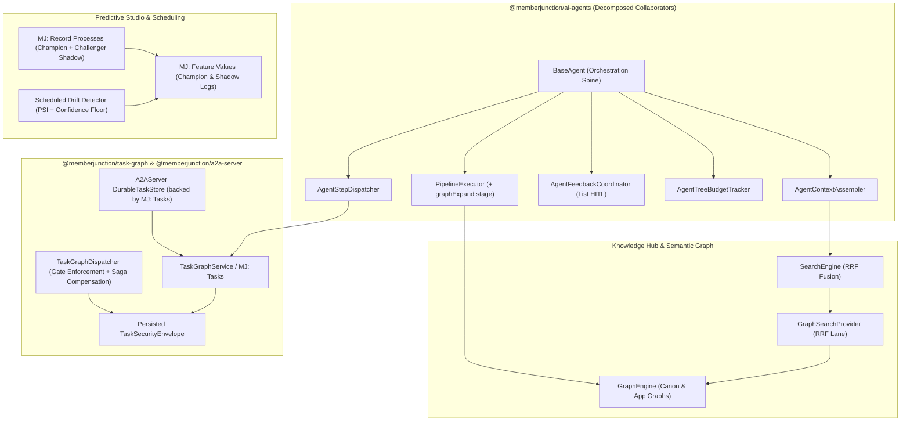
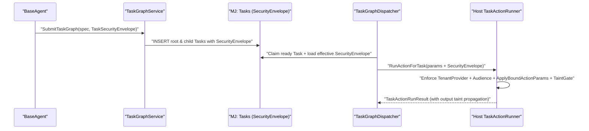
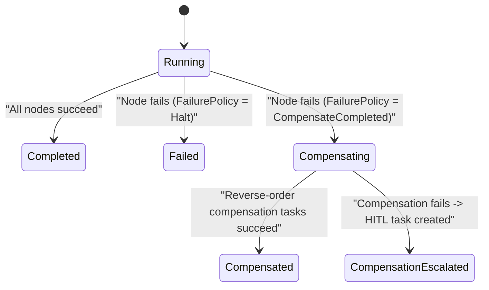

# Next-Gen AI, Agents, Semantic Graph Retrieval & Durable Workflow Orchestration

## Status
- **Status**: **Approved Design Plan — Ready for Implementation Assignment.**
- **Created**: 2026-10-29
- **Reviewed against**: `next` @ `1c1a993397`
- **Related plans**:
  - [`plans/canon-semantic-graph.md`](canon-semantic-graph.md) — Semantic Graph substrate (`@memberjunction/graph-engine`) & MJ Canon
  - [`plans/embeddinggemma-2-local-embeddings.md`](embeddinggemma-2-local-embeddings.md) — Local vector embeddings & Knowledge Hub search pipeline
  - [`packages/OpenApp/PUBLISH_NO_BREAK_POLICY.md`](../packages/OpenApp/PUBLISH_NO_BREAK_POLICY.md) — Additive-only schema and contract evolution rules

---

## Executive Summary

MemberJunction 6.2 established a remarkably rich AI and workflow substrate: `BaseAgent`, durable `TaskGraph` (`@memberjunction/task-graph`), `PipelineExecutor`, Knowledge Hub (`SearchEngine` with RRF hybrid fusion), Predictive Studio (`MJ: Record Processes`, `MJ: Feature Values`), and `@memberjunction/a2a-server`.

Auditing these subsystems across `next` (`1c1a993397`) and all peer OpenApp repositories surfaced **five concrete architectural seams** where capabilities built independently have not yet been unified or hardened for multi-pod, multi-tenant production workloads:

1. **WS-4.1 — Durable `TaskGraph` Security Envelopes (`BoundActionParams`, `Audience`, `TenantContext`, `IsRunTainted`)**: Today `BaseAgent` fails closed and refuses to emit or submit durable task graphs whenever `boundActionParams`, `Audience`, or a tenant-scoped run is active (`packages/AI/Agents/src/base-agent.ts:19131-19149`), because `TaskGraphDispatcher` executes nodes outside the originating run's security gates.
2. **WS-4.2 — Semantic Graph (`@memberjunction/graph-engine`) Integration into RAG (`SearchEngine`) & Deterministic Agent Pipelines (`PipelineExecutor`)**: `plans/canon-semantic-graph.md` introduces `@memberjunction/graph-engine`, but currently exposes graph traversal only as a standalone Action. Wiring it directly as a first-class Reciprocal Rank Fusion (RRF) lane in `SearchEngine` (consumed by `AgentPreExecutionRAG`) and as a deterministic `graphExpand` stage in `PipelineExecutor` gives every agent zero-extra-turn structural context under caller permissions.
3. **WS-4.3 — Saga Compensation & Automated Rollback Contracts on `MJ: Actions` & `TaskGraph`**: Multi-step durable task graphs and multi-action agent turns mutate external systems and multiple entities without a compensation contract when step `k` fails after steps `1..k-1` committed.
4. **WS-4.4 — Online Shadow Scoring (Champion / Challenger) & Scheduled Feature Drift Detection in Predictive Studio**: `MJ: Record Processes` supports `'Action' | 'Agent' | 'FieldRules' | 'Infer' | 'ML Model'`, and `MJ: Feature Values` persists point-in-time feature vectors, yet there is no production shadow-challenger evaluation loop or scheduled Population Stability Index (PSI) / confidence-floor drift monitor.
5. **WS-4.5 — `BaseAgent` Decomposition, List-Based HITL Assignment Completion, & Durable `MJ: Tasks`-Backed A2A `TaskStore`**: `packages/AI/Agents/src/base-agent.ts` has grown to **22,553 lines** (~1.14 MB), its `'List'` HITL assignment strategy (`RoundRobin` / `LeastBusy` / `Random`) at lines `19617-19623` is still stubbed to fall back to `contextUser`, and `packages/AI/A2AServer/src/TaskStore.ts` stores A2A protocol tasks in process-local memory (losing task state across pod restarts or load-balanced replicas).

This plan specifies all five workstreams so they can be implemented in clean, independently mergeable PR phases with full unit and deterministic integration test coverage.

---

## Architecture Overview



---

## Mandatory Engineering Guardrails (All Phases)

Every PR implementing a phase of this plan **must** follow [`AGENTS.md`](../AGENTS.md) and subdirectory `CLAUDE.md` rules:

1. **Zero `any` or lazy `unknown`**: Never introduce `any`, `as any`, or untyped `Record<string, any>`. Define explicit TypeScript interfaces and generics throughout.
2. **No `.Get()` / `.Set()` weak typing**: Run database migrations + CodeGen first, then write TypeScript against generated entity properties (`MJTaskEntity`, `MJActionEntity`, `MJRecordProcessEntity`, etc.).
3. **Derive value-list unions from generated entity classes**: Use `MJTaskEntity['Status']`, `MJRecordProcessEntity['WorkType']`, etc. — never hand-copy CHECK constraint literal unions.
4. **4-Part Migration Rule ([`migrations/CLAUDE.md`](../migrations/CLAUDE.md))**: Hand DDL + `sp_addextendedproperty` at top → ≥50 blank lines → standard CodeGen header → CodeGen-appended `EntityField` / SP / view / permission SQL. Put metadata rows in `metadata/` JSON files.
5. **Singletons & Imports**: Extend `BaseSingleton<T>` from `@memberjunction/global` for all singletons; use static top-of-file `import` statements (no dynamic `await import()`).
6. **No Cross-Package Re-Exports**: Import types directly from the defining package (`@memberjunction/ai-core-plus`, `@memberjunction/task-graph`, `@memberjunction/graph-engine`, etc.).

---

## Workstream 4.1: Durable `TaskGraph` Security Envelopes

### Problem Statement
In `packages/AI/Agents/src/base-agent.ts:19131-19149`, `BaseAgent` explicitly blocks durable task graphs in three critical enterprise contexts:
- Runs with `ExecuteAgentParams.boundActionParams` (`bound-action-params.ts`) — e.g., pinning `OrganizationID`, `MemberID`, or `AccountID` so the LLM cannot override caller-scoped parameters.
- Runs with `ExecuteAgentParams.Audience` (`agent-audience.ts`) — e.g., multi-user shared conversations or channels where every read/action must satisfy the intersection of audience permissions.
- Runs with an active `TenantContext` or taint flag (`IsRunTainted` after untrusted external content ingestion).

Because `TaskGraphDispatcher` (`packages/TaskGraph/src/TaskGraphDispatcher.ts`) executes asynchronously on background workers via `ProviderFactory.CreateProvider()` (`packages/TaskGraph/src/types.ts:21-23`), those runtime security invariants vanish at the `GetTaskGraphSubmitter()` boundary unless persisted with the root workflow task and enforced on every node dispatch.

### Schema & Contract Design

#### 1. Security Envelope Contract (`@memberjunction/ai-core-plus` or `@memberjunction/task-graph`)
Define a serializable, HMAC-verifiable (or DB-authoritative, non-LLM-writable) `TaskSecurityEnvelope`:

```typescript
export interface TaskBoundParamMap {
    /** Keyed by ActionID (UUID) or '*' for wildcard parameter bindings */
    readonly [actionIdOrWildcard: string]: Readonly<Record<string, string | number | boolean | null>>;
}

export interface TaskAudienceEnvelope {
    /** User IDs of all additional readers beyond ContextUser whose permissions must intersect */
    readonly ReaderUserIDs: readonly string[];
    /** Source descriptor for audit logging (e.g., 'conversation', 'channel', 'explicit') */
    readonly SourceKind: string;
}

export interface TaskTenantEnvelope {
    readonly TenantID: string;
    readonly OrganizationID?: string;
    readonly ScopedFilterContext?: Readonly<Record<string, string>>;
}

export interface TaskSecurityEnvelope {
    readonly SchemaVersion: 1;
    readonly BoundActionParams?: TaskBoundParamMap;
    readonly Audience?: TaskAudienceEnvelope;
    readonly TenantContext?: TaskTenantEnvelope;
    /** Monotonic taint bit: once true on parent or upstream node, propagates to all downstream nodes */
    readonly IsRunTainted: boolean;
}
```

#### 2. Database Migration (`MJ: Tasks`)
Add an additive nullable JSON column `SecurityEnvelope` (`nvarchar(max)` on SQL Server / `text` on PostgreSQL) to `${flyway:defaultSchema}.Task`:
- `SecurityEnvelope NVARCHAR(MAX) NULL` with `sp_addextendedproperty` documenting its JSON schema and immutability rules.
- Update `ProviderFactory.CreateProvider(options?: { TenantContext?: TaskTenantEnvelope; ContextUser?: UserInfo })` in `packages/TaskGraph/src/types.ts` so `MJServer` mints a tenant-scoped isolated provider per task node execution.

#### 3. Enforcement in `TaskGraphDispatcher` (`packages/TaskGraph/src/TaskGraphDispatcher.ts`)
Before dispatching any node:
1. **Resolve Effective Envelope**: Merge root workflow `Task.SecurityEnvelope` with parent task envelope; `IsRunTainted` combines via logical OR (`parent.IsRunTainted || upstreamOutputTainted`).
2. **Action Nodes (`TaskActionRunParams`)**:
   - Pass `SecurityEnvelope` into `TaskActionRunParams`.
   - In the host's `TaskActionRunner` implementation, apply `ApplyBoundActionParams` (`packages/AI/Agents/src/bound-action-params.ts`) *after* dependency output interpolation so neither LLM-authored node inputs nor upstream node outputs can overwrite a bound parameter.
   - Enforce audience support (`AUDIENCE_UNSUPPORTED` check) against `Audience.ReaderUserIDs` before `ActionEngineServer.RunAction`.
   - When `IsRunTainted === true`, block actions marked `DisallowWhenTainted` (external egress / destructive actions without an explicit HITL approval node upstream).
3. **Sub-Agent & Prompt Nodes (`TaskAgentRunParams` / `TaskPromptRunParams`)**:
   - Rehydrate `ExecuteAgentParams.boundActionParams`, `ExecuteAgentParams.Audience` (resolved from `UserCache` via `ReaderUserIDs`), `TenantContext`, and initial taint state into the child `AgentRunner` invocation.
   - Strip bound parameter names from action tool schemas exposed to prompts/sub-agents inside the graph, matching `BaseAgent`'s direct tool-loop behavior.
4. **Lift `BaseAgent` Refusal (`packages/AI/Agents/src/base-agent.ts:19131-19149`)**:
   - Serialize the active run's envelope into `submitter.SubmitTaskGraph({ ..., securityEnvelope })` and re-enable `tasks` response availability for bound, audience-scoped, and tenant-scoped runs.



---

## Workstream 4.2: Semantic Graph Integration into RAG (`SearchEngine`) & `PipelineExecutor`

### Problem Statement
`plans/canon-semantic-graph.md` specifies `@memberjunction/graph-engine` (`GraphEngine.Instance.Expand(...)`, `FindPaths(...)`, `ResolveSeeds(...)`) over polymorphic `(EntityID, RecordID)` nodes, weighted/typed edges, and pluggable `BaseGraphEdgeProvider`s. However:
1. `AgentPreExecutionRAG` (`packages/AI/Agents/src/agent-pre-execution-rag.ts`) and `SearchEngine` (`packages/AI/Knowledge/Search/...`) currently fuse vector similarity and full-text lexical lanes via Reciprocal Rank Fusion (RRF), without a structural graph neighborhood lane.
2. Deterministic pipelines (`packages/AI/Agents/src/pipeline/pipeline-executor.ts`) lack a declarative graph-expansion stage, forcing agents to spend an LLM tool-call turn to discover canonical definitions, narrower/broader concepts, and governing queries.

### Design

#### 1. `GraphSearchProvider` as an RRF Lane in `SearchEngine`
- Implement `GraphSearchProvider` registering as an optional search provider in Knowledge Hub's `SearchEngine`:
  - **Seed Resolution**: Map query terms and top-K lexical/entity-name hits to graph seed nodes via `GraphEngine.Instance.ResolveSeeds(queryText, graphNames, contextUser)`.
  - **Bounded Expansion**: Call `GraphEngine.Instance.Expand({ Seeds, MaxDepth: 2, MaxNodes: 25, MinWeight: 0.25 }, contextUser, provider)`.
  - **Permission Invariant**: `GraphEngine` already enforces `CanRead` + RLS on data records and `UserCanRun` / `UserCanUse` on queries and alternate views; for runs with an `Audience` (WS-4.1), intersect node visibility across `[contextUser, ...audienceReaders]`.
  - **RRF Scoring Adapter**: Rank expanded neighbor nodes by path-attenuated edge weight (`product(edge.Weight) * seedScore`), returning standardized `SearchResultItem` entries with `SourceType: 'SemanticGraph'` and human-readable provenance breadcrumbs (e.g., `"Open AR" --[Defined By (0.95)]--> View "Invoices.Open"`).

#### 2. Native `graphExpand` Stage in `PipelineExecutor`
Extend `PipelineStageConfig` in `packages/AI/Agents/src/pipeline/` with a deterministic `graphExpand` stage type:

```typescript
export interface GraphExpandPipelineStage {
    readonly stageType: 'graphExpand';
    readonly id: string;
    /** Named graphs to traverse, e.g. ['MJ Canon'] or ['Member Network'] */
    readonly graphNames: readonly string[];
    /** JSONPath or template expression extracting seed text or { EntityName, RecordID } pairs from payload/input */
    readonly seedSource: string;
    readonly maxDepth?: 1 | 2 | 3 | 4;
    readonly maxNodes?: number;
    readonly edgeTypeFilter?: readonly string[];
    /** Target payload key or context variable where the formatted subgraph is written */
    readonly outputKey: string;
}
```

- **Dependency Sequencing**: Gate WS-4.2 implementation immediately behind `plans/canon-semantic-graph.md` Phase G1 (`@memberjunction/graph-engine` core package). Provide a clean interface seam (`IGraphExpansionService` in `@memberjunction/ai-core-plus`) so `Agents` and `SearchEngine` compile and degrade gracefully when no graph providers are configured.

---

## Workstream 4.3: Saga Compensation & Rollback Contracts (`MJ: Actions` & `TaskGraph`)

### Problem Statement
When a 5-node durable `TaskGraph` (or a multi-action sequence) executes:
- Node 1 reserves inventory (external API or entity mutation),
- Node 2 posts a provisional invoice,
- Node 3 charges a payment gateway and fails permanently after retries exhaust.

Today `TaskGraphDispatcher` marks Node 3 `Failed` and halts downstream nodes, leaving Nodes 1 and 2 permanently committed with no automated rollback or HITL escalation trail.

### Design

#### 1. Additive Metadata on `MJ: Actions`
Add two nullable columns to `${flyway:defaultSchema}.Action` (4-part migration + CodeGen):
- `CompensationActionID UNIQUEIDENTIFIER NULL REFERENCES ${flyway:defaultSchema}.Action(ID)`
- `CompensationInputMapping NVARCHAR(MAX) NULL` — JSON mapping descriptor binding `{ input.*, output.*, actionLogId, recordChanges.* }` from the forward `MJ: Action Execution Logs` row into the compensation action's input parameters.
- `IsIdempotent BIT NOT NULL CONSTRAINT DF_Action_IsIdempotent DEFAULT (0)` — signals safe automatic retry and compensation replay.

#### 2. Workflow-Level Overrides on `TaskGraph` Action Nodes
Extend action node specs in `@memberjunction/task-graph` (`WorkflowSpecSync.ts` / `types.ts`):

```typescript
export interface ActionCompensationSpec {
    /** Overrides Action.CompensationActionID when specified on the workflow node */
    readonly compensationActionId?: string;
    /** Explicit JSON mapping from forward { input, output, actionLogId } -> compensation params */
    readonly inputMapping?: Readonly<Record<string, string>>;
    /** Policy if compensation itself fails after maxRetries */
    readonly onCompensationFailure?: 'EscalateToHumanTask' | 'HaltSaga' | 'ContinueCompensation';
}
```

#### 3. Reverse-Topological Saga Coordinator in `TaskGraphDispatcher`
Add workflow-level policy `FailurePolicy: 'Halt' | 'CompensateCompleted'` (default `'Halt'` for 100% backward compatibility):
1. When a critical node transitions to terminal `Failed` under `FailurePolicy === 'CompensateCompleted'`, transition the parent workflow status to `'Compensating'` (or track saga state in `WorkflowState`).
2. Identify all completed upstream `Action` nodes in **reverse topological completion order** that declare either a node-level `ActionCompensationSpec` or `Action.CompensationActionID`.
3. Materialize child compensation `MJ: Tasks` rows linked via `ParentID` / `CompensatesTaskID` so compensation execution is **just as durable, claim-locked, and observable** as forward execution.
4. Hydrate forward inputs, forward outputs, and correlated `RecordChanges` snapshots (via `TaskActionRunResult.ActionLogID`) into the compensation input mapper.
5. If a compensation task exhausts its retries and `onCompensationFailure === 'EscalateToHumanTask'`, automatically create an `MJ: AI Agent Requests` / human `Task` assigned via the workflow's escalation owner with the exact forward + failed compensation diff attached.



---

## Workstream 4.4: Online Shadow Scoring & Scheduled Feature Drift Detection

### Problem Statement
Predictive Studio introduced `MJ: Record Processes` (including `'ML Model'` and `'Infer'` work types) and `MJ: Feature Values` for feature engineering and online inference. To operate ML and LLM-inference pipelines safely in production, teams need:
1. Zero-risk evaluation of challenger models/prompts on live production traffic without affecting business decisions (**Shadow Scoring**).
2. Automated detection when input feature distributions shift or model confidence degrades (**Drift Monitoring**).

### Design

#### 1. Shadow Challenger Configuration on `MJ: Record Processes`
- Add nullable JSON column `ChallengerConfiguration NVARCHAR(MAX) NULL` (and `ChallengerSampleRate DECIMAL(5,4) NOT NULL DEFAULT (0)`) to `MJ: Record Processes` (or strongly typed `@file:` JSONType interface `IRecordProcessChallengerConfig` in `metadata/`):

```typescript
export interface IRecordProcessChallengerConfig {
    readonly Enabled: boolean;
    /** Fraction of live invocations (0.0 to 1.0) mirrored to the challenger */
    readonly SampleRate: number;
    readonly WorkType: MJRecordProcessEntity['WorkType'];
    readonly ChallengerModelID?: string;
    readonly ChallengerPromptID?: string;
    readonly ChallengerEndpointConfig?: Readonly<Record<string, string | number | boolean>>;
    /** Timeout budget in ms; never blocks champion write path */
    readonly MaxLatencyMs: number;
}
```

- **Execution Path**:
  - Champion executes synchronously/normally and writes authoritative target entity fields + champion `MJ: Feature Values` / prediction audit row (`Role: 'Champion'`).
  - When `ChallengerConfiguration.Enabled` and deterministic/random sampling hits `SampleRate`, enqueue a non-blocking `WorkQueue` item (`WorkQueueEngine.Instance.Publish(...)`) that runs the challenger against the **exact same frozen feature snapshot** and records the result in `MJ: Feature Values` / prediction log with `Role: 'Challenger'` (never mutating the business record).

#### 2. Scheduled Drift Detection Driver (`@memberjunction/scheduling-actions`)
Build a scheduled driver/action `EvaluateFeatureAndPredictionDriftAction` in `@memberjunction/scheduling-actions` (or Predictive Studio's engine package):
- Computes **Population Stability Index (PSI)** across numeric bucketed and categorical feature distributions in `MJ: Feature Values` comparing a rolling evaluation window (e.g., last 7 days) against the training/baseline window:
  $$\text{PSI} = \sum_{i=1}^{B} \left( p_i - q_i \right) \ln \left( \frac{p_i}{q_i} \right)$$
  (with Laplace smoothing $\epsilon = 10^{-4}$ for empty bins, flagging warning at $\text{PSI} \ge 0.10$ and critical drift at $\text{PSI} \ge 0.25$).
- Computes **Confidence-Floor & Champion-vs-Challenger Divergence** metrics (agreement rate, mean absolute score delta, p95 latency ratio).
- Emits structured notifications / `MJ: AI Agent Requests` alerts when thresholds breach.

---

## Workstream 4.5: `BaseAgent` Decomposition, List HITL Assignment, & Durable A2A `TaskStore`

### Problem Statement
1. `packages/AI/Agents/src/base-agent.ts` is **22,553 lines** in a single class file. While several helpers (`PayloadManager`, `ConversationCompactionManager`, `ArtifactToolManager`, `AgentPreExecutionRAG`) were extracted, core context assembly, step routing, HITL feedback coordination, and hierarchical run-tree token/cost/turn budgeting remain tightly interwoven inside `BaseAgent`.
2. In `base-agent.ts:19617-19623`, `resolveUserFromStrategy` has an explicit stub for `case 'List':` (`RoundRobin`, `LeastBusy`, `Random`), logging `"List-based assignment strategy configured but not yet implemented; defaulting to context user"`.
3. `packages/AI/A2AServer/src/TaskStore.ts` stores A2A tasks (`Task`, `Part`, `messages`, `artifacts`) in an in-memory `Map` with a 1-hour terminal sweeper. Any horizontal scaling (2+ MJAPI / A2A pods behind a load balancer) or rolling restart loses in-flight and recently completed A2A tasks.

### Design

#### 1. Cohesive Collaborator Extraction from `BaseAgent` (Zero Breaking Protected API Changes)
Preserve `BaseAgent`'s public and `protected` method signatures as thin delegating facades (honoring subclass overrides like `KnowledgeAgent`, `MemoryManagerAgent`, `QueryBuilderAgent`) while moving implementation into four focused, independently unit-testable collaborators under `packages/AI/Agents/src/`:

| Collaborator | Responsibility Extracted from `base-agent.ts` | Target Size |
|---|---|---|
| `AgentContextAssembler` | System/scoped prompt resolution, runtime state fragments, preloaded data injection, conversation history formatting, catalog narrowing | ~1,800 LOC |
| `AgentStepDispatcher` | Action execution circuit breakers (`fatal`, `audience`, `identical-arguments`, `attempts-exhausted`), bound-param application, sub-agent launch, `TaskGraph` submission | ~2,400 LOC |
| `AgentFeedbackCoordinator` | `MJ: AI Agent Requests` creation, response-form type detection, category strategy inheritance, and **full `List` assignment resolution** | ~900 LOC |
| `AgentTreeBudgetTracker` | Hierarchical token, cost, wall-clock, and action-attempt budgets across parent -> sub-agent trees with thread-safe rollup | ~700 LOC |

#### 2. Complete `List` HITL Assignment Strategy (`RoundRobin`, `LeastBusy`, `Random`)
Inside `AgentFeedbackCoordinator.ResolveAssigneeUserID(strategy, params, provider)` (making resolution `async` and updating the single caller chain in `createFeedbackRequest`):
- Query `MJ: List Details` for `strategy.listID` (verifying target entity is `MJ: Users` and filtering to `IsActive = true` users).
- **`LeastBusy`**: Single aggregate `RunView` / count over `MJ: AI Agent Requests` where `Status IN ('Requested', 'InProgress')` grouped by `RequestForUserID`, selecting the active list member with the lowest open count (tie-breaking deterministically by oldest last assignment).
- **`RoundRobin`**: Query the most recent `MJ: AI Agent Requests` row assigned for `(AgentID)` (or list cursor stored via engine metadata) and pick the next active `UserID` in deterministic sorted `ListDetail.ID` order.
- **`Random`**: Uniform selection across active list members using an injectable RNG interface (defaulting to `crypto.randomInt`, deterministic in unit tests).
- Fall back gracefully to `SharedInbox` (`null` assignee with list visibility) or `contextUser` if the list has zero active users.

#### 3. Durable `MJ: Tasks`-Backed A2A `TaskStore` (`@memberjunction/a2a-server`)
Refactor `packages/AI/A2AServer/src/TaskStore.ts` into an async `IA2ATaskStore` contract with two implementations:
- `InMemoryA2ATaskStore` — retained solely for isolated unit tests.
- `DurableEntityA2ATaskStore` (default in production `Server.ts`):
  - Maps A2A `Task` lifecycle (`pending` | `in_progress` | `completed` | `cancelled` | `failed`) bidirectionally onto `MJ: Tasks` (`MJTaskEntity`), storing A2A protocol wire `messages[]` and `artifacts[]` in structured JSON payload columns / `MJ: Artifact Versions`.
  - Enables `tasks/get`, `tasks/cancel`, and streaming SSE reconnects to hit *any* replica in a multi-pod deployment without sticky sessions.
  - Bridges outbound `A2ASubAgentAdapter` calls into parent `AgentTreeBudgetTracker` and `TaskSecurityEnvelope` (propagation of correlation IDs and taint bit on external A2A responses).

---

## Phased Delivery & PR Breakdown

Each phase ships as an independent, reviewable PR against `next`:

| Phase | Branch / PR Scope | Dependencies | Est. Effort |
|---|---|---|---|
| **Phase 1** | **WS-4.5a**: Extract `AgentFeedbackCoordinator` + `AgentTreeBudgetTracker` from `base-agent.ts` and implement full `List` HITL assignment (`RoundRobin`, `LeastBusy`, `Random`) | None | 3–4 days |
| **Phase 2** | **WS-4.5b**: Extract `AgentContextAssembler` + `AgentStepDispatcher` from `base-agent.ts` + ship `DurableEntityA2ATaskStore` in `@memberjunction/a2a-server` | Phase 1 | 4–5 days |
| **Phase 3** | **WS-4.1**: `TaskSecurityEnvelope` migration on `MJ: Tasks`, enforcement in `TaskGraphDispatcher`, tenant-aware `ProviderFactory`, lift `BaseAgent` task-graph refusal | Phase 2 (uses `AgentStepDispatcher`) | 4–5 days |
| **Phase 4** | **WS-4.3**: Saga compensation metadata on `MJ: Actions` (`CompensationActionID`, `CompensationInputMapping`), `TaskGraphDispatcher` reverse-topological compensation + HITL escalation | Phase 3 | 4–5 days |
| **Phase 5** | **WS-4.2**: `GraphSearchProvider` RRF lane in `SearchEngine` + `graphExpand` stage in `PipelineExecutor` | `plans/canon-semantic-graph.md` Phase G1 | 3–4 days |
| **Phase 6** | **WS-4.4**: `ChallengerConfiguration` shadow scoring via `WorkQueue` on `MJ: Record Processes` + scheduled PSI / confidence-floor drift detector | None (independent) | 3–4 days |

---

## Verification & Testing Plan

Per `AGENTS.md` Rule 6, every PR must add and pass comprehensive unit tests (`cd packages/<Package> && npm run test`) plus deterministic integration checks in `@memberjunction/integration-test-suite`:

1. **WS-4.1 Security Envelope Tests (`packages/TaskGraph/src/__tests__/`, `packages/AI/Agents/src/__tests__/`)**:
   - Prove an LLM-authored `TaskGraph` action node attempting to override a bound `OrganizationID` parameter has the bound value forcibly restored at `TaskGraphDispatcher` execution time, even when fed by an upstream node's `DependencyOutputs`.
   - Prove `AUDIENCE_UNSUPPORTED` actions fail closed inside durable graphs when `Audience.ReaderUserIDs` is non-empty.
   - Prove `IsRunTainted` propagates from an untrusted-fetch node to downstream action nodes and blocks egress actions unless an approval node intervened.
2. **WS-4.2 Graph Retrieval Tests**:
   - Mock `IGraphExpansionService` / `GraphEngine` with a multi-hop Canon fixture; verify RRF score fusion boosts canonical views/queries and strictly filters out nodes where an audience reader lacks `CanRead` or `UserCanRun`.
   - Verify `PipelineExecutor` executes `graphExpand` deterministically with zero LLM calls and populates `outputKey`.
3. **WS-4.3 Saga Compensation Tests (`packages/TaskGraph/src/__tests__/`)**:
   - 4-node DAG (`A -> B -> C -> D`) where `A` and `B` succeed and `C` fails: verify `Compensate(B)` executes *before* `Compensate(A)`, receives `{ input, output, actionLogId }`, and transitions workflow to `Compensated`.
   - Verify failed compensation under `onCompensationFailure: 'EscalateToHumanTask'` creates the expected escalation task with full provenance.
4. **WS-4.4 Shadow Scoring & Drift Tests**:
   - Verify challenger failures or timeouts (`MaxLatencyMs`) never fail or delay the champion `RecordProcess` execution and never mutate target business entity fields.
   - Unit-test PSI math on identical distributions ($\text{PSI} \approx 0$), moderate shift ($0.10 \le \text{PSI} < 0.25$), severe shift ($\text{PSI} \ge 0.25$), and zero-count bins.
5. **WS-4.5 Decomposition, List Assignment, & A2A Persistence Tests**:
   - Verify all existing 220+ test files in `packages/AI/Agents/src/__tests__/` pass unchanged against decomposed `BaseAgent`.
   - Unit-test `RoundRobin`, `LeastBusy`, `Random`, inactive-user filtering, and empty-list fallback in `AgentFeedbackCoordinator`.
   - Simulate two independent `A2AServer` instances backed by `DurableEntityA2ATaskStore`: create/advance task on Instance 1, query `tasks/get` and `tasks/cancel` on Instance 2, and assert full fidelity.
