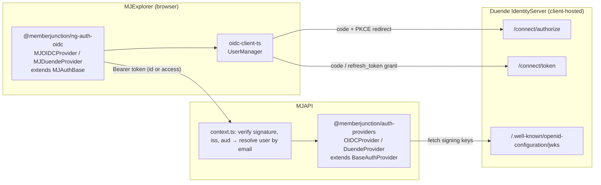

# Generic OIDC Auth Provider, with a Duende IdentityServer Preset

**Status:** Plan. No code yet.
**Customer:** a client engagement. The client's dev team implements it.
**Reviewers:** Yuri Lee, Paul Christmann
**Date:** 2026-10-19

## 1. Goal

Let an MJ deployment sign users in through **any standards-compliant OpenID Connect (OIDC) server**,
with a **Duende IdentityServer** preset that needs only an issuer URL and a client ID.

Two driver keys, one implementation:

| Key | Who uses it | What it adds |
|---|---|---|
| `oidc` | Any OIDC server: Keycloak, Authentik, Zitadel, Ory, a custom one | Nothing assumed; endpoints and claims are configured |
| `duende` | Duende IdentityServer (the client) | Duende's endpoint paths, JWKS path and claim defaults |

Today every MJ auth driver hard-codes one vendor's URLs. `AUTH_PROVIDER_TYPES.CUSTOM` exists
(`packages/MJCore/src/generic/authTypes.ts:16`), but no class implements it. This work fills that gap.

## 2. Background: why Duende needs a generic driver

Okta, Auth0, Cognito and WorkOS are hosted services: fixed domains, fixed token shapes. **Duende is a
.NET framework.** Each customer builds and hosts their own login server in ASP.NET Core and decides
which claims each token carries. So there is no "Duende domain" to hard-code, and two Duende
deployments can issue very differently shaped tokens.

Underneath, Duende is plain OIDC. It publishes a discovery document at
`{issuer}/.well-known/openid-configuration`, keys at `{issuer}/.well-known/openid-configuration/jwks`,
and endpoints under `{issuer}/connect/*`. A configurable OIDC driver covers it, and the Duende preset
fills in its defaults.

Duende in brief: the commercial successor to IdentityServer4, the long-standing OIDC server for .NET
(about 23M NuGet downloads). It is commercially licensed, with a free Community Edition for small
organisations. It is self-hosted, so the client owns the server and its configuration.

## 3. Decisions

Each decision has a recommendation. Reviewers should confirm or change these before Phase 1 starts.

### D1. One generic driver plus a preset, not a Duende-only driver

`OIDCProvider` (server) and `MJOIDCProvider` (browser) do the work. `DuendeProvider` and
`MJDuendeProvider` subclass them and only change defaults and the driver key. Hosts using other
OIDC servers get support for free, and the Duende-specific surface stays small.

### D2. Packaging: the browser half is a separate package; the server half stays in the core auth package

The request was for a separate package, so the code doesn't burden hosts that don't use it. The
burden is entirely on the browser side, so the split goes there:

| Half | Package | Why |
|---|---|---|
| Browser | **New: `@memberjunction/ng-auth-oidc`** at `packages/Angular/Explorer/auth-oidc` | Brings in the `oidc-client-ts` SDK. Every SDK in `@memberjunction/ng-auth-services` is a *required* peer (`packages/Angular/Explorer/auth-services/package.json:23-35`), so adding it there would force it on MJExplorer and every downstream app. A separate package keeps it opt-in. |
| Server | **Existing: `@memberjunction/auth-providers`** (`packages/AuthProviders`) | Adds **no new dependency**: it uses the `jsonwebtoken` + `jwks-rsa` the package already has. It is also the only placement where `mj.config.cjs` and env-var configuration work (see below). |

**Why the server half can't be a separate package without a core change.** MJServer builds the
config- and env-declared providers when the `@memberjunction/server` module loads
(`packages/MJServer/src/auth/index.ts:333`). Packages listed in `dynamicPackages.server[]` are
imported later, inside `CreateMJServer` (`packages/ServerBootstrap/src/index.ts:272`). A driver
in a separate package would not yet be registered when `AuthProviderFactory.CreateProvider` runs
(`packages/AuthProviders/src/AuthProviderFactory.ts:55-75`), so `type: 'duende'` in `mj.config.cjs`
would fail at boot. Metadata rows load later and would work, but env vars and `mj.config.cjs` would
not.

If reviewers still want a separate server package, MJServer must first re-run
`InitializeAuthProviders()` after dynamic packages load. That is a core boot-order change and
should be its own PR.

### D3. Which token the browser sends to MJAPI: configurable, `access_token` for Duende

MJAPI validates whatever token the browser sends against the configured issuer, audience and JWKS
(`packages/MJServer/src/context.ts:328-338`). The browser driver gets a `tokenUse` setting:

| `tokenUse` | `aud` MJ must expect | How email gets into the token (Duende) | Default lifetime (Duende) |
|---|---|---|---|
| `id_token` | the client ID | Set `AlwaysIncludeUserClaimsInIdToken = true` on the client | 5 minutes |
| `access_token` | the ApiResource name, e.g. `mj-api` | List the claims in the ApiResource's `UserClaims` | 1 hour |

**Recommendation:**
- Default `id_token` for `oidc`. That matches every existing MJ driver, and the audience is always
  the client ID, so it works with zero server-side configuration.
- Default `access_token` for `duende`. That is what Duende intends for API calls, it refreshes 12×
  less often, and it leaves room for DPoP later.

Phase 0 verifies the lifetimes and claim behaviour against a real Duende server.

### D4. Claim mapping is configurable

MJ finds the signed-in user by **email**, falling back to `preferred_username`
(`packages/MJServer/src/context.ts:521`). New-user setup uses the first and last names. OIDC servers
disagree on which claims carry these, so the server driver accepts a `claims` map (a
`mj.config.cjs` field or the row's `AdditionalConfiguration`):

```js
claims: {
  email: 'email',                     // default
  firstName: 'given_name',            // default
  lastName: 'family_name',            // default
  fullName: 'name',                   // default
  preferredUsername: 'preferred_username', // default
  userId: 'sub'                       // default
}
```

Do **not** copy Okta's "split `name` into first and last" fallback (`OktaProvider.ts:52-53`). With
ASP.NET Identity, `name` is often the username or the email, which would put an email into
`FirstName` for every new user. Fall back to `name` only when it contains a space and no `@`.

### D5. JWKS discovery: derive for Duende, require it for generic `oidc` in v1

`BaseAuthProvider`'s constructor builds the JWKS client immediately and dereferences `jwksUri`
(`packages/AuthProviders/src/BaseAuthProvider.ts:41`). So the URI must be known synchronously,
before `super()`.

- `duende`: derive it as `{issuer}/.well-known/openid-configuration/jwks` when not given.
- `oidc`: require `jwksUri`. `validateConfig()` fails with a message telling the operator to copy
  `jwks_uri` from `{issuer}/.well-known/openid-configuration`.

Lazy runtime discovery for generic `oidc` (fetch the discovery document on the first signing-key
request) is a follow-up, not v1.

### D6. Browser session storage and refresh

- **Storage:** keep `oidc-client-ts`'s default user store, `sessionStorage`.
  - It survives MJ's logout cache-clear, which only wipes `localStorage` and IndexedDB
    (`mjexplorer-auth-base.service.ts:252-271`). The `id_token` is therefore still there to send
    as `id_token_hint` on logout. Without the hint, Duende will not redirect back to MJ after
    sign-out.
  - Each tab holds its own refresh token, so one-time-use refresh tokens can't race across tabs.
  - A new tab completes a silent SSO round-trip against the Duende session cookie.
- **Refresh:** request `offline_access` and refresh on demand in `refreshTokenInternal()` with
  `UserManager.signinSilent()`, which uses the refresh-token grant. Set
  `automaticSilentRenew: false` and don't use iframe renewal. The Auth0 driver documents iframe
  renewal hanging (`mjexplorer-auth0-provider.service.ts:62-66`), and third-party-cookie blocking
  breaks it anyway.

### D7. No backend-for-frontend in this work

Duende recommends the backend-for-frontend (BFF) pattern, where tokens never reach the browser, and
calls its browser-only quickstart "no longer recommended". MJExplorer keeps tokens in the browser for
**every** provider today, so moving to a BFF would be a platform-wide change, not a driver.

This work uses the browser pattern with PKCE, session storage, short-lived tokens and refresh-token
rotation. If the client's security policy requires a BFF, raise it now (question Q6). It would be a
separate, much larger project.

### D8. MCP OAuth proxy: in scope only if the client uses the MCP server

The MCP OAuth proxy picks upstream endpoints by sniffing the hostname: `azure-ad`, `cognito`, or
`generic`. `generic` assumes `{issuer}/authorize` and `{issuer}/oauth/token`
(`packages/AI/MCPServer/src/auth/UpstreamEndpoints.ts:149-155`), but Duende uses
`/connect/authorize` and `/connect/token`. The fix is Phase 4.

The same fallback looks wrong for Okta too (`/v1/authorize`). Confirm that and file it separately.

## 4. Architecture



Registration follows the existing pattern.

**Server:** `@RegisterClass(BaseAuthProvider, 'oidc' | 'duende')`, exported from the package
barrel (`packages/AuthProviders/src/index.ts`), plus a static `ConfigFromEnvironment`
(`IEnvironmentConfigurableProvider.ts`).

**Browser:** `@RegisterClass(MJAuthBase, 'oidc' | 'duende')` with a static `AngularProviderFactory`.
- `AuthServicesModule.ForRoot` resolves the class by key (`auth-services.module.ts:95-99`).
- Catalog rows reach the driver as `<DRIVER>_*` environment keys (`catalog-environment.ts:56-85`).
  - `oidc` reads `OIDC_*`; `duende` reads `DUENDE_*`.

**How a host's MJExplorer loads the separate browser package:**
1. Add the dependency to the host's MJExplorer `package.json`.
2. List it under `dynamicPackages.client[]` in `mj.config.cjs`.

MJExplorer's prebuild (`mj codegen manifest … --open-app-client-bootstrap`) then appends a
side-effect import to the supplemental manifest, which `app.module.ts` imports. This happens before
the `AuthServicesModule.ForRoot(...)` decorator evaluates, so the class is registered in time. Phase 0
verifies this for an `@memberjunction/*` package. The supplemental manifest normally *excludes*
`@memberjunction` packages, so it needs checking. The fallback is a one-line
`LoadOIDCAuthProviders()` call in the host's `app.module.ts`.

## 5. Configuration surface

### Server (MJAPI)

```js
// mj.config.cjs
authProviders: [{
  name: 'duende',
  type: 'duende',
  issuer: 'https://identity.example.com',   // must equal the token's iss (case/trailing-slash insensitive)
  audience: 'mj-api',                        // ApiResource name (access_token) or client ID (id_token)
  clientId: 'mj-explorer',
  // jwksUri: optional for 'duende', required for 'oidc'
  // claims: { email: 'email', ... }         // optional, see D4
}]
```

| Env var | `oidc` | `duende` |
|---|---|---|
| Issuer | `OIDC_ISSUER` | `DUENDE_AUTHORITY` |
| Client ID | `OIDC_CLIENT_ID` | `DUENDE_CLIENT_ID` |
| Audience (defaults to the client ID) | `OIDC_AUDIENCE` | `DUENDE_AUDIENCE` |
| JWKS URI | `OIDC_JWKS_URI` (required) | `DUENDE_JWKS_URI` (optional) |

Env discovery applies only when `mj.config.cjs` declares no `authProviders`
(`packages/MJServer/src/auth/initializeProviders.ts:32`). `ConfigFromEnvironment` must return
`null`, not a partial config, when its variables are missing.

For a metadata row (`MJ: Authentication Providers`), the modelled columns map to config fields
(`AuthProviderEngine.ts:125-144`):
- `DriverClass` = `duende`; `Issuer`, `Audience`, `ClientID`, `Scopes` as usual; `JWKSUri` is optional.
- `claims` goes in `AdditionalConfiguration`.
- The browser-only settings go in `ClientConfiguration`: `redirectUri`, `postLogoutRedirectUri`,
  `tokenUse`.

### Browser (MJExplorer `environment.ts`, used when the catalog is empty)

```ts
AUTH_TYPE: 'duende',
DUENDE_ISSUER: 'https://identity.example.com',
DUENDE_CLIENTID: 'mj-explorer',
DUENDE_SCOPES: ['openid', 'profile', 'email', 'offline_access', 'mj-api'],
DUENDE_TOKEN_USE: 'access_token',
DUENDE_REDIRECT_URI: 'https://mj.example.com/',             // defaults to window.location.origin
DUENDE_POST_LOGOUT_REDIRECT_URI: 'https://mj.example.com/', // defaults to window.location.origin
```

## 6. Duende configuration recipe (client side)

What the client's IdentityServer needs. This becomes the core of the `OIDC.md` guide in Phase 5.

```csharp
// Identity resources: openid, profile, email
new IdentityResources.OpenId(),
new IdentityResources.Profile(),
new IdentityResources.Email(),

// The API MJ represents. Its name is the access token's `aud`.
new ApiScope("mj-api"),
new ApiResource("mj-api")
{
    Scopes = { "mj-api" },
    // REQUIRED for tokenUse = access_token: MJ resolves users by email
    UserClaims = { "email", "email_verified", "given_name", "family_name", "name", "preferred_username" }
},

// MJExplorer: a public browser client using code + PKCE, no secret
new Client
{
    ClientId = "mj-explorer",
    ClientName = "MemberJunction",
    AllowedGrantTypes = GrantTypes.Code,
    RequirePkce = true,
    RequireClientSecret = false,
    RedirectUris = { "https://mj.example.com/" },
    PostLogoutRedirectUris = { "https://mj.example.com/" },
    AllowedCorsOrigins = { "https://mj.example.com" },   // origin, not URL
    AllowOfflineAccess = true,                            // refresh tokens
    AllowedScopes = { "openid", "profile", "email", "mj-api" },
    // Only for tokenUse = id_token:
    // AlwaysIncludeUserClaimsInIdToken = true,
}
```

The profile service must actually emit `email`, and preferably `email_verified`. On login, MJ passes
`email_verified` into automatic identity-claim redemption (`context.ts:558-576`), and an
unverified email never auto-claims. If MJ users should be auto-provisioned on first login,
configure `newUserSetup` on MJAPI as for any other provider.

## 7. Work breakdown

Each phase is one PR into `next`, with unit tests passing before review.

### Phase 0: Spike (no merge)
1. Run a Duende server locally: `dotnet new install Duende.Templates`, then the in-memory template.
   Duende runs unlicensed in development. The public demo at `https://demo.duendesoftware.com` is a
   second option, but check its redirect-URI rules.
2. Capture real ID and access tokens for both D3 modes, and record `iss`, `aud`, `typ`, signing
   algorithm and claims. MJ accepts RS256/384/512, ES256/384/512 and PS256, but not PS384/PS512
   (`context.ts:332`). Duende signs with RS256 by default.
3. Confirm in this Duende version: the ID-token and access-token lifetimes, the default
   `RefreshTokenUsage`, and whether a refresh-token grant returns a new `id_token` (D3 depends on it).
4. Confirm that an `@memberjunction/*` package listed in `dynamicPackages.client[]` gets a
   side-effect import from `--open-app-client-bootstrap` (section 4).
5. Bring the findings back to this plan before Phase 1.

### Phase 1: Server driver (`@memberjunction/auth-providers`)
- `src/providers/OIDCProvider.ts`: `@RegisterClass(BaseAuthProvider, 'oidc')`, plus:
  - `ConfigFromEnvironment`;
  - claim mapping (D4);
  - `validateConfig()` requiring `jwksUri` (D5);
  - `extractUserInfo` that never puts an email into a name field.
- `src/providers/DuendeProvider.ts`: extends `OIDCProvider`, `@RegisterClass(BaseAuthProvider, 'duende')`.
  - Derives `jwksUri` **before** `super()` (`BaseAuthProvider.ts:41`).
  - Reads `DUENDE_*` env vars.
- Export both from `src/index.ts`. Registration rides on the barrel export.
- Add `OIDC: 'oidc'` and `DUENDE: 'duende'` to `AUTH_PROVIDER_TYPES` (`packages/MJCore/src/generic/authTypes.ts`).
- Tests:
  - New `OIDCProvider.test.ts` and `DuendeProvider.test.ts`: env mapping (null when incomplete),
    JWKS derivation, claim defaults and overrides, name-fallback guard, `validateConfig`.
  - Add both keys to `BUILT_IN_DRIVER_KEYS` (`BuiltInProviderRegistration.test.ts:20`) and
    `EnvironmentDiscovery.test.ts`.
  - One end-to-end test: sign a token with a locally generated RSA key, serve the JWKS from an
    in-process HTTP server, and verify it through the provider.
- Integration tier:
  - Add `oidc` and `duende` to `SHIPPED_PROVIDER_TYPES`
    (`packages/TestingFramework/integration-test-suite/src/checks/auth-validation.checks.ts:74`).
  - Update the hard-coded counts there and in
    `metadata-optional/integration-test/tests/integration/.IT83-auth-validation.json`.
  - Make sure `makeConfig` satisfies both drivers' `validateConfig`.

### Phase 2: Browser package (`@memberjunction/ng-auth-oidc`)
- New package `packages/Angular/Explorer/auth-oidc`, already covered by the workspace glob
  `packages/Angular/Explorer/*`.
  - `"mjUILayer": "surface"`, like `ng-auth-services`.
  - Peer dependencies: `@memberjunction/ng-auth-services` (it must stay a single copy for DI; see
    `packages/Angular/CLAUDE.md`) and `@angular/*` as caret ranges.
  - Dependency: `oidc-client-ts`, pinned to a released 3.x version.
  - Add it at the repo root and run `pnpm install` there.
- `MJOIDCProvider extends MJAuthBase`, `@RegisterClass(MJAuthBase, 'oidc')`. WorkOS's structure is
  the template (`mjexplorer-workos-provider.service.ts`): a vanilla SDK, config via an injection
  token, an idempotent `initialize()`, and `ngOnDestroy`. Okta's driver is the reference for OIDC
  semantics.
  - `initialize()`:
    - Build `UserManager` with authority, client ID, redirect URI, `response_type: 'code'`, scopes,
      `automaticSilentRenew: false` and `loadUserInfo: true`.
    - If the URL carries `code`/`state`, call `signinRedirectCallback()` and then clean the URL.
    - **Skip `/oauth/callback`**: that path is MCP OAuth's. Follow the Auth0 and Cognito precedent
      (`mjexplorer-auth0-provider.service.ts:43`).
  - `extractIdTokenInternal()`: return `user.id_token` or `user.access_token` according to
    `tokenUse`. This value is what MJAPI receives.
  - `refreshTokenInternal()`: call `signinSilent()`.
  - `classifyErrorInternal()`:
    - `invalid_grant` → `TOKEN_EXPIRED`;
    - `login_required` / `interaction_required` / `consent_required` → `INTERACTION_REQUIRED`;
    - timeouts and network failures → `NETWORK_ERROR`.
  - `logoutInternal()`: call `signoutRedirect({ id_token_hint, post_logout_redirect_uri })` and then
    `removeUser()`.
  - `extractUserInfoInternal()`: map `user.profile`. The UI may show userinfo claims the server
    never sees, so don't rely on them for identity.
- `MJDuendeProvider extends MJOIDCProvider`, `@RegisterClass(MJAuthBase, 'duende')`: reads
  `DUENDE_*` keys and defaults `tokenUse` to `access_token`.
- Export `LoadOIDCAuthProviders()` as the tree-shaking anchor and fallback import (section 4).
- Tests: mock `UserManager` and cover:
  - the callback path versus `/oauth/callback`;
  - token selection by `tokenUse`;
  - each error classification;
  - logout sending `id_token_hint`;
  - catalog-overlay keys reaching the config.

### Phase 3: Metadata and UI touch points
- Add two seed rows to `metadata/authentication-providers/.authentication-providers.json`:
  - `"Generic OIDC"` (`DriverClass: "oidc"`) and `"Duende IdentityServer"` (`DriverClass: "duende"`).
  - Both `Status: "Inactive"`, with a `uuidgen` primary key and **no `sync` block**.
  - Each Description says browser login needs `@memberjunction/ng-auth-oidc` installed.
  - JSON only: the release build generates the Metadata_Sync migration.
  - Needs a **`minor`** changeset (`.claude/rules/changesets.md`).
- Login picker icons in `BRAND_ICON_CLASSES` (`login-picker.component.ts:9-18`), for example
  `oidc: 'fa-solid fa-key'` and `duende: 'fa-solid fa-id-badge'`.
- `AUTH_TYPE` union (`packages/Angular/Bootstrap/src/lib/bootstrap.types.ts:69`): add `'oidc' | 'duende'`.
- The About dialog's provider labels.
- The `AUTH_TYPE` label "(msal or auth0)" in `explorer-app.component.ts:1312`: make it generic.

### Phase 4: MCP OAuth proxy (only if needed, D8)
- In `UpstreamEndpoints.ts`:
  - Prefer explicit `authorizationEndpoint`/`tokenEndpoint` from the provider config (an extension
    of `UpstreamProviderInfo`, from `AdditionalConfiguration`).
  - Add a `duende` flavor that yields `{issuer}/connect/authorize` and `{issuer}/connect/token`.
- Keep the `offline_access` handling in `Server.ts:1097-1100` consistent with it.
- Add tests for the new flavor and the override precedence.

### Phase 5: Documentation
- `packages/AuthProviders/OIDC.md`, modelled on `WORKOS.md`:
  - generic setup;
  - the Duende recipe (section 6);
  - D3 token modes;
  - the email caveat;
  - troubleshooting for the issuer mismatch, the audience mismatch and a missing email.
- `packages/Angular/Explorer/auth-oidc/README.md`: how a host enables it, i.e. the dependency plus
  `dynamicPackages.client[]` (or the fallback import).
- Update the provider lists in:
  - `packages/AuthProviders/README.md`, `packages/Angular/Explorer/auth-services/README.md` and
    `packages/MJServer/README.md`;
  - `mj.config.auth.example.cjs`;
  - the "Supported provider types" comment in `mj.config.cjs`.

## 8. Testing

| Tier | What |
|---|---|
| Unit | Phases 1, 2 and 4 as listed; `pnpm test` in each changed package |
| Integration (deterministic) | `pnpm run test:integration`, with IT83 auth-validation covering both new keys |
| Manual end-to-end | Local Duende from Phase 0: login, refresh past token expiry, logout returning to MJ, first-login provisioning, a user with no email (must fail clearly) |
| Manual end-to-end (generic) | Keycloak in Docker through `oidc`, to prove the driver isn't Duende-specific |
| Acceptance | The client's staging Duende |

## 9. Gotchas to keep in view

1. **Email.** Without email in the token, MJ can't find the user, even though the browser UI shows
   an email from userinfo. This is the WorkOS trap again (`WorkOSProvider.ts:15-29`).
2. **Audience.** `aud` must match exactly. In `access_token` mode it is the ApiResource name, and
   Duende's `EmitStaticAudienceClaim` changes it to `{issuer}/resources`.
3. **The issuer must match `iss`** (case and trailing slash are ignored,
   `BaseAuthProvider.ts:143-148`). Behind a reverse proxy, Duende's issuer must be the public URL.
4. **CORS.** The browser calls `/connect/token` cross-origin, so the MJExplorer origin must be in
   `AllowedCorsOrigins`.
5. **Logout needs `id_token_hint`**, or Duende won't redirect back (D6).
6. **Refresh needs `offline_access`** in the scopes, plus `AllowOfflineAccess` on the client.

## 10. Open questions for the client

| # | Question | Affects |
|---|---|---|
| Q1 | Duende version, and the issuer URL for dev, staging and prod? | Phase 0, config |
| Q2 | Can the client register MJ as a public PKCE client with the redirect, logout and CORS origins above? | Section 6 |
| Q3 | Which claim carries the email? Is it always present and verified? Do some users have none? | D4, provisioning |
| Q4 | `access_token` mode with an `mj-api` ApiResource, or `id_token` mode? | D3 |
| Q5 | Will MCP clients (e.g. Claude) connect to MJ's MCP server through Duende? | Phase 4 |
| Q6 | Does the client's security policy require a backend-for-frontend? | D7 |
| Q7 | Do MJ users already exist, or should first login provision them (`newUserSetup`)? | Rollout |
| Q8 | Is single logout (front- or back-channel) required? | Phase 2 scope |

## 11. Out of scope

- A backend-for-frontend for MJExplorer (D7).
- DPoP-bound tokens.
- Mapping Duende roles or groups into MJ roles. MJ roles stay assigned in MJ.
- Runtime OIDC discovery for generic `oidc` (D5 follow-up).
- Installer and CLI prompts for the new drivers. The installer covers only Entra and Auth0 today.
