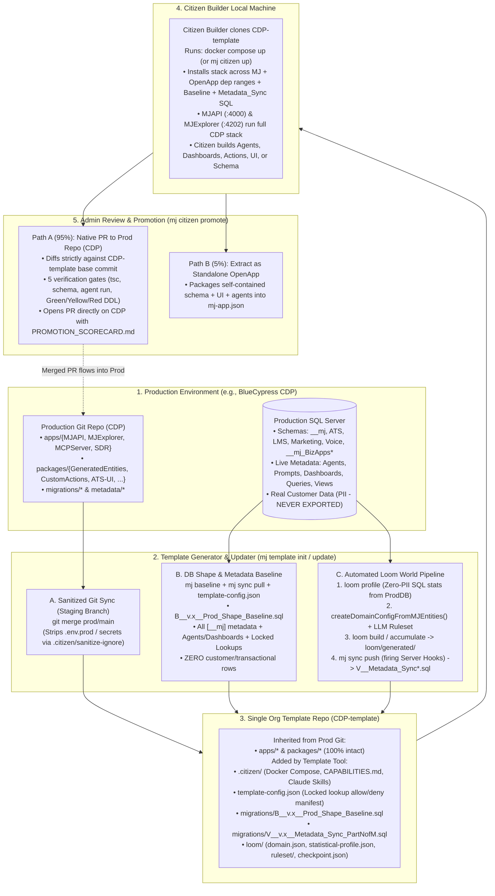
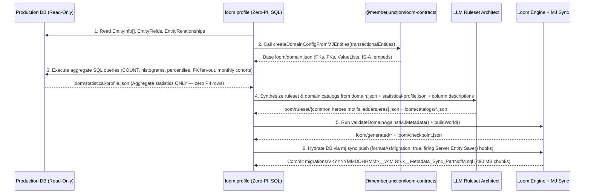

# Plan: Org Template Repos (Sanitized Prod Twin + Loom) & Full-Stack Citizen Builder

- **Status**: Draft / RFC (Updated with Review Feedback)
- **Related Work**:
  - [Citizen Agent Builder Plan](./citizen-agent-builder.md) (`citizen-builder/`)
  - [MJ Baseline Command Plan](../packages/MJCLI/src/commands/baseline/PLAN.md) (`packages/MJCLI/src/baseline/`)
  - Reference Repositories: `more-cheese` (Layered OpenApp + Loom reference), `loom` (`@memberjunction/loom-*`), `CDP` (Full-stack production MJ install reference)

---

## 1. Executive Summary & Core Framing

Organizations running full-stack MemberJunction installations in production (such as BlueCypress's `CDP`) want to empower **Citizen Builders**—analysts, operations leaders, domain experts, and internal builders using AI coding agents—to build **apps, dashboards, agents, prompts, queries, custom actions, Angular UI components, and schema extensions** locally against the exact shape of their organization's production system, without ever touching production credentials or real customer PII.

### Key Architectural Decisions

1. **Single Template Repo per Org (`<org>-template`, e.g., `CDP-template`)**:
   - Rather than splitting into multiple OpenApp repos (`<org>-platform` + `<org>-sampledata`) or requiring organizations to publish internal workspace packages to npm, an **Org Template Repo is a single, sanitized git twin of the full-stack production repository**, paired with an introspected **Production DB Shape Baseline** and hydrated with **Loom synthetic data**.
2. **Zero npm Publishing Required**:
   - Full-stack MJ installs like `CDP` are monorepos (`workspaces: ["apps/*", "packages/*"]`) containing `apps/MJAPI`, `apps/MJExplorer`, `apps/MCPServer`, and dozens of internal packages (`packages/GeneratedEntities`, `packages/CustomActions`, `packages/ATS-UI`, `packages/LMS-UI`, `packages/Marketing-UI`, etc.) that are never published to npm.
   - Because `<org>-template` is a downstream git twin of the production repo (with `.env.prod` / `.env.stage` and secrets stripped), every internal workspace package and installed OpenApp dependency (`mj-bizapps-*`, etc.) is already wired up and builds locally out of the box.
3. **True Layered Stack Installation + Skyway `B<YYYYMMDDHHMM>` Baseline**:
   - In long-lived production systems, replaying years of incremental migration folders (`v2`, `v3`, `v5`, domain subfolders) on a blank database rarely matches the live production schema, and misses AI Agents, Prompts, Dashboards, Queries, and User Views created directly in the Explorer UI.
   - `mj template init` connects read-only to the production DB, uses MJ's schema introspector (`packages/MJCLI/src/baseline/introspector-mssql.ts`) and `ComputeAutoBaselineStamp` (`packages/MJCLI/src/baseline/util.ts:261`) to emit **`B<YYYYMMDDHHMM>__v<M.N>.x__Prod_Shape_Baseline.sql`** stamped at `latestV.timestamp + 1 minute` across all migration directories, and pulls all live non-PII configuration metadata (`Agents`, `Prompts`, `Dashboards`, `Queries`, `User Views`, `Applications`, and admin-locked reference lookup tables in `template-config.json`) with **zero customer rows**.
   - At the same time, **we intentionally reject `.bak` binary snapshots**: `<org>-template` must genuinely install against the declared semver ranges of MJ Core and all upstream OpenApp dependencies (`mj-bizapps-*`, etc.) so that dependency upgrades and variations up and down the stack are truly installed and validated.
4. **Automated Loom World Generation & Committed `Metadata_Sync` SQL Migrations**:
   - `loom profile` runs read-only, zero-PII aggregate SQL queries against the production DB (row ratios, status/enum histograms, numeric quantiles, FK fan-out cardinalities, temporal curves) and combines them with `createDomainConfigFromMJEntities()` (`loom: packages/contracts/src/domain.ts`) + an LLM ruleset pass to generate realistic synthetic business data across all schemas.
   - Rather than regenerating via Loom on each Citizen Builder's machine (which risks Loom version variance and cannot replay multi-cycle incremental history + server hook side-effects) or shipping a frozen `.bak`, `mj template init` and `mj template update` hydrate `loom/generated/` via `mj sync push` (`sqlLogging.formatAsMigration: true`) and commit the resulting **`V<YYYYMMDDHHMM>__v<M.N>.x__Metadata_Sync_PartNofM.sql`** migrations (auto-split at $< 90\text{ MB}$ on `GO` boundaries to stay under GitHub's 100 MB per-file limit, exactly as proven in `more-cheese/migrations`).
   - Because `Metadata_Sync` migrations invoke **named-parameter `EXEC spCreate*` / `spUpdate*` stored procedures** (with `${mjSchema}` and `${flyway:defaultSchema}` placeholders), they execute cleanly even when upstream OpenApps add new defaulted columns within their semver ranges, while guaranteeing 100% deterministic data and server-hook side-effects across every Citizen Builder.
5. **Full-Stack Citizen Builder & Native Git Promotion**:
   - Because the Citizen Builder works inside a full local clone of the production repo layout, they can build across the full stack (Agents, Dashboards, Queries, Custom Actions, Angular UI panels, and schema migrations).
   - Promoting work back to production (`mj citizen promote`) diffs strictly against the `<org>-template` base commit (preventing un-synced prod metadata drift from leaking into feature PRs), runs 5 automated verification gates (including a **Green / Yellow / Red** Tier 4 schema policy), and opens a **clean Git PR directly against the production repo**—or, in rarer cases (`--as-openapp`), extracts a self-contained module into a standalone OpenApp.

---

## 2. End-to-End Architecture



---

## 3. Detailed Design by Lifecycle Phase

### Phase 1: Creating the Org Template Repo (`mj template init`)

An admin with read access to the production git repo and read-only access to the production database (or read replica) runs:

```bash
mj template init \
  --prod-repo https://github.com/BlueCypress/CDP \
  --template-repo https://github.com/BlueCypress/CDP-template \
  --db-connection "$PROD_READONLY_CONN"
```

#### Step 1.1: Sanitized Git Twin Setup
1. Clones `--prod-repo` and configures two remotes:
   - `origin` -> `<org>-template` (where Citizen Builders clone from)
   - `prod` -> `<org>-prod` (upstream production repo)
2. Applies `.citizen/sanitize-ignore` to strip and block sensitive environment and deployment files (`.env`, `.env.prod`, `.env.stage`, `.env.keys`, cloud deployment keys, historical `.zip` or `.log` artifacts) and generates a safe local `.env.example`.

#### Step 1.2: Database Shape & Live Metadata Baseline (Zero Customer Data)
Using the MSSQL introspector in `packages/MJCLI/src/baseline/introspector-mssql.ts` and the timestamp helpers in `packages/MJCLI/src/baseline/util.ts` (extended for multi-schema and multi-folder org installs):

1. **Multi-Schema Physical DDL Extraction & Skyway `B<YYYYMMDDHHMM>` Naming**:
   - Scans **all configured migration directories** in the repo (both versioned folders like `migrations/v2`, `v3`, `v5` and domain subfolders like `migrations/ATS`, `LMS`, `Marketing`, `Voice` in `CDP`, extending `DiscoverMigrationsSourceDir` / `FindLatestVersionedMigration` in `packages/MJCLI/src/baseline/util.ts:186-254`) to find the global latest `V` migration timestamp.
   - Uses `ComputeAutoBaselineStamp` (`packages/MJCLI/src/baseline/util.ts:267`) to stamp **`B<YYYYMMDDHHMM>__v<M.N>.x__Prod_Shape_Baseline.sql`** at `latestV.timestamp + 1 minute`.
   - `@memberjunction/skyway-core` (0.7.1+) natively recognizes the `B<YYYYMMDDHHMM>` baseline file and automatically skips all historical `V` migrations at or below that timestamp—requiring no manual `flyway_schema_history` row insertion—while running any newer `V` files added after the baseline.
   - Meanwhile, MJ Core (`__mj`) and any declared OpenApp dependencies (`mj-bizapps-*`, etc.) remain governed by their declared semver ranges so upgrades up and down the stack install and migrate through the standard pipeline.
   - Explicitly preserves hand-crafted views where `BaseViewGenerated = 0` in `[__mj].[Entity]`.

2. **"Propose, Then Lock" Entity Ownership & Lookup Classification (`template-config.json` & `loom/ownership.json`)**:
   - Classifies every entity in `[__mj].[Entity]` into five categories (generalizing `more-cheese/data/ownership.json`).
   - Crucially, for **`org_reference_lookups`**, a purely automatic heuristic is not enough:
     - *False positive risk*: Small tables ($\le 200$ rows) with generic `Name` / `Amount` columns can still contain sensitive data (e.g., `SalesRep(ID, Name, Region)` containing real employee names, executive comp bands, vendor rate cards, or M&A targets), while blocking `Name` would break legitimate lookups like `StatusType`, `Category`, and `GLAccount`.
     - *False negative risk*: Legitimate taxonomy tables can exceed 200 rows (e.g., NAICS codes, postal/geo tables, full GL chart of accounts, skill taxonomies).
   - **Propose-Then-Lock Workflow**:
     1. `mj template init` uses the heuristic (excluding any table with `NVARCHAR(MAX)` columns or outgoing FKs to `[__mj].[User]` / `Person` / `Contact` / `Employee` by default) only to **propose** candidate `org_reference_lookups` tables.
     2. It prints an interactive review table (Entity Name, Schema, Row Count, Columns) for the Admin to confirm or adjust, and writes the locked allow/deny manifest to **`template-config.json`** (and `loom/ownership.json`) in git.
     3. Subsequent `mj template update` runs strictly honor the locked `template-config.json` and only flag *newly created* tables for classification.

| Category | Detection / Lock Rule | Baseline Action |
| :--- | :--- | :--- |
| **`mj_system_metadata`** | Core metadata tables in `__mj` (`Entity`, `EntityField`, `EntityFieldValue`, `EntityRelationship`, `Role`, `EntityPermission`, `OpenApp`, `OpenAppDependency`, etc.) | Exported into `B<YYYYMMDDHHMM>__v<M.N>.x__Prod_Shape_Baseline.sql` so CodeGen and runtime metadata match prod identically. |
| **`org_config_and_agents`** | Operational config tables (`Application`, `ApplicationEntity`, `AIAgent`, `AIPrompt`, `AIAgentPrompt`, `AIAgentAction`, `Action`, `ActionParam`, `Query`, `Dashboard`, `UserView`, `RecordProcess`, `ContentType`, etc.) | Pulled from live Prod DB via `mj sync pull` into `config/` (and baked into `Metadata_Sync`), with user-owned items (`Dashboard`, `UserView`) re-assigned to a single sanitized **`templateUser`** (`IsTemplate = 1`). |
| **`org_reference_lookups`** | Explicit allowlist locked in **`template-config.json`** (seeded during `mj template init` from candidate tables with incoming FKs, zero `NVARCHAR(MAX)` columns, and zero User/Person FKs, then confirmed by Admin) | Seeded directly from Prod DB so queries, actions, and agents that filter on specific lookup codes/IDs work without modification. |
| **`transactional_business_data`** | All remaining tables in custom org schemas (`ATS`, `LMS`, `Marketing`, `Voice`) and OpenApp schemas (`__mj_BizApps*`) + `__mj.Company` | **0 rows exported from Prod DB.** Populated 100% by **Loom** in Step 1.3. |
| **`ephemeral_and_audit_logs`** | `AuditLog`, `UserRecordLog`, `RecordChange`, `ErrorLog`, `AIAgentRun*`, `AIPromptRun*`, `Conversation*`, `UserNotification` | **Excluded** (left empty or seeded with curated synthetic examples via `templateUser`). |

#### Step 1.3: Automated Loom Statistical Profiling & Committed `Metadata_Sync` SQL Migrations
Generalizing the pipeline proven in `more-cheese/scripts/generate.mjs` and `@memberjunction/loom-*`:



1. **Zero-PII Statistical Profiler (`loom profile`)**:
   - Runs read-only aggregate SQL queries against the production DB to produce `loom/statistical-profile.json`:
     - **Volume & Ratios**: True table row counts scaled proportionally to a local target (e.g., `--scale 500` root persons/accounts), preserving exact parent-to-child ratios.
     - **Categorical Histograms**: `GROUP BY` frequencies for every `ValueList` / enum / status column (suppressing any distinct string values that don't come from a bounded enum or have count $< 5$ to guarantee zero PII leakage).
     - **Numeric Quantiles**: `MIN`, `P10`, `P25`, `P50`, `P75`, `P90`, `P99`, `MAX`, `AVG`, `STDEV` for numeric/currency columns.
     - **FK Cardinality Fan-Out**: Distribution of child rows per parent (`0 children %`, `p50`, `p90`, `max`).
     - **Temporal Shapes**: Monthly creation volume curve over the past 36 months and stage transition lag distributions (`CreatedAt` -> `UpdatedAt` / `ClosedAt`).
2. **LLM Ruleset & Catalog Architect**:
   - Uses `loom/domain.json` (from `createDomainConfigFromMJEntities()` in `loom: packages/contracts/src/domain.ts`) + `loom/statistical-profile.json` + `Entity` / `EntityField` descriptions to synthesize:
     - `loom/ruleset/{common,heroes,motifs,ladders,eras}.json` calibrated so simulated conversion rates, amounts, and status distributions match production shapes.
     - `loom/catalogs/*.json` with realistic domain vocabulary (e.g., realistic job titles, course names, campaign names, interview feedback templates).
     - 8–12 named **Hero archetypes** (pinned deterministic records representing canonical business scenarios like "High-Intent Enterprise Lead", "Completed LMS Graduate", "At-Risk Renewal Account").
3. **Why We Commit `V<YYYYMMDDHHMM>__v<M.N>.x__Metadata_Sync*.sql` (and Reject Both `.bak` and Client-Side Loom Regeneration)**:
   - **Why not `.bak`?**: A `.bak` is a frozen binary snapshot of one exact combination of MJ Core and OpenApp versions. It bypasses `mj migrate` / `mj app install` across declared dependency semver ranges and cannot test or adapt to changes up and down the stack.
   - **Why not regenerate via Loom on each Citizen Builder's laptop?**: Minor version updates to `@memberjunction/loom-engine` could shift PRNG streams, and client-side regeneration cannot replay multi-cycle `loom accumulate` history or guarantee identical timestamps/IDs from runtime server `Save()` hooks (such as `OrderEntityServer.Save()` generating downstream `Subscription` and `JournalEntry` rows).
   - **Why Committed `Metadata_Sync` SQL Migrations Win**:
     - During `mj template init` (and incrementally during `mj template update`), `mj sync push` runs against a fresh database built by the installed dependency chain with `sqlLogging.formatAsMigration: true` (firing all custom server `Save()` hooks once at template build time) and emits **`V<YYYYMMDDHHMM>__v<M.N>.x__Metadata_Sync_PartNofM.sql`**.
     - Because every statement in `Metadata_Sync` is a **named-parameter stored procedure call** (`EXEC [${mjSchema}].spCreateCompany @ID = ..., @Name = ...`, `EXEC [__mj_BizAppsCommon].spCreatePerson ...`, `EXEC [${flyway:defaultSchema}].spCreate...`), it executes cleanly against freshly installed upstream OpenApps even when an upstream dependency adds a new nullable/defaulted column within its semver range.
     - Files are automatically split on `GO` statement boundaries at $< 90\text{ MB}$ per part (staying safely under GitHub's 100 MB per-file push limit, as proven in `more-cheese/migrations/V202609182025__v1.2.x__Metadata_Sync_Part1of5.sql`).
     - *Size Optimization*: Emitting inline literal arguments on `EXEC spCreate*` (instead of declaring and setting 15–30 throwaway `@Col_<hash>` local variables per row) reduces `Metadata_Sync` SQL file size by ~50% while preserving identical named-parameter stored procedure execution.

#### Step 1.4: Citizen Builder Harness Injection
Adds the Citizen Builder local runtime and AI guidance files to `<org>-template`:
- `docker-compose.yml` & `.citizen/docker-entrypoint.sh`: Starts SQL Server, runs the full migration stack (MJ Core + dependent OpenApps within their semver ranges + `B<YYYYMMDDHHMM>__v<M.N>.x__Prod_Shape_Baseline.sql` + `V<YYYYMMDDHHMM>__v<M.N>.x__Metadata_Sync*.sql`), provisions `OWNER_EMAIL` with the `Developer` role, clones `templateUser` dashboards/views, and starts `MJAPI` (`:4000`) and `MJExplorer` (`:4202`).
- `CAPABILITIES.md`: Auto-generated architectural map of the org's instance—every schema, entity, view, existing AI Agent, Action, and workspace UI package (`packages/ATS-UI`, `packages/Marketing-UI`, etc.).
- `.agents/skills/` & `AGENTS.md`: Pre-configured skills for building and verifying full-stack features and packaging them for promotion.

---

### Phase 2: Incremental Updates (`mj template update`)

As production evolves over weeks and months, the org updates `<org>-template` via a scheduled CI workflow or admin CLI command:

```bash
mj template update --db-connection "$PROD_READONLY_CONN"
```

1. **Atomic Staging Branch & Conflict Handling**:
   - Rather than merging directly onto `<org>-template`'s `main` branch without a recovery path, `mj template update` always executes on a staging branch (`template-sync/<YYYYMMDDHHMM>`).
   - For code and migration paths owned by production (`apps/*`, `packages/*`, `migrations/*`), `prod/main` is merged while enforcing `.citizen/sanitize-ignore` (so `.env.*` secrets never enter the branch) and preserving template-only paths (`.citizen/*`, `loom/*`, `template-config.json`).
   - To prevent 3-way git merge conflicts in `metadata/` (where both `prod/main` commits and prior `mj sync pull` runs may have touched files), `mj template update` takes `prod/main`'s `metadata/` tree first and then runs `mj sync pull` from the live Prod DB on top of it.
   - If any unexpected git conflict, build error, or migration failure occurs, `mj template update` **aborts mutating `main`**, pushes the `template-sync/<YYYYMMDDHHMM>` branch, and opens a diagnostic PR on `<org>-template` for Admin resolution (matching the PR-based workflow used in Phase 4).
2. **Database Shape & Live Metadata Delta**:
   - Pulls any new or updated Explorer-authored `Agents`, `Prompts`, `Dashboards`, `Queries`, `User Views`, and `Applications` from Prod DB via `mj sync pull`.
   - Checks for any newly added tables in `[__mj].[Entity]`: if a new table matches the lookup candidate heuristic, prompts the Admin (or flags it in the `template-sync` PR) to lock its disposition in `template-config.json`.
   - Compares the live Prod DB schema against the template repo's current schema (after applying new `migrations/` merged from `prod/main`); if out-of-band DDL occurred in prod, emits an incremental schema alignment migration.
3. **Incremental Loom Accumulation (`loom accumulate`)**:
   - Runs `validateDomainAgainstMJMetadata()` (`loom: packages/contracts/src/domain.ts`) against the updated `EntityInfo[]`.
   - If new transactional tables or columns were added in production, profiles only those new tables/columns via `loom profile --delta` and patches `loom/domain.json` and `loom/ruleset/`.
   - Calls `accumulateWorld()` (`loom: packages/engine/src/build.ts`) starting from `loom/checkpoint.json`:
     - **Monotonic Identity Guarantee (`base ⊆ head`)**: Every existing synthetic record UUID (`Person`, `Organization`, `Application`, Hero records) remains **100% unchanged**, so Citizen Builders with in-progress branches or saved test prompts never have their foreign keys or record IDs broken.
     - Hydrates the additive delta through `mj sync push` (`formatAsMigration: true`) and commits a single new incremental **`migrations/V<YYYYMMDDHHMM>__v<M.N>.x__Metadata_Sync.sql`** migration (just as `more-cheese` did with `V202609252308__v1.3.x__Metadata_Sync.sql`) alongside the updated `loom/checkpoint.json`.
     - Existing Citizen Builders simply run `git pull && mj migrate` and Skyway applies only the new delta migration.

---

### Phase 3: The Citizen Builder Local Experience

Because `<org>-template` is a full-stack clone of the production repo with Loom data snapped in via standard Skyway migrations, Citizen Builders can build **anything** in the context of their organization:

| Capability Tier | What Citizen Builders Can Build Locally | Where It Lives in the Repo |
| :--- | :--- | :--- |
| **Tier 1: Declarative Metadata** | AI Agents, Prompts, Saved Queries, Configured Dashboards, User Views, Applications (Nav & Workspace layouts) | `metadata/` (synced bidirectionally between local DB and disk via `mj sync push` / `mj sync pull`) |
| **Tier 2: Actions & Server Logic** | Strongly-typed Custom Actions, Entity Subclasses, MCP Tools | `packages/CustomActions`, `packages/CustomEntities_Server` (with full compile-time TypeScript types from `packages/GeneratedEntities`) |
| **Tier 3: Custom Angular UI & Apps** | Interactive Dashboards (`BaseDashboard`), Custom Resource Components, Entity Form Panels (`@RegisterClassEx(BaseFormPanel, ...)`), Standalone Apps | `packages/<Domain>-UI` or `apps/` (with live HMR on `localhost:4202`) |
| **Tier 4: Schema Extensions** | New tables, 1:1 extension profiles, additive columns, custom analytical views | `migrations/<Schema>/V<YYYYMMDDHHMM>__v<M.N>.x__*.sql` + `npm run migrate && npm run codegen` (updating `packages/GeneratedEntities` locally) |

#### Guardrails Built into the Local Environment
- **Repo-Specific Rules Enforcement**: Any rules in the production repo's `CLAUDE.md` / `AGENTS.md` (for example, `CDP`'s rule that `ALTER TABLE ADD COLUMN` on a table with `BaseViewGenerated = 0` must also recreate the manually-managed view with explicit trailing columns) are automatically inherited and enforced by pre-promotion checks.
- **Zero Production Network Access**: All external integration keys (`SendGrid`, `Apollo`, `HubSpot`, `Twilio`) in `.env.example` default to local mock/sandbox adapters so a Citizen Builder testing an agent or action can never accidentally email or text a real external contact.

---

### Phase 4: Promotion Workflow (`mj citizen promote`)

When a Citizen Builder is ready to share their work with an Admin for production promotion, they run `mj citizen promote` (or `/promote` in Claude Code).

```mermaid
sequenceDiagram
    participant CB as Citizen Builder (Local Branch)
    participant CLI as mj citizen promote
    participant Gates as 5 Automated Verification Gates
    participant ProdRepo as Production Repo (e.g., CDP)
    participant Admin as Org Admin / Reviewer

    CB->>CLI: Runs `mj citizen promote`
    CLI->>CLI: 1. Run `mj sync pull` on Citizen Builder's touched entities
    CLI->>CLI: 2. Compute narrow diff strictly against `<org>-template` base commit\n(prevents un-synced prod metadata drift from leaking into PR)
    CLI->>Gates: 3. Execute Verification Suite on narrow diff
    Gates->>Gates: Gate A: Schema & Metadata Consistency (@lookup/@file refs, BaseViewGenerated=0 view alignment)
    Gates->>Gates: Gate B: TypeScript & Angular Build (`npm run build` on touched workspaces; zero `any`)
    Gates->>Gates: Gate C: Execution Proof (verify successful run in [__mj].[vwAIAgentRuns] / ActionLog)
    Gates->>Gates: Gate D: Visual Receipt (Playwright screenshot of new/modified Dashboards or Form Panels)
    Gates->>Gates: Gate E: Tier 4 DDL Risk Policy (Green / Yellow / Red) + Security & Standards Audit
    Gates-->>CLI: Generates PROMOTION_SCORECARD.md
    CLI->>ProdRepo: Path A (Default 95%): Cherry-pick Citizen Builder delta onto `prod/main` branch\n(excluding loom/*, .citizen/*, template-config.json, B*__Prod_Shape_Baseline.sql, V*__Metadata_Sync*.sql)\nOpen PR on Prod Repo with PROMOTION_SCORECARD.md
    CLI-->>ProdRepo: Path B (Rare 5% `--as-openapp`): Extract self-contained schema + packages + metadata into standalone OpenApp repo
    ProdRepo->>Admin: Admin reviews standard Git PR + Scorecard + Screenshots and merges
```

#### Isolating Citizen Builder Changes from Live Prod Metadata Drift
Because Step 1.2 pulls live UI-authored `Agents`, `Prompts`, `Dashboards`, `Queries`, and `User Views` from Prod DB into `<org>-template`, some of those files may not yet be committed in `prod/main`'s `metadata/` folder.
- **Strict Base-Commit Diffing**: `mj citizen promote` computes the Citizen Builder's patch strictly as `git diff <org>-template-base..HEAD` (capturing *only* the files and metadata records the Citizen Builder actually created or modified locally) and applies that narrow patch onto a fresh branch off `prod/main`. A single feature promotion PR will never accidentally bundle unrelated production metadata drift.

#### Gate E: Three-Tier Schema Policy (Green / Yellow / Red)
Aligned with the Publish-Then-No-Breaking-Changes policy and `@memberjunction/standards` checks (including upcoming migration existence and status checks from #5923):

| Risk Tier | DDL Scope | Gate E Behavior |
| :--- | :--- | :--- |
| 🟢 **Green (Standard Promotion)** | New tables in domain schemas, 1:1 extension tables, and new views (passing all 5 gates and `npm run check:standards`). | Passes automatically; standard Admin review in `PROMOTION_SCORECARD.md`. |
| 🟡 **Yellow (Elevated Admin/DBA Sign-Off)** | Additive `ALTER TABLE ... ADD` on existing production tables (which affect `GeneratedEntities`, CRUD sprocs, and hand-written `BaseViewGenerated = 0` views). | Allowed when all checks (including `BaseViewGenerated = 0` view alignment) pass, but places a prominent **`⚠️ Modifies Existing Production Table — Requires Admin/DBA Review`** banner at the top of `PROMOTION_SCORECARD.md`. |
| 🔴 **Red (Hard-Blocked)** | Destructive or breaking DDL: `DROP TABLE`, `DROP COLUMN`, `TRUNCATE`, column type narrowing, adding `NOT NULL` without a `DEFAULT` on an existing table, or any DDL touching `__mj` core tables. | **Hard-blocked by `mj citizen verify` / `mj citizen promote`** before a PR can be opened. |

#### Path A: Promote to Main Production Repo via PR (Default — 95% of Cases)
1. `mj citizen promote` takes the narrow diff between the Citizen Builder's branch and the base `<org>-template` commit, excluding template-only paths (`loom/`, `.citizen/`, `template-config.json`, `B*__Prod_Shape_Baseline.sql`, `V*__Metadata_Sync*.sql`, `CAPABILITIES.md`).
2. It applies the Citizen Builder's changes (`metadata/*`, `packages/*`, `apps/*`, `migrations/<Schema>/*`) onto a new branch based on `prod/main` (`citizen-promote/<user>/<feature>`).
3. It opens a Pull Request against the production repo (`CDP`) with **`PROMOTION_SCORECARD.md`** embedded in the PR description.

#### Path B: Graduate to a Standalone OpenApp (`mj citizen promote --as-openapp` — Rare 5% of Cases)
When a Citizen Builder builds a self-contained vertical capability (e.g., a new custom schema + UI package + agents) that the Admin wants to distribute as a reusable OpenApp across multiple MJ instances rather than folding directly into the monolithic repo:
- `mj citizen promote --as-openapp` invokes `ScaffoldOpenApp` (`packages/OpenApp/Engine/src/scaffold/app-scaffolder.ts`) to extract the new schema migration, TypeScript/Angular packages, and `metadata/` into a standalone OpenApp repository with a valid `mj-app.json` and `Metadata_Sync` migration.

---

## 4. Proposed CLI Surface & Implementation Phases

### CLI Commands (`@memberjunction/cli` + `@memberjunction/loom-cli`)

| Command | Persona | Description |
| :--- | :--- | :--- |
| `mj template init` | Admin | Creates `<org>-template` from a production git repo + read-only production DB connection: sanitizes git, prompts to lock `template-config.json` lookups, extracts `B<YYYYMMDDHHMM>__v<M.N>.x__Prod_Shape_Baseline.sql`, pulls live config metadata, runs `loom profile` + `loom build` + `mj sync push` to commit `V<YYYYMMDDHHMM>__v<M.N>.x__Metadata_Sync_PartNofM.sql`, and injects the `.citizen/` Docker harness. |
| `mj template update` | Admin / CI | Incrementally updates `<org>-template` on a staging branch (`template-sync/<ts>`): merges `prod/main`, refreshes `metadata/` via `mj sync pull`, diffs Prod DB schema, and runs `loom accumulate` from `loom/checkpoint.json` to emit an incremental `V<YYYYMMDDHHMM>__v<M.N>.x__Metadata_Sync.sql` migration (opening a conflict PR if any step fails). |
| `mj citizen up` | Citizen Builder | Boots the local Docker stack (`SQL Server` + `MJAPI` + `MJExplorer`), installing MJ Core + dependent OpenApps across their semver ranges and applying the template repo's baseline + `Metadata_Sync` migrations. |
| `mj citizen verify` | Citizen Builder | Runs the 5 pre-promotion gates (including the Green/Yellow/Red DDL check) locally and previews `PROMOTION_SCORECARD.md`. |
| `mj citizen promote` | Citizen Builder / Admin | Serializes local DB metadata edits (`mj sync pull`), diffs strictly against the `<org>-template` base commit, runs `mj citizen verify`, and opens a filtered promotion PR against the production repo (or `--as-openapp`). |

### Phased Rollout Plan

1. **Phase 1: Multi-Schema `mj baseline`, `template-config.json` Lock & Prod Sanitizer (`mj template init --skip-loom`)**
   - Extend `packages/MJCLI/src/baseline/introspector-mssql.ts` and `packages/MJCLI/src/baseline/util.ts` to scan all migration folders (`v\d+` and domain folders like `ATS/`, `LMS/`, `Marketing/`, `Voice/`), implement the "propose, then lock" `template-config.json` lookup workflow, and emit `B<YYYYMMDDHHMM>__v<M.N>.x__Prod_Shape_Baseline.sql`.
   - Test against `CDP` to verify that a fresh SQL Server container boots the exact `CDP` schema + live Agents/Dashboards with zero customer PII.
2. **Phase 2: Automated Loom Statistical Profiler (`loom profile` & `loom init-from-mj`)**
   - Build the read-only SQL statistical profiler in `loom` (`statistical-profile.json`: row ratios, enum histograms, numeric quantiles, FK fan-out, temporal curves).
   - Pair `createDomainConfigFromMJEntities()` (`loom: packages/contracts/src/domain.ts`) with an LLM Ruleset/Catalog generator so `loom build` and `loom accumulate` (`loom: packages/engine/src/build.ts`) populate all transactional tables in `CDP-template` and emit `< 90 MB` chunked `V<YYYYMMDDHHMM>__v<M.N>.x__Metadata_Sync*.sql` migrations automatically.
3. **Phase 3: Full-Stack Citizen Builder Harness (`mj citizen up` / Skills)**
   - Evolve `citizen-builder/` skills and `CAPABILITIES.md` generator to support full-stack repo layouts (`apps/*`, `packages/*`, `migrations/*`, `metadata/*`) across Tiers 1–4.
4. **Phase 4: Automated Verification Gates & Git PR Promoter (`mj citizen promote`)**
   - Build the 5-gate verifier (with Green/Yellow/Red DDL classification and `PROMOTION_SCORECARD.md`) and the base-commit-isolated git PR creator that lifts Citizen Builder branches from `<org>-template` into clean PRs on the production repository.
