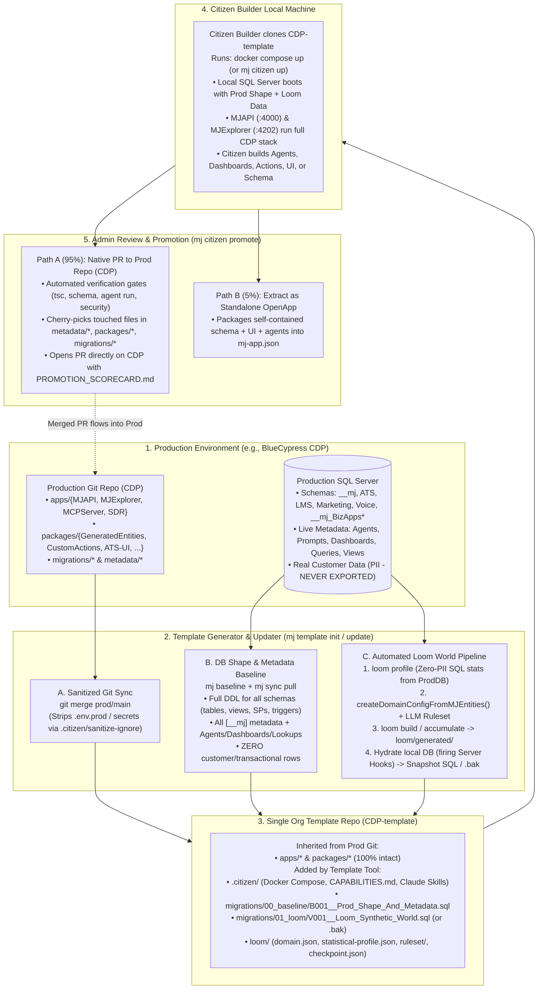
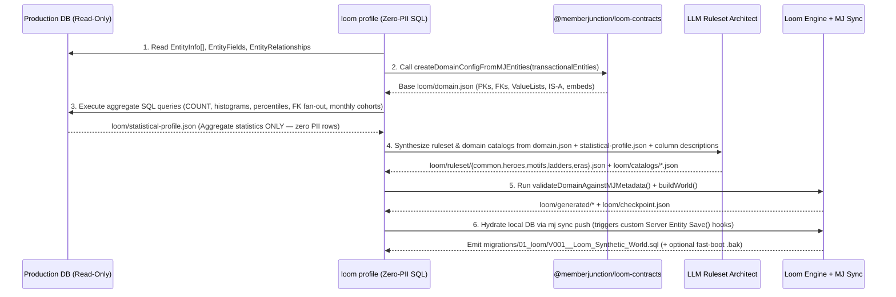

# Plan: Org Template Repos (Sanitized Prod Twin + Loom) & Full-Stack Citizen Builder

- **Status**: Draft / RFC
- **Related Work**:
  - [Citizen Agent Builder Plan](./citizen-agent-builder.md) (`citizen-builder/`)
  - [MJ Baseline Command Plan](../packages/MJCLI/src/commands/baseline/PLAN.md) (`packages/MJCLI/src/baseline/`)
  - Reference Repositories: `more-cheese` (Layered OpenApp + Loom reference), `loom` (`@memberjunction/loom-*`), `CDP` (Full-stack production MJ install reference)

---

## 1. Executive Summary & Core Framing

Organizations running full-stack MemberJunction installations in production (such as BlueCypress's `CDP`) want to empower **Citizen Builders**—analysts, operations leaders, domain experts, and internal builders using AI coding agents—to build **apps, dashboards, agents, prompts, queries, custom actions, Angular UI components, and schema extensions** locally against the exact shape of their organization's production system, without ever touching production credentials or real customer PII.

### Key Architectural Decisions

1. **Single Template Repo per Org (`<org>-template`, e.g., `CDP-template`)**:
   - Rather than splitting into multiple OpenApp repos (`<org>-platform` + `<org>-sampledata`) or requiring organizations to publish internal workspace packages to npm, an **Org Template Repo is a single, sanitized git twin of the full-stack production repository**, paired with an introspected **Production DB Shape Baseline** and hydrated with **Loom synthetic data**.
2. **Zero npm Publishing Required**:
   - Full-stack MJ installs like `CDP` are monorepos (`workspaces: ["apps/*", "packages/*"]`) containing `apps/MJAPI`, `apps/MJExplorer`, `apps/MCPServer`, and dozens of internal packages (`packages/GeneratedEntities`, `packages/CustomActions`, `packages/ATS-UI`, `packages/LMS-UI`, `packages/Marketing-UI`, etc.) that are never published to npm.
   - Because `<org>-template` is a downstream git twin of the production repo (with `.env.prod` / `.env.stage` and secrets stripped), every internal workspace package and installed OpenApp dependency (`mj-bizapps-*`, etc.) is already wired up and builds locally out of the box.
3. **Live DB Shape Introspection Solves Migration Drift**:
   - In long-lived production systems, replaying years of incremental migration folders (`v2`, `v3`, `v5`, domain subfolders) on a blank database rarely matches the live production schema, and misses AI Agents, Prompts, Dashboards, Queries, and User Views created directly in the Explorer UI.
   - `mj template init` connects read-only to the production DB, uses MJ's schema introspector (`packages/MJCLI/src/baseline/introspector-mssql.ts`) to emit a clean **Schema + Metadata Baseline (`B001__Prod_Shape_Baseline.sql`)** across all schemas (`__mj`, installed `__mj_BizApps*` OpenApps, and org custom schemas like `ATS`, `LMS`, `Marketing`, `Voice`), and pulls all live non-PII configuration metadata (`Agents`, `Prompts`, `Dashboards`, `Queries`, `User Views`, `Applications`, and small lookup/taxonomy tables) with **zero customer rows**.
4. **Automated Loom World Generation & Incremental Accumulation**:
   - `loom profile` runs read-only, zero-PII aggregate SQL queries against the production DB (row ratios, status/enum histograms, numeric quantiles, FK fan-out cardinalities, temporal curves) and combines them with `createDomainConfigFromMJEntities()` + an LLM ruleset pass to generate realistic synthetic business data across all schemas.
   - Over time, `mj template update` merges code changes from `prod/main`, diffs the production DB schema/metadata, and runs `loom accumulate` (`base ⊆ head`) so existing synthetic UUIDs never change while new tables/columns are populated.
5. **Full-Stack Citizen Builder & Native Git Promotion**:
   - Because the Citizen Builder works inside a full local clone of the production repo layout (powered by a pre-seeded Docker SQL Server + Loom data), they are no longer restricted to "Agent-only" JSON files—they can build across the full stack (Agents, Dashboards, Queries, Custom Actions, Angular UI panels, and additive schema migrations).
   - Promoting work back to production (`mj citizen promote`) runs automated verification gates and opens a **clean Git PR directly against the production repo** (filtering out template-only `loom/` and `.citizen/` paths)—or, in rarer cases (`--as-openapp`), extracts a self-contained module into a standalone OpenApp.

---

## 2. End-to-End Architecture



---

## 3. Detailed Design by Lifecycle Phase

### Phase 1: Creating the Org Template Repo (`mj template init`)

An admin with read access to the production git repo and read-only access to the production database (or read replica) runs:

```bash
mj template init \
  --prod-repo https://github.com/BlueCypress/CDP \
  --template-repo https://github.com/BlueCypress/CDP-template \
  --db-connection "$PROD_READONLY_CONN"
```

#### Step 1.1: Sanitized Git Twin Setup
1. Clones `--prod-repo` and configures two remotes:
   - `origin` -> `<org>-template` (where Citizen Builders clone from)
   - `prod` -> `<org>-prod` (upstream production repo)
2. Applies `.citizen/sanitize-ignore` to strip and block sensitive environment and deployment files (`.env`, `.env.prod`, `.env.stage`, `.env.keys`, cloud deployment keys, historical `.zip` or `.log` artifacts) and generates a safe local `.env.example`.

#### Step 1.2: Database Shape & Live Metadata Baseline (Zero Customer Data)
Using the MSSQL introspector in `packages/MJCLI/src/baseline/introspector-mssql.ts` (extended for multi-schema org installs):

1. **Multi-Schema Physical DDL Extraction**:
   - Introspects `[__mj]`, all installed OpenApp schemas (discovered from `[__mj].[OpenApp]`, e.g. `__mj_BizAppsCommon`, `__mj_BizAppsOrders`), and all custom org schemas (discovered from `[__mj].[Entity].[SchemaName]`, e.g. `ATS`, `LMS`, `Marketing`, `Voice`, `dbo`).
   - Emits `migrations/00_baseline/B001__Prod_Shape_Baseline.sql` containing all schemas, tables, primary/unique keys, check constraints, defaults, foreign keys (including cross-schema FKs), indexes, views (explicitly preserving hand-crafted views where `BaseViewGenerated = 0`), stored procedures, functions, and triggers.
2. **Entity Ownership & Data Classification (`loom/ownership.json`)**:
   - Automatically classifies every entity in `[__mj].[Entity]` into four categories (generalizing `more-cheese/data/ownership.json`):

| Category | Detection Rule | Baseline Action |
| :--- | :--- | :--- |
| **`mj_system_metadata`** | Core metadata tables in `__mj` (`Entity`, `EntityField`, `EntityFieldValue`, `EntityRelationship`, `Role`, `EntityPermission`, `OpenApp`, `OpenAppDependency`, etc.) | Exported 100% into `B001__Prod_Shape_Baseline.sql` so CodeGen and runtime metadata match prod identically. |
| **`org_config_and_agents`** | Operational config tables (`Application`, `ApplicationEntity`, `AIAgent`, `AIPrompt`, `AIAgentPrompt`, `AIAgentAction`, `Action`, `ActionParam`, `Query`, `Dashboard`, `UserView`, `RecordProcess`, `ContentType`, etc.) | Pulled from live Prod DB via `mj sync pull` (or exported into baseline), with user-owned items (`Dashboard`, `UserView`) re-assigned to a single sanitized **`templateUser`** (`IsTemplate = 1`). |
| **`org_reference_lookups`** | Custom/OpenApp tables with $\le 200$ rows, incoming FKs from transactional tables, and zero PII columns (no `Email`, `Phone`, `SSN`, `FirstName`, `LastName`, `Notes` columns) — e.g., `StatusType`, `Category`, `GLAccount` chart of accounts | Seeded directly from Prod DB so queries, actions, and agents that reference specific lookup codes/IDs work without modification. |
| **`transactional_business_data`** | All remaining tables in custom org schemas (`ATS`, `LMS`, `Marketing`, `Voice`) and OpenApp schemas (`__mj_BizApps*`) + `__mj.Company` | **0 rows exported from Prod DB.** Populated 100% by **Loom** in Step 1.3. |
| **`ephemeral_and_audit_logs`** | `AuditLog`, `UserRecordLog`, `RecordChange`, `ErrorLog`, `AIAgentRun*`, `AIPromptRun*`, `Conversation*`, `UserNotification` | **Excluded** (left empty or seeded with curated synthetic examples via `templateUser`). |

3. **Flyway History Stamp**:
   - Inserts a baseline marker into `flyway_schema_history` corresponding to the latest migration present in `migrations/` at the time of snapshot, so Flyway knows all prior migrations are already represented in `B001__Prod_Shape_Baseline.sql` and will only execute *new* migrations created after the baseline.

#### Step 1.3: Automated Loom Statistical Profiling & Synthetic World Generation
Generalizing the pipeline proven in `more-cheese/scripts/generate.mjs` and `@memberjunction/loom-*`:



1. **Zero-PII Statistical Profiler (`loom profile`)**:
   - Runs read-only aggregate SQL queries against the production DB to produce `loom/statistical-profile.json`:
     - **Volume & Ratios**: True table row counts scaled proportionally to a local target (e.g., `--scale 500` root persons/accounts), preserving exact parent-to-child ratios.
     - **Categorical Histograms**: `GROUP BY` frequencies for every `ValueList` / enum / status column (suppressing any distinct string values that don't come from a bounded enum or have count $< 5$ to guarantee zero PII leakage).
     - **Numeric Quantiles**: `MIN`, `P10`, `P25`, `P50`, `P75`, `P90`, `P99`, `MAX`, `AVG`, `STDEV` for numeric/currency columns.
     - **FK Cardinality Fan-Out**: Distribution of child rows per parent (`0 children %`, `p50`, `p90`, `max`).
     - **Temporal Shapes**: Monthly creation volume curve over the past 36 months and stage transition lag distributions (`CreatedAt` -> `UpdatedAt` / `ClosedAt`).
2. **LLM Ruleset & Catalog Architect**:
   - Uses `loom/domain.json` (from `createDomainConfigFromMJEntities()`) + `loom/statistical-profile.json` + `Entity` / `EntityField` descriptions to synthesize:
     - `loom/ruleset/{common,heroes,motifs,ladders,eras}.json` calibrated so simulated conversion rates, amounts, and status distributions match production shapes.
     - `loom/catalogs/*.json` with realistic domain vocabulary (e.g., realistic job titles, course names, campaign names, interview feedback templates).
     - 8–12 named **Hero archetypes** (pinned deterministic records representing canonical business scenarios like "High-Intent Enterprise Lead", "Completed LMS Graduate", "At-Risk Renewal Account").
3. **Server-Hook Hydration & SQL Emission**:
   - Runs `buildWorld()` to produce `loom/generated/` and `loom/checkpoint.json` (using deterministic `uuidv5(namespace, "entity:businessKey")` IDs).
   - Pushes `loom/generated/` into the containerized baseline database from the repo root so custom server entity subclasses (e.g., `packages/CustomEntities_Server` or `OrderEntityServer`) execute their `Save()` business logic, and captures the resulting SQL into `migrations/01_loom/V001__Loom_Synthetic_World.sql` (and optionally exports a pre-seeded `.bak` snapshot for instant startup).

#### Step 1.4: Citizen Builder Harness Injection
Adds the Citizen Builder local runtime and AI guidance files to `<org>-template`:
- `docker-compose.yml` & `.citizen/docker-entrypoint.sh`: Starts SQL Server, applies the baseline + Loom world (or restores the `.bak` in $< 15\text{s}$), provisions `OWNER_EMAIL` with the `Developer` role, clones `templateUser` dashboards/views, and starts `MJAPI` (`:4000`) and `MJExplorer` (`:4202`).
- `CAPABILITIES.md`: Auto-generated architectural map of the org's instance—every schema, entity, view, existing AI Agent, Action, and workspace UI package (`packages/ATS-UI`, `packages/Marketing-UI`, etc.).
- `.agents/skills/` & `AGENTS.md`: Pre-configured skills for building and verifying full-stack features and packaging them for promotion.

---

### Phase 2: Incremental Updates (`mj template update`)

As production evolves over weeks and months, the org updates `<org>-template` via a scheduled CI workflow or admin CLI command:

```bash
mj template update --db-connection "$PROD_READONLY_CONN"
```

1. **Sanitized Code Merge**:
   - Fetches `prod/main` and merges all code, package, and migration changes into `<org>-template` while enforcing `.citizen/sanitize-ignore` so prod `.env.*` files never enter the template repo.
2. **Database Shape & Live Metadata Delta**:
   - Pulls any new or updated Explorer-authored `Agents`, `Prompts`, `Dashboards`, `Queries`, `User Views`, and `Applications` from Prod DB via `mj sync pull`.
   - Compares the live Prod DB schema against the template repo's current schema (after applying any new `migrations/` merged from `prod/main`); if out-of-band DDL occurred in prod, emits an incremental schema alignment migration.
3. **Incremental Loom Accumulation (`loom accumulate`)**:
   - Runs `validateDomainAgainstMJMetadata()` against the updated `EntityInfo[]`.
   - If new tables or columns were added in production, profiles only those new tables/columns via `loom profile --delta`, patches `loom/domain.json` and `loom/ruleset/`, and backfills them.
   - Calls `accumulateWorld()` (`packages/engine/src/build.ts`) starting from `loom/checkpoint.json`:
     - **Monotonic Identity Guarantee (`base ⊆ head`)**: Every existing synthetic record UUID (`Person`, `Organization`, `Application`, Hero records) remains **100% unchanged**, so Citizen Builders with in-progress branches or saved test prompts never have their foreign keys or record IDs broken.
     - Emits an additive migration (`migrations/01_loom/V<next>__Loom_Accumulate_<date>.sql`) and updates `loom/checkpoint.json`.

---

### Phase 3: The Citizen Builder Local Experience

Because `<org>-template` is a full-stack clone of the production repo with Loom data snapped in, Citizen Builders can build **anything** in the context of their organization:

| Capability Tier | What Citizen Builders Can Build Locally | Where It Lives in the Repo |
| :--- | :--- | :--- |
| **Tier 1: Declarative Metadata** | AI Agents, Prompts, Saved Queries, Configured Dashboards, User Views, Applications (Nav & Workspace layouts) | `metadata/` (synced bidirectionally between local DB and disk via `mj sync push` / `mj sync pull`) |
| **Tier 2: Actions & Server Logic** | Strongly-typed Custom Actions, Entity Subclasses, MCP Tools | `packages/CustomActions`, `packages/CustomEntities_Server` (with full compile-time TypeScript types from `packages/GeneratedEntities`) |
| **Tier 3: Custom Angular UI & Apps** | Interactive Dashboards (`BaseDashboard`), Custom Resource Components, Entity Form Panels (`@RegisterClassEx(BaseFormPanel, ...)`), Standalone Apps | `packages/<Domain>-UI` or `apps/` (with live HMR on `localhost:4202`) |
| **Tier 4: Schema Extensions** | New tables, 1:1 extension profiles, new columns, custom analytical views | `migrations/<Schema>/V<ts>__*.sql` + `npm run migrate && npm run codegen` (updating `packages/GeneratedEntities` locally) |

#### Guardrails Built into the Local Environment
- **Repo-Specific Rules Enforcement**: Any rules in the production repo's `CLAUDE.md` / `AGENTS.md` (for example, `CDP`'s rule that `ALTER TABLE ADD COLUMN` on a table with `BaseViewGenerated = 0` must also recreate the manually-managed view with explicit trailing columns) are automatically inherited and enforced by pre-promotion checks.
- **Zero Production Network Access**: All external integration keys (`SendGrid`, `Apollo`, `HubSpot`, `Twilio`) in `.env.example` default to local mock/sandbox adapters so a Citizen Builder testing an agent or action can never accidentally email or text a real external contact.

---

### Phase 4: Promotion Workflow (`mj citizen promote`)

When a Citizen Builder is ready to share their work with an Admin for production promotion, they run `mj citizen promote` (or `/promote` in Claude Code).

```mermaid
sequenceDiagram
    participant CB as Citizen Builder (Local Branch)
    participant CLI as mj citizen promote
    participant Gates as 5 Automated Verification Gates
    participant ProdRepo as Production Repo (e.g., CDP)
    participant Admin as Org Admin / Reviewer

    CB->>CLI: Runs `mj citizen promote`
    CLI->>CLI: 1. Run `mj sync pull` to capture any UI-authored Dashboards/Views/Agents into metadata/
    CLI->>Gates: 2. Execute Verification Suite
    Gates->>Gates: Gate A: Schema & Metadata Consistency (@lookup/@file refs, BaseViewGenerated=0 view alignment)
    Gates->>Gates: Gate B: TypeScript & Angular Build (`npm run build` on touched workspaces; zero `any`)
    Gates->>Gates: Gate C: Execution Proof (verify successful run in [__mj].[vwAIAgentRuns] / ActionLog)
    Gates->>Gates: Gate D: Visual Receipt (Playwright screenshot of new/modified Dashboards or Form Panels)
    Gates->>Gates: Gate E: Security & Blast-Radius Scan (destructive DDL check, secret scan, permission table diff)
    Gates-->>CLI: Generates PROMOTION_SCORECARD.md
    CLI->>ProdRepo: Path A (Default 95%): Create branch on `prod/main` with ONLY touched prod paths\n(metadata/*, packages/*, migrations/* — stripping loom/* & .citizen/*)\nOpen PR on Prod Repo with PROMOTION_SCORECARD.md
    CLI-->>ProdRepo: Path B (Rare 5% `--as-openapp`): Extract self-contained schema + packages + metadata into standalone OpenApp repo
    ProdRepo->>Admin: Admin reviews standard Git PR + Scorecard + Screenshots and merges
```

#### Path A: Promote to Main Production Repo via PR (Default — 95% of Cases)
Because `<org>-template` has the **exact same folder structure and git history** as the production repo (`CDP`):
1. `mj citizen promote` computes the git diff between the Citizen Builder's branch and the base `<org>-template` commit.
2. It filters out all template-harness paths (`loom/`, `.citizen/`, `migrations/00_baseline/`, `migrations/01_loom/`, `CAPABILITIES.md`).
3. It applies the remaining changes (`metadata/*`, `packages/*`, `apps/*`, `migrations/<Schema>/*`) cleanly onto a new branch based on `prod/main` (`citizen-promote/<user>/<feature>`).
4. It opens a Pull Request against the production repo (`CDP`) with **`PROMOTION_SCORECARD.md`** embedded in the PR description, giving the Admin:
   - **Summary & Business Intent**
   - **Inventory of Changes by Tier** (e.g., *2 AI Agents, 1 Saved Query, 1 Angular Dashboard in `packages/ATS-UI`, 0 Schema Migrations*)
   - **Automated Gate Results** (Build output, schema validation, execution trace IDs against Loom Hero records, and Playwright UI screenshots)
   - **Blast-Radius & Security Assessment** (Tables read/written, external actions invoked, role permissions required).

#### Path B: Graduate to a Standalone OpenApp (`mj citizen promote --as-openapp` — Rare 5% of Cases)
When a Citizen Builder builds a self-contained vertical capability (e.g., a new custom schema + UI package + agents) that the Admin wants to distribute as a reusable OpenApp across multiple MJ instances rather than folding directly into the monolithic repo:
- `mj citizen promote --as-openapp` invokes `ScaffoldOpenApp` (`packages/OpenApp/Engine/src/scaffold/app-scaffolder.ts`) to extract the new schema migration, TypeScript/Angular packages, and `metadata/` into a standalone OpenApp repository with a valid `mj-app.json` and `Metadata_Sync` migration.

---

## 4. Proposed CLI Surface & Implementation Phases

### CLI Commands (`@memberjunction/cli` + `@memberjunction/loom-cli`)

| Command | Persona | Description |
| :--- | :--- | :--- |
| `mj template init` | Admin | Creates `<org>-template` from a production git repo + read-only production DB connection (sanitizes git, extracts `B001__Prod_Shape_Baseline.sql`, pulls live config metadata, runs `loom profile` + `loom build`, and injects the `.citizen/` Docker harness). |
| `mj template update` | Admin / CI | Incrementally updates `<org>-template`: merges `prod/main`, diffs Prod DB schema & live metadata, and runs `loom accumulate` from `loom/checkpoint.json`. |
| `mj citizen up` | Citizen Builder | Boots the local Docker stack (`SQL Server` + `MJAPI` + `MJExplorer`) from the template repo's baseline + Loom snapshot. |
| `mj citizen verify` | Citizen Builder | Runs the 5 pre-promotion gates locally and previews `PROMOTION_SCORECARD.md`. |
| `mj citizen promote` | Citizen Builder / Admin | Serializes local DB metadata edits (`mj sync pull`), runs `mj citizen verify`, and opens a filtered promotion PR against the production repo (or `--as-openapp`). |

### Phased Rollout Plan

1. **Phase 1: Multi-Schema `mj baseline` & Prod Sanitizer (`mj template init --skip-loom`)**
   - Extend `packages/MJCLI/src/baseline/introspector-mssql.ts` to introspect all schemas in a full-stack instance (`__mj`, OpenApp schemas, and custom org schemas like `ATS`, `LMS`, `Marketing`, `Voice` in `CDP`), auto-classify `loom/ownership.json` (system metadata vs. live config/agents vs. small reference lookups vs. transactional tables), and emit `B001__Prod_Shape_Baseline.sql`.
   - Test against `CDP` to verify that a fresh SQL Server container boots the exact `CDP` schema + live Agents/Dashboards with zero customer PII.
2. **Phase 2: Automated Loom Statistical Profiler (`loom profile` & `loom init-from-mj`)**
   - Build the read-only SQL statistical profiler in `loom` (`statistical-profile.json`: row ratios, enum histograms, numeric quantiles, FK fan-out, temporal curves).
   - Pair `createDomainConfigFromMJEntities()` with an LLM Ruleset/Catalog generator so `loom build` and `loom accumulate` populate all transactional tables in `CDP-template` automatically.
3. **Phase 3: Full-Stack Citizen Builder Harness (`mj citizen up` / Skills)**
   - Evolve `citizen-builder/` skills and `CAPABILITIES.md` generator to support full-stack repo layouts (`apps/*`, `packages/*`, `migrations/*`, `metadata/*`) across Tiers 1–4.
   - Add optional `.bak` / Docker volume snapshot support so Citizen Builders boot `CDP-template` in $< 20$ seconds.
4. **Phase 4: Automated Verification Gates & Git PR Promoter (`mj citizen promote`)**
   - Build the 5-gate verifier (`PROMOTION_SCORECARD.md`) and the git path-filtering PR creator that lifts Citizen Builder branches from `<org>-template` into clean PRs on the production repository.

---

## 5. Open Questions for Review (@rkihm-bc)

1. **Lookup / Taxonomy Table Heuristic in `B001__Prod_Shape_Baseline.sql`**:
   - We propose auto-including small reference/taxonomy tables ($\le 200$ rows, referenced by FKs, no PII columns) directly from Prod DB so existing code/queries that filter on specific status/category IDs work immediately, while generating all transactional tables via Loom. Should admins also have an explicit allow/deny list (`template-config.json`) to override which tables are seeded from prod vs. generated by Loom?
2. **Delivering the Loom World to Citizen Builders (SQL Migration vs. `.bak` Snapshot)**:
   - Committing `migrations/01_loom/V001__Loom_Synthetic_World.sql` to git makes the synthetic data diffable and portable, while attaching a pre-baked SQL `.bak` (or Docker data image) to GitHub Releases makes local container startup near-instant ($< 20\text{s}$ vs. several minutes of SQL inserts). Should `mj template init/update` produce both by default?
3. **Citizen Builder Guardrails on Schema Changes (Tier 4)**:
   - Since Citizen Builders work in a full clone of the production repo layout, they *can* author migrations in `migrations/<Schema>/`. Should we allow any valid migration that passes the verification gates (including `BaseViewGenerated = 0` view checks), or flag any `ALTER/DROP` on existing production tables as requiring elevated Admin sign-off in `PROMOTION_SCORECARD.md`?
