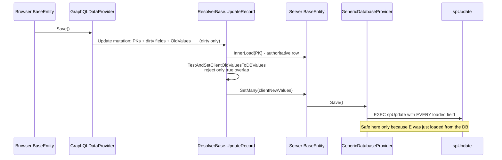
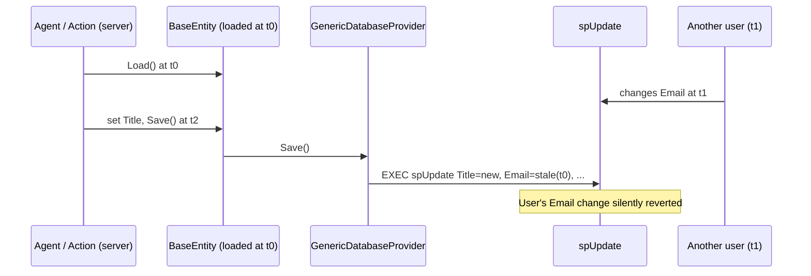
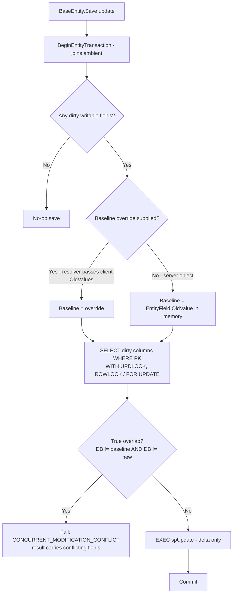

# ORM Layer Improvements: Server-Side Concurrency, Structured Filters, Typed Query Wrappers

## Status
- **Status**: Implemented (Phases 0–3 shipped; Phase 4 benchmark harness planned)
- **Created**: 2026-11-08
- **Author**: Amith Nagarajan + Claude
- **Branch**: `claude/orm-improvements-ef-comparison`
- **Companion page**: [`docs-site/public/mj-vs-ef-core/index.html`](../docs-site/public/mj-vs-ef-core/index.html), which goes live at `https://docs.memberjunction.org/v6/mj-vs-ef-core/` after the next docs deploy. It is an illustrated comparison of the MJ ORM layer with Entity Framework Core 11.

## Overview

This plan came out of a comparison of MemberJunction's ORM layer (`BaseEntity`, `RunView`, `RunQuery`, `BaseEngine`) with Entity Framework Core 11, which ships alongside .NET 11 in November 2026. The comparison showed that MJ is ahead of EF in several places: optimistic concurrency at the field level over the wire, one object model on client and server, field-level security, and a three-tier cache with event-driven invalidation. It also found three gaps worth closing.

1. **Concurrency on server-direct saves.** The GraphQL wire protocol sends only changed fields plus their `OldValues___`, and `ResolverBase` rejects a save only when it truly overlaps with a concurrent change. Code that saves on the server without going through the resolver (agents, actions, scheduled jobs, objects held by an engine) has no check, and `GenericDatabaseProvider` sends **every loaded field** to `spUpdate`. A server process that loads a record, spends 30 seconds in an LLM call and then saves writes its stale copy of every untouched column over whatever changed in the meantime. Agent workloads make this the most important of the three.
2. **Structured filters in `RunView`.** `RunView` only takes SQL text in `ExtraFilter`. MJ already has a portable filter format, `CompositeFilter` (Kendo-style JSON), that User Views compile to SQL and Open Apps evaluate in memory, but `RunView` doesn't accept it. Accepting it gives typed, safe, cacheable filters that also run against `BaseEngine` arrays in memory, and that agents can write as JSON.
3. **Typed wrappers for approved queries.** `RunQueryParams.Parameters` is `Record<string, any>` and result rows are untyped. The MJ Query Language parser already infers each parameter's name, type and whether it's required, and `QueryField` records each output column's SQL type. CodeGen can emit typed wrappers for `Reusable` + `Approved` queries. They call `RunQuery`, so they work the same in the browser and on the server.

A fourth item, **an engine checkout model** (engine instances read-only, edits via a clone), was discussed and deliberately deferred. See [Deferred](#deferred-engine-checkout-model).

## Goals & Non-Goals

### Goals
- Every update, whether it comes over the wire or runs directly on the server, sends only changed columns and gets the same field-level conflict check.
- The race window between "read current row" and "update" is closed inside the save transaction.
- `RunView` (and `BaseEnginePropertyConfig`) accept a `CompositeFilter`. It compiles to **parameterized** SQL in MJCore and evaluates in memory with the same semantics.
- A generic typed filter builder over `BaseEntity<T>` field types, with no per-entity codegen needed.
- CodeGen emits typed `RunQuery` wrappers (parameter and row interfaces, JSDoc from MJQ doc comments) for approved, reusable queries, with drift detection at run time.
- A reproducible benchmark that tests the claim that MJ's caching gives better full-stack performance than an equivalent EF Core stack.

### Non-Goals
- A LINQ-style expression-tree query API. TypeScript has no expression trees, and the team's view is that this is not wanted.
- Replacing `ExtraFilter`. SQL text stays supported; `Filter` is additive.
- Typed wrappers for ad-hoc, pending or agent-drafted queries.
- Changing the GraphQL wire protocol for saves, which already works correctly.
- The engine checkout model (deferred).

## Background & Context

### How saves and concurrency work today



Key code:
- `packages/GraphQLDataProvider/src/graphQLDataProvider.ts` (`Save`, around line 2580): the delta-only update wire protocol, and `OldValues___` attached when `SkipOldValuesCheck === false` (the default on `EntitySaveOptions`).
- `packages/MJServer/src/generic/ResolverBase.ts`: `UpdateRecord`, `MustLoadTruthFromDatabase`, `hasCompleteOldValues` and `TestAndSetClientOldValuesToDBValues`. The overlap check compares each client-changed field's client old value, client new value and current DB value. It handles JSON key order and datetime precision, logs a `SAVE_INCONSISTENCY` error-log row and throws `CONCURRENT_MODIFICATION_CONFLICT` with `conflictingFields`.
- `packages/GenericDatabaseProvider/src/GenericDatabaseProvider.ts`: the save field loop (around line 1995) puts **every** `IsSPParameter` field that is not `NotLoaded` into `fieldValueMap`. The `dirtyFields` set and `changedFieldValues()` are used **only** to render the replay/SQL-log form (`RenderReplayUpdateSQL`).
- The generated `spUpdate*` procs set each column with `ISNULL(@Param, [Col])` plus `@Param_Clear` companions (see `RenderSaveCallBinding` in `packages/SQLServerDataProvider/src/SQLServerDataProvider.ts`), so a column whose parameter isn't passed keeps its stored value. Delta-only execution needs **no sproc change**. Hand-written update procs (`spUpdateGenerated = false`) make no such promise.

### Server-direct saves



The server already holds the baseline it needs in memory: each `EntityField.OldValue` is the value loaded at t0. What it lacks is the **current** DB value at save time, so the provider has to read the changed columns at save time. That one indexed PK read is the same read the resolver path already does through `InnerLoad`.

### CompositeFilter today
- Types and in-memory evaluation: `packages/MJCore/src/generic/filters/` (`filter.types.ts`, `compositeFilter.ts`). The shape is `{ logic: 'and' | 'or', filters: [ {field, operator, value} | nested group ] }`. The operators are `eq, neq, gt, gte, lt, lte, contains, doesnotcontain, startswith, endswith, isnull, isnotnull, isempty, isnotempty`. `CompositeFilter.Evaluate(context)` runs it in memory, and `ParseFilterField` handles the `Source.Field` prefix form.
- SQL compilation: `MJUserViewEntityExtended.GenerateWhereClauseFromFilterState` in `packages/MJCoreEntities/src/custom/MJUserViewEntityExtended.ts` (around line 752). It lives **above** MJCore, so `RunView` can't use it.
- Guide: `guides/FILTER_BUILDER_AND_EVALUATION.md` ("one JSON, two runtimes").

> **⚠️ Security note found while writing this plan — verify first.** `convertFilterToSQLStatic` interpolates filter values straight into SQL: `'${value}'` for quoted types, raw for unquoted types, and `LIKE '%${value}%'` for string operators. It does not call `EscapeSQLString` (which exists in MJCore). A value containing `'` breaks the view, and a crafted value may inject SQL into the stored `WhereClause`. I did not confirm whether the stored `WhereClause` is re-screened (`ClientClauseScreen` / `StrictFragmentValidator`) when a view runs. **Whoever picks this up should check that first; it may need a separate, immediate fix ahead of Phase 2.** Phase 2 replaces this compiler with a parameterized one in any case.

### Queries today
- `packages/MJCore/src/generic/runQuery.ts`: `RunQueryParams` (`Parameters?: Record<string, any>`), and `RunQuery` works on both sides of the wire.
- `packages/MJCore/src/generic/queryInfo.ts`: `QueryInfo` (`Status: 'Pending' | 'Approved' | 'Rejected' | 'Expired'`, `Reusable`, `UsesTemplate`, `Parameters`, `Fields`). `QueryFieldInfo` (`Name`, `Sequence`, `SQLBaseType`, `SQLFullType`, `SourceEntityID`, `SourceFieldName`, `IsComputed`, `Description`) has **no nullability**.
- `@memberjunction/sql-parser` (`packages/SQLParser/src/template/queryTemplate.ts`): `QueryTemplate.Parse(text, dialect)` with `Parameters()` (name, `InferredType`, `IsRequired`, `DefaultValue`, uses), `DocComments()`, `BranchVariants()` and `CompositionReferences()`. The spec is `guides/MJ_QUERY_LANGUAGE.md`.
- CodeGen generators live in `packages/CodeGenLib/src/Misc/*_codegen.ts` (`entity_subclasses_codegen.ts`, `action_subclasses_codegen.ts`, `remote_operations_codegen.ts`, …), orchestrated by `runCodeGen.ts`.

---

## Architecture / Design

### Workstream 1: Server-side concurrency check and delta-only updates

#### 1a. Delta-only update execution
In `GenericDatabaseProvider`'s save path, on **update**, render the executed binding from the changed-field map (primary keys plus dirty fields, with `_Clear` companions) instead of the full `fieldValueMap`. Keep the full row when:
- `options.IgnoreDirtyState === true` (forced re-imposition, e.g. MetadataSync `alwaysPush`);
- the entity's update proc is hand-written (`spUpdateGenerated === false`), since there is no `ISNULL` merge promise;
- IS-A chain saves where a level's proc requires the full set (verify per level; most are generated).

The procs already return the full view row after update, so the entity's untouched columns are refreshed with current DB values. The concurrent change becomes visible to the caller instead of being overwritten.

This also closes, at the root, the field-level-security issue documented in `MustLoadTruthFromDatabase` ("`GenerateSaveSQL` sends every `IsSPParameter` field regardless of dirtiness"). A pinned value that isn't dirty no longer reaches `spUpdate` at all.

#### 1b. Concurrency check moved into the provider
Add the field-level overlap check to the provider's update path, so every update gets it.



- **Baseline.** On the server the baseline is already in memory: each dirty field's `OldValue`. For the wire path the resolver hydrates from the database (so `OldValue` would equal the DB value and nothing would ever conflict), so it passes the client's old values as an **override**:
  ```typescript
  // packages/MJCore/src/generic/interfaces.ts — EntitySaveOptions
  /**
   * Values the caller saw before its edit, keyed by field Name, used as the baseline for the
   * field-level concurrency check instead of each field's in-memory OldValue. Set by the API
   * layer from a client's OldValues___; server code normally leaves it unset.
   */
  ConcurrencyBaseline?: Record<string, unknown>;
  ```
  `SkipOldValuesCheck` (which already exists) stays the opt-out.
- **Read the current row under lock.** Read only the dirty columns by PK, inside the save's entity transaction (`BeginEntityTransaction` joins any ambient one), with `UPDLOCK, ROWLOCK` on SQL Server and `FOR UPDATE` on PostgreSQL. The lock is held until the update commits, which closes the race window.
- **One comparison implementation.** Move the comparison helpers out of `ResolverBase` (`areEntityFieldValuesDifferent`, `ClientOldValueToFieldValue`, the JSON-equivalence and datetime-tolerance helpers, `isFieldOpaqueToClient`, encrypted-value redaction) into a shared module, `packages/GenericDatabaseProvider/src/concurrency/fieldConflictDetector.ts`. Then `ResolverBase.TestAndSetClientOldValuesToDBValues` becomes a thin adapter: it keeps its error-log write and the GraphQL error shape and delegates the decision.
- **Failure surface.** On conflict, `Save()` returns `false`, and `LatestResult` carries a structured conflict (`ConflictingFields`, plus redacted client/DB differences). Add to `BaseEntityResult`:
  ```typescript
  /** Set when a save was refused because a field it changed was changed concurrently in the database. */
  ConcurrencyConflict?: { ConflictingFields: string[] };
  ```
  The resolver maps this to the existing `CONCURRENT_MODIFICATION_CONFLICT` GraphQL error, so the client contract is unchanged.
- **Rollout mode.** Server code has never had this check, and some of it may rely on overwriting (for example, high-frequency status rows). Add a config switch `concurrencyCheck: 'off' | 'log' | 'enforce'` (default `'log'` for one release, overridable per save via `EntitySaveOptions.ConcurrencyCheck`). In `'log'` mode, a would-be conflict emits a structured warning via `LogErrorEx` (`category: 'GenericDatabaseProvider.CheckUpdateConcurrency'`) and the save proceeds. On the GraphQL wire path (`ResolverBase.UpdateRecord`), saves that supply `OldValues___` always set `saveOptions.ConcurrencyCheck = 'enforce'`, persist a `SAVE_INCONSISTENCY` record to `MJ: Error Logs`, and reject conflicting saves with `CONCURRENT_MODIFICATION_CONFLICT` from day one.

#### 1c. Optional row-version token (later, opt-in)
Some entities want EF-style "any concurrent change to the row is a conflict" semantics (financial documents, approvals). That can be opted into per entity by also comparing `__mj_UpdatedAt` against the loaded value. No schema change is needed because tracked tables already have the column. This is out of scope for the first PR; record the open question.

### Workstream 2: `CompositeFilter` in `RunView`

#### API
```typescript
// packages/MJCore/src/views/runView.ts — RunViewParams
/**
 * Structured filter, ANDed with ExtraFilter when both are set. Compiled to parameterized SQL by the
 * provider; never interpolated. Field names are validated against the entity and its field-level
 * security; an unknown or unreadable field is refused.
 */
Filter?: CompositeFilterDescriptor | CompositeFilter;
```
`BaseEnginePropertyConfig` gets the same `Filter` property. Engines also get an in-memory helper over loaded arrays:
```typescript
// in BaseEngine
protected Where<E extends BaseEntity>(propertyName: string, filter: CompositeFilterDescriptor | CompositeFilter): E[]
```

#### Typed builder (generic, no codegen needed)
The generated entity classes already carry their row type (`BaseEntity<MJUserEntityType>`), so one generic builder gives field-name and value-type checking for every entity:
```typescript
// packages/MJCore/src/generic/filters/filterBuilder.ts
const f = FilterOf<MJUserEntityType>();
const filter = f.And(
    f.Eq('Type', 'Owner'),            // 'Type' must be a key; value must be 'Owner' | 'User'
    f.Or(f.StartsWith('Email', 'a'), f.IsNull('Title')),
    f.In('ID', ids),                  // new operator
);
await rv.RunView<MJUserEntity>({ EntityName: 'MJ: Users', Filter: filter, ResultType: 'entity_object' });
```
The builder returns a plain `CompositeFilterDescriptor` (JSON), so it serializes over the wire, can be stored as metadata, and agents can write it directly.

#### Compilation
- New `CompositeFilterSQLCompiler` in MJCore (`packages/MJCore/src/generic/filters/compositeFilterSQL.ts`), dialect-aware through the existing platform/dialect seams (`platformSQL.ts`, `SQLDialect`).
- Output is a **parameterized** fragment plus `RunViewParameters` (`@f0, @f1, …`) that flow through the existing `PrepareExtraFilterSQL` / `NamedQueryParameter` machinery in `GenericDatabaseProvider`. Values are never interpolated.
- Field validation uses `EntityInfo.Fields` (case-insensitive) and the field-security gate (`fieldSecuritySQLGate.ts`). Filtering on an unreadable field is refused, because otherwise the filter would let a caller infer that field's values.
- `LIKE` operators escape `%`, `_` and `[` in the value and pass the pattern as a parameter.
- `isempty` / `isnotempty` become `(col IS NULL OR col = '')` / `(col IS NOT NULL AND col <> '')` for string fields. Today they map to `IS NULL` only, which disagrees with `Evaluate()`. Fix `Evaluate()` in the same change if needed so both runtimes agree.
- New operators: `in`, `notin` (array value), `between` (two-element array). Add them to `FilterOperator`, `Evaluate()`, the compiler and the Angular filter builder's operator list (UI exposure can come later).
- **Migrate User Views onto it.** `MJUserViewEntityExtended.GenerateWhereClauseFromFilterState` calls the new compiler. Because a stored `WhereClause` is SQL text, the compiler needs a "literal" rendering mode for views that escapes with `EscapeSQLString` (and validates numeric/boolean/date values by type). Better still, store the `FilterState` and compile it at run time with parameters. Decide during implementation (open question).

#### Wire and caching
- GraphQL: add `Filter: String` (JSON) to `RunViewByNameInput`, `RunDynamicViewInput` and `RunViewGenericInput` in `packages/MJServer/src/generic/RunViewResolver.ts`. `GraphQLDataProvider` serializes it. The server **always** compiles it; a client never sends compiled SQL for this property. That is strictly safer than `ExtraFilter`, which needs `ClientClauseScreen`.
- Cache fingerprints: include the canonical JSON of `Filter` (sorted keys, normalized operators) wherever `ExtraFilter` feeds the RunView fingerprint (`ProviderBase` / `LocalCacheManager`) and the engine config fingerprint (`BaseEngine.BuildRunViewParamsForConfig`).
- Engines: when a config has `Filter`, a save event's immediate mutation can **evaluate the filter in memory** to decide whether the saved row still belongs in the array. Today, configs with a SQL `Filter` string can't do that and fall back to a refresh. This is a real cache win.

### Workstream 3: Typed query wrappers in CodeGen

#### What is generated
For every query with `Reusable = true` **and** `Status = 'Approved'`, CodeGen emits:
```typescript
// generated: packages/MJCoreEntities/src/generated/queries/__mj.ts (core) — one file per schema/app
/**
 * Orders for one region.            ← MJQ header summary
 * Query: Sales/Reports/Orders By Region  (ID 6F3C…)
 */
export interface OrdersByRegionParams {
    /** The sales region code. */     // @param doc comment
    Region: string;                   // required: used outside every , no default
    /** Only orders on or after this date. Leave empty for all dates. */
    StartDate?: Date;                 // optional
}
export interface OrdersByRegionRow {
    /** The order's ID. */            // @field doc comment
    OrderID: string;                  // uniqueidentifier, from source field (NOT NULL)
    CustomerName: string | null;      // nullable via source entity field
    OrderTotal: number | null;        // computed → nullable
    DiscountCode?: string | null;     // only produced by some branch variants → optional
}
export const OrdersByRegion = DefineTypedQuery<OrdersByRegionParams, OrdersByRegionRow>({
    QueryID: '6F3C…',
    Path: 'Sales/Reports/Orders By Region',
    Signature: 'sha256:…',            // hash of params + fields at codegen time
});

// usage — identical in browser and server
const result = await OrdersByRegion.Run({ Region: 'WEST' }, { contextUser, MaxRows: 100, CacheLocal: true });
result.Results[0].OrderTotal;         // typed
```
- `DefineTypedQuery` lives in MJCore (`packages/MJCore/src/generic/typedQuery.ts`). Its `Run()` builds `RunQueryParams` (`QueryID`, typed `Parameters`, pass-through options) and calls `RunQuery`, so caching, enrichment, paging, audit and permissions behave exactly as for an untyped call.
- Namespacing follows the category path: `Queries.Sales.Reports.OrdersByRegion`, with name collisions resolved the same way entity class names are.

#### Type derivation rules
| Source | Rule |
|---|---|
| Parameter type | MJQ declared type (`@param {type}`, or a `Manual` parameter row) wins over `InferredType`. `unknown` → `string \| number \| boolean \| Date \| null` with a CodeGen warning. |
| Required / optional | `IsRequired` from `QueryTemplate.Parameters()`. A `default(...)` makes it optional. |
| Server-set parameters | `IsServerSet` parameters are **excluded** from the params interface. |
| Row column type | `QueryFieldInfo.SQLBaseType` → TS through the same mapping the entity codegen uses. |
| Row nullability | With `SourceEntityID` + `SourceFieldName`, inherit `AllowsNull` from that entity field. Computed or unsourced → nullable. |
| Branch-only columns | Optional (`?:`). **Needs metadata:** record per `QueryField` whether it appears in every branch variant (see Migration & Data). |
| Docs | Header summary → interface JSDoc. `@param` / `@field` → property JSDoc. |

#### Drift detection
Queries are data and can be edited at runtime, so a wrapper compiled last week can disagree with the live query. `Signature` is a hash over the ordered (name, type, required) parameter list and the ordered (name, SQL type) field list. `TypedQuery.Run()` compares it with the live `QueryInfo` (cheap, from metadata already in memory) and:
- matches → runs;
- differs → logs a warning once per process naming the query and the difference, then runs. With a config switch `typedQueryDrift: 'warn' | 'throw'`, CI and test environments can throw.

Optional dev-mode row validation: emit a Zod schema per row type (same style as `MJUserSchema`) and validate the first N rows when `MJ_TYPED_QUERY_VALIDATE=1`.

#### Where it runs in CodeGen
New generator `packages/CodeGenLib/src/Misc/typed_query_codegen.ts`, called from `runCodeGen.ts` after query metadata refresh and re-binding (it must run after the step that re-binds saved queries whose source entities changed shape). Open Apps get their own generated file in their entity package, so the app's approved queries ship with the app.

---

## API Changes (summary)

| Surface | Change |
|---|---|
| `EntitySaveOptions` | `+ ConcurrencyBaseline?: Record<string, unknown>` |
| `BaseEntityResult` | `+ ConcurrencyConflict?: { ConflictingFields: string[] }` |
| MJAPI config | `+ concurrencyCheck: 'off' \| 'log' \| 'enforce'`, `+ typedQueryDrift: 'warn' \| 'throw'` |
| `RunViewParams` | `+ Filter?: CompositeFilterDescriptor \| CompositeFilter` |
| `BaseEnginePropertyConfig` | `+ Filter` structured form (existing string `Filter` stays) |
| `FilterOperator` | `+ 'in' \| 'notin' \| 'between'` |
| GraphQL RunView inputs | `+ Filter: String` (JSON) |
| MJCore | `+ FilterOf<T>()`, `CompositeFilterSQLCompiler`, `DefineTypedQuery`, `TypedQuery` |
| Generated code | `+ generated/queries/*.ts` per schema/app |

No GraphQL save-mutation change. `OldValues___` keeps its current shape and meaning.

## Implementation Plan

### Phase 0: Verify the security note (before anything else)
1. **Confirm or rule out injection through `FilterState` → `WhereClause`.** Trace a saved User View's `WhereClause` from `MJUserViewEntityExtended` save to `GenericDatabaseProvider.RunView` and check whether it passes `ClientClauseScreen` / `StrictFragmentValidator`. Write a failing test with a filter value of `O'Brien` (breakage) and one with a crafted payload.
2. If it's exploitable, ship a minimal fix (escape with `EscapeSQLString`, validate non-string values by `TSType`) as its own PR **before** Phase 2.

### Phase 1: Server-side concurrency (Workstream 1)
1. **Extract the conflict detector**: create `packages/GenericDatabaseProvider/src/concurrency/fieldConflictDetector.ts` with the comparison helpers moved from `ResolverBase` (value conversion, `areEntityFieldValuesDifferent`, JSON equivalence, datetime tolerance, opaque/encrypted handling and redaction). Keep `ResolverBase` behavior identical by delegating. Unit tests are ported from the resolver's tests.
2. **Delta-only update execution**: in `GenericDatabaseProvider`'s save method, on update and when none of the full-row conditions apply, pass `changedFieldValues(entity, fieldValueMap, dirtyFields)` to `RenderSaveCallBinding`. Do the same in `PostgreSQLDataProvider` / the PG binding renderer. Confirm `_Clear` companions still derive correctly from the narrowed map.
3. **Add `EntitySaveOptions.ConcurrencyBaseline`** and **`BaseEntityResult.ConcurrencyConflict`** in `packages/MJCore/src/generic/interfaces.ts` and `baseEntity.ts`. `BaseEntity._innerSave` passes options through unchanged (it already does).
4. **Locked read plus check in the provider**: in the update path, open or join `BeginEntityTransaction`. Read the dirty columns with a locking read (new dialect hook `RenderLockedRowReadSQL(entityInfo, columns, pk)` with SQL Server and PG implementations), run the detector against `ConcurrencyBaseline ?? field.OldValue`, honor `SkipOldValuesCheck` and the `concurrencyCheck` mode, then execute the delta update.
5. **Rewire the resolver**: `ResolverBase.UpdateRecord` passes the client old values as `ConcurrencyBaseline` and relies on the provider's decision. It keeps the `SAVE_INCONSISTENCY` error-log write and maps `LatestResult.ConcurrencyConflict` to `CONCURRENT_MODIFICATION_CONFLICT`. Remove the duplicate comparison once parity tests pass.
6. **TransactionGroup path**: `SQLServerTransactionGroup` batches saves. Make sure each queued update gets the same locked read and check inside the group transaction, or document that groups opt out (open question). Graph saves (`saveEntityGraphOperation.ts`) go through `Save()` and inherit the check.
7. **IS-A chains**: the check runs per level (each level's table holds its own columns). Verify that a conflict on a parent level rolls back the whole chain (the existing UnitOfWork snapshot logic should cover it) and add a test.
8. **Config plus docs**: add `concurrencyCheck` to the MJAPI/MJServer config schema (`packages/MJServer/src/config.ts`), default `'log'`. Update `guides/TRANSACTIONS_AND_BATCHING_GUIDE.md` with a "Concurrency" section.

### Phase 2: Structured filters (Workstream 2)
1. Add `in`, `notin`, `between` to `FilterOperator` and `CompositeFilter.Evaluate()`. Align `isempty` / `isnotempty` semantics.
2. Implement `CompositeFilterSQLCompiler` (parameterized) in MJCore, with dialect hooks for `LIKE` escaping and `IN` lists. Enforce a maximum number of `IN` values (reuse `BaseEngine.KeyedRefetchMaxKeys`-style limits).
3. Add `RunViewParams.Filter`. In `GenericDatabaseProvider.RunView`, compile it, AND it with `ExtraFilter`, and merge its parameters into `queryParameters`. Apply the field-security gate.
4. Add `Filter` to the three GraphQL RunView inputs and to `GraphQLDataProvider` serialization.
5. Include the canonical filter JSON in the RunView fingerprint and the engine config fingerprint.
6. `BaseEnginePropertyConfig.Filter` structured form; in-memory membership evaluation in `applyImmediateMutation` for structured filters; `BaseEngine.Where()` helper.
7. `FilterOf<T>()` typed builder plus docs in `guides/FILTER_BUILDER_AND_EVALUATION.md` ("now three runtimes: views, RunView, in-memory").
8. Move `MJUserViewEntityExtended.GenerateWhereClauseFromFilterState` onto the new compiler (literal-safe mode or compile at run time; see open questions).

### Phase 3: Typed query wrappers (Workstream 3)
1. Metadata: add `QueryField.InAllBranchVariants BIT NOT NULL DEFAULT 1` (see Migration & Data). Populate it in the output-field extraction step that already renders `BranchVariants()` and takes the union of columns.
2. `DefineTypedQuery` / `TypedQuery` in MJCore, including signature check and drift mode.
3. `typed_query_codegen.ts` in CodeGenLib: select `Reusable && Status === 'Approved'` queries, derive types per the rules table, emit one file per schema (core → `MJCoreEntities`, Open App → its entity package), and register it in the generated `index.ts`.
4. Signature hashing shared between CodeGen and runtime (same function, in MJCore).
5. Optional Zod row schemas behind a flag.
6. Docs: a "Typed queries" section in `guides/MJ_QUERY_LANGUAGE.md` and the citizen-builder docs. These wrappers are what AI coding agents should call.

### Phase 4: Benchmark (validates the performance claims on the companion page)
1. Build a reproducible harness (`experiments/orm-benchmark/`) with two stacks over the **same SQL Server database** and schema (an MJ demo schema such as More Cheese):
   - **MJ**: MJAPI and a headless browser client (GraphQLDataProvider) with default caching (L1 engines, L2 IndexedDB, L3 server cache, Redis on and off).
   - **EF**: ASP.NET Core 11 Minimal API with EF Core 11 (pooled `DbContext`, compiled queries, `AsNoTracking` for reads) and a client using a typical HTTP cache layer. Run two variants: with `EFCoreSecondLevelCacheInterceptor` and without.
2. Workloads: (a) reference-data reads (many repeats); (b) list views with filters and paging; (c) single-record edit/save; (d) bulk insert of 10k rows; (e) mixed 90/10 read/write with two app servers; (f) cold start.
3. Metrics: p50/p95 end-to-end latency at the client, DB queries per user action, DB CPU, bytes on the wire, server memory.
4. Publish results to the companion page and replace its stated hypotheses with measured numbers.

## Migration & Data

- **Phase 1:** no schema change. The sprocs already support delta updates.
- **Phase 2:** no schema change. If the "compile view filters at run time" option is chosen, stored `WhereClause` becomes derived; any change would be metadata/CodeGen only.
- **Phase 3:** one additive column, `__mj.QueryField.InAllBranchVariants BIT NOT NULL DEFAULT 1`. It's a T-SQL migration in `migrations/v6/` (the PG counterpart is transpiled at release, per repo policy), followed by CodeGen (entity class plus GraphQL). The default of 1 keeps today's behavior (all fields required) until extraction runs.

## Testing Strategy

**Unit (vitest)**
- Conflict detector: every comparison case ported from the resolver (JSON key order, datetime precision per SQL type, encrypted/opaque fields, idempotent same-value writes, null ↔ value).
- Delta binding: the update binding contains only PK plus dirty fields; `_Clear` companions are emitted for dirty → NULL; full row with `IgnoreDirtyState` and `spUpdateGenerated = false`.
- Filter compiler: every operator × each `TSType`; `LIKE` escaping of `% _ [ '`; unknown field refused; field-security-denied field refused; `in` limit; parameter naming stable for fingerprinting; `Evaluate()` agrees with SQL for a shared fixture of rows (the same fixture runs through both runtimes).
- Typed query codegen: golden-file tests over a set of MJQ templates (required/optional/default, `IsServerSet`, branch-only columns, computed columns, `unknown` types, category-path namespacing and collisions).
- Signature: stable across key order, and changes on parameter or field change.

**Integration (deterministic tier — required by the Definition of Done)**
- New bundle, "Server-direct save concurrency": a server entity loaded at t0, a concurrent update of a different column → no conflict and the other column is preserved; the same column → conflict in `enforce` mode, error-log row in `log` mode.
- Wire parity: the existing client conflict tests pass unchanged through the rewired resolver.
- Race: two concurrent server saves of the same field. Exactly one succeeds in `enforce` mode, thanks to the locked read.
- RunView `Filter` over GraphQL and directly; cache hit on a repeated identical filter; cache miss on a changed value.
- A typed query wrapper runs from a client and from server code against More Cheese queries.

**Repo gates**: `check:guards` (the field-security source guard covers the new compiler), `check:standards`.

## Risks & Open Questions

- **Server code that relies on overwriting.** Mitigated by `'log'` mode first. Which entities show up in the logs decides the per-entity opt-outs before `'enforce'`.
- **Lock contention.** `UPDLOCK` is held from the read to the commit of the same save, a few milliseconds. Long transactions that do LLM work while holding the transaction would block other writers. Document "never await an LLM inside an entity transaction" (likely already a rule; verify).
- **TransactionGroup semantics.** Deferred batches may need the locked read inside the generated batch SQL. Open: implement, or exclude groups for v1?
- **Row-version opt-in (1c).** Is there demand for whole-row conflict semantics on specific entities?
- **View filters.** Do we keep `WhereClause` as stored SQL (literal-safe compile) or compile `FilterState` at run time with parameters? Run time is cleaner and safer but changes how views are cached and screened.
- **Related-entity fields in `Filter`.** v1 supports only the entity's base-view columns (which already include joined name fields). Multi-source `Source.Field` filters are for in-memory evaluation only, for now.
- **Typed-wrapper churn.** Approval status changes add or remove wrappers, so CodeGen output changes when queries are approved. That's acceptable, and arguably the point: approval into the Canon produces an API.
- **Benchmark fairness.** The EF stack must be idiomatic and tuned. Have someone fluent in .NET review it before publishing numbers.

## Deferred: Engine checkout model
`BaseEngine` getters hand out the engine's own mutable instances, shared by every caller in the process (on the server, every request). A half-edited, unsaved object is visible to everyone; cache-sourced related-record collections already default to `ReadOnly` for this reason. A future design: engine instances read-only by default, with `engine.Edit(id)` returning a clone whose save flows back through the existing event path. A cheap first step when this is picked up: a dev-mode warning when an engine-held instance becomes dirty, to measure how common in-place edits are.

## Files to Modify

| File | Change |
|------|--------|
| `packages/GenericDatabaseProvider/src/concurrency/fieldConflictDetector.ts` | **New**: shared field-level conflict detection |
| `packages/GenericDatabaseProvider/src/GenericDatabaseProvider.ts` | Delta-only update binding; locked read; conflict check; `Filter` compile into RunView |
| `packages/SQLServerDataProvider/src/SQLServerDataProvider.ts` | `RenderLockedRowReadSQL` (UPDLOCK, ROWLOCK); delta binding verification |
| `packages/SQLServerDataProvider/src/SQLServerTransactionGroup.ts` | Concurrency in batched updates (or explicit opt-out) |
| `packages/PostgreSQLDataProvider/src/*` | `RenderLockedRowReadSQL` (FOR UPDATE); delta binding |
| `packages/MJCore/src/generic/interfaces.ts` | `EntitySaveOptions.ConcurrencyBaseline` |
| `packages/MJCore/src/generic/baseEntity.ts` | `BaseEntityResult.ConcurrencyConflict`; surface conflict |
| `packages/MJServer/src/generic/ResolverBase.ts` | Pass `ConcurrencyBaseline`; delegate the decision; map the conflict error |
| `packages/MJServer/src/config.ts` | `concurrencyCheck`, `typedQueryDrift` |
| `packages/MJCore/src/generic/filters/filter.types.ts` | `in`, `notin`, `between` |
| `packages/MJCore/src/generic/filters/compositeFilter.ts` | New operators; `isempty` semantics |
| `packages/MJCore/src/generic/filters/compositeFilterSQL.ts` | **New**: parameterized compiler |
| `packages/MJCore/src/generic/filters/filterBuilder.ts` | **New**: `FilterOf<T>()` |
| `packages/MJCore/src/views/runView.ts` | `RunViewParams.Filter` |
| `packages/MJCore/src/generic/providerBase.ts` / `localCacheManager.ts` | Fingerprint includes canonical filter |
| `packages/MJCore/src/generic/baseEngine.ts` | Structured `Filter` on configs; in-memory membership; `Where()` |
| `packages/MJServer/src/generic/RunViewResolver.ts` | `Filter` on RunView inputs |
| `packages/GraphQLDataProvider/src/graphQLDataProvider.ts` | Serialize `Filter` |
| `packages/MJCoreEntities/src/custom/MJUserViewEntityExtended.ts` | Use the new compiler (and the Phase 0 fix) |
| `packages/Angular/Generic/filter-builder/*` | Operator list (`in`, `between`), when the UI exposes them |
| `packages/MJCore/src/generic/typedQuery.ts` | **New**: `DefineTypedQuery`, `TypedQuery`, signature |
| `packages/CodeGenLib/src/Misc/typed_query_codegen.ts` | **New**: generator |
| `packages/CodeGenLib/src/runCodeGen.ts` | Invoke the generator after query re-bind |
| `packages/MJCoreEntities/src/generated/queries/*` | **Generated** |
| `migrations/v6/V…__v6.x.x__QueryField_InAllBranchVariants.sql` | Additive column |
| `guides/TRANSACTIONS_AND_BATCHING_GUIDE.md`, `guides/FILTER_BUILDER_AND_EVALUATION.md`, `guides/MJ_QUERY_LANGUAGE.md` | Docs |
| `experiments/orm-benchmark/*` | **New**: benchmark harness (Phase 4) |

## References
- [EF Core 11 — What's New (Microsoft Learn)](https://learn.microsoft.com/en-us/ef/core/what-is-new/ef-core-11.0/whatsnew)
- [.NET support policy](https://dotnet.microsoft.com/platform/support/policy/dotnet-core): .NET 11 is STS and ships November 10, 2026
- [EFCoreSecondLevelCacheInterceptor](https://github.com/VahidN/EFCoreSecondLevelCacheInterceptor): the de facto EF data cache (third party)
- `guides/TRANSACTIONS_AND_BATCHING_GUIDE.md`, `guides/CACHING_AND_PUBSUB_GUIDE.md`, `guides/MJ_QUERY_LANGUAGE.md`, `guides/FILTER_BUILDER_AND_EVALUATION.md`, `guides/FRAMEWORK_COMPARISON.md`
- Companion page: `docs-site/public/mj-vs-ef-core/index.html`
