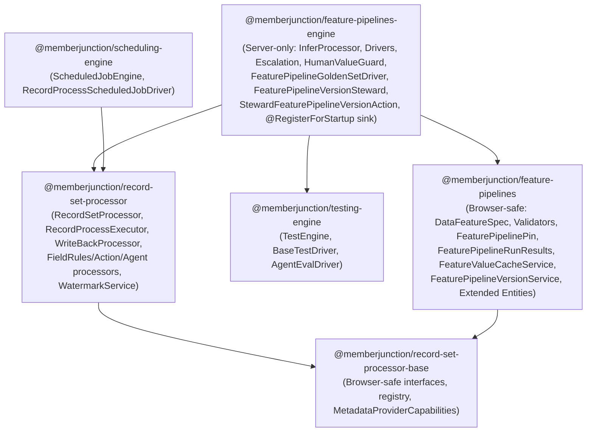

# PS PR 1 (`#5540`) — Architectural Layering & Review Remediation Spec

**Date**: 2026-10-19  
**Target Worktree / Branch**: `/Users/arieglazier/repos/MJ_PR1` (`ps/pr-1-feature-pipelines`)  
**PR**: [#5540 — PS PR 1 — Feature Pipeline correctness and vendor parameter fidelity](https://github.com/MemberJunction/MJ/pull/5540)

---

## 1. Goal & Scope

Address all `CHANGES_REQUESTED` review comments from `AN-BC`, both CodeQL security alerts, and all findings from the **Gemini 4 Argon** adversarial architectural and coding-standards review on PR `#5540`:

1. **Zero Feature Pipeline leakage into foundational primitives**:
   - `@memberjunction/record-set-processor-base`
   - `@memberjunction/record-set-processor`
   - `@memberjunction/scheduling-engine`
   - `@memberjunction/testing-engine`
   - [`guides/RECORD_SET_PROCESSING_GUIDE.md`](file:///Users/arieglazier/repos/MJ_PR1/guides/RECORD_SET_PROCESSING_GUIDE.md) and core package `README.md` files
2. **Browser vs. Server Package Split**:
   - Keep `@memberjunction/feature-pipelines` (`packages/AI/Knowledge/FeaturePipelines`) 100% browser-safe (passing `.github/scripts/check-browser-manifest-leakage.mjs`).
   - Create `@memberjunction/feature-pipelines-engine` (`packages/AI/Knowledge/FeaturePipelinesEngine`) for all server-side execution (`InferProcessor`, drivers, escalation, human-value guard, `@RegisterForStartup` registration of `'Infer'` in `RecordProcessorRegistry`, `FeaturePipelineGoldenSetDriver`, `FeaturePipelineVersionSteward`, and `StewardFeaturePipelineVersionAction`).
3. **Version Steward as a Scheduled Record Process**:
   - Delete `FeaturePipelineVersionStewardDriver` and `metadata/scheduled-job-types/.feature-pipeline-version-steward-type.json`.
   - Seed a `Steward Feature Pipeline Version` Action and a scheduled `MJ: Record Processes` row (`Entity = 'MJ: Record Processes'`, `ScopeFilter = "WorkType='Infer' AND Status='Active'"`, `WorkType = 'Action'`), executed every 15 minutes by the existing `RecordProcessScheduledJobDriver`.
4. **`PascalCase` Interface Unification**:
   - Unify `RecordProcessorContext`, `RecordSetProcessOptions`, `RunRecordProcessOptions`, and `WatermarkService` parameter/decision interfaces (`WatermarkDecision`, `CheckBatchWatermarksParams`, `UpdateWatermarkParams`) to 100% `PascalCase` across all in-repo callers and tests.
5. **CodeQL, Coding Standards & Integration Test Extensions**:
   - Fix both CodeQL alerts (`js/polynomial-redos` in `FeatureValueCacheService.ts` and `js/prototype-polluting-assignment` in `feature-pipeline-builder.component.ts`).
   - Fix all `AGENTS.md` / `coding_standards.md` findings (`unknown` casts in `WriteBackProcessor` / `WatermarkService`, entity-derived union types in `feature-values.logic.ts` and `record-process-studio.component.ts`, and `SafeJSONParse` in `MJFeaturePipelineVersionEntityExtended.ts` and `feature-values.logic.ts`).
   - Extend the `feature-pipeline-core` (`IT124`) integration test suite with checks `FP8` (registry-driven `Infer` processor execution) and `FP9` (Record-Process-driven Version Steward execution).

---

## 2. Package & Layer Architecture

### 2.1 `@memberjunction/record-set-processor-base`
- **Added**:
  - `MetadataProviderCapabilities` (`RunIsolated`, `IsTransactionalProvider`) moved from `@memberjunction/feature-pipelines`.
  - `Provider?: IMetadataProvider` on `RecordProcessorBuildContext`.
  - Generic optional hooks on `IRecordProcessor`:
    - `ComputeBasisHash?(record: RecordRef, context: RecordProcessorContext): Promise<string | undefined>`
    - `DefaultDryRunSampleSize?: number`
    - `FailRunOnRecordError?: boolean`
    - `PrepareOutputMapping?(mapping: Record<string, unknown> | undefined): { OutputMapping?: Record<string, unknown>; HasUnmappedWrites?: boolean }`
    - `BuildRunSummary?(context: ProcessorRunSummaryContext): { ResultSummary?: unknown; WouldRefuse?: string }`
  - `ProcessorRunSummaryContext` interface (`RecordProcessID?: string; Counts: RunCounts; Status: ProcessRunStatusValue; DryRun: boolean; Results: ReadonlyArray<RecordResult>`).
  - Generic `ResultSummary?: unknown` and `WouldRefuse?: string` on `ProcessRunSummary`.
  - Generic `WriteBackValuePreview` (`{ Name: string; Label?: string; Previous: unknown; Proposed: unknown }`) and `previewValues?: WriteBackValuePreview[]` on `WriteBackResult`.
- **Removed**:
  - `feature-pipeline-run-results.ts` and `__tests__/feature-pipeline-run-results.test.ts` (moved to `@memberjunction/feature-pipelines`).
  - `FeaturePipelineRunPin`, `FeaturePipelineRunResult`, `FeatureValuePreview`, `RecordSetProcessOptions.FeaturePipeline`, `ProcessRunSummary.FeaturePipeline`, `IRecordProcessor.CurrentRunPin`, `IRecordProcessor.CurrentRunRefusal`, `RecordResult.PipelinePin`, and `RecordResult.PipelineVersion`.

### 2.2 `@memberjunction/record-set-processor`
- **Dependencies removed from `package.json`**:
  - `@memberjunction/feature-pipelines`
  - `@memberjunction/ai-knowledge-hub-metadata`
- **Moved out to `@memberjunction/feature-pipelines-engine`**:
  - `src/processors/InferProcessor.ts`
  - `src/processors/FeaturePipelineEscalation.ts`
  - `src/processors/FeaturePipelineHumanValueGuard.ts`
  - `src/processors/FeaturePipelineErrors.ts`
  - `src/feature-pipeline-drivers/BaseFeaturePipelineDriver.ts`
  - `src/feature-pipeline-drivers/LLMFeaturePipelineDriver.ts`
  - `src/feature-pipeline-drivers/DecisionFeaturePipelineDriver.ts`
  - All 11 Feature Pipeline test files (`confidenceFloor.test.ts`, `decision-feature-pipeline-driver.test.ts`, `feature-pipeline-driver.test.ts`, `feature-pipeline-escalation.test.ts`, `featureValueOnly.test.ts`, `humanValues.test.ts`, `inferCache.test.ts`, `inferConstraints.test.ts`, `inferHooks.test.ts`, `inferValidation.test.ts`, `modelBoundRenders.test.ts`, plus `helpers/cache-entry.ts` and `history-store-double.ts`).
- **Updated**:
  - `RecordProcessExecutor.ts`: Resolves `'Infer'` via `RecordProcessorRegistry.Instance.Resolve(...)` (passing `Provider`), reads `processor.DefaultDryRunSampleSize` for `DryRunMaxRecords`, and calls `processor.PrepareOutputMapping?.(...)` instead of inspecting `DataFeatureSpec`.
  - `RecordSetProcessor.ts`: Checks `options.Processor.FailRunOnRecordError === true`, collects `RecordResult[]` when `options.Processor.BuildRunSummary` is defined, and populates `ResultSummary` and `WouldRefuse` on `ProcessRunSummary`.
  - `GenericProcessRunTracker.ts`: Writes `run.ResultSummary = JSON.stringify(summary.ResultSummary)` whenever `summary.ResultSummary !== undefined`.
  - `WriteBackProcessor.ts`: Uses generic `DeferredRecordWriteSource` (`DeferRecordWritesToWriteBack`, `WriteDeferredRecordValues`, `DiscardDeferredRecordValues`), `DeferredRecordWriteOutcome`, and `PreviewRecordValues` (`WriteBackValuePreview[]`), and forwards all `IRecordProcessor` optional hooks (`DefaultDryRunSampleSize`, `FailRunOnRecordError`, `PrepareOutputMapping`, `BuildRunSummary`, `ComputeBasisHash`).
  - `writeBack.ts`: Imports `MetadataProviderCapabilities` from `@memberjunction/record-set-processor-base`.

### 2.3 `@memberjunction/feature-pipelines` (Browser-Safe)
- Retains only browser-safe modules (`@memberjunction/core`, `@memberjunction/core-entities`, `@memberjunction/global`, `@memberjunction/record-set-processor-base`).
- Gains `FeaturePipelineRunPin`, `FeaturePipelineRunResult`, `FeaturePipelineRecordResult`, and `FeaturePipelineRunResults` (moved from `@memberjunction/record-set-processor-base`), plus re-exports `MetadataProviderCapabilities` from `@memberjunction/record-set-processor-base` for backward compatibility.

### 2.4 `@memberjunction/feature-pipelines-engine` (New Server Package — `packages/AI/Knowledge/FeaturePipelinesEngine`)
- **Contains**:
  - `InferProcessor`, `FeaturePipelineEscalation`, `FeaturePipelineHumanValueGuard`, `FeaturePipelineErrors`
  - `BaseFeaturePipelineDriver`, `LLMFeaturePipelineDriver`, `DecisionFeaturePipelineDriver`
  - `FeaturePipelineStartup` (`@RegisterForStartup` sink) + `RegisterInferRecordProcessor()` (registers `'Infer'` in `RecordProcessorRegistry.Instance`)
  - `FeaturePipelineGoldenSetDriver` (`@RegisterClass(BaseTestDriver, 'FeaturePipelineGoldenSetDriver')`), `GoldenSetScorer`, `GoldenLabelQualityCheck` (moved from `@memberjunction/testing-engine`)
  - `FeaturePipelineVersionSteward` + `StewardFeaturePipelineVersionAction` (`@RegisterClass(BaseAction, 'Steward Feature Pipeline Version')`)
- **Registered in**:
  - `packages/ServerBootstrap` and `packages/ServerBootstrapLite` (`package.json` dependencies + class registrations).

### 2.5 `@memberjunction/scheduling-engine` & `@memberjunction/testing-engine`
- **`@memberjunction/scheduling-engine`**:
  - Delete `src/drivers/FeaturePipelineVersionStewardDriver.ts` and `src/FeaturePipelineVersionSteward.ts` (moved to `feature-pipelines-engine`).
  - Remove `@memberjunction/feature-pipelines` and `@memberjunction/testing-engine` from `package.json`.
- **`@memberjunction/testing-engine`**:
  - Move `FeaturePipelineGoldenSetDriver.ts`, `golden-set-scoring.ts`, `golden-label-quality.ts`, and their 3 test files to `@memberjunction/feature-pipelines-engine`.
  - Remove `@memberjunction/feature-pipelines` and `@memberjunction/record-set-processor` from `package.json`.

---

## 3. `PascalCase` Interface Unification

All public options/context/parameter interfaces in `@memberjunction/record-set-processor-base` and `@memberjunction/record-set-processor` are unified to 100% `PascalCase`:

- **`RecordProcessorContext`**:
  - `ContextUser: UserInfo`
  - `Provider: IMetadataProvider`
  - `ProcessRunID?: string`
  - `RecordProcessID?: string`
  - `EntityID?: string`
  - `OverwriteHumanValues?: boolean`
  - `DryRun?: boolean`
  - `TriggeredBy?: TriggeredByValue`
  - `BypassCache?: boolean`
- **`RecordSetProcessOptions`**:
  - `Source: IRecordSetSource`
  - `Processor: IRecordProcessor`
  - `Tracker?: IProcessRunTracker`
  - `ContextUser: UserInfo`
  - `Provider?: IMetadataProvider`
  - `RecordProcessID?: string`
  - `ScheduledJobRunID?: string`
  - `EntityID?: string`
  - `TriggeredBy?: TriggeredByValue`
  - `BatchSize?: number`
  - `MaxConcurrency?: number`
  - `ErrorThresholdPercent?: number`
  - `DelayBetweenBatchesMs?: number`
  - `RateLimit?: { RequestsPerMinute?: number; TokensPerMinute?: number }`
  - `Resume?: boolean`
  - `MaxRecords?: number`
  - `OnProgress?: (progress: ProgressInfo) => void`
  - `OnAfterBatch?: (batch: RecordRef[], processed: number) => Promise<{ Continue: boolean; Reason?: string } | null>`
  - `Configuration?: unknown`
  - `DryRun?: boolean`
  - `SkipUnchanged?: boolean`
  - `WatermarkStrategy?: WatermarkStrategyValue`
  - `LastRunAt?: Date | null`
  - `OverwriteHumanValues?: boolean`
- **`RunRecordProcessOptions`**:
  - `ContextUser: UserInfo`
  - `Provider?: IMetadataProvider`
  - `TriggeredBy?: TriggeredByValue`
  - `SingleRecordID?: string`
  - `ScheduledJobRunID?: string`
  - `DryRun?: boolean`
  - `DryRunSampleSize?: number`
  - `OverwriteHumanValues?: boolean`
  - `SkipUnchanged?: boolean`
  - `Scope?: RecordProcessScopeOverride`
  - `OnProgress?: (progress: ProgressInfo) => void`
  - `Tracker?: IProcessRunTracker`
- **`WatermarkDecision` / `CheckBatchWatermarksParams` / `UpdateWatermarkParams`**:
  - `WatermarkDecision`: `ShouldSkip`, `BasisHash`, `ExistingWatermark`
  - `CheckBatchWatermarksParams`: `RecordProcessID`, `EntityID`, `Records`, `Strategy`, `SkipUnchanged`, `LastRunAt`, `Processor`, `ContextUser`, `Provider`, `ProcessRunID`, `MaxConcurrency`, `ExcludeFields`, `OverwriteHumanValues`
  - `UpdateWatermarkParams`: `RecordProcessID`, `EntityID`, `RecordID`, `BasisHash`, `ContextUser`, `Provider`, `ExistingWatermark`

---

## 4. Version Steward as a Scheduled Record Process

1. **Action (`StewardFeaturePipelineVersionAction`)**:
   - Registered via `@RegisterClass(BaseAction, 'Steward Feature Pipeline Version')` in `@memberjunction/feature-pipelines-engine`.
   - Reads required input param `RecordProcessID` (mapped from `$.recordId`).
   - Calls `FeaturePipelineVersionSteward.Instance.StewardPipelineByID(recordProcessID, { ContextUser: params.ContextUser, Provider: this.Provider })`.
   - Populates output params `Outcomes`, `Version`, `LastAction`, and `Detail`.
   - Returns `Success: outcomes.every((o) => o.Action !== 'error')` (`ResultCode: 'SUCCESS'` or `'STEWARD_ERROR'`).
2. **Metadata**:
   - Delete `metadata/scheduled-job-types/.feature-pipeline-version-steward-type.json`.
   - Add `metadata/actions/.feature-pipeline-version-steward.json` (Action `Steward Feature Pipeline Version`, ID `8C4E9A12-3B7D-4F6E-9A2C-5D8E1B4F7A90`).
   - Add `metadata/record-processes/.feature-pipeline-version-steward.json` (Record Process `Feature Pipeline Version Steward`, ID `A6E7D1B2-5439-4E8B-9C1D-7F3E2A1B4C5D`, `EntityID = 'MJ: Record Processes'`, `ScopeType = 'Filter'`, `ScopeFilter = "WorkType='Infer' AND Status='Active'"`, `WorkType = 'Action'`, `ActionID = '@lookup:MJ: Actions.Name=Steward Feature Pipeline Version'`, `InputMapping = '{"RecordProcessID":"$.recordId"}'`, `ScheduleEnabled = true`, `CronExpression = '0 */15 * * * *'`, `Timezone = 'UTC'`, `Status = 'Active'`).
   - Update `metadata/scheduled-jobs/.feature-pipeline-version-steward-job.json` (ID `0798CD7D-60F0-4BAF-BA4A-20E0959A13E3`) to use `JobTypeID: "@lookup:MJ: Scheduled Job Types.DriverClass=RecordProcessScheduledJobDriver"` and `Configuration: { "RecordProcessID": "A6E7D1B2-5439-4E8B-9C1D-7F3E2A1B4C5D" }`.

---

## 5. Docs, CodeQL, Standards Fixes & Integration Tests

1. **Documentation**:
   - Clean [`guides/RECORD_SET_PROCESSING_GUIDE.md`](file:///Users/arieglazier/repos/MJ_PR1/guides/RECORD_SET_PROCESSING_GUIDE.md), `packages/RecordSetProcessor/engine/README.md`, `packages/Scheduling/engine/README.md`, and `packages/TestingFramework/Engine/README.md` of all Feature Pipeline specifics.
   - Move Feature Pipeline dry-run, `FeaturePipelineRunResult`, `FeaturePipelineGoldenSetDriver`, and Version Steward Record Process documentation to [`guides/PREDICTIVE_STUDIO_GUIDE.md`](file:///Users/arieglazier/repos/MJ_PR1/guides/PREDICTIVE_STUDIO_GUIDE.md) and `packages/AI/Knowledge/FeaturePipelinesEngine/README.md`.
2. **CodeQL Alerts**:
   - `FeatureValueCacheService.ts:691`: Replace `/^[+-]?(\d+\.?\d*|\.\d+)([eE][+-]?\d+)?$/` with `/^[+-]?(?:\d+(?:\.\d*)?|\.\d+)(?:[eE][+-]?\d+)?$/`.
   - `feature-pipeline-builder.component.ts:1342-1357`: Guard `index >= 0 && index < this.spec.Outputs.length` and replace dynamic `this.spec.Outputs[index][prop] = val` with explicit `if (prop === 'Name') ... else if (prop === 'Ref') ...` branches.
3. **Coding Standards (`AGENTS.md` / `coding_standards.md`)**:
   - Remove `as { ProcessBatch?: unknown }` and `as { ComputeBasisHash?: unknown }` in `WriteBackProcessor.ts` and `hasComputeBasisHash(processor: unknown)` in `WatermarkService.ts`.
   - Derive entity field union types (`MJFeatureValueEntity['Source']` in `feature-values.logic.ts`, `MJRecordProcessEntity['WorkType' | 'Status' | 'ScopeType']` in `record-process-studio.component.ts`).
   - Use `SafeJSONParse` in `MJFeaturePipelineVersionEntityExtended.ts` and `feature-values.logic.ts`.
4. **Integration Tests (`feature-pipeline-core` / `IT124`)**:
   - Add `FP8`: Verifies `'Infer'` registration in `RecordProcessorRegistry` via `FeaturePipelineStartup` and end-to-end execution through `RecordProcessExecutor.BuildProcessor()`.
   - Add `FP9`: Verifies `StewardFeaturePipelineVersionAction` executed via `ActionRecordProcessor` / `RecordSetProcessor` over `MJ: Record Processes`.
