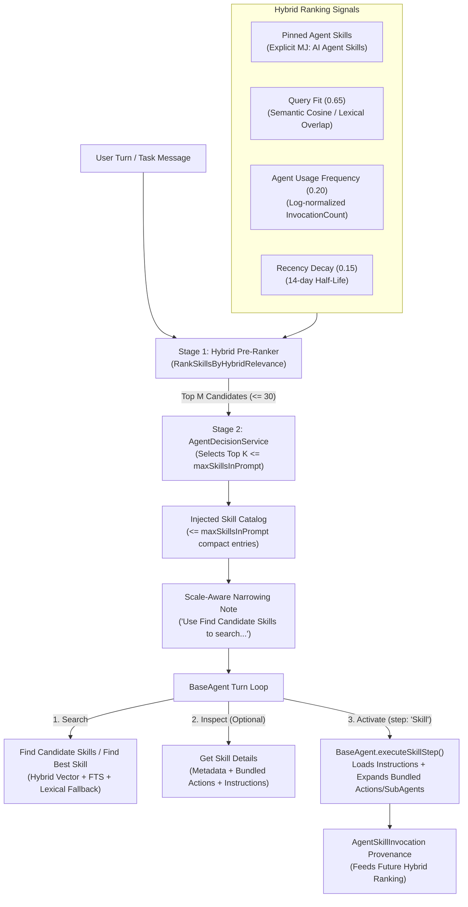

# AI Skill Scaling & Semantic Discovery Architecture

## 1. Executive Summary

As MemberJunction deployments scale from tens of `MJ: AI Skills` to hundreds or thousands of domain, integration, and workflow skills, injecting the entire skill catalog into the system prompt or sending hundreds of unranked skill descriptions to `AgentDecisionService` on every turn becomes prohibitively expensive in latency and token budget.

This architecture brings **AI Skills** to full parity with (and extends beyond) the semantic action discovery pattern by introducing:

1. **Vector & Hybrid Indexed Skill Discovery (`AI Skills Search` EntityDocument)**:
   - Indexes `MJ: AI Skills` (`Name`, `Category`, `Description`) into MJ's vector/Full-Text `EntityDocument` pipeline so `RunSemanticEntitySearch` can execute fast vector, full-text, or hybrid RRF searches over thousands of skills.
2. **First-Class Skill Discovery & Inspection Actions (`@memberjunction/core-actions`)**:
   - `Find Candidate Skills`: Hybrid semantic + lexical discovery over `MJ: AI Skills` (with automatic lexical fallback when no vector index is configured, optional agent auto-activation scope filtering via `AgentID`, and hydrated bundled `ActionNames` and `SubAgentNames`).
   - `Find Best Skill`: Single-top-match convenience action returning the highest-scoring skill and its capabilities.
   - `Get Skill Details`: Progressive-disclosure inspection action allowing an agent to inspect a skill's metadata, bundled actions/sub-agents, and instructions before deciding whether to activate it.
3. **Dedicated `maxSkillsInPrompt` & Two-Stage Hybrid Skill Prioritization (`@memberjunction/ai-agents`)**:
   - Dedicated `maxSkillsInPrompt` prompt parameter (falling back to `maxActionsInPrompt` when omitted for backward compatibility) and `maxSkillDecisionCandidates` cap (default `30`).
   - **Hybrid Skill Relevance Ranking (`RankSkillsByHybridRelevance`)**: Combines semantic/lexical query fit ($w_{\text{sem}} = 0.65$), historical usage frequency by the current agent ($w_{\text{agent}} = 0.20$), and exponential recency decay ($w_{\text{recent}} = 0.15$, 14-day half-life), while always preserving explicitly assigned agent skills (`Pinned: true`) at the top.
   - **Scale-Aware Narrowing Notes (`CatalogNarrowingNote`)**: When `Find Candidate Skills` is available or more than 20 skills are omitted from the prompt, points the model to `Find Candidate Skills` instead of dumping hundreds of hidden skill names into the system prompt.

---

## 2. End-to-End Architecture

---

## 3. Hybrid Skill Scoring Formula

When an agent has $N$ available skills (explicitly assigned `MJ: AI Agent Skills` unioned with auto-activatable catalog skills matched via `AutoActivateRules`) and $N > \text{maxSkillsInPrompt}$, Stage 1 ranks each candidate skill $s$ against the user query $q$:

$$\text{Score}(s, q) = w_{\text{sem}} \cdot \text{Sim}(s, q) + w_{\text{agent}} \cdot \text{Freq}_{\text{agent}}(s) + w_{\text{recent}} \cdot \text{Recency}(s)$$

Where:
- **Explicitly Pinned Priority**: Skills explicitly assigned to the agent in `MJ: AI Agent Skills` have `Pinned = true` and are always sorted ahead of unpinned auto-activatable skills.
- **Query Fit ($\text{Sim}(s, q) \in [0, 1]$, weight $w_{\text{sem}} = 0.65$)**: Uses a pre-computed embedding similarity score (`SemanticScore`) when provided by vector search, or token-overlap + substring boost over `Name`, `Category`, and `Description`.
- **Agent Usage Frequency ($\text{Freq}_{\text{agent}}(s) \in [0, 1]$, weight $w_{\text{agent}} = 0.20$)**: Log-normalized invocation count from `MJ: AI Agent Run Steps` (`StepType = 'Skill'`):
  $$\text{Freq}_{\text{agent}}(s) = \frac{\ln(1 + c_{\text{agent}}(s))}{\ln(1 + \max_{s'} c_{\text{agent}}(s'))}$$
- **Recency Decay ($\text{Recency}(s) \in [0, 1]$, weight $w_{\text{recent}} = 0.15$)**: Exponential decay from `LastInvokedAt` using a 14-day half-life ($\lambda = \ln(2) / 14 \approx 0.0495\text{ days}^{-1}$):
  $$\text{Recency}(s) = e^{-\lambda \cdot \Delta t_{\text{days}}}$$

---

## 4. Component Inventory

| Layer | File / Artifact | Responsibility |
|---|---|---|
| **EntityDocument Template** | `metadata/entity-documents/templates/mj-ai-skills-search.njk` | Nunjucks template indexing `Name`, `Category`, and `Description` for `MJ: AI Skills` |
| **EntityDocument Metadata** | `metadata/entity-documents/.entity-documents.json` | Registers `"AI Skills Search"` document type (`Status: Active`) |
| **Skill Discovery Base** | `packages/Actions/CoreActions/src/custom/ai/base-find-skills.action.ts` | Hybrid `RunSemanticEntitySearch` + lexical fallback over `AIEngine.Instance.Skills` + capability hydration |
| **Find Candidate Skills** | `packages/Actions/CoreActions/src/custom/ai/find-candidate-skills.action.ts` | `@RegisterClass(BaseAction, "Find Candidate Skills")` |
| **Find Best Skill** | `packages/Actions/CoreActions/src/custom/ai/find-best-skill.action.ts` | `@RegisterClass(BaseAction, "Find Best Skill")` |
| **Get Skill Details** | `packages/Actions/CoreActions/src/custom/ai/get-skill-details.action.ts` | `@RegisterClass(BaseAction, "Get Skill Details")` |
| **Action Metadata** | `metadata/actions/.skill-discovery-actions.json` | Metadata definitions & parameters for the 3 skill discovery actions |
| **Catalog Narrowing** | `packages/AI/Agents/src/catalog-narrowing.ts` | `maxSkillsInPrompt`, `RankSkillsByHybridRelevance`, `PreFilterSkillCandidatesForDecision`, scale-aware `CatalogNarrowingNote` |
| **Agent Runtime** | `packages/AI/Agents/src/base-agent.ts` | Marks assigned skills as `Pinned: true` and runs two-stage hybrid skill narrowing before prompt injection |
