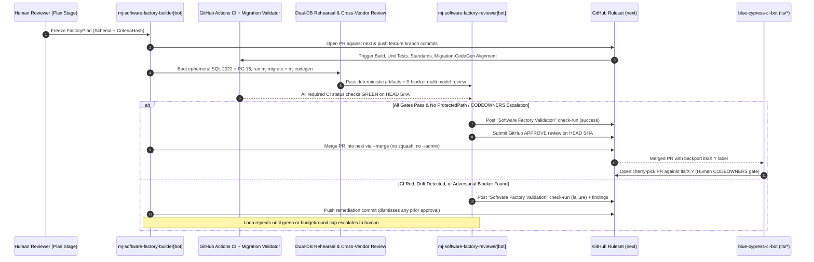
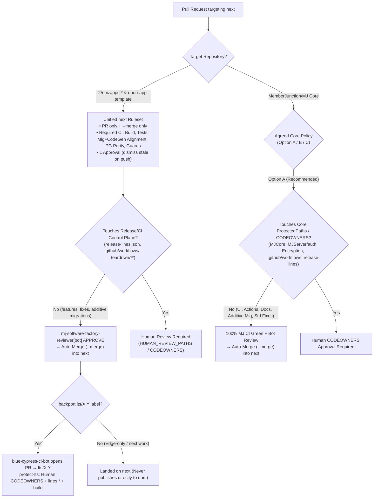

# Software Factory: 100% Auto-Ship Into `next` — Architecture & Governance Plan

> **Status: PROPOSAL — Open for Architecture & Release Engineering Review**
> **Date:** 2026-11-26
> **Requested Reviewers:** Craig Adam (`@cadam11`), Robert Kihm (`@rkihm-BC`), Boston Gunderson (`@bg-BC`)
> **Scope:** `MemberJunction/MJ`, `MemberJunction/open-app-template`, and all 25 active `MemberJunction/bizapps-*` repositories (27 repositories total)
> **Related Docs:** [LTS Release Process](./lts-process.md) · [Publish-Then-No-Breaking-Changes Policy](../packages/OpenApp/PUBLISH_NO_BREAK_POLICY.md) · [OpenApp Release Lines (`bizapps-software-factory`)](https://github.com/MemberJunction/bizapps-software-factory/blob/next/guides/RELEASE_LINES.md)

---

## 1. Executive Summary & Problem Statement

MemberJunction's **Software Factory** now executes full end-to-end delivery autonomously: technical planning (`FactoryPlan`), isolated worktree implementation, live Dual-DB scratch rehearsal (SQL Server 2022 + PostgreSQL 16), cross-vendor adversarial code review, CI log-driven remediation, and PR validation.

Once a human reviews and freezes a `FactoryPlan` (including its database schema design, additive migration contract, and acceptance criteria), **merging green PRs into `next` should require zero human merge clicks across the BizApps estate — and follow a clear, risk-tiered policy on `MemberJunction/MJ` core.**

Today, autonomous shipping into `next` is blocked **not** by code quality or CI gaps in Software Factory, but by two structural infrastructure issues:

1. **Severe Ruleset Drift Across Our 27 Active Repositories:**
   - **11 repos** (`MJ`, `open-app-template`, and 9 `bizapps-*` repos) enforce `required_approving_review_count: 1` on `next`, yet the 9 BizApps repos in this group only require 4 migration/script checks and **do not even require `build` or unit tests on `next`**.
   - **2 repos** (`bizapps-ats`, `bizapps-forms`) require CI checks on `next` with `0` approvals (`bizapps-forms` enforces 7 automated gates).
   - **10 repos** enforce only `deletion` + `non_fast_forward` on `next` — **0 required reviews, 0 required status checks, and no pull-request requirement**.
   - **4 repos** (`bizapps-community`, `bizapps-marketplace`, `bizapps-referrals`, `bizapps-tasks-github`) have **no `next` ruleset at all**.
   - By contrast, **`lts/*` release-line protection is already standardized across 26 of 27 repos** (`protect-lts` requires `required_approving_review_count: 1`, `require_code_owner_review: true`, `build`, and all `lines:*` checks). Because **`next` is MJ Edge and never publishes directly to npm for BizApps**, blocking `next` on manual human review while `lts/*` already acts as our certified release gate creates manual merge toil on half the estate and zero automated CI protection on the other half.

2. **Single-Identity GitHub Token Self-Approval Prohibition:**
   - Software Factory currently runs GitHub operations under a single developer PAT (`AN-BC`). On any repository with `required_approving_review_count: 1`, GitHub natively prohibits a PR author from approving their own PR.
   - As a result, even after Software Factory passes 100% of CI checks, live Dual-DB scratch rehearsal, and independent multi-model adversarial code review, the PR stalls at `REVIEW_REQUIRED` until a human manually clicks Merge (or invokes `break-glass` bypass, which we explicitly forbid in automation).

### Empirical Evidence: The 2026-11-26 15-Repository MJ Docs Unification Live Run

On 2026-11-26, Software Factory executed an estate-wide **MJ Docs (`MJ: Artifacts`) Unification** wave across **15 repositories** (`MJ`, `open-app-template`, 12 `bizapps-*` repos, and `BlueCypress/new-products`). Every slice was planned, dual-DB rehearsed on SQL Server 2022 + PostgreSQL 16, adversarially reviewed across distinct frontier models, and validated against GitHub Actions CI:

| Outcome Bucket | Repositories & PRs | CI / Review Evidence | Why It Auto-Merged or Stalled |
|---|---|---|---|
| **Cleanly Auto-Merged (No `rev=1` Block)** | `bizapps-fpna#33` (16/16), `bizapps-caliber#739` *(incl. SQL+PG migrations)*, `bizapps-collaboration#72` (16/16), `bizapps-planning#29` (14/14), `bizapps-community#24` (9/9), `bizapps-secure-messaging#55` (13/13) | 100% green build, test, and migration verification; zero manual code edits required | `next` ruleset had `required_approving_review_count: 0` (or no `next` ruleset) |
| **Merged via `break-glass` / Human Click Despite 100% Green CI** | `open-app-template#27` (6/6), `bizapps-sales#658` (17/17), `bizapps-contracts#233` (15/15), `bizapps-committees#104` (14/14), `bizapps-common#491` (21/21), `bizapps-tasks#243` (16/16) & `#244`, `bizapps-marketing#116` (14/14) | 100% green GitHub Actions CI + passing Factory Code Reviewer & Validator reports | Stalled at `REVIEW_REQUIRED` strictly due to `protect-next` (`rev=1`) + same-author PAT restriction |
| **Core `MJ` Human-Gated (Adversarial Review Proved Value)** | `MJ#6970` (Phase 0: `__mj.RecordArtifact` + `@memberjunction/ng-artifacts`) + `MJ#6972` (6-file remediation follow-up) | Independent `Factory Code Reviewer` caught two real defects before merge: **`CR-1`** (`MarkdownArtifactViewerComponent.DraftContentChanged` emission + `FlushPendingEdits()` in `MJEmbeddedDocPanelComponent.OnSaveVersion`) and **`CR-2`** (`flushPendingWorkingState` erroneously marking autosave `'saved'` on `CommitInlineEditOnServer` failure); remediated cleanly in `MJ#6972` (34/34 applicable PR checks green at review time) | Intentionally held in `ProtectedHumanMergeRepos` pending team alignment on `MJ` Core auto-ship policy |

**Two Additional Operational Findings from the Live Run:**
- **Migration + Release-Line Backport Interaction (`bizapps-caliber#739`):** Because `bizapps-caliber` has an active open `lts/6.2` line, `lines: backport or edge-only` and `blue-cypress-ci-bot`'s `Open backport pull request` workflow fired on the additive migration PR. Auto-ship into `next` must explicitly integrate with `release-lines.json` so Factory either applies the required `backport lts/X.Y` labels or flags edge-only migrations before merge.
- **Zero-Seat App Identity Constraint:** As already documented in [`.github/workflows/verify-release-app-token.yml`](../.github/workflows/verify-release-app-token.yml), the `MemberJunction` GitHub org operates at its seat cap (42/42), so machine-user accounts are a non-starter. **GitHub Apps consume zero org seats**, carry narrow scoped permissions, and produce first-class cryptographic audit trails.

---

## 2. Complete 27-Repository Ruleset & CI Gate Audit

Queried live on **2026-11-26** via `gh api repos/MemberJunction/<repo>/rules/branches/next`, `.../branches/next/protection`, `.../rulesets`, and `.../git/matching-refs/heads/lts/` across `MJ`, `open-app-template`, and all 25 active `bizapps-*` repositories.

> **Baseline Facts:**
> - **0 of 27** repos use legacy Classic Branch Protection; **100%** of active protections are repository-level GitHub Rulesets (`source_type: Repository`).
> - **`blue-cypress-ci-bot`** (`app_id: 4705146`, installation `156297321`) is already installed org-wide with `contents: write` + `pull_requests: write` and acts as the release/backport bypass actor (`pull_request` bypass on BizApps `protect-next`/`protect-lts`, `always` bypass on `MJ` `next-protect`).
> - **`break-glass`** (`team_id: 19336784`) is the emergency bypass team on all 11 strict `next` rulesets (`bizapps-common` also includes `break-glass-bizapps-common`, `team_id: 20104768`).
> - **24 of 27** repos already maintain active `lts/*` release-line branches, and **26 of 27** enforce `protect-lts` / `lts-lines`.

### Summary by `next` Enforcement Tier

| Tier | Count | `next` Ruleset Posture | `rev` | Required Checks on `next` | Core Gap |
|---|---:|---|---:|---|---|
| **Tier 1A — Core Strict** | 1 (`MJ`) | `next-protect` (`deletion`, `non_fast_forward`, PR, `dismiss_stale`) | `1` | 3 (`Check migrations`, `Run unit tests`, `Detect missing and unused dependencies`) | Same-author PAT blocks Factory; `CODEOWNERS` not yet enforced (`co=false`); `CodeGen tail drift` & PG parity not in ruleset required list |
| **Tier 1B — BizApps Strict** | 10 (`open-app-template` + 9 BizApps) | `protect-next` (`deletion`, `non_fast_forward`, PR, `dismiss_stale`) | `1` | 4 migration/script checks only | **Blocks Factory on `REVIEW_REQUIRED`** while **missing `build` / unit tests** as required checks; allows `squash` & `rebase` |
| **Tier 2 — Checks-Only** | 2 (`ats`, `forms`) | `next-protect` (`deletion`, `non_fast_forward`, checks) | `0` | 2 (`ats`) / 7 (`forms`) | No PR requirement (`pull_request` rule absent); heterogeneous check names |
| **Tier 3 — History-Only** | 10 BizApps | `protect-next` / `next-protect` / `protect-release-branches` | `0` | **0 (NONE)** | **No PR requirement and no CI check enforcement on `next`** |
| **Tier 4 — Unprotected** | 4 BizApps | **NONE** | `0` | **0 (NONE)** | `next` can be force-pushed, deleted, or merged red with zero checks |

### Full 27-Repository Empirical Table

*Legend: `Rev` = `required_approving_review_count` on `next` (`—` = no `pull_request` rule); `Dis` = `dismiss_stale_reviews_on_push`; `4 Std Mig` = `migration naming`, `migration changeset`, `script references`, `Parse migrations (T-SQL syntax check)`; `BC-Bot` = `blue-cypress-ci-bot` (`app_id: 4705146`); `BG` = `break-glass` team (`19336784`).*

| # | Repository | Tier | `next` Ruleset | Rev | Dis | `next` Required Status Checks | `next` Bypass Actors | Live `lts/*` Branches | `lts/*` Ruleset (`rev` / `CO` / checks) | Key Gaps on `next` |
|---:|---|---|---|---:|---:|---|---|---|---|---|
| 1 | `MJ` | 1A | `next-protect` | 1 | Y | **3:** `Check migrations`, `Run unit tests`, `Detect missing and unused dependencies` | `BC-Bot` (always), `BG` (always) | `lts/5`, `lts/6.1`, `lts/6.2` | `lts-lines` (`1` / N / 0) | No bot reviewer identity; `CO=false`; allows squash/rebase; missing CodeGen/PG checks in ruleset |
| 2 | `open-app-template` | 1B | `protect-next` | 1 | Y | **4:** 4 Std Mig | `BC-Bot` (PR), `BG` (always) | *(none — template)* | *(none)* | Blocks Factory (`rev=1`); missing `build` check; allows squash/rebase |
| 3 | `bizapps-accounting` | 1B | `protect-next` | 1 | Y | **4:** 4 Std Mig | `BC-Bot` (PR), `BG` (always) | `lts/6.2` | `protect-lts` (`1` / Y / 8) | Blocks Factory (`rev=1`); missing `build` & PG parity checks; allows squash |
| 4 | `bizapps-committees` | 1B | `protect-next` | 1 | Y | **4:** 4 Std Mig | `BC-Bot` (PR), `BG` (always) | `lts/6.1` | `protect-lts` (`1` / Y / 8) | Blocks Factory (`rev=1`); missing `build` check; allows squash |
| 5 | `bizapps-common` | 1B | `protect-next` | 1 | Y | **4:** 4 Std Mig | `BC-Bot` (PR), `BG`, `break-glass-bizapps-common` | `lts/6.2` | `protect-lts` (`1` / Y / 8) | Blocks Factory (`rev=1`); missing `build` check; extra repo-specific bypass team |
| 6 | `bizapps-contracts` | 1B | `protect-next` | 1 | Y | **4:** 4 Std Mig | `BC-Bot` (PR), `BG` (always) | `lts/6.2` | `protect-lts` (`1` / Y / 9) | Blocks Factory (`rev=1`); missing `build` check; allows squash |
| 7 | `bizapps-issues` | 1B | `protect-next` | 1 | Y | **4:** 4 Std Mig | `BC-Bot` (PR), `BG` (always) | `lts/6.1` | `protect-lts` (`1` / Y / 8) | Blocks Factory (`rev=1`); missing `build` check; allows squash |
| 8 | `bizapps-marketing` | 1B | `protect-next` | 1 | Y | **4:** 4 Std Mig | `BC-Bot` (PR), `BG`, **`RepoAdmin (Role 5)`** | `lts/6.2` | `protect-lts` (`1` / Y / 8) | Blocks Factory (`rev=1`); missing `build`; legacy `Role 5` admin bypass drift |
| 9 | `bizapps-orders` | 1B | `protect-next` | 1 | Y | **4:** 4 Std Mig | `BC-Bot` (PR), `BG` (always) | `lts/6.2` | `protect-lts` (`1` / Y / 8) | Blocks Factory (`rev=1`); missing `build` check; allows squash |
| 10 | `bizapps-sales` | 1B | `protect-next` | 1 | Y | **4:** 4 Std Mig | `BC-Bot` (PR), `BG` (always) | `lts/6.2` | `protect-lts` (`1` / Y / 8) | Blocks Factory (`rev=1`); missing `build` check; allows squash |
| 11 | `bizapps-tasks` | 1B | `protect-next` | 1 | Y | **4:** 4 Std Mig | `BC-Bot` (PR), `BG` (always) | `lts/6.2` | `protect-lts` (`1` / Y / 8) | Blocks Factory (`rev=1`); missing `build` check; allows squash |
| 12 | `bizapps-ats` | 2 | `next-protect` | — | N | **2:** `build-and-test`, `changes_and_migrations` | *(none)* | `lts/6.2` | `protect-lts` (`1` / Y / 5) | No PR rule; legacy check names differ from `protect-next` standard |
| 13 | `bizapps-forms` | 2 | `next-protect` | — | N | **7:** `build-and-test`, `changes_and_migrations`, `codegen-append-gate`, `distribution-gate`, `generated-scope-gate`, `migration-order-gate`, `ui-token-gate` | *(none)* | `lts/6.2` | `protect-lts` (`1` / Y / 10) | Strongest automated checks in BizApps, but no PR rule; check names bespoke |
| 14 | `bizapps-caliber` | 3 | `next-protect` | — | N | **0 (NONE)** | *(none)* | `lts/6.2` | `protect-lts` (`1` / Y / 6) | No PR rule, 0 required checks on `next` |
| 15 | `bizapps-collaboration` | 3 | `protect-next` | — | N | **0 (NONE)** | *(none)* | `lts/6.2` | `protect-lts` (`1` / Y / 9) | No PR rule, 0 required checks on `next` |
| 16 | `bizapps-contact-center` | 3 | `protect-next` | — | N | **0 (NONE)** | *(none)* | `lts/6.2` | `protect-lts` (`1` / Y / 8) | No PR rule, 0 required checks on `next` |
| 17 | `bizapps-credentialing` | 3 | `protect-next` | — | N | **0 (NONE)** | *(none)* | `lts/6.2` | `protect-lts` (`1` / Y / 8) | No PR rule, 0 required checks on `next` |
| 18 | `bizapps-fpna` | 3 | `protect-next` | — | N | **0 (NONE)** | *(none)* | `lts/6.2` | `protect-lts` (`1` / Y / 8) | No PR rule, 0 required checks on `next` |
| 19 | `bizapps-planning` | 3 | `protect-next` | — | N | **0 (NONE)** | *(none)* | `lts/6.2` | `protect-lts` (`1` / Y / 8) | No PR rule, 0 required checks on `next` |
| 20 | `bizapps-secure-messaging` | 3 | `protect-next` | — | N | **0 (NONE)** | *(none)* | `lts/6.1` | `protect-lts` (`1` / Y / 9) | No PR rule, 0 required checks on `next` |
| 21 | `bizapps-software-factory` | 3 | `protect-next` | — | N | **0 (NONE)** | *(none)* | `lts/6.2` | `protect-lts` (`1` / Y / 8) | No PR rule, 0 required checks on `next` |
| 22 | `bizapps-sonar` | 3 | `protect-release-branches` | — | N | **0 (NONE)** | *(none)* | `lts/6.1` | `protect-lts` (`1` / Y / 7) | Ruleset covers `next`+`main` with history-only rules; 0 required checks |
| 23 | `bizapps-voting` | 3 | `protect-next` | — | N | **0 (NONE)** | *(none)* | `lts/6.2` | `protect-lts` (`1` / Y / 8) | No PR rule, 0 required checks on `next` |
| 24 | `bizapps-community` | 4 | **NONE** | — | N | **0 (NONE)** | *(none)* | *(none)* | `protect-lts` (`1` / Y / 4) | Completely unprotected `next` (even force-push/deletion allowed) |
| 25 | `bizapps-marketplace` | 4 | **NONE** | — | N | **0 (NONE)** | *(none)* | `lts/6.2` | `protect-lts` (`1` / Y / 8) | Completely unprotected `next` |
| 26 | `bizapps-referrals` | 4 | **NONE** | — | N | **0 (NONE)** | *(none)* | `lts/6.2` | `protect-lts` (`1` / Y / 8) | Completely unprotected `next` |
| 27 | `bizapps-tasks-github` | 4 | **NONE** | — | N | **0 (NONE)** | *(none)* | *(none)* | `protect-lts` (`1` / Y / 4) | Completely unprotected `next` |

**Takeaway:** Standardizing `next` is not a relaxation of governance — it **dramatically raises the safety floor across 25 of 27 repos** (adding mandatory `build`, deterministic migration/CodeGen alignment, and PR-only history to the 14 unguarded repos and adding `build` to the 10 Tier 1B repos) while removing the artificial same-author bottleneck that blocked Software Factory on 9 repos.

---

## 3. The 4-Pillar Architecture for Safe Auto-Ship Into `next`

### Pillar 1 — Two-Identity GitHub App Separation of Duties

Running Software Factory under a human developer PAT fails GitHub's separation-of-duties model in three ways: (1) GitHub blocks self-approval on `rev=1` repos, (2) a `break-glass` member's PAT can accidentally bypass branch protection, and (3) commit/PR attribution conflates autonomous Factory execution with human-authored changes.

We introduce **two dedicated, zero-seat, least-privilege GitHub Apps** installed org-wide on `MemberJunction`, while keeping the existing **`blue-cypress-ci-bot`** (`app_id: 4705146`) strictly isolated for release cutting and `lts/*` backports:

| GitHub App Identity | Role | Repository Permissions | Ruleset Bypass? | What It Can NEVER Do |
|---|---|---|---|---|
| **`mj-software-factory-builder[bot]`** *(new)* | Authoring, CI remediation, PR lifecycle, `--merge` execution | `contents: write`, `pull_requests: write`, `issues: write`, `checks: read`, `actions: read` | **NEVER** (no bypass on any branch) | Cannot approve its own PRs; cannot push directly to `next`, `main`, or `lts/*`; cannot bypass required status checks |
| **`mj-software-factory-reviewer[bot]`** *(new)* | Independent validation attestation & GitHub `APPROVE` review | `contents: read`, `pull_requests: write` *(reviews/comments only)*, `checks: write` | **NEVER** (no bypass on any branch) | Cannot push code or commits; cannot merge PRs; cannot approve if any required check, Dual-DB rehearsal, or adversarial review failed |
| **`blue-cypress-ci-bot`** *(existing, `4705146`)* | Release publishing, version PRs, `backport lts/*` cherry-picks | `contents: write`, `pull_requests: write` *(existing)* | `pull_request` (BizApps) / `always` (`MJ` release back-merges) | Never used by Software Factory for feature authoring or PR approvals |

**How Cryptographic Separation of Duties Works Natively on GitHub:**
1. `mj-software-factory-builder[bot]` opens the PR and pushes commits to `factory/<task-slug>`.
2. `dismiss_stale_reviews_on_push: true` is enabled on `next`. Every new commit from Builder automatically invalidates any prior review.
3. Only after **all four verification stages succeed on the exact PR `HEAD` SHA** — (a) required GitHub Actions checks green, (b) deterministic `MigrationCodeGenAlignmentValidator` green, (c) live Dual-DB scratch rehearsal green with zero CodeGen diff, and (d) cross-vendor adversarial code review (distinct model vendor from the Builder) returns `0` blockers — does the Factory validation runtime mint a short-lived installation token for `mj-software-factory-reviewer[bot]` to:
   - Publish a structured **`Software Factory Validation`** GitHub Check Run (`conclusion: success`) embedding the `FactoryPlan` ID, `CriteriaHash`, verified `HEAD` SHA, Dual-DB rehearsal summary, and model-vendor review ledger; and
   - Submit a GitHub **`APPROVE`** review on the PR.
4. `mj-software-factory-builder[bot]` then executes a standard `gh pr merge --merge` (never `--squash`, never `--admin`). GitHub's own ruleset engine enforces that a distinct identity approved the current `HEAD` SHA and every required CI check passed.

---

### Pillar 2 — Deterministic Migration & CodeGen Verification (Replacing Manual Migration Eyeballing)

Historically, migrations were placed in `HUMAN_REVIEW_PATHS` (`migrations/**`, `migrations-pg/**`) because an unreviewed migration can silently corrupt `EntityField` sequences, omit stored procedure updates, desync PostgreSQL from SQL Server, or introduce breaking column drops.

However, **once database schema design is reviewed and frozen in the `FactoryPlan`**, manual PR review of a 1,500-line migration + CodeGen PR is almost exclusively mechanical verification — which humans are slow and error-prone at, and deterministic parsers execute in `<200ms` with 100% repeatability.

We replace manual migration eyeballing with a **two-layer deterministic proof**:

#### Layer 2A — 5-Rule Deterministic `MigrationCodeGenAlignmentValidator` (`<200ms` CI & Pre-Push Gate)

Shipped as a shared, dependency-free Node script (`check-migration-codegen-alignment.mjs`) in `bizapps-software-factory` and `open-app-template` (and rolled out to all BizApps + `MJ`), configurable via `--mode Enforce | Warn | Off`:

| Rule | Invariant Enforced | What It Catches Automatically |
|---|---|---|
| **Rule 1 — 4-Part File Anatomy & Separation** | Hand-written DDL sits strictly above `-- GENERATED BY MemberJunction CodeGen`; **>= 50 consecutive blank lines** immediately precede the banner; no hand-authored `spCreate*`/`spUpdate*`/`spDelete*`/`vw*` above the banner (unless `-- codegen-override-ok`) | Mixed hand/CodeGen edits, missing separation delimiter, CodeGen overwrite hazards |
| **Rule 2 — Mandatory CodeGen Section Presence** | Comment- and string-literal-stripped SQL parser detects entity DDL (`CREATE TABLE`, `ALTER TABLE ... ADD/ALTER COLUMN/DROP/CHECK`); fails if the CodeGen tail is missing or empty (exempts index-only, extended-property-only, `Metadata_Sync`-only, or `-- codegen-not-required:<reason>`) | Hand-written schema migrations committed without running `mj codegen` |
| **Rule 3 — 1:1 DDL ↔ CodeGen Coverage Match** | Every created/altered `[schema].[Table]`, added/altered column, and modified `CHECK` constraint in hand DDL must have matching CodeGen output: `Entity`/`EntityField` `INSERT` (using apply-time `COALESCE(MAX([Sequence]), 0)`), `vw*` base view, `spCreate*`/`spUpdate*`/`spDelete*`, `trgUpdate*`, `GRANT`s, and `EntityFieldValue` rows | Partial/stale CodeGen appends, hardcoded `Sequence` integers, missing `@Param` in SPs, drifted `CHECK` value lists |
| **Rule 4 — Cross-File PR Lockstep (`SQL` + `PG` + TS)** | Verifies matching `.pg.sql` counterpart in `migrations-pg/` referencing every new/altered table & column **and** corresponding generated TypeScript entity files (`packages/*Entities*/src/generated/` or `packages/MJCoreEntities/src/generated/`) in the PR diff | Forgotten PostgreSQL parity migration or unregenerated entity classes / Zod schemas |
| **Rule 5 — `PUBLISH_NO_BREAK_POLICY.md` Additive Guard** | Deterministically rejects `DROP TABLE`, `DROP COLUMN`, `sp_rename`, column type narrowing, and `ALTER TABLE ... ADD [Col] ... NOT NULL` without a `DEFAULT` constraint (overridable only on explicit era-bump PRs via `--allow-breaking`) | Accidental breaking schema changes within a published major era |

#### Layer 2B — Live Dual-DB Scratch Rehearsal + Release-Line Label Compliance

In addition to static CI parsing, every migration-bearing Factory task runs:
1. **Live Dual-DB Scratch Rehearsal:** Ephemeral SQL Server 2022 + PostgreSQL 16 Docker containers apply full migration history + the PR's new migrations (`mj migrate`), run `mj codegen`, and assert **zero CodeGen diff** (`check-codegen-tail.mjs` parity).
2. **Release-Line Label Awareness (`release-lines.json`):** Before marking a migration PR merge-ready, Software Factory inspects `release-lines.json` on `next`:
   - If the repo has open `lts/*` lines and the migration is **shared**, Factory applies the required `backport lts/X.Y` label(s) so `lines: backport or edge-only` passes and `blue-cypress-ci-bot` opens the cherry-pick PR to `lts/X.Y` on merge (where human `CODEOWNERS` still gate the release line).
   - If the migration requires upcoming MJ Edge capabilities (**edge-only**), it touches `release-lines.json` (`next.edgeOnlyMigrations`), which remains in `HUMAN_REVIEW_PATHS` / `CODEOWNERS` because marking a migration edge-only is a support decision per `guides/RELEASE_LINES.md`.

---

### Pillar 3 — Standardized `next` vs. `lts/*` Rulesets (BizApps vs. `MJ` Core)

#### 3.1 All 25 `bizapps-*` & `open-app-template` (`next` vs. `lts/*`)

We eliminate the 4-tier ruleset drift by applying **one uniform `next` ruleset** across all 26 non-core repositories (ideally via a single **Org-Level GitHub Ruleset** targeting `refs/heads/next` with `MJ` excluded, or an IaC-managed per-repo ruleset script):

- **Branch Integrity:** `deletion`, `non_fast_forward`, pull request required (`pull_request`).
- **Merge Method:** `allowed_merge_methods: ['merge']` only (forbidding `squash` and `rebase` so commit history stays intact and `korthout/backport-action` cherry-picks cleanly).
- **Approval Gate:** `required_approving_review_count: 1` with `dismiss_stale_reviews_on_push: true`, `require_code_owner_review: false` on `next`. Satisfied natively by `mj-software-factory-reviewer[bot]` for Factory PRs or any teammate for human PRs.
- **Required Status Checks (Standardized Across All 26 Repos):**
  1. `build` (compile + unit tests — closing the missing-build gap on Tier 1B and all 14 Tier 3/4 repos)
  2. `migration naming` + `migration changeset` + `Parse migrations (T-SQL syntax check)` + `PostgreSQL migration parity` *(or a single stable aggregator check job `migration-gates` wrapping all four + `migration-codegen-alignment`)*
  3. `migration-codegen-alignment` (5-rule deterministic validator from Pillar 2)
  4. `repo: guards` + `script references` + `lines: backport or edge-only`
  - *Note on `Software Factory Validation` check-run:* We recommend **NOT** listing `Software Factory Validation` as a mandatory GitHub Ruleset check on `next` unless a lightweight router workflow auto-skips it on non-Factory PRs — otherwise every human-authored PR would block waiting for a Factory bot check. Because `required_approving_review_count: 1` is enforced, Factory PRs still cannot merge without `mj-software-factory-reviewer[bot]`'s approval (which itself refuses to approve unless `Software Factory Validation` is green), while human PRs flow normally with peer review.
- **Bypass Cleanup:** Keep `blue-cypress-ci-bot` (`pull_request` bypass) and `break-glass` (`always` bypass); remove legacy `RepositoryRole:5` bypass from `bizapps-marketing` and reconcile `break-glass-bizapps-common` if unneeded.
- **`lts/*` Unchanged:** `protect-lts` (`rev=1`, `require_code_owner_review: true`, `lines: on next first`, `lines: migrations`, `lines: mj pin`, `build`) remains the human-certified production publishing gate.

#### 3.2 `MemberJunction/MJ` Core (`next`) — Three Concrete Options for Team Alignment

`MemberJunction/MJ` has a much higher blast radius (350+ lockstep packages, core ORM/auth/encryption primitives, release infrastructure). We propose three concrete options for `@cadam11`, `@rkihm-BC`, and `@bg-BC` to choose from:

| Dimension | **Option A (Recommended): Risk-Tiered Auto-Ship + `CODEOWNERS` on Sensitive Core** | **Option B: Time-Delayed Auto-Ship Window on `MJ` Core** | **Option C: Phased Rollout — BizApps 100% Auto-Ship First; `MJ` Core Human-Merged in Phase 1** |
|---|---|---|---|
| **How It Works** | Enable `require_code_owner_review: true` on `MJ` `next-protect` and expand [`.github/CODEOWNERS`](../.github/CODEOWNERS) to cover sensitive core paths. PRs outside `CODEOWNERS` (Angular/UI packages, Actions, Docs, standard bugfixes, frozen-plan additive migrations) auto-merge via `mj-software-factory-reviewer[bot]` once **100% of `MJ` CI** passes (`CodeGen tail drift`, `Ensure migrations are valid`, `PG migration validation`, SQL+PG deterministic integration, 8/8 unit shards, `Detect missing and unused dependencies`, `CLAUDE.md gate`, `MJ standards`, `migration-codegen-alignment`). PRs touching `CODEOWNERS` paths wait for human owner approval. | Same CI + bot approval bar as Option A, plus a configurable **quiet window (e.g., 2–4 hours)** after green CI + bot approval. Posts a Slack/PR notice with a 1-click `hold-auto-merge` label; if no human holds it, Builder auto-merges when the timer expires. Sensitive `CODEOWNERS` paths still require explicit human approval. | Flip all 25 `bizapps-*` + `open-app-template` to 100% auto-ship immediately. Keep `MemberJunction/MJ` in `ProtectedHumanMergeRepos` for a 2–4 week telemetry soak (measuring post-merge revert rate, CI flake rate, and `MigrationCodeGenAlignmentValidator` precision), then graduate `MJ` Core to Option A. |
| **Sensitive Core `CODEOWNERS` / `ProtectedPaths`** | Existing certification/publish/Canon paths in [`.github/CODEOWNERS`](../.github/CODEOWNERS) **plus:** `packages/MJCore/`, `packages/MJServer/src/auth/`, `packages/Encryption/`, `packages/SQLServerDataProvider/`, `packages/PostgreSQLDataProvider/`, `.github/workflows/`, `teardown/**`, security/impersonation/RLS plumbing | Same sensitive path list | Entire `MemberJunction/MJ` repo during Phase 1; Option A list in Phase 2 |
| **Pros** | Immediate velocity on 80%+ of `MJ` PRs while preserving hard GitHub-enforced human gates on auth, core runtime, and release pipelines; zero arbitrary wait latency | Gives core maintainers passive visibility & veto power before any `MJ` merge without blocking overnight waves | Lowest initial risk to core platform; gathers real BizApps production metrics before touching `MJ` core ruleset |
| **Cons** | Requires auditing and maintaining `CODEOWNERS` boundaries accurately up front | Adds 2–4h latency to multi-repo cross-dependency waves (`MJ` → `bizapps-common` → downstream BizApps) | Keeps human bottleneck on `MJ` core during cross-repo waves (like MJ Docs Phase 0) for 2–4 weeks |

---

### Pillar 4 — Guardrails, Kill Switches & Clean Rollback

Auto-ship must be **trivially reversible at every layer** — from a single PR to the entire GitHub organization.

#### 4.1 Layered `DeliveryPolicy` Controls (Built Into `bizapps-software-factory`)

Software Factory's existing 5-layer policy engine (`Global -> Client -> Repository -> Project -> Task` in `DeliveryPolicyResolver.ts`) already provides the enforcement primitives:

- **`AUTO_MERGE_ALLOWED` (`AllMustAllow`):** Every active layer in the chain must explicitly allow auto-merge. Any single layer setting `false` halts auto-merge.
- **`HUMAN_REVIEW_PATHS` (`Union`):** Once Pillar 2's `MigrationCodeGenAlignmentValidator` is enforced, we refine the default `Global` policy to remove additive `migrations/**` and `migrations-pg/**` from `HUMAN_REVIEW_PATHS` (replacing them with the deterministic validator + Dual-DB rehearsal gate), while **retaining** `teardown/**`, `teardown-pg/**`, `.github/workflows/**`, `release-lines.json`, `**/auth/**`, and `**/security/**` as mandatory human-review (`>= L3`) paths.
- **`MigrationCodeGenAlignment` Mode (`Enforce | Warn | Off`):** Per-repo or per-plan setting allowing gradual onboarding (`Warn` during rollout, `Enforce` as the auto-ship prerequisite, explicit override only for major era-bump breaking migrations).
- **`ProtectedHumanMergeRepos`:** Per-policy allowlist of repositories (e.g., `MemberJunction/MJ` under Option C) that always stop at "ready for human merge."
- **`RevertCircuitBreakerPolicy` (Already Modeled in `packages/Core/src/types.ts`):** Automatically demotes a repository's Delivery Policy back to `ShadowModeEnabled = true` if post-merge reverts spike (`maxRevertsInWindow: 2` within `windowHours: 24`), halting further autonomous merges until a human inspects the root cause.

#### 4.2 Three-Tier Instant Kill Switches

| Kill Switch Level | Mechanism | Blast Radius | Time to Effect |
|---|---|---|---|
| **Tier 1 — Single Repository** | Set `AUTO_MERGE_ALLOWED = false` on the Repository Delivery Policy (or add repo to `ProtectedHumanMergeRepos`) | 1 repo | `< 1 second` (next merge gate check) |
| **Tier 2 — Org-Wide Software Factory** | Set `Global` Delivery Policy `ShadowModeEnabled = true` (PRs still open & validate, zero auto-merges) or `FactoryEnabled = false` | All 27 repos | `< 1 second` |
| **Tier 3 — GitHub-Native Emergency Stop** | Suspend `mj-software-factory-reviewer[bot]` installation in GitHub Org Settings (`github.com/organizations/MemberJunction/settings/installations`) | All 27 repos, independent of Factory DB/services | Immediate — GitHub rejects all bot approvals natively |

#### 4.3 Clean Rollback & Follow-Up Push Semantics

- **Mandatory `--merge` Commits:** Enforcing `allowed_merge_methods: ['merge']` ensures every auto-shipped PR lands as a single 2-parent merge commit on `next`, giving engineers a clean 1-command rollback (`git revert -m 1 <merge-sha>`) without untangling squashed multi-slice commits or breaking `korthout/backport-action`.
- **Additive Migration Rollback Discipline:** Code-only PRs revert cleanly via `git revert -m 1`. Because `MigrationCodeGenAlignmentValidator` Rule 5 guarantees all auto-shipped migrations are **strictly additive** (nullable or defaulted columns / new tables), a bad feature PR can be reverted in code immediately without breaking database state; the unreleased schema addition on `next` is then cleaned up either via a forward migration or the existing `migration-changeset-exempt` revert flow before any `lts/*` cut.
- **Follow-Up Pushes & Stale Reviews:** `dismiss_stale_reviews_on_push: true` guarantees that if Builder pushes *any* follow-up commit after approval, GitHub strips the approval and forces a fresh `mj-software-factory-reviewer[bot]` re-validation against the new `HEAD` SHA. For human-approved PRs, Factory's existing `ApprovalReusePolicy` (`trivial` / `same_intent` / `different` diff classification) remains strictly opt-in and never overrides GitHub's native ruleset check.

---

## 4. Concrete Implementation Checklist & Owner Breakdown (~1 Week)

| Workstream | Concrete Deliverables | Target Repos | Est. Effort | Suggested Owner(s) |
|---|---|---|---|---|
| **WS1 — Two-Identity GitHub Apps** | 1. Register `mj-software-factory-builder` and `mj-software-factory-reviewer` GitHub Apps in `MemberJunction` org (zero seats, least-privilege scopes per Pillar 1). 2. Install org-wide on all 27 repos. 3. Store App IDs + private keys in Factory secrets/vault and add a read-only diagnostic workflow mirroring `verify-release-app-token.yml`. | GitHub Org (`MemberJunction`), `bizapps-software-factory` | 0.5 day | `@cadam11` + `@rkihm-BC` |
| **WS2 — Deterministic Migration & CodeGen Gate Rollout** | 1. Land 5-rule `MigrationCodeGenAlignmentValidator` (`check-migration-codegen-alignment.mjs`) + unit test suite in `bizapps-software-factory` and `open-app-template`. 2. Propagate workflow + script across all 25 `bizapps-*` repos and wire into `MJ` CI alongside `check-codegen-tail.mjs`. 3. Standardize required job names across BizApps (`build`, `migration-codegen-alignment`, `migration naming`, `migration changeset`, `Parse migrations (T-SQL syntax check)`, `PostgreSQL migration parity`, `script references`, `repo: guards`). | `bizapps-software-factory`, `open-app-template`, 25 `bizapps-*`, `MJ` | 1.5 days | Software Factory + `@bg-BC` |
| **WS3 — Ruleset Standardization (`next`)** | 1. Create unified org-level `bizapps-protect-next` ruleset (or run idempotent ruleset-sync script across all 26 non-core repos) enforcing PR-only, `--merge` only, `rev=1`, `dismiss_stale=true`, and the standardized required status checks. 2. Remove legacy `RepositoryRole:5` bypass on `bizapps-marketing` and retire fragmented Tier 2/3/4 rulesets. 3. Update `MJ` `next-protect` & [`.github/CODEOWNERS`](../.github/CODEOWNERS) per the agreed core option (Option A, B, or C) and add `CodeGen tail drift` + PG parity to `MJ` required checks. | GitHub Org / 27 repos, `MJ` | 1 day | `@cadam11` + `@rkihm-BC` |
| **WS4 — Factory Reviewer & Release-Line Wiring** | 1. Wire `mj-software-factory-builder[bot]` for PR creation, pushes, `backport lts/X.Y` labeling (checking `release-lines.json`), and `--merge` execution. 2. Wire `mj-software-factory-reviewer[bot]` to publish the `Software Factory Validation` check-run and submit GitHub `APPROVE` strictly after green CI + Dual-DB rehearsal + 0-blocker cross-vendor review. 3. Update default `DeliveryPolicy` templates (promote validated additive migrations out of `HUMAN_REVIEW_PATHS`; enable `RevertCircuitBreakerPolicy` by default). | `bizapps-software-factory` | 1.5 days | Software Factory |
| **WS5 — End-to-End Dry Run & Kill-Switch Drill** | 1. Run a live 3-repo canary wave (1 code-only BizApp, 1 additive SQL+PG migration BizApp with open `lts/6.2`, 1 `MJ` PR) verifying zero-touch auto-merge into `next` + clean `blue-cypress-ci-bot` backport PR to `lts/6.2`. 2. Execute a live Tier 1/2/3 kill-switch test and verify `git revert -m 1` rollback + `RevertCircuitBreakerPolicy` auto-demotion. | Canary repos (`bizapps-fpna`, `bizapps-sales`, `MJ`) | 0.5 day | All (`@cadam11`, `@rkihm-BC`, `@bg-BC`, Factory) |

---

## 5. Open Questions for `@cadam11`, `@rkihm-BC`, and `@bg-BC`

Please weigh in directly on the PR so we can lock these five decisions before starting WS1–WS5:

1. **Org-Level Ruleset vs. Script-Synced Per-Repo Rulesets (`next`):**
   Do we have GitHub Enterprise / Team org-level rulesets available for `MemberJunction` so we can enforce **one** `bizapps-protect-next` ruleset across all 26 non-core repos (eliminating drift permanently as new BizApps are created), or should we maintain an idempotent ruleset-sync script in `open-app-template` / infra repo to converge the 26 repository-level rulesets?
2. **Two Dedicated GitHub Apps (`builder` + `reviewer`) vs. Minimal Single New App:**
   Are we aligned on registering **both** `mj-software-factory-builder[bot]` and `mj-software-factory-reviewer[bot]` (clean provenance, zero human PAT usage, zero bypass rights, `blue-cypress-ci-bot` left strictly for releases/backports), or do you prefer any variation (e.g., reusing an existing app)?
3. **`next` Auto-Ship ↔ `lts/*` Backport Bot Interaction:**
   When Software Factory auto-ships an additive migration PR into `next` on a repo with an active open line (e.g. `lts/6.2`), `lines: backport or edge-only` requires either a `backport lts/6.2` label or a `release-lines.json` `edgeOnlyMigrations` entry. Should Factory **automatically apply `backport lts/X.Y`** on shared migrations (so `blue-cypress-ci-bot` immediately opens a human-reviewed cherry-pick PR to `lts/X.Y`), or should migration-bearing Factory PRs default to edge-only / human label triage before merge?
4. **`MemberJunction/MJ` Core Policy — Option A vs. Option B vs. Option C:**
   Which rollout posture do you want for `MemberJunction/MJ` (`next`)?
   - **Option A** (Recommended: immediate risk-tiered auto-ship with expanded `CODEOWNERS` gating `MJCore`, `MJServer/src/auth`, `Encryption`, data providers, `.github/workflows`, and certification paths),
   - **Option B** (2–4h quiet window + Slack notice / hold label), or
   - **Option C** (BizApps 100% auto-ship first for a 2–4 week soak; `MJ` Core stays human-merged in Phase 1)?
   *(If Option A or B: please confirm any additional `MJ` paths you want locked in `.github/CODEOWNERS`.)*
5. **Required Status Check Naming Standardization & Human-PR Compatibility:**
   Across the 25 BizApps repos, CI job names currently diverge (`build` vs. `build-and-test`, 4 split migration checks vs. `changes_and_migrations`, and `bizapps-forms`'s 7 custom gates). Are we aligned on converging all 26 non-core repos onto a single canonical required-check set (wrapping migration + `migration-codegen-alignment` + PG parity + `build`), and keeping `Software Factory Validation` enforced via `mj-software-factory-reviewer[bot]`'s `APPROVE` review rather than a hard GitHub required status check so human-authored PRs are never blocked by a Factory-only check?
