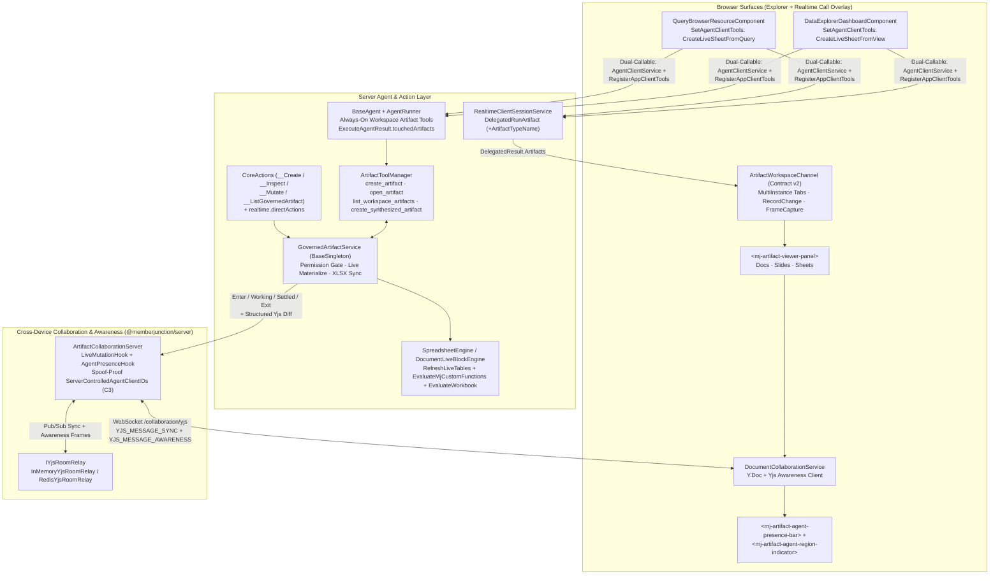
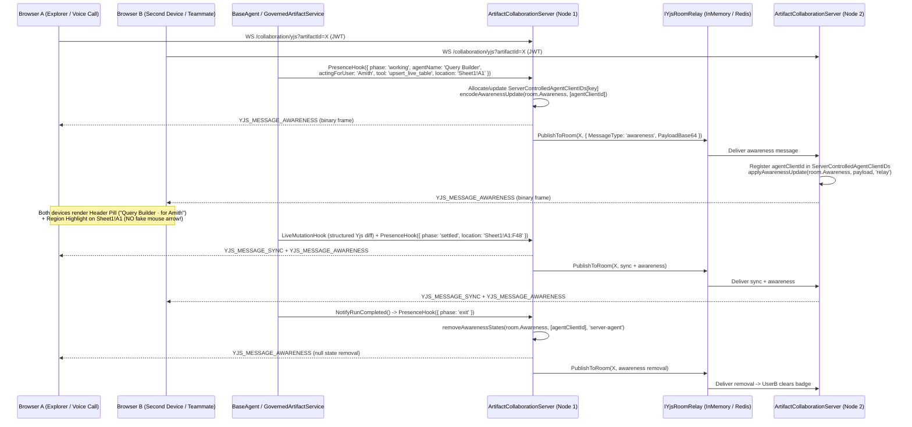

# Unified Agent Artifacts, Realtime Workspace & Cross-Device Live Presence — Implementation Plan

> **Implementation Status (2026-11-15 — Shipped across Wave 1 + Wave 2):** **IMPLEMENTED** across `@memberjunction/ai-core-plus`, `@memberjunction/ai-agents`, `@memberjunction/core-actions`, `@memberjunction/realtime-runtime`, `@memberjunction/ng-conversations`, `@memberjunction/ng-artifacts`, `@memberjunction/ng-dashboards`, and `@memberjunction/server`.
>
> **Shipped Deviations vs. Original Design Notes Below:**
> - **WebSocket endpoint:** Shipped on `/collaboration/yjs` (`ARTIFACT_COLLABORATION_WS_PATH` in `ArtifactCollaborationServer.ts`), superseding earlier draft `/ws/collaboration` notes.
> - **No `any` types:** Codebase ships with strict typing (`ArtifactToolArgs`, `ExecuteAgentResult<P>` without `any`).
> - **`ArtifactWorkspaceChannel` verbs & state:** Shipped verbs are `open`, `focus`, `show_version`, `refresh`, `close`, **`navigate_to_anchor`** (`sheet`, `range`, `slideNumber`, `elementId`, `heading`, `blockId`, `highlightMs`), and **`set_view_mode`** (`'edit' | 'suggest' | 'diff' | 'present'`) — rather than historical draft names `focus_tab`, `navigate_to`, `save_version`, `get_outline`. Instance IDs use `w1`, `w2`, ... (default `MaxInstances: 6`), `GetState()` returns `{ activeInstanceId, activeSelection, artifacts }`, and user cursor/selection deltas flow back via `EmitSelectionDelta` -> `selection_changed`.
> - **Live-Sheet Explorer tools:** Implemented in `packages/Angular/Explorer/dashboards/src/shared/live-sheet-client-tool.helper.ts` (`CreateLiveSheetFromQuery`, `AppendQueryToLiveSheet`, `CreateLiveSheetFromView`, atomic `v1` materialization).
> - **Branch & Target:** Shipped on `feat/artifacts-adversarial-next-wave` in `/Users/amith/mj-worktrees/unified-agent-artifacts`. See [`guides/DOCS_SLIDES_SHEETS_ARCHITECTURE.md`](../guides/DOCS_SLIDES_SHEETS_ARCHITECTURE.md) and [`guides/REALTIME_CHANNELS_GUIDE.md`](../guides/REALTIME_CHANNELS_GUIDE.md) for canonical current contracts.

> **Historical Branch Ref:** `feat/unified-agent-artifacts` (`/Users/amith/mj-worktrees/unified-agent-artifacts`)
> **Original Status:** Architecture & Implementation Plan (Historical Reference)
> **Scope:** Loop Agents (`@memberjunction/ai-agents`), Governed Artifact Actions (`@memberjunction/core-actions`), Realtime Co-Agents & Channels (`@memberjunction/realtime-runtime`, `@memberjunction/ng-conversations`), Explorer Surfaces (`@memberjunction/ng-dashboards`), and Cross-Device Yjs Collaboration & Presence (`@memberjunction/server`, `@memberjunction/ng-artifacts`).

---

## 1. Executive Summary & End-to-End Architecture

Today, MemberJunction's collaborative Docs (`Markdown Document`), Slides (`Presentation`), and Sheets (`Excel Spreadsheet`) have rich server-side tool libraries (`DocumentToolLibrary`, `SlideDeckToolLibrary`, `SpreadsheetToolLibrary`) and a Yjs CRDT collaboration server (`ArtifactCollaborationServer`), **but four structural gaps prevent seamless human + AI co-creation across chat, voice, and dashboards**:

1. **Pre-existing Artifact Gate (`HasArtifacts()`) & Unmaterialized Live Data:** `BaseAgent` only initializes and exposes `artifact_tool` when `inputArtifacts.length > 0`. An agent cannot create a governed Doc/Slide/Sheet mid-run from scratch or open an existing workspace artifact by ID/name unless the user manually `@`-attached one beforehand (the sole exception being `create_synthesized_artifact`, which is unreachable when `HasArtifacts()` is `false`). Furthermore, when `SpreadsheetToolLibrary` executes `upsert_live_table` or writes `=MJ.QUERY(...)` / `=MJ.VIEW(...)`, `BaseArtifactToolLibrary.InvokeTool` lacks `contextUser` and `provider`, so `SpreadsheetEngine.RefreshLiveTables` and `EvaluateMjCustomFunctions` never execute during the tool call — leaving the agent blind to the materialized column headers, row count, and bounding range (`A1:F48`) it needs to build downstream formulas and charts in the same run.
2. **No Governed Artifact CoreActions or Realtime Direct Actions:** `CreateDocumentAction` (`__CreateDocument`) in `@memberjunction/core-actions` generates standalone binary `.pdf`/`.docx`/`.xlsx` files in `MJ: Files` via `ArtifactBuilderService`, not governed collaborative `MJ: Artifacts`. Regular agents without native `artifact_tool` wiring and Realtime Co-Agents (`realtime.directActions`) lack clean, permission-checked Actions to create, inspect, and live-mutate collaborative Docs, Slides, and Sheets.
3. **No Collaborative Artifact Channel in Realtime Voice Sessions & No Dashboard-to-Live-Sheet Tools:** Realtime Co-Agents have `InteractiveComponentChannel` (for React components) and `WhiteboardChannel`, plus `ArtifactWorkspace` is referenced conceptually, but no `ArtifactWorkspaceChannel` exists to render `<mj-artifact-viewer-panel>` (Docs/Slides/Sheets) inside the live call overlay, claim delegated Docs/Slides/Sheets from `OnDelegationArtifacts`, stream bounded perception deltas (`RecordChange`), or expose workspace navigation verbs via `ContextTool`. Likewise, `QueryBrowserResourceComponent` and `DataExplorerDashboardComponent` expose read/filter client tools via `SetAgentClientTools`, but cannot turn an active query or entity view into a live-linked Spreadsheet (`SpreadsheetLiveTableSpec` / `=MJ.QUERY`) that both Loop Agents and Realtime Co-Agents can immediately enrich with formulas and charts.
4. **Client-Local Synthetic Agent Presence Instead of True Cross-Device Yjs Awareness:** `SpreadsheetArtifactViewerComponent` maintains a client-local `SyntheticAgentPresence` (`ClientID: -999`, lines 501–511 & 7005–7035) that is never broadcast over Yjs Awareness, while `MarkdownArtifactViewerComponent` and `SlideDeckArtifactViewerComponent` have no agent presence overlay at all. Viewers on a second browser tab, a mobile device, or a teammate's screen see content jump with zero indication of **which agent** is editing, **which user** it is acting on behalf of (`contextUser`), or **where** it is working.

### End-to-End Target Architecture



### Non-Negotiable MJ Engineering Invariants

Every file created or modified by this plan MUST satisfy all repository guardrails in [`AGENTS.md`](../AGENTS.md) and nested `CLAUDE.md` guides:

- **Zero `any` or lazy `unknown` casts:** Every tool schema, action input/output, Yjs awareness payload, and channel state object uses explicit TypeScript interfaces.
- **Zero `BaseEntity.Get()` / `BaseEntity.Set()`:** Access `MJArtifactEntity`, `MJArtifactVersionEntity`, `MJConversationDetailArtifactEntity`, `MJFileEntity`, and `MJQueryEntity` strictly through generated typed getters/setters.
- **Derive entity unions via indexed access (`Entity['Field']`):** Use `MJArtifactEntity['Visibility']`, `MJConversationDetailArtifactEntity['Direction']`, `MJQueryEntity['Status']` — never hand-copied string literal unions.
- **`BaseSingleton<T>` for all singletons:** `GovernedArtifactService` extends `BaseSingleton<GovernedArtifactService>` with a `protected constructor()` and `public static get Instance()`.
- **Thin Actions, Rich Services (`packages/Actions/CLAUDE.md`):** Actions parse `RunActionParams`, delegate to `GovernedArtifactService`, and map outputs. Actions NEVER instantiate or invoke other Actions.
- **Angular Generic Layer Purity (`packages/Angular/Generic/CLAUDE.md`):** `@memberjunction/ng-artifacts` and `@memberjunction/ng-conversations` MUST NOT import `@angular/router` or `@memberjunction/ng-shared`, and MUST thread `@Input() Provider: IMetadataProvider | null = null` (`RunView.FromMetadataProvider(this.ProviderToUse)`).
- **Thin Explorer Surfaces (`packages/Angular/Explorer/CLAUDE.md` & `dashboards/CLAUDE.md`):** `QueryBrowserResourceComponent` and `DataExplorerDashboardComponent` register tools through `this.navigationService.SetAgentClientTools(this, [...])` — never a parallel mechanism — and delegate workbook construction/materialization to server-side `GovernedArtifactService` via `GraphQLActionClient`.
- **Modern Angular & Design Tokens (`packages/Angular/CLAUDE.md`):** Use `@if` / `@for` / `@switch`, `inject()`, setter `@Input()`s (no `ngOnChanges`), Font Awesome icons, `mjButton` (never override `.mj-btn`), and semantic `--mj-*` CSS custom properties (zero hardcoded hex colors; dark-mode automatic).

---

## 2. Workstream A: Main Agent Mid-Run Artifact Creation, Discovery & Live Materialization

### A.1 Lifting `HasArtifacts()` Gating Across `BaseAgent`, `framework-tools`, and `ArtifactToolManager`

#### Verified Root-Cause Sites to Update

| File | Current Code (Verified Lines) | Required Change |
|---|---|---|
| [`packages/AI/Agents/src/base-agent.ts`](../packages/AI/Agents/src/base-agent.ts#L2908-L2941) | Line 2908 calls `this._artifactToolManager.Clear()`, then line 2933 gates `if (inputArtifacts?.length)` before calling `this._artifactToolManager.Initialize(...)`. When `inputArtifacts` is empty, `contextUser`, `provider`, `getAgentRun`, and `agentName` remain `undefined` inside `ArtifactToolManager`! | Always call `await this._artifactToolManager.Initialize(inputArtifacts ?? [], { contextUser: params.contextUser, provider: this.Provider, getAgentRun: () => this._agentRun, agentName: params.agent.Name, conversationId: params.conversationId, conversationDetailId: params.conversationDetailId })` whenever `this.isArtifactToolingEnabled(params)` is `true`. Add a `finally` cleanup call `await this._artifactToolManager.NotifyRunCompleted()` at run exit so active Yjs agent presence is deterministically cleared. |
| [`packages/AI/Agents/src/base-agent.ts`](../packages/AI/Agents/src/base-agent.ts#L6284-L6286) | `ArtifactTools: p?.includeArtifactToolsDocs !== false && this._artifactToolManager.HasArtifacts()` | Change to `ArtifactTools: p?.includeArtifactToolsDocs !== false && this._artifactToolManager.IsWorkspaceEnabled()` (true whenever `ArtifactToolManager` is initialized with `contextUser` + `provider` AND agent does not disable `includeArtifactToolsDocs`). Note: agents like `Sage` have `ArtifactCreationMode = 'Never'` (to suppress automatic JSON payload dumps at turn end), yet MUST still be able to invoke explicit workspace artifact tools (`create_artifact`, `open_artifact`, `list_workspace_artifacts`) unless `includeArtifactToolsDocs === false`! |
| [`packages/AI/Agents/src/base-agent.ts`](../packages/AI/Agents/src/base-agent.ts#L6737-L6795) | Prompt injection (`_ARTIFACT_MANIFEST`, `_ARTIFACT_MANIFEST_NATIVE`, `_ARTIFACT_TOOLS`) only runs when `this._artifactToolManager.HasArtifacts()` is `true`. | Split prompt injection cleanly: when `HasArtifacts()` is `true`, emit the open-artifact manifest + per-artifact & workspace tools as today; when `HasArtifacts()` is `false` and `IsWorkspaceEnabled()` is `true`, emit a concise ~120-token workspace-tools section (`create_artifact`, `open_artifact`, `list_workspace_artifacts`, `create_synthesized_artifact`) so the LLM knows it can create or open governed Docs/Slides/Sheets mid-run. |
| [`packages/AI/Agents/src/base-agent.ts`](../packages/AI/Agents/src/base-agent.ts#L11751) & [`#L16898`](../packages/AI/Agents/src/base-agent.ts#L16898) & [`#L16980`](../packages/AI/Agents/src/base-agent.ts#L16980) & [`#L17031`](../packages/AI/Agents/src/base-agent.ts#L17031) | Tool dispatch and loop-continuation checks (`if (artifactToolsExecutedThisTurn && this._artifactToolManager.HasArtifacts())`) drop workspace tool calls when `artifacts.size === 0` (e.g., `list_workspace_artifacts` returning 0 items or a failed `open_artifact`). | Replace `this._artifactToolManager.HasArtifacts()` on tool-dispatch and loop-continuation paths with `this._artifactToolManager.IsWorkspaceEnabled()`, and change line 17031 to `if (artifactToolsExecutedThisTurn)` so the LLM always receives the tool result on the next turn. |
| [`packages/AI/Agents/src/base-agent.ts`](../packages/AI/Agents/src/base-agent.ts#L14500) | Sub-agent delegation passes `inputArtifacts: params.inputArtifacts` (static array from run start). | Pass `inputArtifacts: this._artifactToolManager.ExportInputArtifacts(params.inputArtifacts)` so any artifact created or opened mid-run via `create_artifact` / `open_artifact` / `create_synthesized_artifact` is immediately visible to delegated child/related sub-agents, and merge `result.touchedArtifacts` back into the parent run. |
| [`packages/AI/Agents/src/native-tools/framework-tools.ts`](../packages/AI/Agents/src/native-tools/framework-tools.ts#L142-L163) | `artifact_tool` JSON schema declares `required: ['artifactId', 'tool']`, and `ParseNativeFrameworkCalls` rejects calls where `typeof args.artifactId !== 'string'`. | Change `required` to `['tool']`. Keep `artifactId` as an optional `string` property documented as: *"Required for artifact-scoped tools (`'A'`, `'B'`, or UUID). Omit (or pass `'*'`) for workspace-level tools (`create_artifact`, `open_artifact`, `list_workspace_artifacts`, `create_synthesized_artifact`)."* In `ParseNativeFrameworkCalls`, default `artifactId` to `typeof args.artifactId === 'string' ? args.artifactId : '*'` when `tool` is present. |
| [`packages/AI/Agents/src/ArtifactToolManager.ts`](../packages/AI/Agents/src/ArtifactToolManager.ts#L667-L745) & [`#L872-L895`](../packages/AI/Agents/src/ArtifactToolManager.ts#L872-L895) | `GetAvailableToolNames()` returns `[]` and `GetToolDocumentation()` returns `''` when `!this.HasArtifacts()`. `ExecuteSingleToolCall` checks `this.artifacts.get(call.artifactId)` BEFORE dispatching workspace-level tools (currently `list_workspace_artifacts` and `create_synthesized_artifact` at lines 942–950 are unreachable unless `call.artifactId` happens to match an already-loaded artifact!). | 1) Expose `IsWorkspaceEnabled(): boolean` (`Boolean(this.contextUser && this.provider)`).<br/>2) Include workspace tool names (`create_artifact`, `open_artifact`, `list_workspace_artifacts`, `create_synthesized_artifact`) in `GetAvailableToolNames()` and `GetToolDocumentation()` whenever `IsWorkspaceEnabled()` is `true`.<br/>3) In `ExecuteSingleToolCall`, dispatch workspace-level tools (`WORKSPACE_LEVEL_TOOLS` set) **first**, before `this.artifacts.get(call.artifactId)`! |

---

### A.2 Workspace Tools: `create_artifact` and `open_artifact`

Both workspace tools live in `ArtifactToolManager` and delegate core persistence, permission enforcement, initial content scaffolding, and `.xlsx` generation to `GovernedArtifactService` (Section B.1) so behavior is 100% identical between `artifact_tool` and `CoreActions`.

#### 1. `create_artifact` Specification

- **Input Schema (`CreateArtifactToolInput`):**
  ```typescript
  export type GovernedArtifactKind = 'document' | 'slides' | 'spreadsheet' | 'whiteboard';

  export interface CreateArtifactToolInput {
      /** High-level collaborative artifact kind or exact MJ: Artifact Types Name. */
      kind: GovernedArtifactKind | string;
      /** Human-friendly artifact title (required). */
      name: string;
      /** Optional summary description stored on MJ: Artifacts and v1 MJ: Artifact Versions. */
      description?: string;
      /** Optional target MJ: Collections ID; verifies CanEdit on collection via ArtifactPermissionEngine. */
      collectionId?: string;
      /** Optional initial Markdown (for 'document'), SlideDeckDocument JSON, or SpreadsheetWorkbookDocument JSON. */
      initialContent?: string | ArtifactToolArgs;
      /** Convenience seed for 'spreadsheet': immediately bind & materialize a live query or entity view on Sheet 1! */
      liveDataSource?: {
          sourceType: 'query' | 'view' | 'entity';
          queryId?: string;
          queryPath?: string;
          viewId?: string;
          entityName?: string;
          extraFilter?: string;
          parameters?: Record<string, string | number | boolean | null>;
          sheetName?: string;
          anchorCell?: string;
          maxRows?: number;
      };
  }
  ```
- **Execution & Security Contract:**
  1. Verify `contextUser` has `CanCreate` on `MJ: Artifacts` and `MJ: Artifact Versions` via `provider.Entities`.
  2. If `collectionId` is supplied, verify `ArtifactPermissionEngine.Instance.CheckCollectionPermission(provider, collectionId, contextUser.ID, 'Edit', contextUser)` (preventing unauthorized injection into shared collections).
  3. Resolve canonical `MJ: Artifact Types` row (`'document'` -> `'Markdown Document'`, `'slides'` -> `'Presentation'`, `'spreadsheet'` -> `'Excel Spreadsheet'`, `'whiteboard'` -> `'Whiteboard'`, or exact `ArtifactType.Name` match via `ArtifactMetadataEngine`).
  4. Construct canonical initial document:
     - `'Markdown Document'`: Markdown string (`initialContent` or `# ${name}\n`).
     - `'Presentation'`: Validated `SlideDeckDocument` via `SlideDeckEngine.Instance.CreateEmptyDeck(name)` (or parsed `initialContent`).
     - `'Excel Spreadsheet'`: Validated `SpreadsheetWorkbookDocument` via `SpreadsheetEngine.Instance.CreateEmptyWorkbook(name)`. If `liveDataSource` is provided, attach a `SpreadsheetLiveTableSpec` (`SourceType`, `QueryID`/`ViewID`/`EntityName`, `AnchorCell: 'A1'`), execute `RefreshLiveTables` + `EvaluateMjCustomFunctions` + `EvaluateWorkbook` under `contextUser` (enforcing `MJ: Queries` `UserCanRun` and entity RLS/FLS!), and serialize initial `.xlsx` bytes via `SpreadsheetEngine.Instance.SerializeToXlsx(workbook)` into `MJ: Files` when a default storage account is configured.
     - `'Whiteboard'`: Validated `WhiteboardDocument` JSON.
  5. Save `MJArtifactEntity` + `MJArtifactVersionEntity` (`VersionNumber = 1`, `UserID = contextUser.ID`, `Content`, `Configuration` with `previewSnapshot` via `BuildArtifactPreviewSnapshot`), and optional `MJCollectionArtifactEntity`.
  6. Register the new artifact in `ArtifactToolManager` with the next alphabetical manifest ID (`A`, `B`, `C`, ...), record it in `this.touchedArtifacts` (`GovernedRunArtifactSummary` with `Operation: 'created'`), emit `'settled'` presence on `GetArtifactAgentPresenceHook()`, and return:
     ```typescript
     export interface CreateOrOpenArtifactToolOutput {
         artifactId: string;        // MJ: Artifacts UUID
         alphaId: string;           // Session manifest ID ('A', 'B', ...) for subsequent artifact_tool calls
         versionId: string;         // MJ: Artifact Versions UUID
         versionNumber: number;
         name: string;
         typeName: string;
         canEdit: boolean;
         availableTools: string[];  // Tool names unlocked for this artifact type
         outline: ArtifactToolArgs; // Immediate structural outline (sheets/headers/bounds, slides, or headings)
     }
     ```

#### 2. `open_artifact` Specification

- **Input Schema (`OpenArtifactToolInput`):**
  ```typescript
  export interface OpenArtifactToolInput {
      /** MJ: Artifacts UUID (or existing alphaId). Preferred when known. */
      artifactId?: string;
      /** Case-insensitive exact or partial name search within user-readable workspace/conversation/collection artifacts. */
      name?: string;
      /** Optional collection scope when resolving by name. */
      collectionId?: string;
  }
  ```
- **Execution & Security Contract:**
  1. If already open in `this.artifacts`, return its current `alphaId`, `versionId`, `canEdit`, `availableTools`, and fresh `outline` (idempotent, zero duplicate manifest slots).
  2. Resolve target `MJArtifactEntity` by `artifactId` or `name` (filtering candidates through `ArtifactPermissionEngine.Instance.ResolvePermissions(provider, id, contextUser)` so `CanRead === false` rows are invisible; if `name` matches multiple readable artifacts, return an actionable disambiguation list with `artifactId`, `name`, `typeName`, `updatedAt`).
  3. **Live Collaboration Room Hydration:** Query a new optional hook `GetArtifactLiveContentReaderHook()` (registered by `ArtifactCollaborationServer.Start()` alongside `SetArtifactLiveMutationHook`). If an active Yjs `CollaborationRoom` exists for `artifactId` with uncompacted live edits, hydrate from the live room's `Y.Doc` text/JSON + `CurrentVersionNumber`; otherwise load the latest `MJ: Artifact Versions` row (`OrderBy: 'VersionNumber DESC', MaxRows: 1`).
  4. Enforce `perms.CanEdit` on registration (`ManagedArtifact.canEdit = perms.CanEdit`): if `CanEdit === false`, `ArtifactToolManager` exposes ONLY read/inspect tools (`get_document_outline`, `read_section`, `get_workbook_outline`, `read_range`, `get_deck_outline`, `get_slide`, etc.) and blocks all mutating tools with `PERMISSION_DENIED`.
  5. Emit `'enter'` presence via `GetArtifactAgentPresenceHook()` and return `CreateOrOpenArtifactToolOutput`.

---

### A.3 Run-Scoped `touchedArtifacts` Lineage (Chat Cards, Sub-Agents & Realtime Delegation)

To ensure mid-run created or mutated artifacts (`create_artifact`, `create_synthesized_artifact`, `open_artifact` + mutations, or `GovernedArtifactService` CoreActions) are never orphaned when `agentResult.payload` is empty:

1. **New Type in [`packages/AI/CorePlus/src/agent-types.ts`](../packages/AI/CorePlus/src/agent-types.ts):**
   ```typescript
   export interface GovernedRunArtifactSummary {
       ArtifactID: string;
       ArtifactVersionID: string;
       VersionNumber: number;
       Name: string;
       ArtifactTypeName: string;
       DriverClass?: string;
       Operation: 'created' | 'mutated' | 'synthesized';
   }
   ```
   Add `touchedArtifacts?: GovernedRunArtifactSummary[]` to `ExecuteAgentResult<P = ArtifactToolArgs>` in `@memberjunction/ai-core-plus`.
2. **Tracking in `ArtifactToolManager` & `GovernedArtifactService`:**
   - `ArtifactToolManager` records every created, synthesized, or mutated artifact (deduplicated by `ArtifactID`, keeping the latest `ArtifactVersionID` and `VersionNumber`, with `'created'` taking precedence over `'mutated'`).
   - `GovernedArtifactService` accepts an optional `agentRunId?: string` (available via `RunActionParams.Context` or `ArtifactToolManager.getAgentRun()`) and registers touched artifacts in a bounded `MJLruCache<string, Map<string, GovernedRunArtifactSummary>>` (`maxSize: 2_000, ttlMs: 2 * 60 * 60 * 1000`) so `BaseAgent` merges **both** `this._artifactToolManager.GetTouchedArtifacts()` AND any artifacts created/mutated via `CoreActions` during the same `agentRun.ID`!
3. **Conversation Linking in [`packages/AI/Agents/src/AgentRunner.ts`](../packages/AI/Agents/src/AgentRunner.ts#L800-L954):**
   - Add Step `6c` (`linkTouchedGovernedArtifacts`) in `RunAgentInConversation` right after `processFileArtifacts()`: when `!suppressArtifacts && agentResult.success && agentResponseDetailId && agentResult.touchedArtifacts?.length`, ensure each `GovernedRunArtifactSummary` has a `MJConversationDetailArtifactEntity` row (`ConversationDetailID = agentResponseDetailId`, `ArtifactVersionID = item.ArtifactVersionID`, `Direction = 'Output'`, idempotent check so existing links aren't duplicated).
   - Extend `SelectPrimaryArtifact` so `touchedArtifacts` (collaborative Docs/Slides/Sheets explicitly created/edited by the agent) rank alongside `fileArtifacts` ahead of generic JSON `payloadArtifact` snapshots!
4. **Realtime Delegation Surfacing in [`packages/AI/Agents/src/realtime/realtime-client-session-service.ts`](../packages/AI/Agents/src/realtime/realtime-client-session-service.ts#L4307-L4361):**
   - Update `createDelegatedRunArtifacts` eligibility guard from `if (!result.success || paused || (!hasPayload && !result.touchedArtifacts?.length))` so a `Sage` or `Query Builder` run that creates/updates a Doc/Slide/Sheet via tools/actions (with `{}` payload) still surfaces its `DelegatedRunArtifact[]`!
   - Enrich `DelegatedRunArtifact` (`realtime-tool-broker.ts:202`), GraphQL `RealtimeSessionToolArtifact` (`RealtimeClientSessionResolver.ts`), and `ParsedDelegationArtifact` (`delegation-result-parser.ts:14`) with optional `ArtifactTypeName?: string` and `DriverClass?: string`.
   - Also surface `Artifacts?: DelegatedRunArtifact[]` when `ExecuteRelayedTool` executes a **Direct Action** (`__CreateGovernedArtifact` / `__MutateGovernedArtifact`) in `RealtimeClientSessionService`, so direct voice co-agent action calls auto-mount `ArtifactWorkspaceChannel` identically to delegated target-agent runs!

---

### A.4 Server-Side Live Query/Table Materialization in Tool Libraries

#### 1. Extend `BaseArtifactToolLibrary` Execution Context

In [`packages/AI/CorePlus/src/artifact-tool-library.ts`](../packages/AI/CorePlus/src/artifact-tool-library.ts#L19-L87), add an optional strongly-typed 4th parameter (100% backwards-compatible for all existing subclasses):

```typescript
import type { IMetadataProvider, UserInfo } from '@memberjunction/core';

export interface ArtifactToolExecutionContext {
    /** Authenticated user on whose behalf the tool is running (enforces RLS, FLS, and Query permissions). */
    contextUser?: UserInfo;
    /** Request-scoped metadata provider (never fall back to global Metadata.Provider when supplied). */
    provider?: IMetadataProvider;
    /** Underlying MJ: Artifacts UUID, used for =MJ.IMPORTRANGE cycle/permission resolution and audit. */
    artifactId?: string;
    /** Active MJ: AI Agent Runs UUID, if executing inside an agent run. */
    agentRunId?: string;
    /** Display name of the executing agent. */
    agentName?: string;
}
```

Update `BaseArtifactToolLibrary.InvokeTool(toolName, input, artifactContent, context?)` and `protected invokeSubclassTool(toolName, input, artifactContent, context?)` to forward `context`, and pass `{ contextUser: this.contextUser, provider: this.provider, artifactId: managed.artifactId, agentRunId: this.getAgentRun?.()?.ID, agentName: this.agentName }` from `ArtifactToolManager.ExecuteSingleToolCall`.

#### 2. Immediate Server-Side Materialization in `SpreadsheetToolLibrary`

Update [`packages/AI/Agents/src/artifact-tools/SpreadsheetToolLibrary.ts`](../packages/AI/Agents/src/artifact-tools/SpreadsheetToolLibrary.ts):

- **`upsert_live_table` (`handleUpsertLiveTable`, lines 1236–1306):**
  - Fix typing: also accept `SourceType: 'entity'` (`EntityName` + `ExtraFilter`) in addition to `'query'` (`QueryID`, `QueryPath`, `Parameters`) and `'view'` (`ViewID`, `ExtraFilter`), matching `SpreadsheetLiveTableSpec['SourceType']` (`SpreadsheetEngine` already supports `'query' | 'view' | 'entity'`).
  - When `context?.contextUser` and `context?.provider` are present, immediately execute:
    1. `const refreshResults = await SpreadsheetEngine.Instance.RefreshLiveTables(workbook, context.contextUser, context.provider, { TableID: spec.TableID });`
    2. `await SpreadsheetEngine.Instance.EvaluateMjCustomFunctions(workbook, context.contextUser, context.provider, { HostArtifactID: context.artifactId });`
    3. `SpreadsheetEngine.Instance.EvaluateWorkbook(workbook);`
  - Compute and return deterministic materialized metadata in `ArtifactToolResult.data`:
    ```typescript
    export interface MaterializedLiveTableToolOutput {
        mutated: true;
        updatedContent: string;
        tableId: string;
        sheetId: string;
        sheetName: string;
        anchorCell: string;
        materialized: boolean;
        headers: string[];          // Exact column headers written to the anchor row
        rowCount: number;           // Materialized data row count (excluding header row)
        boundingRange: string;      // e.g. "A1:F48" (header + data rows)
        dataRange: string | null;   // e.g. "A2:F48" (ready for =SUM(F2:F48) or chart DataRange!)
        sampleRows: Array<Record<string, string | number | boolean | null>>; // First <= 5 rows for sanity check
        refreshError?: string;      // Populated if query/view permission or SQL failed
    }
    ```
  - **Why this is transformative:** On the very next step of the same agent turn, the agent knows `headers: ["Region", "Deals", "ARR"]`, `boundingRange: "A1:C14"`, and `dataRange: "A2:C14"`, so it can deterministically write `=SUM(C2:C14)` into `C15` and call `upsert_chart` with `DataRange: "A1:C14"` without guessing column letters or row counts!
- **`write_cells` (`handleWriteCells`, lines 739–820):**
  - Inspect written `Formula` values. If any written cell formula matches `/\bMJ\.(QUERY|VIEW|ENTITY|LOOKUP|IMPORTRANGE)\s*\(/i` and `context?.contextUser` + `context?.provider` are present, await `SpreadsheetEngine.Instance.EvaluateMjCustomFunctions(workbook, context.contextUser, context.provider, { HostArtifactID: context.artifactId })` before `SpreadsheetEngine.Instance.EvaluateWorkbook(workbook)`, and include `spilledRanges: Array<{ formulaCell: string; boundingRange: string; headers: string[]; rowCount: number }>` in the response!
- **New `refresh_live_tables` Tool on `SpreadsheetToolLibrary`:**
  - Allows an agent that opened an existing living Spreadsheet via `open_artifact` to refresh one (`tableId`) or all live tables + `=MJ.*` custom functions on demand under `contextUser` and inspect updated `headers`, `rowCount`, and `boundingRange`.
- **Live Block Preview in `DocumentToolLibrary` (`upsert_mj_block`):**
  - When `DocumentToolLibrary` executes `upsert_mj_block` (`packages/AI/Agents/src/artifact-tools/DocumentToolLibrary.ts`) and `context?.contextUser` + `context?.provider` are present, invoke `DocumentLiveBlockEngine.Instance.ExecuteBlock(...)` to validate the query/view/entity reference immediately and return `{ blockId, valid: boolean, rowCount?, columns?, validationError? }` so broken block specs are caught before finishing the run!

---

## 3. Workstream B: Governed Artifact CoreActions & Shared Direct Actions

### B.1 Shared Service Layer: `GovernedArtifactService`

Per [`packages/Actions/CLAUDE.md`](../packages/Actions/CLAUDE.md) (*"Keep Actions Thin; Services = Business Logic; Actions never call other Actions"*), all governed artifact creation, permission resolution, tool-library execution, live-data materialization, `.xlsx` binary synchronization, live Yjs room diffing, and agent presence emission live in a single strongly-typed `BaseSingleton`:

- **File:** `packages/AI/Agents/src/GovernedArtifactService.ts` (exported from `@memberjunction/ai-agents/src/index.ts`).
- **Why in `@memberjunction/ai-agents`:** `@memberjunction/core-actions` ALREADY depends on `@memberjunction/ai-agents` (`packages/Actions/CoreActions/package.json`), and placing `GovernedArtifactService` in `@memberjunction/ai-agents` lets both `ArtifactToolManager` AND `CoreActions` call the exact same `BaseSingleton` without circular dependencies!

```typescript
import { BaseSingleton } from '@memberjunction/global';
import type { IMetadataProvider, UserInfo } from '@memberjunction/core';
import type { MJArtifactEntity } from '@memberjunction/core-entities';
import type { GovernedRunArtifactSummary } from '@memberjunction/ai-core-plus';

export interface CreateGovernedArtifactParams {
    Kind: 'document' | 'slides' | 'spreadsheet' | 'whiteboard' | string;
    Name: string;
    Description?: string;
    CollectionID?: string;
    ConversationDetailID?: string;
    Visibility?: MJArtifactEntity['Visibility'];
    InitialContent?: string | ArtifactToolArgs;
    LiveDataSource?: {
        SourceType: 'query' | 'view' | 'entity';
        QueryID?: string;
        QueryPath?: string;
        ViewID?: string;
        EntityName?: string;
        ExtraFilter?: string;
        Parameters?: Record<string, string | number | boolean | null>;
        SheetName?: string;
        AnchorCell?: string;
        MaxRows?: number;
    };
    AgentRunID?: string;
    AgentName?: string;
    ContextUser: UserInfo;
    Provider: IMetadataProvider;
}

export interface CreateGovernedArtifactResult {
    Success: boolean;
    ErrorCode?: 'MISSING_PARAM' | 'PERMISSION_DENIED' | 'UNKNOWN_ARTIFACT_TYPE' | 'QUERY_NOT_RUNNABLE' | 'SAVE_FAILED';
    ErrorMessage?: string;
    ArtifactID?: string;
    ArtifactVersionID?: string;
    VersionNumber?: number;
    Name?: string;
    ArtifactTypeName?: string;
    DriverClass?: string;
    Outline?: ArtifactToolArgs;
    MaterializedTable?: {
        TableID: string;
        SheetName: string;
        Headers: string[];
        RowCount: number;
        BoundingRange: string;
        DataRange: string | null;
    };
}

export class GovernedArtifactService extends BaseSingleton<GovernedArtifactService> {
    protected constructor() {
        super();
    }

    public static get Instance(): GovernedArtifactService {
        return GovernedArtifactService.getInstance<GovernedArtifactService>();
    }

    public async CreateArtifact(params: CreateGovernedArtifactParams): Promise<CreateGovernedArtifactResult> { /* ... */ }
    public async InspectArtifact(params: InspectGovernedArtifactParams): Promise<InspectGovernedArtifactResult> { /* ... */ }
    public async MutateArtifact(params: MutateGovernedArtifactParams): Promise<MutateGovernedArtifactResult> { /* ... */ }
    public async ListWorkspaceArtifacts(params: ListWorkspaceArtifactsParams): Promise<ListWorkspaceArtifactsResult> { /* ... */ }
    public RecordTouchedArtifact(agentRunId: string, summary: GovernedRunArtifactSummary): void { /* ... */ }
    public ConsumeTouchedArtifacts(agentRunId: string): GovernedRunArtifactSummary[] { /* ... */ }
}
```

### B.2 Four Governed Artifact CoreActions (`@memberjunction/core-actions`)

Create `packages/Actions/CoreActions/src/custom/artifacts/` (and export from `packages/Actions/CoreActions/src/index.ts`):

| Action Metadata Name | Class & `@RegisterClass(BaseAction, ...)` | Responsibility & Parameters | Relationship to Existing Actions |
|---|---|---|---|
| `Create Governed Artifact` | `CreateGovernedArtifactAction` (`'__CreateGovernedArtifact'`) | **Inputs:** `Kind` (`'document' \| 'slides' \| 'spreadsheet' \| 'whiteboard'`), `Name`, `Description?`, `CollectionID?`, `InitialContent?`, `LiveDataSource?` (JSON object for instant query/view-backed Sheet).<br/>**Outputs:** `ArtifactID`, `ArtifactVersionID`, `VersionNumber`, `ArtifactTypeName`, `Outline`, `MaterializedTable`. | Distinct from `CreateDocumentAction` (`__CreateDocument`), which writes static binary `.docx`/`.pdf`/`.xlsx` blobs to `MJ: Files` via `ArtifactBuilderService` without `MJ: Artifacts` collaboration/versioning. |
| `Inspect Governed Artifact` | `InspectGovernedArtifactAction` (`'__InspectGovernedArtifact'`) | **Inputs:** `ArtifactID` (or `Name`), `Operation` (`'outline' \| 'read_range' \| 'read_section' \| 'get_slide' \| 'search'`), `OperationArgs?` (JSON object).<br/>**Outputs:** `ArtifactID`, `ArtifactVersionID`, `VersionNumber`, `CanEdit`, `Data`. | Enforces `ArtifactPermissionEngine.ResolvePermissions().CanRead` and reads live uncompacted Yjs room state when active. |
| `Mutate Governed Artifact` | `MutateGovernedArtifactAction` (`'__MutateGovernedArtifact'`) | **Inputs:** `ArtifactID`, `Tool` (any mutating tool on `SpreadsheetToolLibrary`, `DocumentToolLibrary`, `SlideDeckToolLibrary`, `WhiteboardToolLibrary`, e.g. `write_cells`, `upsert_live_table`, `upsert_chart`, `replace_section`, `upsert_mj_block`, `add_slide`, `update_slide`), `ToolArgs` (JSON object), `SaveNewVersion?` (`boolean`, default `false` when live Yjs room is active, `true` when cold).<br/>**Outputs:** `ArtifactID`, `ArtifactVersionID`, `VersionNumber`, `Result`, `Outline`. | Routes through `GovernedArtifactService.MutateArtifact`, which invokes `GetArtifactAgentPresenceHook()` (`'working'` -> `'settled'`) + `GetArtifactLiveMutationHook()` (`ArtifactCollaborationServer` 3-way merge / structured Yjs diff) + `.xlsx` sync! Complementary to `RefreshAndSnapshotArtifactAction` (`__RefreshAndSnapshotArtifact`), which is for scheduled background Living Report snapshots. |
| `List Workspace Artifacts` | `ListWorkspaceArtifactsAction` (`'__ListWorkspaceArtifacts'`) | **Inputs:** `SearchQuery?`, `ArtifactType?`, `CollectionID?`, `ConversationID?`, `MaxResults?` (default 20, cap 50).<br/>**Outputs:** `Artifacts` (bounded permission-filtered summaries), `TotalCount`. | Gives both Action-driven agents and Realtime Co-Agents fast discovery of user-accessible Docs/Slides/Sheets. |

### B.3 Realtime Co-Agent `directActions` Wiring

- In [`metadata/agents/.sage-agent.json`](../metadata/agents/.sage-agent.json) and [`metadata/agents/.query-builder-agent.json`](../metadata/agents/.query-builder-agent.json):
  1. Grant `MJ: AI Agent Actions` rows for `Create Governed Artifact`, `Inspect Governed Artifact`, `Mutate Governed Artifact`, and `List Workspace Artifacts` (active).
  2. In `TypeConfiguration.realtime.directActions`, allowlist `List Workspace Artifacts`, `Inspect Governed Artifact`, `Create Governed Artifact`, and `Mutate Governed Artifact` so a live Realtime Co-Agent can inspect an open workbook range, create a live query-backed Sheet, or tweak a cell/heading/slide **directly in ~250ms** without spawning a full multi-step Loop Agent delegation when a single governed operation suffices!
  3. In [`packages/AI/Agents/src/realtime/realtime-client-session-service.ts`](../packages/AI/Agents/src/realtime/realtime-client-session-service.ts) (`executeDirectAction`), inspect output params for `ArtifactID` + `ArtifactVersionID` on `__CreateGovernedArtifact` / `__MutateGovernedArtifact` and attach `Artifacts: [{ ArtifactID, ArtifactVersionID, Name, ArtifactTypeName, DriverClass }]` to the relayed tool response so `RealtimeSessionRuntime` automatically notifies `ArtifactWorkspaceChannel.OnDelegationArtifacts`!

---

## 4. Workstream C: Realtime Co-Agent `ArtifactWorkspaceChannel` & Explorer Live-Sheet Client Tools

### C.1 `ArtifactWorkspaceChannel` (Realtime Channels Contract v2)

Modeled directly after [`InteractiveComponentChannel`](../packages/Angular/Generic/conversations/src/lib/components/realtime/interactive-component/interactive-component-channel.ts) and [`guides/REALTIME_CHANNELS_GUIDE.md`](../guides/REALTIME_CHANNELS_GUIDE.md).

#### 1. File Layout

| File | Package | Purpose |
|---|---|---|
| `packages/Angular/Generic/conversations/src/lib/components/realtime/artifact-workspace/artifact-workspace-engine.ts` | `@memberjunction/ng-conversations` | Pure TypeScript state manager (`ArtifactWorkspaceEngine`) owning open instances (`a1`, `a2`, ...), active instance ID, per-instance metadata (`ArtifactID`, `VersionID`, `VersionNumber`, `Name`, `ArtifactTypeName`, `DriverClass`, `CanEdit`), active viewport focus (`ActiveSheetName`, `SelectedRange`, `ActiveSlideIndex`, `ActiveSlideID`, `ActiveSectionHeading`, `IsDirty`, `CollaboratorCount`, `ActiveAgents`), and bounded `GetState()` serialization. Zero Angular/DOM imports — 100% unit-testable in Vitest! |
| `packages/Angular/Generic/conversations/src/lib/components/realtime/artifact-workspace/artifact-workspace-channel.ts` | `@memberjunction/ng-conversations` | `@RegisterClass(BaseRealtimeChannelClient, 'RealtimeArtifactWorkspaceChannel')` implementing Contract v2 (`GetDescriptor`, `GetState`, `ApplyVerb`, `OnOpen`, `AcceptsDelegationArtifacts`, `OnDelegationArtifacts`, `RecordChange`, `EnableVisualPerception`), plus `LoadRealtimeArtifactWorkspaceChannel()` tree-shaking guard. |
| `packages/Angular/Generic/conversations/src/lib/components/realtime/artifact-workspace/realtime-artifact-workspace-surface.component.ts` | `@memberjunction/ng-conversations` | Standalone Angular component (`standalone: true`, `ChangeDetectionStrategy.OnPush`, `@if`/`@for`, `inject()`) importing `ArtifactsModule` from `@memberjunction/ng-artifacts`. Renders multi-artifact tab strip (with type icon, version pill, live agent pulse indicator, close button) + `<mj-artifact-viewer-panel>` wired to `Provider`, `CurrentUser`, `artifactId`, `versionNumber`, and `canEdit`. |
| `packages/Angular/Generic/conversations/src/lib/conversations.module.ts` & `public-api.ts` | `@memberjunction/ng-conversations` | Call `LoadRealtimeArtifactWorkspaceChannel()` alongside `LoadInteractiveComponentChannel()` (`conversations.module.ts:68`) and export channel + surface from `public-api.ts`. |
| `packages/AI/Agents/src/realtime/artifact-workspace-channel-server.ts` | `@memberjunction/ai-agents` | `@RegisterClass(BaseRealtimeChannelServer, 'ArtifactWorkspaceChannelServer')` extending `ClientOnlyChannelServer` (`ChannelName = 'ArtifactWorkspace'`), exported from `packages/AI/Agents/src/index.ts` with `LoadArtifactWorkspaceChannelServer()` called in [`packages/MJServer/src/agentSessions/index.ts`](../packages/MJServer/src/agentSessions/index.ts#L26). |
| `metadata/ai-agent-channels/.ai-agent-channels.json` | `metadata` | Seed row `Name: 'ArtifactWorkspace'`, `GroupName: 'Content'`, `ServerPluginClass: 'ArtifactWorkspaceChannelServer'`, `ClientPluginClass: 'RealtimeArtifactWorkspaceChannel'`, `SupportsDataContext: false`, `IsActive: true`. |

#### 2. `RealtimeChannelDescriptor` & Exposure Policy

- **Channel Identity:**
  - `Key: 'ArtifactWorkspace'`, `Version: '1.0.0'`, `DisplayName: 'Artifact Workspace'`
  - `MultiInstance: true` (hosts multiple open Docs, Slides, and Sheets in tabs `a1`, `a2`, ...)
  - `DisplayPolicy: 'on-demand'` (stays unmounted until `ContextTool` `action: 'open'`, user opens an artifact into the call, or `OnDelegationArtifacts` claims a collaborative artifact)
  - `DefaultAvailability: 'all-sessions'` (configurable/excludable via `realtime.channels` cascade; `autoOpenDelegatedArtifacts` defaults to `true` in channel config)
  - `MaxExposure: 'pixels'` (honors `ResolveChannelExposure` ceiling: `'none' < 'state' < 'pixels'`)
  - `GetToolDefinitions(): []` — zero mint-time tool bloat; all verbs run via the stable `ContextTool` (`target: { channel: 'ArtifactWorkspace', instance?: 'a1' }`).
- **Nouns (`GetState()`):**
  - `activeInstance`: `string | null` (`'a1'`)
  - `openArtifacts`: bounded array (max 10) of `{ instance: string; artifactId: string; versionId: string; versionNumber: number; name: string; kind: 'document' | 'slides' | 'spreadsheet'; canEdit: boolean; isDirty: boolean; focus: { sheetName?: string; selectedRange?: string; slideIndex?: number; slideId?: string; sectionHeading?: string }; activeAgents: Array<{ agentName: string; actingFor: string; action?: string }> }`
  - **Strict size discipline:** Never include raw Markdown text, slide bodies, or cell grids in `GetState()` — `ChannelPerceptionCoalescer` sends compact structural deltas (`[channel:ArtifactWorkspace#a1] state_changed {...}`) when the user switches sheets, selects a range, changes slides, or saves a version!
- **Verbs (`ApplyVerb`):**
  1. `open` (reserved v2 open + explicit verb): `{ artifactId?: string; artifactVersionId?: string }` — loads metadata, verifies collaborative type (`Markdown Document`, `Presentation`, `Excel Spreadsheet`), mounts tab `aN` (or focuses existing tab for `artifactId`), returns `{ instance: 'a1', artifactId, versionNumber, kind }`.
  2. `close`: `{}` (addresses `target.instance` or `activeInstance`) — closes tab cleanly after flushing any pending Yjs awareness.
  3. `focus_tab`: `{ artifactId?: string }` (or `target.instance`) — activates the tab in the overlay and notifies `VideoSourceArbiter`.
  4. `navigate_to`: `{ sheetName?: string; range?: string; slideIndex?: number; slideId?: string; heading?: string; blockId?: string }` (`InvokableBy: 'both'`) — scrolls/switches the mounted `<mj-artifact-viewer-panel>` plugin to the specified worksheet/cell range, slide, or document heading/live block and calls `ConfirmVisualChange()`.
  5. `show_version`: `{ versionNumber: number }` — switches `<mj-artifact-viewer-panel>` version selector.
  6. `save_version`: `{ comments?: string }` — triggers explicit `MJ: Artifact Versions` snapshot compaction on the active collaborative room (`InvokableBy: 'both'`, requires `canEdit === true`).
  7. `get_outline`: `{}` (`ReturnsChannelData: 'state'`) — returns bounded structural outline (sheet names + table ranges, slide titles + IDs, or document headings + block IDs); automatically withheld by `ChannelActionDispatcher` with `exposure_restricted` if session exposure is `'none'`!

#### 3. Clean Delegation Partitioning with `InteractiveComponentChannel`

Because `BaseRealtimeChannelClient.AcceptsDelegationArtifacts(artifacts, config)` is **synchronous** (`base-realtime-channel-client.ts:1157`), enriching `DelegatedRunArtifact` -> `ParsedDelegationArtifact` with `ArtifactTypeName?: string` and `DriverClass?: string` (Section A.3) prevents phantom tab mounts:

- **`ArtifactWorkspaceChannel.AcceptsDelegationArtifacts(artifacts, config)`:**
  - Returns `true` immediately if any `artifact.ArtifactID` is already open in `this.Engine`.
  - Otherwise checks `ParseArtifactWorkspaceConfig(config).AutoOpenDelegatedArtifacts` (default `true`):
    - When `artifact.ArtifactTypeName` or `artifact.DriverClass` is present, returns `true` **iff** at least one artifact matches collaborative workspace types (`'Markdown Document'`, `'Presentation'`, `'Excel Spreadsheet'`, `'Whiteboard'`, or drivers `'MarkdownArtifactViewerPlugin'`, `'SlideDeckArtifactViewerPlugin'`, `'SpreadsheetArtifactViewerPlugin'`, `'WhiteboardArtifactViewerPlugin'`).
    - When `artifact.ArtifactTypeName` is absent (older server fallback), returns `false` unless already open (or explicitly opened via `ContextTool`).
- **`InteractiveComponentChannel.AcceptsDelegationArtifacts` Enhancement (`interactive-component-channel.ts:491`):**
  - Add a 3-line guard: if every `artifact` in `artifacts` carries a non-component `ArtifactTypeName` (`'Markdown Document'`, `'Presentation'`, `'Excel Spreadsheet'`, `'Whiteboard'`), return `false` even when `autoOpenDelegatedComponents: true` — eliminating empty `Interactive Component` tab flashes when an agent creates a Spreadsheet or Slide Deck!
- **Seamless In-Place Yjs Room Continuity on `OnDelegationArtifacts`:**
  - When an artifact is ALREADY open in `ArtifactWorkspaceChannel` connected to `/collaboration/yjs`, live mutations via `ArtifactToolManager` / `MutateGovernedArtifactAction` stream directly through Yjs CRDT frames without resetting `<mj-artifact-viewer-panel>`. `OnDelegationArtifacts` only swaps `[versionNumber]` when a new persisted `MJ: Artifact Versions` row (`loaded.VersionNumber > open.VersionNumber`) was saved!

---

### C.2 `QueryBrowser` & `DataExplorer` Dual-Callable Live-Sheet Client Tools

#### How One Registration Serves Both Loop Agents and Realtime Co-Agents

As verified in [`packages/Angular/Explorer/explorer-app/src/lib/explorer-app.component.ts`](../packages/Angular/Explorer/explorer-app/src/lib/explorer-app.component.ts#L1003-L1056), calling `this.navigationService.SetAgentClientTools(this, tools)` on any Explorer `BaseResourceComponent` / `BaseDashboard` **automatically wires three paths at once**:

1. **`this.agentClient.RegisterTool(...)`** — makes the tool callable by async Loop Agents via `ClientToolRequestManager` (`MJ: ClientTools` step over GraphQL PubSub).
2. **`this.realtimeSession.RegisterAppClientTools(..., REALTIME_SURFACE_TOOL_OWNER)`** — makes the tool callable by live Realtime Co-Agents via `ContextTool` (`ResolveClientTools` `app` tier).
3. **`this.AppContextSnapshot.Capabilities.Tools`** — injects the tool's `Name`, `Description`, and `InputSchema` into both `BaseAgent.buildAppContextSection()` and `ClientContextChannel` live context notes.

#### Shared Thin-Surface Helper (`packages/Angular/Explorer/dashboards/src/shared/live-sheet-client-tool-helper.ts`)

To keep Layer 3 Explorer surfaces thin (`packages/Angular/Explorer/CLAUDE.md`) and avoid duplicating action-invocation or overlay-routing code between `QueryBrowser` and `DataExplorer`, create a small strongly-typed helper `LiveSheetClientToolHelper`:

1. Invokes `Create Governed Artifact` (`__CreateGovernedArtifact`) or `Mutate Governed Artifact` (`__MutateGovernedArtifact` with `tool: 'upsert_live_table'`) on the server via `GraphQLActionClient` (`@memberjunction/graphql-dataprovider`), which runs `GovernedArtifactService` under the authenticated user's GraphQL session (`contextUser`) and returns `{ ArtifactID, ArtifactVersionID, Name, MaterializedTable: { TableID, SheetName, Headers, RowCount, BoundingRange, DataRange } }`.
2. **Smart UI Reveal (`revealArtifactToUser`):**
   - Injects optional `RealtimeSessionService` (`@memberjunction/ng-conversations`, optional `@Optional()` injection). If a realtime voice session is currently active (`realtimeSession?.IsActive`), calls `await realtimeSession.OpenChannel('ArtifactWorkspace', { artifactId: result.ArtifactID, artifactVersionId: result.ArtifactVersionID })` so the live Sheet pops open right inside the call overlay!
   - Otherwise opens the governed `MJ: Artifacts` record/viewer cleanly via `NavigationService` (or optional slide-over drawer when `openInTab !== false`) so the user immediately sees the live Sheet on screen and connects to `/collaboration/yjs` **before** the agent performs its follow-up formula/chart/narrative steps — letting the user watch the agent work live with cross-device Yjs presence!

#### 1. `QueryBrowserResourceComponent` Additions ([`query-browser-resource.component.ts`](../packages/Angular/Explorer/dashboards/src/QueryBrowser/query-browser-resource.component.ts))

- **Context Enrichment (`emitAgentContext`, lines 375–389):**
  - Keep Admin safety boundary intact (**never** put SQL text or raw result rows in `SetAgentContext`), and add safe metadata for the selected query: `SelectedQueryStatus: this.SelectedQuery?.Status ?? null`, `SelectedQueryUserCanRun: this.SelectedQuery ? this.SelectedQuery.Status === 'Approved' && this.SelectedQuery.UserCanRun : false`, `SelectedQueryParameterNames: (this.SelectedQuery?.Parameters ?? []).slice(0, 25).map(p => ({ Name: p.Name, Type: p.Type, IsRequired: p.IsRequired }))`, plus bounded `VisibleQueryNames` (cap 25 + `VisibleQueryNamesTruncated`).
- **New Client Tools in `registerAgentTools()` (lines 391–482):**
  1. **`CreateLiveSheetFromQuery`**:
     - **Parameters:** `queryId?: string` (optional — defaults to `SelectedQuery`, tolerant ID -> exact name -> partial name resolution via `resolveRunnableQuery`), `parameters?: Record<string, string | number | boolean | null>`, `sheetTitle?: string`, `worksheetName?: string`, `collectionId?: string`, `openArtifact?: boolean` (default `true`).
     - **Safety Gate:** Validates query via `resolveRunnableQuery`: refuses unapproved queries (`Status !== 'Approved'`) and queries where `!query.UserCanRun` with a clear actionable error; validates required `MJ: Query Parameters` before calling `__CreateGovernedArtifact`. (Documented explicitly in the component's `SAFETY BOUNDARY` comment: executes ONLY pre-existing `Approved` catalog queries the current user has `UserCanRun` permission for — never arbitrary SQL — and persists results into a user-owned governed `MJ: Artifacts` workbook without leaking raw row data into ambient prompt context.)
     - **Returns:** `{ Success: true, Data: { ArtifactID, ArtifactVersionID, Name, TableID, SheetName, Headers, RowCount, BoundingRange, DataRange, NextStepHint: 'Use artifact_tool or Mutate Governed Artifact on ArtifactID to add formulas, charts, or narrative.' } }`.
  2. **`AppendQueryToLiveSheet`**:
     - **Parameters:** `artifactId: string`, `queryId?: string`, `parameters?: Record<string, string | number | boolean | null>`, `worksheetName?: string`, `anchorCell?: string` (default `'A1'` on a new worksheet).
     - **Behavior:** Adds a new worksheet (if `worksheetName` doesn't exist) and binds a second `SpreadsheetLiveTableSpec` onto an existing governed Spreadsheet so an agent can build multi-tab executive workbooks combining multiple stored queries!

#### 2. `DataExplorerDashboardComponent` Additions ([`data-explorer-dashboard.component.ts`](../packages/Angular/Explorer/dashboards/src/DataExplorer/data-explorer-dashboard.component.ts))

- **Mode-Scoped Registration in `buildRecordViewTools()` (lines 1295–1470, `'entity'` mode only):**
  - Add **`CreateLiveSheetFromView`**:
    - **Parameters:** `sheetTitle?: string`, `worksheetName?: string`, `useActiveView?: boolean` (default `true` when `SelectedViewEntity` is set), `includeLiveFilter?: boolean` (default `true` when `LiveFilterText` is non-empty), `maxRows?: number` (default `500`, clamped `1..5000`), `collectionId?: string`, `openArtifact?: boolean` (default `true`).
    - **Safety & Permission Gate:** Requires `this.SelectedEntity` and `this.SelectedEntity.AllowUserSearchAPI` / `CanRead` for `CurrentUser`. When `SelectedViewEntity` is active and `useActiveView !== false`, binds `SourceType: 'view'` (`ViewID: this.SelectedViewEntity.ID`); otherwise binds `SourceType: 'entity'` (`EntityName: this.SelectedEntity.Name`, combining safe smart/user filter clause if present).
    - **Returns:** `{ Success: true, Data: { ArtifactID, ArtifactVersionID, Name, EntityName, ViewID, TableID, SheetName, Headers, RowCount, BoundingRange, DataRange } }`.

---

## 5. Workstream D: Cross-Device Visual Live Agent Presence UX (True Yjs Awareness)

### D.1 End-to-End Cross-Device Presence Sequence



---

### D.2 Server-Side `ArtifactAgentPresenceEvent` Contract & Lifecycle

In [`packages/AI/Agents/src/ArtifactToolManager.ts`](../packages/AI/Agents/src/ArtifactToolManager.ts#L50-L120), define and export the strongly-typed presence hook alongside `ArtifactLiveMutationHook`:

```typescript
export type ArtifactAgentPresencePhase = 'enter' | 'working' | 'settled' | 'exit';

export interface ArtifactAgentTargetLocation {
    /** Viewer domain for deterministic coordinate mapping. */
    Domain: 'spreadsheet' | 'document' | 'slides' | 'whiteboard' | 'generic';
    /** Spreadsheet target (e.g., SheetID='sheet-1', SheetName='Revenue', Range='A1:F48'). */
    SheetID?: string;
    SheetName?: string;
    Range?: string;
    /** Slide Deck target (e.g., SlideID='slide-3', SlideNumber=3, ElementID='title'). */
    SlideID?: string;
    SlideNumber?: number;
    ElementID?: string;
    /** Markdown Document target (e.g., SectionHeading='Executive Summary', BlockID='kpi-1', StartLine=12, EndLine=28). */
    SectionHeading?: string;
    BlockID?: string;
    StartLine?: number;
    EndLine?: number;
}

export interface ArtifactAgentPresenceEvent {
    ArtifactID: string;
    Phase: ArtifactAgentPresencePhase;
    /** Unique key per concurrent agent run (`agentRunId` when present, else `action:<requestId>`). */
    AgentPresenceKey: string;
    AgentRunID?: string;
    AgentName: string;
    /** Authenticated human user on whose behalf the agent is acting (`contextUser`). */
    ActingForUserID: string;
    ActingForUserName: string;
    ActingForUserEmail?: string;
    /** Active tool name (e.g., 'upsert_live_table', 'replace_section', 'update_slide'). */
    ToolName?: string;
    /** Concise human-friendly verb phrase (e.g., 'Refreshing live query table', 'Writing formulas B2:B14', 'Updating slide 3'). */
    ActionSummary?: string;
    /** Resolved structural region within the artifact. */
    Location?: ArtifactAgentTargetLocation;
    TimestampMs: number;
}

export type ArtifactAgentPresenceHook = (event: ArtifactAgentPresenceEvent) => Promise<void> | void;
```

- **Deterministic Target-Location Extractor (`extractAgentTargetLocation` helper in `packages/AI/Agents/src/artifact-presence-locator.ts`):**
  - **Sheets (`SpreadsheetToolLibrary`):**
    - `write_cells` / `format_range` / `clear_range` / `read_range`: resolves `sheetId` + `sheetName` from workbook and computes bounding A1 range (`A1:F48`) across input cells/range.
    - `upsert_live_table` / `refresh_live_tables`: uses `anchorCell` during `'working'`, then upgrades to materialized `boundingRange` (`A1:F48`) on `'settled'`!
    - `upsert_chart` / `upsert_pivot_table`: uses chart `AnchorCell` or `DataRange` on target sheet.
    - `add_sheet` / `rename_sheet` / `reorder_sheets`: targets `{ SheetID, SheetName, Range: 'A1' }`.
  - **Slides (`SlideDeckToolLibrary`):**
    - `get_slide` / `add_slide` / `update_slide` / `delete_slide` / `reorder_slides` / `update_speaker_notes`: resolves `{ Domain: 'slides', SlideID, SlideNumber }`.
  - **Docs (`DocumentToolLibrary`):**
    - `replace_section` / `insert_section` / `delete_section` / `read_section`: resolves `{ Domain: 'document', SectionHeading, StartLine, EndLine }` from heading outline.
    - `upsert_mj_block` / `remove_mj_block`: resolves `{ Domain: 'document', BlockID, SectionHeading, StartLine, EndLine }`.
- **Lifecycle & Throttle Rules:**
  1. **`enter`**: Emitted when `open_artifact` or `create_artifact` binds an artifact into `ArtifactToolManager`.
  2. **`working`**: Emitted immediately **before** `toolLibrary.InvokeTool(...)` runs — critical for async operations like `upsert_live_table` or `EvaluateMjCustomFunctions`, so viewers see `"Query Builder · for Amith — Refreshing live table…"` while SQL executes!
  3. **`settled`**: Emitted immediately after `GetArtifactLiveMutationHook()` applies the Yjs update, carrying the post-mutation `Location` (e.g., materialized `A1:F48`).
  4. **`exit`**: Emitted in `ArtifactToolManager.NotifyRunCompleted()` (called from `BaseAgent`'s `finally` block) AND after a **8,000 ms post-settled decay timer** in `ArtifactCollaborationServer` (with a **15,000 ms hard server inactivity TTL** sweep so an unexpected crash or aborted run never leaves a stuck agent badge).
  5. **150 ms Server-Side Throttle:** `ArtifactCollaborationServer` coalesces rapid `'working'` events per `(ArtifactID, AgentPresenceKey)` to at most 1 Yjs awareness broadcast per 150 ms while **never** dropping `'settled'` or `'exit'` transitions.

---

### D.3 Spoof-Proof Server Yjs Awareness (`C3` Invariant) & Multi-Instance Relay

In [`packages/MJServer/src/collaboration/ArtifactCollaborationServer.ts`](../packages/MJServer/src/collaboration/ArtifactCollaborationServer.ts):

1. **Room-Level Protected Registry on `CollaborationRoom` (around line 200):**
   ```typescript
   export interface ServerAgentPresenceSlot {
       AgentPresenceKey: string;
       ClientID: number;
       Origin: 'local' | 'relay';
       LastUpdatedAtMs: number;
       DecayTimer: ReturnType<typeof setTimeout> | null;
       HardExpiryTimer: ReturnType<typeof setTimeout> | null;
   }
   ```
   Add `ServerControlledAgentClientIDs: Map<string, ServerAgentPresenceSlot>` and `ProtectedAgentClientIDSet: Set<number>` to `CollaborationRoom`.
2. **Deterministic Collision-Free Synthetic `ClientID` Allocation:**
   - Compute `baseId = 0x70000000 | (fnv1a32(`${artifactId}:${agentPresenceKey}`) & 0x0fffffff)` (always a positive 31-bit integer in `[1879048192, 2147483647]`). If `baseId === room.Awareness.clientID` or collides with an existing `conn.ControlledClientIDs` or another slot, increment linearly within `0x70000000..0x7fffffff`.
   - Because both Replica A and Replica B hash the same `${artifactId}:${agentPresenceKey}`, they deterministically derive the exact same `ClientID`!
3. **Hardening `applyAuthenticatedAwarenessUpdate` (`ArtifactCollaborationServer.ts:4899-4981` — `C3` Security Guarantee):**
   - **Rule 1 (ClientID Isolation):** Reject any browser WebSocket awareness entry whose `clientID` is in `room.ProtectedAgentClientIDSet` (`clientID === room.Awareness.clientID || room.ProtectedAgentClientIDSet.has(clientID)`), preventing any browser client from overwriting or sending a `null` removal frame for a server-owned agent presence!
   - **Rule 2 (Identity & Agent-Flag Sanitization):** When rewriting `state.user` from authenticated `conn.User` (`lines 4946-4955`), explicitly stamp and strip agent fields:
     ```typescript
     const sanitizedUser: AwarenessJsonObject = {
         ...(existingUser ?? {}),
         userId: conn.User.ID,
         userName: conn.User.Name,
         name: conn.User.Name,
         email: conn.User.Email,
         canEdit: conn.CanEdit,
         isAgent: false,
         role: 'human',
     };
     delete sanitizedUser['agentRunId'];
     delete sanitizedUser['actingForUserId'];
     delete sanitizedUser['actingForUserName'];
     delete sanitizedUser['actingForUserEmail'];
     delete sanitizedUser['activeTool'];
     delete sanitizedUser['actionSummary'];
     delete sanitizedUser['presencePhase'];
     delete sanitizedUser['targetLocation'];
     ```
     **Result:** No browser WebSocket client — even with a modified DevTools script sending handcrafted Yjs binary frames — can EVER spoof `isAgent: true`, impersonate an agent name, or forge `actingForUserName`!
4. **Server Injection & Automatic Multi-Instance `IYjsRoomRelay` Fan-Out:**
   - When `ArtifactCollaborationServer.handleAgentPresenceEvent(event)` runs:
     - If no `CollaborationRoom` is currently active in memory on this replica AND `this._relay` has no peer listeners? Wait: in a multi-instance deployment (`RedisYjsRoomRelay`), User B may be connected to Replica 2 while the agent runs on Replica 1 (where `this._rooms.get(artifactId)` might have 0 local WebSocket connections)!
     - **Critical Multi-Replica Insight:** If `this._rooms.get(artifactId)` is not yet loaded on Replica 1 when `handleAgentPresenceEvent` fires, either:
       - If `this._rooms.has(artifactId)`, apply directly to `room.Awareness` (which triggers `onRoomAwarenessUpdate` -> local WS broadcast + `this._relay.PublishToRoom`!).
       - If `!this._rooms.has(artifactId)` and `this._relay` is configured, encode the awareness update on a lightweight transient `awarenessProtocol.Awareness(new Y.Doc())` for `slot.ClientID` and publish `{ ArtifactID: event.ArtifactID, SenderInstanceID: this._instanceId, MessageType: 'awareness', PayloadBase64 }` directly via `this._relay.PublishToRoom(...)` without needing to hydrate the full DB version into Replica 1 if only presence is being emitted! (When a mutation follows, `applyServerSideLiveMutation` already hydrates/publishes as designed.)
     - On peer replicas (`onRelayMessage` at `ArtifactCollaborationServer.ts:5135`), inspect decoded awareness entries from the trusted internal relay: any entry with `state?.user?.isAgent === true` has its `clientID` registered in `room.ProtectedAgentClientIDSet` with a 15,000 ms sliding expiry timer (and removed when `state === null`), then applied via `awarenessProtocol.applyAwarenessUpdate(room.Awareness, payloadBytes, 'relay')` so all WebSocket clients on Replica 2 receive the binary frame immediately!
     - **Zero-Room Teardown Preservation:** Update room idle-eviction check in `ArtifactCollaborationServer` so an empty room (`room.Connections.size === 0`) clears any remaining `DecayTimer`/`HardExpiryTimer` handles cleanly on `destroyRoom` (preventing timer leaks).

---

### D.4 Client Collaboration Service & Unified Multi-Viewer Presence UI

#### 1. `DocumentCollaborationService` Updates ([`document-collaboration.service.ts`](../packages/Angular/Generic/artifacts/src/lib/services/document-collaboration.service.ts))

- Extend `CollaboratorPresence` (lines 28–55) with strongly-typed fields:
  ```typescript
  export interface CollaboratorAgentTarget {
      Domain: 'spreadsheet' | 'document' | 'slides' | 'whiteboard' | 'generic';
      SheetID?: string;
      SheetName?: string;
      Range?: string;
      SlideID?: string;
      SlideNumber?: number;
      ElementID?: string;
      SectionHeading?: string;
      BlockID?: string;
      StartLine?: number;
      EndLine?: number;
  }

  export interface CollaboratorPresence {
      ClientID: number;
      UserID: string;
      Name: string;
      Email?: string;
      Color: string;
      AvatarIcon?: string;
      CursorPosition?: { Line: number; Column: number };
      SelectionRange?: { StartLine: number; StartColumn: number; EndLine: number; EndColumn: number };
      ActiveSectionId?: string;
      Role?: 'human' | 'agent';
      IsTyping?: boolean;
      CanEdit?: boolean;
      // --- Verified Server-Authenticated Agent Presence Fields ---
      IsAgent?: boolean;
      AgentRunID?: string;
      ActingForUserID?: string;
      ActingForUserName?: string;
      ActingForUserEmail?: string;
      ActiveTool?: string;
      ActionSummary?: string;
      PresencePhase?: 'enter' | 'working' | 'settled';
      TargetLocation?: CollaboratorAgentTarget;
      UpdatedAtMs?: number;
  }
  ```
- **Remove Spoofable Name Heuristic (`GetCollaborators`, lines 770–790):**
  - Replace `u['role'] === 'agent' || /\bagent\b/i.test(u['name'])` with strict `const isAgent = u['isAgent'] === true;`. A human user named `"Travel Agent"` will never be misclassified as an AI agent, and browser-spoofed flags are stripped server-side (`D.3`).
- **Dedicated Agent Palette:** Assign agent collaborators distinct semantic accent hues (`#7c3aed`, `#0891b2`, `#db2777`, `#d97706` fallback token variables) visually distinct from the human collaborator cursor ring.

#### 2. Shared Standalone Presence Components (`packages/Angular/Generic/artifacts/src/lib/components/presence/`)

 visual UX rule: **NEVER render a fake human mouse pointer arrow SVG (`fa-arrow-pointer` / `<svg polygon>`).** Agents operate on structured regions (sections, blocks, slides, cell ranges), not pixel coordinates!

1. **`<mj-artifact-agent-presence-bar>` (`artifact-agent-presence-bar.component.ts`):**
   - Rendered in the collaboration header strip of `<mj-artifact-viewer-panel>` (or inside each collaborative viewer toolbar) whenever `AgentCollaborators.length > 0`.
   - **Visual Anatomy:**
     - Rounded capsule (`border-radius: 999px`) with `--mj-bg-surface-elevated` background and `1.5px solid color-mix(in srgb, var(--mj-brand-primary) 45%, var(--mj-border-subtle))`.
     - Leading AI emblem (`<i class="fa-solid fa-wand-magic-sparkles"></i>`) with a subtle CSS `@keyframes mjAgentPulse` halo **only** while `PresencePhase === 'working'` (`prefers-reduced-motion: reduce` disables animation).
     - Clear dual attribution: **`{{ agent.Name }}`** · **`for {{ agent.ActingForUserName }}`** (e.g., `Query Builder · for Amith`) so every viewer on every device knows both the AI specialist and the human principal authorizing its edits!
     - Live action + target chip: e.g., `Updating Revenue!A1:F48` or `Editing "Executive Summary"`.
     - Clicking the capsule emits `(LocateAgent)="onLocateAgent($event)"`, scrolling/switching the viewer directly to that agent's `TargetLocation`!
     - When `> 2` agents are active simultaneously, shows the first 2 capsules + a `+N agents` button opening a compact popover list.

2. **`<mj-artifact-agent-region-indicator>` (`artifact-agent-region-indicator.component.ts`):**
   - Reusable inline/overlay structural badge (`standalone: true`, `OnPush`) rendered on the targeted region in each of the 3 viewers:

| Viewer Component | How `TargetLocation` Maps to the Canvas (No Mouse Pointer Arrow!) | `LocateAgent` Jump Behavior |
|---|---|---|
| [`MarkdownArtifactViewerComponent`](../packages/Angular/Generic/artifacts/src/lib/components/plugins/markdown-artifact-viewer.component.ts) | Matches `DocumentRenderSegment` by `BlockID` (`segment.Block?.BlockID`) or normalized `SectionHeading` slug or `StartLine..EndLine`. Applies `.mj-doc-segment--agent-active` (`3px solid var(--mj-brand-primary)` left accent rail + `color-mix(in srgb, var(--mj-brand-primary) 6%, transparent)` background tint) and mounts `<mj-artifact-agent-region-indicator>` in the top-right corner of that section/block. | Smooth-scrolls matching `[data-segment-id]` element into center of viewport. |
| [`SlideDeckArtifactViewerComponent`](../packages/Angular/Generic/artifacts/src/lib/components/plugins/slide-deck-artifact-viewer.component.ts) | 1) **Filmstrip Thumbnail:** Renders compact `<i class="fa-solid fa-wand-magic-sparkles"></i> {{ agent.Name }}` pill badge + glowing border on the thumbnail matching `SlideID` / `SlideNumber` (even when user is viewing a different slide!).<br/>2) **Active Slide Canvas:** When viewing the targeted slide, renders `<mj-artifact-agent-region-indicator>` as a non-blocking ambient banner at the top-right of the slide frame (`{{ agent.Name }} · for {{ agent.ActingForUserName }} · {{ agent.ActionSummary }}`). | Switches `SelectedSlideIndex` to matching `SlideID` / `SlideNumber`. |
| [`SpreadsheetArtifactViewerComponent`](../packages/Angular/Generic/artifacts/src/lib/components/plugins/spreadsheet-artifact-viewer.component.ts) | 1) **Retire Client-Only `SyntheticAgentPresence` (`ClientID: -999`, lines 501–511 & 7005–7035)** when `CollaborationSession.Transport === 'websocket'`, reading directly from `CollaborationSession.Collaborators` (`IsAgent === true`)! Keep local fallback strictly when `Transport === 'local-only'`.<br/>2) **Grid Range Frame:** Parses `TargetLocation.Range` (`A1:F48`) on matching `SheetID`/`SheetName` into `(rMin, cMin, rMax, cMax)`, draws a `2px dashed/solid` structural range frame (`color-mix(in srgb, var(--mj-brand-primary) 75%, transparent)`) with subtle `6%` range fill, and anchors `<mj-artifact-agent-region-indicator>` at the top-right corner of `(rMin, cMin)` (`Query Builder · for Amith · Refreshing table`).<br/>3) **Sheet Tab Indicator:** Shows a pulsing `--mj-brand-primary` spark icon on inactive worksheet tabs where an agent is currently working! | Switches active worksheet to `SheetID` / `SheetName` and scrolls grid viewport to `(rMin, cMin)`. |

#### 3. Semantic `--mj-*` Design Token Mapping (Dark-Mode Safe, Zero Hardcoded Hex)

| UI Element | CSS Token Expression |
|---|---|
| Capsule / Tag Background | `color-mix(in srgb, var(--mj-brand-primary) 10%, var(--mj-bg-surface-elevated))` |
| Capsule Border | `color-mix(in srgb, var(--mj-brand-primary) 45%, var(--mj-border-subtle))` |
| Agent Name & Spark Icon | `var(--mj-brand-primary)` (`font-weight: 600`) |
| `"for <UserName>"` Attribution | `var(--mj-text-secondary)` |
| Action / Location Chip | `var(--mj-bg-surface-sunken)` bg, `var(--mj-text-primary)` text |
| Active Region Tint (Doc / Sheet) | `color-mix(in srgb, var(--mj-brand-primary) 6%, transparent)` |
| Active Region Rail / Range Frame | `var(--mj-brand-primary)` (`2px` range frame / `3px` doc left rail) |
| Pulse Ring (`working` phase) | `color-mix(in srgb, var(--mj-brand-primary) 35%, transparent)` |

---

## 6. Workstream E: Tests, Metadata Seeds, Migrations, CI Gates & Documentation

### E.1 Concrete Unit & Integration Test Matrix

Every modified package MUST pass `npm run test` with new Vitest coverage before completion:

| Layer & Package | Test File Path | Scenarios Verified |
|---|---|---|
| **Tool Context Contract** (`@memberjunction/ai-core-plus`) | `packages/AI/CorePlus/src/__tests__/artifact-tool-library-context.test.ts` | `BaseArtifactToolLibrary.InvokeTool` forwards optional `ArtifactToolExecutionContext` (`contextUser`, `provider`, `artifactId`, `agentRunId`) while preserving 3-arg backwards compatibility; `ExecuteAgentResult.touchedArtifacts` typing. |
| **Workspace Tools, Gating & Live Materialization** (`@memberjunction/ai-agents`) | `packages/AI/Agents/src/__tests__/artifact-tool-manager-workspace.test.ts` | 1) `IsWorkspaceEnabled()` exposes `create_artifact`, `open_artifact`, `list_workspace_artifacts`, `create_synthesized_artifact` when `inputArtifacts` is `[]`;<br/>2) `ExecuteSingleToolCall` dispatches workspace tools with `artifactId: '*'` or omitted;<br/>3) `create_artifact` enforces entity create + collection `CanEdit`, creates v1 Doc/Slide/Sheet, assigns alpha ID `'A'`, records `touchedArtifacts`;<br/>4) `open_artifact` enforces `CanRead`, hydrates live Yjs content via `GetArtifactLiveContentReaderHook`, blocks mutating tools when `CanEdit === false`;<br/>5) `SpreadsheetToolLibrary` `upsert_live_table` + `write_cells` (`=MJ.QUERY`) calls `RefreshLiveTables` + `EvaluateMjCustomFunctions` + `EvaluateWorkbook` and returns materialized `headers`, `rowCount`, `boundingRange`, `dataRange`;<br/>6) `BaseAgent` propagates mid-run `ExportInputArtifacts` to sub-agents and always emits `'exit'` presence in `NotifyRunCompleted()`. |
| **Presence Locator** (`@memberjunction/ai-agents`) | `packages/AI/Agents/src/__tests__/artifact-presence-locator.test.ts` | Deterministic `ArtifactAgentTargetLocation` extraction for every Sheet (`A1:F48`), Slide (`SlideID` + `SlideNumber`), and Doc (`SectionHeading` / `BlockID` / `StartLine..EndLine`) tool. |
| **Governed Artifact Service & CoreActions** (`@memberjunction/core-actions`) | `packages/Actions/CoreActions/src/__tests__/governed-artifact-actions.test.ts` | `__CreateGovernedArtifact` (including `LiveDataSource` query materialization & `UserCanRun` denial), `__InspectGovernedArtifact` (`CanRead` gate), `__MutateGovernedArtifact` (`CanEdit` gate + live hook + presence hook invocation), `__ListWorkspaceArtifacts` permission filtering. |
| **Realtime Delegation & Direct Actions** (`@memberjunction/ai-agents` & `@memberjunction/realtime-runtime`) | `packages/AI/Agents/src/__tests__/realtime-delegated-governed-artifacts.test.ts` & `packages/RealtimeRuntime/src/__tests__/delegation-result-parser.test.ts` | `createDelegatedRunArtifacts` surfaces `touchedArtifacts` even when `result.payload` is `{}`; `ArtifactTypeName` + `DriverClass` round-trip through `DelegatedRunArtifact` -> `ParsedDelegationArtifact`; direct action `__CreateGovernedArtifact` returns `Artifacts` in relayed tool output. |
| **Spoof-Proof Server Yjs Awareness & Relay (`C3`)** (`@memberjunction/server`) | `packages/MJServer/src/__tests__/artifact-collaboration-agent-presence.test.ts` | 1) Server `handleAgentPresenceEvent` (`enter` -> `working` -> `settled` -> `exit`) broadcasts binary `YJS_MESSAGE_AWARENESS` to local WebSockets AND publishes over `InMemoryYjsRoomRelay` to a second `ArtifactCollaborationServer` instance;<br/>2) Late-joining WebSocket viewer receives active agent awareness on handshake;<br/>3) **Security (`C3`):** Malicious browser WebSocket frames attempting to set `isAgent: true`, forge `actingForUserName`, or overwrite/delete a `ProtectedAgentClientIDSet` ID are stripped/rejected;<br/>4) 150ms throttle coalesces rapid `'working'` bursts without dropping `'settled'`/`'exit'`;<br/>5) Decay (8s) and hard TTL (15s) clear orphaned agent presence cleanly. |
| **Client Presence & Viewers** (`@memberjunction/ng-artifacts`) | `packages/Angular/Generic/artifacts/src/__tests__/agent-presence-ui.test.ts` | `DocumentCollaborationService.GetCollaborators()` maps `IsAgent`, `ActingForUserName`, `ActionSummary`, `PresencePhase`, `TargetLocation` strictly from `u.isAgent === true` (rejecting human named `"Sales Agent"`); `<mj-artifact-agent-presence-bar>` renders `<AgentName> · for <ActingForUserName>` and emits `LocateAgent`; Sheet/Doc/Slide region highlight matching & zero mouse-arrow elements. |
| **`ArtifactWorkspaceChannel` Contract v2** (`@memberjunction/ng-conversations`) | `packages/Angular/Generic/conversations/src/__tests__/artifact-workspace-channel.test.ts` | `AcceptsDelegationArtifacts` claims Docs/Slides/Sheets and ignores React components (and vice-versa in `interactive-component-channel.test.ts`); multi-instance `open`/`focus_tab`/`navigate_to`/`close`/`get_outline`; `ReturnsChannelData: 'state'` withheld at `Exposure = 'none'`; coalesced `RecordChange` notes omit cell/text payloads. |
| **Explorer Live-Sheet Client Tools** (`@memberjunction/ng-dashboards`) | `packages/Angular/Explorer/dashboards/src/__tests__/live-sheet-client-tools.test.ts` | `QueryBrowserResourceComponent` `CreateLiveSheetFromQuery` (enforces `Approved` + `UserCanRun`, validates required params, returns `BoundingRange`, routes to `ArtifactWorkspace` when voice call active); `DataExplorerDashboardComponent` `CreateLiveSheetFromView` mode-scoped to `'entity'` mode only. |

---

### E.2 Database Migrations & Metadata Seed Files

#### Physical Database Schema: **Zero Migrations Needed**

All entities (`MJ: Artifacts`, `MJ: Artifact Versions`, `MJ: Artifact Types`, `MJ: Conversation Detail Artifacts`, `MJ: AI Agent Channels`, `MJ: Actions`, `MJ: Action Params`, `MJ: AI Agent Actions`) and Yjs awareness wire frames already have every physical column required!
- `MJ: Artifact Types` ALREADY contains `Markdown Document`, `Presentation`, `Excel Spreadsheet`, and `Whiteboard` with `ToolLibraryClass` (`DocumentToolLibrary`, `SlideDeckToolLibrary`, `SpreadsheetToolLibrary`, `WhiteboardToolLibrary`) in [`metadata/artifact-types/.artifact-types.json`](../metadata/artifact-types/.artifact-types.json).
- `ArtifactCollaborationServer` awareness states travel as transient Yjs CRDT Awareness JSON maps in memory/Redis/WebSocket (never stored in SQL tables).
- Therefore, **no `migrations/v5/*.sql` DDL migration or CodeGen run is required**, keeping risk low and fully compliant with the [Publish-Then-No-Breaking-Changes Policy](../packages/OpenApp/PUBLISH_NO_BREAK_POLICY.md).

#### Exact `metadata/` JSON Updates (Compliant with [`metadata/CLAUDE.md`](../metadata/CLAUDE.md))

1. **`metadata/actions/.governed-artifact-actions.json`** *(new file)*:
   - Defines the 4 `MJ: Actions` records (`Create Governed Artifact`, `Inspect Governed Artifact`, `Mutate Governed Artifact`, `List Workspace Artifacts`) under category `@lookup:MJ: Action Categories.Name=Utilities` (or `Artifacts`), with nested `relatedEntities["MJ: Action Params"]` and `relatedEntities["MJ: Action Result Codes"]`.
   - Every new record includes `"primaryKey": { "ID": "<real-uuidgen-v4>" }`, native JSON objects where applicable, and **NO** `sync` block.
2. **`metadata/ai-agent-channels/.ai-agent-channels.json`** *(update)*:
   - Append the `ArtifactWorkspace` channel seed row (`primaryKey.ID` generated via `uuidgen`, `Name: "ArtifactWorkspace"`, `GroupName: "Content"`, `ServerPluginClass: "ArtifactWorkspaceChannelServer"`, `ClientPluginClass: "RealtimeArtifactWorkspaceChannel"`, `SupportsDataContext: false`, `IsActive: true`).
3. **`metadata/agents/.sage-agent.json` & `metadata/agents/.query-builder-agent.json`** *(update)*:
   - Add `MJ: AI Agent Actions` entries referencing `@lookup:MJ: Actions.Name=Create Governed Artifact`, `Inspect Governed Artifact`, `Mutate Governed Artifact`, and `List Workspace Artifacts`.
   - Add those 4 action names to `TypeConfiguration.realtime.directActions.allowlist` (native JSON object on `TypeConfiguration`, preserving existing fields).
4. **Prompt Guidance Updates (`metadata/prompts/templates/`):**
   - Update Loop Agent system prompt artifact guidance and `Query Builder` / `Sage` prompt instructions so agents know:
     1) They can call `artifact_tool` with `tool: 'create_artifact'` or `'open_artifact'` mid-run even when no artifact was attached at turn start,
     2) `upsert_live_table` immediately materializes `headers`, `rowCount`, and `boundingRange` (`dataRange`) on the server so they can build formulas (`=SUM(...)`) and charts (`upsert_chart`) in the very next step, and
     3) When the user is on Query Browser or Data Explorer, `CreateLiveSheetFromQuery` / `CreateLiveSheetFromView` creates AND opens the live Sheet on the user's screen so the user can watch subsequent live edits in real time.
5. **No Per-PR `Metadata_Sync` SQL:** Per `AGENTS.md` Rule 2d and `metadata/CLAUDE.md`, contribute **metadata JSON only** and validate with `npx mj sync validate --dir=metadata` (never hand-author `*__Metadata_Sync.sql`).

---

### E.3 CI Compliance & Static Verification Gates

Before opening or updating a PR on `feat/unified-agent-artifacts`, run all of the following gates:

1. **Metadata Validation:** `npx mj sync validate --dir=metadata` — zero broken `@lookup` references, valid UUIDs, valid JSON types.
2. **UI Layer & Standards Gate:** `npx mj standards check` — verifies Explorer surfaces (`@memberjunction/ng-dashboards`) have no banned `Router` imports, Generic packages (`@memberjunction/ng-artifacts`, `@memberjunction/ng-conversations`) have zero `@angular/router` or `@memberjunction/ng-shared` leaks, and design-token / button standards pass.
3. **Strict Typing Audit (Changed Files):**
   - Zero `: any`, `as any`, `<any>` across all touched `.ts` files.
   - Zero `.Get(` / `.Set(` entity property calls across all touched `.ts` files.
   - Zero hardcoded hex colors in component styles (use `--mj-*` tokens).
4. **Package Builds & Unit Tests (Topological Order):**
   - `@memberjunction/ai-core-plus` -> `npm run build && npm run test`
   - `@memberjunction/ai-agents` -> `npm run build && npm run test`
   - `@memberjunction/core-actions` -> `npm run build && npm run test`
   - `@memberjunction/server` -> `npm run build && npm run test`
   - `@memberjunction/realtime-runtime` -> `npm run build && npm run test`
   - `@memberjunction/ng-artifacts` -> `npm run build && npm run test`
   - `@memberjunction/ng-conversations` -> `npm run build && npm run test`
   - `@memberjunction/ng-dashboards` -> `npm run build && npm run test`

---

### E.4 Repo-Wide Documentation Files to Update

| Documentation File | Exact Sections to Add / Update |
|---|---|
| [`guides/DOCS_SLIDES_SHEETS_ARCHITECTURE.md`](../guides/DOCS_SLIDES_SHEETS_ARCHITECTURE.md) | 1) Document `create_artifact` / `open_artifact` workspace tools and lifting of `HasArtifacts()` gating;<br/>2) Document immediate server-side `RefreshLiveTables` + `EvaluateMjCustomFunctions` + `EvaluateWorkbook` materialization in `SpreadsheetToolLibrary`;<br/>3) Update §4 / Collaboration section with Cross-Device Server Yjs Awareness (`ArtifactAgentPresenceHook`, `ProtectedAgentClientIDSet` `C3` security guarantee, `IYjsRoomRelay` multi-instance fan-out, and `<mj-artifact-agent-presence-bar>` / `<mj-artifact-agent-region-indicator>` UX). |
| [`guides/REALTIME_CHANNELS_GUIDE.md`](../guides/REALTIME_CHANNELS_GUIDE.md) | Add `ArtifactWorkspaceChannel` alongside `InteractiveComponentChannel` in built-in channels table, documenting its `MultiInstance` tabs, `AcceptsDelegationArtifacts` `ArtifactTypeName` partitioning, `ReturnsChannelData: 'state'` on `get_outline`, and Yjs collaboration continuity. |
| [`packages/AI/Agents/README.md`](../packages/AI/Agents/README.md) & [`packages/AI/Agents/docs/ARTIFACT_TOOLS_GUIDE.md`](../packages/AI/Agents/docs/ARTIFACT_TOOLS_GUIDE.md) | Document always-available workspace artifact tools (`create_artifact`, `open_artifact`, `list_workspace_artifacts`, `create_synthesized_artifact`), `ArtifactToolExecutionContext`, `ExecuteAgentResult.touchedArtifacts` lineage, and `GovernedArtifactService`. |
| [`packages/Actions/CoreActions/README.md`](../packages/Actions/CoreActions/README.md) | Add **Governed Collaborative Artifacts (4 actions)** catalog section (`Create Governed Artifact`, `Inspect Governed Artifact`, `Mutate Governed Artifact`, `List Workspace Artifacts`) and clarify when to use them vs. binary `Create Document` (`__CreateDocument`) and scheduled `Refresh And Snapshot Artifact`. |
| [`packages/RealtimeRuntime/README.md`](../packages/RealtimeRuntime/README.md) | Note `ArtifactTypeName` / `DriverClass` on `ParsedDelegationArtifact` for synchronous multi-channel delegation partitioning (`ArtifactWorkspaceChannel` vs `InteractiveComponentChannel`). |
| [`packages/Angular/Explorer/dashboards/CLAUDE.md`](../packages/Angular/Explorer/dashboards/CLAUDE.md) | Update the living registry rows for **Query Browser** (line 156) and **Data Explorer** (line 147) to list `CreateLiveSheetFromQuery`, `AppendQueryToLiveSheet`, and `CreateLiveSheetFromView`, including Query Browser's `Approved` + `UserCanRun` safety boundary note. |

---

## 7. Phased Implementation Sequence & Open Trade-Offs

### Phased Execution Plan (Parallel-Swarm Ready)

Each phase has crisp file-ownership boundaries so parallel workers never edit the same file concurrently:

1. **Phase 1 — Foundation Contracts (`@memberjunction/ai-core-plus` + `@memberjunction/realtime-runtime`):**
   - Add `ArtifactToolExecutionContext`, `GovernedRunArtifactSummary` (`ExecuteAgentResult.touchedArtifacts`), and `ArtifactTypeName`/`DriverClass` on `ParsedDelegationArtifact`.
2. **Phase 2 — Server Agent & Collaboration Core (2 parallel tracks):**
   - **Track 2A (`@memberjunction/ai-agents` + `@memberjunction/core-actions`):** Implement `GovernedArtifactService`, lift `HasArtifacts()` gating in `base-agent.ts` / `framework-tools.ts` / `ArtifactToolManager.ts`, add `create_artifact` + `open_artifact` + server-side `SpreadsheetToolLibrary` / `DocumentToolLibrary` live materialization, add `ArtifactAgentPresenceHook` + `artifact-presence-locator.ts`, implement the 4 `CoreActions`, and add `ArtifactWorkspaceChannelServer`.
   - **Track 2B (`@memberjunction/server`):** Implement `handleAgentPresenceEvent`, `ProtectedAgentClientIDSet` (`C3` spoof-proof sanitization in `applyAuthenticatedAwarenessUpdate`), 150ms throttle + 8s/15s decay/TTL timers, `GetArtifactLiveContentReaderHook`, `IYjsRoomRelay` multi-instance awareness protection in `ArtifactCollaborationServer.ts`, `LoadArtifactWorkspaceChannelServer()` in `agentSessions/index.ts`, and `ArtifactTypeName`/`DriverClass` on `RealtimeClientSessionResolver.ts`.
3. **Phase 3 — Angular UI & Surfaces (3 parallel tracks after Phase 1/2 types build):**
   - **Track 3A (`@memberjunction/ng-artifacts`):** Update `DocumentCollaborationService` (`CollaboratorPresence`), build `<mj-artifact-agent-presence-bar>` + `<mj-artifact-agent-region-indicator>`, wire into Docs, Slides, and Sheets viewers, and retire client-only `SyntheticAgentPresence` on WebSocket sessions.
   - **Track 3B (`@memberjunction/ng-conversations`):** Implement `ArtifactWorkspaceEngine`, `ArtifactWorkspaceChannel`, `RealtimeArtifactWorkspaceSurfaceComponent`, and 3-line `ArtifactTypeName` guard in `InteractiveComponentChannel`.
   - **Track 3C (`@memberjunction/ng-dashboards`):** Implement `LiveSheetClientToolHelper`, `CreateLiveSheetFromQuery` + `AppendQueryToLiveSheet` on `QueryBrowserResourceComponent`, and `CreateLiveSheetFromView` on `DataExplorerDashboardComponent`.
4. **Phase 4 — Metadata Seeds & Prompt Templates (`metadata/`):**
   - Author `.governed-artifact-actions.json`, update `.ai-agent-channels.json`, `.sage-agent.json`, `.query-builder-agent.json`, and prompt guidance; run `npx mj sync validate --dir=metadata`.
5. **Phase 5 — End-to-End Integration Tests, CI Standards Check & Documentation Sweep:**
   - Run full test matrix, `npx mj standards check`, and update all 7 documentation files in §E.4.

### Key Architectural Decisions & Open Trade-Offs

| # | Topic | Decision Recommended in Plan | Trade-Off / Alternative if Product Prefers Otherwise |
|---|---|---|---|
| **T1** | **Workspace tools on `Sage` (`ArtifactCreationMode = 'Never'`)** | Keep `ArtifactCreationMode = 'Never'` gating **only** automatic turn-end JSON payload persistence (`_ARTIFACTS_ENABLED`), while allowing explicit `artifact_tool` (`create_artifact`, `open_artifact`, `list_workspace_artifacts`) whenever `includeArtifactToolsDocs !== false`. | If operators want an agent with `ArtifactCreationMode = 'Never'` to also lose `create_artifact` (read/open only), we can gate `create_artifact` on `agent.ArtifactCreationMode !== 'Never'` unless `Create Governed Artifact` is explicitly granted in `MJ: AI Agent Actions`. Recommended: allow explicit `create_artifact` unless `includeArtifactToolsDocs: false`, because `Sage` sets `'Never'` solely to prevent dumping raw `{}` loop payloads as JSON artifacts. |
| **T2** | **Query Browser Admin Safety Boundary** | Expose `CreateLiveSheetFromQuery` / `AppendQueryToLiveSheet` gated strictly on `query.Status === 'Approved' && query.UserCanRun`, executing server-side into a governed Sheet without putting SQL or row values into `SetAgentContext`. | `dashboards/CLAUDE.md` line 158 classifies Admin surfaces as read-only/navigational, though `QueryBrowser` is an analytical catalog surface and `ExportUsers` is already allowed on User Management. Creating a user-owned Sheet from an already-`Approved` + `UserCanRun` stored query is equivalent to a governed live export; if desired, we can also add an `@Input() AllowLiveSheetCreation = true` toggle for embedded admin contexts. |
| **T3** | **Post-Tool Agent Presence Linger Window** | Keep `'settled'` agent badge visible for **8 seconds** after the last tool mutation (or until `NotifyRunCompleted()` fires `'exit'` at run end, whichever comes later — or clear immediately on run end after a brief **2.5s** settle grace so rapid 1-step runs are still perceptible to the human eye!). | Immediate `0ms` removal on `NotifyRunCompleted()` makes fast single-tool direct actions (`< 300ms`) flash too briefly for a user to read `"Sage · for Amith — Updated B12"`. A **2.5s post-exit settle grace** (transitioning from pulsing `'working'` to calm `'settled'` before fading out) gives ideal legibility without lingering stale cursors. |
| **T4** | **`ArtifactWorkspaceChannel` `DefaultAvailability`** | Set `DefaultAvailability: 'all-sessions'` with `DisplayPolicy: 'on-demand'` (zero UI tab clutter until an artifact is actually created/opened, zero mint-time native tools because all verbs ride `ContextTool`). | Setting `'opt-in'` would require every voice-enabled agent's `TypeConfiguration.realtime.channels.include` to list `'ArtifactWorkspace'` manually before delegated Docs/Slides/Sheets could open in a call. `'all-sessions'` + `'on-demand'` matches `InteractiveComponentChannel`'s ergonomics while still letting any agent/app `exclude: ['ArtifactWorkspace']`. |
