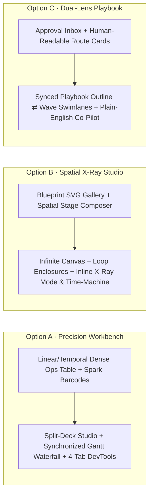

# Workflows App & Generic Task Graph Visualizer/Debugger — UX Teardown & 3 World-Class Proposals

> [!IMPORTANT]
> **Open the 3 Full-Resolution Standalone HTML Prototypes Directly in Your Browser**
> Each prototype is 100% self-contained (zero build/server required), uses authentic `--mj-*` Light & Dark tokens from [_tokens.scss](file:///Users/amith/Dropbox/develop/M5/MJ-worktrees/workflows-ux/packages/Angular/Generic/shared/src/lib/_tokens.scss) with a live Light/Dark toggle, enforces the D18 vocabulary contract (**Workflow · Step · Path · Trigger · Run · Person step**), and lets you interactively click through **all 5 surfaces** (plus the **360px Embedded Debugger** mode):
>
> - **Option A — Precision Operational Workbench & Split-Deck IDE** (*Linear × Temporal Cloud × Chrome DevTools*):
>   [option-a-precision-workbench.html](file:///Users/amith/Dropbox/develop/M5/MJ-worktrees/workflows-ux/plans/workflows-ux-redesign/mockups/option-a-precision-workbench.html) · [Architecture Spec](file:///Users/amith/Dropbox/develop/M5/MJ-worktrees/workflows-ux/plans/workflows-ux-redesign/option-a-spec.md)
> - **Option B — Spatial Infinite Studio & Direct-on-Canvas X-Ray Debugger** (*n8n 2.0 × Figma × Stripe × Raycast*):
>   [option-b-spatial-xray-studio.html](file:///Users/amith/Dropbox/develop/M5/MJ-worktrees/workflows-ux/plans/workflows-ux-redesign/mockups/option-b-spatial-xray-studio.html) · [Architecture Spec](file:///Users/amith/Dropbox/develop/M5/MJ-worktrees/workflows-ux/plans/workflows-ux-redesign/option-b-spec.md)
> - **Option C — Dual-Lens Playbook & Guided Diagnostic Co-Pilot** (*Relay.app × Zapier Central × Notion × Observable*):
>   [option-c-dual-lens-playbook.html](file:///Users/amith/Dropbox/develop/M5/MJ-worktrees/workflows-ux/plans/workflows-ux-redesign/mockups/option-c-dual-lens-playbook.html) · [Architecture Spec](file:///Users/amith/Dropbox/develop/M5/MJ-worktrees/workflows-ux/plans/workflows-ux-redesign/option-c-spec.md)
> - **Full Forensic Audit & Token Snapshot:**
>   [study-and-brief.md](file:///Users/amith/Dropbox/develop/M5/MJ-worktrees/workflows-ux/plans/workflows-ux-redesign/study-and-brief.md)

---

## 1. Ready-to-Build Environment (`origin/next` Worktree + Fresh DB)

| Item | Details |
|---|---|
| **Worktree** | `/Users/amith/Dropbox/develop/M5/MJ-worktrees/workflows-ux` |
| **Branch** | `feat/workflows-ux-redesign` branched cleanly from `origin/next` (`8842ebd978`, upstream unset so `next` is protected; `/Users/amith/Dropbox/develop/M5/MJ` untouched) |
| **Database** | `MJ_Workflows_UX` on Docker SQL Server (`localhost:1433`) — 73 migrations applied through `202611222145` + `RefreshMetadata` |
| **Seeded Data & Roles** | **20 Flow workflows** (15 Active, 5 Disabled including `Schema Documentation Sweep`, `Content Pipeline`, `User Onboarding Flow Agent`, `Demo Flow Agent`, `Betty`, `Podcast To Blog Workflow`); `amith@bluecypress.io` & `da-robot-tester@bluecypress.io` provisioned as `Owner` with `Developer` / `UI` / `Integration` roles and 939/939 CRUD entity permissions |
| **Isolated Dev Ports** | MJAPI on `http://localhost:4001` (`ws://localhost:4001`), MJExplorer `REDIRECT_URI` on `http://localhost:4201/` (zero collision with ports `4000`/`4200`) |
| **Baseline Build & Tests** | `CodeGenLib` + `MJCLI` built locally; `ng-flow-editor` (**143/143**), `ng-task-graph-editor` (**230/230**), and `ng-dashboards` (**3,125/3,125**) unit tests green |

---

## 2. Why Today's Workflows UI Looks Flat & Unfinished (Forensic Summary)

MemberJunction's backend (`@memberjunction/task-graph` + 10 Remote Operations + 14 real-time GraphQL frame types + Saga compensation + AI Decisions + Taint gates + `WorkflowSpecSync` triggers) is **Temporal-grade**. The UI fails to match it for five concrete reasons documented with exact line citations in [study-and-brief.md](file:///Users/amith/Dropbox/develop/M5/MJ-worktrees/workflows-ux/plans/workflows-ux-redesign/study-and-brief.md):

1. **Dead-Token Styling Collapse:** [workflows-dashboard.component.css](file:///Users/amith/Dropbox/develop/M5/MJ-worktrees/workflows-ux/packages/Angular/Explorer/dashboards/src/Workflows/workflows-dashboard.component.css), [create-workflow.component.css](file:///Users/amith/Dropbox/develop/M5/MJ-worktrees/workflows-ux/packages/Angular/Explorer/dashboards/src/Workflows/components/create-workflow.component.css), [workflow-runs-resource.component.css](file:///Users/amith/Dropbox/develop/M5/MJ-worktrees/workflows-ux/packages/Angular/Explorer/dashboards/src/Workflows/components/workflow-runs-resource.component.css), and `task-graph-editor` CSS reference dozens of **hallucinated `--mj-*` variables** (`--mj-color-primary`, `--mj-bg-hover`, `--mj-text-tertiary`, `--mj-font-size-*`, `--mj-font-weight-*`, `--mj-space-sm/md`, `--mj-font-mono`, `--mj-status-error-subtle`) while [flow-toolbar.component.ts](file:///Users/amith/Dropbox/develop/M5/MJ-worktrees/workflows-ux/packages/Angular/Generic/flow-editor/src/lib/components/flow-toolbar.component.ts) and [flow-status-bar.component.ts](file:///Users/amith/Dropbox/develop/M5/MJ-worktrees/workflows-ux/packages/Angular/Generic/flow-editor/src/lib/components/flow-status-bar.component.ts) hardcode light-mode `#ffffff` / `#f8fafc` hex. Hover states, active borders, status colors, and typography hierarchy silently collapse.
2. **App Ejection & Split-Brain Incomplete Editors:** Clicking any workflow in [workflows-dashboard.component.ts](file:///Users/amith/Dropbox/develop/M5/MJ-worktrees/workflows-ux/packages/Angular/Explorer/dashboards/src/Workflows/workflows-dashboard.component.ts#L202-L204) kicks users out to `OpenEntityRecord('MJ: AI Agents', ...)`. Inside `AI Agents`, `mj-flow-agent-editor` lacks `Human` (Person) steps completely, whereas `mj-task-graph-editor` only authors 3 step types with an 86-line stub panel. Meanwhile `CreateWorkflowComponent` promises *"Nothing is saved until you approve it"* yet immediately calls `Workflow.Save` without showing a preview and silently drops `SourceRunID` when promoting a past run!
3. **Canvas Rendering & Geometry Bugs:**
   - [flow-node.component.ts](file:///Users/amith/Dropbox/develop/M5/MJ-worktrees/workflows-ux/packages/Angular/Generic/flow-editor/src/lib/components/flow-node.component.ts#L95) checks `'ForEach' | 'While'` while [task-graph-canvas-adapter.ts](file:///Users/amith/Dropbox/develop/M5/MJ-worktrees/workflows-ux/packages/Angular/Generic/task-graph-editor/src/lib/task-graph-canvas-adapter.ts#L50) emits `'ForEachTask' | 'WhileTask'` — so loop cards never render in Run View.
   - `TaskGraphRunView` runs Left-to-Right (`LR`) layout with hardcoded `top`/`bottom` ports (producing awkward vertical S-curves), only supports 1 input + 1 output port per node, and deletes edges connected to `Skipped` nodes (orphaning skipped branches on the canvas).
4. **Runs Console Layout & Filter Bugs:** `.wfr-graph-pane` is a non-flex container giving `<mj-task-graph-debugger Height="100%">`, clipping the replay scrubber, breakpoint bar, and engine tick strip off-screen; the `'Running'` filter misses active `'In Progress'` rows; `Step('one')` / `Step('wave')` are mislabeled `"Over"` / `"Into"`; and `LiveActivity` (`NodeProgress`) is captured in memory but never rendered on running nodes.
5. **15 Built Backend Superpowers Currently Hidden:** Targeted per-step `Step(taskID)`, Saga Compensation (`CompensatesTaskID` reverse rollback + Person escalation), `NodeProgress` streaming bars, AI Decision confidence thresholds, Security Taint + Person verification, `WorkflowSpecSync` schedules & entity events + `<mj-agent-invocations>` 6-source inverse index, visual `ComputeTasksToBlock` blast-radius preview, `ForEach`/`While` concurrency telemetry, `RememberedBreakpoints`, and interactive `ReplayAt` time-travel scrubbing.

---

## 3. Three Divergent World-Class UX Proposals (Across All 5 Areas)

### Executive Philosophy Comparison

| Dimension | Option A: Precision Operational Workbench | Option B: Spatial Infinite Studio & X-Ray Canvas | Option C: Dual-Lens Playbook & Guided Co-Pilot |
|---|---|---|---|
| **North-Star Inspiration** | **Linear · Temporal Cloud · Chrome/VS Code DevTools · Retool** | **n8n 2.0 · Figma · Stripe Workbench · Apple/Raycast** | **Relay.app · Zapier Central · Notion · Observable** |
| **Core Thesis** | Workflows are mission-critical ops infrastructure — maximize scannability, telemetry density, waterfall timing correlation, and IDE-grade split-deck debugging. | **The Canvas IS the Product** — eliminate nested splitters in favor of spatial topology, enclosed loop frames, inline `+` port quick-add, and direct-on-canvas X-Ray debugging. | **Readable as a Playbook, Inspectable as a Pathway** — synchronize a human-readable SOP outline 1:1 with Wave swimlanes, putting Person approvals & plain-English diagnostics first. |
| **Primary Persona Fit** | Power builders, AI/platform engineers, SRE/ops leads managing 15–100+ live workflows. | Visual systems thinkers, product builders, and technical/ops hybrid teams. | Citizen builders, RevOps/Legal/Domain leads (`WORKFLOWS_FOR_BUSINESS_USERS.md`) collaborating with engineers. |
| **Key Tradeoff** | Dense multi-pane power requires collapsible rails/docks so casual users aren't overwhelmed. | Prioritizes spatial comprehension over dense multi-row spreadsheet comparison (mitigated by list toggle & pinnable sheet). | Structured Playbook + Stage/Wave columns take precedence over freeform 2D pixel placement. |

---

### Area-by-Area Breakdown Across All 5 Surfaces

| Surface | Option A (Precision Workbench) | Option B (Spatial X-Ray Studio) | Option C (Dual-Lens Playbook) |
|---|---|---|---|
| **1. Workflows Catalog (Home)** | **Linear Ops Table** (+ Card toggle): squircle icon, inline `Action → While → Person` micro-chain, real Trigger pills + `+N entry points` popover, **10-run health barcode**, `p50` latency, inline `▶ Run` / `🐞 Debug` / `Edit`. | **Visual Blueprint Gallery** (+ List toggle): 146px **miniature SVG topology stage** on every card (visually showing loops, diamond forks, Person gates, Saga arcs), SVG health ring, hover `Run` / `X-Ray` / `Open Studio`. | **Playbook Hub + Decision Inbox**: collapsible top **Needs Your Decision** inbox for pending Person approvals, plus Playbook cards with **plain-English route summaries**, reliability badges, and 1-click **Run with Inputs** form modal. |
| **2. Create Front Door & AI Co-Drafting** | **Split-Screen Live Compiler**: 3 doors (`Describe`, `Past Run` w/ real step counts, `Blank`) + recipe chips + iterative follow-up prompt on left; live compiled step topology + inferred I/O contract on right before saving. | **Spatial Prompt-to-Canvas Stage**: glassmorphic 3-mode composer floating over a live dotted stage; steps animate onto the canvas, click blocks on-stage to tweak or refine via AI chips before `Approve & Enter Studio`. | **Conversational SOP Co-Author**: co-drafts numbered **Interactive Playbook blocks** with clickable **Mad-Lib parameter pills** (`up to [3 times]`, `Ask [VP Ops]`), switchable to Pathway diagram preview before saving. |
| **3. In-App Workflow Studio** | **IDE Workbench**: `Canvas \| Step Table \| Triggers \| Runs` header, collapsible `⌘K` 7-kind palette, LR adaptive-port canvas, docked **4-Tab Inspector** (`Setup`, `Data Mapping` w/ `{{ var }}` pills, `Branching`, `Retry & Saga`). | **Zero-Clutter Infinite Canvas**: **Trigger Root Cards** on far left of canvas, **true spatial `ForEach`/`While` Loop Enclosures**, multi-port AI Decision cards, inline `+` port/midpoint quick-insert popover, floating/pinnable inspector, `LR ⇄ TB` HUD. | **Synchronized Dual-Lens (`Playbook ⇄ Diagram`)**: edit as collapsible Notion/Relay SOP blocks (indented loops, side-by-side branch columns, `@Step.Output` pills, zero JSON) locked 1:1 in scroll/selection sync with Stage diagram + Triggers tab. |
| **4. Workflow Runs Triage Hub** | **Collapsible Rail + Dual-Sync Waterfall**: `284px` collapsible run rail + **Workflow Canvas (top)** bidirectionally synced with an **Execution Waterfall / Gantt Timeline (bottom)** (`0s–50s` parallel wave spans). | **Timeline Triage → Full-Bleed Flight Deck**: top Needs Attention cards + segmented-bar Run cards; clicking a run enters a **90%+ viewport Spatial Flight Deck** with a floating top-left **Run Switcher pill**. | **Execution Story & Approval Desk**: collapsible run rail + **Inline Person Step Approval Card** (approve checklist & clear taint right in Runs!) above a chronological Execution Story, `Re-run`, and `Save as New Workflow`. |
| **5. Generic `<mj-task-graph-debugger>`** *(Full Console + 360px Embed)* | **Split-Deck DevTools**: DAG VCR (`Continue F5`, `Step Next F10`, `Step Wave F11`), Engine Pulse popover, gutter single/remembered breakpoints, live `NodeProgress`, Blast-Radius toggle, Wave-tick Replay Scrubber, **4-tab DevTools Dock** (`I/O Diff`, `Verdicts`, `Interventions`, `Frame Stream`). | **Direct-on-Canvas X-Ray & Time-Machine**: flip **X-Ray Mode (`X`)** to expand live I/O diffs, Decision confidence meters, Taint/Verified shields, and `[▶ Run Step]` / `[✋ Answer Yes/No]` **directly on canvas cards & paths**, plus reverse **Saga Rollback Arcs** & floating **Time-Machine Dock**. | **Wave Swimlanes & Plain-English Co-Pilot**: explicit **`Wave 1 → Wave 2 → Wave 3` columns** (making `Step Wave` self-evident!), top **Guided Diagnostic Co-Pilot Banner** translating `held` / `heartbeat-lost` / `taint` / `saga` into 1-click fixes, and **Before ⇄ After Payload Diff**. |

---

## 4. Opinionated Recommendation ("Best-of-Breed Synthesis")

> [!TIP]
> **Recommended Direction: Anchor on Option B's Spatial Canvas & Node/Loop Craft + Layer in Option C's Dual-Lens Playbook & Co-Pilot Banner + Option A's Synchronized Gantt Waterfall & DevTools Diff Dock.**

Why **Option B as the structural spine** with **targeted transplants from C and A** produces an unmistakable category-leader for MemberJunction:

1. **Option B makes the Generic Canvas (`@memberjunction/ng-flow-editor` + `@memberjunction/ng-task-graph-editor`) world-class everywhere it's embedded:**
   - **True Spatial Loop Enclosures** (`ForEach` / `While`), **Multi-Port AI Decision cards**, **Inline `+` Port/Midpoint Quick-Insert**, **Trigger Root Cards on the canvas**, **X-Ray inline telemetry**, and **Blueprint Mini-SVG Previews** immediately banish the "crappy flat list / clunky boxes" feel on sight.
2. **Borrowing 2 signature ideas from Option C makes MJ uniquely accessible to Business Users (`WORKFLOWS_FOR_BUSINESS_USERS.md`):**
   - **Playbook Lens Toggle in Studio** (`Canvas | Split Playbook | Triggers`): lets citizen builders read and edit a workflow as a clean Relay-style numbered SOP with `@Step.Output` pills while keeping the spatial canvas synchronized.
   - **Plain-English Diagnostic Co-Pilot Banner + Inline Person Approval Desk** in Runs/Debugger: turns cryptic `GateDecision: held` / `heartbeat-lost` / `TAINTED_EGRESS_BLOCKED` states into 1-sentence human explanations with 1-click recovery buttons.
3. **Borrowing 2 signature ideas from Option A gives Engineers surgical precision:**
   - **Collapsible Bottom Execution Waterfall / Time-Travel Scrubber + Input ⇄ Output Diff Tab**: correlates parallel wave timing (`0s–50s`) with the spatial graph and shows exact JSON key diffs without cluttering the canvas when collapsed.
   - **10-Run Health Spark-Barcodes** in the Catalog's Compact Table mode.

---

## 5. Decisions for Phase Gate Approval

Once you open the three `file://` prototypes in your browser, let me know:
1. **Which base direction wins for you** (`Option A`, `Option B`, `Option C`, or the **Recommended B + C/A Hybrid** above)?
2. **Any specific interactions from the other two** you definitely want folded in (or left out) before we lock `design-plan.md` and unleash `Gemini 4 Neon (High)` sub-agents to build it piece-by-piece in `/Users/amith/Dropbox/develop/M5/MJ-worktrees/workflows-ux`?
